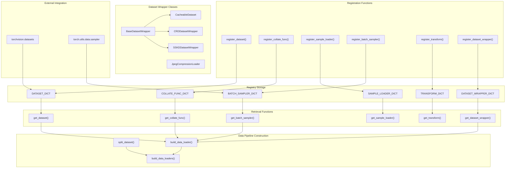
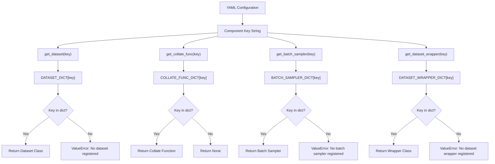
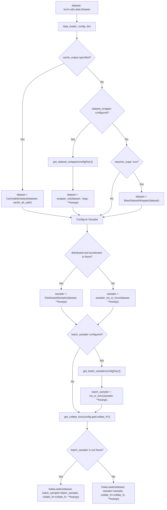
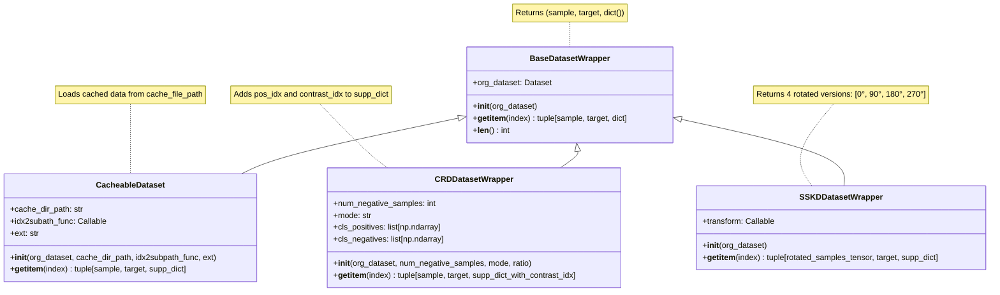

<!-- source: DeepWiki mcp.deepwiki.com · repo yoshitomo-matsubara/torchdistill · page 3.1 Dataset Management · fetched 2026-10-21 -->

# Dataset Management

<details>
<summary>Relevant source files</summary>

The following files were used as context for generating this wiki page:

- [tests/registry_test.py](tests/registry_test.py)
- [torchdistill/datasets/__init__.py](torchdistill/datasets/__init__.py)
- [torchdistill/datasets/registry.py](torchdistill/datasets/registry.py)
- [torchdistill/datasets/sample_loader.py](torchdistill/datasets/sample_loader.py)
- [torchdistill/datasets/util.py](torchdistill/datasets/util.py)
- [torchdistill/datasets/wrapper.py](torchdistill/datasets/wrapper.py)

</details>


The dataset management system in torchdistill provides a comprehensive framework for handling datasets, data loaders, transformations, and specialized dataset wrappers. This system supports the configuration-driven approach of the framework by providing registration mechanisms for all dataset-related components and utilities for constructing data pipelines from YAML configurations.

For information about how datasets integrate with the training framework, see [Core Architecture](#2). For specific dataset examples and configurations, see [Examples and Usage](#4).

## System Overview

Dataset Management Architecture

The dataset management system consists of several interconnected components that work together to provide flexible data handling capabilities:



**Sources:** [torchdistill/datasets/registry.py:5-10](), [torchdistill/datasets/registry.py:16-266](), [torchdistill/datasets/registry.py:269-359](), [torchdistill/datasets/util.py:14-143](), [torchdistill/datasets/wrapper.py:27-159](), [torchdistill/datasets/sample_loader.py:11-31]()

## Dataset Registration System

The registration system provides a centralized mechanism for registering and retrieving dataset-related components. This system supports the framework's configuration-driven approach by allowing components to be referenced by string keys in YAML files.

### Registration Decorators and Storage

The system uses decorator-based registration with centralized storage dictionaries:

| Component Type | Registration Decorator | Storage Dictionary | Getter Function |
|---|---|---|---|
| Datasets | `@register_dataset` | `DATASET_DICT` | `get_dataset()` |
| Collate Functions | `@register_collate_func` | `COLLATE_FUNC_DICT` | `get_collate_func()` |
| Sample Loaders | `@register_sample_loader` | `SAMPLE_LOADER_DICT` | `get_sample_loader()` |
| Batch Samplers | `@register_batch_sampler` | `BATCH_SAMPLER_DICT` | `get_batch_sampler()` |
| Transforms | `@register_transform` | `TRANSFORM_DICT` | `get_transform()` |
| Dataset Wrappers | `@register_dataset_wrapper` | `DATASET_WRAPPER_DICT` | `get_dataset_wrapper()` |

The registration system automatically populates dictionaries with components from external libraries:
- `DATASET_DICT` includes all classes from `torchvision.datasets`
- `BATCH_SAMPLER_DICT` includes all classes from `torch.utils.data.sampler`

**Sources:** [torchdistill/datasets/registry.py:16-266](), [torchdistill/datasets/registry.py:12-13](), [torchdistill/datasets/registry.py:269-359]()

### Dynamic Component Retrieval

Component Resolution Flow



**Sources:** [torchdistill/datasets/registry.py:269-282](), [torchdistill/datasets/registry.py:285-298](), [torchdistill/datasets/registry.py:317-331](), [torchdistill/datasets/registry.py:348-359]()

## Data Loader Construction

The data loader construction system provides a unified interface for creating PyTorch `DataLoader` instances with complex configurations including dataset wrappers, samplers, and distributed training support.

### Data Loader Construction Workflow

build_data_loader() Process Flow



**Sources:** [torchdistill/datasets/util.py:69-119](), [torchdistill/datasets/util.py:84-98](), [torchdistill/datasets/util.py:105-119]()

### Configuration Options

The `build_data_loader()` function supports comprehensive configuration through the `data_loader_config` parameter:

| Configuration Key | Purpose | Default Behavior |
|---|---|---|
| `cache_output` | Directory for cached data | No caching |
| `dataset_wrapper` | Wrapper configuration | No wrapper |
| `requires_supp` | Enable supplementary dict | Disabled |
| `sampler` | Sampler configuration | DistributedSampler if distributed |
| `batch_sampler` | Batch sampler configuration | No batch sampler |
| `collate_fn` | Collate function key | Default collate |
| `kwargs` | DataLoader kwargs | Required |

**Sources:** [torchdistill/datasets/util.py:84-119]()

## Dataset Splitting

The `split_dataset()` function provides utilities for splitting datasets into training and validation subsets with support for deterministic splits and per-subset transformations.

### Splitting Process

The function supports both simple ratio-based splitting and complex multi-subset configurations:

1. **Length Calculation**: Converts ratios to absolute lengths based on dataset size
2. **Random Splitting**: Uses `torch.utils.data.random_split` with optional seed
3. **Transform Application**: Applies independent transforms to each subset
4. **Deep Copying**: Ensures independent dataset instances for each subset

**Sources:** [torchdistill/datasets/util.py:14-66](), [torchdistill/datasets/util.py:43-44](), [torchdistill/datasets/util.py:48-66]()

### Configuration Parameters

| Parameter | Type | Purpose |
|---|---|---|
| `lengths` | `list[int]` | Split ratios (default: `(9, 1)`) |
| `generator_seed` | `int` | Random seed for reproducible splits |
| `sub_splits_configs` | `list[dict]` | Per-subset configurations |
| `dataset_id` | `str` | Identifier for logging |

**Sources:** [torchdistill/datasets/util.py:20-29]()

## Dataset Wrappers

The dataset wrapper system provides specialized dataset classes for different knowledge distillation methods and data handling requirements.

### Wrapper Hierarchy

Dataset Wrapper Class Structure



**Sources:** [torchdistill/datasets/wrapper.py:27-43](), [torchdistill/datasets/wrapper.py:45-73](), [torchdistill/datasets/wrapper.py:76-134](), [torchdistill/datasets/wrapper.py:137-159]()

### Specialized Wrappers

#### CRDDatasetWrapper
Implements Contrastive Representation Distillation by providing positive and negative sample indices for contrastive learning. The wrapper pre-computes class-wise positive and negative sample indices and provides them through the supplementary dictionary.

#### SSKDDatasetWrapper
Supports Self-Supervised Knowledge Distillation by generating four rotated versions (0°, 90°, 180°, 270°) of each input sample. This enables self-supervised pretext tasks during knowledge distillation.

#### CacheableDataset
Provides transparent caching functionality by checking for cached versions of samples in a specified directory and loading them when available. Uses configurable path generation functions for flexible cache organization.

**Sources:** [torchdistill/datasets/wrapper.py:76-134](), [torchdistill/datasets/wrapper.py:137-159](), [torchdistill/datasets/wrapper.py:45-73]()

## Sample Loaders and Transforms

The system includes specialized sample loaders for preprocessing data during loading. Sample loaders are registered using the `@register_sample_loader` decorator and can be retrieved via `get_sample_loader()`.

### JpegCompressionLoader

The `JpegCompressionLoader` class demonstrates the pattern for implementing custom loading behavior. It applies JPEG compression during image loading, useful for studying the effects of compression on model performance:

| Parameter | Type | Purpose |
|---|---|---|
| `jpeg_quality` | `int` or `None` | Quality parameter for JPEG compression (1-100) |

The loader follows this process:
1. Opens image file as PIL Image with RGB conversion
2. If `jpeg_quality` is specified, compresses image to JPEG format in memory
3. Reloads compressed image from memory buffer
4. Returns processed PIL Image

```python
# Usage example in configuration
sample_loader:
  key: 'JpegCompressionLoader'
  kwargs:
    jpeg_quality: 75
```

**Sources:** [torchdistill/datasets/sample_loader.py:11-31](), [torchdistill/datasets/registry.py:101-140]()

## Integration with Configuration System

The dataset management system integrates seamlessly with torchdistill's configuration-driven architecture. All components can be specified in YAML configuration files using their registered keys, enabling complete specification of data pipelines without code modification.

### Configuration Example Structure

```yaml
datasets:
  train_dataset:
    name: 'CIFAR10'  # Registered dataset key
    params:
      root: './data'
      train: true
    transforms:
      - name: 'RandomHorizontalFlip'  # Registered transform key
      - name: 'ToTensor'

data_loaders:
  - dataset_id: 'train_dataset'
    dataset_wrapper:
      key: 'CRDDatasetWrapper'  # Registered wrapper key
      kwargs:
        num_negative_samples: 16384
        mode: 'exact'
        ratio: 1.0
    sampler:
      class_or_func: 'RandomSampler'
    kwargs:
      batch_size: 32
      num_workers: 4
```

This configuration demonstrates how the registry system enables declarative specification of complex data pipelines, maintaining the framework's principle of configuration-driven experimentation.

**Sources:** [torchdistill/datasets/registry.py:16-55](), [torchdistill/datasets/util.py:122-143]()

---

