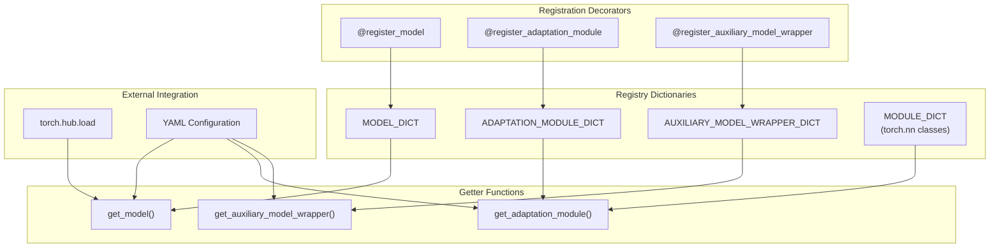
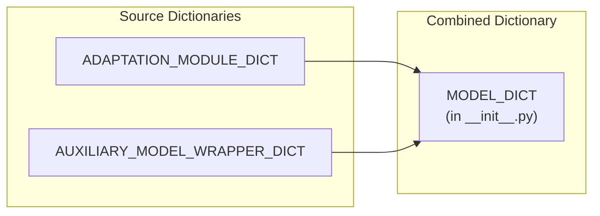
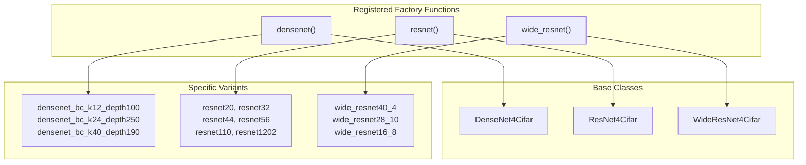
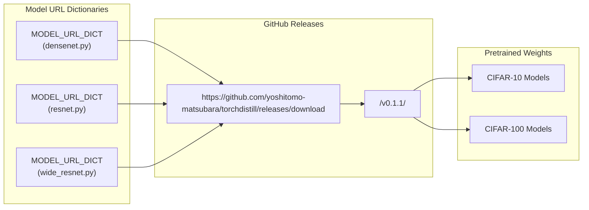
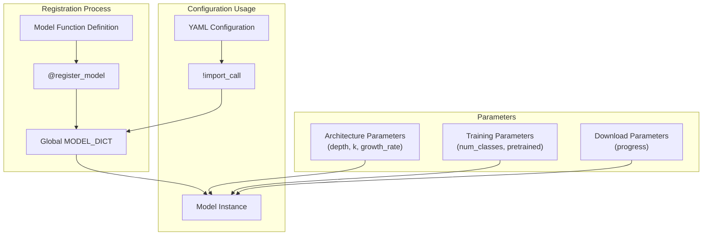

<!-- source: DeepWiki mcp.deepwiki.com · repo yoshitomo-matsubara/torchdistill · page 3.2 Model Architectures · fetched 2026-10-21 -->

# Model Architectures

<details>
<summary>Relevant source files</summary>

The following files were used as context for generating this wiki page:

- [torchdistill/models/__init__.py](torchdistill/models/__init__.py)
- [torchdistill/models/classification/__init__.py](torchdistill/models/classification/__init__.py)
- [torchdistill/models/classification/densenet.py](torchdistill/models/classification/densenet.py)
- [torchdistill/models/classification/resnet.py](torchdistill/models/classification/resnet.py)
- [torchdistill/models/classification/wide_resnet.py](torchdistill/models/classification/wide_resnet.py)
- [torchdistill/models/registry.py](torchdistill/models/registry.py)

</details>


This document covers the model architectures and components implemented in torchdistill. The framework provides three types of model components: standard models, adaptation modules, and auxiliary model wrappers. Each component type has its own registration system for dynamic instantiation through configuration files. For information about how these components integrate with the training pipeline, see [Training and Distillation Framework](#2.2). For loss functions used with these models, see [Loss Functions](#3.3).

## Model Registry System

The model registry system provides three separate registries for different types of model components. Each registry uses decorators for registration and provides corresponding getter functions for instantiation.

### Three-Part Registry Architecture



Sources: [torchdistill/models/registry.py:5-8](), [torchdistill/models/registry.py:11-51](), [torchdistill/models/registry.py:54-94](), [torchdistill/models/registry.py:97-137]()

### Combined Model Dictionary

The framework also creates a combined model dictionary that merges adaptation modules and auxiliary model wrappers for unified access:



Sources: [torchdistill/models/__init__.py:4-7]()

## Classification Models

The framework implements three major CNN architectures optimized for CIFAR datasets. Each provides both flexible base classes and specific pretrained variants registered through the `@register_model` decorator.

### Model Architecture Overview



Sources: [torchdistill/models/classification/densenet.py:21-43](), [torchdistill/models/classification/resnet.py:22-45](), [torchdistill/models/classification/wide_resnet.py:61-80]()

### DenseNet Architecture

The `DenseNet4Cifar` class implements DenseNet-BC (Bottleneck and Compression) for CIFAR datasets. Key features include:

| Component | Description |
|-----------|-------------|
| Growth Rate | Number of filters added per layer (`k` parameter) |
| Block Configuration | Tuple defining layers per dense block |
| Bottleneck Layers | 1x1 convolutions for dimension reduction |
| Transition Layers | Between dense blocks for downsampling |

The implementation uses torchvision's `_DenseBlock` and `_Transition` components but adapts the initial convolution layer for CIFAR's 32x32 input size.

**Registered Variants:**
- `densenet_bc_k12_depth100`: k=12, depth=100
- `densenet_bc_k24_depth250`: k=24, depth=250  
- `densenet_bc_k40_depth190`: k=40, depth=190

Sources: [torchdistill/models/classification/densenet.py:21-105](), [torchdistill/models/classification/densenet.py:157-210]()

### ResNet Architecture

The `ResNet4Cifar` class adapts the standard ResNet architecture for CIFAR datasets with the following modifications:

| Modification | Purpose |
|--------------|---------|
| Initial conv layer | 3x3 kernel, stride=1, padding=1 (vs 7x7, stride=2) |
| No max pooling | After initial conv layer |
| Smaller input planes | 16 instead of 64 |
| Final avg pooling | 8x8 kernel for CIFAR dimensions |

The depth formula is `depth = 6n + 2` where `n` is the number of blocks per layer.

**Registered Variants:**
- `resnet20`, `resnet32`, `resnet44`, `resnet56`, `resnet110`, `resnet1202`

Sources: [torchdistill/models/classification/resnet.py:22-139](), [torchdistill/models/classification/resnet.py:177-288]()

### Wide ResNet Architecture

The `WideResNet4Cifar` class implements Wide Residual Networks with configurable width multiplier `k`:

| Parameter | Description |
|-----------|-------------|
| `depth` | Network depth (must satisfy `(depth-4) % 6 == 0`) |
| `k` | Width multiplier for feature maps |
| `dropout_p` | Dropout rate in residual blocks |

The `WideBasicBlock` includes batch normalization before convolutions and optional dropout.

**Registered Variants:**
- `wide_resnet40_4`: depth=40, k=4
- `wide_resnet28_10`: depth=28, k=10
- `wide_resnet16_8`: depth=16, k=8

Sources: [torchdistill/models/classification/wide_resnet.py:22-128](), [torchdistill/models/classification/wide_resnet.py:171-231]()

## Pretrained Models

The framework provides pretrained models hosted on GitHub releases. Each model file includes URL mappings and automatic downloading.

### Pretrained Model URLs



Sources: [torchdistill/models/classification/densenet.py:14-18](), [torchdistill/models/classification/resnet.py:12-19](), [torchdistill/models/classification/wide_resnet.py:11-19]()

### Model Loading Mechanism

All registered model functions support pretrained weights through a consistent interface:

```python
# Model loading pattern used across all architectures
if pretrained and model_key in MODEL_URL_DICT:
    state_dict = torch.hub.load_state_dict_from_url(MODEL_URL_DICT[model_key], progress=progress)
    model.load_state_dict(state_dict)
elif pretrained:
    logger.warning(f'`pretrained` = True, but pretrained {model_key} model is not available')
```

The `model_key` format follows the pattern: `cifar{num_classes}-{model_name}_{parameters}`

**Available Pretrained Models:**
- DenseNet-BC: k12_depth100 (CIFAR-10/100)
- ResNet: depth 20, 32, 44, 56, 110 (CIFAR-10 only)
- Wide ResNet: 40_4, 28_10, 16_8 (CIFAR-10/100)

Sources: [torchdistill/models/classification/densenet.py:148-153](), [torchdistill/models/classification/resnet.py:169-174](), [torchdistill/models/classification/wide_resnet.py:163-168]()

## Model Registration and Instantiation

The registration system enables seamless integration with the configuration-driven framework:



Sources: [torchdistill/models/classification/densenet.py:107-153](), [torchdistill/models/classification/resnet.py:141-174](), [torchdistill/models/classification/wide_resnet.py:130-168]()

---

