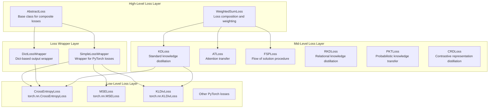
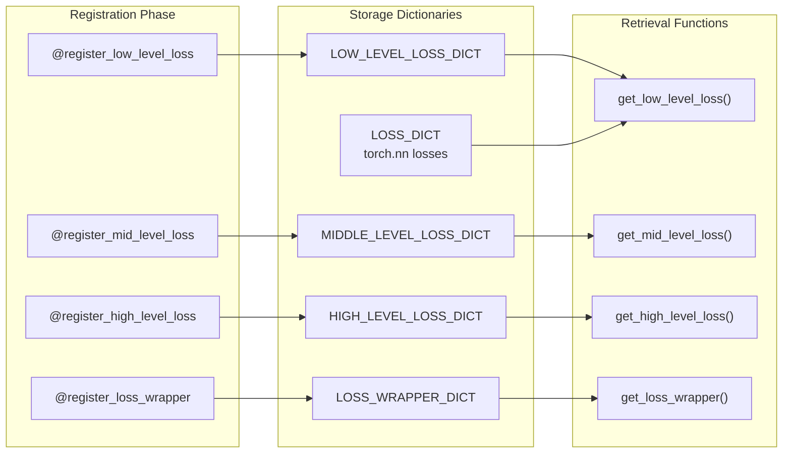
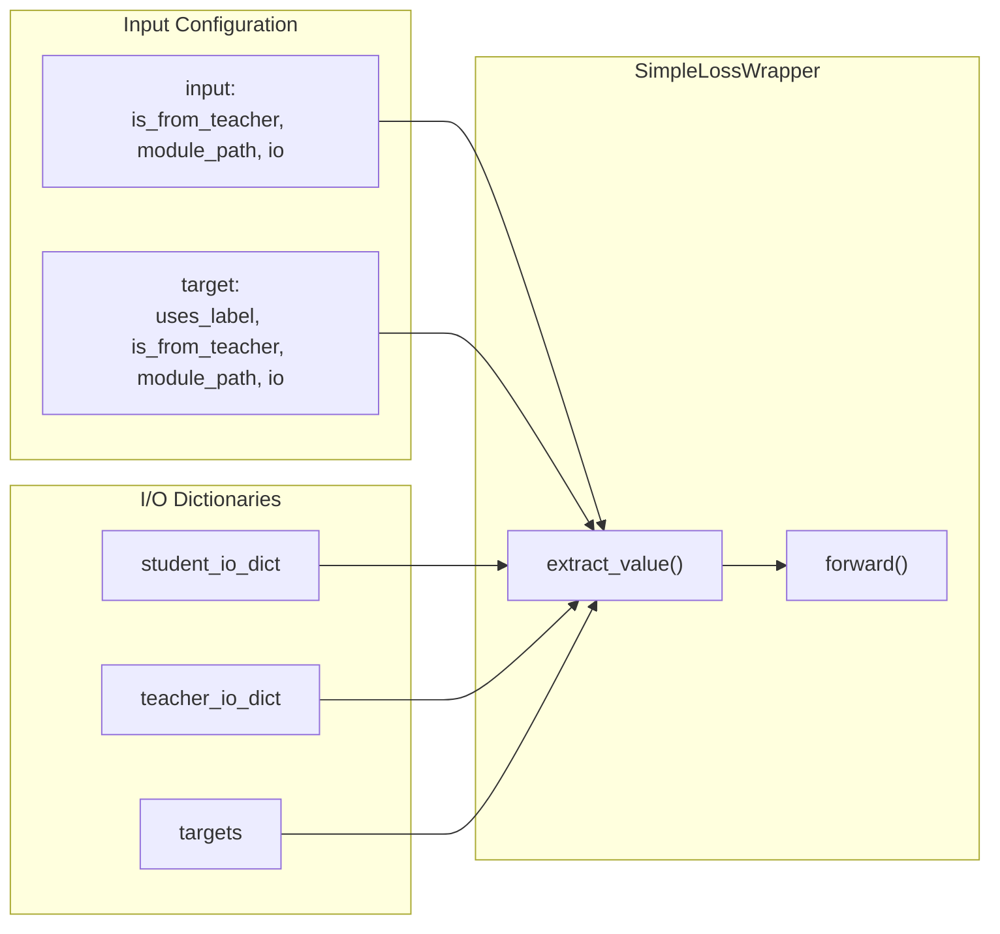
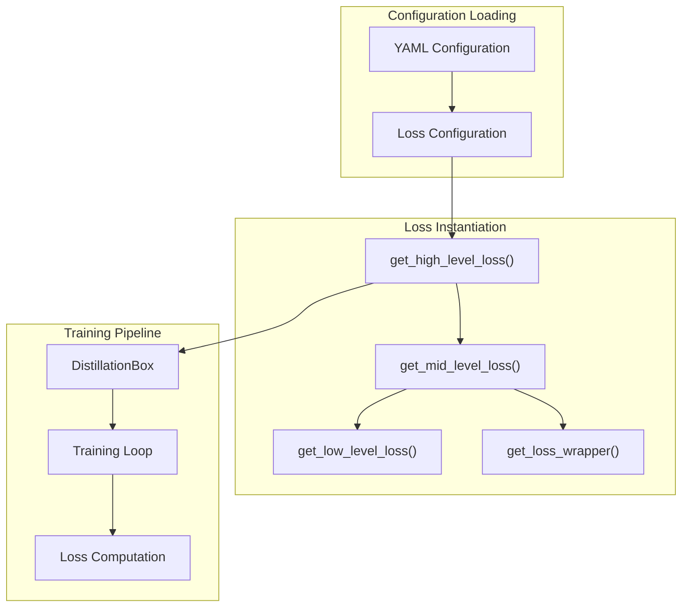

<!-- source: DeepWiki mcp.deepwiki.com · repo yoshitomo-matsubara/torchdistill · page 3.3 Loss Functions · fetched 2026-10-21 -->

# Loss Functions

<details>
<summary>Relevant source files</summary>

The following files were used as context for generating this wiki page:

- [configs/sample/ilsvrc2012/kd_w_ls/resnet18_from_resnet34.yaml](configs/sample/ilsvrc2012/kd_w_ls/resnet18_from_resnet34.yaml)
- [configs/sample/ilsvrc2012/kr/resnet18_from_resnet34.yaml](configs/sample/ilsvrc2012/kr/resnet18_from_resnet34.yaml)
- [examples/legacy/hf_transformers/custom/loss.py](examples/legacy/hf_transformers/custom/loss.py)
- [torchdistill/losses/__init__.py](torchdistill/losses/__init__.py)
- [torchdistill/losses/high_level.py](torchdistill/losses/high_level.py)
- [torchdistill/losses/mid_level.py](torchdistill/losses/mid_level.py)
- [torchdistill/losses/registry.py](torchdistill/losses/registry.py)
- [torchdistill/losses/util.py](torchdistill/losses/util.py)

</details>


This document covers the loss function subsystem in torchdistill, which provides a comprehensive framework for implementing and composing loss functions for knowledge distillation and standard training. The system includes a hierarchical registry-based architecture supporting low-level PyTorch losses, mid-level knowledge distillation losses, and high-level loss composition mechanisms.

For information about the core training and distillation pipeline that uses these loss functions, see [Training and Distillation Framework](#2.2). For details about the component registry pattern used throughout the system, see [Component Registry System](#2.3).

## Loss Function Architecture

The torchdistill loss system follows a three-tier hierarchical architecture that enables flexible composition and reuse of loss components:

### Loss Function Hierarchy



**Sources:** [torchdistill/losses/high_level.py:9-101](), [torchdistill/losses/mid_level.py:1-998](), [torchdistill/losses/registry.py:1-318]()

## Registry System

The loss function registry system provides a unified interface for registering and retrieving loss components at different levels:

### Loss Registry Architecture



**Sources:** [torchdistill/losses/registry.py:11-51](), [torchdistill/losses/registry.py:54-94](), [torchdistill/losses/registry.py:97-137](), [torchdistill/losses/registry.py:140-180]()

### Registry Interface

The registry system provides decorator-based registration for each loss level:

| Registry Level | Decorator | Storage Dict | Getter Function |
|---|---|---|---|
| Low-level | `@register_low_level_loss` | `LOW_LEVEL_LOSS_DICT` | `get_low_level_loss()` |
| Mid-level | `@register_mid_level_loss` | `MIDDLE_LEVEL_LOSS_DICT` | `get_mid_level_loss()` |
| High-level | `@register_high_level_loss` | `HIGH_LEVEL_LOSS_DICT` | `get_high_level_loss()` |
| Wrapper | `@register_loss_wrapper` | `LOSS_WRAPPER_DICT` | `get_loss_wrapper()` |

**Sources:** [torchdistill/losses/registry.py:3-8](), [torchdistill/losses/registry.py:225-318]()

## Loss Hierarchy Components

### Low-Level Losses

Low-level losses include standard PyTorch loss functions and custom implementations that operate on raw tensors. The system automatically includes all `torch.nn` loss modules and allows registration of custom low-level losses.

**Sources:** [torchdistill/losses/registry.py:3](), [torchdistill/losses/registry.py:225-238]()

### Mid-Level Knowledge Distillation Losses

Mid-level losses implement specific knowledge distillation algorithms and operate on teacher-student I/O dictionaries:

#### Core Knowledge Distillation Loss

The `KDLoss` class implements the standard knowledge distillation approach:

```python
# Standard KD loss formula: L_KD = α * L_CE + (1-α) * τ² * L_KL
```

**Key Parameters:**
- `temperature`: Softening parameter τ for probability distributions
- `alpha`: Weight for cross-entropy loss
- `beta`: Weight for KL divergence loss (default: 1-α)

**Sources:** [torchdistill/losses/mid_level.py:129-180]()

#### Attention Transfer Losses

Multiple attention-based knowledge transfer methods are implemented:

| Loss Class | Method | Key Features |
|---|---|---|
| `ATLoss` | Attention Transfer | Transfers attention maps between teacher-student layers |
| `FSPLoss` | Flow of Solution Procedure | Uses FSP matrix for layer-wise knowledge transfer |
| `RKDLoss` | Relational Knowledge Distillation | Preserves relational information between samples |

**Sources:** [torchdistill/losses/mid_level.py:182-263](), [torchdistill/losses/mid_level.py:265-346](), [torchdistill/losses/mid_level.py:549-632]()

#### Feature-Based Distillation

Advanced feature distillation methods:

| Loss Class | Method | Application |
|---|---|---|
| `VIDLoss` | Variational Information Distillation | Probabilistic feature matching |
| `PKTLoss` | Probabilistic Knowledge Transfer | Cosine similarity-based transfer |
| `CRDLoss` | Contrastive Representation Distillation | Contrastive learning for KD |

**Sources:** [torchdistill/losses/mid_level.py:635-698](), [torchdistill/losses/mid_level.py:349-417](), [torchdistill/losses/mid_level.py:825-998]()

### High-Level Loss Composition

High-level losses enable composition and weighting of multiple loss terms:

#### WeightedSumLoss

The `WeightedSumLoss` class implements weighted linear combination of losses:

```
L_total = W_model * (∑L_model,i) + ∑W_sub,k * L_sub,k
```

**Configuration Structure:**
- `model_term`: Model-driven loss configuration with weight
- `sub_terms`: Dictionary of sub-loss configurations with individual weights

**Sources:** [torchdistill/losses/high_level.py:56-101]()

### Loss Wrappers

Loss wrappers adapt PyTorch loss functions for use in torchdistill's I/O dictionary system:

#### SimpleLossWrapper

Basic wrapper for standard PyTorch losses:



**Sources:** [torchdistill/losses/mid_level.py:19-72]()

#### DictLossWrapper

Extended wrapper for models with dictionary outputs:

**Key Features:**
- Supports weighted combination of multiple output keys
- Useful for models like DeepLabV3 with main and auxiliary outputs
- Inherits from `SimpleLossWrapper`

**Sources:** [torchdistill/losses/mid_level.py:74-127]()

## Knowledge Distillation Loss Implementations

### Comprehensive KD Loss Catalog

The framework includes implementations of major knowledge distillation methods:

| Category | Methods | Loss Classes |
|---|---|---|
| **Response-based** | Standard KD, LogitStdKD | `KDLoss`, `LogitStdKDLoss` |
| **Feature-based** | AT, FSP, FT, VID | `ATLoss`, `FSPLoss`, `FTLoss`, `VIDLoss` |
| **Relation-based** | RKD, PKT, SPKD | `RKDLoss`, `PKTLoss`, `SPKDLoss` |
| **Contrastive** | CRD | `CRDLoss` |
| **Activation** | DAB | `AltActTransferLoss` |
| **Structural** | SSKD, CCKD | `SSKDLoss`, `CCKDLoss` |

**Sources:** [torchdistill/losses/mid_level.py:129-998]()

### Feature Pair Configuration

Many KD losses use feature pair configurations to specify teacher-student layer mappings:

```yaml
# Example feature pair configuration
feature_pairs:
  pair1:
    teacher:
      io: 'output'
      path: 'layer3'
    student:
      io: 'output'
      path: 'layer3'
    weight: 1.0
```

**Sources:** [torchdistill/losses/mid_level.py:272-305]()

## Loss Configuration

### YAML-Based Loss Configuration

Loss functions are configured through YAML files using the registry system:

```yaml
criterion:
  key: 'WeightedSumLoss'
  kwargs:
    sub_terms:
      ce:
        criterion:
          key: 'CrossEntropyLoss'
          kwargs:
            reduction: 'mean'
        criterion_wrapper:
          key: 'SimpleLossWrapper'
          kwargs:
            input:
              is_from_teacher: False
              module_path: '.'
              io: 'output'
            target:
              uses_label: True
        weight: 1.0
      kd:
        criterion:
          key: 'KDLoss'
          kwargs:
            student_module_path: '.'
            student_module_io: 'output'
            teacher_module_path: '.'
            teacher_module_io: 'output'
            temperature: 4.0
            alpha: 0.1
        weight: 1.0
```

**Sources:** [configs/sample/ilsvrc2012/kd_w_ls/resnet18_from_resnet34.yaml:127-143](), [configs/sample/ilsvrc2012/kr/resnet18_from_resnet34.yaml:168-241]()

### Loss Integration Flow



**Sources:** [torchdistill/losses/registry.py:260-301](), [torchdistill/losses/high_level.py:77-93]()

## Usage Examples

### Standard Knowledge Distillation

Basic KD setup with temperature scaling:

```yaml
criterion:
  key: 'WeightedSumLoss'
  kwargs:
    sub_terms:
      kd:
        criterion:
          key: 'KDLoss'
          kwargs:
            student_module_path: '.'
            student_module_io: 'output'
            teacher_module_path: '.'
            teacher_module_io: 'output'
            temperature: 4.0
            alpha: 0.1
        weight: 1.0
```

### Multi-Layer Feature Distillation

Attention transfer across multiple layers:

```yaml
criterion:
  key: 'WeightedSumLoss'
  kwargs:
    sub_terms:
      layer3_at:
        criterion:
          key: 'ATLoss'
          kwargs:
            at_pairs:
              pair1:
                teacher:
                  io: 'output'
                  path: 'layer3'
                student:
                  io: 'output'
                  path: 'layer3'
                weight: 1.0
        weight: 1.0
```

**Sources:** [configs/sample/ilsvrc2012/kd_w_ls/resnet18_from_resnet34.yaml:131-143](), [torchdistill/losses/mid_level.py:282-305]()

---

