<!-- source: DeepWiki mcp.deepwiki.com · repo yoshitomo-matsubara/torchdistill · page 3.4 Optimization Components · fetched 2026-10-21 -->

# Common Utilities

Relevant source files

The following files were used as context for generating this wiki page:

- [torchdistill/common/file_util.py](torchdistill/common/file_util.py)
- [torchdistill/common/main_util.py](torchdistill/common/main_util.py)
- [torchdistill/common/misc_util.py](torchdistill/common/misc_util.py)
- [torchdistill/common/module_util.py](torchdistill/common/module_util.py)
- [torchdistill/common/yaml_util.py](torchdistill/common/yaml_util.py)
- [torchdistill/optim/__init__.py](torchdistill/optim/__init__.py)
- [torchdistill/optim/registry.py](torchdistill/optim/registry.py)
- [torchdistill/optim/scheduler.py](torchdistill/optim/scheduler.py)

This document covers the shared utility modules that provide foundational support across the torchdistill framework. These utilities enable the configuration-driven architecture through dynamic imports, YAML processing, module manipulation, distributed training support, and file system operations.

For information about the configuration system that utilizes these utilities, see [Configuration-Driven System](#2.1). For details on the component registry that depends on these utilities, see [Component Registry System](#2.3).

## Dynamic Import System

The dynamic import system forms the backbone of torchdistill's configuration-driven architecture, allowing YAML configurations to instantiate Python objects without requiring code modifications.

### Core Import Functions

The framework provides several functions for dynamic module loading and object instantiation:

| Function | Purpose | Usage |
|----------|---------|-------|
| `import_get` | Import module and retrieve attribute | Getting classes, functions, or variables |
| `import_call` | Import module and call (instantiate) | Creating instances of classes or calling functions |
| `import_call_method` | Import class and call specific method | Calling class methods or static methods |
| `call_method` | Call method on existing object | Invoking methods on already instantiated objects |

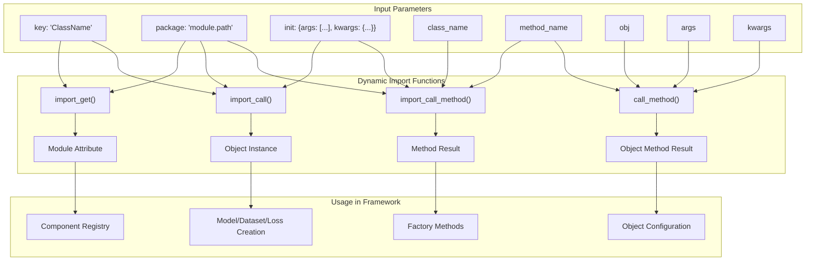

**Sources:** [torchdistill/common/main_util.py:54-133]()

### Import Dependencies Management

The framework supports automatic dependency importing for required packages:

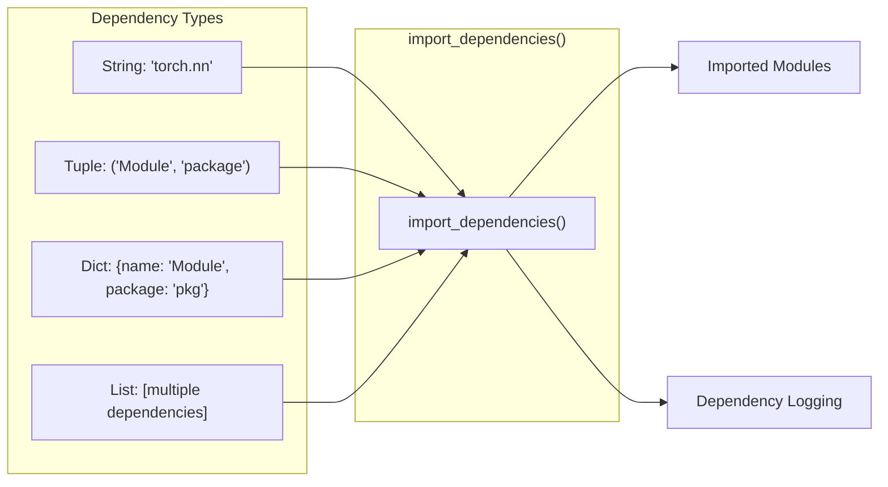

**Sources:** [torchdistill/common/main_util.py:18-52]()

## YAML Processing with Custom Constructors

The YAML utility system extends standard YAML processing with custom constructors that enable powerful configuration capabilities.

### Custom YAML Tags

The framework registers multiple custom YAML constructors for enhanced configuration:

| Tag | Function | Purpose |
|-----|----------|---------|
| `!import_get` | `yaml_import_get` | Import and retrieve module attributes |
| `!import_call` | `yaml_import_call` | Import and instantiate objects |
| `!import_call_method` | `yaml_import_call_method` | Import and call class methods |
| `!call_method` | `yaml_call_method` | Call methods on objects |
| `!pathjoin` | `yaml_pathjoin` | Join path components |
| `!expanduser` | `yaml_expanduser` | Expand user home directory |
| `!getattr` | `yaml_getattr` | Get object attributes |
| `!setattr` | `yaml_setattr` | Set object attributes |

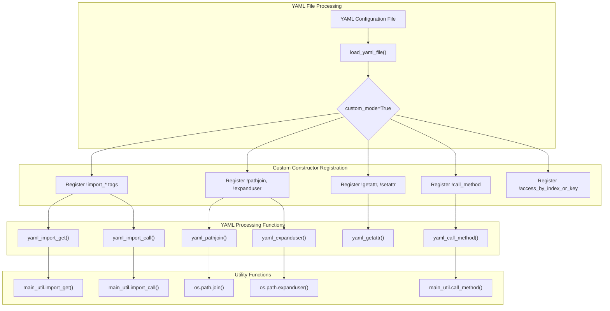

**Sources:** [torchdistill/common/yaml_util.py:179-203](), [torchdistill/common/yaml_util.py:71-129]()

### Path Manipulation Constructors

The framework provides specialized constructors for file path operations:

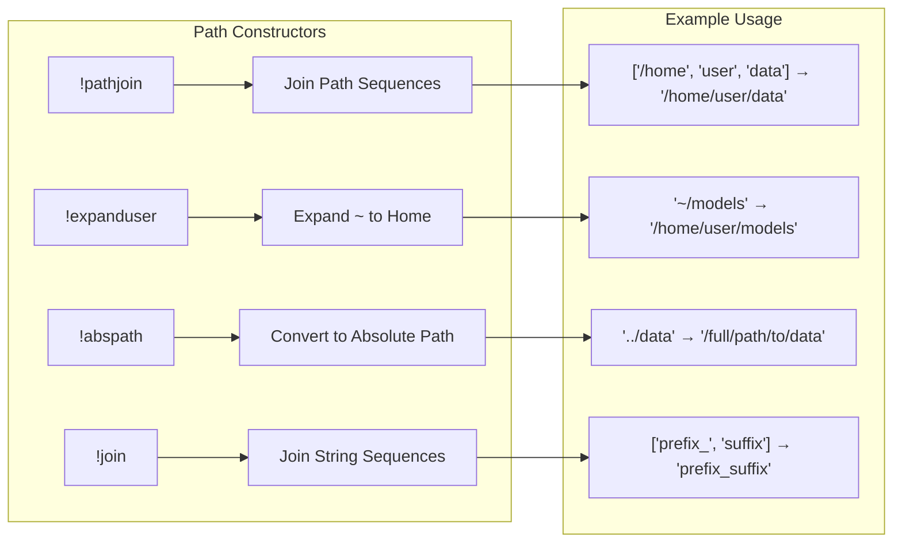

**Sources:** [torchdistill/common/yaml_util.py:26-68]()

## Module Management Utilities

The module utilities provide comprehensive support for PyTorch module introspection and manipulation.

### Module Introspection Functions

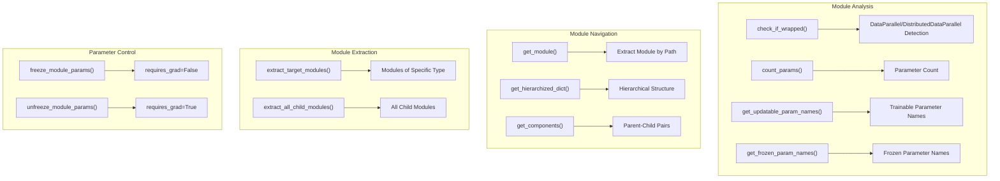

**Sources:** [torchdistill/common/module_util.py:11-219]()

### Module Path Resolution

The framework provides sophisticated module path resolution that handles wrapped models and sequential containers:

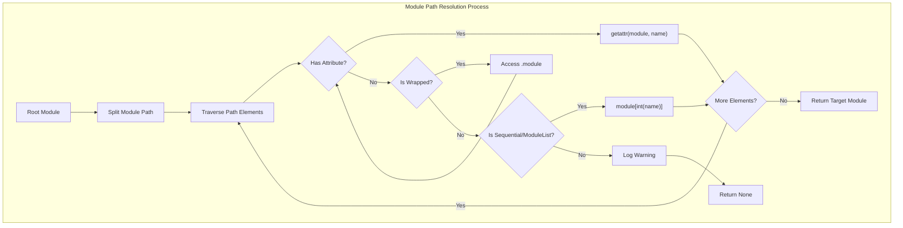

**Sources:** [torchdistill/common/module_util.py:87-122]()

## Distributed Training Utilities

The framework provides comprehensive support for distributed training across multiple processes and devices.

### Distributed Training Setup

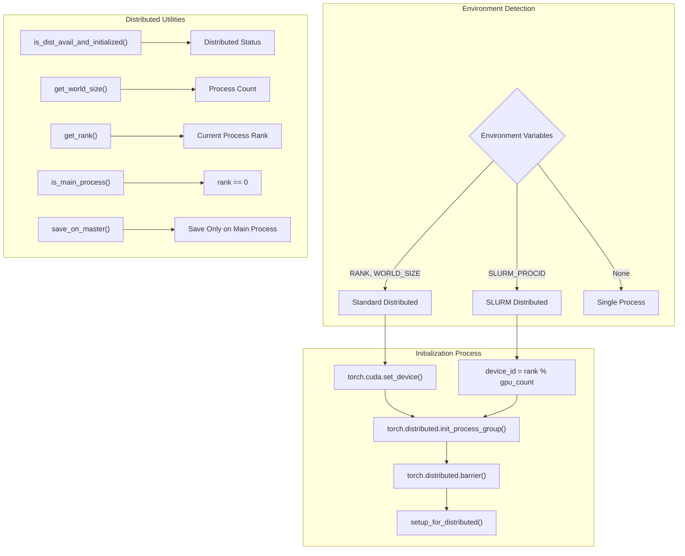

**Sources:** [torchdistill/common/main_util.py:166-288]()

### Checkpoint Management

The framework provides robust checkpoint loading and saving with support for models, optimizers, and schedulers:

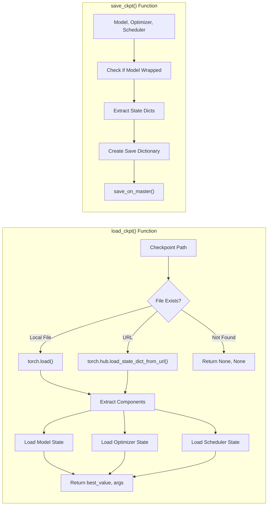

**Sources:** [torchdistill/common/main_util.py:291-375]()

## File System Utilities

The framework provides essential file system operations for managing data, models, and outputs.

### File System Operations

| Function | Purpose | Return Type |
|----------|---------|-------------|
| `check_if_exists` | Check file/directory existence | `bool` |
| `get_file_path_list` | List files in directory | `list[str]` |
| `get_dir_path_list` | List subdirectories | `list[str]` |
| `make_dirs` | Create directory structure | `None` |
| `make_parent_dirs` | Create parent directories | `None` |
| `save_pickle` | Serialize object to file | `None` |
| `load_pickle` | Deserialize object from file | `Any` |
| `get_binary_object_size` | Calculate serialized size | `float` |

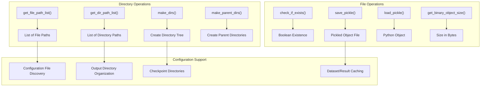

**Sources:** [torchdistill/common/file_util.py:7-124]()

## Miscellaneous Utilities

The framework includes additional utilities for introspection and environment management.

### Introspection Functions

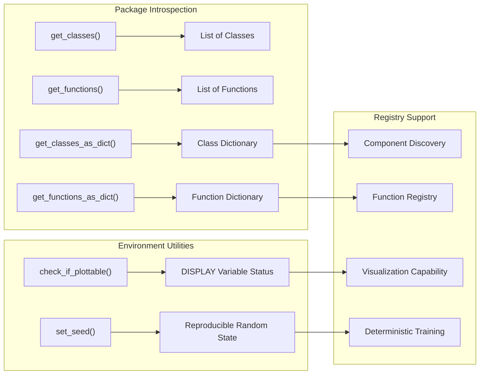

**Sources:** [torchdistill/common/misc_util.py:6-84](), [torchdistill/common/main_util.py:184-198]()

### Seed Management for Reproducibility

The `set_seed` function ensures reproducible experiments by setting seeds for all random number generators:

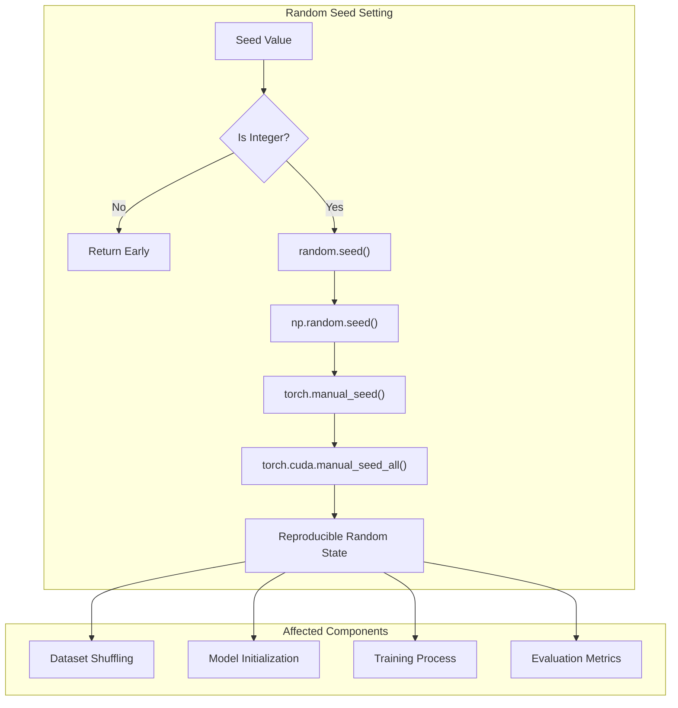

**Sources:** [torchdistill/common/main_util.py:184-198]()

## Integration with Core Framework

The common utilities integrate seamlessly with the core framework components:

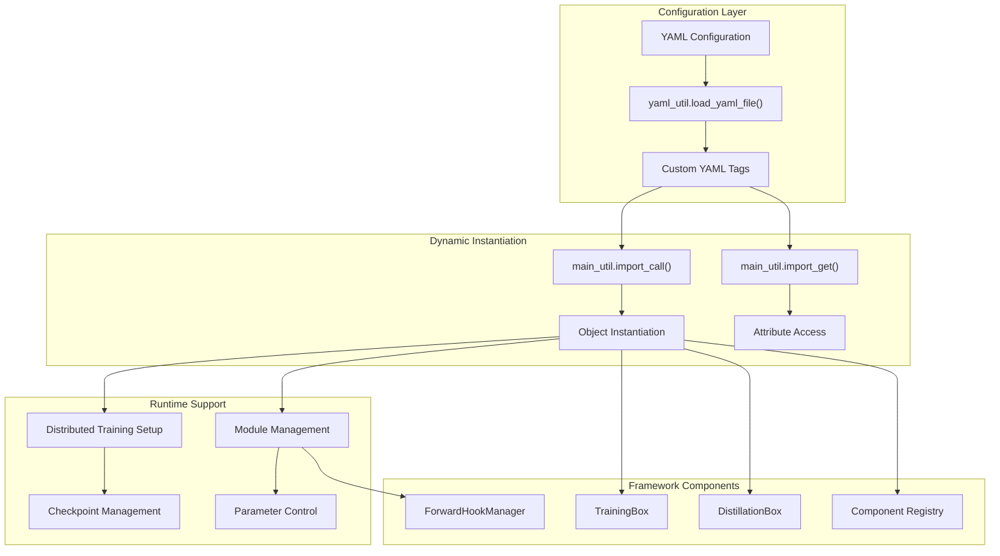

**Sources:** [torchdistill/common/main_util.py:1-376](), [torchdistill/common/yaml_util.py:1-204](), [torchdistill/common/module_util.py:1-219]()

---

