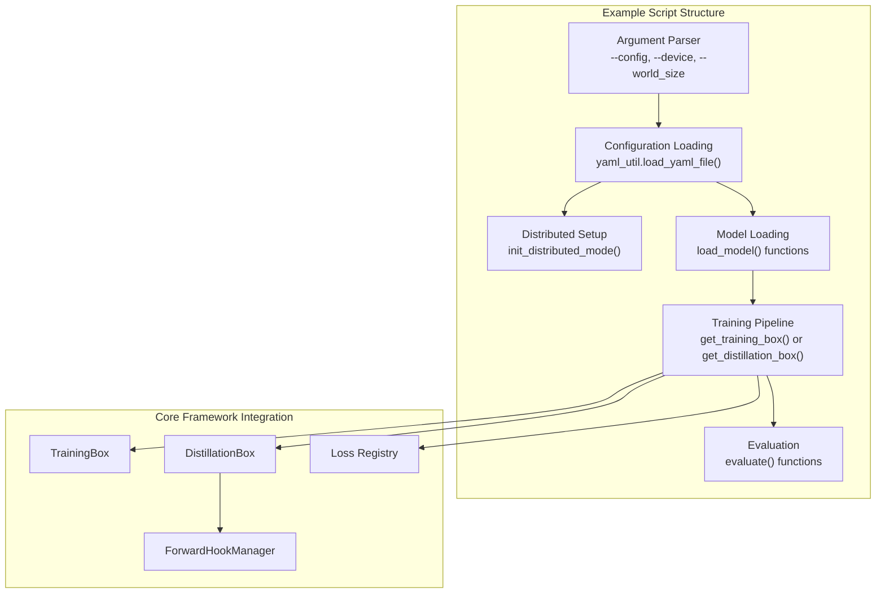
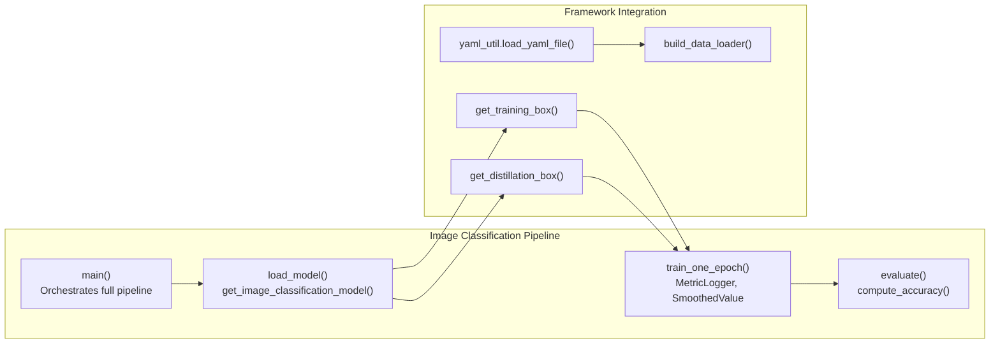
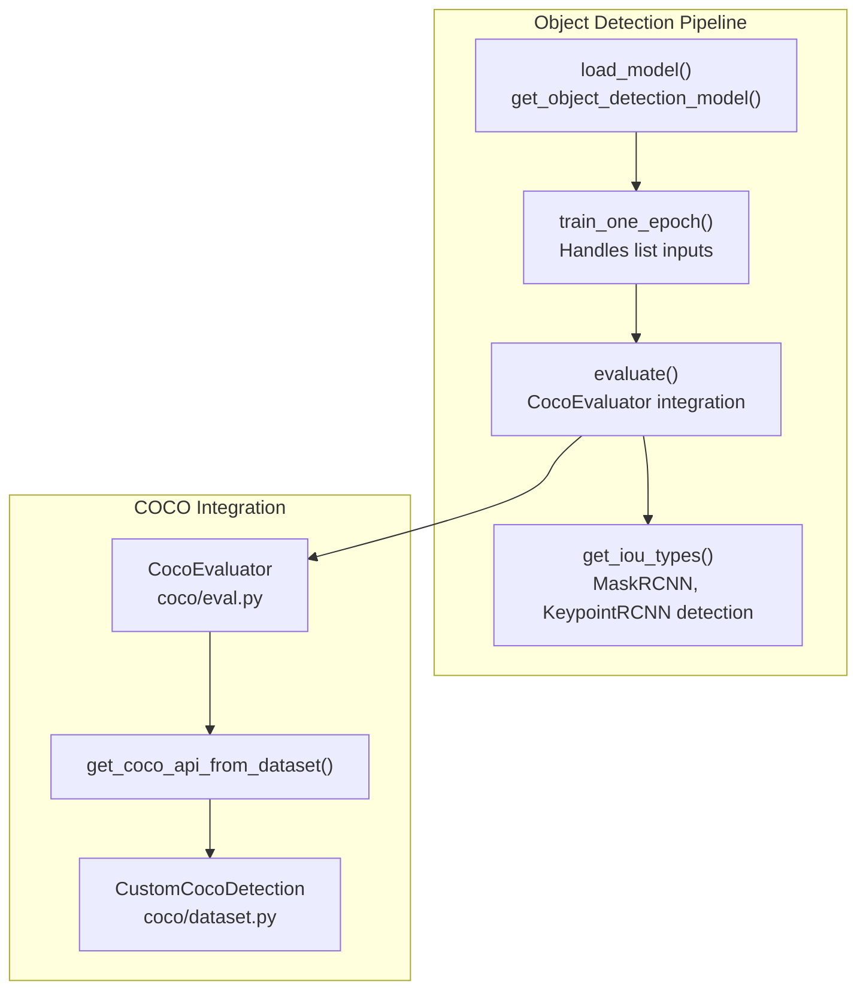
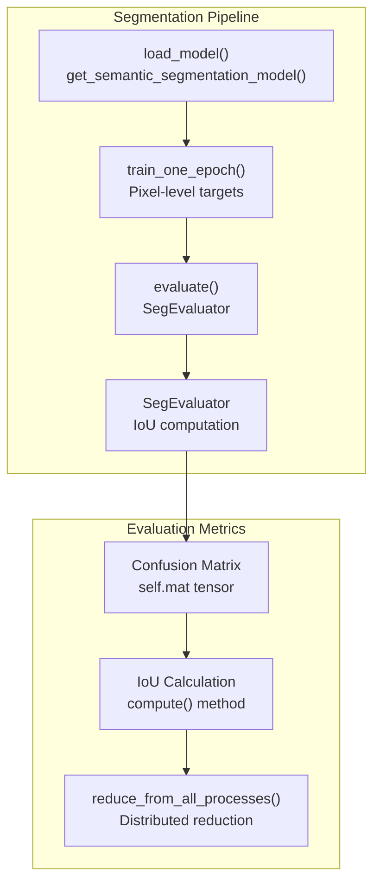
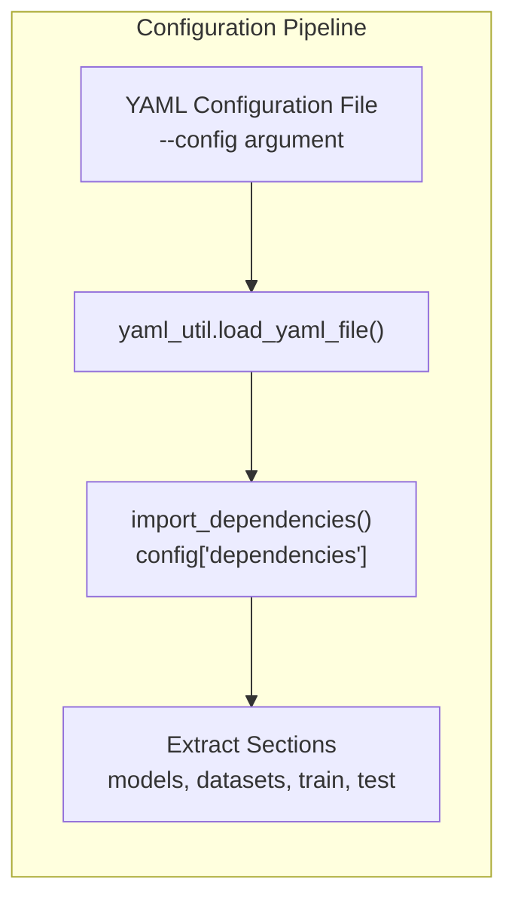
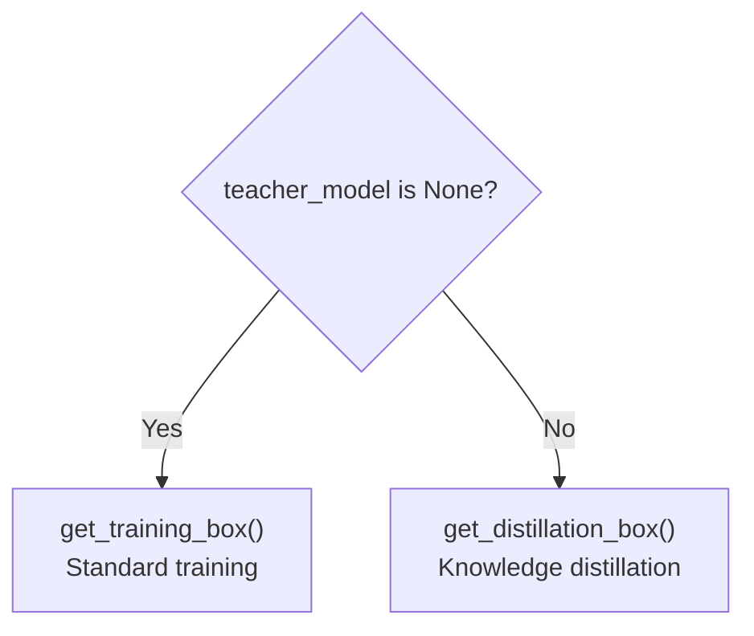
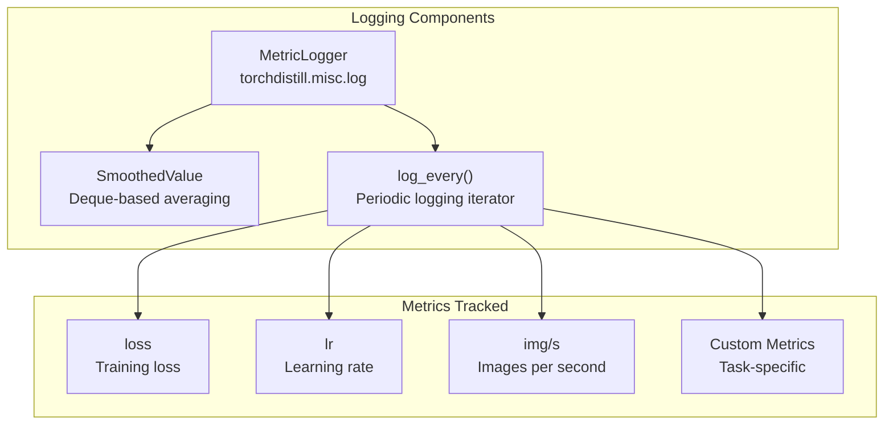

<!-- source: DeepWiki mcp.deepwiki.com · repo yoshitomo-matsubara/torchdistill · page 4 Examples and Usage · fetched 2026-10-21 -->

# Examples and Usage

Relevant source files

The following files were used as context for generating this wiki page:

- [examples/README.md](examples/README.md)
- [examples/torchvision/coco/__init__.py](examples/torchvision/coco/__init__.py)
- [examples/torchvision/coco/dataset.py](examples/torchvision/coco/dataset.py)
- [examples/torchvision/coco/eval.py](examples/torchvision/coco/eval.py)
- [examples/torchvision/image_classification.py](examples/torchvision/image_classification.py)
- [examples/torchvision/object_detection.py](examples/torchvision/object_detection.py)
- [examples/torchvision/semantic_segmentation.py](examples/torchvision/semantic_segmentation.py)
- [examples/torchvision/utils/__init__.py](examples/torchvision/utils/__init__.py)
- [examples/torchvision/utils/dataset.py](examples/torchvision/utils/dataset.py)
- [examples/torchvision/utils/eval.py](examples/torchvision/utils/eval.py)
- [torchdistill/common/constant.py](torchdistill/common/constant.py)
- [torchdistill/misc/log.py](torchdistill/misc/log.py)

This document provides practical examples and usage patterns for the torchdistill framework across different domains and tasks. The examples demonstrate how to configure and execute knowledge distillation experiments using the framework's declarative YAML-based configuration system.

For detailed information about the core framework components, see [Core Architecture](#2). For configuration system details, see [Configuration-Driven System](#2.1). For component-specific documentation, see [Components](#3).

## Example Structure Overview

The torchdistill repository provides comprehensive examples organized by domain and integration:

| Domain | Location | Description |
|--------|----------|-------------|
| Computer Vision | `examples/torchvision/` | Image classification, object detection, semantic segmentation |
| Natural Language Processing | `examples/hf_transformers/` | GLUE tasks, text classification with Hugging Face |
| Legacy Examples | `examples/legacy/` | Examples for torchdistill ≤ v0.3.3 |

**Example Script Architecture:**

Sources: [examples/README.md:1-12](), [examples/torchvision/image_classification.py:26-42](), [examples/torchvision/object_detection.py:32-50](), [examples/torchvision/semantic_segmentation.py:28-45]()

## Computer Vision Examples

### Image Classification

The image classification example demonstrates standard knowledge distillation for image classification tasks using torchvision models.

**Key Components:**

**Training Loop Pattern:**
- Uses `MetricLogger` for tracking training metrics
- Implements top-1 and top-5 accuracy computation
- Supports both standard training and knowledge distillation modes
- Handles distributed training with `DistributedDataParallel`

Sources: [examples/torchvision/image_classification.py:45-54](), [examples/torchvision/image_classification.py:56-72](), [examples/torchvision/image_classification.py:89-119]()

### Object Detection

The object detection example supports COCO-style object detection with multiple IoU types (bbox, segmentation, keypoints).

**Detection-Specific Components:**

**Key Features:**
- Handles variable-length inputs for detection models
- Integrates with pycocotools for evaluation
- Supports multiple IoU metrics (bbox, segmentation, keypoints)
- Uses `CocoEvaluator` for standardized evaluation

Sources: [examples/torchvision/object_detection.py:53-62](), [examples/torchvision/object_detection.py:84-95](), [examples/torchvision/object_detection.py:103-154]()

### Semantic Segmentation

The semantic segmentation example implements pixel-level knowledge distillation for segmentation tasks.

**Segmentation-Specific Components:**

**Evaluation Features:**
- Uses `SegEvaluator` for IoU computation
- Maintains confusion matrix for pixel-level accuracy
- Supports distributed evaluation with tensor reduction
- Computes mean IoU and per-class metrics

Sources: [examples/torchvision/semantic_segmentation.py:48-57](), [examples/torchvision/semantic_segmentation.py:78-108](), [examples/torchvision/utils/eval.py:4-42]()

## Common Usage Patterns

### Configuration-Driven Execution

All examples follow a consistent pattern for configuration-driven execution:

**Configuration Loading Pattern:**

**Model Loading Pattern:**
- Check for official model implementations first
- Fall back to registry-based loading with `get_model()`
- Load checkpoints if specified in configuration
- Move models to appropriate device

Sources: [examples/torchvision/image_classification.py:45-54](), [examples/torchvision/object_detection.py:53-62](), [examples/torchvision/semantic_segmentation.py:48-57]()

### Training Box Selection

Examples implement a consistent pattern for selecting between training and distillation modes:

**Box Selection Logic:**

This pattern appears identically across all three example scripts, enabling seamless switching between standard training and knowledge distillation based on configuration.

Sources: [examples/torchvision/image_classification.py:126-129](), [examples/torchvision/object_detection.py:161-164](), [examples/torchvision/semantic_segmentation.py:115-118]()

### Distributed Training Support

All examples include comprehensive distributed training support:

**Distributed Training Components:**

| Component | Purpose | Implementation |
|-----------|---------|----------------|
| `init_distributed_mode()` | Initialize distributed process group | Sets up world_size, rank, device_ids |
| `DistributedDataParallel` | Model parallelization | Wraps models for distributed training |
| `adjust_lr` flag | Learning rate scaling | Multiplies LR by world_size |
| `is_main_process()` | Process coordination | Controls logging and checkpointing |

### Evaluation and Checkpointing

Examples implement domain-specific evaluation with consistent checkpointing:

**Checkpoint Management:**
- Load existing checkpoints if available
- Save best model based on validation metrics
- Track best performance (accuracy, mAP, mIoU)
- Support test-only mode for evaluation

Sources: [examples/torchvision/image_classification.py:130-149](), [examples/torchvision/object_detection.py:165-189](), [examples/torchvision/semantic_segmentation.py:119-142]()

## Logging and Monitoring

### MetricLogger System

All examples use a consistent logging system based on `MetricLogger` and `SmoothedValue`:

**Logging Architecture:**

**Key Features:**
- Windowed averaging with configurable window size
- Distributed synchronization support
- GPU memory tracking when available
- ETA calculation for training progress

Sources: [torchdistill/misc/log.py:41-120](), [torchdistill/misc/log.py:122-250](), [examples/torchvision/image_classification.py:56-72]()

## Running Examples

### Command Line Interface

Each example script provides a consistent command-line interface:

**Common Arguments:**

| Argument | Purpose | Example |
|----------|---------|---------|
| `--config` | YAML configuration file path | `--config configs/image_classification.yaml` |
| `--device` | Training device | `--device cuda` |
| `--world_size` | Distributed training processes | `--world_size 4` |
| `--test_only` | Evaluation-only mode | `-test_only` |
| `--student_only` | Skip teacher evaluation | `-student_only` |
| `--log_config` | Print configuration | `-log_config` |

### Execution Pattern

**Standard execution flow:**
1. Parse command-line arguments
2. Initialize distributed training environment
3. Load YAML configuration and import dependencies
4. Initialize models (teacher and student)
5. Create training or distillation box
6. Execute training loop with validation
7. Final evaluation on test set

Sources: [examples/torchvision/image_classification.py:160-207](), [examples/torchvision/object_detection.py:200-248](), [examples/torchvision/semantic_segmentation.py:153-201]()

---

