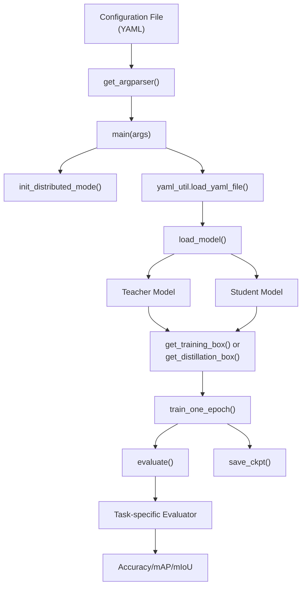
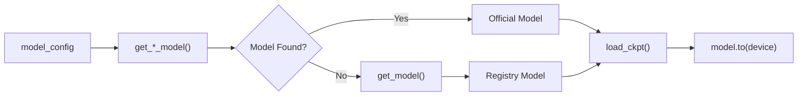
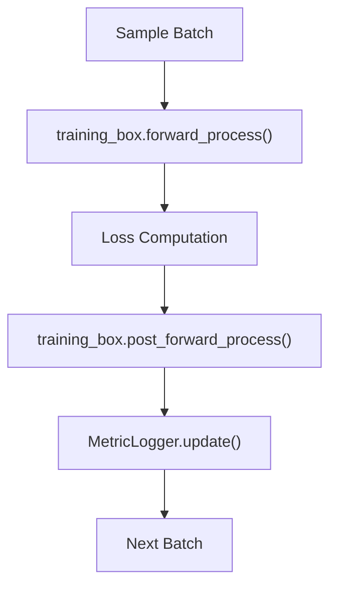
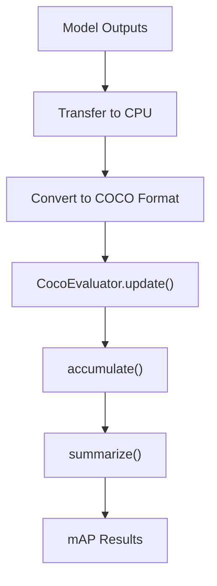
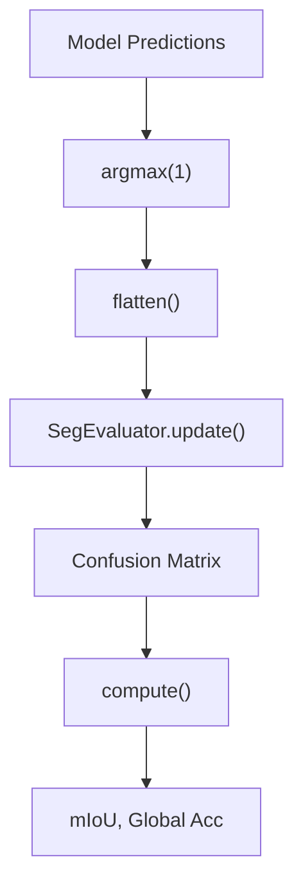
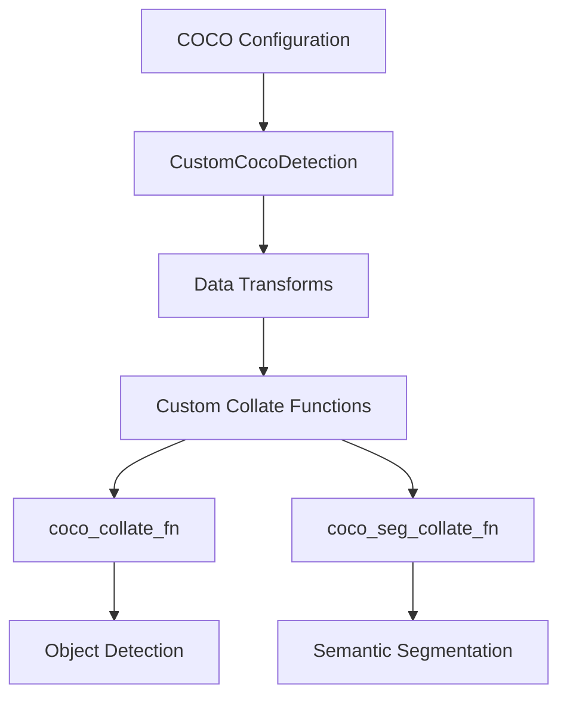
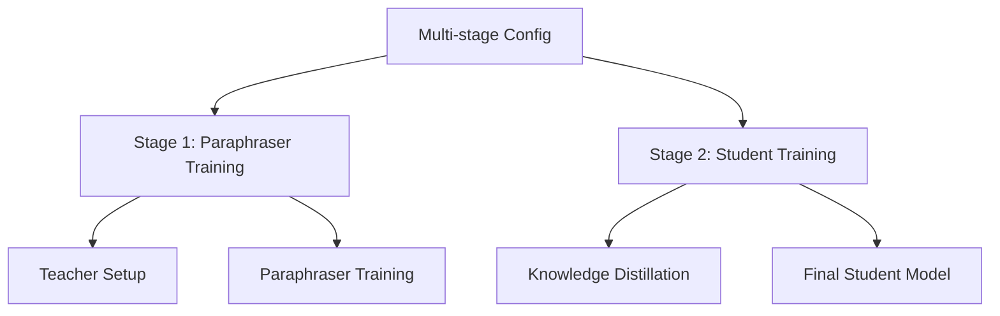
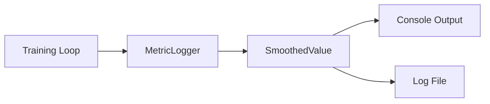
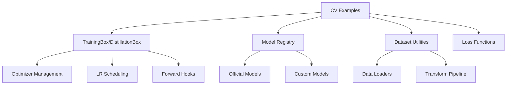

<!-- source: DeepWiki mcp.deepwiki.com · repo yoshitomo-matsubara/torchdistill · page 4.1 Computer Vision Examples · fetched 2026-10-21 -->

# Computer Vision Examples

Relevant source files

The following files were used as context for generating this wiki page:

- [configs/sample/coco2017/ce/deeplabv3_resnet50.yaml](configs/sample/coco2017/ce/deeplabv3_resnet50.yaml)
- [configs/sample/coco2017/ft/custom_fasterrcnn_resnet18_fpn_from_fasterrcnn_resnet50_fpn.yaml](configs/sample/coco2017/ft/custom_fasterrcnn_resnet18_fpn_from_fasterrcnn_resnet50_fpn.yaml)
- [configs/sample/coco2017/ghnd/custom_fasterrcnn_resnet50_fpn_from_fasterrcnn_resnet50_fpn.yaml](configs/sample/coco2017/ghnd/custom_fasterrcnn_resnet50_fpn_from_fasterrcnn_resnet50_fpn.yaml)
- [configs/sample/coco2017/ghnd/custom_maskrcnn_resnet50_fpn_from_maskrcnn_resnet50_fpn.yaml](configs/sample/coco2017/ghnd/custom_maskrcnn_resnet50_fpn_from_maskrcnn_resnet50_fpn.yaml)
- [configs/sample/coco2017/ktaad/lraspp_mobilenet_v3_large_from_deeplabv3_resnet50.yaml](configs/sample/coco2017/ktaad/lraspp_mobilenet_v3_large_from_deeplabv3_resnet50.yaml)
- [configs/sample/pascal_voc2012/ce/deeplabv3_resnet101.yaml](configs/sample/pascal_voc2012/ce/deeplabv3_resnet101.yaml)
- [configs/sample/pascal_voc2012/ce/deeplabv3_resnet50.yaml](configs/sample/pascal_voc2012/ce/deeplabv3_resnet50.yaml)
- [examples/README.md](examples/README.md)
- [examples/torchvision/coco/__init__.py](examples/torchvision/coco/__init__.py)
- [examples/torchvision/coco/dataset.py](examples/torchvision/coco/dataset.py)
- [examples/torchvision/coco/eval.py](examples/torchvision/coco/eval.py)
- [examples/torchvision/image_classification.py](examples/torchvision/image_classification.py)
- [examples/torchvision/object_detection.py](examples/torchvision/object_detection.py)
- [examples/torchvision/semantic_segmentation.py](examples/torchvision/semantic_segmentation.py)
- [examples/torchvision/utils/__init__.py](examples/torchvision/utils/__init__.py)
- [examples/torchvision/utils/dataset.py](examples/torchvision/utils/dataset.py)
- [examples/torchvision/utils/eval.py](examples/torchvision/utils/eval.py)
- [torchdistill/common/constant.py](torchdistill/common/constant.py)
- [torchdistill/misc/log.py](torchdistill/misc/log.py)

This page documents the computer vision examples provided in torchdistill, which demonstrate practical applications of knowledge distillation for image classification, object detection, and semantic segmentation tasks. These examples leverage the torchvision ecosystem and provide complete end-to-end training and evaluation pipelines.

For natural language processing examples using Hugging Face transformers, see [Natural Language Processing](#4.2). For sample configuration files across different domains, see [Configuration Examples](#4.3).

## Overview

The computer vision examples are located in `examples/torchvision/` and provide three main application domains:

| Task | Script | Supported Datasets | Key Features |
|------|--------|-------------------|--------------|
| Image Classification | `image_classification.py` | ImageNet, CIFAR | Top-1/Top-5 accuracy evaluation |
| Object Detection | `object_detection.py` | COCO 2017 | COCO evaluation metrics, multi-IoU types |
| Semantic Segmentation | `semantic_segmentation.py` | Pascal VOC 2012, COCO | mIoU evaluation, auxiliary losses |

## Example Script Architecture

All computer vision examples follow a consistent architectural pattern that integrates with torchdistill's core components:

### Script Structure Flow

Sources: [examples/torchvision/image_classification.py:160-211](), [examples/torchvision/object_detection.py:200-252](), [examples/torchvision/semantic_segmentation.py:153-201]()

### Model Loading Pipeline

Sources: [examples/torchvision/image_classification.py:45-53](), [examples/torchvision/object_detection.py:53-61](), [examples/torchvision/semantic_segmentation.py:48-56]()

## Task-Specific Implementation Details

### Image Classification

The image classification example (`image_classification.py`) implements standard supervised learning and knowledge distillation for image classification tasks.

**Key Components:**
- `get_image_classification_model()` - Loads torchvision classification models
- `compute_accuracy()` - Calculates top-1 and top-5 accuracy metrics
- `evaluate()` - Performs model evaluation with accuracy reporting

**Training Loop:**

Sources: [examples/torchvision/image_classification.py:56-71](), [examples/torchvision/image_classification.py:89-118]()

### Object Detection

The object detection example (`object_detection.py`) supports COCO-style object detection with bounding boxes, segmentation masks, and keypoints.

**Key Components:**
- `get_object_detection_model()` - Loads detection models (Faster R-CNN, Mask R-CNN, etc.)
- `CocoEvaluator` - COCO evaluation metrics implementation
- `get_iou_types()` - Determines evaluation IoU types based on model

**Evaluation Pipeline:**

Sources: [examples/torchvision/object_detection.py:103-153](), [examples/torchvision/coco/eval.py:17-59]()

### Semantic Segmentation

The semantic segmentation example (`semantic_segmentation.py`) implements pixel-level classification with support for auxiliary losses.

**Key Components:**
- `get_semantic_segmentation_model()` - Loads segmentation models (DeepLab, etc.)
- `SegEvaluator` - Computes intersection-over-union (IoU) metrics
- Auxiliary loss handling for models with auxiliary classifiers

**Evaluation Process:**

Sources: [examples/torchvision/semantic_segmentation.py:78-107](), [examples/torchvision/utils/eval.py:4-41]()

## Dataset Integration

### COCO Dataset Support

The examples include comprehensive COCO dataset support through custom dataset classes and utilities:

**Transform Pipeline:**
- `CustomCompose` - Composition of transforms
- `CustomRandomResize` - Random resizing with aspect ratio preservation
- `CustomRandomHorizontalFlip` - Data augmentation
- `CustomRandomCrop` - Random cropping
- `CustomToTensor` - Tensor conversion
- `CustomNormalize` - Normalization

Sources: [examples/torchvision/coco/dataset.py:281-319](), [configs/sample/coco2017/ce/deeplabv3_resnet50.yaml:1-44]()

### Pascal VOC Support

Pascal VOC 2012 segmentation is supported through torchvision's built-in dataset:

Sources: [configs/sample/pascal_voc2012/ce/deeplabv3_resnet50.yaml:1-41]()

## Configuration Examples

The examples demonstrate various knowledge distillation methods through configuration files:

| Method | Path | Description |
|--------|------|-------------|
| Cross Entropy | `configs/sample/*/ce/` | Standard supervised training |
| Factor Transfer | `configs/sample/*/ft/` | Factor transfer knowledge distillation |
| GHND | `configs/sample/*/ghnd/` | Graph-based knowledge distillation |
| KTAAD | `configs/sample/*/ktaad/` | Knowledge transfer with attention |

### Multi-Stage Training Configuration

Some methods support multi-stage training with different configurations per stage:

Sources: [configs/sample/coco2017/ft/custom_fasterrcnn_resnet18_fpn_from_fasterrcnn_resnet50_fpn.yaml:50-218]()

## Evaluation and Metrics

### Logging and Monitoring

All examples use `MetricLogger` for training progress monitoring:

**Tracked Metrics:**
- Loss values
- Learning rate
- Processing speed (img/s)
- Model/evaluator time
- Memory usage (GPU)

Sources: [torchdistill/misc/log.py:122-249]()

### Task-Specific Evaluators

Each computer vision task implements specialized evaluation:

| Task | Evaluator | Key Metrics |
|------|-----------|-------------|
| Classification | Built-in accuracy | Top-1, Top-5 accuracy |
| Detection | `CocoEvaluator` | mAP, AP@IoU thresholds |
| Segmentation | `SegEvaluator` | mIoU, pixel accuracy |

Sources: [examples/torchvision/utils/eval.py:4-41](), [examples/torchvision/coco/eval.py:17-59]()

## Integration with Core Framework

The computer vision examples demonstrate integration with torchdistill's core components:

Sources: [examples/torchvision/image_classification.py:16-18](), [examples/torchvision/object_detection.py:22-24](), [examples/torchvision/semantic_segmentation.py:17-19]()

---

