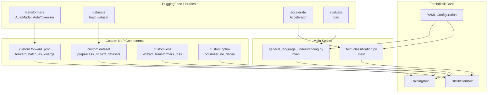
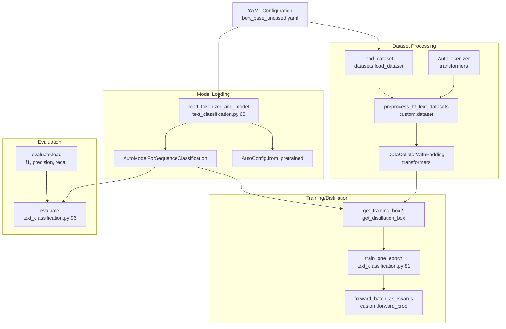
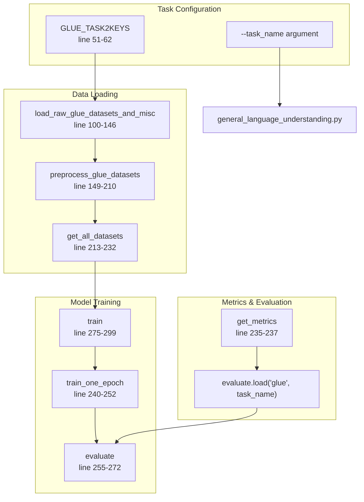

<!-- source: DeepWiki mcp.deepwiki.com · repo yoshitomo-matsubara/torchdistill · page 4.2 Natural Language Processing · fetched 2026-10-21 -->

# Natural Language Processing

<details>
<summary>Relevant source files</summary>

The following files were used as context for generating this wiki page:

- [configs/sample/glue/cola/ce/bert_base_uncased.yaml](configs/sample/glue/cola/ce/bert_base_uncased.yaml)
- [configs/sample/glue/mnli/ce/bert_base_uncased.yaml](configs/sample/glue/mnli/ce/bert_base_uncased.yaml)
- [configs/sample/glue/mrpc/ce/bert_base_uncased.yaml](configs/sample/glue/mrpc/ce/bert_base_uncased.yaml)
- [configs/sample/glue/qnli/ce/bert_base_uncased.yaml](configs/sample/glue/qnli/ce/bert_base_uncased.yaml)
- [configs/sample/glue/qqp/ce/bert_base_uncased.yaml](configs/sample/glue/qqp/ce/bert_base_uncased.yaml)
- [configs/sample/glue/qqp/ce/bert_large_uncased.yaml](configs/sample/glue/qqp/ce/bert_large_uncased.yaml)
- [configs/sample/glue/rte/ce/bert_base_uncased.yaml](configs/sample/glue/rte/ce/bert_base_uncased.yaml)
- [configs/sample/glue/sst2/ce/bert_base_uncased.yaml](configs/sample/glue/sst2/ce/bert_base_uncased.yaml)
- [configs/sample/glue/wnli/ce/bert_base_uncased.yaml](configs/sample/glue/wnli/ce/bert_base_uncased.yaml)
- [configs/sample/go_emotions/ce/bert_base_uncased.yaml](configs/sample/go_emotions/ce/bert_base_uncased.yaml)
- [demo/cifar_kd.ipynb](demo/cifar_kd.ipynb)
- [demo/cifar_training.ipynb](demo/cifar_training.ipynb)
- [demo/glue_finetuning_and_submission.ipynb](demo/glue_finetuning_and_submission.ipynb)
- [demo/glue_kd_and_submission.ipynb](demo/glue_kd_and_submission.ipynb)
- [examples/hf_transformers/README.md](examples/hf_transformers/README.md)
- [examples/hf_transformers/custom/__init__.py](examples/hf_transformers/custom/__init__.py)
- [examples/hf_transformers/custom/dataset.py](examples/hf_transformers/custom/dataset.py)
- [examples/hf_transformers/custom/forward_proc.py](examples/hf_transformers/custom/forward_proc.py)
- [examples/hf_transformers/custom/loss.py](examples/hf_transformers/custom/loss.py)
- [examples/hf_transformers/custom/optim.py](examples/hf_transformers/custom/optim.py)
- [examples/hf_transformers/custom/registry.py](examples/hf_transformers/custom/registry.py)
- [examples/hf_transformers/general_language_understanding.py](examples/hf_transformers/general_language_understanding.py)
- [examples/hf_transformers/requirements.txt](examples/hf_transformers/requirements.txt)
- [examples/hf_transformers/text_classification.py](examples/hf_transformers/text_classification.py)

</details>


This document covers torchdistill's support for Natural Language Processing (NLP) tasks, primarily through HuggingFace Transformers integration. It details the components that enable text classification, GLUE benchmark evaluation, and knowledge distillation for transformer models.

For computer vision examples and configurations, see [Computer Vision Examples](#4.1). For general configuration system documentation, see [Configuration-Driven System](#2.1).

## Requirements and Setup

The HuggingFace Transformers integration requires additional dependencies beyond the core torchdistill package:

| Package | Version | Purpose |
|---------|---------|---------|
| `accelerate` | Latest | Multi-GPU/TPU support and mixed precision |
| `datasets` | >= 3.6.0 | Dataset loading and preprocessing |
| `transformers` | >= 4.6.1 | Pre-trained models and tokenizers |
| `evaluate` | Latest | Evaluation metrics |
| `torch` | >= 2.0.0 | PyTorch framework |
| `sentencepiece` | Latest | Tokenization support |
| `protobuf` | Latest | Protocol buffer support |
| `pandas` | Latest | Data manipulation |

Installation:
```bash
pip install -r examples/hf_transformers/requirements.txt
```

**Sources:** [examples/hf_transformers/requirements.txt:1-9]()

## HuggingFace Transformers Integration

Torchdistill integrates with HuggingFace's `transformers`, `datasets`, and `accelerate` libraries to provide a unified framework for NLP model training and knowledge distillation. The integration maintains the framework's configuration-driven philosophy while leveraging HuggingFace's extensive model ecosystem.

### Integration Architecture



**Sources:** [examples/hf_transformers/text_classification.py:1-270](), [examples/hf_transformers/general_language_understanding.py:1-428](), [examples/hf_transformers/custom/dataset.py:1-83](), [examples/hf_transformers/custom/forward_proc.py:1-7]()

## Text Classification Pipeline

The text classification pipeline processes datasets through tokenization, model loading, training/distillation, and evaluation phases. The pipeline supports both single-label and multi-label classification tasks.

### Text Classification Flow



**Sources:** [examples/hf_transformers/text_classification.py:65-78](), [examples/hf_transformers/text_classification.py:81-94](), [examples/hf_transformers/custom/dataset.py:19-82](), [examples/hf_transformers/custom/forward_proc.py:4-6]()

## GLUE Benchmark Support

The framework provides comprehensive support for the General Language Understanding Evaluation (GLUE) benchmark, including all nine tasks: CoLA, SST-2, MRPC, STS-B, QQP, MNLI, QNLI, RTE, and WNLI.

### GLUE Task Configuration

| Task | Task Type | Sentence Keys | Evaluation Metric |
|------|-----------|---------------|-------------------|
| CoLA | Acceptability | `sentence` | Matthews Correlation |
| SST-2 | Sentiment | `sentence` | Accuracy |
| MRPC | Paraphrase | `sentence1`, `sentence2` | F1/Accuracy |
| STS-B | Similarity (Regression) | `sentence1`, `sentence2` | Pearson/Spearman |
| QQP | Duplicate Detection | `question1`, `question2` | F1/Accuracy |
| MNLI | Entailment | `premise`, `hypothesis` | Accuracy |
| QNLI | Question Answering | `question`, `sentence` | Accuracy |
| RTE | Entailment | `sentence1`, `sentence2` | Accuracy |
| WNLI | Coreference | `sentence1`, `sentence2` | Accuracy |

### GLUE Processing Pipeline



**Sources:** [examples/hf_transformers/general_language_understanding.py:51-62](), [examples/hf_transformers/general_language_understanding.py:100-146](), [examples/hf_transformers/general_language_understanding.py:149-210](), [examples/hf_transformers/general_language_understanding.py:235-237]()

## Custom NLP Components

The framework provides custom components specifically designed for NLP workflows, extending torchdistill's component registry system to work seamlessly with HuggingFace models.

### Dataset Processing Components

The `preprocess_hf_text_datasets` function handles complex text dataset preprocessing including multi-label support, tokenization, and label mapping:

```python
def preprocess_hf_text_datasets(raw_dataset_dict, tokenizer, text_keys, label_key, 
                                pad_to_max_length, max_length, base_split_name, 
                                batched, skipped_splits=None, remove_columns=None,
                                label2id=None, dataset_id_map=None, **kwargs)
```

Key features:
- **Multi-label Support**: Automatically detects and handles multi-label classification tasks
- **Label Mapping**: Creates `label2id` mappings for consistent label handling across splits
- **Tokenization Integration**: Seamless integration with HuggingFace tokenizers
- **Flexible Text Inputs**: Supports single or paired text inputs via `text_keys` parameter

**Sources:** [examples/hf_transformers/custom/dataset.py:19-82]()

### Forward Processing

The `forward_batch_as_kwargs` function enables HuggingFace models to work with torchdistill's forward processing pipeline:

```python
@register_forward_proc_func
def forward_batch_as_kwargs(model, sample_batch, targets=None, supp_dict=None):
    return model(**sample_batch)
```

This adapter function unpacks the sample batch as keyword arguments, which is the expected input format for HuggingFace models.

**Sources:** [examples/hf_transformers/custom/forward_proc.py:4-6]()

### Loss Extraction

The `extract_transformers_loss` function extracts loss values from HuggingFace model outputs:

```python
@register_func2extract_model_output
def extract_transformers_loss(student_outputs, targets, **kwargs):
    model_loss_dict = dict()
    model_loss_dict['loss'] = student_outputs.loss
    return model_loss_dict
```

**Sources:** [examples/hf_transformers/custom/loss.py:4-8]()

### Optimization Components

The `optimizer_no_decay` function implements weight decay exclusion for specific parameter types, following transformer training best practices:

```python
@register_optimizer
def optimizer_no_decay(model, optimizer_key, weight_decay, no_decay=None, **kwargs):
    if no_decay is None:
        no_decay = ['bias', 'LayerNorm.weight']
    # ... parameter grouping logic
```

**Sources:** [examples/hf_transformers/custom/optim.py:47-66]()

## Configuration System for NLP

NLP configurations follow the same YAML-driven approach as other torchdistill components, with specialized entries for HuggingFace integration.

### Sample Configuration Structure

```yaml
dependencies:
  - name: 'custom'

datasets: !import_call
  key: 'datasets.load_dataset'
  init:
    kwargs:
      path: 'go_emotions'
      name: 'simplified'

models:
  student_model:
    key: 'bert-base-uncased'
    config_kwargs:
      pretrained_model_name_or_path: 'bert-base-uncased'
      num_labels: 28
      problem_type: 'multi_label_classification'
    tokenizer_kwargs:
      pretrained_model_name_or_path: 'bert-base-uncased'
    model_kwargs:
      pretrained_model_name_or_path: 'bert-base-uncased'

train:
  model:
    forward_proc: 'forward_batch_as_kwargs'
  optimizer:
    key: 'optimizer_no_decay'
  criterion:
    func2extract_model_loss: 'extract_transformers_loss'
```

### Key Configuration Elements

- **Dependencies**: The `custom` dependency loads NLP-specific components
- **Dynamic Loading**: Uses `!import_call` for HuggingFace dataset loading
- **Model Configuration**: Separate `config_kwargs`, `tokenizer_kwargs`, and `model_kwargs` sections
- **Custom Components**: References to registered custom functions like `forward_batch_as_kwargs`

**Sources:** [configs/sample/go_emotions/ce/bert_base_uncased.yaml:1-152]()

## Knowledge Distillation for NLP Models

The framework supports knowledge distillation between transformer models, enabling compression of large models into smaller, more efficient variants while maintaining performance.

### Distillation Configuration

NLP distillation configurations specify both teacher and student models with their respective checkpoints:

```yaml
models:
  teacher_model:
    key: 'yoshitomo-matsubara/bert-large-uncased-cola'
    # teacher configuration
  student_model:
    key: 'bert-base-uncased'
    # student configuration
```

The system automatically:
- Loads pre-trained teacher models from HuggingFace Hub
- Freezes teacher model parameters during distillation
- Applies knowledge distillation losses between teacher and student outputs
- Saves fine-tuned student models

### Performance Results

The README documents achieved results on GLUE benchmark:

| Model Configuration | Overall GLUE Score |
|-------------------|-------------------|
| BERT-Large (uncased) | 80.2 |
| BERT-Base (uncased) | 77.9 |
| BERT-Base distilled from BERT-Large | 78.9 |

**Sources:** [examples/hf_transformers/README.md:84-94]()

## Usage Examples

### Text Classification

```bash
accelerate launch examples/hf_transformers/text_classification.py \
  --config configs/sample/go_emotions/ce/bert_base_uncased.yaml \
  --run_log log/go_emotions/ce/bert_base_uncased.txt \
  --seed 123
```

### GLUE Benchmark

```bash
export TASK_NAME=cola
accelerate launch examples/hf_transformers/general_language_understanding.py \
  --config configs/sample/glue/${TASK_NAME}/ce/bert_base_uncased.yaml \
  --task ${TASK_NAME}
```

**Sources:** [examples/hf_transformers/README.md:30-56](), [demo/glue_finetuning_and_submission.ipynb:1-570]()

---

