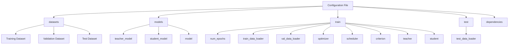
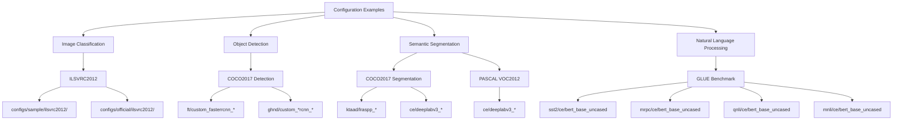
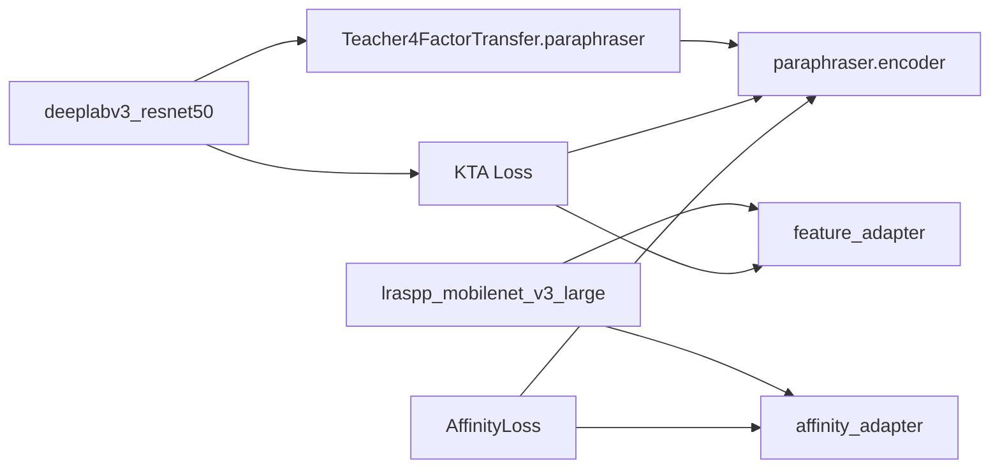
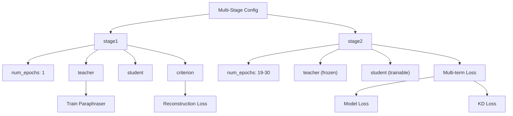
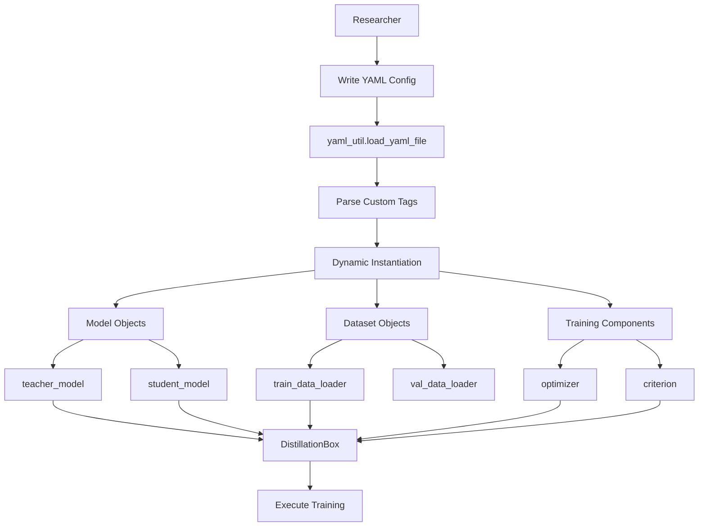

<!-- source: DeepWiki mcp.deepwiki.com · repo yoshitomo-matsubara/torchdistill · page 4.3 Configuration Examples · fetched 2026-10-21 -->

# Configuration Examples

Relevant source files

The following files were used as context for generating this wiki page:

- [configs/sample/coco2017/ce/deeplabv3_resnet50.yaml](configs/sample/coco2017/ce/deeplabv3_resnet50.yaml)
- [configs/sample/coco2017/ft/custom_fasterrcnn_resnet18_fpn_from_fasterrcnn_resnet50_fpn.yaml](configs/sample/coco2017/ft/custom_fasterrcnn_resnet18_fpn_from_fasterrcnn_resnet50_fpn.yaml)
- [configs/sample/coco2017/ghnd/custom_fasterrcnn_resnet50_fpn_from_fasterrcnn_resnet50_fpn.yaml](configs/sample/coco2017/ghnd/custom_fasterrcnn_resnet50_fpn_from_fasterrcnn_resnet50_fpn.yaml)
- [configs/sample/coco2017/ghnd/custom_maskrcnn_resnet50_fpn_from_maskrcnn_resnet50_fpn.yaml](configs/sample/coco2017/ghnd/custom_maskrcnn_resnet50_fpn_from_maskrcnn_resnet50_fpn.yaml)
- [configs/sample/coco2017/ktaad/lraspp_mobilenet_v3_large_from_deeplabv3_resnet50.yaml](configs/sample/coco2017/ktaad/lraspp_mobilenet_v3_large_from_deeplabv3_resnet50.yaml)
- [configs/sample/glue/cola/ce/bert_base_uncased.yaml](configs/sample/glue/cola/ce/bert_base_uncased.yaml)
- [configs/sample/glue/mnli/ce/bert_base_uncased.yaml](configs/sample/glue/mnli/ce/bert_base_uncased.yaml)
- [configs/sample/glue/mrpc/ce/bert_base_uncased.yaml](configs/sample/glue/mrpc/ce/bert_base_uncased.yaml)
- [configs/sample/glue/qnli/ce/bert_base_uncased.yaml](configs/sample/glue/qnli/ce/bert_base_uncased.yaml)
- [configs/sample/glue/qqp/ce/bert_base_uncased.yaml](configs/sample/glue/qqp/ce/bert_base_uncased.yaml)
- [configs/sample/glue/qqp/ce/bert_large_uncased.yaml](configs/sample/glue/qqp/ce/bert_large_uncased.yaml)
- [configs/sample/glue/rte/ce/bert_base_uncased.yaml](configs/sample/glue/rte/ce/bert_base_uncased.yaml)
- [configs/sample/glue/sst2/ce/bert_base_uncased.yaml](configs/sample/glue/sst2/ce/bert_base_uncased.yaml)
- [configs/sample/glue/wnli/ce/bert_base_uncased.yaml](configs/sample/glue/wnli/ce/bert_base_uncased.yaml)
- [configs/sample/pascal_voc2012/ce/deeplabv3_resnet101.yaml](configs/sample/pascal_voc2012/ce/deeplabv3_resnet101.yaml)
- [configs/sample/pascal_voc2012/ce/deeplabv3_resnet50.yaml](configs/sample/pascal_voc2012/ce/deeplabv3_resnet50.yaml)

This page showcases sample and official configuration files for various knowledge distillation scenarios in torchdistill. These examples demonstrate how to define complete experiments using YAML configuration files without writing code.

For information about the underlying configuration system and custom YAML tags, see [Configuration-Driven System](#2.1). For details about official research reproducible configurations, see [Research Configurations](#4.4).

## Configuration File Anatomy

Every torchdistill configuration file follows a standardized structure with key sections that define the complete experimental setup:

**Sources:** [configs/sample/pascal_voc2012/ce/deeplabv3_resnet101.yaml](), [configs/sample/coco2017/ft/custom_fasterrcnn_resnet18_fpn_from_fasterrcnn_resnet50_fpn.yaml]()

## Configuration Types by Task Domain

The framework provides configurations across computer vision and natural language processing domains:

**Sources:** [configs/sample/pascal_voc2012/ce/deeplabv3_resnet101.yaml](), [configs/sample/coco2017/ce/deeplabv3_resnet50.yaml](), [configs/sample/coco2017/ft/custom_fasterrcnn_resnet18_fpn_from_fasterrcnn_resnet50_fpn.yaml](), [configs/sample/glue/sst2/ce/bert_base_uncased.yaml]()

### Image Classification Examples

Basic classification training uses a single `model` entry without teacher-student setup:

| Configuration Type | Example File | Model Architecture | Dataset |
|-------------------|--------------|-------------------|---------|
| Standard Training | `configs/sample/ilsvrc2012/ce/resnet18.yaml` | ResNet-18 | ILSVRC2012 |
| Knowledge Distillation | `configs/sample/ilsvrc2012/kd/resnet18_from_resnet34.yaml` | Student: ResNet-18, Teacher: ResNet-34 | ILSVRC2012 |

### Object Detection Examples

Object detection configurations use complex multi-stage training with auxiliary model wrappers:

| Method | Configuration Path | Teacher | Student |
|--------|-------------------|---------|---------|
| Factor Transfer | `configs/sample/coco2017/ft/custom_fasterrcnn_resnet18_fpn_from_fasterrcnn_resnet50_fpn.yaml` | Faster R-CNN ResNet-50 | Faster R-CNN ResNet-18 |
| GHND | `configs/sample/coco2017/ghnd/custom_fasterrcnn_resnet50_fpn_from_fasterrcnn_resnet50_fpn.yaml` | Faster R-CNN ResNet-50 | Custom Faster R-CNN ResNet-50 |

**Sources:** [configs/sample/coco2017/ft/custom_fasterrcnn_resnet18_fpn_from_fasterrcnn_resnet50_fpn.yaml:25-48](), [configs/sample/coco2017/ghnd/custom_fasterrcnn_resnet50_fpn_from_fasterrcnn_resnet50_fpn.yaml:25-56]()

### Semantic Segmentation Examples

Segmentation configurations demonstrate advanced knowledge transfer methods:

**Sources:** [configs/sample/coco2017/ktaad/lraspp_mobilenet_v3_large_from_deeplabv3_resnet50.yaml:73-92](), [configs/sample/coco2017/ktaad/lraspp_mobilenet_v3_large_from_deeplabv3_resnet50.yaml:228-247]()

## Multi-Stage Training Configurations

Complex knowledge distillation methods often require multi-stage training with different objectives:

**Sources:** [configs/sample/coco2017/ft/custom_fasterrcnn_resnet18_fpn_from_fasterrcnn_resnet50_fpn.yaml:50-151](), [configs/sample/coco2017/ktaad/lraspp_mobilenet_v3_large_from_deeplabv3_resnet50.yaml:96-193]()

## Configuration Patterns and Custom Tags

All configurations leverage torchdistill's custom YAML tags for dynamic object instantiation:

| Custom Tag | Purpose | Example Usage |
|------------|---------|---------------|
| `!import_call` | Instantiate objects dynamically | `!import_call { key: 'torchvision.datasets.VOCSegmentation', init: {...} }` |
| `!import_get` | Import classes/functions | `!import_get { key: 'torch.utils.data.RandomSampler' }` |
| `!join` | String concatenation | `!join ['./resource/ckpt/', *experiment, '.pt']` |
| `!getattr` | Get object attributes | `!getattr [*weights, 'IMAGENET1K_V1']` |

**Sources:** [configs/sample/pascal_voc2012/ce/deeplabv3_resnet101.yaml:2-11](), [configs/sample/pascal_voc2012/ce/deeplabv3_resnet101.yaml:72-75]()

## Official Research Configurations

The framework includes official configurations from published research papers with reproducible results:

### RRPR 2020 Paper Configurations

Location: `configs/official/ilsvrc2012/yoshitomo-matsubara/rrpr2020/`

| Method | Configuration File | Teacher | Student | Top-1 Accuracy |
|--------|-------------------|---------|---------|----------------|
| Knowledge Distillation | `kd-resnet18_from_resnet34.yaml` | ResNet-34 | ResNet-18 | 71.37% |
| Attention Transfer | `at-resnet18_from_resnet34.yaml` | ResNet-34 | ResNet-18 | 70.90% |
| Factor Transfer | `ft-resnet18_from_resnet34.yaml` | ResNet-34 | ResNet-18 | 71.56% |
| CRD | `crd-resnet18_from_resnet34.yaml` | ResNet-34 | ResNet-18 | 70.93% |
| Teacher-free KD | `tfkd-resnet18_from_resnet18.yaml` | ResNet-18 | ResNet-18 | 70.52% |
| SSKD | `sskd-resnet18_from_resnet34.yaml` | ResNet-34 | ResNet-18 | 70.09% |

**Sources:** [configs/official/ilsvrc2012/yoshitomo-matsubara/rrpr2020/README.md:25-29]()

### COCO Object Detection Configurations

Location: `configs/official/coco2017/yoshitomo-matsubara/rrpr2020/`

| Method | Teacher | Student | mAP (BBox) |
|--------|---------|---------|------------|
| GHND | Faster R-CNN ResNet-50 FPN | Bottleneck-injected Faster R-CNN ResNet-50 FPN | 0.359 |
| GHND | Mask R-CNN ResNet-50 FPN | Bottleneck-injected Mask R-CNN ResNet-50 FPN | 0.369 (BBox), 0.336 (Mask) |

**Sources:** [configs/official/coco2017/yoshitomo-matsubara/rrpr2020/README.md:16-24]()

## Configuration Execution Workflow

The relationship between configuration files and execution follows this pattern:

**Sources:** [configs/official/ilsvrc2012/yoshitomo-matsubara/rrpr2020/README.md:42-44](), [examples/torchvision/README.md:38-45]()

---

