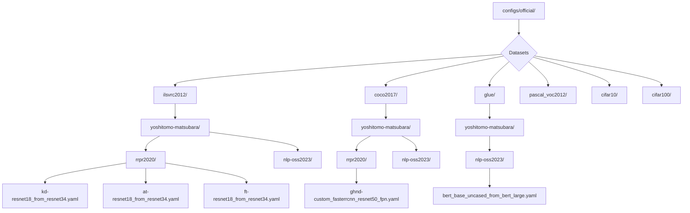
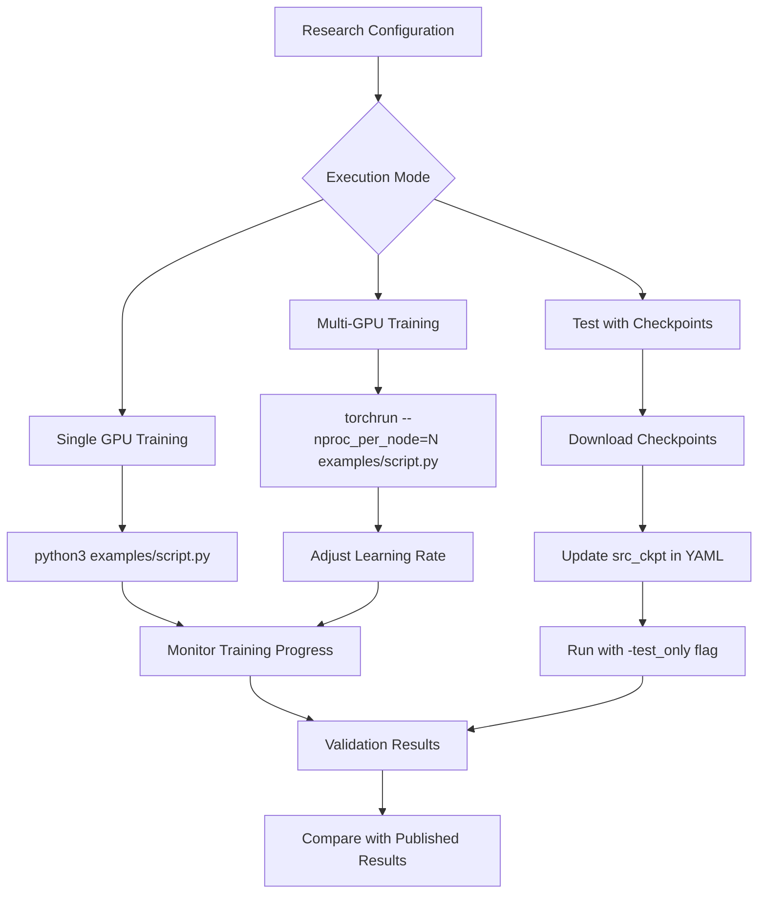
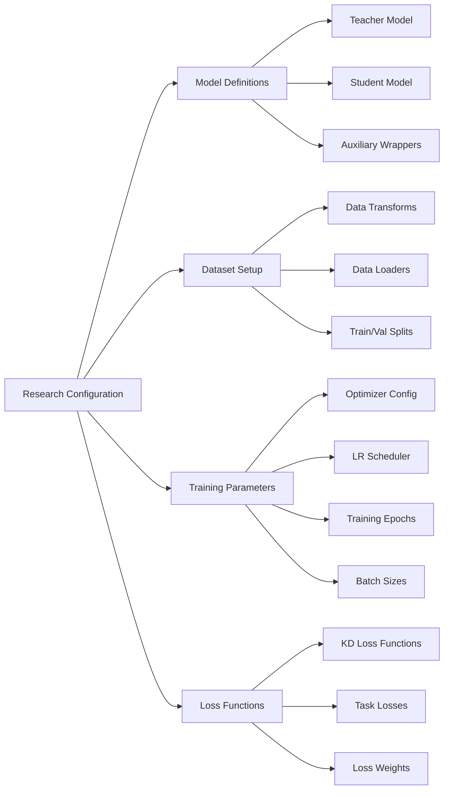

<!-- source: DeepWiki mcp.deepwiki.com · repo yoshitomo-matsubara/torchdistill · page 4.4 Research Configurations · fetched 2026-10-21 -->

# Research Configurations

<details>
<summary>Relevant source files</summary>

The following files were used as context for generating this wiki page:

- [configs/legacy/official/ilsvrc2012/yoshitomo-matsubara/rrpr2020/README.md](configs/legacy/official/ilsvrc2012/yoshitomo-matsubara/rrpr2020/README.md)
- [configs/official/cifar10/yoshitomo-matsubara/nlp-oss2023/README.md](configs/official/cifar10/yoshitomo-matsubara/nlp-oss2023/README.md)
- [configs/official/cifar100/yoshitomo-matsubara/nlp-oss2023/README.md](configs/official/cifar100/yoshitomo-matsubara/nlp-oss2023/README.md)
- [configs/official/coco2017/yoshitomo-matsubara/nlp-oss2023/README.md](configs/official/coco2017/yoshitomo-matsubara/nlp-oss2023/README.md)
- [configs/official/coco2017/yoshitomo-matsubara/rrpr2020/README.md](configs/official/coco2017/yoshitomo-matsubara/rrpr2020/README.md)
- [configs/official/glue/yoshitomo-matsubara/nlp-oss2023/README.md](configs/official/glue/yoshitomo-matsubara/nlp-oss2023/README.md)
- [configs/official/ilsvrc2012/yoshitomo-matsubara/nlp-oss2023/README.md](configs/official/ilsvrc2012/yoshitomo-matsubara/nlp-oss2023/README.md)
- [configs/official/ilsvrc2012/yoshitomo-matsubara/rrpr2020/README.md](configs/official/ilsvrc2012/yoshitomo-matsubara/rrpr2020/README.md)
- [configs/official/ilsvrc2012/yoshitomo-matsubara/rrpr2020/tfkd-resnet18_from_resnet18.log](configs/official/ilsvrc2012/yoshitomo-matsubara/rrpr2020/tfkd-resnet18_from_resnet18.log)
- [configs/official/pascal_voc2012/yoshitomo-matsubara/nlp-oss2023/README.md](configs/official/pascal_voc2012/yoshitomo-matsubara/nlp-oss2023/README.md)
- [examples/torchvision/README.md](examples/torchvision/README.md)

</details>


This section documents the official research configurations provided in torchdistill that enable exact reproduction of results from published research papers. These configurations contain the precise hyperparameters, model architectures, and training procedures used to generate the experimental results reported in academic publications.

For general usage examples and sample configurations, see [Configuration Examples](#4.3). For performance benchmarks and reproducibility information, see [Performance and Benchmarks](#5).

## Organization Structure

Research configurations are organized hierarchically by dataset, author, and publication to ensure clear provenance and reproducibility:



Sources: [configs/official/ilsvrc2012/yoshitomo-matsubara/rrpr2020/README.md:1-50](), [configs/official/coco2017/yoshitomo-matsubara/rrpr2020/README.md:1-30](), [configs/official/glue/yoshitomo-matsubara/nlp-oss2023/README.md:1-50]()

## Available Research Papers

### RRPR 2020: torchdistill Framework Paper

The foundational paper introducing the torchdistill framework includes comprehensive knowledge distillation experiments on ImageNet and COCO datasets.

**Citation**: Matsubara, Y. (2021). torchdistill: A Modular, Configuration-Driven Framework for Knowledge Distillation. *International Workshop on Reproducible Research in Pattern Recognition*, 24-44.

#### ImageNet (ILSVRC 2012) Experiments

| Method | Teacher | Student | Top-1 Accuracy | Configuration File |
|--------|---------|---------|----------------|-------------------|
| KD | ResNet-34 | ResNet-18 | 71.37% | `kd-resnet18_from_resnet34.yaml` |
| AT | ResNet-34 | ResNet-18 | 70.90% | `at-resnet18_from_resnet34.yaml` |
| FT | ResNet-34 | ResNet-18 | 71.56% | `ft-resnet18_from_resnet34.yaml` |
| CRD | ResNet-34 | ResNet-18 | 70.93% | `crd-resnet18_from_resnet34.yaml` |
| Tf-KD | ResNet-18 | ResNet-18 | 70.52% | `tfkd-resnet18_from_resnet18.yaml` |
| SSKD | ResNet-34 | ResNet-18 | 70.09% | `sskd-resnet18_from_resnet34.yaml` |
| PAD-L2 | ResNet-34 | ResNet-18 | 71.71% | `pad_l2-resnet18_from_resnet34.yaml` |

#### COCO 2017 Object Detection Experiments

| Method | Teacher | Student | mAP (BBox) | mAP (Mask) |
|--------|---------|---------|------------|------------|
| GHND | Faster R-CNN ResNet-50 | Bottleneck Faster R-CNN ResNet-50 | 35.9% | - |
| GHND | Mask R-CNN ResNet-50 | Bottleneck Mask R-CNN ResNet-50 | 36.9% | 33.6% |

### NLP-OSS 2023: Hugging Face Integration Paper

This paper demonstrates torchdistill's integration with Hugging Face libraries for NLP tasks and expanded computer vision experiments.

**Citation**: Matsubara, Y. (2023). torchdistill Meets Hugging Face Libraries for Reproducible, Coding-Free Deep Learning Studies: A Case Study on NLP. *NLP-OSS 2023*, 153-164.

#### GLUE Benchmark Results

| Model | Method | MNLI | QQP | QNLI | SST-2 | CoLA | STS-B | MRPC | RTE | WNLI |
|-------|--------|------|-----|------|-------|------|-------|------|-----|------|
| BERT-Large | FT | 86.4/85.7 | 72.2 | 92.4 | 94.6 | 61.5 | 85.0 | 89.2 | 68.9 | 65.1 |
| BERT-Base | FT | 84.2/83.3 | 71.4 | 91.0 | 94.1 | 51.1 | 84.4 | 86.8 | 66.7 | 65.8 |
| BERT-Base | KD | 85.9/84.7 | 72.8 | 90.7 | 93.7 | 57.0 | 85.6 | 87.5 | 66.7 | 65.1 |

#### Computer Vision Datasets

- **CIFAR-10**: ResNet and WideResNet models with accuracies up to 95.53%
- **CIFAR-100**: ResNet, WideResNet, and DenseNet models with accuracies up to 81.27%
- **PASCAL VOC 2012**: DeepLabv3 semantic segmentation with mIoU up to 82.4%
- **COCO 2017**: LRASPP semantic segmentation with mIoU of 58.2%

Sources: [configs/official/ilsvrc2012/yoshitomo-matsubara/rrpr2020/README.md:25-29](), [configs/official/glue/yoshitomo-matsubara/nlp-oss2023/README.md:17-27](), [configs/official/cifar10/yoshitomo-matsubara/nlp-oss2023/README.md:17-28]()

## Reproduction Workflow

The research configurations provide multiple execution modes to accommodate different computational resources and use cases:



### Testing with Pre-trained Checkpoints

For immediate result verification, download the official checkpoints and run inference:

```bash
# Download checkpoint
wget https://github.com/yoshitomo-matsubara/torchdistill/releases/download/v0.0.1/imagenet.zip

# Update src_ckpt in configuration file
# Run inference
python3 examples/torchvision/image_classification.py \
    --config configs/official/ilsvrc2012/yoshitomo-matsubara/rrpr2020/kd-resnet18_from_resnet34.yaml \
    -test_only
```

### Single GPU Training

For training from scratch on a single GPU:

```bash
python3 examples/torchvision/image_classification.py \
    --config configs/official/ilsvrc2012/yoshitomo-matsubara/rrpr2020/kd-resnet18_from_resnet34.yaml \
    --run_log log/ilsvrc2012/kd-resnet18_from_resnet34.log
```

### Multi-GPU Distributed Training

For faster training using multiple GPUs with automatic learning rate scaling:

```bash
export NUM_GPUS=3
torchrun --nproc_per_node=${NUM_GPUS} examples/torchvision/image_classification.py \
    --config configs/official/ilsvrc2012/yoshitomo-matsubara/rrpr2020/kd-resnet18_from_resnet34.yaml \
    --run_log log/ilsvrc2012/kd-resnet18_from_resnet34.log \
    --world_size ${NUM_GPUS} \
    -adjust_lr
```

Sources: [configs/official/ilsvrc2012/yoshitomo-matsubara/rrpr2020/README.md:40-50](), [configs/official/ilsvrc2012/yoshitomo-matsubara/rrpr2020/README.md:106-113](), [configs/official/ilsvrc2012/yoshitomo-matsubara/rrpr2020/README.md:195-200]()

## Configuration Components

Research configurations contain precisely tuned components that ensure exact reproduction of published results:



### Model Architecture Specifications

Research configurations specify exact model architectures with precise initialization:

- **Teacher Models**: Pre-trained models loaded from `torchvision.models` or custom implementations
- **Student Models**: Target architectures for knowledge distillation with specified checkpoint paths (`dst_ckpt`)
- **Auxiliary Wrappers**: Specialized model modifications for advanced distillation methods

### Hyperparameter Precision

Critical hyperparameters are fixed to match published experiments:

- **Learning Rates**: Exact values and schedules used in original experiments
- **Batch Sizes**: Adjusted for different GPU counts with scaling rules
- **Training Epochs**: Total training duration matching original experiments
- **Loss Weights**: Precise weightings for multi-term loss functions

### Distributed Training Adaptations

Multi-GPU configurations include scaling rules to maintain equivalent effective batch sizes:

- **CRD Method**: Requires `batch_size * NUM_GPUS = 256`
- **SSKD Method**: Requires `batch_size * NUM_GPUS = 256`
- **L2 Method**: Requires `batch_size * NUM_GPUS = 512`

Sources: [configs/official/ilsvrc2012/yoshitomo-matsubara/rrpr2020/README.md:134-136](), [configs/official/ilsvrc2012/yoshitomo-matsubara/rrpr2020/README.md:154-156](), [configs/official/ilsvrc2012/yoshitomo-matsubara/rrpr2020/README.md:165-167]()

## Execution Environments

### Computer Vision Tasks

Research configurations for computer vision use the torchvision integration:

- **Script**: `examples/torchvision/image_classification.py`
- **Script**: `examples/torchvision/object_detection.py`  
- **Script**: `examples/torchvision/semantic_segmentation.py`

### Natural Language Processing Tasks

NLP configurations leverage Hugging Face Accelerate for efficient training:

```bash
# Configure Accelerate
accelerate config

# Run GLUE experiments
accelerate launch examples/hf_transformers/text_classification.py \
    --config configs/official/glue/yoshitomo-matsubara/nlp-oss2023/cola/ce/bert_base_uncased.yaml \
    --task cola
```

### Multi-stage Training Methods

Some research configurations implement multi-stage training procedures:

- **PAD-L2**: Two-stage method requiring initial L2 training followed by PAD refinement
- **Multi-stage Definitions**: Can be defined in single YAML files with sequential stages

Sources: [configs/official/glue/yoshitomo-matsubara/nlp-oss2023/README.md:55-74](), [configs/official/ilsvrc2012/yoshitomo-matsubara/rrpr2020/README.md:92-94](), [configs/official/ilsvrc2012/yoshitomo-matsubara/rrpr2020/README.md:188-189]()

---

