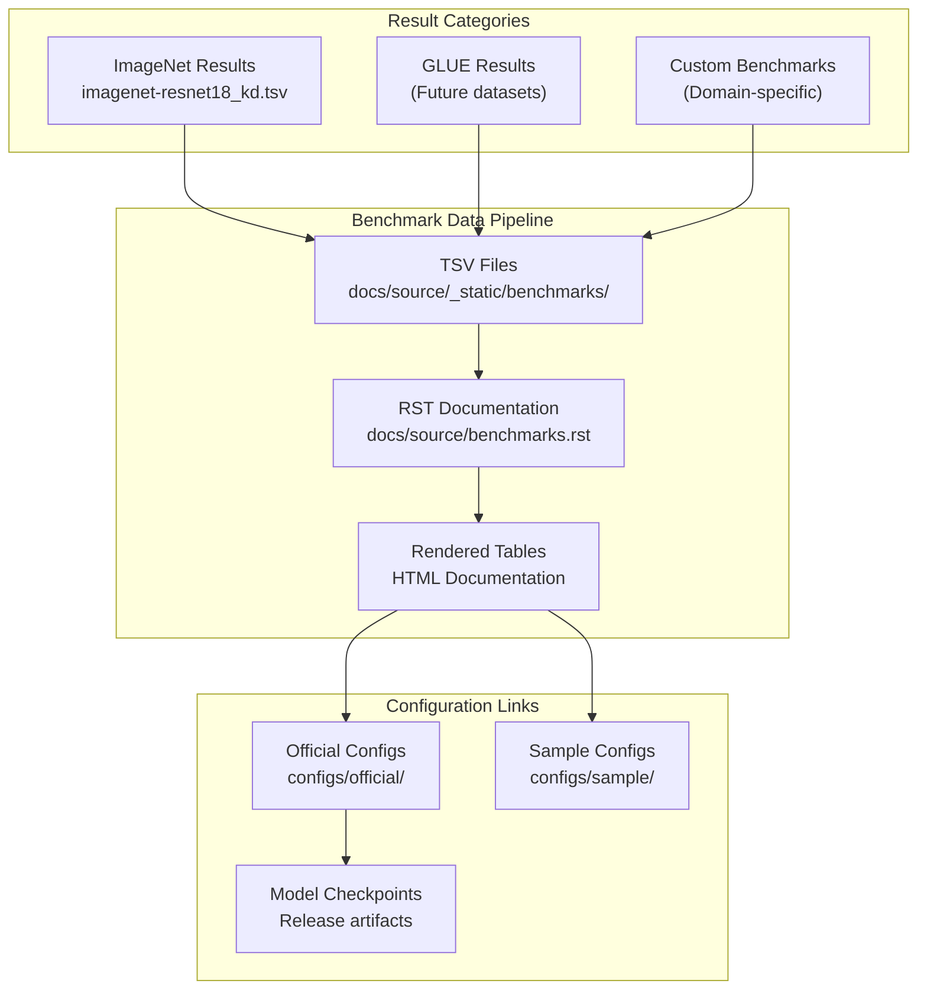
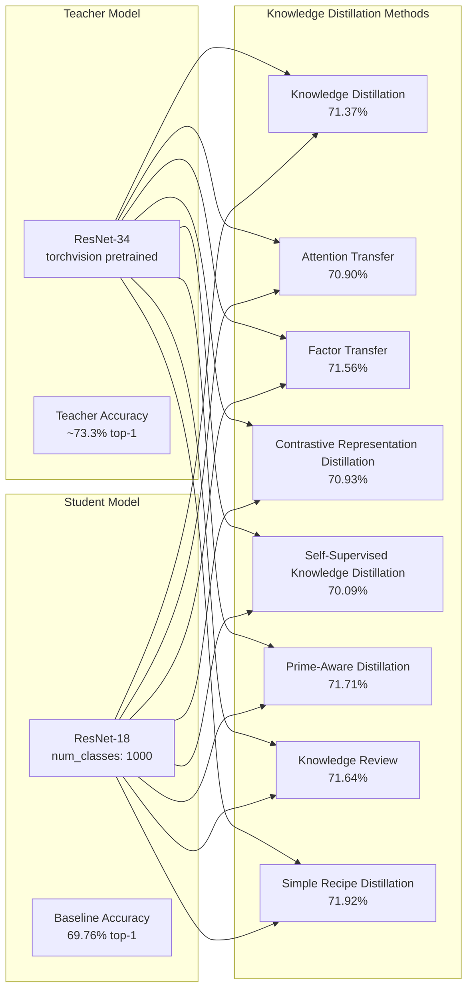
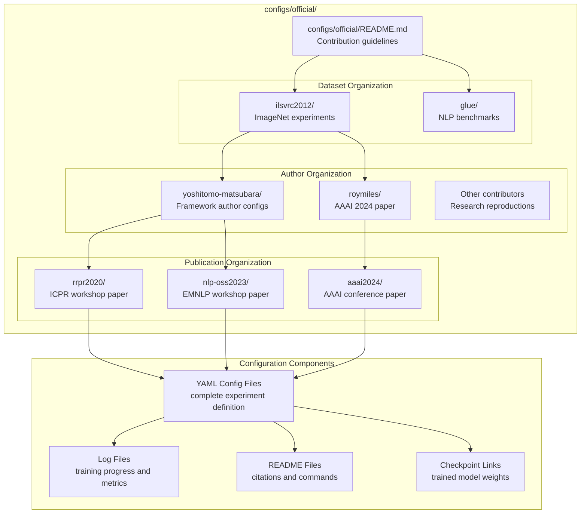
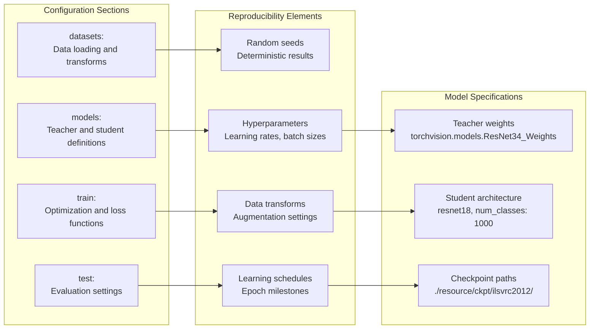
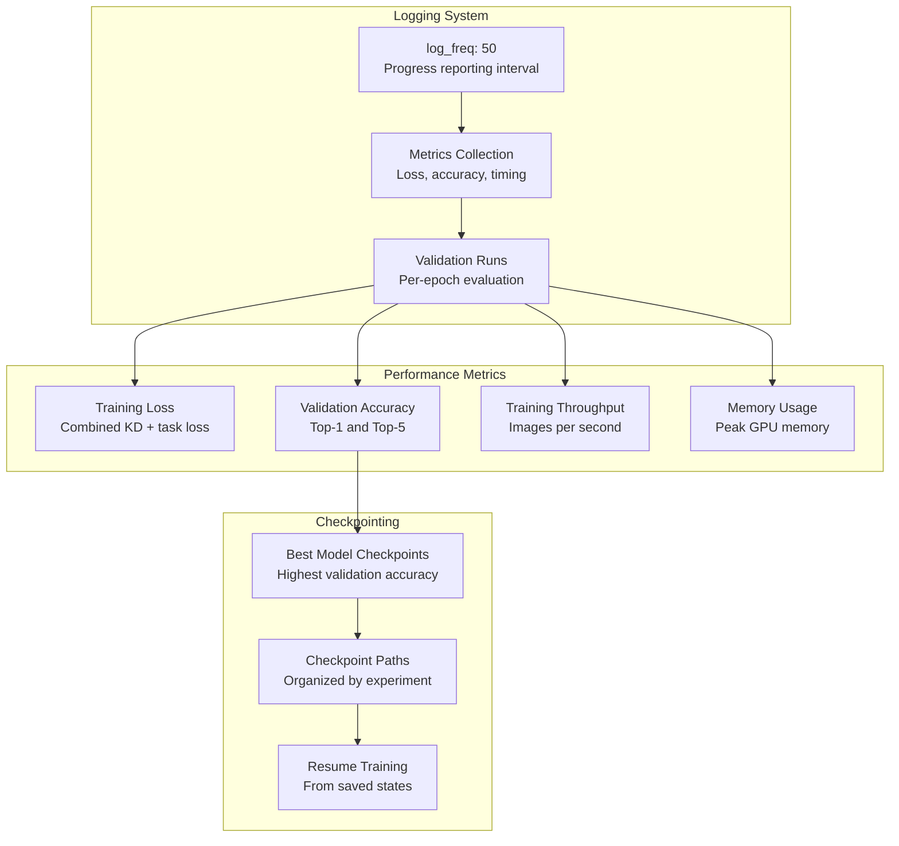
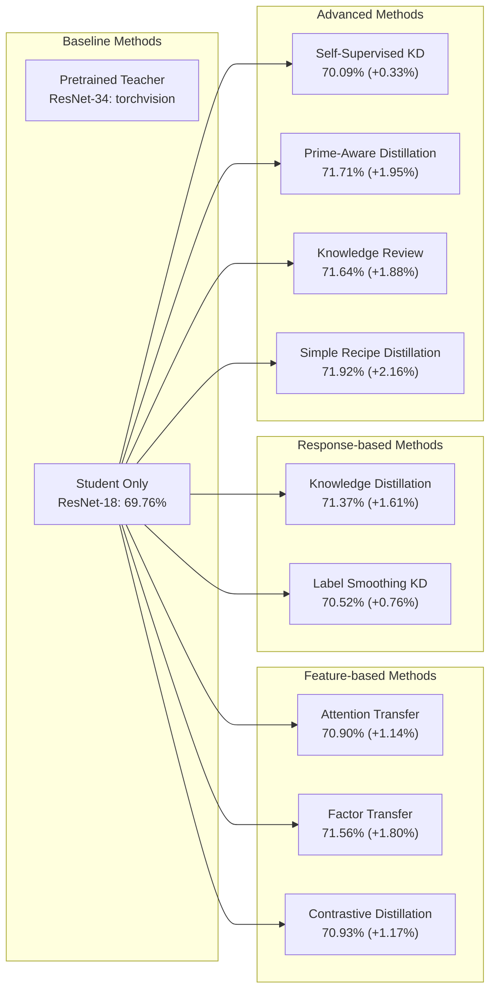

<!-- source: DeepWiki mcp.deepwiki.com · repo yoshitomo-matsubara/torchdistill · page 5 Performance and Benchmarks · fetched 2026-10-21 -->

# Performance and Benchmarks

<details>
<summary>Relevant source files</summary>

The following files were used as context for generating this wiki page:

- [configs/official/README.md](configs/official/README.md)
- [configs/official/ilsvrc2012/roymiles/aaai2024/README.md](configs/official/ilsvrc2012/roymiles/aaai2024/README.md)
- [configs/official/ilsvrc2012/roymiles/aaai2024/srd-resnet18_from_resnet34.log](configs/official/ilsvrc2012/roymiles/aaai2024/srd-resnet18_from_resnet34.log)
- [configs/official/ilsvrc2012/roymiles/aaai2024/srd-resnet18_from_resnet34.yaml](configs/official/ilsvrc2012/roymiles/aaai2024/srd-resnet18_from_resnet34.yaml)
- [configs/official/ilsvrc2012/yoshitomo-matsubara/nlp-oss2023/kr-resnet18_from_resnet34.yaml](configs/official/ilsvrc2012/yoshitomo-matsubara/nlp-oss2023/kr-resnet18_from_resnet34.yaml)
- [docs/source/_static/benchmarks/imagenet-resnet18_kd.tsv](docs/source/_static/benchmarks/imagenet-resnet18_kd.tsv)
- [docs/source/benchmarks.rst](docs/source/benchmarks.rst)

</details>


This page documents torchdistill's performance benchmarking system, reproducible experimental results, and official configuration repository. It covers benchmark result formats, reproducibility infrastructure, and the relationship between published research and torchdistill implementations.

For information about configuring individual experiments, see [Configuration Examples](#4.3). For research-specific configurations, see [Research Configurations](#4.4).

## Benchmark Results Infrastructure

The torchdistill framework maintains a comprehensive benchmarking system that compares knowledge distillation methods against their original implementations and provides reproducible configurations.

### Result Storage Format

Benchmark results are stored in tab-separated value (TSV) format within the documentation system:



**TSV Result Format**
The benchmark files follow a standardized format with columns for method name, original work results, torchdistill reproduced results, and configuration links:

| Column | Description | Example |
|--------|-------------|---------|
| Method | Knowledge distillation method name | `KD`, `AT`, `FT`, `CRD` |
| Original work | Results from original paper | `70.70`, `71.43*` |
| torchdistill | Reproduced results using torchdistill | `70.90`, `71.56` |
| Config | Link to configuration files | `torchdistill/configs/official/...` |

Sources: [docs/source/_static/benchmarks/imagenet-resnet18_kd.tsv:1-16](), [docs/source/benchmarks.rst:22-27]()

### ImageNet ILSVRC 2012 Results

The primary benchmark dataset is ImageNet ILSVRC 2012, using ResNet-18 as the student model with ResNet-34 as the teacher:



**Performance Comparison**
The benchmark results demonstrate torchdistill's ability to reproduce and sometimes exceed original paper results:

- **Knowledge Distillation (KD)**: 71.37% (no original baseline for comparison)
- **Attention Transfer (AT)**: 70.90% vs 70.70% original
- **Factor Transfer (FT)**: 71.56% vs 71.43% original
- **Knowledge Review (KR)**: 71.64% vs 71.61% original
- **Simple Recipe Distillation (SRD)**: 71.92% vs 71.63% original

Sources: [docs/source/_static/benchmarks/imagenet-resnet18_kd.tsv:3-14](), [docs/source/benchmarks.rst:35-46]()

## Reproducibility Framework

The torchdistill reproducibility framework ensures that benchmark results can be independently verified and extended by providing complete experimental configurations and trained model checkpoints.

### Official Configuration Repository



**Configuration Structure**
Each official configuration includes:

1. **Complete YAML Configuration**: Dataset, model, training, and evaluation settings
2. **Training Logs**: Full training output with metrics and timing information
3. **Documentation**: Citation information, reproduction commands, and results
4. **Model Checkpoints**: Pre-trained weights available for download

Sources: [configs/official/README.md:1-8](), [configs/official/ilsvrc2012/roymiles/aaai2024/README.md:1-53]()

### Experimental Configuration Format

The YAML configuration files provide complete experiment definitions that ensure reproducibility:



**Example: SRD Configuration Structure**
The Simple Recipe Distillation configuration demonstrates the comprehensive nature of torchdistill configurations:

- **Dataset Configuration**: ImageNet with specific transforms and normalization
- **Model Configuration**: ResNet-34 teacher with pre-trained weights, ResNet-18 student
- **Training Configuration**: SGD optimizer, MultiStepLR scheduler, 100 epochs
- **Loss Configuration**: Weighted combination of CrossEntropy and SRD-specific losses
- **Auxiliary Models**: SRDModelWrapper for feature normalization and projection

Sources: [configs/official/ilsvrc2012/roymiles/aaai2024/srd-resnet18_from_resnet34.yaml:1-201]()

## Performance Analysis and Validation

The benchmark system includes comprehensive validation mechanisms to ensure result reliability and enable performance analysis across different knowledge distillation methods.

### Training Progress Monitoring



**Training Log Analysis**
The training logs provide detailed insights into the knowledge distillation process:

- **Epoch-by-epoch progress**: Loss convergence and accuracy improvement
- **Performance metrics**: Training throughput (960+ images/second), memory usage (9397 MB peak)
- **Validation tracking**: Regular evaluation with top-1 and top-5 accuracy
- **Best model selection**: Automatic checkpoint saving based on validation performance

The SRD training log shows progression from 30.7% accuracy at epoch 0 to 71.92% final accuracy, demonstrating effective knowledge transfer.

Sources: [configs/official/ilsvrc2012/roymiles/aaai2024/srd-resnet18_from_resnet34.log:1-500]()

### Method Comparison Framework



**Performance Analysis**
The benchmark results reveal several key insights:

1. **Consistent Improvements**: All methods show positive gains over the baseline student model
2. **Method Effectiveness**: Feature-based methods (AT, FT) and advanced methods (PAD, KR, SRD) achieve the highest improvements
3. **Reproducibility**: torchdistill results closely match or exceed original paper results
4. **Method Range**: Performance improvements range from 0.33% (SSKD) to 2.16% (SRD)

### Testing and Evaluation Commands

The framework provides standardized commands for testing and reproducing results:

```bash
# Test with pre-trained checkpoints
python3 examples/torchvision/image_classification.py \
    --config configs/official/ilsvrc2012/roymiles/aaai2024/srd-resnet18_from_resnet34.yaml \
    -test_only

# Train from scratch
python3 examples/torchvision/image_classification.py \
    --config configs/official/ilsvrc2012/roymiles/aaai2024/srd-resnet18_from_resnet34.yaml \
    --run_log log/ilsvrc2012/srd-resnet18_from_resnet34.log
```

**Checkpoint Management**
- Checkpoint files available via GitHub releases and Google Drive
- Organized by dataset, method, and experiment configuration
- Includes both intermediate and final model states
- Enables quick validation without full retraining

Sources: [configs/official/ilsvrc2012/roymiles/aaai2024/README.md:31-52](), [docs/source/benchmarks.rst:48-51]()

---

