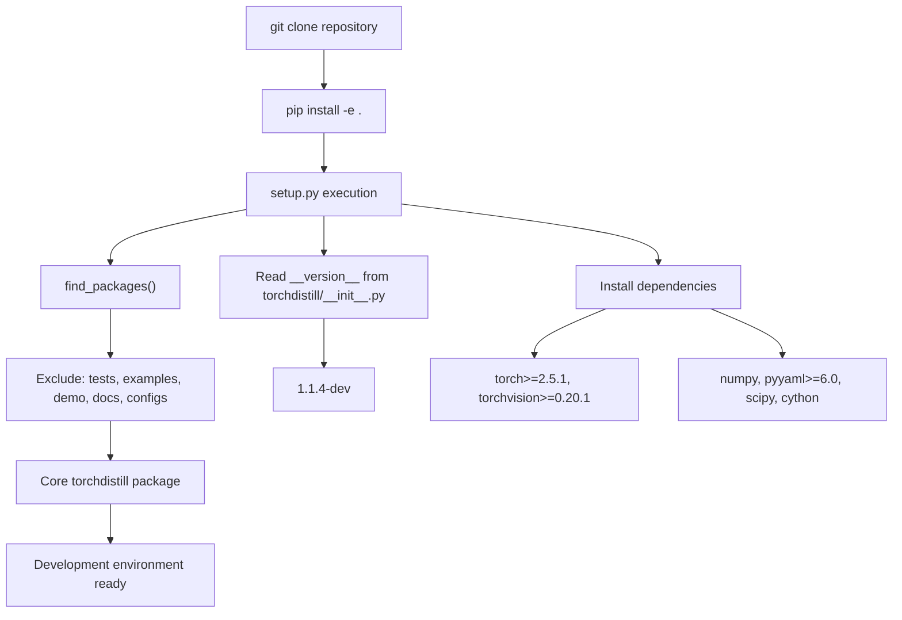
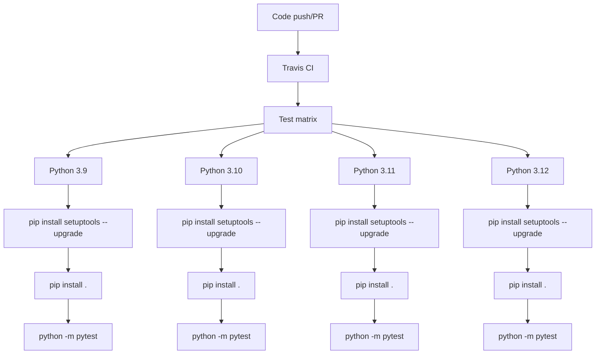

<!-- source: DeepWiki mcp.deepwiki.com · repo yoshitomo-matsubara/torchdistill · page 6 Installation and Development · fetched 2026-10-21 -->

# Installation and Development

<details>
<summary>Relevant source files</summary>

The following files were used as context for generating this wiki page:

- [.github/workflows/documentation.yaml](.github/workflows/documentation.yaml)
- [.travis.yml](.travis.yml)
- [setup.py](setup.py)
- [torchdistill/__init__.py](torchdistill/__init__.py)

</details>


This document provides comprehensive instructions for installing torchdistill and setting up a development environment. It covers installation requirements, development workflows, testing procedures, documentation building, and continuous integration processes.

For information about using torchdistill's configuration system and running experiments, see [Core Architecture](#2). For practical usage examples, see [Examples and Usage](#4).

## Installation

### System Requirements

torchdistill requires Python 3.9 or higher and is built on the PyTorch ecosystem. The framework supports multiple Python versions as validated through continuous integration.

**Supported Python Versions:**
- Python 3.9
- Python 3.10  
- Python 3.11
- Python 3.12

Sources: [.travis.yml:12-16](), [setup.py:19]()

### Core Dependencies

The framework has the following core dependencies defined in the setup configuration:

| Dependency | Version Requirement | Purpose |
|------------|-------------------|---------|
| `torch` | >=2.5.1 | Core neural network framework |
| `torchvision` | >=0.20.1 | Computer vision models and datasets |
| `numpy` | Latest | Numerical computing |
| `pyyaml` | >=6.0 | YAML configuration parsing |
| `scipy` | Latest | Scientific computing utilities |
| `cython` | Latest | Performance optimizations |

Sources: [setup.py:20-27]()

### Installation Methods

#### Standard Installation

Install torchdistill from PyPI using pip:

```bash
pip install torchdistill
```

#### Development Installation

For development work, clone the repository and install in editable mode:

```bash
git clone https://github.com/yoshitomo-matsubara/torchdistill.git
cd torchdistill
pip install -e .
```

The editable installation allows modifications to the source code to be immediately reflected without reinstalling.

Sources: [.github/workflows/documentation.yaml:19](), [setup.py:10-32]()

### Optional Dependencies

torchdistill defines optional dependency groups for specific use cases:

#### Testing Dependencies
```bash
pip install torchdistill[test]
```
Includes: `pytest` for running the test suite.

#### Documentation Dependencies
```bash
pip install torchdistill[docs]
```
Includes: `sphinx`, `sphinx_rtd_theme`, `sphinx_sitemap` for building documentation.

Sources: [setup.py:28-31]()

## Development Environment Setup

### Package Structure and Exclusions

The `setup.py` configuration excludes certain directories from the installed package to keep the distribution clean:

#### Installation Flow Diagram



Sources: [setup.py:18](), [torchdistill/__init__.py:1]()

### Running Tests

The project uses `pytest` as the testing framework. Tests are executed in the continuous integration pipeline and can be run locally:

```bash
# Install test dependencies
pip install torchdistill[test]

# Run tests
python -m pytest
```

Sources: [.travis.yml:23](), [setup.py:29]()

## Documentation System

### Documentation Building Process

torchdistill uses Sphinx for documentation generation with the Read the Docs theme. The documentation system is integrated with GitHub Actions for automated deployment.

#### Documentation Build Workflow


### Building Documentation Locally

To build documentation locally for development:

```bash
# Install documentation dependencies
pip install torchdistill[docs]

# Install torchdistill in development mode
pip install -e .

# Build documentation
sphinx-build -b html docs/source/ docs/_build/
```

The built documentation will be available in the `docs/_build/` directory.

Sources: [.github/workflows/documentation.yaml:14-22]()

### Documentation Deployment

Documentation is automatically deployed to GitHub Pages through a GitHub Actions workflow that:

1. Triggers on push, pull request, or manual dispatch
2. Sets up Python 3.10 environment
3. Installs Sphinx dependencies and torchdistill
4. Builds documentation using `sphinx-build`
5. Deploys to the `gh-pages` branch on main branch pushes

The deployment uses the `peaceiris/actions-gh-pages@v3` action with force orphan mode to maintain a clean deployment history.

Sources: [.github/workflows/documentation.yaml:1-30]()

## Continuous Integration

### Travis CI Configuration

The project uses Travis CI for cross-platform testing across multiple Python versions:

#### CI Pipeline Flow



### CI Environment Configuration

The Travis CI configuration includes:
- **Operating System**: Ubuntu Focal (20.04)
- **Caching**: pip cache and `$HOME/.cache/` directory
- **Test Matrix**: All supported Python versions
- **Installation Process**: Upgrade setuptools, install package, run tests

Sources: [.travis.yml:1-24]()

### GitHub Actions Integration

In addition to Travis CI, the project uses GitHub Actions for documentation deployment, providing a dual CI/CD approach:
- **Travis CI**: Cross-version testing and validation
- **GitHub Actions**: Documentation building and deployment

This ensures both code quality and documentation consistency across the development lifecycle.

Sources: [.github/workflows/documentation.yaml:1-30]()

## Development Workflow

### Version Management

The project version is centrally managed in `torchdistill/__init__.py` and referenced by `setup.py` during package building. The current development version is `1.1.4-dev`, indicating active development toward the next release.

### Package Distribution

The `setup.py` configuration defines the package for distribution with:
- **Package Discovery**: Automatic discovery via `find_packages()`
- **Exclusions**: Development files (`tests`, `examples`, `demo`, `docs`, `configs`)
- **Metadata**: Author, description, and repository URL
- **Content Type**: Markdown for PyPI display

This ensures clean package distribution while maintaining comprehensive development resources in the repository.

Sources: [setup.py:1-32](), [torchdistill/__init__.py:1]()