# Page: Overview

# Overview

<details>
<summary>Relevant source files</summary>

The following files were used as context for generating this wiki page:

- [README.md](README.md)
- [configs/README.md](configs/README.md)
- [demo/extract_intermediate_representations.ipynb](demo/extract_intermediate_representations.ipynb)
- [docs/source/conf.py](docs/source/conf.py)
- [docs/source/index.rst](docs/source/index.rst)
- [docs/source/package.rst](docs/source/package.rst)
- [docs/source/projects.rst](docs/source/projects.rst)
- [docs/source/subpkgs/common.rst](docs/source/subpkgs/common.rst)
- [docs/source/subpkgs/core.rst](docs/source/subpkgs/core.rst)
- [docs/source/subpkgs/datasets.rst](docs/source/subpkgs/datasets.rst)
- [docs/source/subpkgs/losses.rst](docs/source/subpkgs/losses.rst)
- [docs/source/subpkgs/misc.rst](docs/source/subpkgs/misc.rst)
- [docs/source/subpkgs/models.rst](docs/source/subpkgs/models.rst)
- [docs/source/subpkgs/optim.rst](docs/source/subpkgs/optim.rst)

</details>


## Purpose and Scope

This document provides an overview of **torchdistill**, a modular, configuration-driven framework for knowledge distillation and deep learning experiments. The framework enables researchers to design and execute reproducible experiments through declarative YAML configuration files, eliminating the need for extensive Python coding in most cases.

torchdistill supports both knowledge distillation (teacher-student training) and standard deep learning training scenarios. For detailed information about specific components, see [Core Architecture](#2), [Components](#3), and [Examples and Usage](#4).

## Core Philosophy

torchdistill follows a "coding-free" design philosophy where experiments are entirely defined through YAML configuration files. The framework uses dynamic object instantiation to create and orchestrate machine learning components, making experiments highly reproducible and easily configurable.

**Key Design Principles:**
- **Configuration-driven**: One experiment equals one YAML file
- **Non-invasive**: Extract intermediate representations without modifying model code
- **Modular**: Component registry system for easy extensibility
- **Reproducible**: Complete experiment specification in declarative format

Sources: [README.md:10-18](), [README.md:66-71]()

## High-Level Architecture

**torchdistill Core Architecture**
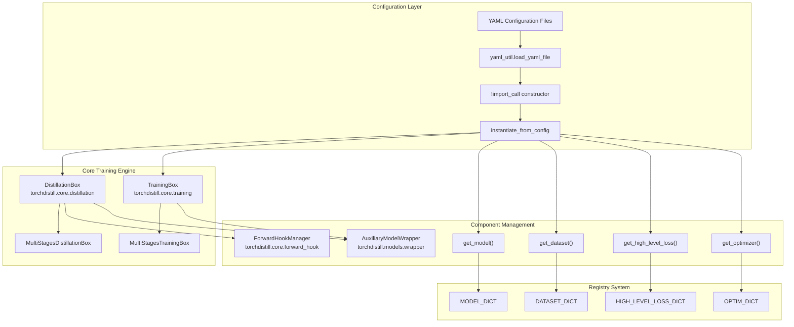

The framework operates through three main layers: configuration processing via `yaml_util`, core training orchestration through `DistillationBox`/`TrainingBox` classes, and component management via registry dictionaries and getter functions.

Sources: [README.md:32-63](), [README.md:178-194](), [torchdistill/core/distillation.py](), [torchdistill/core/training.py](), [torchdistill/core/forward_hook.py]()

## Configuration-Driven Workflow

**Configuration to Execution Pipeline**
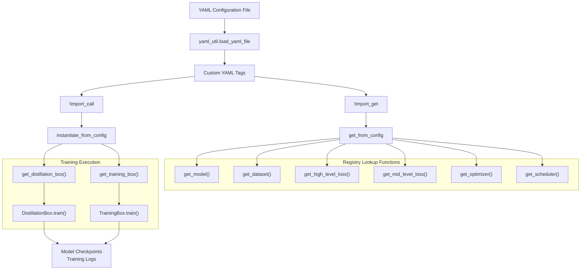

The framework processes YAML configurations through custom PyYAML constructors (`!import_call`, `!import_get`) that enable dynamic object instantiation and component retrieval from registry dictionaries.

Sources: [README.md:74-79](), [README.md:82-135](), [torchdistill/common/yaml_util.py](), [torchdistill/common/main_util.py]()

## Key Components

### Forward Hook Manager

The `ForwardHookManager` enables non-invasive extraction of intermediate representations from PyTorch models without modifying their forward methods.

| Component | Purpose | Key Methods |
|-----------|---------|-------------|
| `ForwardHookManager` | Extract intermediate features | `add_hook()`, `pop_io_dict()` |
| Forward hooks | Capture input/output tensors | Automatic during forward pass |
| I/O dictionary | Store extracted representations | Module path → input/output mapping |

**Example Usage:**
```python
# From README.md:48-62
forward_hook_manager = ForwardHookManager(device)
forward_hook_manager.add_hook(model, 'conv1', requires_input=True)
forward_hook_manager.add_hook(model, 'layer1.0.bn2', requires_input=True, requires_output=True)
```

Sources: [README.md:32-63](), [demo/extract_intermediate_representations.ipynb:62-68]()

### Component Registry System

**Registry Pattern Implementation**
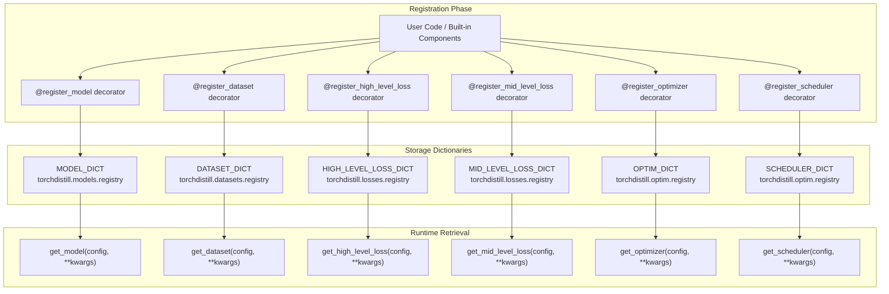

The registry system uses decorators to populate component dictionaries during import time, then provides getter functions for runtime component instantiation based on configuration keys.

| Registry Module | Decorator | Dictionary | Getter Function |
|-----------------|-----------|------------|-----------------|
| `torchdistill.models.registry` | `@register_model` | `MODEL_DICT` | `get_model()` |
| `torchdistill.datasets.registry` | `@register_dataset` | `DATASET_DICT` | `get_dataset()` |
| `torchdistill.losses.registry` | `@register_high_level_loss` | `HIGH_LEVEL_LOSS_DICT` | `get_high_level_loss()` |
| `torchdistill.losses.registry` | `@register_mid_level_loss` | `MID_LEVEL_LOSS_DICT` | `get_mid_level_loss()` |
| `torchdistill.optim.registry` | `@register_optimizer` | `OPTIM_DICT` | `get_optimizer()` |
| `torchdistill.optim.registry` | `@register_scheduler` | `SCHEDULER_DICT` | `get_scheduler()` |

Sources: [torchdistill/models/registry.py](), [torchdistill/datasets/registry.py](), [torchdistill/losses/registry.py](), [torchdistill/optim/registry.py]()

### Training and Distillation Framework

**Core Training Classes**
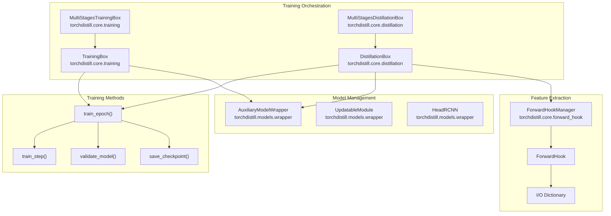

The framework provides specialized training orchestration through "box" classes that encapsulate different training scenarios and handle model management, feature extraction, and training lifecycle.

| Component | Module | Purpose |
|-----------|--------|---------|
| `TrainingBox` | `torchdistill.core.training` | Standard single-model training |
| `DistillationBox` | `torchdistill.core.distillation` | Teacher-student knowledge distillation |
| `MultiStagesTrainingBox` | `torchdistill.core.training` | Sequential training phases |
| `MultiStagesDistillationBox` | `torchdistill.core.distillation` | Multi-stage distillation |
| `AuxiliaryModelWrapper` | `torchdistill.models.wrapper` | Model behavior modification |
| `ForwardHookManager` | `torchdistill.core.forward_hook` | Non-invasive feature extraction |

Sources: [torchdistill/core/training.py](), [torchdistill/core/distillation.py](), [torchdistill/models/wrapper.py](), [torchdistill/core/forward_hook.py]()

## Framework Features

### Domain Support

torchdistill supports multiple machine learning domains through integrated examples and configurations:

| Domain | Tasks | Integration |
|--------|-------|-------------|
| Computer Vision | Image classification, object detection, segmentation | TorchVision models and datasets |
| Natural Language Processing | Text classification, GLUE benchmark | HuggingFace Transformers |
| Custom Domains | User-defined tasks | Extensible registry system |

Sources: [README.md:146-158](), [examples/torchvision/](), [examples/hf_transformers/]()

### Knowledge Distillation Methods

The framework implements state-of-the-art knowledge distillation techniques:

- **Basic KD**: Hinton et al. soft target distillation
- **Feature-based**: FitNet, Attention Transfer, Factor Transfer
- **Relation-based**: Relational KD, Similarity-Preserving KD
- **Advanced methods**: Variational Information Distillation, Contrastive Representation Distillation

Sources: [README.md:265-287]()

### External Integration

**PyTorch Ecosystem Integration**
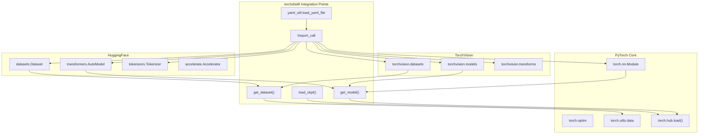

The framework integrates with the PyTorch ecosystem through direct instantiation via `!import_call` in YAML configs and through PyTorch Hub for model loading. This enables seamless use of external libraries without modification.

**Integration Examples:**
- **TorchVision**: Direct model/dataset instantiation in YAML
- **HuggingFace**: Transformers, datasets, and tokenizers support
- **PyTorch Hub**: Remote model loading via `torch.hub.load()`
- **Custom Libraries**: Any Python class can be instantiated via `!import_call`

Sources: [README.md:178-194](), [examples/torchvision/](), [examples/hf_transformers/](), [torchdistill/common/yaml_util.py]()

## Getting Started

### Installation

```bash
pip3 install torchdistill
```

### Basic Usage Pattern

1. **Define experiment** in YAML configuration file
2. **Run training** using provided examples or custom scripts
3. **Analyze results** through generated logs and checkpoints

The framework requires minimal Python coding - most experiments are fully specified through configuration files.

Sources: [README.md:197-215]()

### Example Configuration Structure

```yaml
# Basic structure from README.md:82-135
datasets:
  train_dataset: !import_call
    key: 'torchvision.datasets.CIFAR10'
    init:
      kwargs:
        root: '~/datasets/cifar10'
        train: True

models:
  student_model:
    key: 'resnet18'
    kwargs:
      num_classes: 10
```

This configuration-first approach enables reproducible research and easy experiment modification without code changes.

Sources: [README.md:82-135](), [configs/sample/]()

---

# Page: Core Architecture

# Core Architecture

<details>
<summary>Relevant source files</summary>

The following files were used as context for generating this wiki page:

- [README.md](README.md)
- [configs/README.md](configs/README.md)
- [demo/extract_intermediate_representations.ipynb](demo/extract_intermediate_representations.ipynb)
- [torchdistill/core/distillation.py](torchdistill/core/distillation.py)
- [torchdistill/core/forward_hook.py](torchdistill/core/forward_hook.py)
- [torchdistill/core/training.py](torchdistill/core/training.py)
- [torchdistill/core/util.py](torchdistill/core/util.py)
- [torchdistill/models/wrapper.py](torchdistill/models/wrapper.py)

</details>


This document explains the core architectural components and design patterns that form the foundation of torchdistill. It covers the configuration-driven system, training framework, component registry, and forward hook management that enable modular, declarative knowledge distillation experiments.

For specific component implementations (models, datasets, losses, optimizers), see [Components](#3). For practical usage examples, see [Examples and Usage](#4).

## Architectural Overview

torchdistill follows a configuration-driven architecture where YAML files declaratively define entire experiments. The framework consists of four main architectural pillars that work together to enable flexible knowledge distillation workflows.

### Core Architecture Diagram

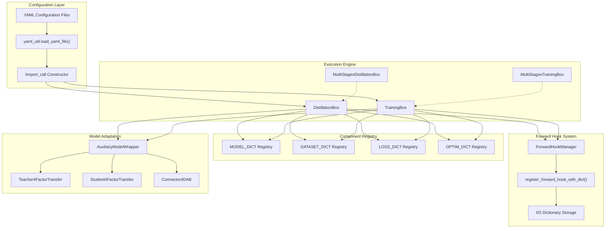

Sources: [torchdistill/core/distillation.py:28-567](), [torchdistill/core/training.py:24-416](), [torchdistill/core/forward_hook.py:104-206](), [torchdistill/models/wrapper.py:16-30]()

## Configuration-Driven System

The configuration system enables declarative experiment definition through YAML files. All components are instantiated and configured without requiring Python code changes.

### Configuration Flow

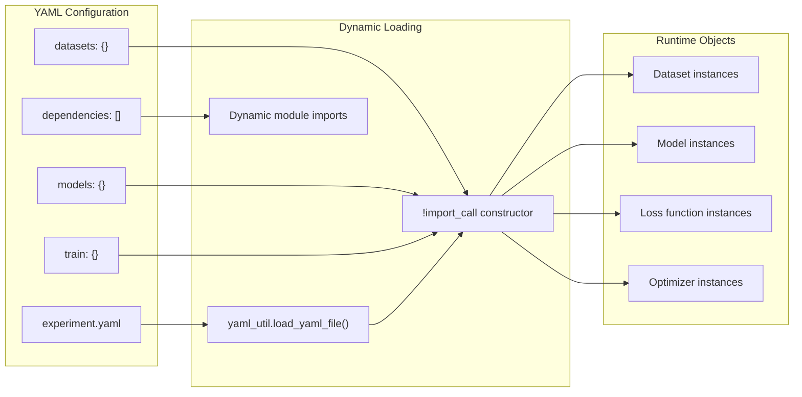

The `!import_call` constructor allows instantiation of any Python class with specified arguments directly from YAML configuration. This eliminates the need to modify framework code when adding new components.

Sources: [README.md:66-140](), [torchdistill/common/yaml_util.py]()

## Training Framework

The training framework provides two main execution engines: `TrainingBox` for standard training and `DistillationBox` for knowledge distillation.

### Training Box Architecture

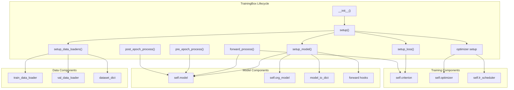

Sources: [torchdistill/core/training.py:24-416]()

### Distillation Box Architecture

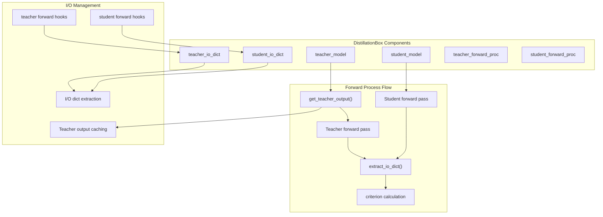

The `DistillationBox` manages both teacher and student models, handles forward hook registration for intermediate feature extraction, and supports teacher output caching for efficiency.

Sources: [torchdistill/core/distillation.py:28-567]()

## Component Registry System

The registry system provides a plugin architecture for models, datasets, losses, and optimizers. Components are registered via decorators and retrieved by string keys.

### Registry Pattern Implementation

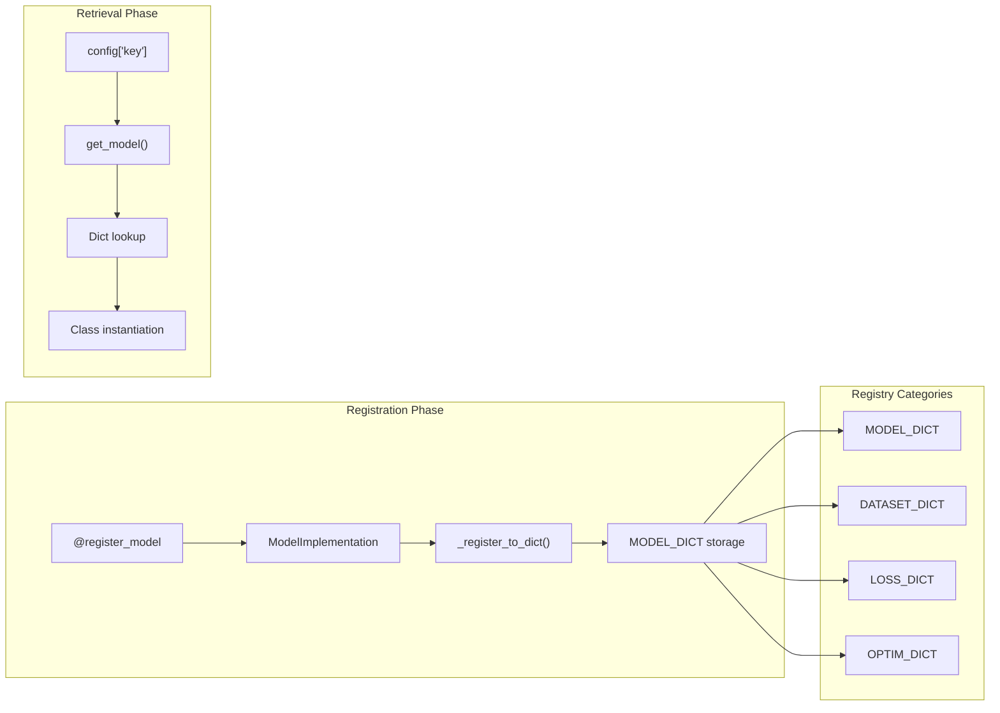

Each component category uses the same registration pattern:

| Component Type | Registry Dict | Registration Decorator | Getter Function |
|----------------|--------------|----------------------|-----------------|
| Models | `MODEL_DICT` | `@register_model` | `get_model()` |
| Datasets | `DATASET_DICT` | `@register_dataset` | `get_dataset()` |
| Losses | `LOSS_DICT` | `@register_loss` | `get_loss()` |
| Optimizers | `OPTIM_DICT` | `@register_optimizer` | `get_optimizer()` |

Sources: [torchdistill/models/registry.py](), [torchdistill/datasets/registry.py](), [torchdistill/losses/registry.py](), [torchdistill/optim/registry.py]()

## Forward Hook Management

The `ForwardHookManager` provides a clean API for extracting intermediate representations from PyTorch models without modifying their forward methods.

### Forward Hook System Architecture

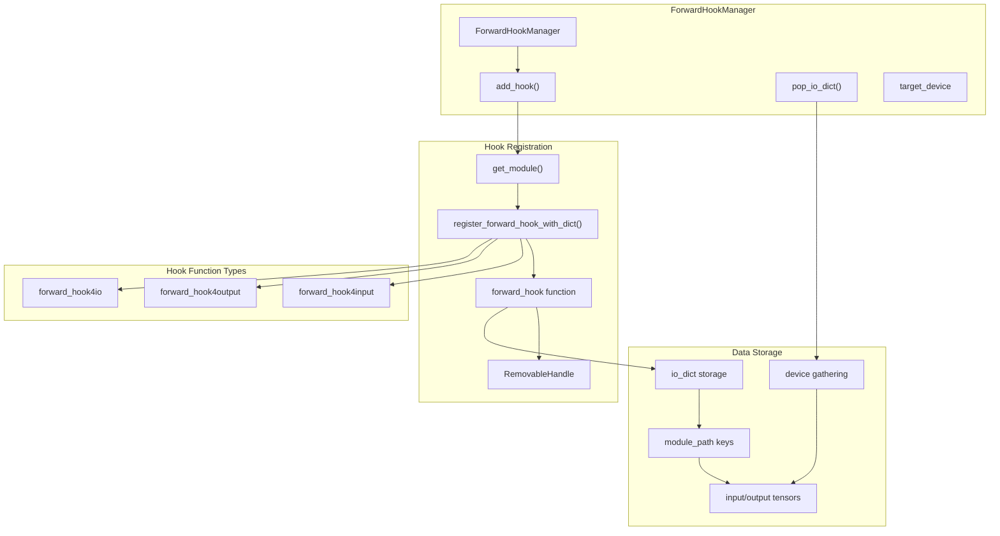

The hook system supports three modes:
- Input-only hooks (`requires_input=True, requires_output=False`)
- Output-only hooks (`requires_input=False, requires_output=True`)  
- Input-output hooks (`requires_input=True, requires_output=True`)

Sources: [torchdistill/core/forward_hook.py:39-206]()

## Model Wrapper System

The auxiliary model wrapper system allows modification of model behavior for specific knowledge distillation methods without changing the original model implementations.

### Auxiliary Wrapper Hierarchy

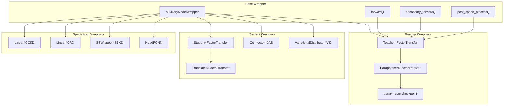

Each wrapper implements:
- `forward()`: Primary model forward pass
- `secondary_forward()`: Additional computations using I/O dict
- `post_epoch_process()`: End-of-epoch operations (e.g., checkpoint saving)

Sources: [torchdistill/models/wrapper.py:16-567]()

## Integration Patterns

The architectural components integrate through well-defined interfaces and data flow patterns.

### Component Integration Flow

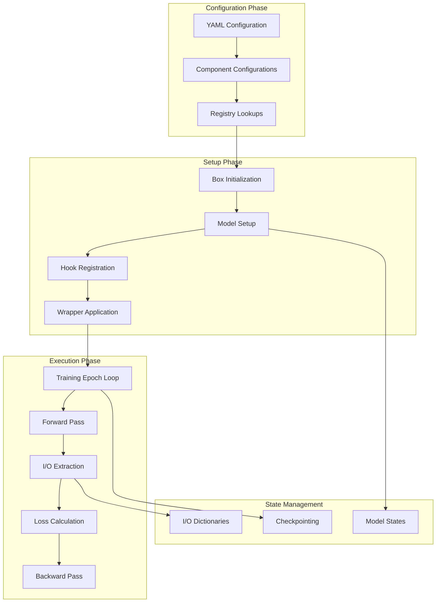

This integration enables:
- **Declarative Configuration**: Complete experiment definition in YAML
- **Modular Components**: Pluggable models, datasets, losses, optimizers
- **Feature Extraction**: Non-intrusive intermediate representation access
- **Model Adaptation**: Behavior modification through wrappers
- **Multi-stage Training**: Progressive training configurations

Sources: [torchdistill/core/distillation.py:176-282](), [torchdistill/core/training.py:141-220](), [torchdistill/core/util.py:36-67]()

---

# Page: Configuration-Driven System

# Configuration-Driven System

<details>
<summary>Relevant source files</summary>

The following files were used as context for generating this wiki page:

- [README.md](README.md)
- [configs/README.md](configs/README.md)
- [demo/extract_intermediate_representations.ipynb](demo/extract_intermediate_representations.ipynb)
- [torchdistill/common/file_util.py](torchdistill/common/file_util.py)
- [torchdistill/common/main_util.py](torchdistill/common/main_util.py)
- [torchdistill/common/misc_util.py](torchdistill/common/misc_util.py)
- [torchdistill/common/module_util.py](torchdistill/common/module_util.py)
- [torchdistill/common/yaml_util.py](torchdistill/common/yaml_util.py)

</details>


The Configuration-Driven System is the foundation of torchdistill's declarative approach to machine learning experiments. This system enables users to define complete training and distillation experiments using YAML configuration files instead of writing Python code, making experiments reproducible and easily shareable.

This document covers the YAML-based configuration system, custom constructors, and dynamic object instantiation mechanisms. For information about how configurations are used in training pipelines, see [Training and Distillation Framework](#2.2). For details about component registration that works alongside this system, see [Component Registry System](#2.3).

## Core Configuration Architecture

The configuration system transforms declarative YAML specifications into runtime Python objects through a two-stage process: YAML parsing with custom constructors and dynamic object instantiation.

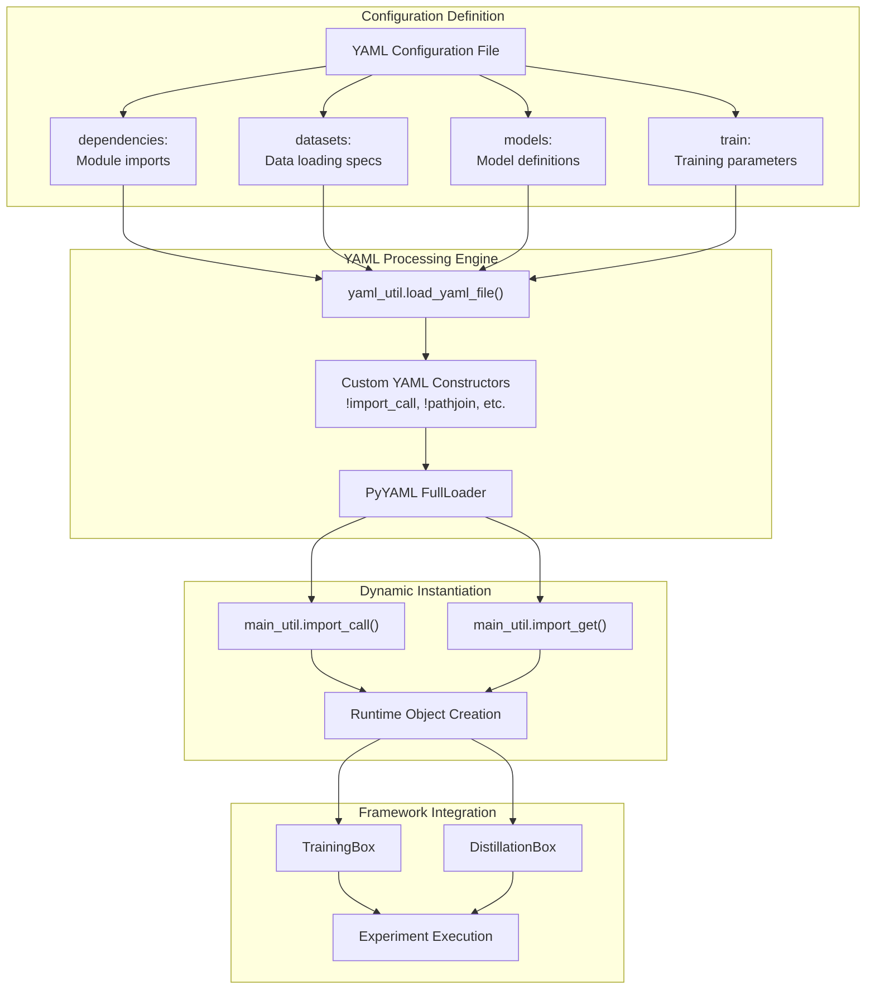

**Sources:** [README.md:66-139](), [torchdistill/common/yaml_util.py:179-203]()

## YAML Custom Constructors

The system extends PyYAML with custom constructors that enable dynamic object creation directly within YAML files. These constructors bridge the gap between declarative configuration and imperative Python code.

| Constructor | Function | Purpose |
|-------------|----------|---------|
| `!import_call` | `yaml_import_call()` | Import and instantiate objects |
| `!import_get` | `yaml_import_get()` | Import and get attributes |
| `!pathjoin` | `yaml_pathjoin()` | Join file paths |
| `!expanduser` | `yaml_expanduser()` | Expand user home directory |
| `!join` | `yaml_join()` | Join strings |
| `!getattr` | `yaml_getattr()` | Get object attributes |
| `!call_method` | `yaml_call_method()` | Call object methods |

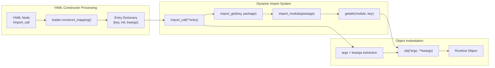

**Sources:** [torchdistill/common/yaml_util.py:86-98](), [torchdistill/common/main_util.py:75-100]()

## Dynamic Object Creation

The `import_call` function serves as the core mechanism for dynamic object instantiation, supporting flexible module loading and parameter passing.

### Import and Instantiation Flow

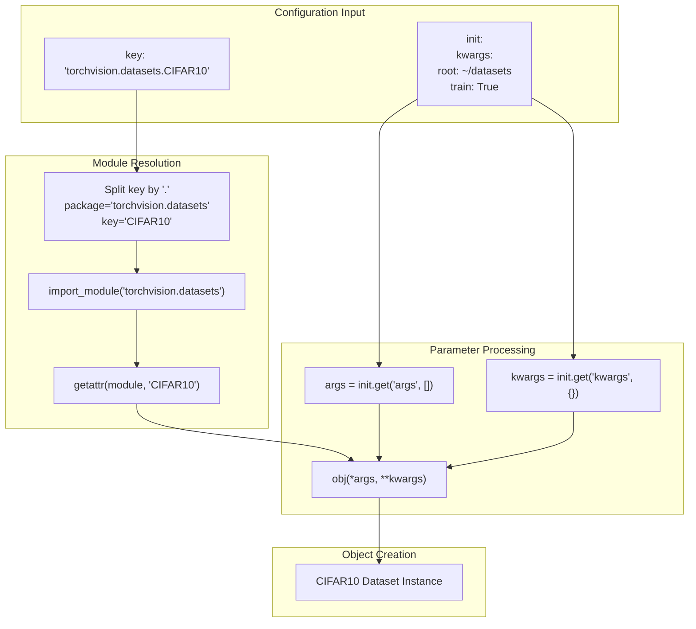

**Sources:** [torchdistill/common/main_util.py:75-100](), [README.md:82-135]()

## Configuration File Structure

Configuration files follow a hierarchical structure that maps to framework components:

### Example Configuration Breakdown

```yaml
dependencies:
  - torchvision.transforms

datasets:
  cifar10/train: !import_call
    key: 'torchvision.datasets.CIFAR10'
    init:
      kwargs:
        root: &root_dir '~/datasets/cifar10'
        train: True
        transform: !import_call
          key: 'torchvision.transforms.Compose'
          init:
            kwargs:
              transforms:
                - !import_call
                  key: 'torchvision.transforms.ToTensor'
                  init:
```

### Configuration Processing Pipeline

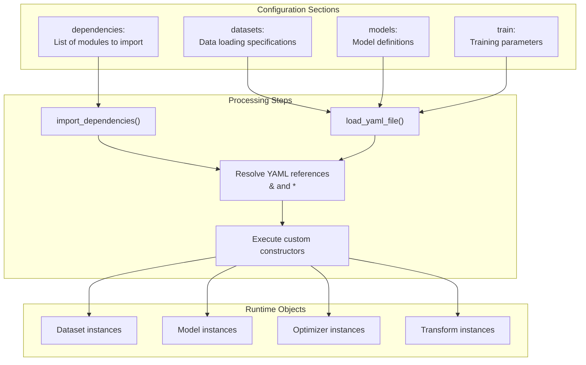

**Sources:** [torchdistill/common/main_util.py:18-51](), [README.md:73-79]()

## Integration with Framework Components

The configuration system integrates with torchdistill's core components through standardized interfaces:

### Configuration to Component Mapping

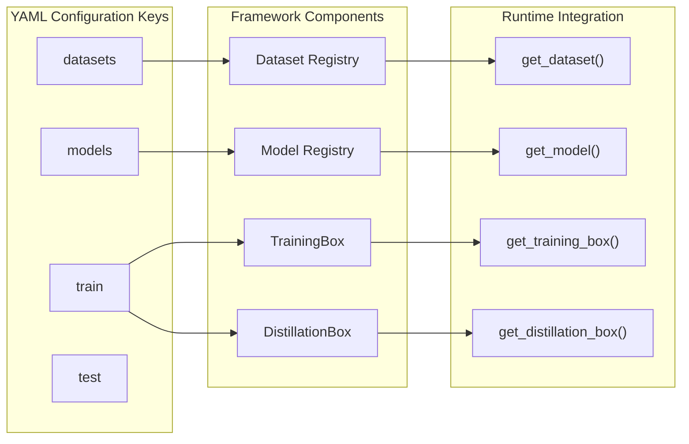

**Sources:** [README.md:146-158](), [torchdistill/common/yaml_util.py:190-201]()

## Advanced Configuration Features

### Path Handling and File Operations

The system provides specialized constructors for file path operations:

| Constructor | Usage | Example |
|-------------|-------|---------|
| `!pathjoin` | Join path components | `!pathjoin [~, datasets, cifar10]` |
| `!expanduser` | Expand `~` to home directory | `!expanduser ~/datasets` |
| `!abspath` | Convert to absolute path | `!abspath ./configs` |

### Dynamic Method Calls

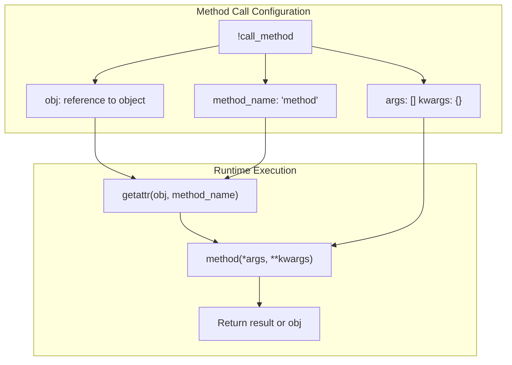

**Sources:** [torchdistill/common/yaml_util.py:116-128](), [torchdistill/common/main_util.py:135-163]()

## Error Handling and Validation

The configuration system includes robust error handling for common configuration issues:

### Import Resolution Errors

The `import_call` function handles various error conditions:
- Missing modules or packages
- Invalid attribute names
- Incorrect initialization parameters
- Type validation for arguments

### Configuration Validation

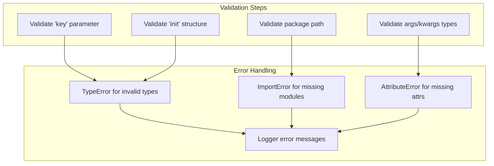

**Sources:** [torchdistill/common/main_util.py:75-100](), [torchdistill/common/main_util.py:18-51]()

---

# Page: Training and Distillation Framework

# Training and Distillation Framework

<details>
<summary>Relevant source files</summary>

The following files were used as context for generating this wiki page:

- [torchdistill/core/__init__.py](torchdistill/core/__init__.py)
- [torchdistill/core/distillation.py](torchdistill/core/distillation.py)
- [torchdistill/core/forward_hook.py](torchdistill/core/forward_hook.py)
- [torchdistill/core/interfaces/__init__.py](torchdistill/core/interfaces/__init__.py)
- [torchdistill/core/interfaces/forward_proc.py](torchdistill/core/interfaces/forward_proc.py)
- [torchdistill/core/interfaces/post_epoch_proc.py](torchdistill/core/interfaces/post_epoch_proc.py)
- [torchdistill/core/interfaces/post_forward_proc.py](torchdistill/core/interfaces/post_forward_proc.py)
- [torchdistill/core/interfaces/pre_epoch_proc.py](torchdistill/core/interfaces/pre_epoch_proc.py)
- [torchdistill/core/interfaces/pre_forward_proc.py](torchdistill/core/interfaces/pre_forward_proc.py)
- [torchdistill/core/interfaces/registry.py](torchdistill/core/interfaces/registry.py)
- [torchdistill/core/training.py](torchdistill/core/training.py)
- [torchdistill/core/util.py](torchdistill/core/util.py)
- [torchdistill/models/wrapper.py](torchdistill/models/wrapper.py)

</details>


This document covers the core training and distillation orchestration framework that manages model training workflows, including both standard training and knowledge distillation scenarios. The framework provides unified interfaces for single-stage and multi-stage training with support for auxiliary model wrappers and forward hook management.

For information about the configuration system that drives this framework, see [Configuration-Driven System](#2.1). For details about specific loss functions and model architectures, see [Loss Functions](#3.3) and [Model Architectures](#3.2).

## Core Architecture Overview

The training framework is built around two primary orchestration classes: `DistillationBox` for knowledge distillation and `TrainingBox` for standard training. Both classes follow a similar architecture pattern but differ in their handling of teacher-student relationships.

```mermaid
graph TB
    subgraph "Factory_Functions"
        get_distillation_box["get_distillation_box()"] --> stage_check{"'stage1' in train_config?"}
        get_training_box["get_training_box()"] --> stage_check2{"'stage1' in train_config?"}
        
        stage_check -->|"Yes"| MultiStagesDistillationBox
        stage_check -->|"No"| DistillationBox
        stage_check2 -->|"Yes"| MultiStagesTrainingBox  
        stage_check2 -->|"No"| TrainingBox
    end
    
    subgraph "Setup_Pipeline"
        DistillationBox --> setup_distill["setup()"]
        TrainingBox --> setup_train["setup()"]
        
        setup_distill --> setup_data_loaders_d["setup_data_loaders()"]
        setup_distill --> setup_teacher_student_models["setup_teacher_student_models()"]
        setup_distill --> setup_loss_d["setup_loss()"]
        setup_distill --> setup_pre_post_processes_d["setup_pre_post_processes()"]
        
        setup_train --> setup_data_loaders_t["setup_data_loaders()"]
        setup_train --> setup_model["setup_model()"]
        setup_train --> setup_loss_t["setup_loss()"]
        setup_train --> setup_pre_post_processes_t["setup_pre_post_processes()"]
    end
    
    subgraph "Training_Loop_Methods"
        pre_epoch_process["pre_epoch_process()"]
        pre_forward_process["pre_forward_process()"]
        forward_process["forward_process()"]
        post_forward_process["post_forward_process()"]
        post_epoch_process["post_epoch_process()"]
        
        pre_epoch_process --> pre_forward_process
        pre_forward_process --> forward_process
        forward_process --> post_forward_process
        post_forward_process --> post_epoch_process
    end
    
    subgraph "Multi_Stage_Methods"
        advance_to_next_stage["advance_to_next_stage()"]
        save_stage_ckpt["save_stage_ckpt()"]
        clean_modules["clean_modules()"]
        
        advance_to_next_stage --> save_stage_ckpt
        save_stage_ckpt --> clean_modules
        clean_modules --> setup_distill
    end
    
    MultiStagesDistillationBox --> advance_to_next_stage
    MultiStagesTrainingBox --> advance_to_next_stage
    
    setup_distill --> pre_epoch_process
    setup_train --> pre_epoch_process
```

**Core Training Framework Architecture**

The framework provides factory functions that automatically select the appropriate box type based on configuration structure and provides consistent method interfaces for setup, training loop management, and multi-stage progression.

Sources: [torchdistill/core/distillation.py:28-567](), [torchdistill/core/training.py:24-415]()

## DistillationBox vs TrainingBox

The framework provides two primary orchestration classes that share similar interfaces but handle different training scenarios.

### DistillationBox

The `DistillationBox` class orchestrates knowledge distillation training with both teacher and student models:

| Component | Method/Attribute | Purpose | Line Reference |
|-----------|------------------|---------|----------------|
| Model Setup | `setup_teacher_student_models()` | Configures both teacher and student models with auxiliary wrappers | [torchdistill/core/distillation.py:73-134]() |
| Forward Process | `get_teacher_output()` | Handles teacher inference with caching support | [torchdistill/core/distillation.py:326-398]() |
| I/O Management | `teacher_io_dict`, `student_io_dict` | Separate I/O dictionaries for both models | [torchdistill/core/distillation.py:299]() |
| Hook Management | `target_teacher_pairs`, `target_student_pairs` | Forward hooks for both models | [torchdistill/core/distillation.py:298]() |
| Training Loop | `forward_process()` | Coordinates teacher/student forward passes | [torchdistill/core/distillation.py:400-425]() |

### TrainingBox

The `TrainingBox` class handles standard single-model training:

| Component | Method/Attribute | Purpose | Line Reference |
|-----------|------------------|---------|----------------|
| Model Setup | `setup_model()` | Configures single model with auxiliary wrapper | [torchdistill/core/training.py:67-98]() |
| Forward Process | `forward_process()` | Standard forward computation | [torchdistill/core/training.py:261-284]() |
| I/O Management | `model_io_dict` | Single I/O dictionary | [torchdistill/core/training.py:234]() |
| Hook Management | `target_model_pairs` | Forward hooks for single model | [torchdistill/core/training.py:233]() |

```mermaid
graph TD
    subgraph "DistillationBox_Flow"
        teacher_model["teacher_model"] --> get_teacher_output["get_teacher_output()"]
        student_model["student_model"] --> student_forward_proc["student_forward_proc()"]
        
        get_teacher_output --> teacher_io_dict["teacher_io_dict"]
        student_forward_proc --> student_io_dict["student_io_dict"]
        
        teacher_io_dict --> forward_process_d["forward_process()"]
        student_io_dict --> forward_process_d
        
        forward_process_d --> criterion_d["criterion(io_dict, model_loss_dict, targets)"]
        
        target_teacher_pairs["target_teacher_pairs"] --> clean_modules_d["clean_modules()"]
        target_student_pairs["target_student_pairs"] --> clean_modules_d
    end
    
    subgraph "TrainingBox_Flow"
        model["model"] --> model_forward_proc["model_forward_proc()"]
        model_forward_proc --> model_io_dict["model_io_dict"]
        
        model_io_dict --> forward_process_t["forward_process()"]
        forward_process_t --> criterion_t["criterion(io_dict, model_loss_dict, targets)"]
        
        target_model_pairs["target_model_pairs"] --> clean_modules_t["clean_modules()"]
    end
    
    subgraph "Shared_Setup_Methods"
        setup_data_loaders["setup_data_loaders()"]
        setup_loss["setup_loss()"]
        setup_pre_post_processes["setup_pre_post_processes()"]
        
        setup_data_loaders --> train_data_loader["train_data_loader"]
        setup_data_loaders --> val_data_loader["val_data_loader"]
        setup_loss --> criterion["criterion"]
        setup_pre_post_processes --> setattr_processes["setattr(Box, 'process_name', process_func)"]
    end
```

**Box Architecture and Data Flow Comparison**

Sources: [torchdistill/core/distillation.py:400-425](), [torchdistill/core/training.py:261-284](), [torchdistill/core/distillation.py:443-456]()

## Multi-Stage Training Support

Both `DistillationBox` and `TrainingBox` support multi-stage training through their respective multi-stage subclasses that manage stage progression and checkpoint saving.

### Stage Configuration

Multi-stage training is identified by the presence of `stage1`, `stage2`, etc. keys in the configuration:

```mermaid
graph LR
    subgraph "Stage Management"
        STAGE1["stage1 config"] --> INIT["__init__()"]
        INIT --> CURRENT["current_epoch = 0<br/>stage_end_epoch"]
        
        CURRENT --> CHECK{"epoch == stage_end_epoch?"}
        CHECK -->|"Yes"| ADVANCE["advance_to_next_stage()"]
        CHECK -->|"No"| CONTINUE["Continue current stage"]
        
        ADVANCE --> SAVE_CKPT["save_stage_ckpt()"]
        SAVE_CKPT --> CLEAN["clean_modules()"]
        CLEAN --> NEXT_SETUP["setup(next_stage_config)"]
        NEXT_SETUP --> CURRENT
    end
```

**Multi-Stage Training Flow**

### Stage Advancement Process

The `advance_to_next_stage()` method handles the transition between training stages:

1. **Checkpoint Saving**: Models are saved via `save_stage_ckpt()`
2. **Cleanup**: `clean_modules()` unfreezes parameters and clears I/O dictionaries
3. **Reconfiguration**: `setup()` is called with the next stage's configuration
4. **Epoch Tracking**: Stage boundaries are updated

Sources: [torchdistill/core/distillation.py:509-533](), [torchdistill/core/training.py:362-385]()

## AuxiliaryModelWrapper Integration

The framework integrates with specialized knowledge distillation methods through the `AuxiliaryModelWrapper` system, providing extensions for specific distillation techniques.

### Wrapper Types

| Wrapper Class | Purpose | Distillation Method |
|---------------|---------|-------------------|
| `Teacher4FactorTransfer` | Teacher wrapper with paraphraser | Factor Transfer (FT) |
| `Student4FactorTransfer` | Student wrapper with translator | Factor Transfer (FT) |
| `Connector4DAB` | Student wrapper with connectors | Distillation of Activation Boundaries |
| `VariationalDistributor4VID` | Student wrapper with regressors | Variational Information Distillation |
| `Linear4CRD` | Teacher/Student wrapper with normalizer | Contrastive Representation Distillation |
| `SSWrapper4SSKD` | Self-supervision wrapper | Self-Supervised Knowledge Distillation |

### Wrapper Integration Flow

```mermaid
graph TD
    subgraph "Wrapper Construction"
        CONFIG["model_config"] --> BUILD["build_auxiliary_model_wrapper()"]
        BUILD --> AUX_WRAPPER["AuxiliaryModelWrapper"]
        AUX_WRAPPER --> REDESIGN["redesign_model()"]
    end
    
    subgraph "Training Integration"
        FORWARD["forward()"] --> PRIMARY["Primary forward pass"]
        PRIMARY --> SECONDARY["secondary_forward()"]
        SECONDARY --> IO_DICT["I/O dict operations"]
        
        POST_EPOCH["post_epoch_process()"] --> SAVE_CKPT["Model checkpointing"]
    end
    
    subgraph "Wrapper Methods"
        AUX_WRAPPER --> FORWARD
        AUX_WRAPPER --> SECONDARY
        AUX_WRAPPER --> POST_EPOCH
    end
    
    REDESIGN --> FORWARD
```

**AuxiliaryModelWrapper Integration**

The framework calls `secondary_forward()` after the primary forward pass to enable auxiliary computations, and `post_epoch_process()` for checkpoint management.

Sources: [torchdistill/models/wrapper.py:16-604](), [torchdistill/core/distillation.py:94-122]()

## Forward Hook Integration

The training framework integrates with the forward hook system to capture intermediate representations from models during training.

### Hook Setup Process

The `set_hooks()` function establishes forward hooks based on model configuration:

```mermaid
graph TD
    subgraph "Hook Configuration"
        MODEL_CONFIG["model_config.forward_hook"] --> INPUT_PATHS["input: [module_paths]"]
        MODEL_CONFIG --> OUTPUT_PATHS["output: [module_paths]"]
    end
    
    subgraph "Hook Registration"
        INPUT_PATHS --> REGISTER["register_forward_hook_with_dict()"]
        OUTPUT_PATHS --> REGISTER
        REGISTER --> HANDLE["RemovableHandle"]
        HANDLE --> PAIR_LIST["target_model_pairs"]
    end
    
    subgraph "I/O Management"
        REGISTER --> IO_DICT["model_io_dict"]
        IO_DICT --> EXTRACT["extract_io_dict()"]
        EXTRACT --> GATHERED["Gathered tensors"]
    end
    
    subgraph "Cleanup"
        PAIR_LIST --> CLEAN["clean_modules()"]
        CLEAN --> REMOVE["handle.remove()"]
    end
```

**Forward Hook Integration Flow**

### Hook Management

The framework maintains lists of `(module_path, handle)` pairs for cleanup:

- **DistillationBox**: `target_teacher_pairs` and `target_student_pairs`
- **TrainingBox**: `target_model_pairs`

During `clean_modules()`, all registered hooks are removed and I/O dictionaries are cleared.

Sources: [torchdistill/core/util.py:36-66](), [torchdistill/core/distillation.py:443-456](), [torchdistill/core/training.py:302-311]()

## Process Interfaces

The framework provides configurable interfaces for customizing training behavior at key points in the training loop through registered process functions.

### Interface Registry

```mermaid
graph TB
    subgraph "Registry_Dictionaries"
        PRE_EPOCH_PROC_FUNC_DICT["PRE_EPOCH_PROC_FUNC_DICT"]
        PRE_FORWARD_PROC_FUNC_DICT["PRE_FORWARD_PROC_FUNC_DICT"]
        FORWARD_PROC_FUNC_DICT["FORWARD_PROC_FUNC_DICT"]
        POST_FORWARD_PROC_FUNC_DICT["POST_FORWARD_PROC_FUNC_DICT"]
        POST_EPOCH_PROC_FUNC_DICT["POST_EPOCH_PROC_FUNC_DICT"]
    end
    
    subgraph "Registration_Decorators"
        register_pre_epoch_proc_func["@register_pre_epoch_proc_func"]
        register_pre_forward_proc_func["@register_pre_forward_proc_func"]
        register_forward_proc_func["@register_forward_proc_func"]
        register_post_forward_proc_func["@register_post_forward_proc_func"]
        register_post_epoch_proc_func["@register_post_epoch_proc_func"]
    end
    
    subgraph "Getter_Functions"
        get_pre_epoch_proc_func["get_pre_epoch_proc_func(key)"]
        get_pre_forward_proc_func["get_pre_forward_proc_func(key)"]
        get_forward_proc_func["get_forward_proc_func(key)"]
        get_post_forward_proc_func["get_post_forward_proc_func(key)"]
        get_post_epoch_proc_func["get_post_epoch_proc_func(key)"]
    end
    
    subgraph "Setup_Integration"
        setup_pre_post_processes["setup_pre_post_processes()"]
        setattr_call["setattr(Box, 'process_name', process_func)"]
    end
    
    register_pre_epoch_proc_func --> PRE_EPOCH_PROC_FUNC_DICT
    register_pre_forward_proc_func --> PRE_FORWARD_PROC_FUNC_DICT
    register_forward_proc_func --> FORWARD_PROC_FUNC_DICT
    register_post_forward_proc_func --> POST_FORWARD_PROC_FUNC_DICT
    register_post_epoch_proc_func --> POST_EPOCH_PROC_FUNC_DICT
    
    PRE_EPOCH_PROC_FUNC_DICT --> get_pre_epoch_proc_func
    PRE_FORWARD_PROC_FUNC_DICT --> get_pre_forward_proc_func
    FORWARD_PROC_FUNC_DICT --> get_forward_proc_func
    POST_FORWARD_PROC_FUNC_DICT --> get_post_forward_proc_func
    POST_EPOCH_PROC_FUNC_DICT --> get_post_epoch_proc_func
    
    get_pre_epoch_proc_func --> setup_pre_post_processes
    get_post_epoch_proc_func --> setup_pre_post_processes
    setup_pre_post_processes --> setattr_call
```

**Process Interface Registry System**

### Default Process Functions

The framework provides default implementations for each process stage:

| Process Stage | Default Function | Purpose | Line Reference |
|---------------|------------------|---------|----------------|
| Pre-Epoch | `default_pre_epoch_process_with_teacher` | Clear I/O dicts, set training mode | [torchdistill/core/interfaces/pre_epoch_proc.py:11-24]() |
| Pre-Forward | `default_pre_forward_process` | Empty default implementation | [torchdistill/core/interfaces/pre_forward_proc.py:8-9]() |
| Forward | `forward_batch_only` | Standard forward with batch only | [torchdistill/core/interfaces/forward_proc.py:22-37]() |
| Post-Forward | `default_post_forward_process` | Gradient computation and optimizer step | [torchdistill/core/interfaces/post_forward_proc.py:11-48]() |
| Post-Epoch | `default_post_epoch_process_with_teacher` | Learning rate scheduling | [torchdistill/core/interfaces/post_epoch_proc.py:12-35]() |

### Process Function Assignment

During setup, process functions are dynamically assigned to the box classes using `setattr()`:

```python
# Example from setup_pre_post_processes()
pre_epoch_process = get_pre_epoch_proc_func(train_config['pre_epoch_process'])
setattr(DistillationBox, 'pre_epoch_process', pre_epoch_process)
```

The `setup_pre_post_processes()` method assigns process functions to the class itself, allowing runtime customization of training behavior based on configuration.

Sources: [torchdistill/core/interfaces/registry.py:1-280](), [torchdistill/core/distillation.py:149-174](), [torchdistill/core/interfaces/pre_epoch_proc.py:11-40](), [torchdistill/core/interfaces/post_forward_proc.py:11-48]()

## Framework Instantiation

The framework provides factory functions that automatically select the appropriate box type based on configuration structure.

### Factory Functions

```mermaid
graph TD
    subgraph "Factory Selection"
        GET_DISTILL["get_distillation_box()"] --> CHECK_STAGE{"'stage1' in config?"}
        CHECK_STAGE -->|"Yes"| MULTI_DISTILL["MultiStagesDistillationBox"]
        CHECK_STAGE -->|"No"| SINGLE_DISTILL["DistillationBox"]
        
        GET_TRAIN["get_training_box()"] --> CHECK_STAGE2{"'stage1' in config?"}
        CHECK_STAGE2 -->|"Yes"| MULTI_TRAIN["MultiStagesTrainingBox"]  
        CHECK_STAGE2 -->|"No"| SINGLE_TRAIN["TrainingBox"]
    end
    
    subgraph "Common Parameters"
        PARAMS["model(s)<br/>dataset_dict<br/>train_config<br/>device<br/>device_ids<br/>distributed<br/>lr_factor<br/>accelerator"]
    end
    
    PARAMS --> GET_DISTILL
    PARAMS --> GET_TRAIN
```

**Framework Factory Functions**

### Usage Pattern

The framework is typically instantiated through configuration-driven scripts that:

1. Load models and datasets through the component registry
2. Call the appropriate factory function based on training mode
3. Execute training loops using the box's process interfaces

The unified interface allows the same training loop code to work with both single-stage and multi-stage training, as well as standard training and knowledge distillation scenarios.

Sources: [torchdistill/core/distillation.py:536-566](), [torchdistill/core/training.py:388-415]()

---

# Page: Component Registry System

# Component Registry System

<details>
<summary>Relevant source files</summary>

The following files were used as context for generating this wiki page:

- [examples/legacy/hf_transformers/custom/loss.py](examples/legacy/hf_transformers/custom/loss.py)
- [tests/registry_test.py](tests/registry_test.py)
- [torchdistill/datasets/__init__.py](torchdistill/datasets/__init__.py)
- [torchdistill/datasets/registry.py](torchdistill/datasets/registry.py)
- [torchdistill/datasets/sample_loader.py](torchdistill/datasets/sample_loader.py)
- [torchdistill/datasets/util.py](torchdistill/datasets/util.py)
- [torchdistill/datasets/wrapper.py](torchdistill/datasets/wrapper.py)
- [torchdistill/losses/__init__.py](torchdistill/losses/__init__.py)
- [torchdistill/losses/high_level.py](torchdistill/losses/high_level.py)
- [torchdistill/losses/registry.py](torchdistill/losses/registry.py)
- [torchdistill/losses/util.py](torchdistill/losses/util.py)
- [torchdistill/models/registry.py](torchdistill/models/registry.py)
- [torchdistill/optim/__init__.py](torchdistill/optim/__init__.py)
- [torchdistill/optim/registry.py](torchdistill/optim/registry.py)
- [torchdistill/optim/scheduler.py](torchdistill/optim/scheduler.py)

</details>


The Component Registry System is torchdistill's central mechanism for managing and instantiating modular components such as models, datasets, loss functions, optimizers, and schedulers. It provides a decorator-based registration pattern that enables dynamic component lookup and instantiation through string-based keys, facilitating the framework's configuration-driven architecture.

This document covers the registry pattern implementation and component-specific registries. For information about how these registries integrate with YAML configuration files, see [Configuration-Driven System](#2.1). For details about the training pipeline that uses these registered components, see [Training and Distillation Framework](#2.2).

## Registry Pattern Architecture

The registry system implements a consistent pattern across all component types: registration through decorators, storage in dictionaries, and retrieval through getter functions.

### Core Registry Pattern

```mermaid
graph TD
    subgraph "Registration Phase"
        DEV["Developer Code"] --> DECORATOR["@register_* decorator"]
        DECORATOR --> KEY_EXTRACT["Extract or Generate Key"]
        KEY_EXTRACT --> STORAGE["Store in *_DICT"]
    end
    
    subgraph "Storage Layer"
        STORAGE --> DATASET_DICT["DATASET_DICT"]
        STORAGE --> MODEL_DICT["MODEL_DICT"] 
        STORAGE --> LOSS_DICT["LOSS_DICT"]
        STORAGE --> OPTIM_DICT["OPTIM_DICT"]
    end
    
    subgraph "Retrieval Phase"
        CONFIG["Configuration"] --> GET_FUNC["get_* functions"]
        GET_FUNC --> LOOKUP["Dictionary Lookup"]
        LOOKUP --> INSTANTIATE["Component Instantiation"]
    end
    
    DATASET_DICT --> LOOKUP
    MODEL_DICT --> LOOKUP
    LOSS_DICT --> LOOKUP
    OPTIM_DICT --> LOOKUP
```

The pattern supports two registration modes:
- **Automatic key generation**: Uses the class or function name as the registry key
- **Custom key specification**: Allows explicit key assignment via the `key` parameter

Sources: [tests/registry_test.py:1-458](), [torchdistill/datasets/registry.py:16-55](), [torchdistill/models/registry.py:11-51]()

### Registration Decorator Implementation

All registry decorators follow a consistent implementation pattern that handles both parameterized and non-parameterized decoration:

```mermaid
graph LR
    subgraph "Decorator Usage Patterns"
        USAGE1["@register_model"] --> HANDLER1["_register_model(cls)"]
        USAGE2["@register_model()"] --> HANDLER2["_register_model(cls)"]
        USAGE3["@register_model(key='custom')"] --> HANDLER3["_register_model(cls)"]
    end
    
    subgraph "Internal Logic"
        HANDLER1 --> KEY_GEN["key = cls.__name__"]
        HANDLER2 --> KEY_GEN
        HANDLER3 --> KEY_CUSTOM["key = 'custom'"]
        KEY_GEN --> STORE["DICT[key] = cls"]
        KEY_CUSTOM --> STORE
    end
```

Sources: [torchdistill/datasets/registry.py:45-55](), [torchdistill/models/registry.py:41-51](), [torchdistill/losses/registry.py:127-137]()

## Dataset Registry System

The dataset registry manages dataset classes, data loading utilities, and preprocessing components.

### Dataset Registry Components

| Registry Dictionary | Purpose | Registration Decorator |
|---------------------|---------|----------------------|
| `DATASET_DICT` | Dataset classes | `@register_dataset` |
| `COLLATE_FUNC_DICT` | Batch collation functions | `@register_collate_func` |
| `SAMPLE_LOADER_DICT` | Sample loading classes | `@register_sample_loader` |
| `BATCH_SAMPLER_DICT` | Batch sampling strategies | `@register_batch_sampler` |
| `TRANSFORM_DICT` | Data transformation functions | `@register_transform` |
| `DATASET_WRAPPER_DICT` | Dataset wrapper classes | `@register_dataset_wrapper` |

The dataset registry pre-populates with standard PyTorch components:
- `DATASET_DICT` includes all `torchvision.datasets` classes
- `BATCH_SAMPLER_DICT` includes all `torch.utils.data.sampler` classes

Sources: [torchdistill/datasets/registry.py:5-14](), [torchdistill/datasets/registry.py:269-359]()

### Dataset Registry Usage Flow

```mermaid
graph TD
    subgraph "Dataset Pipeline Construction"
        CONFIG["Dataset Configuration"] --> GET_DATASET["get_dataset()"]
        GET_DATASET --> DATASET_CLASS["Dataset Class"]
        DATASET_CLASS --> WRAPPER_CHECK["Dataset Wrapper?"]
        WRAPPER_CHECK -->|Yes| GET_WRAPPER["get_dataset_wrapper()"]
        WRAPPER_CHECK -->|No| DATALOADER["DataLoader Creation"]
        GET_WRAPPER --> WRAPPED_DATASET["Wrapped Dataset"]
        WRAPPED_DATASET --> DATALOADER
        DATALOADER --> GET_COLLATE["get_collate_func()"]
        GET_COLLATE --> GET_SAMPLER["get_batch_sampler()"]
        GET_SAMPLER --> FINAL_LOADER["Final DataLoader"]
    end
```

Sources: [torchdistill/datasets/util.py:69-119](), [torchdistill/datasets/registry.py:269-359]()

## Model Registry System

The model registry manages neural network architectures, adaptation modules, and auxiliary model wrappers for knowledge distillation.

### Model Registry Components

```mermaid
graph LR
    subgraph "Model Registry Structure"
        MODEL_DICT["MODEL_DICT<br/>Core models"]
        ADAPTATION_MODULE_DICT["ADAPTATION_MODULE_DICT<br/>Feature adaptation"]
        AUXILIARY_MODEL_WRAPPER_DICT["AUXILIARY_MODEL_WRAPPER_DICT<br/>Behavior modification"]
        MODULE_DICT["MODULE_DICT<br/>torch.nn modules"]
    end
    
    subgraph "Registration Functions"
        REG_MODEL["@register_model"]
        REG_ADAPT["@register_adaptation_module"] 
        REG_AUX["@register_auxiliary_model_wrapper"]
    end
    
    REG_MODEL --> MODEL_DICT
    REG_ADAPT --> ADAPTATION_MODULE_DICT
    REG_AUX --> AUXILIARY_MODEL_WRAPPER_DICT
```

The `get_model()` function supports both registry lookup and PyTorch Hub loading via the optional `repo_or_dir` parameter.

Sources: [torchdistill/models/registry.py:5-8](), [torchdistill/models/registry.py:140-155](), [torchdistill/models/registry.py:158-185]()

## Loss Function Registry System

The loss registry implements a hierarchical structure with three levels of loss abstraction.

### Loss Registry Hierarchy

```mermaid
graph TD
    subgraph "Loss Function Hierarchy"
        HIGH["HIGH_LEVEL_LOSS_DICT<br/>Complete loss systems"]
        MID["MIDDLE_LEVEL_LOSS_DICT<br/>KD-specific losses"]
        LOW["LOW_LEVEL_LOSS_DICT<br/>Basic loss functions"]
        TORCH_LOSS["LOSS_DICT<br/>torch.nn losses"]
        WRAPPER["LOSS_WRAPPER_DICT<br/>Loss decorators"]
        EXTRACT["FUNC2EXTRACT_MODEL_OUTPUT_DICT<br/>Output extraction"]
    end
    
    subgraph "Composition Pattern"
        HIGH --> MID
        MID --> LOW
        MID --> TORCH_LOSS
        MID --> WRAPPER
        HIGH --> EXTRACT
    end
```

### Loss Registry Retrieval Chain

The loss retrieval functions implement a fallback chain that searches multiple dictionaries:

```mermaid
graph LR
    subgraph "Loss Retrieval Flow"
        REQUEST["Loss Request"] --> GET_HIGH["get_high_level_loss()"]
        GET_HIGH --> GET_MID["get_mid_level_loss()"]
        GET_MID --> GET_LOW["get_low_level_loss()"]
        GET_LOW --> CHECK_TORCH["Check LOSS_DICT"]
        CHECK_TORCH --> CHECK_CUSTOM["Check LOW_LEVEL_LOSS_DICT"]
        CHECK_CUSTOM --> INSTANTIATE["Instantiate Loss"]
    end
```

Sources: [torchdistill/losses/registry.py:3-8](), [torchdistill/losses/registry.py:225-279](), [torchdistill/losses/registry.py:304-317]()

## Optimizer and Scheduler Registry

The optimization registry manages PyTorch optimizers and learning rate schedulers with automatic parameter filtering.

### Optimizer Registry Features

The `get_optimizer()` function includes built-in parameter filtering:

```mermaid
graph TD
    subgraph "Optimizer Creation Flow"
        MODULE["nn.Module"] --> CHECK_FILTER["filters_params?"]
        CHECK_FILTER -->|True| FILTER["Filter requires_grad=True"]
        CHECK_FILTER -->|False| DIRECT["Use all parameters"]
        FILTER --> FILTERED_PARAMS["Updatable Parameters"]
        DIRECT --> ALL_PARAMS["All Parameters"]
        FILTERED_PARAMS --> OPTIMIZER["Optimizer Instance"]
        ALL_PARAMS --> OPTIMIZER
    end
```

Both registries pre-populate from PyTorch modules:
- `OPTIM_DICT` from `torch.optim`
- `SCHEDULER_DICT` from `torch.optim.lr_scheduler`

Sources: [torchdistill/optim/registry.py:5-6](), [torchdistill/optim/registry.py:95-116](), [torchdistill/optim/registry.py:119-132]()

## Integration with Configuration System

The registry system integrates seamlessly with torchdistill's YAML-based configuration through the `!import_call` mechanism.

### Configuration-to-Registry Flow

```mermaid
graph LR
    subgraph "YAML Configuration"
        YAML_CONFIG["model:<br/>  key: 'ResNet'<br/>  kwargs:<br/>    num_classes: 10"]
    end
    
    subgraph "Runtime Resolution"
        IMPORT_CALL["!import_call"] --> GET_MODEL["get_model('ResNet')"]
        GET_MODEL --> MODEL_DICT_LOOKUP["MODEL_DICT['ResNet']"]
        MODEL_DICT_LOOKUP --> INSTANTIATE["ResNet(num_classes=10)"]
    end
    
    YAML_CONFIG --> IMPORT_CALL
```

This pattern enables declarative component specification in configuration files while maintaining type safety and IDE support through the registry system.

Sources: [torchdistill/datasets/util.py:93-94](), [torchdistill/datasets/util.py:112-115]()

## Custom Component Registration Examples

### Registering Custom Components

The registry system supports multiple registration patterns for custom components:

```python
# Automatic key (class name)
@register_model
class MyCustomModel(nn.Module):
    pass

# Custom key
@register_dataset(key='my_special_dataset')
class SpecialDataset(Dataset):
    pass

# Function registration
@register_collate_func
def custom_collate_fn(batch):
    return batch
```

### Pre-populated Registries

Several registries automatically include standard PyTorch components:
- **Dataset Registry**: All `torchvision.datasets` classes
- **Model Registry**: All `torch.nn` modules via `MODULE_DICT`
- **Loss Registry**: All `torch.nn.modules.loss` classes
- **Optimizer Registry**: All `torch.optim` classes
- **Scheduler Registry**: All `torch.optim.lr_scheduler` classes

Sources: [torchdistill/datasets/registry.py:12-13](), [torchdistill/models/registry.py:8](), [torchdistill/losses/registry.py:3](), [torchdistill/optim/registry.py:5-6]()

---

# Page: Forward Hook Manager

# Forward Hook Manager

<details>
<summary>Relevant source files</summary>

The following files were used as context for generating this wiki page:

- [README.md](README.md)
- [configs/README.md](configs/README.md)
- [demo/extract_intermediate_representations.ipynb](demo/extract_intermediate_representations.ipynb)

</details>


The Forward Hook Manager is a core component of torchdistill that enables extraction of intermediate representations from neural networks without modifying model implementations. This system provides a clean, non-intrusive way to capture inputs and outputs from specific modules during forward passes, which is essential for knowledge distillation methods that require access to internal model states.

For information about the broader training framework that utilizes these extracted representations, see [Training and Distillation Framework](#2.2). For details on how intermediate representations are used in loss computations, see [Loss Functions](#3.3).

## Architecture Overview

The Forward Hook Manager operates as an intermediary layer between model execution and representation extraction, leveraging PyTorch's built-in forward hook mechanism to capture data at specified module boundaries.

### Core Components

```mermaid
graph TB
    subgraph "ForwardHookManager System"
        FHM["ForwardHookManager"]
        HOOKS["Forward Hooks"]
        IO_DICT["I/O Dictionary Storage"]
    end
    
    subgraph "PyTorch Model"
        MODEL["torch.nn.Module"]
        MODULE1["target_module_1"]
        MODULE2["target_module_2"] 
        MODULEN["target_module_n"]
    end
    
    subgraph "User Interface"
        ADD_HOOK["add_hook()"]
        POP_IO["pop_io_dict()"]
        CONFIG["YAML Configuration"]
    end
    
    FHM --> HOOKS
    HOOKS --> IO_DICT
    
    ADD_HOOK --> FHM
    POP_IO --> IO_DICT
    CONFIG --> FHM
    
    HOOKS --> MODULE1
    HOOKS --> MODULE2
    HOOKS --> MODULEN
    
    MODULE1 --> MODEL
    MODULE2 --> MODEL
    MODULEN --> MODEL
```

Sources: [README.md:32-63](), [demo/extract_intermediate_representations.ipynb:49-69]()

### Data Flow Architecture

The Forward Hook Manager captures data during model execution through a well-defined pipeline:

```mermaid
sequenceDiagram
    participant User
    participant FHM as ForwardHookManager
    participant Model as torch.nn.Module
    participant Hook as Forward Hook
    participant Storage as I/O Dictionary
    
    User->>FHM: add_hook(model, 'module_path', requires_input, requires_output)
    FHM->>Model: register_forward_hook()
    
    User->>Model: forward(input_data)
    Model->>Hook: trigger hook during forward pass
    Hook->>Storage: store input/output tensors
    Model->>User: return final output
    
    User->>FHM: pop_io_dict()
    FHM->>Storage: retrieve stored representations
    Storage->>User: return io_dict
```

Sources: [demo/extract_intermediate_representations.ipynb:88-119]()

## Core API Components

### ForwardHookManager Class

The `ForwardHookManager` class serves as the primary interface for registering hooks and managing captured representations.

| Method | Purpose | Parameters |
|--------|---------|------------|
| `__init__(device)` | Initialize manager with target device | `device`: torch device for tensor storage |
| `add_hook(model, module_path, requires_input, requires_output)` | Register forward hook on specified module | `model`: target model, `module_path`: string path to module, `requires_input`/`requires_output`: boolean flags |
| `pop_io_dict()` | Retrieve and clear stored representations | Returns dictionary of captured inputs/outputs |

Sources: [README.md:48-62](), [demo/extract_intermediate_representations.ipynb:62-68]()

### Hook Registration Patterns

The system supports flexible hook registration through module path specifications:

```mermaid
graph LR
    subgraph "Module Path Resolution"
        PATH["'layer1.0.bn2'"]
        SPLIT["path.split('.')"]
        TRAVERSE["Iterative getattr()"]
        MODULE["Target Module"]
    end
    
    subgraph "Hook Configuration"
        REQ_INPUT["requires_input=True"]
        REQ_OUTPUT["requires_output=True"]
        HOOK_FUNC["hook_function"]
    end
    
    PATH --> SPLIT
    SPLIT --> TRAVERSE
    TRAVERSE --> MODULE
    
    REQ_INPUT --> HOOK_FUNC
    REQ_OUTPUT --> HOOK_FUNC
    HOOK_FUNC --> MODULE
```

Sources: [demo/extract_intermediate_representations.ipynb:66-68]()

## Integration with Knowledge Distillation

The Forward Hook Manager is deeply integrated with torchdistill's knowledge distillation pipeline, providing the mechanism for extracting teacher and student representations.

### Configuration-Driven Hook Management

Forward hooks can be specified declaratively in YAML configuration files, eliminating the need for programmatic hook registration in many cases.

```mermaid
graph TB
    subgraph "Configuration Layer"
        YAML["YAML Config File"]
        HOOK_CONFIG["Forward Hook Specifications"]
    end
    
    subgraph "Runtime System"
        DISTILL_BOX["DistillationBox"]
        FHM_INSTANCE["ForwardHookManager Instance"]
        TEACHER["Teacher Model"]
        STUDENT["Student Model"]
    end
    
    subgraph "Execution Flow"
        FORWARD_PASS["Forward Pass Execution"]
        REPR_EXTRACTION["Representation Extraction"]
        LOSS_COMPUTATION["Knowledge Distillation Loss"]
    end
    
    YAML --> HOOK_CONFIG
    HOOK_CONFIG --> DISTILL_BOX
    DISTILL_BOX --> FHM_INSTANCE
    
    FHM_INSTANCE --> TEACHER
    FHM_INSTANCE --> STUDENT
    
    TEACHER --> FORWARD_PASS
    STUDENT --> FORWARD_PASS
    FORWARD_PASS --> REPR_EXTRACTION
    REPR_EXTRACTION --> LOSS_COMPUTATION
```

Sources: [README.md:10-18]()

## Practical Usage Patterns

### Basic Representation Extraction

The most common usage pattern involves three steps: hook registration, model execution, and representation retrieval.

```mermaid
flowchart TD
    START["Initialize ForwardHookManager"] --> REGISTER["Register Hooks on Target Modules"]
    REGISTER --> EXECUTE["Execute Model Forward Pass"]
    EXECUTE --> EXTRACT["Extract I/O Dictionary"]
    EXTRACT --> PROCESS["Process Extracted Representations"]
    
    subgraph "Hook Registration Options"
        INPUT_ONLY["requires_input=True, requires_output=False"]
        OUTPUT_ONLY["requires_input=False, requires_output=True"] 
        BOTH["requires_input=True, requires_output=True"]
    end
    
    REGISTER --> INPUT_ONLY
    REGISTER --> OUTPUT_ONLY
    REGISTER --> BOTH
```

Sources: [demo/extract_intermediate_representations.ipynb:62-68]()

### Multi-Model Hook Management

For knowledge distillation scenarios, the Forward Hook Manager can simultaneously manage hooks across teacher and student models.

| Use Case | Hook Strategy | Data Captured |
|----------|---------------|---------------|
| Feature Matching | Same module paths in both models | Intermediate feature maps |
| Attention Transfer | Attention layer outputs | Attention weights and maps |
| Logit Distillation | Final classifier outputs | Pre-softmax logits |
| Layer-wise Distillation | Multiple intermediate layers | Progressive feature representations |

Sources: [README.md:32-35]()

## Advanced Features

### Device Management

The Forward Hook Manager handles device placement automatically, ensuring captured representations are moved to the specified device for consistent processing.

### Memory Efficiency

The `pop_io_dict()` method clears stored representations after retrieval, preventing memory accumulation during long training runs.

```mermaid
graph LR
    subgraph "Memory Management Cycle"
        CAPTURE["Capture Representations"]
        STORE["Store in I/O Dict"]
        RETRIEVE["pop_io_dict() Call"]
        CLEAR["Clear Storage"]
        RETURN["Return Data to User"]
    end
    
    CAPTURE --> STORE
    STORE --> RETRIEVE
    RETRIEVE --> CLEAR
    RETRIEVE --> RETURN
    CLEAR --> CAPTURE
```

Sources: [demo/extract_intermediate_representations.ipynb:118-119]()

## Example Usage Validation

The system provides built-in validation capabilities to ensure captured representations match expected model behavior:

- Input validation: Verifying that captured inputs match original model inputs
- Output validation: Confirming that captured outputs match final model outputs  
- Consistency checks: Ensuring intermediate representations maintain expected tensor properties

Sources: [demo/extract_intermediate_representations.ipynb:130-176]()

The Forward Hook Manager eliminates the need to modify model implementations for intermediate representation access, providing a clean separation between model architecture and feature extraction requirements. This design enables torchdistill to work with arbitrary PyTorch models while maintaining the flexibility needed for diverse knowledge distillation methods.

---

# Page: Components

# Components

<details>
<summary>Relevant source files</summary>

The following files were used as context for generating this wiki page:

- [tests/registry_test.py](tests/registry_test.py)
- [torchdistill/datasets/__init__.py](torchdistill/datasets/__init__.py)
- [torchdistill/datasets/registry.py](torchdistill/datasets/registry.py)
- [torchdistill/datasets/sample_loader.py](torchdistill/datasets/sample_loader.py)
- [torchdistill/datasets/util.py](torchdistill/datasets/util.py)
- [torchdistill/datasets/wrapper.py](torchdistill/datasets/wrapper.py)

</details>


This document covers the major component categories in torchdistill and their registration system. Components are the building blocks that can be dynamically selected and configured through YAML configuration files. The framework provides registries for datasets, models, loss functions, and optimization components.

For detailed information about the core registry architecture, see [Component Registry System](#2.3). For configuration-driven usage patterns, see [Configuration-Driven System](#2.1).

## Registry Pattern Overview

All components in torchdistill follow a consistent registry pattern that enables dynamic component selection and instantiation through decorators and lookup functions.

### Registry Architecture

```mermaid
graph TB
    subgraph "Registration Phase"
        DECORATOR_DATASET["@register_dataset"]
        DECORATOR_MODEL["@register_model"]
        DECORATOR_LOSS["@register_high_level_loss"]
        DECORATOR_OPTIM["@register_optimizer"]
        DECORATOR_TRANSFORM["@register_transform"]
        DECORATOR_WRAPPER["@register_dataset_wrapper"]
    end
    
    subgraph "Storage Layer"
        DATASET_DICT["DATASET_DICT"]
        MODEL_DICT["MODEL_DICT"]
        LOSS_DICT["HIGH_LEVEL_LOSS_DICT"]
        OPTIM_DICT["OPTIM_DICT"]
        TRANSFORM_DICT["TRANSFORM_DICT"]
        WRAPPER_DICT["DATASET_WRAPPER_DICT"]
    end
    
    subgraph "Retrieval Layer"
        GET_DATASET["get_dataset()"]
        GET_MODEL["get_model()"]
        GET_LOSS["get_high_level_loss()"]
        GET_OPTIM["get_optimizer()"]
        GET_TRANSFORM["get_transform()"]
        GET_WRAPPER["get_dataset_wrapper()"]
    end
    
    subgraph "Runtime Usage"
        YAML_CONFIG["YAML Configuration"]
        IMPORT_CALL["!import_call"]
        COMPONENT_INSTANTIATION["Component Instantiation"]
    end
    
    DECORATOR_DATASET --> DATASET_DICT
    DECORATOR_MODEL --> MODEL_DICT
    DECORATOR_LOSS --> LOSS_DICT
    DECORATOR_OPTIM --> OPTIM_DICT
    DECORATOR_TRANSFORM --> TRANSFORM_DICT
    DECORATOR_WRAPPER --> WRAPPER_DICT
    
    DATASET_DICT --> GET_DATASET
    MODEL_DICT --> GET_MODEL
    LOSS_DICT --> GET_LOSS
    OPTIM_DICT --> GET_OPTIM
    TRANSFORM_DICT --> GET_TRANSFORM
    WRAPPER_DICT --> GET_WRAPPER
    
    YAML_CONFIG --> IMPORT_CALL
    IMPORT_CALL --> GET_DATASET
    IMPORT_CALL --> GET_MODEL
    IMPORT_CALL --> GET_LOSS
    IMPORT_CALL --> GET_OPTIM
    IMPORT_CALL --> GET_TRANSFORM
    IMPORT_CALL --> GET_WRAPPER
    
    GET_DATASET --> COMPONENT_INSTANTIATION
    GET_MODEL --> COMPONENT_INSTANTIATION
    GET_LOSS --> COMPONENT_INSTANTIATION
    GET_OPTIM --> COMPONENT_INSTANTIATION
    GET_TRANSFORM --> COMPONENT_INSTANTIATION
    GET_WRAPPER --> COMPONENT_INSTANTIATION
```

Sources: [tests/registry_test.py:1-458](), [torchdistill/datasets/registry.py:1-360]()

### Registration Decorators

The registry system provides decorators for component registration that support both default and custom keys:

| Decorator | Purpose | Registry Dict |
|-----------|---------|---------------|
| `@register_dataset` | Dataset classes | `DATASET_DICT` |
| `@register_collate_func` | Collate functions | `COLLATE_FUNC_DICT` |
| `@register_sample_loader` | Sample loader classes | `SAMPLE_LOADER_DICT` |
| `@register_batch_sampler` | Batch sampler classes | `BATCH_SAMPLER_DICT` |
| `@register_transform` | Transform classes | `TRANSFORM_DICT` |
| `@register_dataset_wrapper` | Dataset wrapper classes | `DATASET_WRAPPER_DICT` |

Sources: [torchdistill/datasets/registry.py:16-267](), [tests/registry_test.py:20-173]()

## Dataset Management Components

Dataset management is handled through a multi-layered system of datasets, transforms, wrappers, and loaders that work together to provide flexible data processing pipelines.

### Dataset Component Hierarchy

```mermaid
graph TB
    subgraph "Core Dataset Layer"
        TORCHVISION_DATASETS["torchvision.datasets.*"]
        CUSTOM_DATASETS["Custom Dataset Classes"]
        REGISTERED_DATASETS["@register_dataset classes"]
    end
    
    subgraph "Dataset Wrapper Layer"
        BASE_WRAPPER["BaseDatasetWrapper"]
        CACHEABLE_WRAPPER["CacheableDataset"]
        CRD_WRAPPER["CRDDatasetWrapper"]
        SSKD_WRAPPER["SSKDDatasetWrapper"]
        CUSTOM_WRAPPERS["Custom Dataset Wrappers"]
    end
    
    subgraph "Transform Layer"
        TORCHVISION_TRANSFORMS["torchvision.transforms.*"]
        CUSTOM_TRANSFORMS["@register_transform classes"]
    end
    
    subgraph "Sample Loading Layer"
        DEFAULT_LOADER["default_loader"]
        JPEG_LOADER["JpegCompressionLoader"]
        CUSTOM_LOADERS["@register_sample_loader classes"]
    end
    
    subgraph "Data Loading Layer"
        COLLATE_FUNCS["Collate Functions"]
        BATCH_SAMPLERS["Batch Samplers"]
        DATA_LOADERS["DataLoader instances"]
    end
    
    TORCHVISION_DATASETS --> BASE_WRAPPER
    CUSTOM_DATASETS --> BASE_WRAPPER
    REGISTERED_DATASETS --> BASE_WRAPPER
    
    BASE_WRAPPER --> CACHEABLE_WRAPPER
    BASE_WRAPPER --> CRD_WRAPPER
    BASE_WRAPPER --> SSKD_WRAPPER
    BASE_WRAPPER --> CUSTOM_WRAPPERS
    
    TORCHVISION_TRANSFORMS --> CACHEABLE_WRAPPER
    CUSTOM_TRANSFORMS --> CACHEABLE_WRAPPER
    TORCHVISION_TRANSFORMS --> CRD_WRAPPER
    CUSTOM_TRANSFORMS --> CRD_WRAPPER
    
    DEFAULT_LOADER --> TORCHVISION_DATASETS
    JPEG_LOADER --> TORCHVISION_DATASETS
    CUSTOM_LOADERS --> TORCHVISION_DATASETS
    
    CACHEABLE_WRAPPER --> DATA_LOADERS
    CRD_WRAPPER --> DATA_LOADERS
    SSKD_WRAPPER --> DATA_LOADERS
    CUSTOM_WRAPPERS --> DATA_LOADERS
    
    COLLATE_FUNCS --> DATA_LOADERS
    BATCH_SAMPLERS --> DATA_LOADERS
```

Sources: [torchdistill/datasets/wrapper.py:27-159](), [torchdistill/datasets/sample_loader.py:11-32](), [torchdistill/datasets/util.py:69-119]()

### Dataset Wrapper Types

The framework provides several dataset wrapper implementations:

#### BaseDatasetWrapper
The base wrapper class that extends the original dataset to return supplementary data:

```python
# Returns (sample, target, supp_dict) instead of (sample, target)
def __getitem__(self, index):
    sample, target = self.org_dataset.__getitem__(index)
    return sample, target, dict()
```

#### CacheableDataset
Extends `BaseDatasetWrapper` to support cached data loading from disk:

```python
def __getitem__(self, index):
    sample, target, supp_dict = super().__getitem__(index)
    cache_file_path = os.path.join(self.cache_dir_path, self.idx2subath_func(index) + self.ext)
    if file_util.check_if_exists(cache_file_path):
        cached_data = torch.load(cache_file_path)
        supp_dict['cached_data'] = cached_data
    return sample, target, supp_dict
```

#### Specialized Knowledge Distillation Wrappers
- `CRDDatasetWrapper`: Provides contrastive samples for Contrastive Representation Distillation
- `SSKDDatasetWrapper`: Generates rotated samples for Self-Supervised Knowledge Distillation

Sources: [torchdistill/datasets/wrapper.py:27-159]()

### Data Loading Pipeline

The data loading pipeline integrates multiple components through the `build_data_loader` function:

```mermaid
graph LR
    subgraph "Configuration Input"
        DATASET_CONFIG["dataset config"]
        LOADER_CONFIG["data_loader config"]
    end
    
    subgraph "Dataset Construction"
        GET_DATASET_FUNC["get_dataset()"]
        DATASET_INSTANCE["Dataset Instance"]
        WRAPPER_APPLICATION["Dataset Wrapper Application"]
    end
    
    subgraph "Sampling Configuration"
        SAMPLER_CONFIG["sampler config"]
        BATCH_SAMPLER_CONFIG["batch_sampler config"]
        DISTRIBUTED_SAMPLER["DistributedSampler"]
        CUSTOM_SAMPLERS["Custom Samplers"]
    end
    
    subgraph "Final Data Loader"
        COLLATE_FUNC["get_collate_func()"]
        DATALOADER["DataLoader"]
    end
    
    DATASET_CONFIG --> GET_DATASET_FUNC
    GET_DATASET_FUNC --> DATASET_INSTANCE
    DATASET_INSTANCE --> WRAPPER_APPLICATION
    LOADER_CONFIG --> WRAPPER_APPLICATION
    
    WRAPPER_APPLICATION --> DISTRIBUTED_SAMPLER
    WRAPPER_APPLICATION --> CUSTOM_SAMPLERS
    SAMPLER_CONFIG --> CUSTOM_SAMPLERS
    BATCH_SAMPLER_CONFIG --> CUSTOM_SAMPLERS
    
    DISTRIBUTED_SAMPLER --> DATALOADER
    CUSTOM_SAMPLERS --> DATALOADER
    COLLATE_FUNC --> DATALOADER
```

Sources: [torchdistill/datasets/util.py:69-119]()

## Model Architecture Components

Model components are registered through the model registry system and include standard architectures, custom models, and auxiliary wrappers that modify model behavior during training.

### Model Registry Categories

| Registry | Purpose | Usage |
|----------|---------|-------|
| `MODEL_DICT` | Standard model architectures | Teacher/student models |
| `ADAPTATION_MODULE_DICT` | Feature adaptation modules | Dimension matching between teacher/student |
| `AUXILIARY_MODEL_WRAPPER_DICT` | Model behavior wrappers | Modify forward pass behavior |

Sources: [tests/registry_test.py:310-377]()

## Loss Function Components

Loss functions are organized in a hierarchical system with high-level composite losses, mid-level knowledge distillation losses, and low-level loss functions.

### Loss Function Hierarchy

| Level | Registry | Purpose |
|-------|----------|---------|
| High-level | `HIGH_LEVEL_LOSS_DICT` | Composite losses that combine multiple loss terms |
| Mid-level | `MIDDLE_LEVEL_LOSS_DICT` | Knowledge distillation specific losses |
| Low-level | PyTorch built-ins | Basic loss functions (CrossEntropy, MSE, etc.) |

Additional loss-related registries:
- `LOSS_WRAPPER_DICT`: Loss function wrappers
- `FUNC2EXTRACT_MODEL_OUTPUT_DICT`: Functions to extract specific outputs from models

Sources: [tests/registry_test.py:175-262]()

## Optimization Components

Optimization components include optimizers, learning rate schedulers, and related utilities for training configuration.

### Optimization Registry

| Registry | Purpose | Built-in Support |
|----------|---------|------------------|
| `OPTIM_DICT` | Optimizers | PyTorch optimizers |
| `SCHEDULER_DICT` | Learning rate schedulers | PyTorch schedulers |

Sources: [tests/registry_test.py:264-308]()

## Component Integration Flow

Components integrate through the configuration system and training pipeline:

```mermaid
graph TB
    subgraph "YAML Configuration"
        YAML_DATASETS["datasets: {...}"]
        YAML_MODELS["models: {...}"]
        YAML_LOSSES["train: loss: {...}"]
        YAML_OPTIM["train: optimizer: {...}"]
    end
    
    subgraph "Component Resolution"
        IMPORT_CALL_PROC["!import_call processing"]
        REGISTRY_LOOKUP["Registry lookups"]
        COMPONENT_INSTANTIATION["Component instantiation"]
    end
    
    subgraph "Training Pipeline"
        DISTILLATION_BOX["DistillationBox"]
        TRAINING_BOX["TrainingBox"]
        FORWARD_HOOKS["Forward hooks"]
        LOSS_COMPUTATION["Loss computation"]
        OPTIMIZATION["Optimization step"]
    end
    
    YAML_DATASETS --> IMPORT_CALL_PROC
    YAML_MODELS --> IMPORT_CALL_PROC
    YAML_LOSSES --> IMPORT_CALL_PROC
    YAML_OPTIM --> IMPORT_CALL_PROC
    
    IMPORT_CALL_PROC --> REGISTRY_LOOKUP
    REGISTRY_LOOKUP --> COMPONENT_INSTANTIATION
    
    COMPONENT_INSTANTIATION --> DISTILLATION_BOX
    COMPONENT_INSTANTIATION --> TRAINING_BOX
    
    DISTILLATION_BOX --> FORWARD_HOOKS
    TRAINING_BOX --> FORWARD_HOOKS
    FORWARD_HOOKS --> LOSS_COMPUTATION
    LOSS_COMPUTATION --> OPTIMIZATION
```

Sources: [torchdistill/datasets/util.py:122-143]()

This component system provides the foundation for torchdistill's modular architecture, enabling researchers to easily swap and configure different components for their knowledge distillation experiments.

---

# Page: Dataset Management

# Dataset Management

<details>
<summary>Relevant source files</summary>

The following files were used as context for generating this wiki page:

- [tests/registry_test.py](tests/registry_test.py)
- [torchdistill/datasets/__init__.py](torchdistill/datasets/__init__.py)
- [torchdistill/datasets/registry.py](torchdistill/datasets/registry.py)
- [torchdistill/datasets/sample_loader.py](torchdistill/datasets/sample_loader.py)
- [torchdistill/datasets/util.py](torchdistill/datasets/util.py)
- [torchdistill/datasets/wrapper.py](torchdistill/datasets/wrapper.py)

</details>


The dataset management system in torchdistill provides a comprehensive framework for handling datasets, data loaders, transformations, and specialized dataset wrappers. This system supports the configuration-driven approach of the framework by providing registration mechanisms for all dataset-related components and utilities for constructing data pipelines from YAML configurations.

For information about how datasets integrate with the training framework, see [Core Architecture](#2). For specific dataset examples and configurations, see [Examples and Usage](#4).

## System Overview

Dataset Management Architecture

The dataset management system consists of several interconnected components that work together to provide flexible data handling capabilities:

```mermaid
graph TB
    subgraph "Registry Storage"
        DATASET_DICT["DATASET_DICT"]
        COLLATE_FUNC_DICT["COLLATE_FUNC_DICT"]
        SAMPLE_LOADER_DICT["SAMPLE_LOADER_DICT"]
        BATCH_SAMPLER_DICT["BATCH_SAMPLER_DICT"] 
        TRANSFORM_DICT["TRANSFORM_DICT"]
        DATASET_WRAPPER_DICT["DATASET_WRAPPER_DICT"]
    end
    
    subgraph "Registration Functions"
        register_dataset["register_dataset()"]
        register_collate_func["register_collate_func()"] 
        register_sample_loader["register_sample_loader()"]
        register_batch_sampler["register_batch_sampler()"]
        register_transform["register_transform()"]
        register_dataset_wrapper["register_dataset_wrapper()"]
    end
    
    subgraph "Retrieval Functions"
        get_dataset["get_dataset()"]
        get_collate_func["get_collate_func()"]
        get_sample_loader["get_sample_loader()"]
        get_batch_sampler["get_batch_sampler()"]
        get_transform["get_transform()"]
        get_dataset_wrapper["get_dataset_wrapper()"]
    end
    
    subgraph "Data Pipeline Construction"
        split_dataset["split_dataset()"]
        build_data_loader["build_data_loader()"]
        build_data_loaders["build_data_loaders()"]
    end
    
    subgraph "Dataset Wrapper Classes"
        BaseDatasetWrapper["BaseDatasetWrapper"]
        CacheableDataset["CacheableDataset"]
        CRDDatasetWrapper["CRDDatasetWrapper"]
        SSKDDatasetWrapper["SSKDDatasetWrapper"]
        JpegCompressionLoader["JpegCompressionLoader"]
    end
    
    subgraph "External Integration"
        torchvision_datasets["torchvision.datasets"]
        torch_samplers["torch.utils.data.sampler"]
    end
    
    register_dataset --> DATASET_DICT
    register_collate_func --> COLLATE_FUNC_DICT
    register_sample_loader --> SAMPLE_LOADER_DICT
    register_batch_sampler --> BATCH_SAMPLER_DICT
    register_transform --> TRANSFORM_DICT
    register_dataset_wrapper --> DATASET_WRAPPER_DICT
    
    DATASET_DICT --> get_dataset
    COLLATE_FUNC_DICT --> get_collate_func
    SAMPLE_LOADER_DICT --> get_sample_loader
    BATCH_SAMPLER_DICT --> get_batch_sampler
    TRANSFORM_DICT --> get_transform
    DATASET_WRAPPER_DICT --> get_dataset_wrapper
    
    get_dataset --> build_data_loader
    get_collate_func --> build_data_loader
    get_batch_sampler --> build_data_loader
    get_dataset_wrapper --> build_data_loader
    
    build_data_loader --> build_data_loaders
    split_dataset --> build_data_loaders
    
    BaseDatasetWrapper --> CacheableDataset
    BaseDatasetWrapper --> CRDDatasetWrapper
    BaseDatasetWrapper --> SSKDDatasetWrapper
    
    torchvision_datasets --> DATASET_DICT
    torch_samplers --> BATCH_SAMPLER_DICT
```

**Sources:** [torchdistill/datasets/registry.py:5-10](), [torchdistill/datasets/registry.py:16-266](), [torchdistill/datasets/registry.py:269-359](), [torchdistill/datasets/util.py:14-143](), [torchdistill/datasets/wrapper.py:27-159](), [torchdistill/datasets/sample_loader.py:11-31]()

## Dataset Registration System

The registration system provides a centralized mechanism for registering and retrieving dataset-related components. This system supports the framework's configuration-driven approach by allowing components to be referenced by string keys in YAML files.

### Registration Decorators and Storage

The system uses decorator-based registration with centralized storage dictionaries:

| Component Type | Registration Decorator | Storage Dictionary | Getter Function |
|---|---|---|---|
| Datasets | `@register_dataset` | `DATASET_DICT` | `get_dataset()` |
| Collate Functions | `@register_collate_func` | `COLLATE_FUNC_DICT` | `get_collate_func()` |
| Sample Loaders | `@register_sample_loader` | `SAMPLE_LOADER_DICT` | `get_sample_loader()` |
| Batch Samplers | `@register_batch_sampler` | `BATCH_SAMPLER_DICT` | `get_batch_sampler()` |
| Transforms | `@register_transform` | `TRANSFORM_DICT` | `get_transform()` |
| Dataset Wrappers | `@register_dataset_wrapper` | `DATASET_WRAPPER_DICT` | `get_dataset_wrapper()` |

The registration system automatically populates dictionaries with components from external libraries:
- `DATASET_DICT` includes all classes from `torchvision.datasets`
- `BATCH_SAMPLER_DICT` includes all classes from `torch.utils.data.sampler`

**Sources:** [torchdistill/datasets/registry.py:16-266](), [torchdistill/datasets/registry.py:12-13](), [torchdistill/datasets/registry.py:269-359]()

### Dynamic Component Retrieval

Component Resolution Flow

```mermaid
flowchart TD
    YAML_CONFIG["YAML Configuration"] --> COMPONENT_KEY["Component Key String"]
    COMPONENT_KEY --> get_dataset["get_dataset(key)"]
    COMPONENT_KEY --> get_collate_func["get_collate_func(key)"]
    COMPONENT_KEY --> get_batch_sampler["get_batch_sampler(key)"]
    COMPONENT_KEY --> get_dataset_wrapper["get_dataset_wrapper(key)"]
    
    get_dataset --> DATASET_DICT_LOOKUP["DATASET_DICT[key]"]
    get_collate_func --> COLLATE_DICT_LOOKUP["COLLATE_FUNC_DICT[key]"]
    get_batch_sampler --> BATCH_DICT_LOOKUP["BATCH_SAMPLER_DICT[key]"]
    get_dataset_wrapper --> WRAPPER_DICT_LOOKUP["DATASET_WRAPPER_DICT[key]"]
    
    DATASET_DICT_LOOKUP --> FOUND_DATASET{"Key in dict?"}
    COLLATE_DICT_LOOKUP --> FOUND_COLLATE{"Key in dict?"}
    BATCH_DICT_LOOKUP --> FOUND_BATCH{"Key in dict?"}
    WRAPPER_DICT_LOOKUP --> FOUND_WRAPPER{"Key in dict?"}
    
    FOUND_DATASET -->|Yes| RETURN_DATASET["Return Dataset Class"]
    FOUND_DATASET -->|No| RAISE_ERROR_DATASET["ValueError: No dataset registered"]
    
    FOUND_COLLATE -->|Yes| RETURN_COLLATE["Return Collate Function"]
    FOUND_COLLATE -->|No| RETURN_NONE["Return None"]
    
    FOUND_BATCH -->|Yes| RETURN_BATCH["Return Batch Sampler"]
    FOUND_BATCH -->|No| RAISE_ERROR_BATCH["ValueError: No batch sampler registered"]
    
    FOUND_WRAPPER -->|Yes| RETURN_WRAPPER["Return Wrapper Class"]
    FOUND_WRAPPER -->|No| RAISE_ERROR_WRAPPER["ValueError: No dataset wrapper registered"]
```

**Sources:** [torchdistill/datasets/registry.py:269-282](), [torchdistill/datasets/registry.py:285-298](), [torchdistill/datasets/registry.py:317-331](), [torchdistill/datasets/registry.py:348-359]()

## Data Loader Construction

The data loader construction system provides a unified interface for creating PyTorch `DataLoader` instances with complex configurations including dataset wrappers, samplers, and distributed training support.

### Data Loader Construction Workflow

build_data_loader() Process Flow

```mermaid
flowchart TD
    INPUT_DATASET["dataset: torch.utils.data.Dataset"] --> data_loader_config["data_loader_config: dict"]
    data_loader_config --> CACHE_CHECK{"cache_output specified?"}
    
    CACHE_CHECK -->|Yes| CacheableDataset["dataset = CacheableDataset(dataset, cache_dir_path)"]
    CACHE_CHECK -->|No| WRAPPER_CHECK{"dataset_wrapper configured?"}
    
    CacheableDataset --> SAMPLER_CONFIG["Configure Sampler"]
    
    WRAPPER_CHECK -->|Yes| get_dataset_wrapper["get_dataset_wrapper(config['key'])"]
    WRAPPER_CHECK -->|No| REQUIRES_SUPP_CHECK{"requires_supp: true?"}
    
    get_dataset_wrapper --> APPLY_WRAPPER["dataset = wrapper_cls(dataset, *args, **kwargs)"]
    APPLY_WRAPPER --> SAMPLER_CONFIG
    
    REQUIRES_SUPP_CHECK -->|Yes| BaseDatasetWrapper["dataset = BaseDatasetWrapper(dataset)"]
    REQUIRES_SUPP_CHECK -->|No| SAMPLER_CONFIG
    BaseDatasetWrapper --> SAMPLER_CONFIG
    
    SAMPLER_CONFIG --> DISTRIBUTED_CHECK{"distributed and accelerator is None?"}
    DISTRIBUTED_CHECK -->|Yes| DistributedSampler["sampler = DistributedSampler(dataset, **kwargs)"]
    DISTRIBUTED_CHECK -->|No| CUSTOM_SAMPLER["sampler = sampler_cls_or_func(dataset, **kwargs)"]
    
    DistributedSampler --> BATCH_SAMPLER_CHECK{"batch_sampler configured?"}
    CUSTOM_SAMPLER --> BATCH_SAMPLER_CHECK
    
    BATCH_SAMPLER_CHECK -->|Yes| get_batch_sampler["get_batch_sampler(config['key'])"]
    BATCH_SAMPLER_CHECK -->|No| get_collate_func["get_collate_func(config.get('collate_fn'))"]
    
    get_batch_sampler --> CREATE_BATCH_SAMPLER["batch_sampler = cls_or_func(sampler, **kwargs)"]
    CREATE_BATCH_SAMPLER --> get_collate_func
    
    get_collate_func --> CREATE_DATALOADER{"batch_sampler is not None?"}
    CREATE_DATALOADER -->|Yes| DATALOADER_WITH_BATCH["DataLoader(dataset, batch_sampler=batch_sampler, collate_fn=collate_fn, **kwargs)"]
    CREATE_DATALOADER -->|No| DATALOADER_WITH_SAMPLER["DataLoader(dataset, sampler=sampler, collate_fn=collate_fn, **kwargs)"]
```

**Sources:** [torchdistill/datasets/util.py:69-119](), [torchdistill/datasets/util.py:84-98](), [torchdistill/datasets/util.py:105-119]()

### Configuration Options

The `build_data_loader()` function supports comprehensive configuration through the `data_loader_config` parameter:

| Configuration Key | Purpose | Default Behavior |
|---|---|---|
| `cache_output` | Directory for cached data | No caching |
| `dataset_wrapper` | Wrapper configuration | No wrapper |
| `requires_supp` | Enable supplementary dict | Disabled |
| `sampler` | Sampler configuration | DistributedSampler if distributed |
| `batch_sampler` | Batch sampler configuration | No batch sampler |
| `collate_fn` | Collate function key | Default collate |
| `kwargs` | DataLoader kwargs | Required |

**Sources:** [torchdistill/datasets/util.py:84-119]()

## Dataset Splitting

The `split_dataset()` function provides utilities for splitting datasets into training and validation subsets with support for deterministic splits and per-subset transformations.

### Splitting Process

The function supports both simple ratio-based splitting and complex multi-subset configurations:

1. **Length Calculation**: Converts ratios to absolute lengths based on dataset size
2. **Random Splitting**: Uses `torch.utils.data.random_split` with optional seed
3. **Transform Application**: Applies independent transforms to each subset
4. **Deep Copying**: Ensures independent dataset instances for each subset

**Sources:** [torchdistill/datasets/util.py:14-66](), [torchdistill/datasets/util.py:43-44](), [torchdistill/datasets/util.py:48-66]()

### Configuration Parameters

| Parameter | Type | Purpose |
|---|---|---|
| `lengths` | `list[int]` | Split ratios (default: `(9, 1)`) |
| `generator_seed` | `int` | Random seed for reproducible splits |
| `sub_splits_configs` | `list[dict]` | Per-subset configurations |
| `dataset_id` | `str` | Identifier for logging |

**Sources:** [torchdistill/datasets/util.py:20-29]()

## Dataset Wrappers

The dataset wrapper system provides specialized dataset classes for different knowledge distillation methods and data handling requirements.

### Wrapper Hierarchy

Dataset Wrapper Class Structure

```mermaid
classDiagram
    class BaseDatasetWrapper {
        +org_dataset: Dataset
        +__init__(org_dataset)
        +__getitem__(index) tuple[sample, target, dict]
        +__len__() int
    }
    
    class CacheableDataset {
        +cache_dir_path: str
        +idx2subath_func: Callable
        +ext: str
        +__init__(org_dataset, cache_dir_path, idx2subpath_func, ext)
        +__getitem__(index) tuple[sample, target, supp_dict]
    }
    
    class CRDDatasetWrapper {
        +num_negative_samples: int
        +mode: str
        +cls_positives: list[np.ndarray]
        +cls_negatives: list[np.ndarray]
        +__init__(org_dataset, num_negative_samples, mode, ratio)
        +__getitem__(index) tuple[sample, target, supp_dict_with_contrast_idx]
    }
    
    class SSKDDatasetWrapper {
        +transform: Callable
        +__init__(org_dataset)
        +__getitem__(index) tuple[rotated_samples_tensor, target, supp_dict]
    }
    
    BaseDatasetWrapper <|-- CacheableDataset
    BaseDatasetWrapper <|-- CRDDatasetWrapper
    BaseDatasetWrapper <|-- SSKDDatasetWrapper
    
    note for BaseDatasetWrapper "Returns (sample, target, dict())"
    note for CacheableDataset "Loads cached data from cache_file_path"
    note for CRDDatasetWrapper "Adds pos_idx and contrast_idx to supp_dict"
    note for SSKDDatasetWrapper "Returns 4 rotated versions: [0°, 90°, 180°, 270°]"
```

**Sources:** [torchdistill/datasets/wrapper.py:27-43](), [torchdistill/datasets/wrapper.py:45-73](), [torchdistill/datasets/wrapper.py:76-134](), [torchdistill/datasets/wrapper.py:137-159]()

### Specialized Wrappers

#### CRDDatasetWrapper
Implements Contrastive Representation Distillation by providing positive and negative sample indices for contrastive learning. The wrapper pre-computes class-wise positive and negative sample indices and provides them through the supplementary dictionary.

#### SSKDDatasetWrapper
Supports Self-Supervised Knowledge Distillation by generating four rotated versions (0°, 90°, 180°, 270°) of each input sample. This enables self-supervised pretext tasks during knowledge distillation.

#### CacheableDataset
Provides transparent caching functionality by checking for cached versions of samples in a specified directory and loading them when available. Uses configurable path generation functions for flexible cache organization.

**Sources:** [torchdistill/datasets/wrapper.py:76-134](), [torchdistill/datasets/wrapper.py:137-159](), [torchdistill/datasets/wrapper.py:45-73]()

## Sample Loaders and Transforms

The system includes specialized sample loaders for preprocessing data during loading. Sample loaders are registered using the `@register_sample_loader` decorator and can be retrieved via `get_sample_loader()`.

### JpegCompressionLoader

The `JpegCompressionLoader` class demonstrates the pattern for implementing custom loading behavior. It applies JPEG compression during image loading, useful for studying the effects of compression on model performance:

| Parameter | Type | Purpose |
|---|---|---|
| `jpeg_quality` | `int` or `None` | Quality parameter for JPEG compression (1-100) |

The loader follows this process:
1. Opens image file as PIL Image with RGB conversion
2. If `jpeg_quality` is specified, compresses image to JPEG format in memory
3. Reloads compressed image from memory buffer
4. Returns processed PIL Image

```python
# Usage example in configuration
sample_loader:
  key: 'JpegCompressionLoader'
  kwargs:
    jpeg_quality: 75
```

**Sources:** [torchdistill/datasets/sample_loader.py:11-31](), [torchdistill/datasets/registry.py:101-140]()

## Integration with Configuration System

The dataset management system integrates seamlessly with torchdistill's configuration-driven architecture. All components can be specified in YAML configuration files using their registered keys, enabling complete specification of data pipelines without code modification.

### Configuration Example Structure

```yaml
datasets:
  train_dataset:
    name: 'CIFAR10'  # Registered dataset key
    params:
      root: './data'
      train: true
    transforms:
      - name: 'RandomHorizontalFlip'  # Registered transform key
      - name: 'ToTensor'

data_loaders:
  - dataset_id: 'train_dataset'
    dataset_wrapper:
      key: 'CRDDatasetWrapper'  # Registered wrapper key
      kwargs:
        num_negative_samples: 16384
        mode: 'exact'
        ratio: 1.0
    sampler:
      class_or_func: 'RandomSampler'
    kwargs:
      batch_size: 32
      num_workers: 4
```

This configuration demonstrates how the registry system enables declarative specification of complex data pipelines, maintaining the framework's principle of configuration-driven experimentation.

**Sources:** [torchdistill/datasets/registry.py:16-55](), [torchdistill/datasets/util.py:122-143]()

---

# Page: Model Architectures

# Model Architectures

<details>
<summary>Relevant source files</summary>

The following files were used as context for generating this wiki page:

- [torchdistill/models/__init__.py](torchdistill/models/__init__.py)
- [torchdistill/models/classification/__init__.py](torchdistill/models/classification/__init__.py)
- [torchdistill/models/classification/densenet.py](torchdistill/models/classification/densenet.py)
- [torchdistill/models/classification/resnet.py](torchdistill/models/classification/resnet.py)
- [torchdistill/models/classification/wide_resnet.py](torchdistill/models/classification/wide_resnet.py)
- [torchdistill/models/registry.py](torchdistill/models/registry.py)

</details>


This document covers the model architectures and components implemented in torchdistill. The framework provides three types of model components: standard models, adaptation modules, and auxiliary model wrappers. Each component type has its own registration system for dynamic instantiation through configuration files. For information about how these components integrate with the training pipeline, see [Training and Distillation Framework](#2.2). For loss functions used with these models, see [Loss Functions](#3.3).

## Model Registry System

The model registry system provides three separate registries for different types of model components. Each registry uses decorators for registration and provides corresponding getter functions for instantiation.

### Three-Part Registry Architecture

```mermaid
graph TB
    subgraph "Registration Decorators"
        REGISTER_MODEL["@register_model"]
        REGISTER_ADAPTATION["@register_adaptation_module"]
        REGISTER_AUXILIARY["@register_auxiliary_model_wrapper"]
    end
    
    subgraph "Registry Dictionaries"
        MODEL_DICT["MODEL_DICT"]
        ADAPTATION_MODULE_DICT["ADAPTATION_MODULE_DICT"]
        AUXILIARY_MODEL_WRAPPER_DICT["AUXILIARY_MODEL_WRAPPER_DICT"]
        MODULE_DICT["MODULE_DICT<br/>(torch.nn classes)"]
    end
    
    subgraph "Getter Functions"
        GET_MODEL["get_model()"]
        GET_ADAPTATION["get_adaptation_module()"]
        GET_AUXILIARY["get_auxiliary_model_wrapper()"]
    end
    
    subgraph "External Integration"
        TORCH_HUB["torch.hub.load"]
        YAML_CONFIG["YAML Configuration"]
    end
    
    REGISTER_MODEL --> MODEL_DICT
    REGISTER_ADAPTATION --> ADAPTATION_MODULE_DICT
    REGISTER_AUXILIARY --> AUXILIARY_MODEL_WRAPPER_DICT
    
    MODEL_DICT --> GET_MODEL
    ADAPTATION_MODULE_DICT --> GET_ADAPTATION
    AUXILIARY_MODEL_WRAPPER_DICT --> GET_AUXILIARY
    MODULE_DICT --> GET_ADAPTATION
    
    TORCH_HUB --> GET_MODEL
    YAML_CONFIG --> GET_MODEL
    YAML_CONFIG --> GET_ADAPTATION
    YAML_CONFIG --> GET_AUXILIARY
```

Sources: [torchdistill/models/registry.py:5-8](), [torchdistill/models/registry.py:11-51](), [torchdistill/models/registry.py:54-94](), [torchdistill/models/registry.py:97-137]()

### Combined Model Dictionary

The framework also creates a combined model dictionary that merges adaptation modules and auxiliary model wrappers for unified access:

```mermaid
graph LR
    subgraph "Source Dictionaries"
        ADAPTATION_MODULE_DICT["ADAPTATION_MODULE_DICT"]
        AUXILIARY_MODEL_WRAPPER_DICT["AUXILIARY_MODEL_WRAPPER_DICT"]
    end
    
    subgraph "Combined Dictionary"
        COMBINED_MODEL_DICT["MODEL_DICT<br/>(in __init__.py)"]
    end
    
    ADAPTATION_MODULE_DICT --> COMBINED_MODEL_DICT
    AUXILIARY_MODEL_WRAPPER_DICT --> COMBINED_MODEL_DICT
```

Sources: [torchdistill/models/__init__.py:4-7]()

## Classification Models

The framework implements three major CNN architectures optimized for CIFAR datasets. Each provides both flexible base classes and specific pretrained variants registered through the `@register_model` decorator.

### Model Architecture Overview

```mermaid
graph TB
    subgraph "Base Classes"
        DENSENET4CIFAR["DenseNet4Cifar"]
        RESNET4CIFAR["ResNet4Cifar"] 
        WIDERESNET4CIFAR["WideResNet4Cifar"]
    end
    
    subgraph "Registered Factory Functions"
        DENSENET_FUNC["densenet()"]
        RESNET_FUNC["resnet()"]
        WIDERESNET_FUNC["wide_resnet()"]
    end
    
    subgraph "Specific Variants"
        DENSENET_VARIANTS["densenet_bc_k12_depth100<br/>densenet_bc_k24_depth250<br/>densenet_bc_k40_depth190"]
        RESNET_VARIANTS["resnet20, resnet32<br/>resnet44, resnet56<br/>resnet110, resnet1202"]
        WIDERESNET_VARIANTS["wide_resnet40_4<br/>wide_resnet28_10<br/>wide_resnet16_8"]
    end
    
    DENSENET_FUNC --> DENSENET4CIFAR
    RESNET_FUNC --> RESNET4CIFAR
    WIDERESNET_FUNC --> WIDERESNET4CIFAR
    
    DENSENET_FUNC --> DENSENET_VARIANTS
    RESNET_FUNC --> RESNET_VARIANTS
    WIDERESNET_FUNC --> WIDERESNET_VARIANTS
```

Sources: [torchdistill/models/classification/densenet.py:21-43](), [torchdistill/models/classification/resnet.py:22-45](), [torchdistill/models/classification/wide_resnet.py:61-80]()

### DenseNet Architecture

The `DenseNet4Cifar` class implements DenseNet-BC (Bottleneck and Compression) for CIFAR datasets. Key features include:

| Component | Description |
|-----------|-------------|
| Growth Rate | Number of filters added per layer (`k` parameter) |
| Block Configuration | Tuple defining layers per dense block |
| Bottleneck Layers | 1x1 convolutions for dimension reduction |
| Transition Layers | Between dense blocks for downsampling |

The implementation uses torchvision's `_DenseBlock` and `_Transition` components but adapts the initial convolution layer for CIFAR's 32x32 input size.

**Registered Variants:**
- `densenet_bc_k12_depth100`: k=12, depth=100
- `densenet_bc_k24_depth250`: k=24, depth=250  
- `densenet_bc_k40_depth190`: k=40, depth=190

Sources: [torchdistill/models/classification/densenet.py:21-105](), [torchdistill/models/classification/densenet.py:157-210]()

### ResNet Architecture

The `ResNet4Cifar` class adapts the standard ResNet architecture for CIFAR datasets with the following modifications:

| Modification | Purpose |
|--------------|---------|
| Initial conv layer | 3x3 kernel, stride=1, padding=1 (vs 7x7, stride=2) |
| No max pooling | After initial conv layer |
| Smaller input planes | 16 instead of 64 |
| Final avg pooling | 8x8 kernel for CIFAR dimensions |

The depth formula is `depth = 6n + 2` where `n` is the number of blocks per layer.

**Registered Variants:**
- `resnet20`, `resnet32`, `resnet44`, `resnet56`, `resnet110`, `resnet1202`

Sources: [torchdistill/models/classification/resnet.py:22-139](), [torchdistill/models/classification/resnet.py:177-288]()

### Wide ResNet Architecture

The `WideResNet4Cifar` class implements Wide Residual Networks with configurable width multiplier `k`:

| Parameter | Description |
|-----------|-------------|
| `depth` | Network depth (must satisfy `(depth-4) % 6 == 0`) |
| `k` | Width multiplier for feature maps |
| `dropout_p` | Dropout rate in residual blocks |

The `WideBasicBlock` includes batch normalization before convolutions and optional dropout.

**Registered Variants:**
- `wide_resnet40_4`: depth=40, k=4
- `wide_resnet28_10`: depth=28, k=10
- `wide_resnet16_8`: depth=16, k=8

Sources: [torchdistill/models/classification/wide_resnet.py:22-128](), [torchdistill/models/classification/wide_resnet.py:171-231]()

## Pretrained Models

The framework provides pretrained models hosted on GitHub releases. Each model file includes URL mappings and automatic downloading.

### Pretrained Model URLs

```mermaid
graph LR
    subgraph "Model URL Dictionaries"
        DENSENET_URLS["MODEL_URL_DICT<br/>(densenet.py)"]
        RESNET_URLS["MODEL_URL_DICT<br/>(resnet.py)"] 
        WIDE_RESNET_URLS["MODEL_URL_DICT<br/>(wide_resnet.py)"]
    end
    
    subgraph "GitHub Releases"
        ROOT_URL["https://github.com/yoshitomo-matsubara/torchdistill/releases/download"]
        RELEASE_v011["/v0.1.1/"]
    end
    
    subgraph "Pretrained Weights"
        CIFAR10_MODELS["CIFAR-10 Models"]
        CIFAR100_MODELS["CIFAR-100 Models"]
    end
    
    DENSENET_URLS --> ROOT_URL
    RESNET_URLS --> ROOT_URL
    WIDE_RESNET_URLS --> ROOT_URL
    
    ROOT_URL --> RELEASE_v011
    RELEASE_v011 --> CIFAR10_MODELS
    RELEASE_v011 --> CIFAR100_MODELS
```

Sources: [torchdistill/models/classification/densenet.py:14-18](), [torchdistill/models/classification/resnet.py:12-19](), [torchdistill/models/classification/wide_resnet.py:11-19]()

### Model Loading Mechanism

All registered model functions support pretrained weights through a consistent interface:

```python
# Model loading pattern used across all architectures
if pretrained and model_key in MODEL_URL_DICT:
    state_dict = torch.hub.load_state_dict_from_url(MODEL_URL_DICT[model_key], progress=progress)
    model.load_state_dict(state_dict)
elif pretrained:
    logger.warning(f'`pretrained` = True, but pretrained {model_key} model is not available')
```

The `model_key` format follows the pattern: `cifar{num_classes}-{model_name}_{parameters}`

**Available Pretrained Models:**
- DenseNet-BC: k12_depth100 (CIFAR-10/100)
- ResNet: depth 20, 32, 44, 56, 110 (CIFAR-10 only)
- Wide ResNet: 40_4, 28_10, 16_8 (CIFAR-10/100)

Sources: [torchdistill/models/classification/densenet.py:148-153](), [torchdistill/models/classification/resnet.py:169-174](), [torchdistill/models/classification/wide_resnet.py:163-168]()

## Model Registration and Instantiation

The registration system enables seamless integration with the configuration-driven framework:

```mermaid
graph TD
    subgraph "Registration Process"
        FUNC_DEF["Model Function Definition"]
        REGISTER_DECORATOR["@register_model"]
        GLOBAL_REGISTRY["Global MODEL_DICT"]
    end
    
    subgraph "Configuration Usage"
        YAML_CONFIG["YAML Configuration"]
        IMPORT_CALL["!import_call"]
        MODEL_INSTANTIATION["Model Instance"]
    end
    
    subgraph "Parameters"
        ARCH_PARAMS["Architecture Parameters<br/>(depth, k, growth_rate)"]
        TRAINING_PARAMS["Training Parameters<br/>(num_classes, pretrained)"]
        DOWNLOAD_PARAMS["Download Parameters<br/>(progress)"]
    end
    
    FUNC_DEF --> REGISTER_DECORATOR
    REGISTER_DECORATOR --> GLOBAL_REGISTRY
    
    YAML_CONFIG --> IMPORT_CALL
    IMPORT_CALL --> GLOBAL_REGISTRY
    GLOBAL_REGISTRY --> MODEL_INSTANTIATION
    
    ARCH_PARAMS --> MODEL_INSTANTIATION
    TRAINING_PARAMS --> MODEL_INSTANTIATION
    DOWNLOAD_PARAMS --> MODEL_INSTANTIATION
```

Sources: [torchdistill/models/classification/densenet.py:107-153](), [torchdistill/models/classification/resnet.py:141-174](), [torchdistill/models/classification/wide_resnet.py:130-168]()

---

# Page: Loss Functions

# Loss Functions

<details>
<summary>Relevant source files</summary>

The following files were used as context for generating this wiki page:

- [configs/sample/ilsvrc2012/kd_w_ls/resnet18_from_resnet34.yaml](configs/sample/ilsvrc2012/kd_w_ls/resnet18_from_resnet34.yaml)
- [configs/sample/ilsvrc2012/kr/resnet18_from_resnet34.yaml](configs/sample/ilsvrc2012/kr/resnet18_from_resnet34.yaml)
- [examples/legacy/hf_transformers/custom/loss.py](examples/legacy/hf_transformers/custom/loss.py)
- [torchdistill/losses/__init__.py](torchdistill/losses/__init__.py)
- [torchdistill/losses/high_level.py](torchdistill/losses/high_level.py)
- [torchdistill/losses/mid_level.py](torchdistill/losses/mid_level.py)
- [torchdistill/losses/registry.py](torchdistill/losses/registry.py)
- [torchdistill/losses/util.py](torchdistill/losses/util.py)

</details>


This document covers the loss function subsystem in torchdistill, which provides a comprehensive framework for implementing and composing loss functions for knowledge distillation and standard training. The system includes a hierarchical registry-based architecture supporting low-level PyTorch losses, mid-level knowledge distillation losses, and high-level loss composition mechanisms.

For information about the core training and distillation pipeline that uses these loss functions, see [Training and Distillation Framework](#2.2). For details about the component registry pattern used throughout the system, see [Component Registry System](#2.3).

## Loss Function Architecture

The torchdistill loss system follows a three-tier hierarchical architecture that enables flexible composition and reuse of loss components:

### Loss Function Hierarchy

```mermaid
graph TD
    subgraph "High-Level Loss Layer"
        WS["WeightedSumLoss<br/>Loss composition and weighting"]
        AL["AbstractLoss<br/>Base class for composite losses"]
    end
    
    subgraph "Mid-Level Loss Layer"
        KD["KDLoss<br/>Standard knowledge distillation"]
        AT["ATLoss<br/>Attention transfer"]
        FSP["FSPLoss<br/>Flow of solution procedure"]
        RKD["RKDLoss<br/>Relational knowledge distillation"]
        PKT["PKTLoss<br/>Probabilistic knowledge transfer"]
        CRD["CRDLoss<br/>Contrastive representation distillation"]
    end
    
    subgraph "Loss Wrapper Layer"
        SLW["SimpleLossWrapper<br/>Wrapper for PyTorch losses"]
        DLW["DictLossWrapper<br/>Dict-based output wrapper"]
    end
    
    subgraph "Low-Level Loss Layer"
        CE["CrossEntropyLoss<br/>torch.nn.CrossEntropyLoss"]
        MSE["MSELoss<br/>torch.nn.MSELoss"]
        KL["KLDivLoss<br/>torch.nn.KLDivLoss"]
        TORCH["Other PyTorch losses"]
    end
    
    WS --> KD
    WS --> AT
    WS --> FSP
    AL --> SLW
    AL --> DLW
    
    SLW --> CE
    SLW --> MSE
    SLW --> KL
    DLW --> CE
    
    KD --> KL
    KD --> CE
```

**Sources:** [torchdistill/losses/high_level.py:9-101](), [torchdistill/losses/mid_level.py:1-998](), [torchdistill/losses/registry.py:1-318]()

## Registry System

The loss function registry system provides a unified interface for registering and retrieving loss components at different levels:

### Loss Registry Architecture

```mermaid
graph LR
    subgraph "Registration Phase"
        REG_LOW["@register_low_level_loss"]
        REG_MID["@register_mid_level_loss"]
        REG_HIGH["@register_high_level_loss"]
        REG_WRAP["@register_loss_wrapper"]
    end
    
    subgraph "Storage Dictionaries"
        LOW_DICT["LOW_LEVEL_LOSS_DICT"]
        MID_DICT["MIDDLE_LEVEL_LOSS_DICT"]
        HIGH_DICT["HIGH_LEVEL_LOSS_DICT"]
        WRAP_DICT["LOSS_WRAPPER_DICT"]
        LOSS_DICT["LOSS_DICT<br/>torch.nn losses"]
    end
    
    subgraph "Retrieval Functions"
        GET_LOW["get_low_level_loss()"]
        GET_MID["get_mid_level_loss()"]
        GET_HIGH["get_high_level_loss()"]
        GET_WRAP["get_loss_wrapper()"]
    end
    
    REG_LOW --> LOW_DICT
    REG_MID --> MID_DICT
    REG_HIGH --> HIGH_DICT
    REG_WRAP --> WRAP_DICT
    
    LOW_DICT --> GET_LOW
    MID_DICT --> GET_MID
    HIGH_DICT --> GET_HIGH
    WRAP_DICT --> GET_WRAP
    LOSS_DICT --> GET_LOW
```

**Sources:** [torchdistill/losses/registry.py:11-51](), [torchdistill/losses/registry.py:54-94](), [torchdistill/losses/registry.py:97-137](), [torchdistill/losses/registry.py:140-180]()

### Registry Interface

The registry system provides decorator-based registration for each loss level:

| Registry Level | Decorator | Storage Dict | Getter Function |
|---|---|---|---|
| Low-level | `@register_low_level_loss` | `LOW_LEVEL_LOSS_DICT` | `get_low_level_loss()` |
| Mid-level | `@register_mid_level_loss` | `MIDDLE_LEVEL_LOSS_DICT` | `get_mid_level_loss()` |
| High-level | `@register_high_level_loss` | `HIGH_LEVEL_LOSS_DICT` | `get_high_level_loss()` |
| Wrapper | `@register_loss_wrapper` | `LOSS_WRAPPER_DICT` | `get_loss_wrapper()` |

**Sources:** [torchdistill/losses/registry.py:3-8](), [torchdistill/losses/registry.py:225-318]()

## Loss Hierarchy Components

### Low-Level Losses

Low-level losses include standard PyTorch loss functions and custom implementations that operate on raw tensors. The system automatically includes all `torch.nn` loss modules and allows registration of custom low-level losses.

**Sources:** [torchdistill/losses/registry.py:3](), [torchdistill/losses/registry.py:225-238]()

### Mid-Level Knowledge Distillation Losses

Mid-level losses implement specific knowledge distillation algorithms and operate on teacher-student I/O dictionaries:

#### Core Knowledge Distillation Loss

The `KDLoss` class implements the standard knowledge distillation approach:

```python
# Standard KD loss formula: L_KD = α * L_CE + (1-α) * τ² * L_KL
```

**Key Parameters:**
- `temperature`: Softening parameter τ for probability distributions
- `alpha`: Weight for cross-entropy loss
- `beta`: Weight for KL divergence loss (default: 1-α)

**Sources:** [torchdistill/losses/mid_level.py:129-180]()

#### Attention Transfer Losses

Multiple attention-based knowledge transfer methods are implemented:

| Loss Class | Method | Key Features |
|---|---|---|
| `ATLoss` | Attention Transfer | Transfers attention maps between teacher-student layers |
| `FSPLoss` | Flow of Solution Procedure | Uses FSP matrix for layer-wise knowledge transfer |
| `RKDLoss` | Relational Knowledge Distillation | Preserves relational information between samples |

**Sources:** [torchdistill/losses/mid_level.py:182-263](), [torchdistill/losses/mid_level.py:265-346](), [torchdistill/losses/mid_level.py:549-632]()

#### Feature-Based Distillation

Advanced feature distillation methods:

| Loss Class | Method | Application |
|---|---|---|
| `VIDLoss` | Variational Information Distillation | Probabilistic feature matching |
| `PKTLoss` | Probabilistic Knowledge Transfer | Cosine similarity-based transfer |
| `CRDLoss` | Contrastive Representation Distillation | Contrastive learning for KD |

**Sources:** [torchdistill/losses/mid_level.py:635-698](), [torchdistill/losses/mid_level.py:349-417](), [torchdistill/losses/mid_level.py:825-998]()

### High-Level Loss Composition

High-level losses enable composition and weighting of multiple loss terms:

#### WeightedSumLoss

The `WeightedSumLoss` class implements weighted linear combination of losses:

```
L_total = W_model * (∑L_model,i) + ∑W_sub,k * L_sub,k
```

**Configuration Structure:**
- `model_term`: Model-driven loss configuration with weight
- `sub_terms`: Dictionary of sub-loss configurations with individual weights

**Sources:** [torchdistill/losses/high_level.py:56-101]()

### Loss Wrappers

Loss wrappers adapt PyTorch loss functions for use in torchdistill's I/O dictionary system:

#### SimpleLossWrapper

Basic wrapper for standard PyTorch losses:

```mermaid
graph LR
    subgraph "Input Configuration"
        IN_CFG["input:<br/>is_from_teacher, module_path, io"]
        TGT_CFG["target:<br/>uses_label, is_from_teacher, module_path, io"]
    end
    
    subgraph "SimpleLossWrapper"
        EXTRACT["extract_value()"]
        FORWARD["forward()"]
    end
    
    subgraph "I/O Dictionaries"
        STUDENT_IO["student_io_dict"]
        TEACHER_IO["teacher_io_dict"]
        TARGETS["targets"]
    end
    
    IN_CFG --> EXTRACT
    TGT_CFG --> EXTRACT
    STUDENT_IO --> EXTRACT
    TEACHER_IO --> EXTRACT
    TARGETS --> EXTRACT
    EXTRACT --> FORWARD
```

**Sources:** [torchdistill/losses/mid_level.py:19-72]()

#### DictLossWrapper

Extended wrapper for models with dictionary outputs:

**Key Features:**
- Supports weighted combination of multiple output keys
- Useful for models like DeepLabV3 with main and auxiliary outputs
- Inherits from `SimpleLossWrapper`

**Sources:** [torchdistill/losses/mid_level.py:74-127]()

## Knowledge Distillation Loss Implementations

### Comprehensive KD Loss Catalog

The framework includes implementations of major knowledge distillation methods:

| Category | Methods | Loss Classes |
|---|---|---|
| **Response-based** | Standard KD, LogitStdKD | `KDLoss`, `LogitStdKDLoss` |
| **Feature-based** | AT, FSP, FT, VID | `ATLoss`, `FSPLoss`, `FTLoss`, `VIDLoss` |
| **Relation-based** | RKD, PKT, SPKD | `RKDLoss`, `PKTLoss`, `SPKDLoss` |
| **Contrastive** | CRD | `CRDLoss` |
| **Activation** | DAB | `AltActTransferLoss` |
| **Structural** | SSKD, CCKD | `SSKDLoss`, `CCKDLoss` |

**Sources:** [torchdistill/losses/mid_level.py:129-998]()

### Feature Pair Configuration

Many KD losses use feature pair configurations to specify teacher-student layer mappings:

```yaml
# Example feature pair configuration
feature_pairs:
  pair1:
    teacher:
      io: 'output'
      path: 'layer3'
    student:
      io: 'output'
      path: 'layer3'
    weight: 1.0
```

**Sources:** [torchdistill/losses/mid_level.py:272-305]()

## Loss Configuration

### YAML-Based Loss Configuration

Loss functions are configured through YAML files using the registry system:

```yaml
criterion:
  key: 'WeightedSumLoss'
  kwargs:
    sub_terms:
      ce:
        criterion:
          key: 'CrossEntropyLoss'
          kwargs:
            reduction: 'mean'
        criterion_wrapper:
          key: 'SimpleLossWrapper'
          kwargs:
            input:
              is_from_teacher: False
              module_path: '.'
              io: 'output'
            target:
              uses_label: True
        weight: 1.0
      kd:
        criterion:
          key: 'KDLoss'
          kwargs:
            student_module_path: '.'
            student_module_io: 'output'
            teacher_module_path: '.'
            teacher_module_io: 'output'
            temperature: 4.0
            alpha: 0.1
        weight: 1.0
```

**Sources:** [configs/sample/ilsvrc2012/kd_w_ls/resnet18_from_resnet34.yaml:127-143](), [configs/sample/ilsvrc2012/kr/resnet18_from_resnet34.yaml:168-241]()

### Loss Integration Flow

```mermaid
graph TD
    subgraph "Configuration Loading"
        YAML["YAML Configuration"]
        LOSS_CFG["Loss Configuration"]
    end
    
    subgraph "Loss Instantiation"
        GET_HIGH["get_high_level_loss()"]
        GET_MID["get_mid_level_loss()"]
        GET_LOW["get_low_level_loss()"]
        GET_WRAP["get_loss_wrapper()"]
    end
    
    subgraph "Training Pipeline"
        DISTILL_BOX["DistillationBox"]
        TRAIN_LOOP["Training Loop"]
        LOSS_COMP["Loss Computation"]
    end
    
    YAML --> LOSS_CFG
    LOSS_CFG --> GET_HIGH
    GET_HIGH --> GET_MID
    GET_MID --> GET_LOW
    GET_MID --> GET_WRAP
    
    GET_HIGH --> DISTILL_BOX
    DISTILL_BOX --> TRAIN_LOOP
    TRAIN_LOOP --> LOSS_COMP
```

**Sources:** [torchdistill/losses/registry.py:260-301](), [torchdistill/losses/high_level.py:77-93]()

## Usage Examples

### Standard Knowledge Distillation

Basic KD setup with temperature scaling:

```yaml
criterion:
  key: 'WeightedSumLoss'
  kwargs:
    sub_terms:
      kd:
        criterion:
          key: 'KDLoss'
          kwargs:
            student_module_path: '.'
            student_module_io: 'output'
            teacher_module_path: '.'
            teacher_module_io: 'output'
            temperature: 4.0
            alpha: 0.1
        weight: 1.0
```

### Multi-Layer Feature Distillation

Attention transfer across multiple layers:

```yaml
criterion:
  key: 'WeightedSumLoss'
  kwargs:
    sub_terms:
      layer3_at:
        criterion:
          key: 'ATLoss'
          kwargs:
            at_pairs:
              pair1:
                teacher:
                  io: 'output'
                  path: 'layer3'
                student:
                  io: 'output'
                  path: 'layer3'
                weight: 1.0
        weight: 1.0
```

**Sources:** [configs/sample/ilsvrc2012/kd_w_ls/resnet18_from_resnet34.yaml:131-143](), [torchdistill/losses/mid_level.py:282-305]()

---

# Page: Optimization Components

# Common Utilities

<details>
<summary>Relevant source files</summary>

The following files were used as context for generating this wiki page:

- [torchdistill/common/file_util.py](torchdistill/common/file_util.py)
- [torchdistill/common/main_util.py](torchdistill/common/main_util.py)
- [torchdistill/common/misc_util.py](torchdistill/common/misc_util.py)
- [torchdistill/common/module_util.py](torchdistill/common/module_util.py)
- [torchdistill/common/yaml_util.py](torchdistill/common/yaml_util.py)
- [torchdistill/optim/__init__.py](torchdistill/optim/__init__.py)
- [torchdistill/optim/registry.py](torchdistill/optim/registry.py)
- [torchdistill/optim/scheduler.py](torchdistill/optim/scheduler.py)

</details>


This document covers the shared utility modules that provide foundational support across the torchdistill framework. These utilities enable the configuration-driven architecture through dynamic imports, YAML processing, module manipulation, distributed training support, and file system operations.

For information about the configuration system that utilizes these utilities, see [Configuration-Driven System](#2.1). For details on the component registry that depends on these utilities, see [Component Registry System](#2.3).

## Dynamic Import System

The dynamic import system forms the backbone of torchdistill's configuration-driven architecture, allowing YAML configurations to instantiate Python objects without requiring code modifications.

### Core Import Functions

The framework provides several functions for dynamic module loading and object instantiation:

| Function | Purpose | Usage |
|----------|---------|-------|
| `import_get` | Import module and retrieve attribute | Getting classes, functions, or variables |
| `import_call` | Import module and call (instantiate) | Creating instances of classes or calling functions |
| `import_call_method` | Import class and call specific method | Calling class methods or static methods |
| `call_method` | Call method on existing object | Invoking methods on already instantiated objects |

```mermaid
graph TD
    subgraph "Dynamic Import Functions"
        IMPORT_GET["import_get()"] --> MODULE_ATTR["Module Attribute"]
        IMPORT_CALL["import_call()"] --> INSTANCE["Object Instance"]
        IMPORT_CALL_METHOD["import_call_method()"] --> METHOD_RESULT["Method Result"]
        CALL_METHOD["call_method()"] --> OBJ_METHOD_RESULT["Object Method Result"]
    end
    
    subgraph "Input Parameters"
        KEY["key: 'ClassName'"] --> IMPORT_GET
        PACKAGE["package: 'module.path'"] --> IMPORT_GET
        KEY --> IMPORT_CALL
        PACKAGE --> IMPORT_CALL
        INIT["init: {args: [...], kwargs: {...}}"] --> IMPORT_CALL
        
        CLASS_NAME["class_name"] --> IMPORT_CALL_METHOD
        METHOD_NAME["method_name"] --> IMPORT_CALL_METHOD
        PACKAGE --> IMPORT_CALL_METHOD
        INIT --> IMPORT_CALL_METHOD
        
        OBJ["obj"] --> CALL_METHOD
        METHOD_NAME --> CALL_METHOD
        ARGS["args"] --> CALL_METHOD
        KWARGS["kwargs"] --> CALL_METHOD
    end
    
    subgraph "Usage in Framework"
        MODULE_ATTR --> COMPONENT_REGISTRY["Component Registry"]
        INSTANCE --> MODEL_INSTANTIATION["Model/Dataset/Loss Creation"]
        METHOD_RESULT --> FACTORY_METHODS["Factory Methods"]
        OBJ_METHOD_RESULT --> OBJECT_CONFIGURATION["Object Configuration"]
    end
```

**Sources:** [torchdistill/common/main_util.py:54-133]()

### Import Dependencies Management

The framework supports automatic dependency importing for required packages:

```mermaid
graph LR
    subgraph "Dependency Types"
        STR_DEP["String: 'torch.nn'"]
        TUPLE_DEP["Tuple: ('Module', 'package')"]
        DICT_DEP["Dict: {name: 'Module', package: 'pkg'}"]
        LIST_DEP["List: [multiple dependencies]"]
    end
    
    subgraph "import_dependencies()"
        IMPORT_DEPS["import_dependencies()"]
    end
    
    STR_DEP --> IMPORT_DEPS
    TUPLE_DEP --> IMPORT_DEPS
    DICT_DEP --> IMPORT_DEPS
    LIST_DEP --> IMPORT_DEPS
    
    IMPORT_DEPS --> IMPORTED["Imported Modules"]
    IMPORT_DEPS --> LOGGED["Dependency Logging"]
```

**Sources:** [torchdistill/common/main_util.py:18-52]()

## YAML Processing with Custom Constructors

The YAML utility system extends standard YAML processing with custom constructors that enable powerful configuration capabilities.

### Custom YAML Tags

The framework registers multiple custom YAML constructors for enhanced configuration:

| Tag | Function | Purpose |
|-----|----------|---------|
| `!import_get` | `yaml_import_get` | Import and retrieve module attributes |
| `!import_call` | `yaml_import_call` | Import and instantiate objects |
| `!import_call_method` | `yaml_import_call_method` | Import and call class methods |
| `!call_method` | `yaml_call_method` | Call methods on objects |
| `!pathjoin` | `yaml_pathjoin` | Join path components |
| `!expanduser` | `yaml_expanduser` | Expand user home directory |
| `!getattr` | `yaml_getattr` | Get object attributes |
| `!setattr` | `yaml_setattr` | Set object attributes |

```mermaid
graph TD
    subgraph "YAML File Processing"
        YAML_FILE["YAML Configuration File"] --> LOAD_YAML["load_yaml_file()"]
        LOAD_YAML --> CUSTOM_MODE{"custom_mode=True"}
    end
    
    subgraph "Custom Constructor Registration"
        CUSTOM_MODE --> REG_IMPORT["Register !import_* tags"]
        CUSTOM_MODE --> REG_PATH["Register !pathjoin, !expanduser"]
        CUSTOM_MODE --> REG_ATTR["Register !getattr, !setattr"]
        CUSTOM_MODE --> REG_METHOD["Register !call_method"]
        CUSTOM_MODE --> REG_ACCESS["Register !access_by_index_or_key"]
    end
    
    subgraph "YAML Processing Functions"
        REG_IMPORT --> YAML_IMPORT_GET["yaml_import_get()"]
        REG_IMPORT --> YAML_IMPORT_CALL["yaml_import_call()"]
        REG_PATH --> YAML_PATHJOIN["yaml_pathjoin()"]
        REG_PATH --> YAML_EXPANDUSER["yaml_expanduser()"]
        REG_ATTR --> YAML_GETATTR["yaml_getattr()"]
        REG_METHOD --> YAML_CALL_METHOD["yaml_call_method()"]
    end
    
    subgraph "Utility Functions"
        YAML_IMPORT_GET --> MAIN_IMPORT_GET["main_util.import_get()"]
        YAML_IMPORT_CALL --> MAIN_IMPORT_CALL["main_util.import_call()"]
        YAML_CALL_METHOD --> MAIN_CALL_METHOD["main_util.call_method()"]
        YAML_PATHJOIN --> OS_PATH_JOIN["os.path.join()"]
        YAML_EXPANDUSER --> OS_EXPANDUSER["os.path.expanduser()"]
    end
```

**Sources:** [torchdistill/common/yaml_util.py:179-203](), [torchdistill/common/yaml_util.py:71-129]()

### Path Manipulation Constructors

The framework provides specialized constructors for file path operations:

```mermaid
graph LR
    subgraph "Path Constructors"
        PATHJOIN["!pathjoin"] --> JOIN_PATHS["Join Path Sequences"]
        EXPANDUSER["!expanduser"] --> EXPAND_HOME["Expand ~ to Home"]
        ABSPATH["!abspath"] --> ABSOLUTE_PATH["Convert to Absolute Path"]
        JOIN["!join"] --> STRING_JOIN["Join String Sequences"]
    end
    
    subgraph "Example Usage"
        JOIN_PATHS --> PATH_EXAMPLE["['/home', 'user', 'data'] → '/home/user/data'"]
        EXPAND_HOME --> HOME_EXAMPLE["'~/models' → '/home/user/models'"]
        ABSOLUTE_PATH --> ABS_EXAMPLE["'../data' → '/full/path/to/data'"]
        STRING_JOIN --> STR_EXAMPLE["['prefix_', 'suffix'] → 'prefix_suffix'"]
    end
```

**Sources:** [torchdistill/common/yaml_util.py:26-68]()

## Module Management Utilities

The module utilities provide comprehensive support for PyTorch module introspection and manipulation.

### Module Introspection Functions

```mermaid
graph TD
    subgraph "Module Analysis"
        CHECK_WRAPPED["check_if_wrapped()"] --> WRAPPED_STATUS["DataParallel/DistributedDataParallel Detection"]
        COUNT_PARAMS["count_params()"] --> PARAM_COUNT["Parameter Count"]
        GET_UPDATABLE["get_updatable_param_names()"] --> UPDATABLE_NAMES["Trainable Parameter Names"]
        GET_FROZEN["get_frozen_param_names()"] --> FROZEN_NAMES["Frozen Parameter Names"]
    end
    
    subgraph "Module Navigation"
        GET_MODULE["get_module()"] --> TARGET_MODULE["Extract Module by Path"]
        GET_HIERARCHIZED["get_hierarchized_dict()"] --> HIERARCHY["Hierarchical Structure"]
        GET_COMPONENTS["get_components()"] --> COMPONENTS["Parent-Child Pairs"]
    end
    
    subgraph "Module Extraction"
        EXTRACT_TARGET["extract_target_modules()"] --> TARGET_LIST["Modules of Specific Type"]
        EXTRACT_ALL["extract_all_child_modules()"] --> ALL_CHILDREN["All Child Modules"]
    end
    
    subgraph "Parameter Control"
        FREEZE_PARAMS["freeze_module_params()"] --> FROZEN_MODULE["requires_grad=False"]
        UNFREEZE_PARAMS["unfreeze_module_params()"] --> UNFROZEN_MODULE["requires_grad=True"]
    end
```

**Sources:** [torchdistill/common/module_util.py:11-219]()

### Module Path Resolution

The framework provides sophisticated module path resolution that handles wrapped models and sequential containers:

```mermaid
graph TD
    subgraph "Module Path Resolution Process"
        ROOT_MODULE["Root Module"] --> SPLIT_PATH["Split Module Path"]
        SPLIT_PATH --> TRAVERSE["Traverse Path Elements"]
        
        TRAVERSE --> CHECK_ATTR{"Has Attribute?"}
        CHECK_ATTR -->|Yes| GET_ATTR["getattr(module, name)"]
        CHECK_ATTR -->|No| CHECK_WRAPPED{"Is Wrapped?"}
        
        CHECK_WRAPPED -->|Yes| UNWRAP["Access .module"]
        CHECK_WRAPPED -->|No| CHECK_SEQUENTIAL{"Is Sequential/ModuleList?"}
        
        CHECK_SEQUENTIAL -->|Yes| INDEX_ACCESS["module[int(name)]"]
        CHECK_SEQUENTIAL -->|No| LOG_WARNING["Log Warning"]
        
        UNWRAP --> CHECK_ATTR
        GET_ATTR --> NEXT_ELEMENT{"More Elements?"}
        INDEX_ACCESS --> NEXT_ELEMENT
        
        NEXT_ELEMENT -->|Yes| TRAVERSE
        NEXT_ELEMENT -->|No| RETURN_MODULE["Return Target Module"]
        LOG_WARNING --> RETURN_NONE["Return None"]
    end
```

**Sources:** [torchdistill/common/module_util.py:87-122]()

## Distributed Training Utilities

The framework provides comprehensive support for distributed training across multiple processes and devices.

### Distributed Training Setup

```mermaid
graph TD
    subgraph "Environment Detection"
        CHECK_ENV{"Environment Variables"}
        CHECK_ENV -->|RANK, WORLD_SIZE| STANDARD_DIST["Standard Distributed"]
        CHECK_ENV -->|SLURM_PROCID| SLURM_DIST["SLURM Distributed"]
        CHECK_ENV -->|None| SINGLE_PROCESS["Single Process"]
    end
    
    subgraph "Initialization Process"
        STANDARD_DIST --> SET_DEVICE["torch.cuda.set_device()"]
        SLURM_DIST --> CALC_DEVICE["device_id = rank % gpu_count"]
        SET_DEVICE --> INIT_GROUP["torch.distributed.init_process_group()"]
        CALC_DEVICE --> INIT_GROUP
        INIT_GROUP --> BARRIER["torch.distributed.barrier()"]
        BARRIER --> SETUP_LOGGING["setup_for_distributed()"]
    end
    
    subgraph "Distributed Utilities"
        IS_AVAILABLE["is_dist_avail_and_initialized()"] --> DIST_STATUS["Distributed Status"]
        GET_WORLD_SIZE["get_world_size()"] --> WORLD_SIZE["Process Count"]
        GET_RANK["get_rank()"] --> PROCESS_RANK["Current Process Rank"]
        IS_MAIN["is_main_process()"] --> MAIN_STATUS["rank == 0"]
        SAVE_MASTER["save_on_master()"] --> CONDITIONAL_SAVE["Save Only on Main Process"]
    end
```

**Sources:** [torchdistill/common/main_util.py:166-288]()

### Checkpoint Management

The framework provides robust checkpoint loading and saving with support for models, optimizers, and schedulers:

```mermaid
graph LR
    subgraph "load_ckpt() Function"
        CKPT_PATH["Checkpoint Path"] --> CHECK_EXISTS{"File Exists?"}
        CHECK_EXISTS -->|Local File| LOAD_LOCAL["torch.load()"]
        CHECK_EXISTS -->|URL| LOAD_URL["torch.hub.load_state_dict_from_url()"]
        CHECK_EXISTS -->|Not Found| RETURN_NONE["Return None, None"]
        
        LOAD_LOCAL --> EXTRACT_COMPONENTS["Extract Components"]
        LOAD_URL --> EXTRACT_COMPONENTS
        
        EXTRACT_COMPONENTS --> LOAD_MODEL["Load Model State"]
        EXTRACT_COMPONENTS --> LOAD_OPTIMIZER["Load Optimizer State"]
        EXTRACT_COMPONENTS --> LOAD_SCHEDULER["Load Scheduler State"]
        
        LOAD_MODEL --> RETURN_VALUES["Return best_value, args"]
        LOAD_OPTIMIZER --> RETURN_VALUES
        LOAD_SCHEDULER --> RETURN_VALUES
    end
    
    subgraph "save_ckpt() Function"
        COMPONENTS["Model, Optimizer, Scheduler"] --> CHECK_WRAPPED["Check if Model Wrapped"]
        CHECK_WRAPPED --> EXTRACT_STATE["Extract State Dicts"]
        EXTRACT_STATE --> SAVE_DICT["Create Save Dictionary"]
        SAVE_DICT --> SAVE_MASTER["save_on_master()"]
    end
```

**Sources:** [torchdistill/common/main_util.py:291-375]()

## File System Utilities

The framework provides essential file system operations for managing data, models, and outputs.

### File System Operations

| Function | Purpose | Return Type |
|----------|---------|-------------|
| `check_if_exists` | Check file/directory existence | `bool` |
| `get_file_path_list` | List files in directory | `list[str]` |
| `get_dir_path_list` | List subdirectories | `list[str]` |
| `make_dirs` | Create directory structure | `None` |
| `make_parent_dirs` | Create parent directories | `None` |
| `save_pickle` | Serialize object to file | `None` |
| `load_pickle` | Deserialize object from file | `Any` |
| `get_binary_object_size` | Calculate serialized size | `float` |

```mermaid
graph TD
    subgraph "Directory Operations"
        LIST_FILES["get_file_path_list()"] --> FILE_LIST["List of File Paths"]
        LIST_DIRS["get_dir_path_list()"] --> DIR_LIST["List of Directory Paths"]
        MAKE_DIRS["make_dirs()"] --> CREATE_DIRS["Create Directory Tree"]
        MAKE_PARENT["make_parent_dirs()"] --> CREATE_PARENTS["Create Parent Directories"]
    end
    
    subgraph "File Operations"
        CHECK_EXISTS["check_if_exists()"] --> EXISTS_STATUS["Boolean Existence"]
        SAVE_PICKLE["save_pickle()"] --> SERIALIZED_FILE["Pickled Object File"]
        LOAD_PICKLE["load_pickle()"] --> DESERIALIZED_OBJ["Python Object"]
        GET_SIZE["get_binary_object_size()"] --> SIZE_BYTES["Size in Bytes"]
    end
    
    subgraph "Configuration Support"
        FILE_LIST --> CONFIG_DISCOVERY["Configuration File Discovery"]
        DIR_LIST --> OUTPUT_ORGANIZATION["Output Directory Organization"]
        CREATE_DIRS --> CHECKPOINT_DIRS["Checkpoint Directories"]
        SERIALIZED_FILE --> DATA_CACHING["Dataset/Result Caching"]
    end
```

**Sources:** [torchdistill/common/file_util.py:7-124]()

## Miscellaneous Utilities

The framework includes additional utilities for introspection and environment management.

### Introspection Functions

```mermaid
graph LR
    subgraph "Package Introspection"
        GET_CLASSES["get_classes()"] --> CLASS_LIST["List of Classes"]
        GET_FUNCTIONS["get_functions()"] --> FUNC_LIST["List of Functions"]
        GET_CLASSES_DICT["get_classes_as_dict()"] --> CLASS_DICT["Class Dictionary"]
        GET_FUNCTIONS_DICT["get_functions_as_dict()"] --> FUNC_DICT["Function Dictionary"]
    end
    
    subgraph "Environment Utilities"
        CHECK_PLOTTABLE["check_if_plottable()"] --> DISPLAY_STATUS["DISPLAY Variable Status"]
        SET_SEED["set_seed()"] --> REPRODUCIBLE["Reproducible Random State"]
    end
    
    subgraph "Registry Support"
        CLASS_DICT --> COMPONENT_DISCOVERY["Component Discovery"]
        FUNC_DICT --> FUNCTION_REGISTRY["Function Registry"]
        DISPLAY_STATUS --> PLOTTING_CAPABILITY["Visualization Capability"]
        REPRODUCIBLE --> DETERMINISTIC_TRAINING["Deterministic Training"]
    end
```

**Sources:** [torchdistill/common/misc_util.py:6-84](), [torchdistill/common/main_util.py:184-198]()

### Seed Management for Reproducibility

The `set_seed` function ensures reproducible experiments by setting seeds for all random number generators:

```mermaid
graph TD
    subgraph "Random Seed Setting"
        SEED_INPUT["Seed Value"] --> VALIDATE{"Is Integer?"}
        VALIDATE -->|No| RETURN_EARLY["Return Early"]
        VALIDATE -->|Yes| SET_RANDOM["random.seed()"]
        
        SET_RANDOM --> SET_NUMPY["np.random.seed()"]
        SET_NUMPY --> SET_TORCH["torch.manual_seed()"]
        SET_TORCH --> SET_CUDA["torch.cuda.manual_seed_all()"]
        
        SET_CUDA --> REPRODUCIBLE_STATE["Reproducible Random State"]
    end
    
    subgraph "Affected Components"
        REPRODUCIBLE_STATE --> DATA_LOADING["Dataset Shuffling"]
        REPRODUCIBLE_STATE --> MODEL_INIT["Model Initialization"]
        REPRODUCIBLE_STATE --> TRAINING_PROCESS["Training Process"]
        REPRODUCIBLE_STATE --> EVALUATION["Evaluation Metrics"]
    end
```

**Sources:** [torchdistill/common/main_util.py:184-198]()

## Integration with Core Framework

The common utilities integrate seamlessly with the core framework components:

```mermaid
graph TB
    subgraph "Configuration Layer"
        YAML_CONFIG["YAML Configuration"] --> YAML_UTIL["yaml_util.load_yaml_file()"]
        YAML_UTIL --> CUSTOM_TAGS["Custom YAML Tags"]
    end
    
    subgraph "Dynamic Instantiation"
        CUSTOM_TAGS --> IMPORT_CALL["main_util.import_call()"]
        CUSTOM_TAGS --> IMPORT_GET["main_util.import_get()"]
        IMPORT_CALL --> OBJECT_CREATION["Object Instantiation"]
        IMPORT_GET --> ATTRIBUTE_ACCESS["Attribute Access"]
    end
    
    subgraph "Runtime Support"
        OBJECT_CREATION --> DISTRIBUTED_SETUP["Distributed Training Setup"]
        OBJECT_CREATION --> MODULE_MANAGEMENT["Module Management"]
        DISTRIBUTED_SETUP --> CHECKPOINT_MANAGEMENT["Checkpoint Management"]
        MODULE_MANAGEMENT --> PARAMETER_CONTROL["Parameter Control"]
    end
    
    subgraph "Framework Components"
        OBJECT_CREATION --> TRAINING_BOX["TrainingBox"]
        OBJECT_CREATION --> DISTILLATION_BOX["DistillationBox"]
        OBJECT_CREATION --> COMPONENT_REGISTRY["Component Registry"]
        MODULE_MANAGEMENT --> FORWARD_HOOK["ForwardHookManager"]
    end
```

**Sources:** [torchdistill/common/main_util.py:1-376](), [torchdistill/common/yaml_util.py:1-204](), [torchdistill/common/module_util.py:1-219]()

---

# Page: Examples and Usage

# Examples and Usage

<details>
<summary>Relevant source files</summary>

The following files were used as context for generating this wiki page:

- [examples/README.md](examples/README.md)
- [examples/torchvision/coco/__init__.py](examples/torchvision/coco/__init__.py)
- [examples/torchvision/coco/dataset.py](examples/torchvision/coco/dataset.py)
- [examples/torchvision/coco/eval.py](examples/torchvision/coco/eval.py)
- [examples/torchvision/image_classification.py](examples/torchvision/image_classification.py)
- [examples/torchvision/object_detection.py](examples/torchvision/object_detection.py)
- [examples/torchvision/semantic_segmentation.py](examples/torchvision/semantic_segmentation.py)
- [examples/torchvision/utils/__init__.py](examples/torchvision/utils/__init__.py)
- [examples/torchvision/utils/dataset.py](examples/torchvision/utils/dataset.py)
- [examples/torchvision/utils/eval.py](examples/torchvision/utils/eval.py)
- [torchdistill/common/constant.py](torchdistill/common/constant.py)
- [torchdistill/misc/log.py](torchdistill/misc/log.py)

</details>


This document provides practical examples and usage patterns for the torchdistill framework across different domains and tasks. The examples demonstrate how to configure and execute knowledge distillation experiments using the framework's declarative YAML-based configuration system.

For detailed information about the core framework components, see [Core Architecture](#2). For configuration system details, see [Configuration-Driven System](#2.1). For component-specific documentation, see [Components](#3).

## Example Structure Overview

The torchdistill repository provides comprehensive examples organized by domain and integration:

| Domain | Location | Description |
|--------|----------|-------------|
| Computer Vision | `examples/torchvision/` | Image classification, object detection, semantic segmentation |
| Natural Language Processing | `examples/hf_transformers/` | GLUE tasks, text classification with Hugging Face |
| Legacy Examples | `examples/legacy/` | Examples for torchdistill ≤ v0.3.3 |

**Example Script Architecture:**

```mermaid
graph TB
    subgraph "Example Script Structure"
        ARGS["Argument Parser<br/>--config, --device, --world_size"]
        CONFIG["Configuration Loading<br/>yaml_util.load_yaml_file()"]
        DIST["Distributed Setup<br/>init_distributed_mode()"]
        MODELS["Model Loading<br/>load_model() functions"]
        TRAINING["Training Pipeline<br/>get_training_box() or get_distillation_box()"]
        EVAL["Evaluation<br/>evaluate() functions"]
    end
    
    subgraph "Core Framework Integration"
        TRAIN_BOX["TrainingBox"]
        DISTILL_BOX["DistillationBox"]
        HOOK_MGR["ForwardHookManager"]
        LOSS_REG["Loss Registry"]
    end
    
    ARGS --> CONFIG
    CONFIG --> DIST
    CONFIG --> MODELS
    MODELS --> TRAINING
    TRAINING --> TRAIN_BOX
    TRAINING --> DISTILL_BOX
    DISTILL_BOX --> HOOK_MGR
    TRAINING --> LOSS_REG
    TRAINING --> EVAL
```

Sources: [examples/README.md:1-12](), [examples/torchvision/image_classification.py:26-42](), [examples/torchvision/object_detection.py:32-50](), [examples/torchvision/semantic_segmentation.py:28-45]()

## Computer Vision Examples

### Image Classification

The image classification example demonstrates standard knowledge distillation for image classification tasks using torchvision models.

**Key Components:**

```mermaid
graph LR
    subgraph "Image Classification Pipeline"
        LOAD_MODEL["load_model()<br/>get_image_classification_model()"]
        TRAIN_EPOCH["train_one_epoch()<br/>MetricLogger, SmoothedValue"]
        EVALUATE["evaluate()<br/>compute_accuracy()"]
        MAIN["main()<br/>Orchestrates full pipeline"]
    end
    
    subgraph "Framework Integration"
        GET_TRAIN["get_training_box()"]
        GET_DISTILL["get_distillation_box()"]
        BUILD_LOADER["build_data_loader()"]
        YAML_LOAD["yaml_util.load_yaml_file()"]
    end
    
    LOAD_MODEL --> GET_TRAIN
    LOAD_MODEL --> GET_DISTILL
    YAML_LOAD --> BUILD_LOADER
    GET_TRAIN --> TRAIN_EPOCH
    GET_DISTILL --> TRAIN_EPOCH
    TRAIN_EPOCH --> EVALUATE
    MAIN --> LOAD_MODEL
```

**Training Loop Pattern:**
- Uses `MetricLogger` for tracking training metrics
- Implements top-1 and top-5 accuracy computation
- Supports both standard training and knowledge distillation modes
- Handles distributed training with `DistributedDataParallel`

Sources: [examples/torchvision/image_classification.py:45-54](), [examples/torchvision/image_classification.py:56-72](), [examples/torchvision/image_classification.py:89-119]()

### Object Detection

The object detection example supports COCO-style object detection with multiple IoU types (bbox, segmentation, keypoints).

**Detection-Specific Components:**

```mermaid
graph TB
    subgraph "Object Detection Pipeline"
        LOAD_OBJ["load_model()<br/>get_object_detection_model()"]
        TRAIN_OBJ["train_one_epoch()<br/>Handles list inputs"]
        EVAL_OBJ["evaluate()<br/>CocoEvaluator integration"]
        IOU_TYPES["get_iou_types()<br/>MaskRCNN, KeypointRCNN detection"]
    end
    
    subgraph "COCO Integration"
        COCO_EVAL["CocoEvaluator<br/>coco/eval.py"]
        COCO_API["get_coco_api_from_dataset()"]
        COCO_DATASET["CustomCocoDetection<br/>coco/dataset.py"]
    end
    
    LOAD_OBJ --> TRAIN_OBJ
    TRAIN_OBJ --> EVAL_OBJ
    EVAL_OBJ --> IOU_TYPES
    EVAL_OBJ --> COCO_EVAL
    COCO_EVAL --> COCO_API
    COCO_API --> COCO_DATASET
```

**Key Features:**
- Handles variable-length inputs for detection models
- Integrates with pycocotools for evaluation
- Supports multiple IoU metrics (bbox, segmentation, keypoints)
- Uses `CocoEvaluator` for standardized evaluation

Sources: [examples/torchvision/object_detection.py:53-62](), [examples/torchvision/object_detection.py:84-95](), [examples/torchvision/object_detection.py:103-154]()

### Semantic Segmentation

The semantic segmentation example implements pixel-level knowledge distillation for segmentation tasks.

**Segmentation-Specific Components:**

```mermaid
graph TB
    subgraph "Segmentation Pipeline"
        LOAD_SEG["load_model()<br/>get_semantic_segmentation_model()"]
        TRAIN_SEG["train_one_epoch()<br/>Pixel-level targets"]
        EVAL_SEG["evaluate()<br/>SegEvaluator"]
        SEG_EVAL["SegEvaluator<br/>IoU computation"]
    end
    
    subgraph "Evaluation Metrics"
        CONFUSION["Confusion Matrix<br/>self.mat tensor"]
        IOU_CALC["IoU Calculation<br/>compute() method"]
        REDUCE_PROC["reduce_from_all_processes()<br/>Distributed reduction"]
    end
    
    LOAD_SEG --> TRAIN_SEG
    TRAIN_SEG --> EVAL_SEG
    EVAL_SEG --> SEG_EVAL
    SEG_EVAL --> CONFUSION
    CONFUSION --> IOU_CALC
    IOU_CALC --> REDUCE_PROC
```

**Evaluation Features:**
- Uses `SegEvaluator` for IoU computation
- Maintains confusion matrix for pixel-level accuracy
- Supports distributed evaluation with tensor reduction
- Computes mean IoU and per-class metrics

Sources: [examples/torchvision/semantic_segmentation.py:48-57](), [examples/torchvision/semantic_segmentation.py:78-108](), [examples/torchvision/utils/eval.py:4-42]()

## Common Usage Patterns

### Configuration-Driven Execution

All examples follow a consistent pattern for configuration-driven execution:

**Configuration Loading Pattern:**
```mermaid
graph LR
    subgraph "Configuration Pipeline"
        YAML_FILE["YAML Configuration File<br/>--config argument"]
        LOAD_YAML["yaml_util.load_yaml_file()"]
        IMPORT_DEPS["import_dependencies()<br/>config['dependencies']"]
        EXTRACT_CONFIGS["Extract Sections<br/>models, datasets, train, test"]
    end
    
    YAML_FILE --> LOAD_YAML
    LOAD_YAML --> IMPORT_DEPS
    IMPORT_DEPS --> EXTRACT_CONFIGS
```

**Model Loading Pattern:**
- Check for official model implementations first
- Fall back to registry-based loading with `get_model()`
- Load checkpoints if specified in configuration
- Move models to appropriate device

Sources: [examples/torchvision/image_classification.py:45-54](), [examples/torchvision/object_detection.py:53-62](), [examples/torchvision/semantic_segmentation.py:48-57]()

### Training Box Selection

Examples implement a consistent pattern for selecting between training and distillation modes:

**Box Selection Logic:**
```mermaid
graph TB
    TEACHER_CHECK{"teacher_model is None?"}
    GET_TRAINING["get_training_box()<br/>Standard training"]
    GET_DISTILL["get_distillation_box()<br/>Knowledge distillation"]
    
    TEACHER_CHECK -->|Yes| GET_TRAINING
    TEACHER_CHECK -->|No| GET_DISTILL
```

This pattern appears identically across all three example scripts, enabling seamless switching between standard training and knowledge distillation based on configuration.

Sources: [examples/torchvision/image_classification.py:126-129](), [examples/torchvision/object_detection.py:161-164](), [examples/torchvision/semantic_segmentation.py:115-118]()

### Distributed Training Support

All examples include comprehensive distributed training support:

**Distributed Training Components:**

| Component | Purpose | Implementation |
|-----------|---------|----------------|
| `init_distributed_mode()` | Initialize distributed process group | Sets up world_size, rank, device_ids |
| `DistributedDataParallel` | Model parallelization | Wraps models for distributed training |
| `adjust_lr` flag | Learning rate scaling | Multiplies LR by world_size |
| `is_main_process()` | Process coordination | Controls logging and checkpointing |

### Evaluation and Checkpointing

Examples implement domain-specific evaluation with consistent checkpointing:

**Checkpoint Management:**
- Load existing checkpoints if available
- Save best model based on validation metrics
- Track best performance (accuracy, mAP, mIoU)
- Support test-only mode for evaluation

Sources: [examples/torchvision/image_classification.py:130-149](), [examples/torchvision/object_detection.py:165-189](), [examples/torchvision/semantic_segmentation.py:119-142]()

## Logging and Monitoring

### MetricLogger System

All examples use a consistent logging system based on `MetricLogger` and `SmoothedValue`:

**Logging Architecture:**
```mermaid
graph TB
    subgraph "Logging Components"
        METRIC_LOGGER["MetricLogger<br/>torchdistill.misc.log"]
        SMOOTHED_VALUE["SmoothedValue<br/>Deque-based averaging"]
        LOG_EVERY["log_every()<br/>Periodic logging iterator"]
    end
    
    subgraph "Metrics Tracked"
        LOSS["loss<br/>Training loss"]
        LR["lr<br/>Learning rate"]
        THROUGHPUT["img/s<br/>Images per second"]
        CUSTOM["Custom Metrics<br/>Task-specific"]
    end
    
    METRIC_LOGGER --> SMOOTHED_VALUE
    METRIC_LOGGER --> LOG_EVERY
    LOG_EVERY --> LOSS
    LOG_EVERY --> LR
    LOG_EVERY --> THROUGHPUT
    LOG_EVERY --> CUSTOM
```

**Key Features:**
- Windowed averaging with configurable window size
- Distributed synchronization support
- GPU memory tracking when available
- ETA calculation for training progress

Sources: [torchdistill/misc/log.py:41-120](), [torchdistill/misc/log.py:122-250](), [examples/torchvision/image_classification.py:56-72]()

## Running Examples

### Command Line Interface

Each example script provides a consistent command-line interface:

**Common Arguments:**

| Argument | Purpose | Example |
|----------|---------|---------|
| `--config` | YAML configuration file path | `--config configs/image_classification.yaml` |
| `--device` | Training device | `--device cuda` |
| `--world_size` | Distributed training processes | `--world_size 4` |
| `--test_only` | Evaluation-only mode | `-test_only` |
| `--student_only` | Skip teacher evaluation | `-student_only` |
| `--log_config` | Print configuration | `-log_config` |

### Execution Pattern

**Standard execution flow:**
1. Parse command-line arguments
2. Initialize distributed training environment
3. Load YAML configuration and import dependencies
4. Initialize models (teacher and student)
5. Create training or distillation box
6. Execute training loop with validation
7. Final evaluation on test set

Sources: [examples/torchvision/image_classification.py:160-207](), [examples/torchvision/object_detection.py:200-248](), [examples/torchvision/semantic_segmentation.py:153-201]()

---

# Page: Computer Vision Examples

# Computer Vision Examples

<details>
<summary>Relevant source files</summary>

The following files were used as context for generating this wiki page:

- [configs/sample/coco2017/ce/deeplabv3_resnet50.yaml](configs/sample/coco2017/ce/deeplabv3_resnet50.yaml)
- [configs/sample/coco2017/ft/custom_fasterrcnn_resnet18_fpn_from_fasterrcnn_resnet50_fpn.yaml](configs/sample/coco2017/ft/custom_fasterrcnn_resnet18_fpn_from_fasterrcnn_resnet50_fpn.yaml)
- [configs/sample/coco2017/ghnd/custom_fasterrcnn_resnet50_fpn_from_fasterrcnn_resnet50_fpn.yaml](configs/sample/coco2017/ghnd/custom_fasterrcnn_resnet50_fpn_from_fasterrcnn_resnet50_fpn.yaml)
- [configs/sample/coco2017/ghnd/custom_maskrcnn_resnet50_fpn_from_maskrcnn_resnet50_fpn.yaml](configs/sample/coco2017/ghnd/custom_maskrcnn_resnet50_fpn_from_maskrcnn_resnet50_fpn.yaml)
- [configs/sample/coco2017/ktaad/lraspp_mobilenet_v3_large_from_deeplabv3_resnet50.yaml](configs/sample/coco2017/ktaad/lraspp_mobilenet_v3_large_from_deeplabv3_resnet50.yaml)
- [configs/sample/pascal_voc2012/ce/deeplabv3_resnet101.yaml](configs/sample/pascal_voc2012/ce/deeplabv3_resnet101.yaml)
- [configs/sample/pascal_voc2012/ce/deeplabv3_resnet50.yaml](configs/sample/pascal_voc2012/ce/deeplabv3_resnet50.yaml)
- [examples/README.md](examples/README.md)
- [examples/torchvision/coco/__init__.py](examples/torchvision/coco/__init__.py)
- [examples/torchvision/coco/dataset.py](examples/torchvision/coco/dataset.py)
- [examples/torchvision/coco/eval.py](examples/torchvision/coco/eval.py)
- [examples/torchvision/image_classification.py](examples/torchvision/image_classification.py)
- [examples/torchvision/object_detection.py](examples/torchvision/object_detection.py)
- [examples/torchvision/semantic_segmentation.py](examples/torchvision/semantic_segmentation.py)
- [examples/torchvision/utils/__init__.py](examples/torchvision/utils/__init__.py)
- [examples/torchvision/utils/dataset.py](examples/torchvision/utils/dataset.py)
- [examples/torchvision/utils/eval.py](examples/torchvision/utils/eval.py)
- [torchdistill/common/constant.py](torchdistill/common/constant.py)
- [torchdistill/misc/log.py](torchdistill/misc/log.py)

</details>


This page documents the computer vision examples provided in torchdistill, which demonstrate practical applications of knowledge distillation for image classification, object detection, and semantic segmentation tasks. These examples leverage the torchvision ecosystem and provide complete end-to-end training and evaluation pipelines.

For natural language processing examples using Hugging Face transformers, see [Natural Language Processing](#4.2). For sample configuration files across different domains, see [Configuration Examples](#4.3).

## Overview

The computer vision examples are located in `examples/torchvision/` and provide three main application domains:

| Task | Script | Supported Datasets | Key Features |
|------|--------|-------------------|--------------|
| Image Classification | `image_classification.py` | ImageNet, CIFAR | Top-1/Top-5 accuracy evaluation |
| Object Detection | `object_detection.py` | COCO 2017 | COCO evaluation metrics, multi-IoU types |
| Semantic Segmentation | `semantic_segmentation.py` | Pascal VOC 2012, COCO | mIoU evaluation, auxiliary losses |

## Example Script Architecture

All computer vision examples follow a consistent architectural pattern that integrates with torchdistill's core components:

### Script Structure Flow

```mermaid
graph TB
    CONFIG["Configuration File<br/>(YAML)"] --> ARGPARSE["get_argparser()"]
    ARGPARSE --> MAIN["main(args)"]
    
    MAIN --> INIT_DIST["init_distributed_mode()"]
    MAIN --> LOAD_CONFIG["yaml_util.load_yaml_file()"]
    
    LOAD_CONFIG --> LOAD_MODELS["load_model()"]
    LOAD_MODELS --> TEACHER["Teacher Model"]
    LOAD_MODELS --> STUDENT["Student Model"]
    
    TEACHER --> TRAIN_BOX["get_training_box() or<br/>get_distillation_box()"]
    STUDENT --> TRAIN_BOX
    
    TRAIN_BOX --> TRAIN_LOOP["train_one_epoch()"]
    TRAIN_LOOP --> EVALUATE["evaluate()"]
    
    EVALUATE --> EVALUATOR["Task-specific Evaluator"]
    EVALUATOR --> METRICS["Accuracy/mAP/mIoU"]
    
    TRAIN_LOOP --> CHECKPOINT["save_ckpt()"]
```

Sources: [examples/torchvision/image_classification.py:160-211](), [examples/torchvision/object_detection.py:200-252](), [examples/torchvision/semantic_segmentation.py:153-201]()

### Model Loading Pipeline

```mermaid
graph LR
    MODEL_CONFIG["model_config"] --> GET_OFFICIAL["get_*_model()"]
    GET_OFFICIAL --> MODEL_FOUND{Model Found?}
    
    MODEL_FOUND -->|No| GET_REGISTRY["get_model()"]
    MODEL_FOUND -->|Yes| OFFICIAL_MODEL["Official Model"]
    GET_REGISTRY --> REGISTRY_MODEL["Registry Model"]
    
    OFFICIAL_MODEL --> LOAD_CKPT["load_ckpt()"]
    REGISTRY_MODEL --> LOAD_CKPT
    LOAD_CKPT --> DEVICE["model.to(device)"]
```

Sources: [examples/torchvision/image_classification.py:45-53](), [examples/torchvision/object_detection.py:53-61](), [examples/torchvision/semantic_segmentation.py:48-56]()

## Task-Specific Implementation Details

### Image Classification

The image classification example (`image_classification.py`) implements standard supervised learning and knowledge distillation for image classification tasks.

**Key Components:**
- `get_image_classification_model()` - Loads torchvision classification models
- `compute_accuracy()` - Calculates top-1 and top-5 accuracy metrics
- `evaluate()` - Performs model evaluation with accuracy reporting

**Training Loop:**
```mermaid
graph TB
    BATCH["Sample Batch"] --> FORWARD["training_box.forward_process()"]
    FORWARD --> LOSS["Loss Computation"]
    LOSS --> BACKWARD["training_box.post_forward_process()"]
    BACKWARD --> METRICS["MetricLogger.update()"]
    METRICS --> NEXT["Next Batch"]
```

Sources: [examples/torchvision/image_classification.py:56-71](), [examples/torchvision/image_classification.py:89-118]()

### Object Detection

The object detection example (`object_detection.py`) supports COCO-style object detection with bounding boxes, segmentation masks, and keypoints.

**Key Components:**
- `get_object_detection_model()` - Loads detection models (Faster R-CNN, Mask R-CNN, etc.)
- `CocoEvaluator` - COCO evaluation metrics implementation
- `get_iou_types()` - Determines evaluation IoU types based on model

**Evaluation Pipeline:**
```mermaid
graph TB
    MODEL_OUTPUT["Model Outputs"] --> CPU_TRANSFER["Transfer to CPU"]
    CPU_TRANSFER --> COCO_FORMAT["Convert to COCO Format"]
    COCO_FORMAT --> COCO_EVAL["CocoEvaluator.update()"]
    COCO_EVAL --> ACCUMULATE["accumulate()"]
    ACCUMULATE --> SUMMARIZE["summarize()"]
    SUMMARIZE --> METRICS["mAP Results"]
```

Sources: [examples/torchvision/object_detection.py:103-153](), [examples/torchvision/coco/eval.py:17-59]()

### Semantic Segmentation

The semantic segmentation example (`semantic_segmentation.py`) implements pixel-level classification with support for auxiliary losses.

**Key Components:**
- `get_semantic_segmentation_model()` - Loads segmentation models (DeepLab, etc.)
- `SegEvaluator` - Computes intersection-over-union (IoU) metrics
- Auxiliary loss handling for models with auxiliary classifiers

**Evaluation Process:**
```mermaid
graph TB
    PREDICTIONS["Model Predictions"] --> ARGMAX["argmax(1)"]
    ARGMAX --> FLATTEN["flatten()"]
    FLATTEN --> UPDATE["SegEvaluator.update()"]
    UPDATE --> CONFUSION["Confusion Matrix"]
    CONFUSION --> COMPUTE["compute()"]
    COMPUTE --> METRICS["mIoU, Global Acc"]
```

Sources: [examples/torchvision/semantic_segmentation.py:78-107](), [examples/torchvision/utils/eval.py:4-41]()

## Dataset Integration

### COCO Dataset Support

The examples include comprehensive COCO dataset support through custom dataset classes and utilities:

```mermaid
graph TB
    COCO_CONFIG["COCO Configuration"] --> CUSTOM_DATASET["CustomCocoDetection"]
    CUSTOM_DATASET --> TRANSFORMS["Data Transforms"]
    TRANSFORMS --> COLLATE["Custom Collate Functions"]
    
    COLLATE --> DETECT["coco_collate_fn"]
    COLLATE --> SEG["coco_seg_collate_fn"]
    
    DETECT --> DETECTION["Object Detection"]
    SEG --> SEGMENTATION["Semantic Segmentation"]
```

**Transform Pipeline:**
- `CustomCompose` - Composition of transforms
- `CustomRandomResize` - Random resizing with aspect ratio preservation
- `CustomRandomHorizontalFlip` - Data augmentation
- `CustomRandomCrop` - Random cropping
- `CustomToTensor` - Tensor conversion
- `CustomNormalize` - Normalization

Sources: [examples/torchvision/coco/dataset.py:281-319](), [configs/sample/coco2017/ce/deeplabv3_resnet50.yaml:1-44]()

### Pascal VOC Support

Pascal VOC 2012 segmentation is supported through torchvision's built-in dataset:

```mermaid
graph LR
    VOC_CONFIG["VOC Configuration"] --> TORCHVISION["torchvision.datasets.VOCSegmentation"]
    TORCHVISION --> TRANSFORM["Custom Transforms"]
    TRANSFORM --> TRAIN_VAL["Train/Val Split"]
```

Sources: [configs/sample/pascal_voc2012/ce/deeplabv3_resnet50.yaml:1-41]()

## Configuration Examples

The examples demonstrate various knowledge distillation methods through configuration files:

| Method | Path | Description |
|--------|------|-------------|
| Cross Entropy | `configs/sample/*/ce/` | Standard supervised training |
| Factor Transfer | `configs/sample/*/ft/` | Factor transfer knowledge distillation |
| GHND | `configs/sample/*/ghnd/` | Graph-based knowledge distillation |
| KTAAD | `configs/sample/*/ktaad/` | Knowledge transfer with attention |

### Multi-Stage Training Configuration

Some methods support multi-stage training with different configurations per stage:

```mermaid
graph TB
    CONFIG["Multi-stage Config"] --> STAGE1["Stage 1: Paraphraser Training"]
    CONFIG --> STAGE2["Stage 2: Student Training"]
    
    STAGE1 --> TEACHER_SETUP["Teacher Setup"]
    STAGE1 --> PARAPHRASER["Paraphraser Training"]
    
    STAGE2 --> DISTILLATION["Knowledge Distillation"]
    STAGE2 --> FINAL_MODEL["Final Student Model"]
```

Sources: [configs/sample/coco2017/ft/custom_fasterrcnn_resnet18_fpn_from_fasterrcnn_resnet50_fpn.yaml:50-218]()

## Evaluation and Metrics

### Logging and Monitoring

All examples use `MetricLogger` for training progress monitoring:

```mermaid
graph LR
    TRAINING["Training Loop"] --> LOGGER["MetricLogger"]
    LOGGER --> SMOOTHED["SmoothedValue"]
    SMOOTHED --> DISPLAY["Console Output"]
    SMOOTHED --> FILE["Log File"]
```

**Tracked Metrics:**
- Loss values
- Learning rate
- Processing speed (img/s)
- Model/evaluator time
- Memory usage (GPU)

Sources: [torchdistill/misc/log.py:122-249]()

### Task-Specific Evaluators

Each computer vision task implements specialized evaluation:

| Task | Evaluator | Key Metrics |
|------|-----------|-------------|
| Classification | Built-in accuracy | Top-1, Top-5 accuracy |
| Detection | `CocoEvaluator` | mAP, AP@IoU thresholds |
| Segmentation | `SegEvaluator` | mIoU, pixel accuracy |

Sources: [examples/torchvision/utils/eval.py:4-41](), [examples/torchvision/coco/eval.py:17-59]()

## Integration with Core Framework

The computer vision examples demonstrate integration with torchdistill's core components:

```mermaid
graph TB
    CV_EXAMPLES["CV Examples"] --> TRAINING_BOX["TrainingBox/DistillationBox"]
    CV_EXAMPLES --> MODEL_REGISTRY["Model Registry"]
    CV_EXAMPLES --> DATASET_UTIL["Dataset Utilities"]
    CV_EXAMPLES --> LOSS_FUNCTIONS["Loss Functions"]
    
    TRAINING_BOX --> OPTIMIZER["Optimizer Management"]
    TRAINING_BOX --> SCHEDULER["LR Scheduling"]
    TRAINING_BOX --> HOOKS["Forward Hooks"]
    
    MODEL_REGISTRY --> OFFICIAL_MODELS["Official Models"]
    MODEL_REGISTRY --> CUSTOM_MODELS["Custom Models"]
    
    DATASET_UTIL --> DATA_LOADERS["Data Loaders"]
    DATASET_UTIL --> TRANSFORMS["Transform Pipeline"]
```

Sources: [examples/torchvision/image_classification.py:16-18](), [examples/torchvision/object_detection.py:22-24](), [examples/torchvision/semantic_segmentation.py:17-19]()

---

# Page: Natural Language Processing

# Natural Language Processing

<details>
<summary>Relevant source files</summary>

The following files were used as context for generating this wiki page:

- [configs/sample/glue/cola/ce/bert_base_uncased.yaml](configs/sample/glue/cola/ce/bert_base_uncased.yaml)
- [configs/sample/glue/mnli/ce/bert_base_uncased.yaml](configs/sample/glue/mnli/ce/bert_base_uncased.yaml)
- [configs/sample/glue/mrpc/ce/bert_base_uncased.yaml](configs/sample/glue/mrpc/ce/bert_base_uncased.yaml)
- [configs/sample/glue/qnli/ce/bert_base_uncased.yaml](configs/sample/glue/qnli/ce/bert_base_uncased.yaml)
- [configs/sample/glue/qqp/ce/bert_base_uncased.yaml](configs/sample/glue/qqp/ce/bert_base_uncased.yaml)
- [configs/sample/glue/qqp/ce/bert_large_uncased.yaml](configs/sample/glue/qqp/ce/bert_large_uncased.yaml)
- [configs/sample/glue/rte/ce/bert_base_uncased.yaml](configs/sample/glue/rte/ce/bert_base_uncased.yaml)
- [configs/sample/glue/sst2/ce/bert_base_uncased.yaml](configs/sample/glue/sst2/ce/bert_base_uncased.yaml)
- [configs/sample/glue/wnli/ce/bert_base_uncased.yaml](configs/sample/glue/wnli/ce/bert_base_uncased.yaml)
- [configs/sample/go_emotions/ce/bert_base_uncased.yaml](configs/sample/go_emotions/ce/bert_base_uncased.yaml)
- [demo/cifar_kd.ipynb](demo/cifar_kd.ipynb)
- [demo/cifar_training.ipynb](demo/cifar_training.ipynb)
- [demo/glue_finetuning_and_submission.ipynb](demo/glue_finetuning_and_submission.ipynb)
- [demo/glue_kd_and_submission.ipynb](demo/glue_kd_and_submission.ipynb)
- [examples/hf_transformers/README.md](examples/hf_transformers/README.md)
- [examples/hf_transformers/custom/__init__.py](examples/hf_transformers/custom/__init__.py)
- [examples/hf_transformers/custom/dataset.py](examples/hf_transformers/custom/dataset.py)
- [examples/hf_transformers/custom/forward_proc.py](examples/hf_transformers/custom/forward_proc.py)
- [examples/hf_transformers/custom/loss.py](examples/hf_transformers/custom/loss.py)
- [examples/hf_transformers/custom/optim.py](examples/hf_transformers/custom/optim.py)
- [examples/hf_transformers/custom/registry.py](examples/hf_transformers/custom/registry.py)
- [examples/hf_transformers/general_language_understanding.py](examples/hf_transformers/general_language_understanding.py)
- [examples/hf_transformers/requirements.txt](examples/hf_transformers/requirements.txt)
- [examples/hf_transformers/text_classification.py](examples/hf_transformers/text_classification.py)

</details>


This document covers torchdistill's support for Natural Language Processing (NLP) tasks, primarily through HuggingFace Transformers integration. It details the components that enable text classification, GLUE benchmark evaluation, and knowledge distillation for transformer models.

For computer vision examples and configurations, see [Computer Vision Examples](#4.1). For general configuration system documentation, see [Configuration-Driven System](#2.1).

## Requirements and Setup

The HuggingFace Transformers integration requires additional dependencies beyond the core torchdistill package:

| Package | Version | Purpose |
|---------|---------|---------|
| `accelerate` | Latest | Multi-GPU/TPU support and mixed precision |
| `datasets` | >= 3.6.0 | Dataset loading and preprocessing |
| `transformers` | >= 4.6.1 | Pre-trained models and tokenizers |
| `evaluate` | Latest | Evaluation metrics |
| `torch` | >= 2.0.0 | PyTorch framework |
| `sentencepiece` | Latest | Tokenization support |
| `protobuf` | Latest | Protocol buffer support |
| `pandas` | Latest | Data manipulation |

Installation:
```bash
pip install -r examples/hf_transformers/requirements.txt
```

**Sources:** [examples/hf_transformers/requirements.txt:1-9]()

## HuggingFace Transformers Integration

Torchdistill integrates with HuggingFace's `transformers`, `datasets`, and `accelerate` libraries to provide a unified framework for NLP model training and knowledge distillation. The integration maintains the framework's configuration-driven philosophy while leveraging HuggingFace's extensive model ecosystem.

### Integration Architecture

```mermaid
graph TB
    subgraph "HuggingFace Libraries"
        HF_TRANSFORMERS["transformers<br/>AutoModel, AutoTokenizer"]
        HF_DATASETS["datasets<br/>load_dataset"]
        HF_ACCELERATE["accelerate<br/>Accelerator"]
        HF_EVALUATE["evaluate<br/>load"]
    end
    
    subgraph "Torchdistill Core"
        DISTILL_BOX["DistillationBox"]
        TRAIN_BOX["TrainingBox"]
        YAML_CONFIG["YAML Configuration"]
    end
    
    subgraph "Custom NLP Components"
        CUSTOM_DATASET["custom.dataset<br/>preprocess_hf_text_datasets"]
        CUSTOM_FORWARD["custom.forward_proc<br/>forward_batch_as_kwargs"]
        CUSTOM_LOSS["custom.loss<br/>extract_transformers_loss"]
        CUSTOM_OPTIM["custom.optim<br/>optimizer_no_decay"]
    end
    
    subgraph "Main Scripts"
        TEXT_CLASS["text_classification.py<br/>main"]
        GLUE_SCRIPT["general_language_understanding.py<br/>main"]
    end
    
    HF_TRANSFORMERS --> CUSTOM_FORWARD
    HF_DATASETS --> CUSTOM_DATASET
    HF_ACCELERATE --> TEXT_CLASS
    HF_EVALUATE --> GLUE_SCRIPT
    
    CUSTOM_DATASET --> DISTILL_BOX
    CUSTOM_FORWARD --> TRAIN_BOX
    CUSTOM_LOSS --> DISTILL_BOX
    CUSTOM_OPTIM --> TRAIN_BOX
    
    YAML_CONFIG --> TEXT_CLASS
    YAML_CONFIG --> GLUE_SCRIPT
    
    TEXT_CLASS --> DISTILL_BOX
    GLUE_SCRIPT --> TRAIN_BOX
```

**Sources:** [examples/hf_transformers/text_classification.py:1-270](), [examples/hf_transformers/general_language_understanding.py:1-428](), [examples/hf_transformers/custom/dataset.py:1-83](), [examples/hf_transformers/custom/forward_proc.py:1-7]()

## Text Classification Pipeline

The text classification pipeline processes datasets through tokenization, model loading, training/distillation, and evaluation phases. The pipeline supports both single-label and multi-label classification tasks.

### Text Classification Flow

```mermaid
flowchart TD
    CONFIG_YAML["YAML Configuration<br/>bert_base_uncased.yaml"]
    
    subgraph "Dataset Processing"
        LOAD_DATASET["load_dataset<br/>datasets.load_dataset"]
        PREPROCESS["preprocess_hf_text_datasets<br/>custom.dataset"]
        TOKENIZER["AutoTokenizer<br/>transformers"]
        DATA_COLLATOR["DataCollatorWithPadding<br/>transformers"]
    end
    
    subgraph "Model Loading"
        LOAD_TOKENIZER["load_tokenizer_and_model<br/>text_classification.py:65"]
        AUTO_CONFIG["AutoConfig.from_pretrained"]
        AUTO_MODEL["AutoModelForSequenceClassification"]
    end
    
    subgraph "Training/Distillation"
        GET_BOX["get_training_box / get_distillation_box"]
        TRAIN_EPOCH["train_one_epoch<br/>text_classification.py:81"]
        FORWARD_PROC["forward_batch_as_kwargs<br/>custom.forward_proc"]
    end
    
    subgraph "Evaluation"
        EVALUATE_FUNC["evaluate<br/>text_classification.py:96"]
        METRICS["evaluate.load<br/>f1, precision, recall"]
    end
    
    CONFIG_YAML --> LOAD_DATASET
    LOAD_DATASET --> PREPROCESS
    TOKENIZER --> PREPROCESS
    PREPROCESS --> DATA_COLLATOR
    
    CONFIG_YAML --> LOAD_TOKENIZER
    LOAD_TOKENIZER --> AUTO_CONFIG
    LOAD_TOKENIZER --> AUTO_MODEL
    
    AUTO_MODEL --> GET_BOX
    DATA_COLLATOR --> GET_BOX
    GET_BOX --> TRAIN_EPOCH
    TRAIN_EPOCH --> FORWARD_PROC
    
    AUTO_MODEL --> EVALUATE_FUNC
    METRICS --> EVALUATE_FUNC
```

**Sources:** [examples/hf_transformers/text_classification.py:65-78](), [examples/hf_transformers/text_classification.py:81-94](), [examples/hf_transformers/custom/dataset.py:19-82](), [examples/hf_transformers/custom/forward_proc.py:4-6]()

## GLUE Benchmark Support

The framework provides comprehensive support for the General Language Understanding Evaluation (GLUE) benchmark, including all nine tasks: CoLA, SST-2, MRPC, STS-B, QQP, MNLI, QNLI, RTE, and WNLI.

### GLUE Task Configuration

| Task | Task Type | Sentence Keys | Evaluation Metric |
|------|-----------|---------------|-------------------|
| CoLA | Acceptability | `sentence` | Matthews Correlation |
| SST-2 | Sentiment | `sentence` | Accuracy |
| MRPC | Paraphrase | `sentence1`, `sentence2` | F1/Accuracy |
| STS-B | Similarity (Regression) | `sentence1`, `sentence2` | Pearson/Spearman |
| QQP | Duplicate Detection | `question1`, `question2` | F1/Accuracy |
| MNLI | Entailment | `premise`, `hypothesis` | Accuracy |
| QNLI | Question Answering | `question`, `sentence` | Accuracy |
| RTE | Entailment | `sentence1`, `sentence2` | Accuracy |
| WNLI | Coreference | `sentence1`, `sentence2` | Accuracy |

### GLUE Processing Pipeline

```mermaid
graph TD
    GLUE_SCRIPT["general_language_understanding.py"]
    
    subgraph "Task Configuration"
        TASK_KEYS["GLUE_TASK2KEYS<br/>line 51-62"]
        TASK_NAME["--task_name argument"]
    end
    
    subgraph "Data Loading"
        LOAD_RAW["load_raw_glue_datasets_and_misc<br/>line 100-146"]
        PREPROCESS_GLUE["preprocess_glue_datasets<br/>line 149-210"]
        GET_ALL_DATASETS["get_all_datasets<br/>line 213-232"]
    end
    
    subgraph "Model Training"
        TRAIN_FUNC["train<br/>line 275-299"]
        TRAIN_ONE_EPOCH["train_one_epoch<br/>line 240-252"]
        EVALUATE_FUNC["evaluate<br/>line 255-272"]
    end
    
    subgraph "Metrics & Evaluation"
        GET_METRICS["get_metrics<br/>line 235-237"]
        HF_EVALUATE["evaluate.load('glue', task_name)"]
    end
    
    TASK_NAME --> GLUE_SCRIPT
    TASK_KEYS --> LOAD_RAW
    LOAD_RAW --> PREPROCESS_GLUE
    PREPROCESS_GLUE --> GET_ALL_DATASETS
    GET_ALL_DATASETS --> TRAIN_FUNC
    TRAIN_FUNC --> TRAIN_ONE_EPOCH
    TRAIN_ONE_EPOCH --> EVALUATE_FUNC
    GET_METRICS --> HF_EVALUATE
    HF_EVALUATE --> EVALUATE_FUNC
```

**Sources:** [examples/hf_transformers/general_language_understanding.py:51-62](), [examples/hf_transformers/general_language_understanding.py:100-146](), [examples/hf_transformers/general_language_understanding.py:149-210](), [examples/hf_transformers/general_language_understanding.py:235-237]()

## Custom NLP Components

The framework provides custom components specifically designed for NLP workflows, extending torchdistill's component registry system to work seamlessly with HuggingFace models.

### Dataset Processing Components

The `preprocess_hf_text_datasets` function handles complex text dataset preprocessing including multi-label support, tokenization, and label mapping:

```python
def preprocess_hf_text_datasets(raw_dataset_dict, tokenizer, text_keys, label_key, 
                                pad_to_max_length, max_length, base_split_name, 
                                batched, skipped_splits=None, remove_columns=None,
                                label2id=None, dataset_id_map=None, **kwargs)
```

Key features:
- **Multi-label Support**: Automatically detects and handles multi-label classification tasks
- **Label Mapping**: Creates `label2id` mappings for consistent label handling across splits
- **Tokenization Integration**: Seamless integration with HuggingFace tokenizers
- **Flexible Text Inputs**: Supports single or paired text inputs via `text_keys` parameter

**Sources:** [examples/hf_transformers/custom/dataset.py:19-82]()

### Forward Processing

The `forward_batch_as_kwargs` function enables HuggingFace models to work with torchdistill's forward processing pipeline:

```python
@register_forward_proc_func
def forward_batch_as_kwargs(model, sample_batch, targets=None, supp_dict=None):
    return model(**sample_batch)
```

This adapter function unpacks the sample batch as keyword arguments, which is the expected input format for HuggingFace models.

**Sources:** [examples/hf_transformers/custom/forward_proc.py:4-6]()

### Loss Extraction

The `extract_transformers_loss` function extracts loss values from HuggingFace model outputs:

```python
@register_func2extract_model_output
def extract_transformers_loss(student_outputs, targets, **kwargs):
    model_loss_dict = dict()
    model_loss_dict['loss'] = student_outputs.loss
    return model_loss_dict
```

**Sources:** [examples/hf_transformers/custom/loss.py:4-8]()

### Optimization Components

The `optimizer_no_decay` function implements weight decay exclusion for specific parameter types, following transformer training best practices:

```python
@register_optimizer
def optimizer_no_decay(model, optimizer_key, weight_decay, no_decay=None, **kwargs):
    if no_decay is None:
        no_decay = ['bias', 'LayerNorm.weight']
    # ... parameter grouping logic
```

**Sources:** [examples/hf_transformers/custom/optim.py:47-66]()

## Configuration System for NLP

NLP configurations follow the same YAML-driven approach as other torchdistill components, with specialized entries for HuggingFace integration.

### Sample Configuration Structure

```yaml
dependencies:
  - name: 'custom'

datasets: !import_call
  key: 'datasets.load_dataset'
  init:
    kwargs:
      path: 'go_emotions'
      name: 'simplified'

models:
  student_model:
    key: 'bert-base-uncased'
    config_kwargs:
      pretrained_model_name_or_path: 'bert-base-uncased'
      num_labels: 28
      problem_type: 'multi_label_classification'
    tokenizer_kwargs:
      pretrained_model_name_or_path: 'bert-base-uncased'
    model_kwargs:
      pretrained_model_name_or_path: 'bert-base-uncased'

train:
  model:
    forward_proc: 'forward_batch_as_kwargs'
  optimizer:
    key: 'optimizer_no_decay'
  criterion:
    func2extract_model_loss: 'extract_transformers_loss'
```

### Key Configuration Elements

- **Dependencies**: The `custom` dependency loads NLP-specific components
- **Dynamic Loading**: Uses `!import_call` for HuggingFace dataset loading
- **Model Configuration**: Separate `config_kwargs`, `tokenizer_kwargs`, and `model_kwargs` sections
- **Custom Components**: References to registered custom functions like `forward_batch_as_kwargs`

**Sources:** [configs/sample/go_emotions/ce/bert_base_uncased.yaml:1-152]()

## Knowledge Distillation for NLP Models

The framework supports knowledge distillation between transformer models, enabling compression of large models into smaller, more efficient variants while maintaining performance.

### Distillation Configuration

NLP distillation configurations specify both teacher and student models with their respective checkpoints:

```yaml
models:
  teacher_model:
    key: 'yoshitomo-matsubara/bert-large-uncased-cola'
    # teacher configuration
  student_model:
    key: 'bert-base-uncased'
    # student configuration
```

The system automatically:
- Loads pre-trained teacher models from HuggingFace Hub
- Freezes teacher model parameters during distillation
- Applies knowledge distillation losses between teacher and student outputs
- Saves fine-tuned student models

### Performance Results

The README documents achieved results on GLUE benchmark:

| Model Configuration | Overall GLUE Score |
|-------------------|-------------------|
| BERT-Large (uncased) | 80.2 |
| BERT-Base (uncased) | 77.9 |
| BERT-Base distilled from BERT-Large | 78.9 |

**Sources:** [examples/hf_transformers/README.md:84-94]()

## Usage Examples

### Text Classification

```bash
accelerate launch examples/hf_transformers/text_classification.py \
  --config configs/sample/go_emotions/ce/bert_base_uncased.yaml \
  --run_log log/go_emotions/ce/bert_base_uncased.txt \
  --seed 123
```

### GLUE Benchmark

```bash
export TASK_NAME=cola
accelerate launch examples/hf_transformers/general_language_understanding.py \
  --config configs/sample/glue/${TASK_NAME}/ce/bert_base_uncased.yaml \
  --task ${TASK_NAME}
```

**Sources:** [examples/hf_transformers/README.md:30-56](), [demo/glue_finetuning_and_submission.ipynb:1-570]()

---

# Page: Configuration Examples

# Configuration Examples

<details>
<summary>Relevant source files</summary>

The following files were used as context for generating this wiki page:

- [configs/sample/coco2017/ce/deeplabv3_resnet50.yaml](configs/sample/coco2017/ce/deeplabv3_resnet50.yaml)
- [configs/sample/coco2017/ft/custom_fasterrcnn_resnet18_fpn_from_fasterrcnn_resnet50_fpn.yaml](configs/sample/coco2017/ft/custom_fasterrcnn_resnet18_fpn_from_fasterrcnn_resnet50_fpn.yaml)
- [configs/sample/coco2017/ghnd/custom_fasterrcnn_resnet50_fpn_from_fasterrcnn_resnet50_fpn.yaml](configs/sample/coco2017/ghnd/custom_fasterrcnn_resnet50_fpn_from_fasterrcnn_resnet50_fpn.yaml)
- [configs/sample/coco2017/ghnd/custom_maskrcnn_resnet50_fpn_from_maskrcnn_resnet50_fpn.yaml](configs/sample/coco2017/ghnd/custom_maskrcnn_resnet50_fpn_from_maskrcnn_resnet50_fpn.yaml)
- [configs/sample/coco2017/ktaad/lraspp_mobilenet_v3_large_from_deeplabv3_resnet50.yaml](configs/sample/coco2017/ktaad/lraspp_mobilenet_v3_large_from_deeplabv3_resnet50.yaml)
- [configs/sample/glue/cola/ce/bert_base_uncased.yaml](configs/sample/glue/cola/ce/bert_base_uncased.yaml)
- [configs/sample/glue/mnli/ce/bert_base_uncased.yaml](configs/sample/glue/mnli/ce/bert_base_uncased.yaml)
- [configs/sample/glue/mrpc/ce/bert_base_uncased.yaml](configs/sample/glue/mrpc/ce/bert_base_uncased.yaml)
- [configs/sample/glue/qnli/ce/bert_base_uncased.yaml](configs/sample/glue/qnli/ce/bert_base_uncased.yaml)
- [configs/sample/glue/qqp/ce/bert_base_uncased.yaml](configs/sample/glue/qqp/ce/bert_base_uncased.yaml)
- [configs/sample/glue/qqp/ce/bert_large_uncased.yaml](configs/sample/glue/qqp/ce/bert_large_uncased.yaml)
- [configs/sample/glue/rte/ce/bert_base_uncased.yaml](configs/sample/glue/rte/ce/bert_base_uncased.yaml)
- [configs/sample/glue/sst2/ce/bert_base_uncased.yaml](configs/sample/glue/sst2/ce/bert_base_uncased.yaml)
- [configs/sample/glue/wnli/ce/bert_base_uncased.yaml](configs/sample/glue/wnli/ce/bert_base_uncased.yaml)
- [configs/sample/pascal_voc2012/ce/deeplabv3_resnet101.yaml](configs/sample/pascal_voc2012/ce/deeplabv3_resnet101.yaml)
- [configs/sample/pascal_voc2012/ce/deeplabv3_resnet50.yaml](configs/sample/pascal_voc2012/ce/deeplabv3_resnet50.yaml)

</details>


This page showcases sample and official configuration files for various knowledge distillation scenarios in torchdistill. These examples demonstrate how to define complete experiments using YAML configuration files without writing code.

For information about the underlying configuration system and custom YAML tags, see [Configuration-Driven System](#2.1). For details about official research reproducible configurations, see [Research Configurations](#4.4).

## Configuration File Anatomy

Every torchdistill configuration file follows a standardized structure with key sections that define the complete experimental setup:

```mermaid
graph TD
    CONFIG["Configuration File"] --> DATASETS["datasets"]
    CONFIG --> MODELS["models"] 
    CONFIG --> TRAIN["train"]
    CONFIG --> TEST["test"]
    CONFIG --> DEPS["dependencies"]
    
    DATASETS --> TRAIN_DATA["Training Dataset"]
    DATASETS --> VAL_DATA["Validation Dataset"]
    DATASETS --> TEST_DATA["Test Dataset"]
    
    MODELS --> TEACHER["teacher_model"]
    MODELS --> STUDENT["student_model"] 
    MODELS --> SINGLE["model"]
    
    TRAIN --> EPOCHS["num_epochs"]
    TRAIN --> LOADER["train_data_loader"]
    TRAIN --> VAL_LOADER["val_data_loader"]
    TRAIN --> OPTIMIZER["optimizer"]
    TRAIN --> SCHEDULER["scheduler"]
    TRAIN --> CRITERION["criterion"]
    TRAIN --> TEACHER_CONFIG["teacher"]
    TRAIN --> STUDENT_CONFIG["student"]
    
    TEST --> TEST_LOADER["test_data_loader"]
```

**Sources:** [configs/sample/pascal_voc2012/ce/deeplabv3_resnet101.yaml](), [configs/sample/coco2017/ft/custom_fasterrcnn_resnet18_fpn_from_fasterrcnn_resnet50_fpn.yaml]()

## Configuration Types by Task Domain

The framework provides configurations across computer vision and natural language processing domains:

```mermaid
graph TB
    CONFIGS["Configuration Examples"]
    
    CONFIGS --> CLASSIFICATION["Image Classification"]
    CONFIGS --> DETECTION["Object Detection"] 
    CONFIGS --> SEGMENTATION["Semantic Segmentation"]
    CONFIGS --> NLP["Natural Language Processing"]
    
    CLASSIFICATION --> ILSVRC["ILSVRC2012"]
    ILSVRC --> ILSVRC_SAMPLE["configs/sample/ilsvrc2012/"]
    ILSVRC --> ILSVRC_OFFICIAL["configs/official/ilsvrc2012/"]
    
    DETECTION --> COCO_DET["COCO2017 Detection"]
    COCO_DET --> FT_CONFIG["ft/custom_fasterrcnn_*"]
    COCO_DET --> GHND_CONFIG["ghnd/custom_*rcnn_*"]
    
    SEGMENTATION --> COCO_SEG["COCO2017 Segmentation"]
    SEGMENTATION --> PASCAL_SEG["PASCAL VOC2012"]
    COCO_SEG --> KTAAD_CONFIG["ktaad/lraspp_*"]
    COCO_SEG --> CE_CONFIG["ce/deeplabv3_*"]
    PASCAL_SEG --> PASCAL_CE["ce/deeplabv3_*"]
    
    NLP --> GLUE_TASKS["GLUE Benchmark"]
    GLUE_TASKS --> SST2["sst2/ce/bert_base_uncased"]
    GLUE_TASKS --> MRPC["mrpc/ce/bert_base_uncased"]
    GLUE_TASKS --> QNLI["qnli/ce/bert_base_uncased"]
    GLUE_TASKS --> MNLI["mnli/ce/bert_base_uncased"]
```

**Sources:** [configs/sample/pascal_voc2012/ce/deeplabv3_resnet101.yaml](), [configs/sample/coco2017/ce/deeplabv3_resnet50.yaml](), [configs/sample/coco2017/ft/custom_fasterrcnn_resnet18_fpn_from_fasterrcnn_resnet50_fpn.yaml](), [configs/sample/glue/sst2/ce/bert_base_uncased.yaml]()

### Image Classification Examples

Basic classification training uses a single `model` entry without teacher-student setup:

| Configuration Type | Example File | Model Architecture | Dataset |
|-------------------|--------------|-------------------|---------|
| Standard Training | `configs/sample/ilsvrc2012/ce/resnet18.yaml` | ResNet-18 | ILSVRC2012 |
| Knowledge Distillation | `configs/sample/ilsvrc2012/kd/resnet18_from_resnet34.yaml` | Student: ResNet-18, Teacher: ResNet-34 | ILSVRC2012 |

### Object Detection Examples

Object detection configurations use complex multi-stage training with auxiliary model wrappers:

| Method | Configuration Path | Teacher | Student |
|--------|-------------------|---------|---------|
| Factor Transfer | `configs/sample/coco2017/ft/custom_fasterrcnn_resnet18_fpn_from_fasterrcnn_resnet50_fpn.yaml` | Faster R-CNN ResNet-50 | Faster R-CNN ResNet-18 |
| GHND | `configs/sample/coco2017/ghnd/custom_fasterrcnn_resnet50_fpn_from_fasterrcnn_resnet50_fpn.yaml` | Faster R-CNN ResNet-50 | Custom Faster R-CNN ResNet-50 |

**Sources:** [configs/sample/coco2017/ft/custom_fasterrcnn_resnet18_fpn_from_fasterrcnn_resnet50_fpn.yaml:25-48](), [configs/sample/coco2017/ghnd/custom_fasterrcnn_resnet50_fpn_from_fasterrcnn_resnet50_fpn.yaml:25-56]()

### Semantic Segmentation Examples

Segmentation configurations demonstrate advanced knowledge transfer methods:

```mermaid
graph LR
    TEACHER["deeplabv3_resnet50"] --> KTA["KTA Loss"]
    STUDENT["lraspp_mobilenet_v3_large"] --> FEATURE_ADAPTER["feature_adapter"]
    STUDENT --> AFFINITY_ADAPTER["affinity_adapter"]
    
    TEACHER --> PARAPHRASER["Teacher4FactorTransfer.paraphraser"] 
    PARAPHRASER --> ENCODER["paraphraser.encoder"]
    
    KTA --> ENCODER
    KTA --> FEATURE_ADAPTER
    
    AFFINITY_LOSS["AffinityLoss"] --> AFFINITY_ADAPTER
    AFFINITY_LOSS --> ENCODER
```

**Sources:** [configs/sample/coco2017/ktaad/lraspp_mobilenet_v3_large_from_deeplabv3_resnet50.yaml:73-92](), [configs/sample/coco2017/ktaad/lraspp_mobilenet_v3_large_from_deeplabv3_resnet50.yaml:228-247]()

## Multi-Stage Training Configurations

Complex knowledge distillation methods often require multi-stage training with different objectives:

```mermaid
graph TD
    CONFIG["Multi-Stage Config"] --> STAGE1["stage1"]
    CONFIG --> STAGE2["stage2"]
    
    STAGE1 --> S1_EPOCHS["num_epochs: 1"]
    STAGE1 --> S1_TEACHER["teacher"]
    STAGE1 --> S1_STUDENT["student"] 
    STAGE1 --> S1_CRITERION["criterion"]
    
    S1_TEACHER --> PARAPHRASER_TRAIN["Train Paraphraser"]
    S1_CRITERION --> RECONST_LOSS["Reconstruction Loss"]
    
    STAGE2 --> S2_EPOCHS["num_epochs: 19-30"]
    STAGE2 --> S2_TEACHER_FROZEN["teacher (frozen)"]
    STAGE2 --> S2_STUDENT_TRAIN["student (trainable)"]
    STAGE2 --> S2_CRITERION["Multi-term Loss"]
    
    S2_CRITERION --> MODEL_LOSS["Model Loss"]
    S2_CRITERION --> KD_LOSS["KD Loss"]
```

**Sources:** [configs/sample/coco2017/ft/custom_fasterrcnn_resnet18_fpn_from_fasterrcnn_resnet50_fpn.yaml:50-151](), [configs/sample/coco2017/ktaad/lraspp_mobilenet_v3_large_from_deeplabv3_resnet50.yaml:96-193]()

## Configuration Patterns and Custom Tags

All configurations leverage torchdistill's custom YAML tags for dynamic object instantiation:

| Custom Tag | Purpose | Example Usage |
|------------|---------|---------------|
| `!import_call` | Instantiate objects dynamically | `!import_call { key: 'torchvision.datasets.VOCSegmentation', init: {...} }` |
| `!import_get` | Import classes/functions | `!import_get { key: 'torch.utils.data.RandomSampler' }` |
| `!join` | String concatenation | `!join ['./resource/ckpt/', *experiment, '.pt']` |
| `!getattr` | Get object attributes | `!getattr [*weights, 'IMAGENET1K_V1']` |

**Sources:** [configs/sample/pascal_voc2012/ce/deeplabv3_resnet101.yaml:2-11](), [configs/sample/pascal_voc2012/ce/deeplabv3_resnet101.yaml:72-75]()

## Official Research Configurations

The framework includes official configurations from published research papers with reproducible results:

### RRPR 2020 Paper Configurations

Location: `configs/official/ilsvrc2012/yoshitomo-matsubara/rrpr2020/`

| Method | Configuration File | Teacher | Student | Top-1 Accuracy |
|--------|-------------------|---------|---------|----------------|
| Knowledge Distillation | `kd-resnet18_from_resnet34.yaml` | ResNet-34 | ResNet-18 | 71.37% |
| Attention Transfer | `at-resnet18_from_resnet34.yaml` | ResNet-34 | ResNet-18 | 70.90% |
| Factor Transfer | `ft-resnet18_from_resnet34.yaml` | ResNet-34 | ResNet-18 | 71.56% |
| CRD | `crd-resnet18_from_resnet34.yaml` | ResNet-34 | ResNet-18 | 70.93% |
| Teacher-free KD | `tfkd-resnet18_from_resnet18.yaml` | ResNet-18 | ResNet-18 | 70.52% |
| SSKD | `sskd-resnet18_from_resnet34.yaml` | ResNet-34 | ResNet-18 | 70.09% |

**Sources:** [configs/official/ilsvrc2012/yoshitomo-matsubara/rrpr2020/README.md:25-29]()

### COCO Object Detection Configurations

Location: `configs/official/coco2017/yoshitomo-matsubara/rrpr2020/`

| Method | Teacher | Student | mAP (BBox) |
|--------|---------|---------|------------|
| GHND | Faster R-CNN ResNet-50 FPN | Bottleneck-injected Faster R-CNN ResNet-50 FPN | 0.359 |
| GHND | Mask R-CNN ResNet-50 FPN | Bottleneck-injected Mask R-CNN ResNet-50 FPN | 0.369 (BBox), 0.336 (Mask) |

**Sources:** [configs/official/coco2017/yoshitomo-matsubara/rrpr2020/README.md:16-24]()

## Configuration Execution Workflow

The relationship between configuration files and execution follows this pattern:

```mermaid
graph TD
    USER["Researcher"] --> YAML_FILE["Write YAML Config"]
    YAML_FILE --> LOAD_YAML["yaml_util.load_yaml_file"]
    
    LOAD_YAML --> PARSE_TAGS["Parse Custom Tags"]
    PARSE_TAGS --> INSTANTIATE["Dynamic Instantiation"]
    
    INSTANTIATE --> DATASETS_INST["Dataset Objects"]
    INSTANTIATE --> MODELS_INST["Model Objects"] 
    INSTANTIATE --> TRAIN_COMPONENTS["Training Components"]
    
    MODELS_INST --> TEACHER_MODEL["teacher_model"]
    MODELS_INST --> STUDENT_MODEL["student_model"]
    
    DATASETS_INST --> TRAIN_LOADER["train_data_loader"]
    DATASETS_INST --> VAL_LOADER["val_data_loader"]
    
    TRAIN_COMPONENTS --> OPTIMIZER_OBJ["optimizer"]
    TRAIN_COMPONENTS --> CRITERION_OBJ["criterion"]
    
    TEACHER_MODEL --> DISTILLATION_BOX["DistillationBox"]
    STUDENT_MODEL --> DISTILLATION_BOX
    TRAIN_LOADER --> DISTILLATION_BOX
    OPTIMIZER_OBJ --> DISTILLATION_BOX
    CRITERION_OBJ --> DISTILLATION_BOX
    
    DISTILLATION_BOX --> TRAINING["Execute Training"]
```

**Sources:** [configs/official/ilsvrc2012/yoshitomo-matsubara/rrpr2020/README.md:42-44](), [examples/torchvision/README.md:38-45]()

---

# Page: Research Configurations

# Research Configurations

<details>
<summary>Relevant source files</summary>

The following files were used as context for generating this wiki page:

- [configs/legacy/official/ilsvrc2012/yoshitomo-matsubara/rrpr2020/README.md](configs/legacy/official/ilsvrc2012/yoshitomo-matsubara/rrpr2020/README.md)
- [configs/official/cifar10/yoshitomo-matsubara/nlp-oss2023/README.md](configs/official/cifar10/yoshitomo-matsubara/nlp-oss2023/README.md)
- [configs/official/cifar100/yoshitomo-matsubara/nlp-oss2023/README.md](configs/official/cifar100/yoshitomo-matsubara/nlp-oss2023/README.md)
- [configs/official/coco2017/yoshitomo-matsubara/nlp-oss2023/README.md](configs/official/coco2017/yoshitomo-matsubara/nlp-oss2023/README.md)
- [configs/official/coco2017/yoshitomo-matsubara/rrpr2020/README.md](configs/official/coco2017/yoshitomo-matsubara/rrpr2020/README.md)
- [configs/official/glue/yoshitomo-matsubara/nlp-oss2023/README.md](configs/official/glue/yoshitomo-matsubara/nlp-oss2023/README.md)
- [configs/official/ilsvrc2012/yoshitomo-matsubara/nlp-oss2023/README.md](configs/official/ilsvrc2012/yoshitomo-matsubara/nlp-oss2023/README.md)
- [configs/official/ilsvrc2012/yoshitomo-matsubara/rrpr2020/README.md](configs/official/ilsvrc2012/yoshitomo-matsubara/rrpr2020/README.md)
- [configs/official/ilsvrc2012/yoshitomo-matsubara/rrpr2020/tfkd-resnet18_from_resnet18.log](configs/official/ilsvrc2012/yoshitomo-matsubara/rrpr2020/tfkd-resnet18_from_resnet18.log)
- [configs/official/pascal_voc2012/yoshitomo-matsubara/nlp-oss2023/README.md](configs/official/pascal_voc2012/yoshitomo-matsubara/nlp-oss2023/README.md)
- [examples/torchvision/README.md](examples/torchvision/README.md)

</details>


This section documents the official research configurations provided in torchdistill that enable exact reproduction of results from published research papers. These configurations contain the precise hyperparameters, model architectures, and training procedures used to generate the experimental results reported in academic publications.

For general usage examples and sample configurations, see [Configuration Examples](#4.3). For performance benchmarks and reproducibility information, see [Performance and Benchmarks](#5).

## Organization Structure

Research configurations are organized hierarchically by dataset, author, and publication to ensure clear provenance and reproducibility:

```mermaid
graph TD
    CONFIG_ROOT["configs/official/"] --> DATASETS{Datasets}
    
    DATASETS --> ILSVRC["ilsvrc2012/"]
    DATASETS --> COCO["coco2017/"]
    DATASETS --> GLUE["glue/"]
    DATASETS --> PASCAL["pascal_voc2012/"]
    DATASETS --> CIFAR10["cifar10/"]
    DATASETS --> CIFAR100["cifar100/"]
    
    ILSVRC --> AUTHOR1["yoshitomo-matsubara/"]
    COCO --> AUTHOR2["yoshitomo-matsubara/"]
    GLUE --> AUTHOR3["yoshitomo-matsubara/"]
    
    AUTHOR1 --> PAPER1["rrpr2020/"]
    AUTHOR1 --> PAPER2["nlp-oss2023/"]
    AUTHOR2 --> PAPER3["rrpr2020/"]
    AUTHOR2 --> PAPER4["nlp-oss2023/"]
    AUTHOR3 --> PAPER5["nlp-oss2023/"]
    
    PAPER1 --> CONFIG1["kd-resnet18_from_resnet34.yaml"]
    PAPER1 --> CONFIG2["at-resnet18_from_resnet34.yaml"]
    PAPER1 --> CONFIG3["ft-resnet18_from_resnet34.yaml"]
    PAPER3 --> CONFIG4["ghnd-custom_fasterrcnn_resnet50_fpn.yaml"]
    PAPER5 --> CONFIG5["bert_base_uncased_from_bert_large.yaml"]
```

Sources: [configs/official/ilsvrc2012/yoshitomo-matsubara/rrpr2020/README.md:1-50](), [configs/official/coco2017/yoshitomo-matsubara/rrpr2020/README.md:1-30](), [configs/official/glue/yoshitomo-matsubara/nlp-oss2023/README.md:1-50]()

## Available Research Papers

### RRPR 2020: torchdistill Framework Paper

The foundational paper introducing the torchdistill framework includes comprehensive knowledge distillation experiments on ImageNet and COCO datasets.

**Citation**: Matsubara, Y. (2021). torchdistill: A Modular, Configuration-Driven Framework for Knowledge Distillation. *International Workshop on Reproducible Research in Pattern Recognition*, 24-44.

#### ImageNet (ILSVRC 2012) Experiments

| Method | Teacher | Student | Top-1 Accuracy | Configuration File |
|--------|---------|---------|----------------|-------------------|
| KD | ResNet-34 | ResNet-18 | 71.37% | `kd-resnet18_from_resnet34.yaml` |
| AT | ResNet-34 | ResNet-18 | 70.90% | `at-resnet18_from_resnet34.yaml` |
| FT | ResNet-34 | ResNet-18 | 71.56% | `ft-resnet18_from_resnet34.yaml` |
| CRD | ResNet-34 | ResNet-18 | 70.93% | `crd-resnet18_from_resnet34.yaml` |
| Tf-KD | ResNet-18 | ResNet-18 | 70.52% | `tfkd-resnet18_from_resnet18.yaml` |
| SSKD | ResNet-34 | ResNet-18 | 70.09% | `sskd-resnet18_from_resnet34.yaml` |
| PAD-L2 | ResNet-34 | ResNet-18 | 71.71% | `pad_l2-resnet18_from_resnet34.yaml` |

#### COCO 2017 Object Detection Experiments

| Method | Teacher | Student | mAP (BBox) | mAP (Mask) |
|--------|---------|---------|------------|------------|
| GHND | Faster R-CNN ResNet-50 | Bottleneck Faster R-CNN ResNet-50 | 35.9% | - |
| GHND | Mask R-CNN ResNet-50 | Bottleneck Mask R-CNN ResNet-50 | 36.9% | 33.6% |

### NLP-OSS 2023: Hugging Face Integration Paper

This paper demonstrates torchdistill's integration with Hugging Face libraries for NLP tasks and expanded computer vision experiments.

**Citation**: Matsubara, Y. (2023). torchdistill Meets Hugging Face Libraries for Reproducible, Coding-Free Deep Learning Studies: A Case Study on NLP. *NLP-OSS 2023*, 153-164.

#### GLUE Benchmark Results

| Model | Method | MNLI | QQP | QNLI | SST-2 | CoLA | STS-B | MRPC | RTE | WNLI |
|-------|--------|------|-----|------|-------|------|-------|------|-----|------|
| BERT-Large | FT | 86.4/85.7 | 72.2 | 92.4 | 94.6 | 61.5 | 85.0 | 89.2 | 68.9 | 65.1 |
| BERT-Base | FT | 84.2/83.3 | 71.4 | 91.0 | 94.1 | 51.1 | 84.4 | 86.8 | 66.7 | 65.8 |
| BERT-Base | KD | 85.9/84.7 | 72.8 | 90.7 | 93.7 | 57.0 | 85.6 | 87.5 | 66.7 | 65.1 |

#### Computer Vision Datasets

- **CIFAR-10**: ResNet and WideResNet models with accuracies up to 95.53%
- **CIFAR-100**: ResNet, WideResNet, and DenseNet models with accuracies up to 81.27%
- **PASCAL VOC 2012**: DeepLabv3 semantic segmentation with mIoU up to 82.4%
- **COCO 2017**: LRASPP semantic segmentation with mIoU of 58.2%

Sources: [configs/official/ilsvrc2012/yoshitomo-matsubara/rrpr2020/README.md:25-29](), [configs/official/glue/yoshitomo-matsubara/nlp-oss2023/README.md:17-27](), [configs/official/cifar10/yoshitomo-matsubara/nlp-oss2023/README.md:17-28]()

## Reproduction Workflow

The research configurations provide multiple execution modes to accommodate different computational resources and use cases:

```mermaid
graph TD
    START["Research Configuration"] --> MODE{Execution Mode}
    
    MODE --> TEST["Test with Checkpoints"]
    MODE --> SINGLE["Single GPU Training"]  
    MODE --> MULTI["Multi-GPU Training"]
    
    TEST --> DOWNLOAD["Download Checkpoints"]
    SINGLE --> TRAIN_SINGLE["python3 examples/script.py"]
    MULTI --> TRAIN_MULTI["torchrun --nproc_per_node=N examples/script.py"]
    
    DOWNLOAD --> UPDATE_CONFIG["Update src_ckpt in YAML"]
    UPDATE_CONFIG --> RUN_TEST["Run with -test_only flag"]
    
    TRAIN_SINGLE --> MONITOR["Monitor Training Progress"]
    TRAIN_MULTI --> ADJUST_LR["Adjust Learning Rate"]
    ADJUST_LR --> MONITOR
    
    MONITOR --> VALIDATE["Validation Results"]
    RUN_TEST --> VALIDATE
    
    VALIDATE --> COMPARE["Compare with Published Results"]
```

### Testing with Pre-trained Checkpoints

For immediate result verification, download the official checkpoints and run inference:

```bash
# Download checkpoint
wget https://github.com/yoshitomo-matsubara/torchdistill/releases/download/v0.0.1/imagenet.zip

# Update src_ckpt in configuration file
# Run inference
python3 examples/torchvision/image_classification.py \
    --config configs/official/ilsvrc2012/yoshitomo-matsubara/rrpr2020/kd-resnet18_from_resnet34.yaml \
    -test_only
```

### Single GPU Training

For training from scratch on a single GPU:

```bash
python3 examples/torchvision/image_classification.py \
    --config configs/official/ilsvrc2012/yoshitomo-matsubara/rrpr2020/kd-resnet18_from_resnet34.yaml \
    --run_log log/ilsvrc2012/kd-resnet18_from_resnet34.log
```

### Multi-GPU Distributed Training

For faster training using multiple GPUs with automatic learning rate scaling:

```bash
export NUM_GPUS=3
torchrun --nproc_per_node=${NUM_GPUS} examples/torchvision/image_classification.py \
    --config configs/official/ilsvrc2012/yoshitomo-matsubara/rrpr2020/kd-resnet18_from_resnet34.yaml \
    --run_log log/ilsvrc2012/kd-resnet18_from_resnet34.log \
    --world_size ${NUM_GPUS} \
    -adjust_lr
```

Sources: [configs/official/ilsvrc2012/yoshitomo-matsubara/rrpr2020/README.md:40-50](), [configs/official/ilsvrc2012/yoshitomo-matsubara/rrpr2020/README.md:106-113](), [configs/official/ilsvrc2012/yoshitomo-matsubara/rrpr2020/README.md:195-200]()

## Configuration Components

Research configurations contain precisely tuned components that ensure exact reproduction of published results:

```mermaid
graph LR
    CONFIG["Research Configuration"] --> MODELS["Model Definitions"]
    CONFIG --> DATASETS["Dataset Setup"]
    CONFIG --> TRAINING["Training Parameters"]
    CONFIG --> LOSSES["Loss Functions"]
    
    MODELS --> TEACHER["Teacher Model"]
    MODELS --> STUDENT["Student Model"]
    MODELS --> AUXILIARY["Auxiliary Wrappers"]
    
    DATASETS --> TRANSFORMS["Data Transforms"]
    DATASETS --> LOADERS["Data Loaders"]
    DATASETS --> SPLITS["Train/Val Splits"]
    
    TRAINING --> OPTIMIZER["Optimizer Config"]
    TRAINING --> SCHEDULER["LR Scheduler"]
    TRAINING --> EPOCHS["Training Epochs"]
    TRAINING --> BATCH_SIZE["Batch Sizes"]
    
    LOSSES --> KD_LOSS["KD Loss Functions"]
    LOSSES --> TASK_LOSS["Task Losses"]
    LOSSES --> WEIGHTS["Loss Weights"]
```

### Model Architecture Specifications

Research configurations specify exact model architectures with precise initialization:

- **Teacher Models**: Pre-trained models loaded from `torchvision.models` or custom implementations
- **Student Models**: Target architectures for knowledge distillation with specified checkpoint paths (`dst_ckpt`)
- **Auxiliary Wrappers**: Specialized model modifications for advanced distillation methods

### Hyperparameter Precision

Critical hyperparameters are fixed to match published experiments:

- **Learning Rates**: Exact values and schedules used in original experiments
- **Batch Sizes**: Adjusted for different GPU counts with scaling rules
- **Training Epochs**: Total training duration matching original experiments
- **Loss Weights**: Precise weightings for multi-term loss functions

### Distributed Training Adaptations

Multi-GPU configurations include scaling rules to maintain equivalent effective batch sizes:

- **CRD Method**: Requires `batch_size * NUM_GPUS = 256`
- **SSKD Method**: Requires `batch_size * NUM_GPUS = 256`
- **L2 Method**: Requires `batch_size * NUM_GPUS = 512`

Sources: [configs/official/ilsvrc2012/yoshitomo-matsubara/rrpr2020/README.md:134-136](), [configs/official/ilsvrc2012/yoshitomo-matsubara/rrpr2020/README.md:154-156](), [configs/official/ilsvrc2012/yoshitomo-matsubara/rrpr2020/README.md:165-167]()

## Execution Environments

### Computer Vision Tasks

Research configurations for computer vision use the torchvision integration:

- **Script**: `examples/torchvision/image_classification.py`
- **Script**: `examples/torchvision/object_detection.py`  
- **Script**: `examples/torchvision/semantic_segmentation.py`

### Natural Language Processing Tasks

NLP configurations leverage Hugging Face Accelerate for efficient training:

```bash
# Configure Accelerate
accelerate config

# Run GLUE experiments
accelerate launch examples/hf_transformers/text_classification.py \
    --config configs/official/glue/yoshitomo-matsubara/nlp-oss2023/cola/ce/bert_base_uncased.yaml \
    --task cola
```

### Multi-stage Training Methods

Some research configurations implement multi-stage training procedures:

- **PAD-L2**: Two-stage method requiring initial L2 training followed by PAD refinement
- **Multi-stage Definitions**: Can be defined in single YAML files with sequential stages

Sources: [configs/official/glue/yoshitomo-matsubara/nlp-oss2023/README.md:55-74](), [configs/official/ilsvrc2012/yoshitomo-matsubara/rrpr2020/README.md:92-94](), [configs/official/ilsvrc2012/yoshitomo-matsubara/rrpr2020/README.md:188-189]()

---

# Page: Performance and Benchmarks

# Performance and Benchmarks

<details>
<summary>Relevant source files</summary>

The following files were used as context for generating this wiki page:

- [configs/official/README.md](configs/official/README.md)
- [configs/official/ilsvrc2012/roymiles/aaai2024/README.md](configs/official/ilsvrc2012/roymiles/aaai2024/README.md)
- [configs/official/ilsvrc2012/roymiles/aaai2024/srd-resnet18_from_resnet34.log](configs/official/ilsvrc2012/roymiles/aaai2024/srd-resnet18_from_resnet34.log)
- [configs/official/ilsvrc2012/roymiles/aaai2024/srd-resnet18_from_resnet34.yaml](configs/official/ilsvrc2012/roymiles/aaai2024/srd-resnet18_from_resnet34.yaml)
- [configs/official/ilsvrc2012/yoshitomo-matsubara/nlp-oss2023/kr-resnet18_from_resnet34.yaml](configs/official/ilsvrc2012/yoshitomo-matsubara/nlp-oss2023/kr-resnet18_from_resnet34.yaml)
- [docs/source/_static/benchmarks/imagenet-resnet18_kd.tsv](docs/source/_static/benchmarks/imagenet-resnet18_kd.tsv)
- [docs/source/benchmarks.rst](docs/source/benchmarks.rst)

</details>


This page documents torchdistill's performance benchmarking system, reproducible experimental results, and official configuration repository. It covers benchmark result formats, reproducibility infrastructure, and the relationship between published research and torchdistill implementations.

For information about configuring individual experiments, see [Configuration Examples](#4.3). For research-specific configurations, see [Research Configurations](#4.4).

## Benchmark Results Infrastructure

The torchdistill framework maintains a comprehensive benchmarking system that compares knowledge distillation methods against their original implementations and provides reproducible configurations.

### Result Storage Format

Benchmark results are stored in tab-separated value (TSV) format within the documentation system:

```mermaid
graph TB
    subgraph "Benchmark Data Pipeline"
        TSV["TSV Files<br/>docs/source/_static/benchmarks/"]
        RST["RST Documentation<br/>docs/source/benchmarks.rst"]
        TABLE["Rendered Tables<br/>HTML Documentation"]
    end
    
    subgraph "Result Categories"
        IMAGENET["ImageNet Results<br/>imagenet-resnet18_kd.tsv"]
        GLUE["GLUE Results<br/>(Future datasets)"]
        CUSTOM["Custom Benchmarks<br/>(Domain-specific)"]
    end
    
    subgraph "Configuration Links"
        OFFICIAL["Official Configs<br/>configs/official/"]
        SAMPLE["Sample Configs<br/>configs/sample/"]
        CHECKPOINTS["Model Checkpoints<br/>Release artifacts"]
    end
    
    TSV --> RST
    RST --> TABLE
    
    IMAGENET --> TSV
    GLUE --> TSV
    CUSTOM --> TSV
    
    TABLE --> OFFICIAL
    TABLE --> SAMPLE
    OFFICIAL --> CHECKPOINTS
```

**TSV Result Format**
The benchmark files follow a standardized format with columns for method name, original work results, torchdistill reproduced results, and configuration links:

| Column | Description | Example |
|--------|-------------|---------|
| Method | Knowledge distillation method name | `KD`, `AT`, `FT`, `CRD` |
| Original work | Results from original paper | `70.70`, `71.43*` |
| torchdistill | Reproduced results using torchdistill | `70.90`, `71.56` |
| Config | Link to configuration files | `torchdistill/configs/official/...` |

Sources: [docs/source/_static/benchmarks/imagenet-resnet18_kd.tsv:1-16](), [docs/source/benchmarks.rst:22-27]()

### ImageNet ILSVRC 2012 Results

The primary benchmark dataset is ImageNet ILSVRC 2012, using ResNet-18 as the student model with ResNet-34 as the teacher:

```mermaid
graph LR
    subgraph "Teacher Model"
        T_MODEL["ResNet-34<br/>torchvision pretrained"]
        T_ACC["Teacher Accuracy<br/>~73.3% top-1"]
    end
    
    subgraph "Student Model"
        S_MODEL["ResNet-18<br/>num_classes: 1000"]
        S_BASE["Baseline Accuracy<br/>69.76% top-1"]
    end
    
    subgraph "Knowledge Distillation Methods"
        KD["Knowledge Distillation<br/>71.37%"]
        AT["Attention Transfer<br/>70.90%"]
        FT["Factor Transfer<br/>71.56%"]
        CRD["Contrastive Representation Distillation<br/>70.93%"]
        SSKD["Self-Supervised Knowledge Distillation<br/>70.09%"]
        PAD["Prime-Aware Distillation<br/>71.71%"]
        KR["Knowledge Review<br/>71.64%"]
        SRD["Simple Recipe Distillation<br/>71.92%"]
    end
    
    T_MODEL --> KD
    T_MODEL --> AT
    T_MODEL --> FT
    T_MODEL --> CRD
    T_MODEL --> SSKD
    T_MODEL --> PAD
    T_MODEL --> KR
    T_MODEL --> SRD
    
    S_MODEL --> KD
    S_MODEL --> AT
    S_MODEL --> FT
    S_MODEL --> CRD
    S_MODEL --> SSKD
    S_MODEL --> PAD
    S_MODEL --> KR
    S_MODEL --> SRD
```

**Performance Comparison**
The benchmark results demonstrate torchdistill's ability to reproduce and sometimes exceed original paper results:

- **Knowledge Distillation (KD)**: 71.37% (no original baseline for comparison)
- **Attention Transfer (AT)**: 70.90% vs 70.70% original
- **Factor Transfer (FT)**: 71.56% vs 71.43% original
- **Knowledge Review (KR)**: 71.64% vs 71.61% original
- **Simple Recipe Distillation (SRD)**: 71.92% vs 71.63% original

Sources: [docs/source/_static/benchmarks/imagenet-resnet18_kd.tsv:3-14](), [docs/source/benchmarks.rst:35-46]()

## Reproducibility Framework

The torchdistill reproducibility framework ensures that benchmark results can be independently verified and extended by providing complete experimental configurations and trained model checkpoints.

### Official Configuration Repository

```mermaid
graph TB
    subgraph "configs/official/"
        ROOT["configs/official/README.md<br/>Contribution guidelines"]
        
        subgraph "Dataset Organization"
            ILSVRC["ilsvrc2012/<br/>ImageNet experiments"]
            GLUE_DIR["glue/<br/>NLP benchmarks"]
        end
        
        subgraph "Author Organization"
            MATSUBARA["yoshitomo-matsubara/<br/>Framework author configs"]
            MILES["roymiles/<br/>AAAI 2024 paper"]
            CONTRIBUTORS["Other contributors<br/>Research reproductions"]
        end
        
        subgraph "Publication Organization"
            RRPR2020["rrpr2020/<br/>ICPR workshop paper"]
            NLP_OSS2023["nlp-oss2023/<br/>EMNLP workshop paper"]
            AAAI2024["aaai2024/<br/>AAAI conference paper"]
        end
    end
    
    subgraph "Configuration Components"
        YAML["YAML Config Files<br/>complete experiment definition"]
        LOG["Log Files<br/>training progress and metrics"]
        README["README Files<br/>citations and commands"]
        CKPT["Checkpoint Links<br/>trained model weights"]
    end
    
    ROOT --> ILSVRC
    ROOT --> GLUE_DIR
    
    ILSVRC --> MATSUBARA
    ILSVRC --> MILES
    
    MATSUBARA --> RRPR2020
    MATSUBARA --> NLP_OSS2023
    MILES --> AAAI2024
    
    RRPR2020 --> YAML
    NLP_OSS2023 --> YAML
    AAAI2024 --> YAML
    
    YAML --> LOG
    YAML --> README
    YAML --> CKPT
```

**Configuration Structure**
Each official configuration includes:

1. **Complete YAML Configuration**: Dataset, model, training, and evaluation settings
2. **Training Logs**: Full training output with metrics and timing information
3. **Documentation**: Citation information, reproduction commands, and results
4. **Model Checkpoints**: Pre-trained weights available for download

Sources: [configs/official/README.md:1-8](), [configs/official/ilsvrc2012/roymiles/aaai2024/README.md:1-53]()

### Experimental Configuration Format

The YAML configuration files provide complete experiment definitions that ensure reproducibility:

```mermaid
graph LR
    subgraph "Configuration Sections"
        DATASETS["datasets:<br/>Data loading and transforms"]
        MODELS["models:<br/>Teacher and student definitions"]
        TRAIN["train:<br/>Optimization and loss functions"]
        TEST["test:<br/>Evaluation settings"]
    end
    
    subgraph "Reproducibility Elements"
        SEEDS["Random seeds<br/>Deterministic results"]
        HYPERPARAMS["Hyperparameters<br/>Learning rates, batch sizes"]
        TRANSFORMS["Data transforms<br/>Augmentation settings"]
        SCHEDULES["Learning schedules<br/>Epoch milestones"]
    end
    
    subgraph "Model Specifications"
        TEACHER_WEIGHTS["Teacher weights<br/>torchvision.models.ResNet34_Weights"]
        STUDENT_ARCH["Student architecture<br/>resnet18, num_classes: 1000"]
        CHECKPOINT_PATHS["Checkpoint paths<br/>./resource/ckpt/ilsvrc2012/"]
    end
    
    DATASETS --> SEEDS
    MODELS --> HYPERPARAMS
    TRAIN --> TRANSFORMS
    TEST --> SCHEDULES
    
    HYPERPARAMS --> TEACHER_WEIGHTS
    TRANSFORMS --> STUDENT_ARCH
    SCHEDULES --> CHECKPOINT_PATHS
```

**Example: SRD Configuration Structure**
The Simple Recipe Distillation configuration demonstrates the comprehensive nature of torchdistill configurations:

- **Dataset Configuration**: ImageNet with specific transforms and normalization
- **Model Configuration**: ResNet-34 teacher with pre-trained weights, ResNet-18 student
- **Training Configuration**: SGD optimizer, MultiStepLR scheduler, 100 epochs
- **Loss Configuration**: Weighted combination of CrossEntropy and SRD-specific losses
- **Auxiliary Models**: SRDModelWrapper for feature normalization and projection

Sources: [configs/official/ilsvrc2012/roymiles/aaai2024/srd-resnet18_from_resnet34.yaml:1-201]()

## Performance Analysis and Validation

The benchmark system includes comprehensive validation mechanisms to ensure result reliability and enable performance analysis across different knowledge distillation methods.

### Training Progress Monitoring

```mermaid
graph TB
    subgraph "Logging System"
        LOG_FREQ["log_freq: 50<br/>Progress reporting interval"]
        METRICS["Metrics Collection<br/>Loss, accuracy, timing"]
        VALIDATION["Validation Runs<br/>Per-epoch evaluation"]
    end
    
    subgraph "Performance Metrics"
        TRAIN_LOSS["Training Loss<br/>Combined KD + task loss"]
        VAL_ACC["Validation Accuracy<br/>Top-1 and Top-5"]
        THROUGHPUT["Training Throughput<br/>Images per second"]
        MEMORY["Memory Usage<br/>Peak GPU memory"]
    end
    
    subgraph "Checkpointing"
        BEST_MODEL["Best Model Checkpoints<br/>Highest validation accuracy"]
        CHECKPOINT_PATH["Checkpoint Paths<br/>Organized by experiment"]
        RESUME["Resume Training<br/>From saved states"]
    end
    
    LOG_FREQ --> METRICS
    METRICS --> VALIDATION
    
    VALIDATION --> TRAIN_LOSS
    VALIDATION --> VAL_ACC
    VALIDATION --> THROUGHPUT
    VALIDATION --> MEMORY
    
    VAL_ACC --> BEST_MODEL
    BEST_MODEL --> CHECKPOINT_PATH
    CHECKPOINT_PATH --> RESUME
```

**Training Log Analysis**
The training logs provide detailed insights into the knowledge distillation process:

- **Epoch-by-epoch progress**: Loss convergence and accuracy improvement
- **Performance metrics**: Training throughput (960+ images/second), memory usage (9397 MB peak)
- **Validation tracking**: Regular evaluation with top-1 and top-5 accuracy
- **Best model selection**: Automatic checkpoint saving based on validation performance

The SRD training log shows progression from 30.7% accuracy at epoch 0 to 71.92% final accuracy, demonstrating effective knowledge transfer.

Sources: [configs/official/ilsvrc2012/roymiles/aaai2024/srd-resnet18_from_resnet34.log:1-500]()

### Method Comparison Framework

```mermaid
graph LR
    subgraph "Baseline Methods"
        PRETRAINED["Pretrained Teacher<br/>ResNet-34: torchvision"]
        STUDENT_ONLY["Student Only<br/>ResNet-18: 69.76%"]
    end
    
    subgraph "Feature-based Methods"
        AT_METHOD["Attention Transfer<br/>70.90% (+1.14%)"]
        FT_METHOD["Factor Transfer<br/>71.56% (+1.80%)"]
        CRD_METHOD["Contrastive Distillation<br/>70.93% (+1.17%)"]
    end
    
    subgraph "Response-based Methods"
        KD_METHOD["Knowledge Distillation<br/>71.37% (+1.61%)"]
        TFKD_METHOD["Label Smoothing KD<br/>70.52% (+0.76%)"]
    end
    
    subgraph "Advanced Methods"
        SSKD_METHOD["Self-Supervised KD<br/>70.09% (+0.33%)"]
        PAD_METHOD["Prime-Aware Distillation<br/>71.71% (+1.95%)"]
        KR_METHOD["Knowledge Review<br/>71.64% (+1.88%)"]
        SRD_METHOD["Simple Recipe Distillation<br/>71.92% (+2.16%)"]
    end
    
    STUDENT_ONLY --> AT_METHOD
    STUDENT_ONLY --> FT_METHOD
    STUDENT_ONLY --> CRD_METHOD
    STUDENT_ONLY --> KD_METHOD
    STUDENT_ONLY --> TFKD_METHOD
    STUDENT_ONLY --> SSKD_METHOD
    STUDENT_ONLY --> PAD_METHOD
    STUDENT_ONLY --> KR_METHOD
    STUDENT_ONLY --> SRD_METHOD
```

**Performance Analysis**
The benchmark results reveal several key insights:

1. **Consistent Improvements**: All methods show positive gains over the baseline student model
2. **Method Effectiveness**: Feature-based methods (AT, FT) and advanced methods (PAD, KR, SRD) achieve the highest improvements
3. **Reproducibility**: torchdistill results closely match or exceed original paper results
4. **Method Range**: Performance improvements range from 0.33% (SSKD) to 2.16% (SRD)

### Testing and Evaluation Commands

The framework provides standardized commands for testing and reproducing results:

```bash
# Test with pre-trained checkpoints
python3 examples/torchvision/image_classification.py \
    --config configs/official/ilsvrc2012/roymiles/aaai2024/srd-resnet18_from_resnet34.yaml \
    -test_only

# Train from scratch
python3 examples/torchvision/image_classification.py \
    --config configs/official/ilsvrc2012/roymiles/aaai2024/srd-resnet18_from_resnet34.yaml \
    --run_log log/ilsvrc2012/srd-resnet18_from_resnet34.log
```

**Checkpoint Management**
- Checkpoint files available via GitHub releases and Google Drive
- Organized by dataset, method, and experiment configuration
- Includes both intermediate and final model states
- Enables quick validation without full retraining

Sources: [configs/official/ilsvrc2012/roymiles/aaai2024/README.md:31-52](), [docs/source/benchmarks.rst:48-51]()

---

# Page: Installation and Development

# Installation and Development

<details>
<summary>Relevant source files</summary>

The following files were used as context for generating this wiki page:

- [.github/workflows/documentation.yaml](.github/workflows/documentation.yaml)
- [.travis.yml](.travis.yml)
- [setup.py](setup.py)
- [torchdistill/__init__.py](torchdistill/__init__.py)

</details>


This document provides comprehensive instructions for installing torchdistill and setting up a development environment. It covers installation requirements, development workflows, testing procedures, documentation building, and continuous integration processes.

For information about using torchdistill's configuration system and running experiments, see [Core Architecture](#2). For practical usage examples, see [Examples and Usage](#4).

## Installation

### System Requirements

torchdistill requires Python 3.9 or higher and is built on the PyTorch ecosystem. The framework supports multiple Python versions as validated through continuous integration.

**Supported Python Versions:**
- Python 3.9
- Python 3.10  
- Python 3.11
- Python 3.12

Sources: [.travis.yml:12-16](), [setup.py:19]()

### Core Dependencies

The framework has the following core dependencies defined in the setup configuration:

| Dependency | Version Requirement | Purpose |
|------------|-------------------|---------|
| `torch` | >=2.5.1 | Core neural network framework |
| `torchvision` | >=0.20.1 | Computer vision models and datasets |
| `numpy` | Latest | Numerical computing |
| `pyyaml` | >=6.0 | YAML configuration parsing |
| `scipy` | Latest | Scientific computing utilities |
| `cython` | Latest | Performance optimizations |

Sources: [setup.py:20-27]()

### Installation Methods

#### Standard Installation

Install torchdistill from PyPI using pip:

```bash
pip install torchdistill
```

#### Development Installation

For development work, clone the repository and install in editable mode:

```bash
git clone https://github.com/yoshitomo-matsubara/torchdistill.git
cd torchdistill
pip install -e .
```

The editable installation allows modifications to the source code to be immediately reflected without reinstalling.

Sources: [.github/workflows/documentation.yaml:19](), [setup.py:10-32]()

### Optional Dependencies

torchdistill defines optional dependency groups for specific use cases:

#### Testing Dependencies
```bash
pip install torchdistill[test]
```
Includes: `pytest` for running the test suite.

#### Documentation Dependencies
```bash
pip install torchdistill[docs]
```
Includes: `sphinx`, `sphinx_rtd_theme`, `sphinx_sitemap` for building documentation.

Sources: [setup.py:28-31]()

## Development Environment Setup

### Package Structure and Exclusions

The `setup.py` configuration excludes certain directories from the installed package to keep the distribution clean:

#### Installation Flow Diagram

```mermaid
graph TD
    CLONE["git clone repository"] --> INSTALL["pip install -e ."]
    INSTALL --> SETUP_PY["setup.py execution"]
    SETUP_PY --> FIND_PACKAGES["find_packages()"]
    FIND_PACKAGES --> EXCLUDE["Exclude: tests, examples, demo, docs, configs"]
    EXCLUDE --> CORE_PACKAGE["Core torchdistill package"]
    
    SETUP_PY --> VERSION_CHECK["Read __version__ from torchdistill/__init__.py"]
    VERSION_CHECK --> CURRENT_VERSION["1.1.4-dev"]
    
    SETUP_PY --> DEPS["Install dependencies"]
    DEPS --> TORCH_DEPS["torch>=2.5.1, torchvision>=0.20.1"]
    DEPS --> UTIL_DEPS["numpy, pyyaml>=6.0, scipy, cython"]
    
    CORE_PACKAGE --> DEV_READY["Development environment ready"]
```

Sources: [setup.py:18](), [torchdistill/__init__.py:1]()

### Running Tests

The project uses `pytest` as the testing framework. Tests are executed in the continuous integration pipeline and can be run locally:

```bash
# Install test dependencies
pip install torchdistill[test]

# Run tests
python -m pytest
```

Sources: [.travis.yml:23](), [setup.py:29]()

## Documentation System

### Documentation Building Process

torchdistill uses Sphinx for documentation generation with the Read the Docs theme. The documentation system is integrated with GitHub Actions for automated deployment.

#### Documentation Build Workflow

```mermaid
graph LR
    SOURCE["docs/source/"] --> SPHINX_BUILD["sphinx-build -b html"]
    SPHINX_BUILD --> OUTPUT["docs/_build/"]
    OUTPUT --> DEPLOY["Deploy to gh-pages"]
    
    DEPS["Install dependencies"] --> SPHINX_DEPS["sphinx, sphinx_rtd_theme"]
    SPHINX_DEPS --> TORCHDISTILL_INSTALL["pip install -e ."]
    TORCHDISTILL_INSTALL --> SPHINX_BUILD
    
    TRIGGER["Push to main branch"] --> GITHUB_ACTIONS["GitHub Actions workflow"]
    GITHUB_ACTIONS --> DEPS
```

### Building Documentation Locally

To build documentation locally for development:

```bash
# Install documentation dependencies
pip install torchdistill[docs]

# Install torchdistill in development mode
pip install -e .

# Build documentation
sphinx-build -b html docs/source/ docs/_build/
```

The built documentation will be available in the `docs/_build/` directory.

Sources: [.github/workflows/documentation.yaml:14-22]()

### Documentation Deployment

Documentation is automatically deployed to GitHub Pages through a GitHub Actions workflow that:

1. Triggers on push, pull request, or manual dispatch
2. Sets up Python 3.10 environment
3. Installs Sphinx dependencies and torchdistill
4. Builds documentation using `sphinx-build`
5. Deploys to the `gh-pages` branch on main branch pushes

The deployment uses the `peaceiris/actions-gh-pages@v3` action with force orphan mode to maintain a clean deployment history.

Sources: [.github/workflows/documentation.yaml:1-30]()

## Continuous Integration

### Travis CI Configuration

The project uses Travis CI for cross-platform testing across multiple Python versions:

#### CI Pipeline Flow

```mermaid
graph TD
    TRIGGER["Code push/PR"] --> TRAVIS_CI["Travis CI"]
    TRAVIS_CI --> MATRIX["Test matrix"]
    
    MATRIX --> PY39["Python 3.9"]
    MATRIX --> PY310["Python 3.10"] 
    MATRIX --> PY311["Python 3.11"]
    MATRIX --> PY312["Python 3.12"]
    
    PY39 --> SETUP39["pip install setuptools --upgrade"]
    PY310 --> SETUP310["pip install setuptools --upgrade"]
    PY311 --> SETUP311["pip install setuptools --upgrade"] 
    PY312 --> SETUP312["pip install setuptools --upgrade"]
    
    SETUP39 --> INSTALL39["pip install ."]
    SETUP310 --> INSTALL310["pip install ."]
    SETUP311 --> INSTALL311["pip install ."]
    SETUP312 --> INSTALL312["pip install ."]
    
    INSTALL39 --> TEST39["python -m pytest"]
    INSTALL310 --> TEST310["python -m pytest"]
    INSTALL311 --> TEST311["python -m pytest"]
    INSTALL312 --> TEST312["python -m pytest"]
```

### CI Environment Configuration

The Travis CI configuration includes:
- **Operating System**: Ubuntu Focal (20.04)
- **Caching**: pip cache and `$HOME/.cache/` directory
- **Test Matrix**: All supported Python versions
- **Installation Process**: Upgrade setuptools, install package, run tests

Sources: [.travis.yml:1-24]()

### GitHub Actions Integration

In addition to Travis CI, the project uses GitHub Actions for documentation deployment, providing a dual CI/CD approach:
- **Travis CI**: Cross-version testing and validation
- **GitHub Actions**: Documentation building and deployment

This ensures both code quality and documentation consistency across the development lifecycle.

Sources: [.github/workflows/documentation.yaml:1-30]()

## Development Workflow

### Version Management

The project version is centrally managed in `torchdistill/__init__.py` and referenced by `setup.py` during package building. The current development version is `1.1.4-dev`, indicating active development toward the next release.

### Package Distribution

The `setup.py` configuration defines the package for distribution with:
- **Package Discovery**: Automatic discovery via `find_packages()`
- **Exclusions**: Development files (`tests`, `examples`, `demo`, `docs`, `configs`)
- **Metadata**: Author, description, and repository URL
- **Content Type**: Markdown for PyPI display

This ensures clean package distribution while maintaining comprehensive development resources in the repository.

Sources: [setup.py:1-32](), [torchdistill/__init__.py:1]()