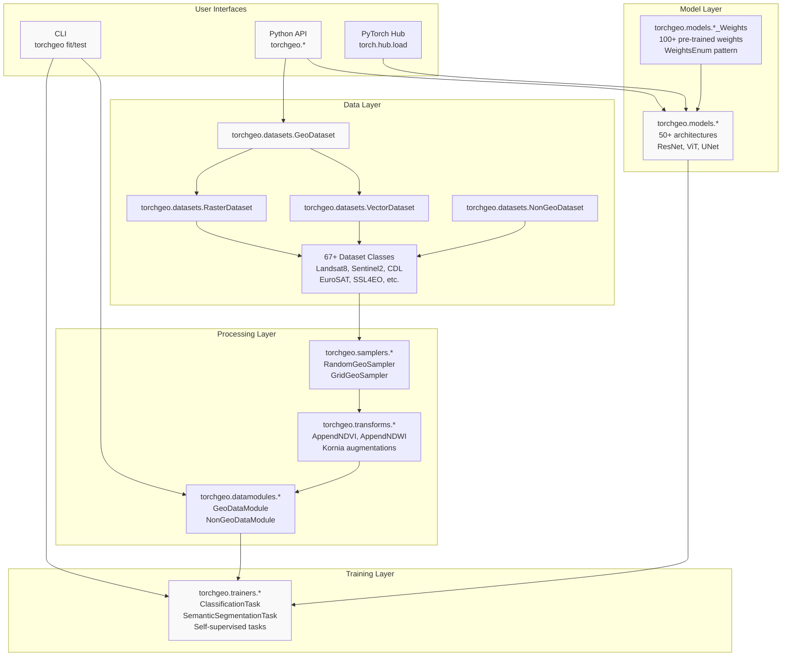
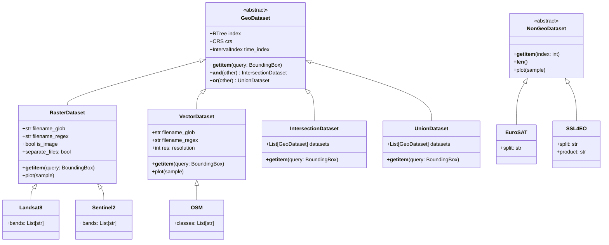
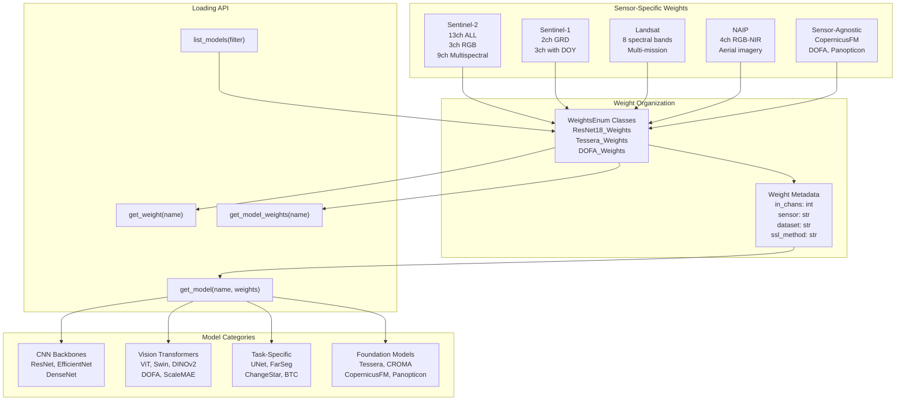
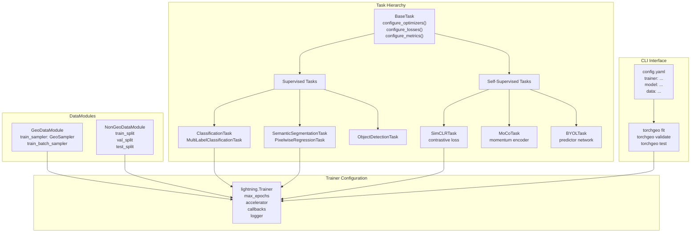

<!-- source: DeepWiki mcp.deepwiki.com · repo torchgeo/torchgeo · page 1 Overview · fetched 2026-10-21 -->

# Overview

<details>
<summary>Relevant source files</summary>

The following files were used as context for generating this wiki page:

- [CITATION.cff](CITATION.cff)
- [README.md](README.md)
- [docs/user/installation.rst](docs/user/installation.rst)
- [images/geodataset.png](images/geodataset.png)
- [images/inria.png](images/inria.png)
- [images/vhr10.png](images/vhr10.png)

</details>


TorchGeo is a PyTorch domain library that provides datasets, samplers, transforms, and pre-trained models for working with geospatial data. It serves as the geospatial equivalent of torchvision, bridging the gap between machine learning practitioners and remote sensing experts by providing standardized tools for loading, processing, and training models on satellite imagery and related geospatial datasets.

**Purpose**: This page provides a comprehensive overview of TorchGeo's architecture, core abstractions, and component interactions. It is intended for developers who need to understand how the library is organized and how its pieces fit together.

**Scope**: This document covers the high-level system design, core abstractions, and main functional areas. For detailed information on specific topics, see:
- Dataset implementations and usage patterns: [Dataset System](#2)
- Data loading and preprocessing details: [Data Loading Pipeline](#3)
- Model architectures and pre-trained weights: [Models and Pre-trained Weights](#4)
- Training workflows and task configurations: [Training System](#5)

Sources: [README.md:1-275]()

## What TorchGeo Provides

TorchGeo addresses the unique challenges of working with geospatial data:

- **Geographic indexing**: Datasets that use spatial coordinates (latitude/longitude, CRS) rather than integer indices
- **Multi-source composition**: Ability to combine datasets from different satellites and sensors with different resolutions and coordinate systems
- **Pre-trained weights**: Models trained on satellite imagery (Sentinel-1/2, Landsat, NAIP) rather than just ImageNet
- **Domain-specific transforms**: Spectral indices (NDVI, NDWI, NDBI) and other remote sensing preprocessing operations
- **Benchmark datasets**: 67+ curated datasets for reproducible comparisons

The library supports both **geospatial datasets** (continent-scale imagery with spatial indexing) and **non-geospatial benchmark datasets** (pre-chipped images with standard integer indexing).

Sources: [README.md:3-9](), [README.md:67-115]()

## System Architecture



**Architecture Overview**: TorchGeo is organized into five functional layers:

1. **User Interfaces**: Three entry points - direct Python imports (most flexible), CLI for configuration-driven training, and PyTorch Hub for model loading
2. **Data Layer**: Dataset abstractions supporting both geospatial (coordinate-based) and non-geospatial (index-based) access patterns
3. **Processing Layer**: Components for sampling patches, applying transforms, and managing train/val/test splits
4. **Model Layer**: Architecture implementations and pre-trained weights with sensor-aware metadata
5. **Training Layer**: PyTorch Lightning trainers encapsulating task-specific logic

Sources: [README.md:3-9](), [README.md:52-249]()

## Core Package Structure

The library is organized into the following top-level modules:

| Module | Purpose | Key Classes/Functions |
|--------|---------|----------------------|
| `torchgeo.datasets` | Dataset implementations | `GeoDataset`, `RasterDataset`, `VectorDataset`, `NonGeoDataset`, 67+ concrete datasets |
| `torchgeo.samplers` | Spatial sampling strategies | `RandomGeoSampler`, `GridGeoSampler`, `PreChippedGeoSampler` |
| `torchgeo.transforms` | Data augmentation and preprocessing | `AppendNDVI`, `AppendNDWI`, `AppendNDBI`, Kornia wrappers |
| `torchgeo.datamodules` | Lightning DataModules | `GeoDataModule`, `NonGeoDataModule`, task-specific modules |
| `torchgeo.models` | Model architectures and weights | `get_model()`, `get_weight()`, `ResNet18_Weights`, etc. |
| `torchgeo.trainers` | Training task definitions | `ClassificationTask`, `SemanticSegmentationTask`, `SimCLRTask` |

Sources: [README.md:55-65](), [README.md:155-187]()

## Dataset Abstractions



**Key Abstractions**:

- **`GeoDataset`**: Base class for datasets with spatial/temporal indexing using `BoundingBox` queries instead of integer indices. Supports composition via `&` (intersection) and `|` (union) operators.

- **`RasterDataset`**: Handles raster imagery (GeoTIFF, NetCDF, HDF5). Automatically builds spatial index from file metadata, handles CRS transformations, and merges multi-file scenes.

- **`VectorDataset`**: Handles vector data (GeoJSON, Shapefile). Rasterizes geometries on-the-fly or extracts keypoint features.

- **`NonGeoDataset`**: Standard PyTorch dataset pattern with integer indexing for benchmark datasets (EuroSAT, SSL4EO, etc.).

Sources: [README.md:67-115]()

## Data Flow Pipeline

```mermaid
flowchart LR
    subgraph "Input Data"
        Files["Raw Files<br/>GeoTIFF, HDF5, etc."]
    end
    
    subgraph "Dataset Creation"
        RD["RasterDataset<br/>e.g., Landsat8"]
        Index["Build RTree Index<br/>from file metadata"]
    end
    
    subgraph "Composition"
        Union["UnionDataset<br/>operator |"]
        Intersection["IntersectionDataset<br/>operator &"]
    end
    
    subgraph "Sampling"
        RandomSampler["RandomGeoSampler<br/>sample(BoundingBox)"]
        GridSampler["GridGeoSampler<br/>non-overlapping tiles"]
    end
    
    subgraph "Preprocessing"
        Indices["Spectral Indices<br/>AppendNDVI, etc."]
        Augment["Augmentations<br/>Kornia wrappers"]
    end
    
    subgraph "Batching"
        Collate["Collate Functions<br/>stack_samples<br/>concat_samples"]
        DataLoader["PyTorch DataLoader"]
    end
    
    subgraph "Training"
        Batch["Mini-batch<br/>image: Tensor<br/>mask: Tensor<br/>metadata: dict"]
    end
    
    Files --> RD
    RD --> Index
    Index --> Union
    Index --> Intersection
    Union --> RandomSampler
    Intersection --> RandomSampler
    Union --> GridSampler
    Intersection --> GridSampler
    RandomSampler --> Indices
    GridSampler --> Indices
    Indices --> Augment
    Augment --> Collate
    Collate --> DataLoader
    DataLoader --> Batch
```



**Pipeline Stages**:

1. **Dataset Creation**: `RasterDataset` subclasses scan directories matching `filename_glob` patterns and build spatial indices
2. **Composition**: Multiple datasets combined via `&` (intersection - imagery + labels) or `|` (union - multi-source imagery)
3. **Sampling**: `RandomGeoSampler` generates random `BoundingBox` queries; `GridGeoSampler` generates non-overlapping tiles
4. **Preprocessing**: Transforms like `AppendNDVI` compute spectral indices; Kornia augmentations applied for training
5. **Batching**: Custom collate functions (`stack_samples`, `concat_samples`) handle variable-size inputs
6. **Training**: PyTorch `DataLoader` yields mini-batches with standardized dictionary structure

Sources: [README.md:73-103]()

## Model and Weight Management



**Weight System**: TorchGeo adopts torchvision's `WeightsEnum` pattern for managing 100+ pre-trained weights. Each weight includes metadata about input channels, sensor type, pretraining dataset, and training method (supervised, self-supervised, multi-modal).

**Usage Pattern**:
```python
from torchgeo.models import ResNet18_Weights, get_model

# Option 1: Using enum
weights = ResNet18_Weights.SENTINEL2_ALL_MOCO
model = get_model("resnet18", weights=weights)

# Option 2: String-based
model = get_model("resnet18", weights="sentinel2_all_moco")

# Option 3: Load state dict manually
state_dict = weights.get_state_dict(progress=True)
```

**Sensor Categories**:
- **Sentinel-2**: 13-channel multispectral, 3-channel RGB, 9-channel multispectral variants
- **Sentinel-1**: 2-channel SAR (VV/VH), 3-channel with day-of-year encoding
- **Landsat**: 8 spectral bands across Landsat 7/8/9 missions
- **NAIP**: 4-channel RGB + near-infrared aerial imagery
- **Sensor-Agnostic**: Foundation models (DOFA, CopernicusFM, Panopticon) trained on multiple sensors

Sources: [README.md:155-168]()

## Training Framework



**Training Architecture**: TorchGeo leverages PyTorch Lightning's `LightningModule` abstraction through a hierarchy of task classes:

- **`BaseTask`**: Common interface for optimizer configuration, metric logging, and checkpoint management
- **Supervised Tasks**: Standard computer vision tasks (classification, segmentation, detection) with task-specific models, losses, and metrics
- **Self-Supervised Tasks**: Contrastive learning methods (SimCLR, MoCo, BYOL) for pretraining on unlabeled satellite imagery

**DataModule Integration**: `GeoDataModule` and `NonGeoDataModule` encapsulate data loading logic with well-defined train/val/test splits and preprocessing pipelines.

**CLI Usage**:
```bash
# Train a model
torchgeo fit --config config.yaml

# Validate only
torchgeo validate --config config.yaml --ckpt_path path/to/checkpoint.ckpt

# Test and report metrics
torchgeo test --config config.yaml --ckpt_path path/to/checkpoint.ckpt
```

Sources: [README.md:170-251]()

## Example Usage Patterns

### Geospatial Data Composition

```python
from torchgeo.datasets import Landsat7, Landsat8, CDL
from torchgeo.samplers import RandomGeoSampler
from torch.utils.data import DataLoader

# Create union of Landsat 7 and 8 (combine multi-source imagery)
landsat7 = Landsat7(paths="...", bands=["B1", ..., "B7"])
landsat8 = Landsat8(paths="...", bands=["B2", ..., "B8"])
landsat = landsat7 | landsat8

# Create intersection with labels (imagery + labels)
cdl = CDL(paths="...", download=True, checksum=True)
dataset = landsat & cdl

# Sample 256x256 patches
sampler = RandomGeoSampler(dataset, size=256, length=10000)
dataloader = DataLoader(dataset, batch_size=128, sampler=sampler, 
                       collate_fn=stack_samples)

for batch in dataloader:
    image = batch["image"]  # Tensor of shape (B, C, H, W)
    mask = batch["mask"]    # Tensor of shape (B, H, W)
```

**Key Concepts**:
- `|` operator creates `UnionDataset` - queries return data from first matching dataset
- `&` operator creates `IntersectionDataset` - queries must be present in all datasets
- `RandomGeoSampler` generates `BoundingBox` queries for spatial sampling
- `stack_samples` collates dictionary samples into batched tensors

Sources: [README.md:73-103]()

### Benchmark Dataset Training

```python
from lightning.pytorch import Trainer
from torchgeo.datamodules import InriaAerialImageLabelingDataModule
from torchgeo.trainers import SemanticSegmentationTask

# DataModule handles train/val/test splits and preprocessing
datamodule = InriaAerialImageLabelingDataModule(
    root="...", 
    batch_size=64, 
    num_workers=6
)

# Task encapsulates model, loss, optimizer, and metrics
task = SemanticSegmentationTask(
    model="unet",
    backbone="resnet50",
    weights=True,  # Use ImageNet weights
    in_channels=3,
    num_classes=2,
    loss="bce"
)

# Standard Lightning training
trainer = Trainer(max_epochs=20, accelerator="gpu")
trainer.fit(model=task, datamodule=datamodule)
```

**Key Concepts**:
- DataModules provide complete data loading pipeline with well-defined splits
- Tasks encapsulate model architecture, loss function, optimizer, and evaluation metrics
- PyTorch Lightning handles training loop, checkpointing, and logging

Sources: [README.md:170-187]()

### Pre-trained Weight Loading

```python
import timm
from torchgeo.models import ResNet18_Weights

# Get weight metadata
weights = ResNet18_Weights.SENTINEL2_ALL_MOCO
print(f"Input channels: {weights.meta['in_chans']}")  # 13
print(f"Sensor: {weights.meta['sensor']}")           # sentinel2
print(f"Dataset: {weights.meta['dataset']}")         # ssl4eo_l

# Create model with correct input channels
model = timm.create_model("resnet18", 
                         in_chans=weights.meta["in_chans"],
                         num_classes=10)

# Load pre-trained weights
model.load_state_dict(weights.get_state_dict(progress=True), strict=False)
```

**Key Concepts**:
- `WeightsEnum` classes provide type-safe access to pre-trained weights
- Weight metadata includes sensor type, input channels, pretraining dataset, and method
- Weights trained on Sentinel-2's 13 spectral bands transfer better to satellite imagery than ImageNet RGB weights

Sources: [README.md:155-168]()

## Installation and Distribution

TorchGeo is distributed through three package managers:

| Package Manager | Installation Command | Notes |
|----------------|---------------------|-------|
| pip | `pip install torchgeo` | Recommended; supports optional dependencies |
| conda | `conda install -c conda-forge torchgeo` | Stable releases only; required dependencies |
| spack | `spack install py-torchgeo` | HPC environments; supports variants |

**Optional Dependencies**:
```bash
# Install with dataset support
pip install torchgeo[datasets]

# Install with model support  
pip install torchgeo[models]

# Install all optional dependencies
pip install torchgeo[all]

# Development installation
pip install torchgeo[style,tests,docs]
```

**Dependency Groups** (defined in `pyproject.toml`):
- `datasets`: Rasterio, GeoPandas, Shapely for geospatial data loading
- `models`: Timm, Segmentation-Models-PyTorch for model architectures
- `style`: Ruff, mypy, prettier for code quality
- `tests`: Pytest, pytest-cov for testing
- `docs`: Sphinx, nbsphinx for documentation

Sources: [README.md:28-36](), [docs/user/installation.rst:1-84]()

## Key Design Patterns

### Spatial Indexing with RTree

All `GeoDataset` subclasses maintain an RTree spatial index mapping `BoundingBox` queries to data files:

```python
from rtree import index
from torchgeo.datasets import BoundingBox

# Internal to RasterDataset
self.index = index.Index(interleaved=False)

# When files are discovered, add bounds to index
for filepath in filepaths:
    minx, maxx, miny, maxy, mint, maxt = self._get_bounds(filepath)
    coords = (minx, maxx, miny, maxy, mint, maxt)
    self.index.insert(id, coords, filepath)

# Query returns matching file paths
hits = self.index.intersection(query.bounds)
```

This enables efficient spatial queries on continental-scale datasets without loading all files into memory.

### Dataset Composition Operators

The `&` and `|` operators create composite datasets that transparently handle multiple data sources:

```python
# Union: queries return from first matching dataset
dataset1 | dataset2  # -> UnionDataset([dataset1, dataset2])

# Intersection: queries must be present in all datasets  
dataset1 & dataset2  # -> IntersectionDataset([dataset1, dataset2])

# Composition is associative
(imagery1 | imagery2) & labels
```

### WeightsEnum Pattern

Following torchvision's multi-weight API:

```python
from enum import Enum
from torchgeo.models._api import WeightsEnum

class ResNet18_Weights(WeightsEnum):
    SENTINEL2_ALL_MOCO = Weights(
        url="...",
        transforms=...,
        meta={
            "in_chans": 13,
            "sensor": "sentinel2", 
            "dataset": "ssl4eo_l",
            "ssl_method": "moco"
        }
    )
```

This provides type safety, metadata discoverability, and consistent API across all model architectures.

Sources: [README.md:155-168]()

## Summary

TorchGeo provides a complete toolkit for geospatial deep learning:

1. **Dataset Abstractions**: Unified interface for geospatial (coordinate-based) and non-geospatial (index-based) datasets
2. **Spatial Sampling**: Efficient patch extraction from continent-scale imagery via `RandomGeoSampler` and `GridGeoSampler`
3. **Data Composition**: Algebraic operators (`&`, `|`) for combining multi-source datasets
4. **Pre-trained Models**: 100+ weights trained on satellite imagery across multiple sensors
5. **Training Framework**: PyTorch Lightning tasks for classification, segmentation, detection, and self-supervised learning
6. **CLI Interface**: Configuration-driven training for reproducible experiments

The library's design prioritizes flexibility (direct Python API), reproducibility (Lightning DataModules and CLI), and domain expertise (sensor-aware weights, spectral transforms).

For detailed information on specific components, see the relevant section pages linked at the top of this document.

Sources: [README.md:1-275](), [CITATION.cff:1-42]()

---

