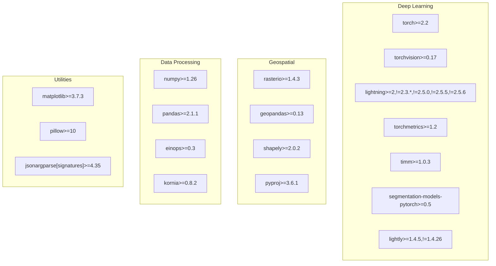

<!-- source: DeepWiki mcp.deepwiki.com · repo torchgeo/torchgeo · page 1.1 Installation · fetched 2026-10-21 -->

# Installation

<details>
<summary>Relevant source files</summary>

The following files were used as context for generating this wiki page:

- [.github/dependabot.yml](.github/dependabot.yml)
- [.pre-commit-config.yaml](.pre-commit-config.yaml)
- [CITATION.cff](CITATION.cff)
- [README.md](README.md)
- [docs/user/installation.rst](docs/user/installation.rst)
- [images/geodataset.png](images/geodataset.png)
- [images/inria.png](images/inria.png)
- [images/vhr10.png](images/vhr10.png)
- [pyproject.toml](pyproject.toml)
- [requirements/datasets.txt](requirements/datasets.txt)
- [requirements/min-reqs.old](requirements/min-reqs.old)
- [requirements/required.txt](requirements/required.txt)

</details>


TorchGeo can be installed via pip, conda, or spack. The library requires Python 3.12+ and includes required dependencies plus optional groups for datasets, models, documentation, testing, and style checking. For development installation, see page 6.1.

**Sources:** [pyproject.toml:13](), [README.md:28-36](), [docs/user/installation.rst:1-4]()

## Installation via pip

TorchGeo is distributed as a pure-Python package on PyPI. Install the latest stable release:

```bash
pip install torchgeo
```

Install a development version from the main branch:

```bash
pip install git+https://github.com/torchgeo/torchgeo.git
```

Install from a local checkout:

```bash
git clone https://github.com/torchgeo/torchgeo.git
cd torchgeo
pip install .
```

### Optional Dependencies

The base installation includes only required dependencies. Optional groups are installed using bracket notation:

```bash
# Single group
pip install torchgeo[datasets]

# Multiple groups
pip install torchgeo[datasets,models]

# All optional dependencies
pip install torchgeo[all]
```

Available optional groups:
- `datasets`: HDF5, NetCDF, LAS, Parquet, WebDataset support
- `models`: Foundation models (microsoft-aurora)
- `docs`: Sphinx documentation building
- `style`: Code formatting and type checking (ruff, mypy)
- `tests`: Testing infrastructure (pytest, nbmake)
- `all`: All of the above

**Sources:** [docs/user/installation.rst:6-37](), [pyproject.toml:92-158](), [requirements/datasets.txt:1-13]()

## Installation via conda

TorchGeo is available on conda-forge. Configure conda to prioritize conda-forge:

```bash
conda config --add channels conda-forge
conda config --set channel_priority strict
conda install torchgeo
```

Conda packages include only stable releases and required dependencies. Optional dependencies must be installed separately via pip.

**Sources:** [docs/user/installation.rst:39-56](), [README.md:36]()

## Installation via spack

For HPC environments, spack supports source-based builds with build variants:

```bash
# Stable release
spack install py-torchgeo
spack load py-torchgeo

# Development version from main branch
spack install py-torchgeo@main

# With optional dependencies (build variants)
spack install py-torchgeo+datasets+models

# List available variants
spack info py-torchgeo
```

**Sources:** [docs/user/installation.rst:59-83]()

## Required Dependencies

Title: **Required Dependencies by Category**



Required dependencies are listed in [pyproject.toml:37-89]() with minimum version constraints. The pinned versions used in CI are specified in [requirements/required.txt:1-22]().

**Sources:** [pyproject.toml:37-89](), [requirements/required.txt:1-22]()

## Optional Dependencies

Title: **Optional Dependency Groups**

| Group | Purpose | Key Packages | Used By |
|-------|---------|--------------|---------|
| `datasets` | Additional data formats | h5py, netcdf4, laspy, xarray, rioxarray, webdataset, pycocotools | Datasets requiring HDF5, NetCDF, point clouds, Parquet |
| `models` | Foundation models | microsoft-aurora | Aurora atmospheric model |
| `docs` | Documentation | sphinx, nbsphinx, myst-parser, pydata-sphinx-theme | Building API docs and tutorials |
| `style` | Code quality | mypy, ruff, types-* | Type checking, linting, formatting |
| `tests` | Testing | pytest, pytest-cov, nbmake | Running test suite |

Optional dependencies are defined in [pyproject.toml:92-158]() and pinned versions are in [requirements/datasets.txt:1-13]().

**Sources:** [pyproject.toml:92-158](), [requirements/datasets.txt:1-13]()

## Version Constraints

TorchGeo requires **Python 3.12+** as specified in [pyproject.toml:13](). 

### Critical Version Exclusions

Certain package versions are excluded due to known bugs:

| Package | Excluded Versions | Reason |
|---------|-------------------|--------|
| lightning | 2.3.*, 2.5.0, 2.5.5, 2.5.6 | YAML parsing bugs, import changes, checkpoint loading issues |
| lightly | 1.4.26 | Incompatible with timm version required by segmentation-models-pytorch |

**Sources:** [pyproject.toml:46-58]()

### Minimum Tested Versions

The [requirements/min-reqs.old:1-44]() file specifies the oldest supported versions tested in CI:

| Package | Minimum | Note |
|---------|---------|------|
| torch | 2.2.0 | Python 3.12 wheels |
| lightning | 2.0.0 | LightningCLI args support |
| rasterio | 1.4.3 | WarpedVRT merging, positive y-resolution |
| geopandas | 0.13.0 | GeoDataFrame.get_coordinates() |
| timm | 1.0.3 | forward_intermediates for ViT |
| kornia | 0.8.2 | VideoSequential fix |
| segmentation-models-pytorch | 0.5.0 | UnetDecoder API |

**Sources:** [requirements/min-reqs.old:1-24](), [pyproject.toml:37-89]()

## Command Line Interface

After installation, TorchGeo provides a command-line interface for training and evaluation:

```bash
# Available after installation
torchgeo --help
torchgeo fit --help
torchgeo validate --help
torchgeo test --help

# Alternative invocation
python3 -m torchgeo
```

The CLI is registered via the `[project.scripts]` section and provides access to Lightning-based training workflows.

**Sources:** [pyproject.toml:156-157](), [README.md:193-213]()

## Verification

After installation, verify TorchGeo is correctly installed:

```python
import torchgeo
print(torchgeo.__version__)

# Check available modules
from torchgeo import datasets, samplers, transforms, models, trainers
```

**Sources:** [pyproject.toml:10-11](), [docs/conf.py:22-30]()

---

