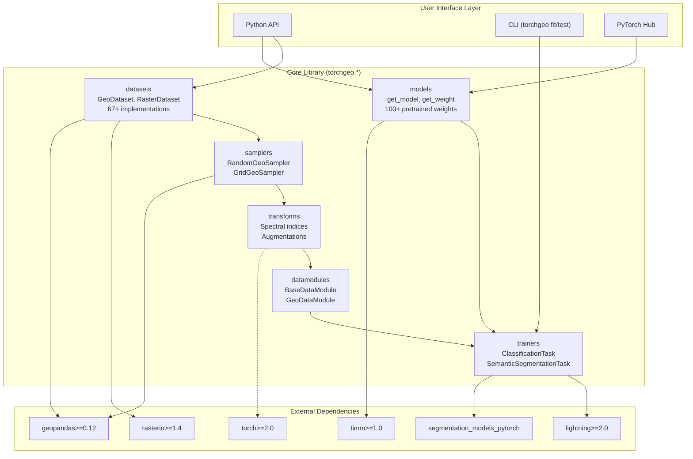
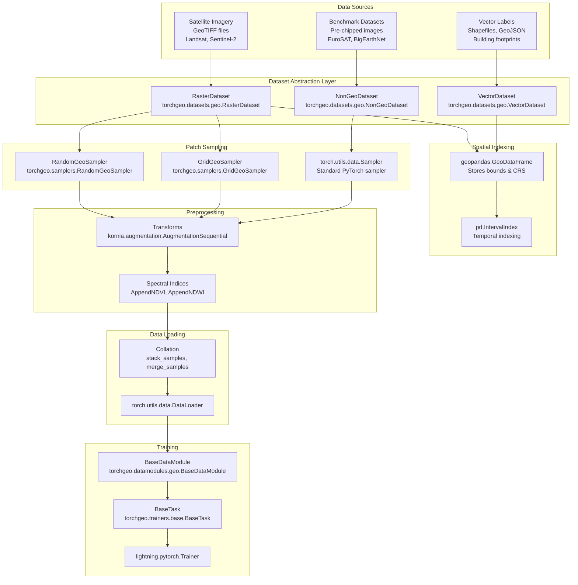
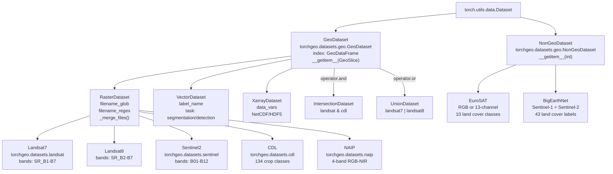
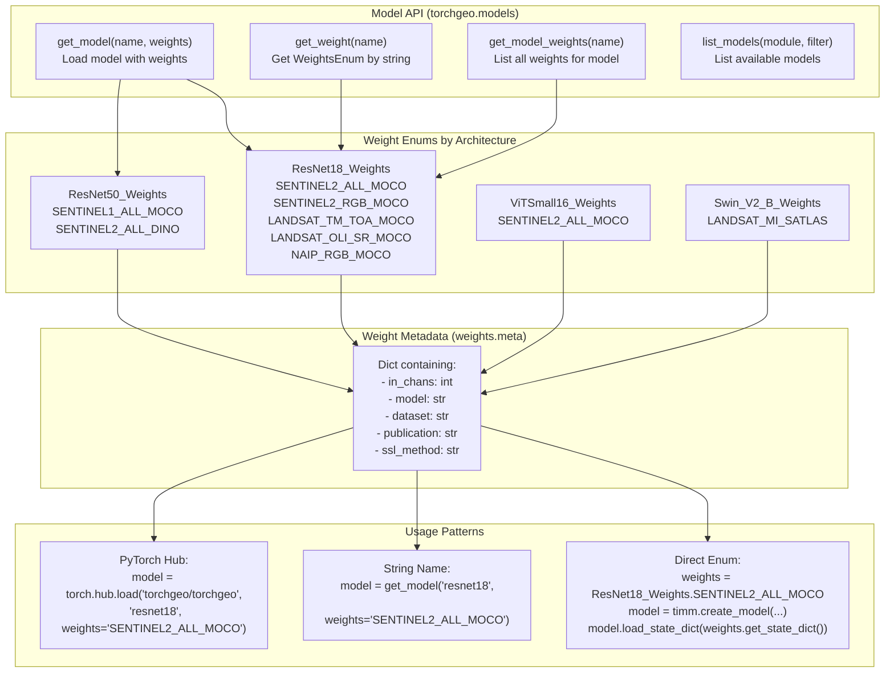
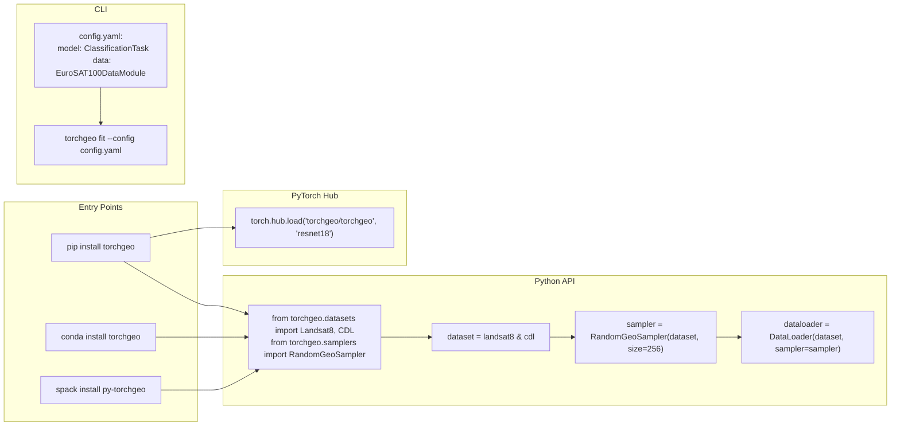

<!-- source: DeepWiki mcp.deepwiki.com · repo torchgeo/torchgeo · page 1.2 System Architecture · fetched 2026-10-21 -->

# System Architecture

<details>
<summary>Relevant source files</summary>

The following files were used as context for generating this wiki page:

- [CITATION.cff](CITATION.cff)
- [README.md](README.md)
- [docs/user/installation.rst](docs/user/installation.rst)
- [images/geodataset.png](images/geodataset.png)
- [images/inria.png](images/inria.png)
- [images/vhr10.png](images/vhr10.png)
- [tests/conf/vhr10_ins_seg.yaml](tests/conf/vhr10_ins_seg.yaml)
- [tests/conf/vhr10_obj_det.yaml](tests/conf/vhr10_obj_det.yaml)
- [tests/data/naip/data.py](tests/data/naip/data.py)
- [tests/data/naip/m_3807511_ne_18_060_20181104.tif](tests/data/naip/m_3807511_ne_18_060_20181104.tif)
- [tests/data/naip/m_3807511_ne_18_060_20190605.tif](tests/data/naip/m_3807511_ne_18_060_20190605.tif)
- [tests/data/vector/data.py](tests/data/vector/data.py)
- [tests/data/vector/vector_2024.geojson](tests/data/vector/vector_2024.geojson)
- [tests/data/vector/vector_2024.parquet](tests/data/vector/vector_2024.parquet)
- [tests/datasets/test_geo.py](tests/datasets/test_geo.py)
- [tests/datasets/test_utils.py](tests/datasets/test_utils.py)
- [tests/models/test_btc.py](tests/models/test_btc.py)
- [tests/trainers/test_byol.py](tests/trainers/test_byol.py)
- [tests/trainers/test_classification.py](tests/trainers/test_classification.py)
- [tests/trainers/test_detection.py](tests/trainers/test_detection.py)
- [tests/trainers/test_instance_segmentation.py](tests/trainers/test_instance_segmentation.py)
- [tests/trainers/test_moco.py](tests/trainers/test_moco.py)
- [tests/trainers/test_regression.py](tests/trainers/test_regression.py)
- [tests/trainers/test_simclr.py](tests/trainers/test_simclr.py)
- [torchgeo/datasets/cdl.py](torchgeo/datasets/cdl.py)
- [torchgeo/datasets/geo.py](torchgeo/datasets/geo.py)
- [torchgeo/datasets/landsat.py](torchgeo/datasets/landsat.py)
- [torchgeo/datasets/naip.py](torchgeo/datasets/naip.py)
- [torchgeo/datasets/sentinel.py](torchgeo/datasets/sentinel.py)
- [torchgeo/datasets/utils.py](torchgeo/datasets/utils.py)
- [torchgeo/models/btc.py](torchgeo/models/btc.py)
- [torchgeo/trainers/base.py](torchgeo/trainers/base.py)
- [torchgeo/trainers/byol.py](torchgeo/trainers/byol.py)
- [torchgeo/trainers/classification.py](torchgeo/trainers/classification.py)
- [torchgeo/trainers/detection.py](torchgeo/trainers/detection.py)
- [torchgeo/trainers/instance_segmentation.py](torchgeo/trainers/instance_segmentation.py)
- [torchgeo/trainers/iobench.py](torchgeo/trainers/iobench.py)
- [torchgeo/trainers/moco.py](torchgeo/trainers/moco.py)
- [torchgeo/trainers/regression.py](torchgeo/trainers/regression.py)
- [torchgeo/trainers/segmentation.py](torchgeo/trainers/segmentation.py)
- [torchgeo/trainers/simclr.py](torchgeo/trainers/simclr.py)

</details>


TorchGeo is a PyTorch domain library that provides datasets, samplers, transforms, models, and trainers for geospatial data. This page describes the high-level architecture, showing how these components interact to form a complete machine learning pipeline. For detailed documentation of specific subsystems, see:

- [Dataset System](#2) - Core dataset abstractions and implementations
- [Data Loading Pipeline](#3) - Samplers, transforms, and DataModules
- [Models and Pre-trained Weights](#4) - Model zoo and weight management
- [Training System](#5) - Lightning tasks and training workflows

**Sources**: [README.md:1-276](), [torchgeo/datasets/geo.py:1-100](), [torchgeo/trainers/base.py:1-100]()

---

## High-Level System Overview

TorchGeo is structured as a layered system with six core modules that integrate with PyTorch and Lightning:

**Diagram: TorchGeo System Components**



The library is organized into functional modules:

| Module | Location | Purpose | Key Classes/Functions |
|--------|----------|---------|----------------------|
| `datasets` | [torchgeo/datasets/](torchgeo/datasets) | Dataset abstractions and implementations | `GeoDataset`, `RasterDataset`, `Landsat`, `Sentinel2`, `CDL` |
| `samplers` | [torchgeo/samplers/](torchgeo/samplers) | Spatial/temporal patch extraction | `RandomGeoSampler`, `GridGeoSampler`, `PreChippedGeoSampler` |
| `transforms` | [torchgeo/transforms/](torchgeo/transforms) | Spectral indices and augmentations | `AppendNormalizedDifferenceIndex`, `AppendNDVI` |
| `models` | [torchgeo/models/](torchgeo/models) | Model architectures and weights | `get_model()`, `get_weight()`, `ResNet18_Weights` |
| `trainers` | [torchgeo/trainers/](torchgeo/trainers) | Lightning training tasks | `ClassificationTask`, `SemanticSegmentationTask`, `ObjectDetectionTask` |
| `datamodules` | [torchgeo/datamodules/](torchgeo/datamodules) | Lightning data loading | `BaseDataModule`, `GeoDataModule`, `NonGeoDataModule` |

**Sources**: [README.md:1-50](), [torchgeo/datasets/geo.py:1-100](), [torchgeo/trainers/classification.py:1-50](), [torchgeo/models/__init__.py:1-50](), [pyproject.toml:37-90]()

---

## Data Flow Pipeline

Data flows through five layers from raw files to trained models. This architecture separates data loading, preprocessing, and training concerns.

**Diagram: End-to-End Data Pipeline**



### Key Components by Layer

**Dataset Layer** ([torchgeo/datasets/geo.py:54-691]()):
- `GeoDataset`: Base class with spatiotemporal indexing using `GeoSlice` notation `[xmin:xmax:xres, ymin:ymax:yres, tmin:tmax:tres]`
- `RasterDataset`: Reads GeoTIFF/JP2 files using `rasterio.open()` with windowed reading
- `VectorDataset`: Rasterizes vector geometries using `rasterio.features.rasterize()`
- `NonGeoDataset`: Integer indexing for pre-processed benchmark datasets

**Indexing Layer** ([torchgeo/datasets/geo.py:96-223]()):
- `geopandas.GeoDataFrame`: Stores spatial bounds and CRS for each file
- `pandas.IntervalIndex`: Temporal index with overlapping timestamp ranges
- `GeoDataFrame.cx[]`: Spatial query using coordinate-based indexing

**Sampling Layer**:
- `RandomGeoSampler` ([torchgeo/samplers/](torchgeo/samplers)): Generates random bounding boxes within dataset bounds
- `GridGeoSampler`: Systematic grid-based sampling for inference
- Standard PyTorch samplers for `NonGeoDataset`

**Processing Layer**:
- `kornia.augmentation.AugmentationSequential`: GPU-accelerated augmentations
- Spectral index calculation ([torchgeo/transforms/](torchgeo/transforms)): Append NDVI, NDWI, NDBI to input tensors

**Sources**: [torchgeo/datasets/geo.py:54-691](), [torchgeo/samplers/](torchgeo/samplers), [torchgeo/datamodules/geo.py:1-200](), [README.md:69-116]()

---

## Dataset System Architecture

The dataset system has two parallel hierarchies for geospatial and non-geospatial data, with composition operators for combining datasets.

**Diagram: Dataset Class Hierarchy and Composition**



### Design Patterns

**Spatiotemporal Indexing** ([torchgeo/datasets/geo.py:96-223]()):
```python
class GeoDataset:
    index: GeoDataFrame  # Stores bounds & timestamp per file
    
    def __getitem__(self, index: GeoSlice) -> Sample:
        # GeoSlice = (x: slice, y: slice, t: slice)
        # Example: dataset[0:100:10, 0:100:10, mint:maxt:1]
```

**Dataset Composition** ([torchgeo/datasets/geo.py:185-215]()):
```python
# Union: Combine multiple sensors (Landsat 7 + 8)
landsat = Landsat7(...) | Landsat8(...)

# Intersection: Pair imagery with labels
dataset = landsat & CDL(...)
```

**Windowed Reading** ([torchgeo/datasets/geo.py:621-650]()):
- Uses `rasterio.merge.merge()` to read only requested bounds
- Lazy loading with `functools.lru_cache` for repeated queries
- Automatic CRS reprojection via `rasterio.vrt.WarpedVRT`

**Filename Pattern Matching** ([torchgeo/datasets/geo.py:463-492]()):
- `filename_glob`: Glob pattern to find files (e.g., `'LT05_*_SR_B*.TIF'`)
- `filename_regex`: Extract metadata from filename (date, band, satellite ID)
- `date_format`: Parse timestamp from filename

**Sources**: [torchgeo/datasets/geo.py:54-691](), [torchgeo/datasets/landsat.py:19-267](), [torchgeo/datasets/sentinel.py:260-400](), [torchgeo/datasets/cdl.py:20-383](), [README.md:69-116]()

---

## Training Framework Architecture

The training system uses PyTorch Lightning's modular design with `BaseTask` for model/training logic and `BaseDataModule` for data loading.

**Diagram: Training Task and DataModule Structure**

```mermaid
graph TB
    subgraph TaskHierarchy["Task Hierarchy (torchgeo.trainers)"]
        BaseTask["BaseTask<br/>torchgeo.trainers.base.BaseTask<br/>configure_models()<br/>configure_losses()<br/>configure_metrics()<br/>configure_optimizers()"]
        
        ClassificationTask["ClassificationTask<br/>model: timm backbone<br/>loss: ce/bce/jaccard/focal"]
        SegmentationTask["SemanticSegmentationTask<br/>model: unet/deeplabv3+/fcn<br/>loss: ce/bce/jaccard/focal"]
        DetectionTask["ObjectDetectionTask<br/>model: faster-rcnn/fcos/retinanet"]
        RegressionTask["RegressionTask<br/>model: timm backbone<br/>loss: mse/mae"]
        SimCLRTask["SimCLRTask<br/>Self-supervised contrastive"]
        MoCoTask["MoCoTask<br/>Self-supervised momentum"]
        
        BaseTask --> ClassificationTask
        BaseTask --> SegmentationTask
        BaseTask --> DetectionTask
        BaseTask --> RegressionTask
        BaseTask --> SimCLRTask
        BaseTask --> MoCoTask
    end
    
    subgraph DataModuleHierarchy["DataModule Hierarchy (torchgeo.datamodules)"]
        BaseDataModule["BaseDataModule<br/>torchgeo.datamodules.geo.BaseDataModule<br/>setup()<br/>train_dataloader()<br/>val_dataloader()<br/>test_dataloader()"]
        
        GeoDataModule["GeoDataModule<br/>Uses RandomGeoSampler<br/>Spatial sampling"]
        NonGeoDataModule["NonGeoDataModule<br/>Uses random_split()<br/>Integer indexing"]
        
        BaseDataModule --> GeoDataModule
        BaseDataModule --> NonGeoDataModule
    end
    
    subgraph Components["Training Components"]
        Models["Models<br/>timm.create_model()<br/>smp.Unet/DeepLabV3Plus<br/>torchvision.models.detection"]
        Losses["Losses<br/>nn.CrossEntropyLoss<br/>smp.losses.JaccardLoss<br/>smp.losses.FocalLoss"]
        Metrics["Metrics<br/>torchmetrics.Accuracy<br/>torchmetrics.JaccardIndex<br/>torchmetrics.MeanAveragePrecision"]
        Optimizers["Optimizers<br/>torch.optim.AdamW<br/>lightly.utils.lars.LARS"]
    end
    
    subgraph Lightning["PyTorch Lightning"]
        Trainer["lightning.pytorch.Trainer<br/>fit/validate/test<br/>callbacks<br/>loggers"]
    end
    
    Models --> BaseTask
    Losses --> BaseTask
    Metrics --> BaseTask
    Optimizers --> BaseTask
    
    BaseDataModule --> Trainer
    BaseTask --> Trainer
```



### BaseTask Interface

All tasks inherit from `BaseTask` ([torchgeo/trainers/base.py:16-85]()) and implement:

| Method | Purpose | Example Implementation |
|--------|---------|----------------------|
| `configure_models()` | Instantiate model architecture | `self.model = timm.create_model(...)` |
| `configure_losses()` | Define loss function | `self.criterion = nn.CrossEntropyLoss()` |
| `configure_metrics()` | Setup torchmetrics | `self.train_metrics = Accuracy(...)` |
| `configure_optimizers()` | Define optimizer/scheduler | `return AdamW(...), ReduceLROnPlateau(...)` |
| `training_step()` | Forward pass + loss | `loss = self.criterion(y_hat, y)` |
| `validation_step()` | Validation metrics | `self.val_metrics(y_hat, y)` |

### Task Configuration Examples

**Classification** ([torchgeo/trainers/classification.py:30-82]()):
```python
task = ClassificationTask(
    model='resnet50',              # timm model name
    weights='SENTINEL2_ALL_MOCO',  # Pretrained weights
    in_channels=13,                # Sentinel-2 bands
    num_classes=10,                # Output classes
    loss='ce'                      # CrossEntropy loss
)
```

**Segmentation** ([torchgeo/trainers/segmentation.py:28-106]()):
```python
task = SemanticSegmentationTask(
    model='unet',                  # smp model
    backbone='resnet18',           # Encoder
    in_channels=3,                 # RGB
    num_classes=5,                 # Land cover classes
    loss='jaccard',                # IoU loss
    freeze_backbone=True           # Linear probing
)
```

**Self-Supervised** ([torchgeo/trainers/simclr.py:56-127]()):
```python
task = SimCLRTask(
    model='resnet50',
    in_channels=13,
    version=2,                     # SimCLR v2
    layers=3,                      # Projection head layers
    temperature=0.07               # NT-Xent temperature
)
```

### DataModule Interface

`BaseDataModule` ([torchgeo/datamodules/geo.py:1-100]()) provides data loading:

| Method | Purpose |
|--------|---------|
| `setup(stage)` | Initialize datasets for fit/validate/test/predict |
| `train_dataloader()` | Return `DataLoader` for training |
| `val_dataloader()` | Return `DataLoader` for validation |
| `test_dataloader()` | Return `DataLoader` for testing |
| `predict_dataloader()` | Return `DataLoader` for inference |

**Sources**: [torchgeo/trainers/base.py:1-85](), [torchgeo/trainers/classification.py:30-164](), [torchgeo/trainers/segmentation.py:28-257](), [torchgeo/trainers/simclr.py:56-127](), [torchgeo/datamodules/geo.py:1-200]()

---

## Model and Weight Management

TorchGeo provides 100+ pretrained weights organized by sensor type, following torchvision's `WeightsEnum` API pattern.

**Diagram: Weight Enums and Model Loading API**



### Weight Organization by Sensor

Weights are organized by source sensor to match input channel requirements:

| Sensor | Channels | Example Weights | SSL Method |
|--------|----------|----------------|------------|
| Sentinel-2 ALL | 13 | `ResNet18_Weights.SENTINEL2_ALL_MOCO` | MoCo v2 |
| Sentinel-2 RGB | 3 | `ResNet18_Weights.SENTINEL2_RGB_MOCO` | MoCo v2 |
| Sentinel-1 GRD | 2 | `ResNet50_Weights.SENTINEL1_ALL_MOCO` | MoCo v2 |
| Landsat TM | 7 | `ResNet18_Weights.LANDSAT_TM_TOA_MOCO` | MoCo v2 |
| Landsat OLI | 7 | `ResNet18_Weights.LANDSAT_OLI_SR_MOCO` | MoCo v2 |
| NAIP | 4 | `ResNet18_Weights.NAIP_RGB_MOCO` | MoCo v2 |
| Sensor-Agnostic | Variable | `ViTSmall16_Weights.SENTINEL2_ALL_MOCO` | MoCo v2 |

### Loading Models with Weights

**Method 1: Direct WeightsEnum** ([torchgeo/models/__init__.py:1-100]()):
```python
from torchgeo.models import ResNet18_Weights
import timm

weights = ResNet18_Weights.SENTINEL2_ALL_MOCO
in_chans = weights.meta["in_chans"]  # 13 for Sentinel-2

model = timm.create_model("resnet18", in_chans=in_chans, num_classes=10)
model.load_state_dict(weights.get_state_dict(progress=True), strict=False)
```

**Method 2: String-based Loading**:
```python
from torchgeo.models import get_model

model = get_model("resnet18", weights="SENTINEL2_ALL_MOCO")
```

**Method 3: Use in Tasks** ([torchgeo/trainers/classification.py:83-103]()):
```python
task = ClassificationTask(
    model='resnet18',
    weights='SENTINEL2_ALL_MOCO',  # Automatically loads weights
    in_channels=13,
    num_classes=10
)
```

### Weight Metadata

Each `WeightsEnum` member includes metadata accessible via `.meta`:

```python
weights = ResNet18_Weights.SENTINEL2_ALL_MOCO
print(weights.meta)
# {
#     'in_chans': 13,
#     'model': 'resnet18',
#     'dataset': 'ssl4eo_s2_12',
#     'publication': 'https://arxiv.org/abs/2306.09424',
#     'ssl_method': 'moco_v2'
# }
```

**Sources**: [README.md:155-168](), [torchgeo/models/__init__.py:1-100](), [torchgeo/trainers/classification.py:83-111](), [tests/trainers/test_classification.py:128-189]()

---

## User Interface Patterns

TorchGeo provides three interfaces for different use cases:



### Python API

Programmatic control for research workflows. Users compose datasets, add samplers/transforms, and train models using Lightning or plain PyTorch.

### Command Line Interface

Configuration-driven training via Lightning CLI. Users specify model and data in YAML files:

```yaml
model:
  class_path: SemanticSegmentationTask
  init_args:
    model: 'unet'
    backbone: 'resnet18'
data:
  class_path: PASTISDataModule
  init_args:
    batch_size: 32
```

Run with: `torchgeo fit --config config.yaml`

### PyTorch Hub

One-line model loading for inference:

```python
model = torch.hub.load("torchgeo/torchgeo", "resnet18", 
                       weights="SENTINEL2_ALL_MOCO")
```

**Sources**: [README.md:27-253](), [docs/user/installation.rst:1-84](), [tests/conf/pastis.yaml:1-19](), [pyproject.toml:156-158]()

---

## Dependency Management

TorchGeo uses a multi-file dependency strategy to support optional features:

```mermaid
graph TB
    subgraph "Dependency Files"
        required["requirements/required.txt<br/>Core dependencies<br/>- torch>=2.0<br/>- rasterio>=1.4.3<br/>- geopandas>=0.12.1"]
        
        datasets["requirements/datasets.txt<br/>Dataset dependencies<br/>- h5py, netcdf4<br/>- rioxarray, xarray<br/>- opencv-python"]
        
        models["requirements/models.txt<br/>Model dependencies<br/>- microsoft-aurora<br/>- ultralytics"]
        
        style["requirements/style.txt<br/>Linting tools<br/>- mypy, ruff"]
        
        tests["requirements/tests.txt<br/>Testing tools<br/>- pytest, pytest-cov<br/>- nbmake"]
    end
    
    subgraph "Installation Options"
        base["pip install torchgeo<br/>(required only)"]
        extras["pip install torchgeo[datasets,models]<br/>(with optional dependencies)"]
        all["pip install torchgeo[all]<br/>(everything)"]
    end
    
    required --> base
    required --> extras
    required --> all
    
    datasets --> extras
    models --> extras
    
    datasets --> all
    models --> all
    style --> all
    tests --> all
```

### Version Constraints

TorchGeo explicitly excludes incompatible versions in [pyproject.toml:37-90]():

- `lightning>=2,!=2.3.*,!=2.5.0,<2.5.5`: Excludes versions with known bugs
- `lightly>=1.4.5,!=1.4.26`: Excludes version incompatible with `timm`
- `rasterio>=1.4.3`: Requires version with `rasterio.merge` fixes

**Sources**: [requirements/required.txt:1-22](), [requirements/datasets.txt:1-13](), [pyproject.toml:37-155](), [docs/user/installation.rst:29-83]()

---

## Design Philosophy

TorchGeo's architecture follows several key principles:

### 1. Composability

Datasets, transforms, and models are designed to be composed. The `&` and `|` operators allow intuitive dataset combination without explicit wrapper classes.

### 2. Lazy Evaluation

Operations like dataset union and reprojection are lazily evaluated. `GeoDataset` doesn't create mosaics or reproject files until data is accessed.

### 3. PyTorch Native

TorchGeo extends `torch.utils.data.Dataset` and integrates seamlessly with PyTorch and Lightning. Users can mix TorchGeo components with standard PyTorch code.

### 4. Geospatial Aware

Unlike generic computer vision libraries, TorchGeo handles CRS, resolution, spatial indexing, and multi-spectral data as first-class concepts.

### 5. Reproducibility

Lightning integration, CLI support, and seed control enable reproducible experiments. DataModules encapsulate train/val/test splits.

**Sources**: [README.md:1-276](), [docs/tutorials/torchgeo.ipynb:83-392]()

---

