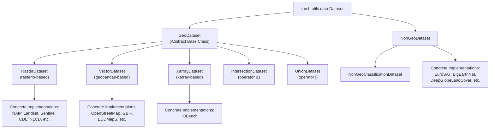
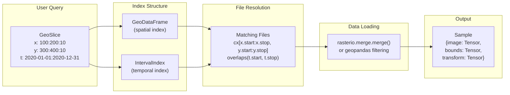
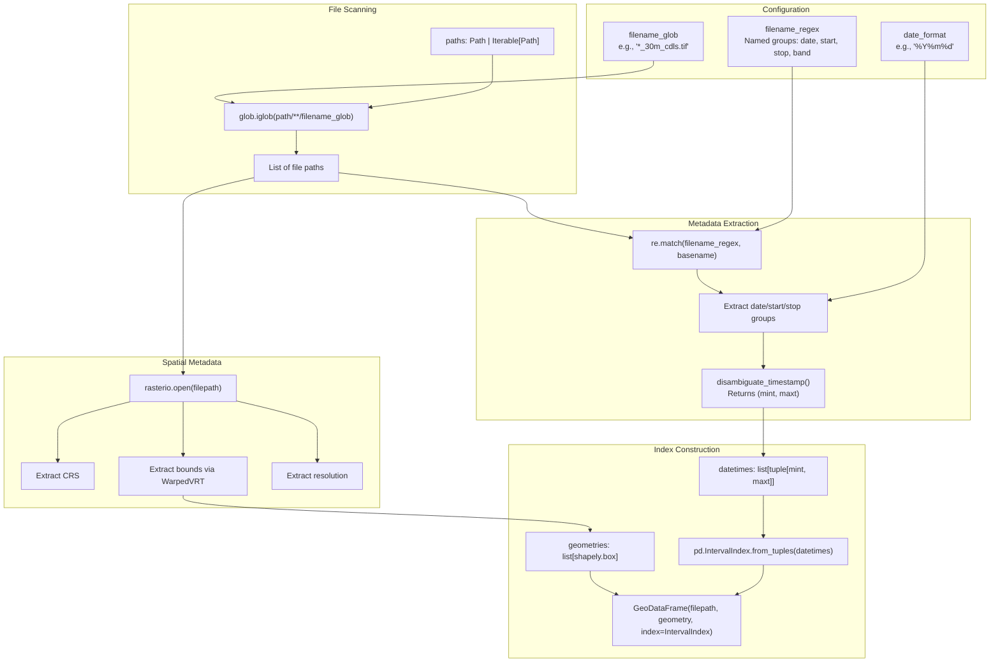
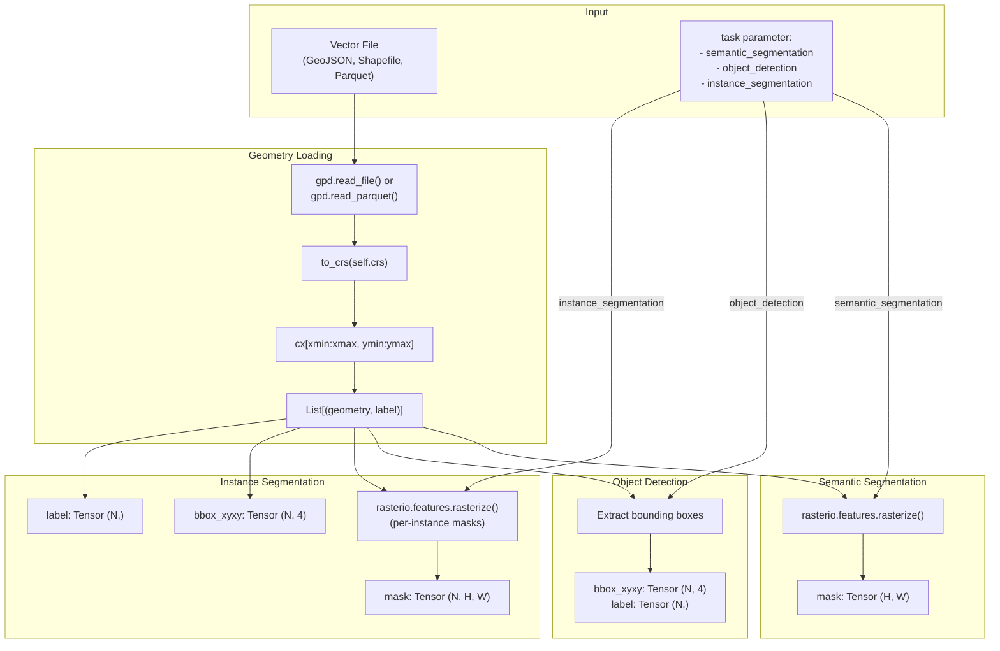
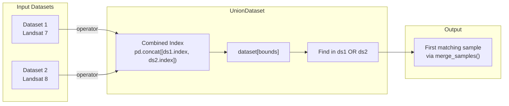
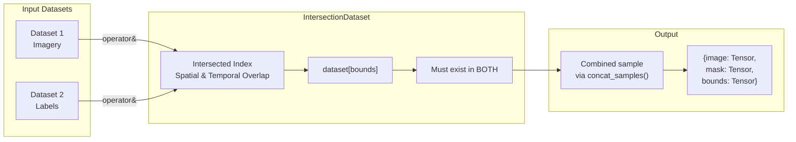
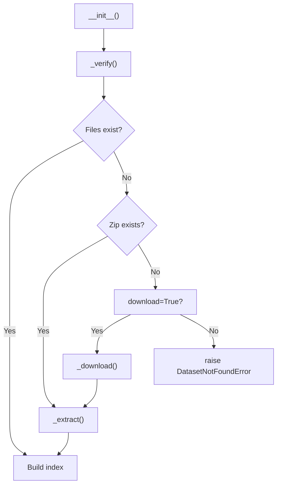

<!-- source: DeepWiki mcp.deepwiki.com · repo torchgeo/torchgeo · page 2 Dataset System · fetched 2026-10-21 -->

# Dataset System

<details>
<summary>Relevant source files</summary>

The following files were used as context for generating this wiki page:

- [docs/api/datamodules.rst](docs/api/datamodules.rst)
- [docs/api/datasets.rst](docs/api/datasets.rst)
- [tests/data/deepglobelandcover/data.py](tests/data/deepglobelandcover/data.py)
- [tests/data/deepglobelandcover/data.zip](tests/data/deepglobelandcover/data.zip)
- [tests/data/naip/data.py](tests/data/naip/data.py)
- [tests/data/naip/m_3807511_ne_18_060_20181104.tif](tests/data/naip/m_3807511_ne_18_060_20181104.tif)
- [tests/data/naip/m_3807511_ne_18_060_20190605.tif](tests/data/naip/m_3807511_ne_18_060_20190605.tif)
- [tests/data/vector/data.py](tests/data/vector/data.py)
- [tests/data/vector/vector_2024.geojson](tests/data/vector/vector_2024.geojson)
- [tests/data/vector/vector_2024.parquet](tests/data/vector/vector_2024.parquet)
- [tests/datasets/test_deepglobelandcover.py](tests/datasets/test_deepglobelandcover.py)
- [tests/datasets/test_geo.py](tests/datasets/test_geo.py)
- [tests/datasets/test_utils.py](tests/datasets/test_utils.py)
- [tests/trainers/test_segmentation.py](tests/trainers/test_segmentation.py)
- [torchgeo/datamodules/__init__.py](torchgeo/datamodules/__init__.py)
- [torchgeo/datasets/__init__.py](torchgeo/datasets/__init__.py)
- [torchgeo/datasets/cdl.py](torchgeo/datasets/cdl.py)
- [torchgeo/datasets/deepglobelandcover.py](torchgeo/datasets/deepglobelandcover.py)
- [torchgeo/datasets/geo.py](torchgeo/datasets/geo.py)
- [torchgeo/datasets/landsat.py](torchgeo/datasets/landsat.py)
- [torchgeo/datasets/naip.py](torchgeo/datasets/naip.py)
- [torchgeo/datasets/sentinel.py](torchgeo/datasets/sentinel.py)
- [torchgeo/datasets/utils.py](torchgeo/datasets/utils.py)

</details>


The Dataset System provides the foundational data loading infrastructure for TorchGeo. It defines abstract base classes and concrete implementations for accessing geospatial and non-geospatial remote sensing datasets with consistent interfaces optimized for machine learning workflows.

**Scope:** This page covers dataset abstractions, spatial indexing mechanisms, and implementation patterns. For information about sampling patches from datasets, see [Data Loading Pipeline](#3). For specific dataset implementations, see [Dataset Catalog](#2.2). For creating custom datasets, see [Creating Custom Datasets](#2.5).

---

## Core Dataset Hierarchy

The dataset system is organized around two primary abstractions: geospatial datasets with coordinate awareness, and non-geospatial datasets with simple integer indexing.



**Sources:** [torchgeo/datasets/geo.py:54-95](), [torchgeo/datasets/geo.py:338-339](), [torchgeo/datasets/geo.py:693-697](), [torchgeo/datasets/geo.py:859-860](), [torchgeo/datasets/__init__.py:82-91]()

---

## Geospatial Indexing with GeoSlice

Geospatial datasets use a `GeoSlice` indexing scheme that represents spatiotemporal queries as three-dimensional slices:

```
dataset[xmin:xmax:xres, ymin:ymax:yres, tmin:tmax:tres]
```

Each component follows Python's slice notation where `start:stop:step` defines:
- **Spatial dimensions:** min/max bounds in CRS units, step as resolution
- **Temporal dimension:** min/max timestamps, step as sampling interval

### GeoSlice to Internal Index Translation



**Index Attributes:**
- `index: GeoDataFrame` - Stores file paths, geometries (shapely polygons), and temporal intervals
- `crs: CRS` - Coordinate reference system for spatial queries
- `res: tuple[float, float]` - Resolution in (xres, yres) format
- `bounds: tuple[slice, slice, slice]` - Dataset extent as spatiotemporal slices

**Sources:** [torchgeo/datasets/geo.py:96](), [torchgeo/datasets/geo.py:238-249](), [torchgeo/datasets/utils.py:51-53](), [torchgeo/datasets/geo.py:534-543]()

---

## RasterDataset: Satellite Imagery and Masks

`RasterDataset` provides the foundation for datasets stored as geospatial raster files (GeoTIFF, JP2, etc.). It handles multi-file merging, CRS transformation, and resolution resampling automatically.

### File Discovery and Temporal Extraction



**Key Methods:**

| Method | Purpose |
|--------|---------|
| `__init__` | Initialize dataset with paths, CRS, resolution, bands, transforms |
| `__getitem__` | Retrieve data for spatiotemporal slice via `_merge_files` |
| `_filepath_to_timestamp` | Extract temporal bounds from filename using regex |
| `_merge_files` | Load and merge multiple rasters using `rasterio.merge.merge` |
| `_load_warp_file` | Open file and warp to target CRS/resolution via `WarpedVRT` |

**Sample Structure (is_image=True):**

```python
{
    'image': Tensor,      # Shape: (C, H, W), dtype from self.dtype
    'bounds': Tensor,     # Spatiotemporal slice as tensor
    'transform': Tensor   # Affine transform for georeferencing
}
```

**Sample Structure (is_image=False):**

```python
{
    'mask': Tensor,       # Shape: (H, W), dtype typically long
    'bounds': Tensor,
    'transform': Tensor
}
```

**Band Selection:**

For multi-band datasets, specify `bands` parameter:
- **Separate files** (`separate_files=True`): Each band stored in separate file, uses `filename_regex` group `band` to locate files
- **Single file** (`separate_files=False`): Multiple bands in one file, uses `band_indexes` to select specific bands

**Sources:** [torchgeo/datasets/geo.py:338-424](), [torchgeo/datasets/geo.py:425-520](), [torchgeo/datasets/geo.py:522-572](), [torchgeo/datasets/geo.py:621-650]()

---

## VectorDataset: Points, Lines, and Polygons

`VectorDataset` handles vector data formats (GeoJSON, Shapefile, Parquet) and rasterizes geometries into masks or extracts bounding boxes for object detection.

### Task-Specific Output Formats



**Label Extraction:**

Each geometry can have an associated label value extracted via `label_name` parameter:
- If `label_name` is specified, reads property from vector file (e.g., `{'label_id': 3}`)
- Otherwise defaults to class index via `get_label` method (can be overridden)

**Sources:** [torchgeo/datasets/geo.py:859-990](), [torchgeo/datasets/geo.py:992-1095](), [tests/data/vector/data.py]()

---

## XarrayDataset: Multidimensional Array Data

`XarrayDataset` provides support for multidimensional array datasets stored in formats like NetCDF or HDF5, leveraging xarray's labeled array capabilities.

**Key Features:**
- Multi-variable data loading via `data_vars` parameter
- Time-series support with native xarray temporal indexing
- Lazy loading and chunked computation
- Automatic CRS reprojection via `rioxarray`

**Dependencies:**
- Requires `xarray >= 0.17`, `rioxarray >= 0.14.1`
- Optional: `h5py >= 3.10` for HDF5, `netCDF4 >= 1.6.5` for NetCDF

**Sources:** [torchgeo/datasets/geo.py:693-856]()

---

## NonGeoDataset: Integer-Indexed Datasets

`NonGeoDataset` is the base class for datasets without geospatial information, using traditional integer indexing:

```python
sample = dataset[42]  # Integer index
```

### NonGeoClassificationDataset

Extends `NonGeoDataset` with torchvision's `ImageFolder` pattern:

```
root/
    class_a/
        img1.jpg
        img2.jpg
    class_b/
        img3.jpg
```

**Automatic class indexing:** Discovers subdirectories as class labels and creates `classes` and `class_to_idx` mappings.

**Sources:** [torchgeo/datasets/geo.py:1098-1176]()

---

## Dataset Composition Operators

TorchGeo provides algebraic operators for combining multiple `GeoDataset` instances:

### Union Operator (|): Spatial Concatenation

```python
dataset = landsat7 | landsat8  # Combine Landsat 7 and 8
```

**Use cases:**
- Multiple sensors covering same area (Landsat 7 + Landsat 8)
- Multiple temporal acquisitions
- Non-overlapping spatial regions (Chesapeake NY | Chesapeake PA)

**Behavior:** Query must be found in **at least one** dataset. Returns data from first matching dataset.



### Intersection Operator (&): Aligned Pairing

```python
dataset = landsat & cdl  # Pair imagery with labels
```

**Use cases:**
- Imagery + ground truth labels (Landsat & CDL)
- Multi-modal data fusion (optical & SAR)
- Imagery + auxiliary data (elevation, temperature)

**Behavior:** Query must be found in **both** datasets. Samples are concatenated along channel dimension.



**CRS Harmonization:** When combining datasets with different CRS, the first dataset's CRS is used. Other datasets are automatically reprojected.

**Sources:** [torchgeo/datasets/geo.py:185-215](), [torchgeo/datasets/geo.py:1179-1289](), [torchgeo/datasets/geo.py:1292-1396]()

---

## Common Implementation Patterns

### Pattern 1: File Discovery Configuration

Every `RasterDataset` and `VectorDataset` subclass defines file discovery parameters:

```python
class Landsat8(Landsat):
    filename_glob = 'LC08_*_{}.*'
    filename_regex = r"""
        ^L(?P<sensor>[COTEM])
        (?P<satellite>\d{2})
        _(?P<processing_correction_level>[A-Z0-9]{4})
        ...
        _(?P<date>\d{8})
        ...
        _(?P<band>[A-Z0-9_]+)
        \.
    """
    date_format = '%Y%m%d'
```

**Sources:** [torchgeo/datasets/landsat.py:39-52](), [torchgeo/datasets/landsat.py:240-246]()

### Pattern 2: Download/Verify/Extract Workflow

Datasets with downloadable data implement a three-phase initialization:



**Example from CDL:**

| Method | Purpose |
|--------|---------|
| `_verify` | Check if files exist, trigger download if needed |
| `_download` | Download files from URLs with checksum validation |
| `_extract` | Extract archives to destination directory |

**Sources:** [torchgeo/datasets/cdl.py:291-336]()

### Pattern 3: Band Selection

**Separate Files (Sentinel-2):**
```python
all_bands = ('B01', 'B02', 'B03', ...)
separate_files = True

def __init__(self, bands=['B04', 'B03', 'B02'], ...):
    # Uses filename_regex group 'band' to find files
    self.filename_glob = f'T*_*_{bands[0]}*.*'
```

**Single File (NAIP):**
```python
all_bands = ('R', 'G', 'B', 'NIR')
separate_files = False

def __init__(self, bands=['R', 'G', 'B'], ...):
    # Creates band_indexes = [0, 1, 2]
    self.band_indexes = [self.all_bands.index(b) + 1 for b in bands]
```

**Sources:** [torchgeo/datasets/sentinel.py:141-201](), [torchgeo/datasets/naip.py:47-48](), [torchgeo/datasets/geo.py:497-509]()

### Pattern 4: Custom Class Mapping

Datasets like CDL with 134+ raw classes allow class filtering:

```python
cdl = CDL(
    paths='data',
    years=[2023],
    classes=[0, 1, 5, 24, 36]  # Background, Corn, Soybeans, Winter Wheat, Alfalfa
)

# Creates ordinal_map: tensor mapping raw class IDs to [0, 1, 2, 3, 4]
sample = cdl[bounds]
# sample['mask'] contains values 0-4 instead of original class IDs
```

**Implementation:**
1. Initialize `ordinal_map` tensor of size `max(class_ids) + 1`
2. Map selected classes to ordinal indices: `ordinal_map[class_id] = ordinal`
3. In `__getitem__`, remap: `sample['mask'] = self.ordinal_map[sample['mask']]`

**Sources:** [torchgeo/datasets/cdl.py:209-289]()

### Pattern 5: Plotting with RGB Bands

Datasets define `rgb_bands` attribute for visualization:

```python
class Landsat8(Landsat):
    rgb_bands = ('SR_B4', 'SR_B3', 'SR_B2')  # Red, Green, Blue
    
    def plot(self, sample, ...):
        rgb_indices = [self.bands.index(b) for b in self.rgb_bands]
        image = sample['image'][rgb_indices].permute(1, 2, 0)
        # Normalize and plot
```

**Sources:** [torchgeo/datasets/landsat.py:99-142](), [torchgeo/datasets/sentinel.py:260-315]()

---

## Sample Transformation and Collation

### Transform Pipeline

Datasets accept a `transforms` callable that modifies samples:

```python
def my_transform(sample: dict[str, Any]) -> dict[str, Any]:
    sample['image'] = sample['image'] / 10000.0  # Scale reflectance
    return sample

dataset = Landsat8(paths='data', transforms=my_transform)
```

Transforms are applied in `__getitem__` after data loading but before returning.

### Collation Functions

For batching samples in DataLoaders:

| Function | Purpose |
|----------|---------|
| `stack_samples` | Stack list of samples into batch (adds new dimension) |
| `concat_samples` | Concatenate samples along existing dimension (for IntersectionDataset) |
| `merge_samples` | Merge samples taking maximum values (for UnionDataset) |
| `unbind_samples` | Reverse of stack_samples, splits batch into list |

**Sources:** [torchgeo/datasets/utils.py:473-558]()

---

## Dataset Catalog Overview

TorchGeo includes 67+ dataset implementations. Key categories:

### Geospatial Datasets (Imagery)

| Dataset | Type | Description | Bands/Channels |
|---------|------|-------------|----------------|
| NAIP | Raster | High-resolution aerial imagery (60cm) | R, G, B, NIR |
| Landsat 8/9 | Raster | Multispectral satellite (30m) | 11 bands |
| Sentinel-1 | Raster | SAR imagery (10m) | HH, HV, VV, VH polarizations |
| Sentinel-2 | Raster | Multispectral satellite (10-60m) | 13 bands |
| PRISMA | Raster | Hyperspectral (30m) | 239 bands |

### Geospatial Datasets (Labels)

| Dataset | Type | Description | Classes |
|---------|------|-------------|---------|
| CDL | Raster | Crop type classification | 134 crop types |
| NLCD | Raster | Land cover classification | 16 classes |
| Chesapeake | Raster | Land cover for Chesapeake Bay | 7 classes |
| OpenStreetMap | Vector | Building footprints, roads | Geometries |
| GBIF | Vector | Species occurrence data | Point locations |

### Non-Geospatial Datasets (Benchmark)

| Dataset | Task | Samples | Classes/Metrics |
|---------|------|---------|-----------------|
| EuroSAT | Classification | 27,000 | 10 land use classes |
| BigEarthNet | Multi-label classification | 590,326 | 19 land cover classes |
| DeepGlobeLandCover | Segmentation | 803 | 7 land cover classes |
| So2Sat | Classification | 400,673 | 17 local climate zones |
| xBD | Disaster assessment | 850,736 buildings | Pre/post disaster damage |

**Sources:** [docs/api/datasets.rst:10-611](), [torchgeo/datasets/__init__.py:6-381]()

---

## Error Handling

Common exceptions:

| Exception | Raised When | Resolution |
|-----------|-------------|------------|
| `DatasetNotFoundError` | No files found matching `filename_glob` | Check paths, download data, or set `download=True` |
| `IndexError` | Query outside dataset bounds | Verify spatiotemporal query intersects dataset |
| `AssertionError` | Invalid bands specified | Ensure bands in `all_bands` attribute |
| `DependencyNotFoundError` | Optional dependency missing | Install required package (e.g., `rioxarray`, `h5py`) |
| `RGBBandsMissingError` | Plotting without RGB bands | Provide dataset with RGB bands or use custom plot |

**Sources:** [torchgeo/datasets/errors.py:1-61](), [torchgeo/datasets/geo.py:447-449](), [torchgeo/datasets/geo.py:540-543]()

---

## Key Dataset Attributes

Every `GeoDataset` provides:

| Attribute/Property | Type | Description |
|-------------------|------|-------------|
| `index` | `GeoDataFrame` | Spatial index with file paths and temporal intervals |
| `crs` | `CRS` | Coordinate reference system |
| `res` | `tuple[float, float]` | Resolution in CRS units (xres, yres) |
| `bounds` | `tuple[slice, slice, slice]` | Dataset extent as spatiotemporal slices |
| `files` | `list[str]` | All files matching filename_glob |

Every `RasterDataset` adds:

| Attribute | Type | Description |
|-----------|------|-------------|
| `all_bands` | `tuple[str, ...]` | All available bands |
| `bands` | `Sequence[str]` | Selected bands to load |
| `rgb_bands` | `tuple[str, ...]` | Bands for RGB visualization |
| `is_image` | `bool` | True for imagery, False for masks |
| `dtype` | `torch.dtype` | Output tensor dtype |
| `resampling` | `Resampling` | Resampling algorithm (bilinear/nearest) |

**Sources:** [torchgeo/datasets/geo.py:96-283](), [torchgeo/datasets/geo.py:381-423]()

---

