<!-- source: DeepWiki mcp.deepwiki.com · repo torchgeo/torchgeo · page 2.1 Core Dataset Abstractions · fetched 2026-10-21 -->

# Core Dataset Abstractions

<details>
<summary>Relevant source files</summary>

The following files were used as context for generating this wiki page:

- [tests/data/naip/data.py](tests/data/naip/data.py)
- [tests/data/naip/m_3807511_ne_18_060_20181104.tif](tests/data/naip/m_3807511_ne_18_060_20181104.tif)
- [tests/data/naip/m_3807511_ne_18_060_20190605.tif](tests/data/naip/m_3807511_ne_18_060_20190605.tif)
- [tests/data/vector/data.py](tests/data/vector/data.py)
- [tests/data/vector/vector_2024.geojson](tests/data/vector/vector_2024.geojson)
- [tests/data/vector/vector_2024.parquet](tests/data/vector/vector_2024.parquet)
- [tests/datasets/test_geo.py](tests/datasets/test_geo.py)
- [tests/datasets/test_utils.py](tests/datasets/test_utils.py)
- [torchgeo/datasets/cdl.py](torchgeo/datasets/cdl.py)
- [torchgeo/datasets/geo.py](torchgeo/datasets/geo.py)
- [torchgeo/datasets/landsat.py](torchgeo/datasets/landsat.py)
- [torchgeo/datasets/naip.py](torchgeo/datasets/naip.py)
- [torchgeo/datasets/sentinel.py](torchgeo/datasets/sentinel.py)
- [torchgeo/datasets/utils.py](torchgeo/datasets/utils.py)

</details>


This page provides a detailed explanation of the core dataset base classes in TorchGeo: `GeoDataset`, `RasterDataset`, `VectorDataset`, `XarrayDataset`, and `NonGeoDataset`. These abstractions define the fundamental interfaces for loading geospatial data and enable spatiotemporal indexing, multi-modal data fusion, and dataset composition. For information about specific dataset implementations, see [Dataset Catalog](#2.2). For details on how to combine datasets using operators, see [Dataset Composition and Indexing](#2.3). For guidance on creating custom datasets, see [Creating Custom Datasets](#2.4).

## Dataset Hierarchy Overview

TorchGeo's dataset system is built on two parallel inheritance hierarchies, each serving different use cases:

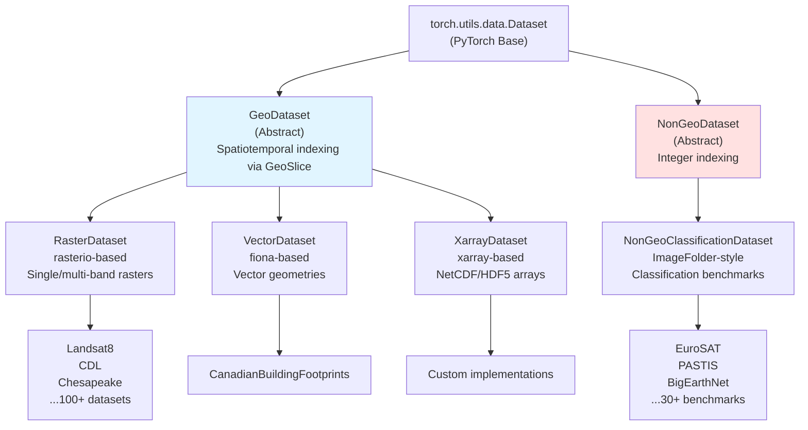

**Sources:** [torchgeo/datasets/geo.py:50-1099]()

The key distinction:
- **GeoDataset**: For datasets with geospatial metadata (CRS, bounds, resolution). Indexed by spatiotemporal slices.
- **NonGeoDataset**: For pre-curated benchmark datasets without geospatial context. Indexed by integers.

## GeoDataset Base Class

`GeoDataset` is an abstract base class that adds geospatial awareness to PyTorch's `Dataset` interface. It provides spatiotemporal indexing, coordinate reference system (CRS) management, and dataset composition operators.

### Class Definition and Core Properties

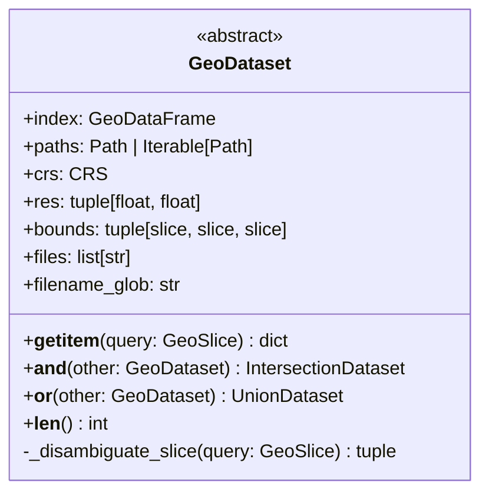

**Sources:** [torchgeo/datasets/geo.py:50-309]()

| Property | Type | Description |
|----------|------|-------------|
| `index` | `GeoDataFrame` | Spatiotemporal index of all files, with geometry and temporal interval |
| `paths` | `Path \| Iterable[Path]` | Root directory(ies) to search for files |
| `crs` | `CRS` | Coordinate reference system |
| `res` | `tuple[float, float]` | Resolution in CRS units (xres, yres) |
| `bounds` | `tuple[slice, slice, slice]` | Bounding box as (x_slice, y_slice, t_slice) |
| `files` | `list[str]` | List of all files matching `filename_glob` |
| `filename_glob` | `str` | Glob pattern for finding files (e.g., `"*.tif"`) |

**Sources:** [torchgeo/datasets/geo.py:92-309]()

### Spatiotemporal Indexing with GeoSlice

The primary innovation of `GeoDataset` is its indexing mechanism. Instead of integer indices, datasets are queried using spatiotemporal slices:

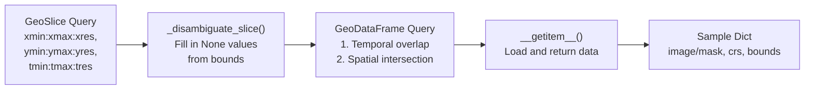

**Sources:** [torchgeo/datasets/geo.py:116-156](), [torchgeo/datasets/utils.py:48-51]()

#### GeoSlice Type

A `GeoSlice` can be:
- A single slice: `[xmin:xmax:xres]`
- A tuple of 2 slices: `[xmin:xmax:xres, ymin:ymax:yres]`
- A tuple of 3 slices: `[xmin:xmax:xres, ymin:ymax:yres, tmin:tmax:tres]`

```python
# Example queries
dataset[0.0:1.0:0.1, 2.0:3.0:0.1, datetime(2020,1,1):datetime(2020,12,31):1]
dataset[:, :, :]  # Full bounds
dataset[slice(None), slice(None), slice(t_start, t_end)]  # Specific time range
```

**Sources:** [torchgeo/datasets/utils.py:48-51](), [tests/datasets/test_geo.py:194-274]()

### The Index: GeoDataFrame Structure

Every `GeoDataset` maintains a `GeoDataFrame` that indexes all available data:

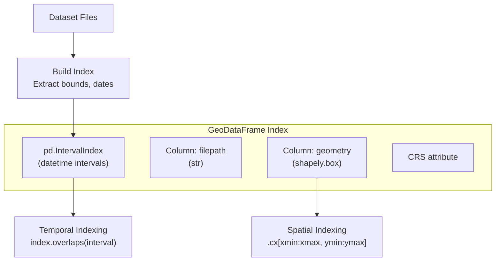

**Sources:** [torchgeo/datasets/geo.py:503-504](), [torchgeo/datasets/geo.py:911-912]()

The index is constructed by:
1. Finding all files matching `filename_glob` in `paths`
2. Extracting spatial bounds using rasterio/fiona
3. Extracting temporal information from filename using `filename_regex` and `date_format`
4. Creating a GeoDataFrame with geometry and temporal IntervalIndex

**Example Index Structure:**
| datetime (IntervalIndex) | filepath | geometry |
|--------------------------|----------|----------|
| [2020-01-01, 2020-12-31] | /path/to/file1.tif | POLYGON((0 0, 1 0, 1 1, 0 1, 0 0)) |
| [2021-01-01, 2021-12-31] | /path/to/file2.tif | POLYGON((1 0, 2 0, 2 1, 1 1, 1 0)) |

**Sources:** [torchgeo/datasets/geo.py:501-504](), [torchgeo/datasets/geo.py:909-912]()

### CRS and Resolution Management

`GeoDataset` provides properties and setters for managing coordinate reference systems and resolution:

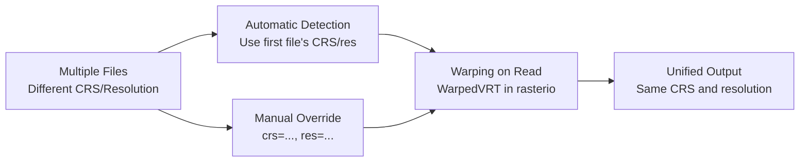

**Sources:** [torchgeo/datasets/geo.py:224-274](), [torchgeo/datasets/geo.py:606-624]()

When setting a new CRS, the index is automatically reprojected:
```python
# Change CRS
dataset.crs = CRS.from_epsg(4326)  # Reprojects index geometries
dataset.res = (10.0, 10.0)  # Changes resolution for future reads
```

**Sources:** [torchgeo/datasets/geo.py:234-248](), [torchgeo/datasets/geo.py:258-274]()

## GeoDataset Specializations

Three concrete base classes extend `GeoDataset` for different file formats:

### RasterDataset

`RasterDataset` is designed for raster data (GeoTIFF, JP2, etc.) using rasterio:

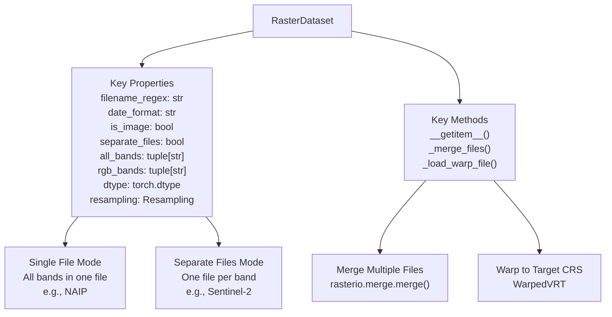

**Sources:** [torchgeo/datasets/geo.py:311-624]()

#### Key Attributes

| Attribute | Type | Description |
|-----------|------|-------------|
| `filename_regex` | `str` | Regex with named groups (date, start, stop, band) |
| `date_format` | `str` | strptime format for parsing dates (default: `'%Y%m%d'`) |
| `is_image` | `bool` | True for inputs (key='image'), False for masks (key='mask') |
| `separate_files` | `bool` | True if each band is a separate file |
| `all_bands` | `tuple[str, ...]` | Names of all available bands |
| `rgb_bands` | `tuple[str, ...]` | Names of RGB bands for plotting |
| `dtype` | `torch.dtype` | Output dtype (default: float32 for images, long for masks) |
| `resampling` | `Resampling` | Resampling algorithm (bilinear for float, nearest for int) |

**Sources:** [torchgeo/datasets/geo.py:314-397]()

#### Data Loading Flow

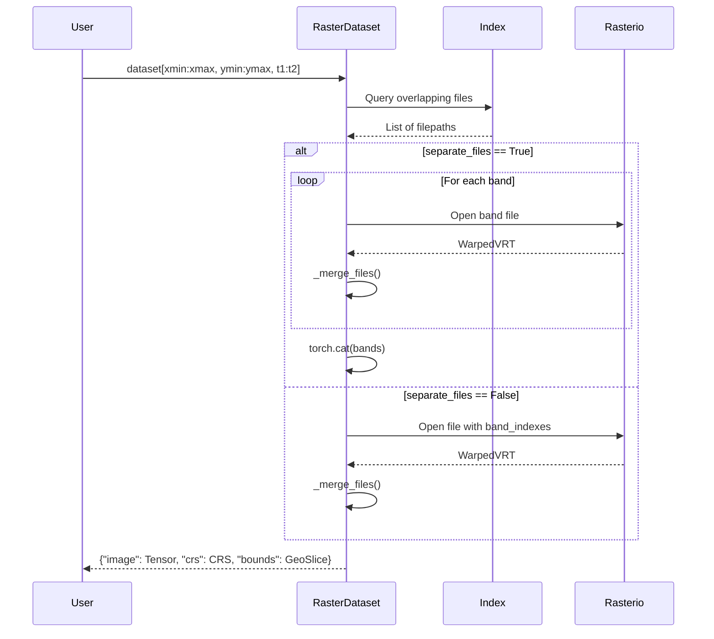

**Sources:** [torchgeo/datasets/geo.py:506-562](), [torchgeo/datasets/geo.py:563-593]()

#### Example: CDL Dataset

The Cropland Data Layer (CDL) demonstrates a typical `RasterDataset` implementation:

```python
class CDL(RasterDataset):
    filename_glob = '*_30m_cdls.tif'
    filename_regex = r'^(?P<date>\d+)_30m_cdls\..*$'
    date_format = '%Y'
    is_image = False  # This is a mask dataset
    
    def __getitem__(self, query):
        sample = super().__getitem__(query)
        # Apply class remapping
        sample['mask'] = self.ordinal_map[sample['mask']]
        return sample
```

**Sources:** [torchgeo/datasets/cdl.py:20-290]()

### VectorDataset

`VectorDataset` is designed for vector data (Shapefiles, GeoJSON, GeoPackage) using fiona:

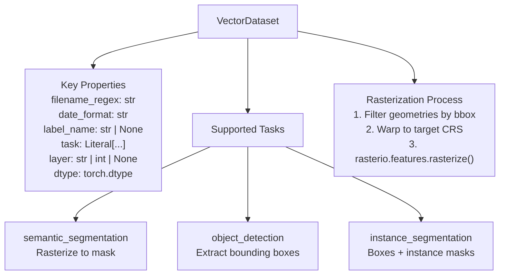

**Sources:** [torchgeo/datasets/geo.py:784-1042]()

#### Task-Specific Outputs

| Task | Output Keys | Description |
|------|-------------|-------------|
| `semantic_segmentation` | `mask` | Single-channel mask with class labels |
| `object_detection` | `bbox_xyxy`, `label` | Bounding boxes in (xmin, ymin, xmax, ymax) format + labels |
| `instance_segmentation` | `bbox_xyxy`, `label`, `mask` | Boxes + labels + multi-channel instance masks |

**Sources:** [torchgeo/datasets/geo.py:960-1028]()

#### Label Extraction

If `label_name` is specified, labels are extracted from feature properties. Otherwise, all features get label 1:

```python
def get_label(self, feature):
    if self.label_name and self.label_name in feature['properties']:
        return feature['properties'][self.label_name]
    return 1
```

**Sources:** [torchgeo/datasets/geo.py:1029-1042]()

### XarrayDataset

`XarrayDataset` is designed for multidimensional array data (NetCDF, HDF5) using xarray:

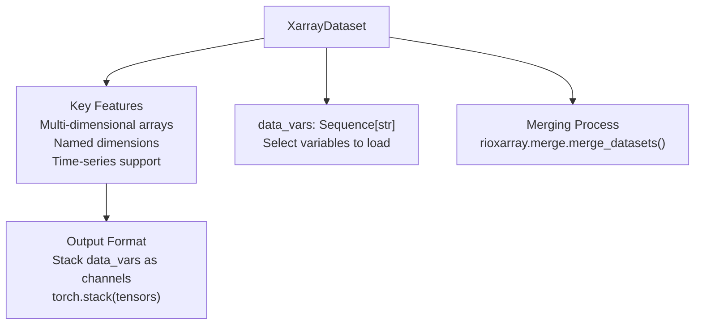

**Sources:** [torchgeo/datasets/geo.py:626-782]()

The primary difference from `RasterDataset` is that xarray handles multi-dimensional data with labeled dimensions and coordinates. This is useful for datasets like climate model outputs or time-series satellite data stored in NetCDF format.

**Sources:** [torchgeo/datasets/geo.py:626-709](), [torchgeo/datasets/geo.py:741-782]()

## NonGeoDataset Base Class

`NonGeoDataset` is the abstract base class for datasets without geospatial metadata:

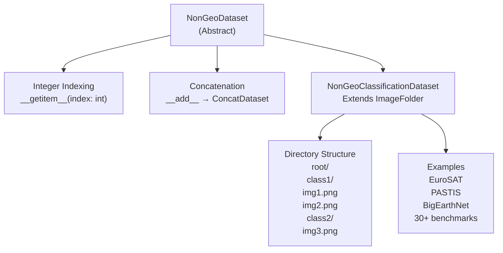

**Sources:** [torchgeo/datasets/geo.py:1044-1099](), [torchgeo/datasets/geo.py:1101-1199]()

### NonGeoClassificationDataset

The most common specialization, `NonGeoClassificationDataset`, extends `torchvision.datasets.ImageFolder`:

| Property | Description |
|----------|-------------|
| `root` | Root directory containing class subdirectories |
| `classes` | List of class names |
| `class_to_idx` | Mapping from class name to integer label |
| `loader` | Function to load images (default: PIL loader or rasterio) |

**Sources:** [torchgeo/datasets/geo.py:1101-1199]()

Example directory structure:
```
eurosat/
  AnnualCrop/
    AnnualCrop_1.jpg
    AnnualCrop_2.jpg
  Forest/
    Forest_1.jpg
    Forest_2.jpg
```

**Sources:** [torchgeo/datasets/geo.py:1101-1155]()

## Dataset Composition

`GeoDataset` supports two composition operators for combining datasets:

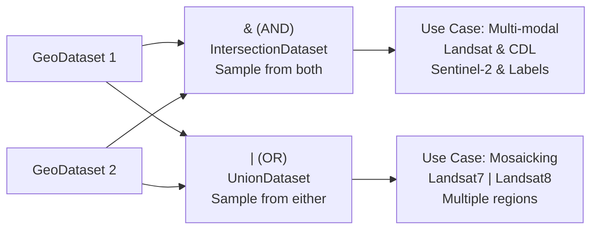

**Sources:** [torchgeo/datasets/geo.py:158-188]()

### IntersectionDataset

Created with the `&` operator. Requires that queries exist in **both** datasets:

```python
# Multi-modal learning
imagery = Landsat8(root)
labels = CDL(root)
dataset = imagery & labels  # Sample contains both image and mask

sample = dataset[bounds]
# sample = {
#     'image': Tensor,  # from Landsat8
#     'mask': Tensor,   # from CDL
#     'crs': CRS,
#     'bounds': GeoSlice
# }
```

When `__getitem__` is called, `IntersectionDataset`:
1. Queries both datasets with the same spatiotemporal slice
2. Concatenates the samples using `concat_samples()` helper
3. Returns a single dictionary with keys from both datasets

**Sources:** [torchgeo/datasets/geo.py:158-172](), [torchgeo/datasets/utils.py:495-515]()

### UnionDataset

Created with the `|` operator. Requires that queries exist in **at least one** dataset:

```python
# Virtual mosaic
landsat7 = Landsat7(root)
landsat8 = Landsat8(root)
dataset = landsat7 | landsat8  # Use whichever has data

sample = dataset[bounds]
# sample = {
#     'image': Tensor,  # from either Landsat7 or Landsat8
#     'crs': CRS,
#     'bounds': GeoSlice
# }
```

When `__getitem__` is called, `UnionDataset`:
1. Attempts to query each dataset with the spatiotemporal slice
2. Merges the samples using `merge_samples()` helper (takes maximum to fill gaps)
3. Returns a single dictionary with combined data

**Sources:** [torchgeo/datasets/geo.py:174-188](), [torchgeo/datasets/utils.py:517-540]()

### Operator Overloading Summary

| Operator | Class | Behavior | Use Case |
|----------|-------|----------|----------|
| `&` | `IntersectionDataset` | Both datasets must have data | Multi-modal fusion |
| `\|` | `UnionDataset` | Either dataset can have data | Mosaicking, coverage extension |
| `+` | `ConcatDataset` (NonGeoDataset only) | Simple concatenation | Combine benchmarks |

**Note:** `GeoDataset.__add__` is explicitly set to `None` because addition is ambiguous for geospatial data (should it be intersection or union?). Users must explicitly choose `&` or `|`.

**Sources:** [torchgeo/datasets/geo.py:112-114](), [torchgeo/datasets/geo.py:158-188]()

## Key Abstractions Summary

### Abstract Methods and Contracts

| Class | Abstract Methods | Expected Behavior |
|-------|------------------|-------------------|
| `GeoDataset` | `__getitem__(query: GeoSlice)` | Query by spatiotemporal slice, return dict with 'crs', 'bounds' |
| `NonGeoDataset` | `__getitem__(index: int)`<br/>`__len__()` | Query by integer index, return dict with 'image' or 'mask' |

**Sources:** [torchgeo/datasets/geo.py:144-156](), [torchgeo/datasets/geo.py:1068-1080]()

### File Discovery Pattern

All `GeoDataset` subclasses follow this pattern:

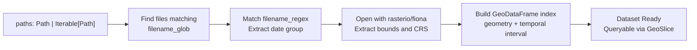

**Sources:** [torchgeo/datasets/geo.py:398-477](), [torchgeo/datasets/geo.py:813-903]()

### Sample Dictionary Contract

All datasets return a dictionary from `__getitem__`:

**GeoDataset Sample:**
```python
{
    'image': Tensor,      # (C, H, W) if is_image=True
    'mask': Tensor,       # (H, W) if is_image=False
    'crs': CRS,           # Coordinate reference system
    'bounds': GeoSlice,   # Query bounds
}
```

**NonGeoDataset Sample:**
```python
{
    'image': Tensor,      # (C, H, W)
    'label': int,         # Class label
}
```

This contract enables:
- Consistent data loading across different dataset types
- Easy integration with PyTorch DataLoaders
- Transforms that operate on standard keys
- Combining samples from multiple datasets

**Sources:** [torchgeo/datasets/geo.py:550-561](), [torchgeo/datasets/geo.py:1165-1179]()

---

