<!-- source: DeepWiki mcp.deepwiki.com · repo torchgeo/torchgeo · page 2.2 Dataset Catalog · fetched 2026-10-21 -->

# Dataset Catalog

<details>
<summary>Relevant source files</summary>

The following files were used as context for generating this wiki page:

- [docs/api/datamodules.rst](docs/api/datamodules.rst)
- [docs/api/datasets.rst](docs/api/datasets.rst)
- [tests/data/deepglobelandcover/data.py](tests/data/deepglobelandcover/data.py)
- [tests/data/deepglobelandcover/data.zip](tests/data/deepglobelandcover/data.zip)
- [tests/datasets/test_deepglobelandcover.py](tests/datasets/test_deepglobelandcover.py)
- [tests/trainers/test_segmentation.py](tests/trainers/test_segmentation.py)
- [torchgeo/datamodules/__init__.py](torchgeo/datamodules/__init__.py)
- [torchgeo/datasets/__init__.py](torchgeo/datasets/__init__.py)
- [torchgeo/datasets/deepglobelandcover.py](torchgeo/datasets/deepglobelandcover.py)

</details>


## Purpose and Scope

This page provides a comprehensive catalog of the 67+ built-in datasets available in TorchGeo, organized by type and purpose. Each dataset is implemented as a concrete class ready for immediate use in training and evaluation workflows.

For information about the base classes and core abstractions these datasets inherit from, see [Core Dataset Abstractions](#2.1). For guidance on composing multiple datasets together or creating custom datasets, see [Dataset Composition and Indexing](#2.3) and [Creating Custom Datasets](#2.5).

**Sources:** [torchgeo/datasets/__init__.py:1-382](), [docs/api/datasets.rst:1-730]()

## Dataset Organization

TorchGeo datasets are organized into two fundamental categories based on whether they contain geospatial coordinate information:

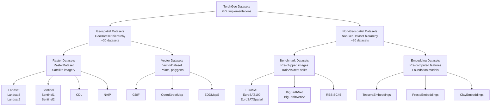

**Sources:** [torchgeo/datasets/__init__.py:82-91](), [docs/api/datasets.rst:6-237]()

## Geospatial Datasets

Geospatial datasets inherit from `GeoDataset` and support spatial queries via bounding boxes in any coordinate reference system. These datasets are designed for continental-scale data and can be composed using intersection (`&`) and union (`|`) operators.

### Satellite Imagery Collections

Multi-mission satellite imagery datasets providing optical and radar observations:

| Dataset Class | Missions | Resolution | Spectral Bands | Temporal Coverage |
|---------------|----------|------------|----------------|-------------------|
| `Landsat` | Landsat 1-9 | 30m | Pan, MS, TIR | 1972-present |
| `Landsat9` | Landsat 9 | 30m | 11 bands | 2021-present |
| `Landsat8` | Landsat 8 | 30m | 11 bands | 2013-present |
| `Landsat7` | Landsat 7 | 30m | 8 bands | 1999-present |
| `Landsat5TM` | Landsat 5 TM | 30m | 7 bands | 1984-2012 |
| `Landsat4TM` | Landsat 4 TM | 30m | 7 bands | 1982-1993 |
| `Sentinel` | Sentinel 1-2 | 10-60m | SAR + MS | 2014-present |
| `Sentinel2` | Sentinel-2 A/B | 10-60m | 13 MS bands | 2015-present |
| `Sentinel1` | Sentinel-1 A/B | 10m | SAR (VV, VH) | 2014-present |
| `NAIP` | Aerial imagery | 0.3-1m | RGB + NIR | 2002-present |

**Usage Pattern:**

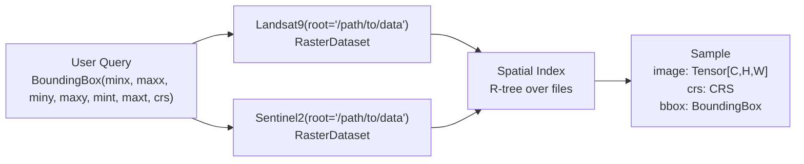

**Sources:** [torchgeo/datasets/__init__.py:104-116](), [torchgeo/datasets/__init__.py:145](), [docs/api/datasets.rst:150-163](), [docs/api/datasets.rst:204-209]()

### Hyperspectral and Specialized Sensors

High spectral resolution datasets for advanced remote sensing:

| Dataset Class | Sensor Type | Spectral Bands | Spatial Resolution | Use Case |
|---------------|-------------|----------------|-------------------|----------|
| `PRISMA` | Hyperspectral | 239 bands | 30m | Mineral detection |
| `EnMAP` | Hyperspectral | 224 bands | 30m | Vegetation analysis |
| `AsterGDEM` | DEM | Elevation | 30m | Terrain modeling |
| `EUDEM` | DEM | Elevation | 25m | European terrain |

**Sources:** [torchgeo/datasets/__init__.py:67](), [torchgeo/datasets/__init__.py:72](), [torchgeo/datasets/__init__.py:10](), [docs/api/datasets.rst:36-39](), [docs/api/datasets.rst:89-92](), [docs/api/datasets.rst:104-107](), [docs/api/datasets.rst:199-202]()

### Label and Reference Data

Geospatial label datasets for supervised learning, typically paired with satellite imagery:

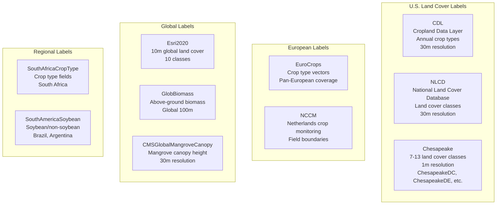

**Typical Pairing Pattern:**

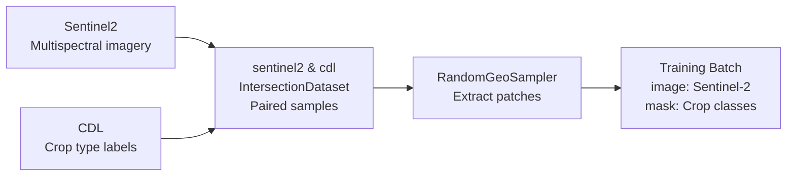

**Sources:** [torchgeo/datasets/__init__.py:18](), [torchgeo/datasets/__init__.py:128](), [torchgeo/datasets/__init__.py:20-30](), [torchgeo/datasets/__init__.py:73](), [torchgeo/datasets/__init__.py:127](), [docs/api/datasets.rst:46-57](), [docs/api/datasets.rst:79-82](), [docs/api/datasets.rst:109-112](), [docs/api/datasets.rst:174-177](), [docs/api/datasets.rst:179-182]()

### Vector Data Sources

Point and polygon datasets for various ecological and infrastructure applications:

| Dataset Class | Data Type | Content | Global Coverage |
|---------------|-----------|---------|-----------------|
| `GBIF` | Points | Species observations | Yes |
| `INaturalist` | Points | Species observations | Yes |
| `EDDMapS` | Points | Invasive species | North America |
| `OpenStreetMap` | Polygons/Lines | Buildings, roads, POIs | Yes |
| `CanadianBuildingFootprints` | Polygons | Building footprints | Canada |
| `OpenBuildings` | Polygons | Building footprints | Global |

**Sources:** [torchgeo/datasets/__init__.py:80](), [torchgeo/datasets/__init__.py:98](), [torchgeo/datasets/__init__.py:66](), [torchgeo/datasets/__init__.py:130](), [torchgeo/datasets/__init__.py:17](), [torchgeo/datasets/__init__.py:129](), [docs/api/datasets.rst:114-117](), [docs/api/datasets.rst:124-127](), [docs/api/datasets.rst:84-87](), [docs/api/datasets.rst:189-192](), [docs/api/datasets.rst:41-44](), [docs/api/datasets.rst:184-187]()

### Embedding Datasets (Geospatial)

Pre-computed feature embeddings from foundation models with geospatial indexing:

| Dataset Class | Model Source | Embedding Dim | Coverage |
|---------------|--------------|---------------|----------|
| `TesseraEmbeddings` | Tessera | 1024 | User-provided |
| `PrestoEmbeddings` | Presto | 128 | User-provided |
| `GoogleSatelliteEmbedding` | Google | 512 | Global grid |
| `CopernicusEmbed` | CopernicusFM | 768 | User-provided |

**Sources:** [torchgeo/datasets/__init__.py:175](), [torchgeo/datasets/__init__.py:135](), [torchgeo/datasets/__init__.py:95](), [torchgeo/datasets/__init__.py:52](), [docs/api/datasets.rst:221-224](), [docs/api/datasets.rst:194-197](), [docs/api/datasets.rst:74-77](), [docs/api/datasets.rst:59-62]()

## Non-Geospatial Datasets

Non-geospatial datasets inherit from `NonGeoDataset` and use integer indexing. These are typically pre-processed benchmark datasets with fixed train/validation/test splits.

### Classification Benchmarks

Scene classification datasets with labeled image chips:

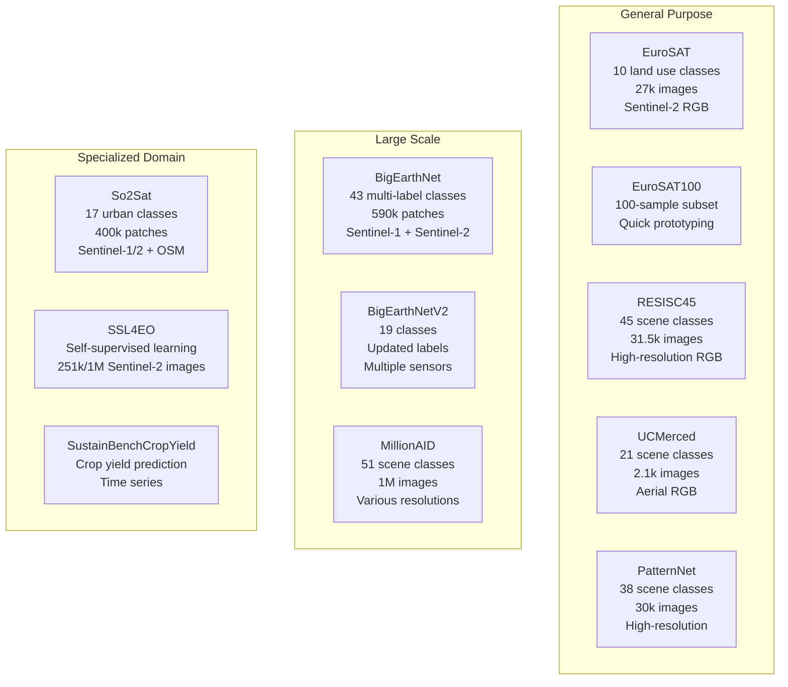

**Task Type Distribution:**

| Task Type | Datasets | Typical Use |
|-----------|----------|-------------|
| Classification (C) | EuroSAT, RESISC45, UCMerced, PatternNet, MillionAID, So2Sat, DIOR, FAIR1M | Scene classification, land use |
| Multi-label (C) | BigEarthNet, BigEarthNetV2 | Multi-class land cover |
| Regression (R) | SustainBenchCropYield, FireRisk | Yield prediction, risk assessment |
| Time Series (T) | PASTIS, CropHarvest, TropicalCyclone, DigitalTyphoon | Temporal modeling |

**Sources:** [torchgeo/datasets/__init__.py:74](), [torchgeo/datasets/__init__.py:139](), [torchgeo/datasets/__init__.py:177](), [torchgeo/datasets/__init__.py:133](), [torchgeo/datasets/__init__.py:12](), [torchgeo/datasets/__init__.py:122](), [docs/api/datasets.rst:351-356](), [docs/api/datasets.rst:490-493](), [docs/api/datasets.rst:577-580](), [docs/api/datasets.rst:470-473](), [docs/api/datasets.rst:249-253](), [docs/api/datasets.rst:445-448]()

### Semantic Segmentation Benchmarks

Pixel-wise land cover and building segmentation datasets:

| Dataset Class | Task | Classes | Image Count | Resolution |
|---------------|------|---------|-------------|------------|
| `DeepGlobeLandCover` | Land cover | 7 | 803 | 0.5m |
| `LandCoverAI` | Land cover | 5 | 41k | 0.25-0.5m |
| `LandCoverAI100` | Land cover | 5 | 100 | 0.25-0.5m |
| `Potsdam2D` | Urban mapping | 6 | 38 | 0.05m |
| `Vaihingen2D` | Urban mapping | 6 | 33 | 0.09m |
| `Inria` | Buildings | 2 | 360 | 0.3m |
| `LoveDA` | Urban/rural | 7 | 5987 | 0.3m |
| `SEN12MS` | Land cover | 17 | 180k | 10m |
| `GID15` | Land cover | 15 | 150 | 4m |
| `PASTIS` | Crop mapping | 18 | 2433 | 10m |

**Sources:** [torchgeo/datasets/__init__.py:59](), [torchgeo/datasets/__init__.py:103](), [torchgeo/datasets/__init__.py:134](), [torchgeo/datasets/__init__.py:186](), [torchgeo/datasets/__init__.py:99](), [torchgeo/datasets/__init__.py:118](), [torchgeo/datasets/__init__.py:144](), [torchgeo/datasets/__init__.py:93](), [torchgeo/datasets/__init__.py:132](), [docs/api/datasets.rst:312-315](), [docs/api/datasets.rst:408-412](), [docs/api/datasets.rst:475-478](), [docs/api/datasets.rst:587-590](), [docs/api/datasets.rst:403-406](), [docs/api/datasets.rst:425-428](), [docs/api/datasets.rst:515-518](), [docs/api/datasets.rst:388-391](), [docs/api/datasets.rst:465-468]()

### Object Detection and Instance Segmentation

Datasets for detecting and segmenting individual objects:

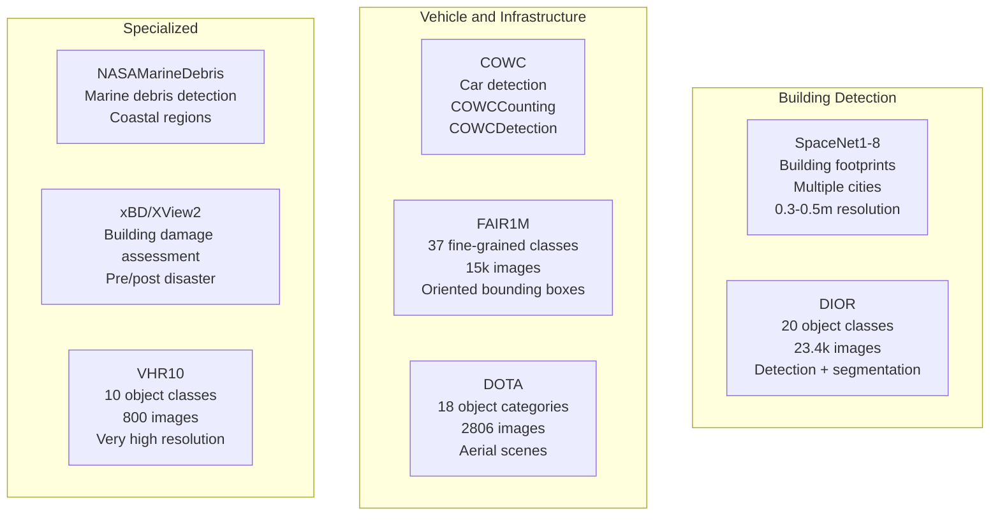

**Sources:** [torchgeo/datasets/__init__.py:153-163](), [torchgeo/datasets/__init__.py:62](), [torchgeo/datasets/__init__.py:55](), [torchgeo/datasets/__init__.py:76](), [torchgeo/datasets/__init__.py:64](), [torchgeo/datasets/__init__.py:126](), [torchgeo/datasets/__init__.py:189](), [torchgeo/datasets/__init__.py:187](), [docs/api/datasets.rst:643-662](), [docs/api/datasets.rst:322-325](), [docs/api/datasets.rst:295-300](), [docs/api/datasets.rst:363-366](), [docs/api/datasets.rst:337-340](), [docs/api/datasets.rst:455-458](), [docs/api/datasets.rst:602-605](), [docs/api/datasets.rst:592-595]()

### Change Detection

Bi-temporal or multi-temporal datasets for detecting changes:

| Dataset Class | Task | Image Pairs | Resolution | Focus Area |
|---------------|------|-------------|------------|------------|
| `OSCD` | Urban change | 24 | 10m | Sentinel-2 cities |
| `LEVIRCD` | Building change | 637 | 0.5m | Urban development |
| `LEVIRCDPlus` | Building change | 985 | 0.5m | Enhanced LEVIRCD |
| `xBD` / `XView2` | Damage assessment | 22k | 0.3-0.8m | Pre/post disaster |
| `DFC2022` | Change detection | - | Multi-source | IEEE GRSS competition |

**Sources:** [torchgeo/datasets/__init__.py:131](), [torchgeo/datasets/__init__.py:117](), [torchgeo/datasets/__init__.py:60](), [torchgeo/datasets/__init__.py:189](), [docs/api/datasets.rst:460-463](), [docs/api/datasets.rst:414-423](), [docs/api/datasets.rst:317-320]()

### Self-Supervised Learning Datasets

Unlabeled datasets for pre-training:

| Dataset Class | Images | Sensors | Purpose |
|---------------|--------|---------|---------|
| `SSL4EO` | - | Sentinel-2 | SSL pre-training |
| `SSL4EOL` | 251k | Landsat 8 | SSL pre-training |
| `SSL4EOS12` | 1M | Sentinel-1/2 | Multi-modal SSL |
| `SeasonalContrastS2` | 1M | Sentinel-2 | Seasonal contrast |
| `SatlasPretrain` | 302M | NAIP + Sentinel-2 | Large-scale SSL |
| `CopernicusPretrain` | 5M | Sentinel 1/2/3/5P | Multi-sensor SSL |

**Sources:** [torchgeo/datasets/__init__.py:171](), [torchgeo/datasets/__init__.py:141](), [torchgeo/datasets/__init__.py:143](), [docs/api/datasets.rst:545-550](), [docs/api/datasets.rst:505-508](), [docs/api/datasets.rst:500-503](), [docs/api/datasets.rst:290-293]()

### Pre-computed Embedding Datasets

Feature embeddings from foundation models for transfer learning:

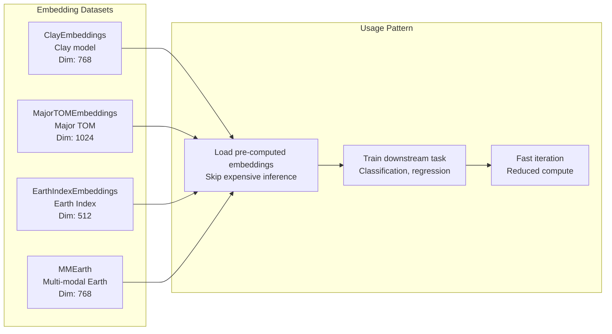

**Sources:** [torchgeo/datasets/__init__.py:31](), [torchgeo/datasets/__init__.py:119](), [torchgeo/datasets/__init__.py:65](), [torchgeo/datasets/__init__.py:123](), [docs/api/datasets.rst:280-283](), [docs/api/datasets.rst:430-433](), [docs/api/datasets.rst:341-344](), [docs/api/datasets.rst:450-453]()

## Special Dataset Collections

### Copernicus-Bench

A comprehensive benchmark suite with 15 downstream tasks across three application tiers:

```mermaid
graph TB
    Root["CopernicusBench<br/>Unified benchmark interface"]
    
    subgraph "Preprocessing Tasks"
        CloudS2["CopernicusBenchCloudS2<br/>Cloud removal Sentinel-2"]
        CloudS3["CopernicusBenchCloudS3<br/>Cloud removal Sentinel-3"]
    end
    
    subgraph "Base Applications"
        EuroSATS1["CopernicusBenchEuroSATS1<br/>10 classes, SAR"]
        EuroSATS2["CopernicusBenchEuroSATS2<br/>10 classes, optical"]
        BEN_S1["CopernicusBenchBigEarthNetS1<br/>19 classes, SAR"]
        BEN_S2["CopernicusBenchBigEarthNetS2<br/>19 classes, optical"]
        LC100Cls["CopernicusBenchLC100ClsS3<br/>Land cover classification"]
        LC100Seg["CopernicusBenchLC100SegS3<br/>Land cover segmentation"]
        DFC_S1["CopernicusBenchDFC2020S1<br/>Change detection SAR"]
        DFC_S2["CopernicusBenchDFC2020S2<br/>Change detection optical"]
    end
    
    subgraph "Specialized Applications"
        Flood["CopernicusBenchFloodS1<br/>Flood mapping"]
        LCZ["CopernicusBenchLCZS2<br/>Local climate zones"]
        Biomass["CopernicusBenchBiomassS3<br/>Biomass estimation"]
        AQNO2["CopernicusBenchAQNO2S5P<br/>Air quality NO2"]
        AQO3["CopernicusBenchAQO3S5P<br/>Air quality O3"]
    end
    
    Root --> CloudS2
    Root --> CloudS3
    Root --> EuroSATS1
    Root --> EuroSATS2
    Root --> BEN_S1
    Root --> BEN_S2
    Root --> LC100Cls
    Root --> LC100Seg
    Root --> DFC_S1
    Root --> DFC_S2
    Root --> Flood
    Root --> LCZ
    Root --> Biomass
    Root --> AQNO2
    Root --> AQO3
```

**Sensor Coverage:**

| Sentinel Mission | Task Count | Task Types |
|------------------|------------|------------|
| Sentinel-1 (SAR) | 5 | Classification, segmentation, change detection |
| Sentinel-2 (Optical) | 7 | Classification, segmentation, preprocessing |
| Sentinel-3 (OLCI) | 4 | Classification, segmentation, regression |
| Sentinel-5P (TROPOMI) | 2 | Regression (air quality) |

**Sources:** [torchgeo/datasets/__init__.py:34-54](), [docs/api/datasets.rst:614-641]()

### SpaceNet

A multi-challenge building detection and road extraction benchmark:

| Dataset Class | Challenge | Task | Location | Image Count |
|---------------|-----------|------|----------|-------------|
| `SpaceNet1` | 1 | Building footprints | Rio de Janeiro | 6940 |
| `SpaceNet2` | 2 | Building footprints | 5 cities | 4000 |
| `SpaceNet3` | 3 | Road network | 5 cities | 3000 |
| `SpaceNet4` | 4 | Off-nadir buildings | Atlanta | 1000 |
| `SpaceNet5` | 5 | Road speed limits | Moscow | 1353 |
| `SpaceNet6` | 6 | SAR + optical buildings | Rotterdam | 3000 |
| `SpaceNet7` | 7 | Multi-temporal buildings | 100 regions | 24000 |
| `SpaceNet8` | 8 | Flood mapping | 6 regions | 450 |

**Usage via base class:**

```python
from torchgeo.datasets import SpaceNet1, SpaceNet6

# Buildings from WorldView-3 imagery
spacenet1 = SpaceNet1(root='data/spacenet1')

# Multi-modal SAR + optical
spacenet6 = SpaceNet6(root='data/spacenet6', image='PS-RGB')
```

**Sources:** [torchgeo/datasets/__init__.py:153-163](), [docs/api/datasets.rst:643-662]()

## Dataset Selection Guide

### By Task Type

```mermaid
graph TB
    Task["Select Task Type"]
    
    Cls["Classification"]
    Seg["Segmentation"]
    Det["Detection"]
    CD["Change Detection"]
    Reg["Regression"]
    SSL["Self-Supervised"]
    
    Task --> Cls
    Task --> Seg
    Task --> Det
    Task --> CD
    Task --> Reg
    Task --> SSL
    
    Cls --> ClsSmall["Small: EuroSAT100<br/>UCMerced"]
    Cls --> ClsMed["Medium: RESISC45<br/>PatternNet"]
    Cls --> ClsLarge["Large: BigEarthNet<br/>MillionAID"]
    
    Seg --> SegBuilding["Buildings: Inria<br/>SpaceNet"]
    Seg --> SegLandCover["Land Cover: LandCoverAI<br/>DeepGlobeLandCover"]
    Seg --> SegUrban["Urban: Potsdam2D<br/>Vaihingen2D"]
    
    Det --> DetVehicle["Vehicles: COWC"]
    Det --> DetBuilding["Buildings: SpaceNet<br/>DIOR"]
    Det --> DetGeneral["General: FAIR1M<br/>DOTA"]
    
    CD --> CDUrban["Urban: OSCD<br/>LEVIRCD"]
    CD --> CDDisaster["Disaster: xBD"]
    
    Reg --> RegCrop["Crop Yield: SustainBenchCropYield"]
    Reg --> RegRisk["Risk: FireRisk"]
    
    SSL --> SSLOpt["Optical: SSL4EO<br/>SeasonalContrastS2"]
    SSL --> SSLMulti["Multi-modal: SSL4EOS12<br/>CopernicusPretrain"]
```

**Sources:** [docs/api/datasets.rst:233-237]()

### By Data Requirements

**Small Datasets (< 5k images):** Ideal for quick prototyping and testing
- `EuroSAT100` (100 samples)
- `LandCoverAI100` (100 samples)  
- `UCMerced` (2.1k images)
- `Vaihingen2D` (33 images)

**Medium Datasets (5k-100k images):** Suitable for model development
- `EuroSAT` (27k images)
- `RESISC45` (31.5k images)
- `PatternNet` (30k images)
- `LandCoverAI` (41k images)

**Large Datasets (> 100k images):** For production-grade models
- `BigEarthNet` (590k patches)
- `SEN12MS` (180k triplets)
- `MillionAID` (1M images)
- `SSL4EOS12` (1M images)

**Sources:** [docs/api/datasets.rst:233-237]()

### By Sensor Compatibility

Common pairing patterns for multi-modal learning:

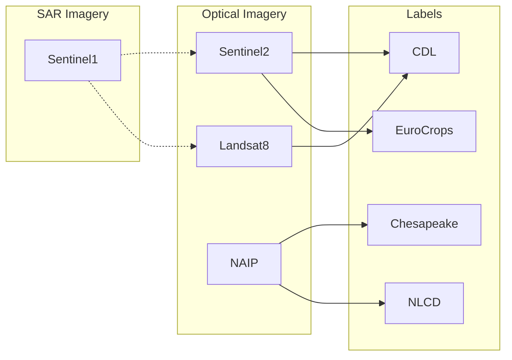

**Typical Combinations:**
- `Sentinel2 & CDL`: Crop type mapping (30m)
- `Sentinel2 & EuroCrops`: European crop monitoring
- `NAIP & Chesapeake`: High-res land cover (1m)
- `Landsat8 & CDL`: Long-term crop analysis
- `Sentinel1 & Sentinel2`: Multi-modal classification

**Sources:** [docs/api/datasets.rst:6-19]()

## Dataset Characteristics Reference

### Task Type Legend

The following abbreviations are used throughout dataset documentation:

| Code | Task Type | Description |
|------|-----------|-------------|
| C | Classification | Scene-level or patch-level classification |
| R | Regression | Continuous value prediction |
| S | Semantic Segmentation | Pixel-wise classification |
| I | Instance Segmentation | Object detection with masks |
| T | Time Series | Temporal sequence modeling |
| CD | Change Detection | Bi-temporal or multi-temporal analysis |
| OD | Object Detection | Bounding box detection |
| IC | Image Captioning | Natural language description |
| E | Embedding | Pre-computed feature vectors |

**Sources:** [docs/api/datasets.rst:233](), [docs/api/datasets.rst:619](), [docs/api/datasets.rst:648]()

### Resolution Categories

| Category | Range | Typical Datasets | Use Cases |
|----------|-------|------------------|-----------|
| Very High (< 1m) | 0.3-1m | NAIP, SpaceNet, Potsdam2D | Urban mapping, building detection |
| High (1-10m) | 1-10m | Sentinel-2, Chesapeake | Land cover, crop monitoring |
| Medium (10-30m) | 10-30m | Landsat, PRISMA | Regional analysis |
| Coarse (> 30m) | 30m+ | MODIS, SRTM | Continental modeling |

**Sources:** [docs/api/datasets.rst:15-19]()

## Dataset Access Patterns

### Integer Indexing (NonGeoDataset)

```python
from torchgeo.datasets import EuroSAT

dataset = EuroSAT(root='data/eurosat', split='train')

# Access by integer index
sample = dataset[0]
# Returns: {'image': Tensor[C,H,W], 'label': int}

# Compatible with standard PyTorch DataLoader
from torch.utils.data import DataLoader
loader = DataLoader(dataset, batch_size=32, shuffle=True)
```

### Spatial Indexing (GeoDataset)

```python
from torchgeo.datasets import Landsat8, CDL
from torchgeo.samplers import RandomGeoSampler

# Combine imagery and labels
imagery = Landsat8(root='data/landsat')
labels = CDL(root='data/cdl')
dataset = imagery & labels

# Sample patches by geographic coordinates
sampler = RandomGeoSampler(dataset, size=256, length=1000)

# Access by bounding box
from torchgeo.datasets import BoundingBox
bbox = BoundingBox(minx=-100, maxx=-99, miny=40, maxy=41,
                    mint=..., maxt=..., crs='EPSG:4326')
sample = dataset[bbox]
# Returns: {'image': Tensor[C,H,W], 'mask': Tensor[H,W],
#           'crs': CRS, 'bbox': BoundingBox}
```

**Sources:** [torchgeo/datasets/__init__.py:82-91]()

## Dataset Discovery Functions

TorchGeo provides utilities for programmatic dataset discovery:

```python
from torchgeo.datasets import __all__ as all_datasets

# List all available datasets
print(f"Total datasets: {len(all_datasets)}")

# Filter by base class
from torchgeo.datasets import RasterDataset, NonGeoDataset
geo_datasets = [d for d in dir(torchgeo.datasets) 
                if isinstance(getattr(torchgeo.datasets, d), type) 
                and issubclass(getattr(torchgeo.datasets, d), RasterDataset)]

# Check dataset availability
from torchgeo.datasets import DatasetNotFoundError
try:
    dataset = EuroSAT(root='data/eurosat')
except DatasetNotFoundError as e:
    print(f"Dataset not found: {e}")
```

**Error Handling:**
- `DatasetNotFoundError`: Raised when data is not downloaded
- `DependencyNotFoundError`: Raised when optional dependencies are missing  
- `RGBBandsMissingError`: Raised when plotting requires RGB bands not present

**Sources:** [torchgeo/datasets/__init__.py:192-381](), [torchgeo/datasets/errors.py]()

## Summary Statistics

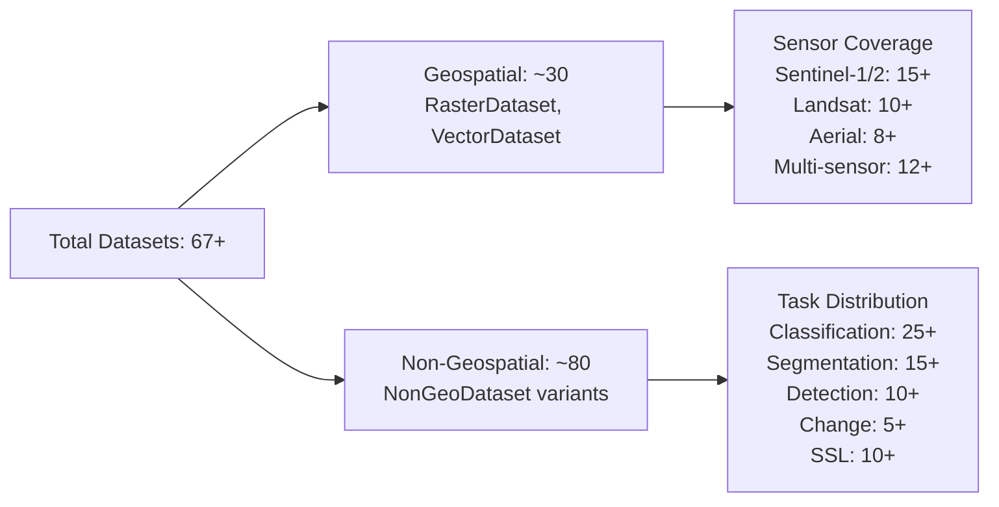

**Key Capabilities:**
- **67+ datasets** spanning diverse remote sensing tasks
- **30+ geospatial datasets** with coordinate-aware indexing
- **15+ benchmark collections** with standardized splits
- **10+ embedding datasets** from foundation models
- **5+ special collections** (Copernicus-Bench, SpaceNet)
- **Multi-modal support** (optical, SAR, hyperspectral, DEM)

**Sources:** [torchgeo/datasets/__init__.py:1-382](), [docs/api/datasets.rst:1-730]()

---

