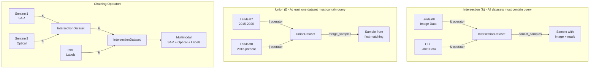
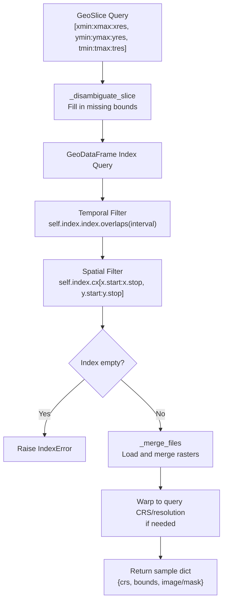
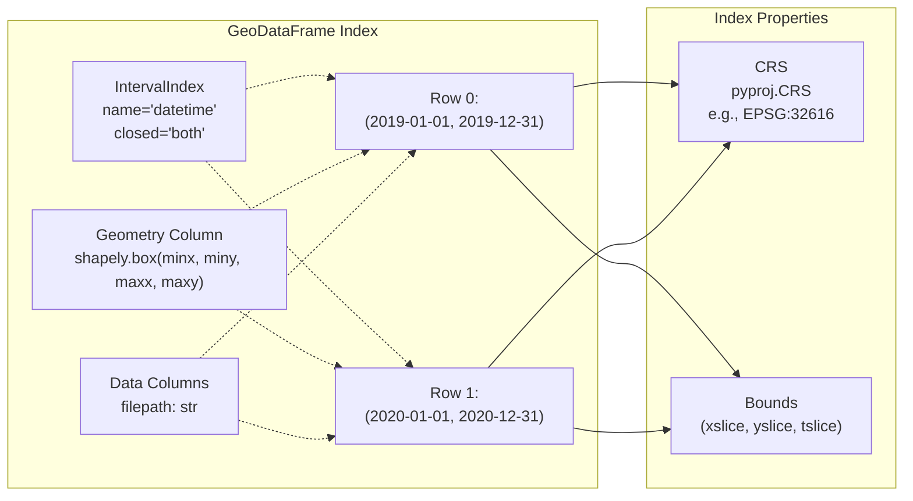
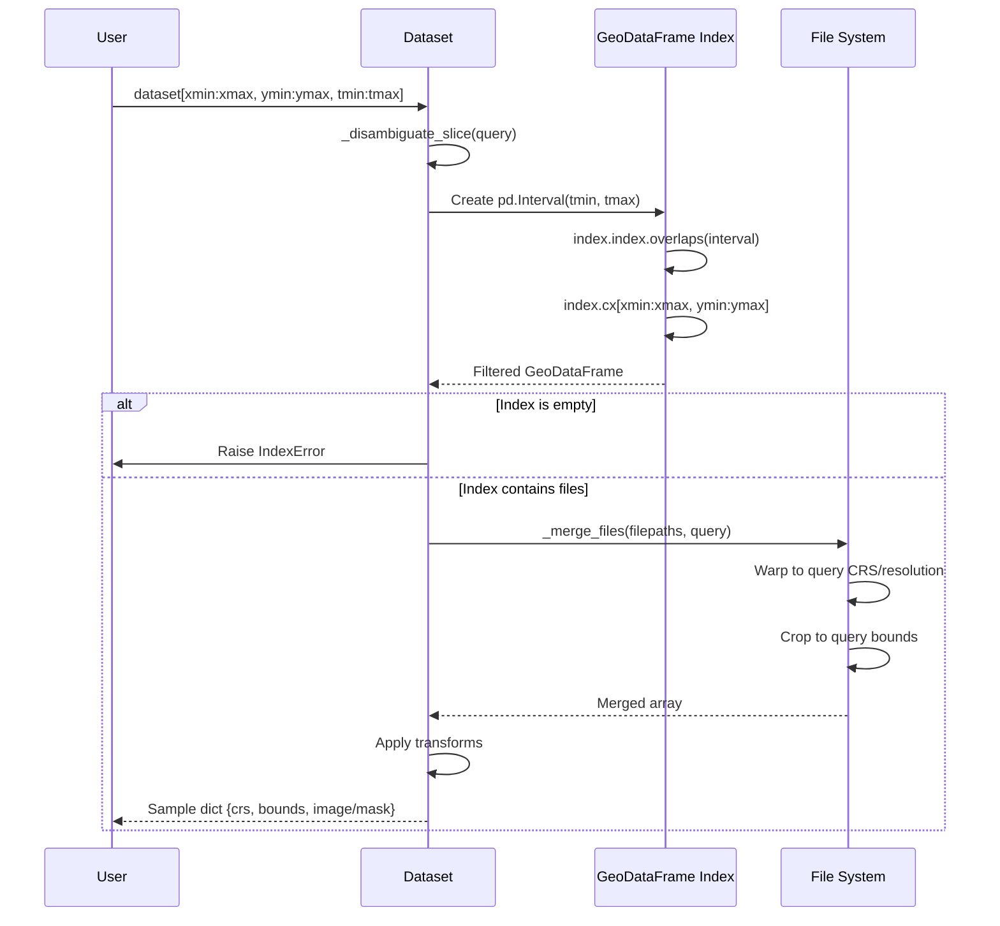

<!-- source: DeepWiki mcp.deepwiki.com · repo torchgeo/torchgeo · page 2.3 Dataset Composition and Indexing · fetched 2026-10-21 -->

# Dataset Composition and Indexing

<details>
<summary>Relevant source files</summary>

The following files were used as context for generating this wiki page:

- [tests/data/naip/data.py](tests/data/naip/data.py)
- [tests/data/naip/m_3807511_ne_18_060_20181104.tif](tests/data/naip/m_3807511_ne_18_060_20181104.tif)
- [tests/data/naip/m_3807511_ne_18_060_20190605.tif](tests/data/naip/m_3807511_ne_18_060_20190605.tif)
- [tests/data/vector/data.py](tests/data/vector/data.py)
- [tests/data/vector/vector_2024.geojson](tests/data/vector/vector_2024.geojson)
- [tests/data/vector/vector_2024.parquet](tests/data/vector/vector_2024.parquet)
- [tests/datasets/test_geo.py](tests/datasets/test_geo.py)
- [tests/datasets/test_utils.py](tests/datasets/test_utils.py)
- [torchgeo/datasets/cdl.py](torchgeo/datasets/cdl.py)
- [torchgeo/datasets/geo.py](torchgeo/datasets/geo.py)
- [torchgeo/datasets/landsat.py](torchgeo/datasets/landsat.py)
- [torchgeo/datasets/naip.py](torchgeo/datasets/naip.py)
- [torchgeo/datasets/sentinel.py](torchgeo/datasets/sentinel.py)
- [torchgeo/datasets/utils.py](torchgeo/datasets/utils.py)

</details>


## Purpose and Scope

This page explains how TorchGeo datasets can be composed together using operators and how spatiotemporal indexing works for querying geospatial data. This covers the mechanics of combining multiple datasets for multimodal learning or mosaicking, and the GeoDataFrame-based query system that enables efficient spatial and temporal lookups.

For information about the base dataset classes themselves, see [Core Dataset Abstractions](#2.1). For a catalog of available datasets, see [Dataset Catalog](#2.2).

## Dataset Composition Operators

TorchGeo provides operator overloading to intuitively combine geospatial datasets. The semantics differ from PyTorch's `ConcatDataset` because geospatial datasets have spatial and temporal extents that determine how they should be merged.

### Intersection Operator (`&`)

The intersection operator creates an `IntersectionDataset` where queries must be present in **all** constituent datasets. This is used for:

- **Multimodal learning**: Combining imagery from different sensors (e.g., Landsat + Sentinel-2)
- **Image-label pairs**: Combining input imagery with target labels (e.g., Landsat + CDL)
- **Multi-source fusion**: Combining imagery with auxiliary data (e.g., imagery + elevation)

```python
from torchgeo.datasets import Landsat8, CDL

landsat = Landsat8(paths="path/to/landsat")
cdl = CDL(paths="path/to/cdl", download=True)

# Create intersection - only samples where both datasets overlap
dataset = landsat & cdl
```

When you query an `IntersectionDataset`, it queries each constituent dataset with the same spatiotemporal coordinates and merges the results using `concat_samples`, which concatenates tensors along the channel dimension and preserves scalar values from the first dataset.

**Sources:** [torchgeo/datasets/geo.py:158-172](), [torchgeo/datasets/utils.py:495-514](), [README.md:73-117]()

### Union Operator (`|`)

The union operator creates a `UnionDataset` where queries must be present in **at least one** constituent dataset. This is used for:

- **Virtual mosaicking**: Combining datasets covering different geographic areas (e.g., Chesapeake NY + PA)
- **Temporal continuity**: Combining datasets from different time periods (e.g., Landsat 7 + Landsat 8)
- **Mixed sensors**: Treating multiple sensors as equivalent data sources

```python
from torchgeo.datasets import Landsat7, Landsat8

landsat7 = Landsat7(paths="path/to/l7", bands=["SR_B1", "SR_B2", "SR_B3"])
landsat8 = Landsat8(paths="path/to/l8", bands=["SR_B2", "SR_B3", "SR_B4"])

# Create union - samples from either Landsat 7 or 8
dataset = landsat7 | landsat8
```

When you query a `UnionDataset`, it queries each constituent dataset and returns data from the first one that contains the query. Results are merged using `merge_samples`, which takes the element-wise maximum of tensors (replacing nodata zeros with actual values).

**Sources:** [torchgeo/datasets/geo.py:174-188](), [torchgeo/datasets/utils.py:517-539](), [README.md:73-117]()

### Deprecated Addition Operator

The `+` operator is **no longer supported** for `GeoDataset` objects because its semantics are ambiguous. Previously, it was unclear whether `dataset1 + dataset2` meant intersection or union. Users should now explicitly use `&` or `|`.

For `NonGeoDataset` objects (benchmark datasets), the standard PyTorch `torch.utils.data.ConcatDataset` should be used instead.

**Sources:** [torchgeo/datasets/geo.py:110-114]()

### Dataset Composition Patterns



**Sources:** [torchgeo/datasets/geo.py:158-188](), [tests/datasets/test_geo.py:121-167]()

## Spatiotemporal Indexing

TorchGeo uses a slice-based indexing system called `GeoSlice` that allows querying datasets by geographic coordinates and time ranges.

### GeoSlice Syntax

A `GeoSlice` is defined as a tuple of up to three slice objects representing `[xmin:xmax:xres, ymin:ymax:yres, tmin:tmax:tres]`:

```python
# Query a 256x256 meter patch at 1m resolution from 2023
query = (
    slice(100000, 100256, 1),      # x: [100000, 100256) with 1m resolution
    slice(200000, 200256, 1),      # y: [200000, 200256) with 1m resolution  
    slice(pd.Timestamp(2023, 1, 1), pd.Timestamp(2023, 12, 31), 1)  # t: year 2023
)
sample = dataset[query]
```

The slice syntax is:
- **start**: Minimum coordinate (inclusive)
- **stop**: Maximum coordinate (exclusive)
- **step**: Resolution in units of the dataset's CRS

**Type Definition:**
```
GeoSlice = slice | tuple[slice] | tuple[slice, slice] | tuple[slice, slice, slice]
```

Partial slices are supported - any missing or `None` components are filled in using the dataset's bounds via `_disambiguate_slice`.

**Sources:** [torchgeo/datasets/utils.py:48-50](), [torchgeo/datasets/geo.py:116-142]()

### Query Resolution Flow



**Sources:** [torchgeo/datasets/geo.py:506-561](), [torchgeo/datasets/geo.py:116-142]()

### Query Disambiguation

The `_disambiguate_slice` method fills in partial queries using the dataset's bounds:

```python
# Dataset bounds: x=[0, 100], y=[200, 300], t=[2020, 2023]

# Partial query - only x specified
query = slice(10, 20, 1)
# Becomes: (slice(10, 20, 1), slice(200, 300, 1), slice(2020, 2023, 1))

# Partial query - x and y specified, default resolution
query = (slice(10, 20), slice(210, 220))
# Becomes: (slice(10, 20, 1), slice(210, 220, 1), slice(2020, 2023, 1))

# Full query - all components specified
query = (slice(10, 20, 1), slice(210, 220, 1), slice(2021, 2022, 1))
# Unchanged
```

This allows flexible querying without requiring users to specify all components every time.

**Sources:** [torchgeo/datasets/geo.py:116-142](), [tests/datasets/test_geo.py:194-273]()

## Index Structure

All `GeoDataset` objects maintain a `GeoDataFrame` index that stores the spatiotemporal metadata for all files in the dataset. This enables efficient spatial and temporal queries.

### GeoDataFrame Components



### Index Construction in RasterDataset

During initialization, `RasterDataset` scans all files matching `filename_glob` and builds the index:

1. **File Discovery**: Use `glob` to find all files matching the pattern
2. **Metadata Extraction**: For each file:
   - Open with `rasterio` to get CRS and bounds
   - Parse filename with `filename_regex` to extract date
   - Create `shapely.box` geometry from bounds
   - Disambiguate timestamp to get temporal range
3. **Index Assembly**: Create `GeoDataFrame` with:
   - `pd.IntervalIndex` as the index (temporal ranges)
   - Geometry column (spatial extents)
   - `filepath` column (file paths)
   - CRS property (coordinate system)

**Example Index:**

| datetime (IntervalIndex) | geometry | filepath | 
|--------------------------|----------|----------|
| [2019-01-01, 2019-12-31] | POLYGON((100 200, 110 200, ...)) | /data/2019.tif |
| [2020-01-01, 2020-12-31] | POLYGON((100 200, 110 200, ...)) | /data/2020.tif |

**Sources:** [torchgeo/datasets/geo.py:436-504](), [torchgeo/datasets/geo.py:662-708]()

### Spatial Queries

Spatial queries use GeoPandas' `.cx` indexer, which performs a bounding box intersection:

```python
# Query all files overlapping x=[100, 110], y=[200, 210]
index = self.index.cx[100:110, 200:210]
```

This is equivalent to:
```python
index.cx[x.start:x.stop, y.start:y.stop]
```

The `.cx` indexer uses the R-tree spatial index built by GeoPandas for efficient lookups.

**Sources:** [torchgeo/datasets/geo.py:522](), [torchgeo/datasets/geo.py:726]()

### Temporal Queries

Temporal queries use pandas `IntervalIndex.overlaps()` to find all intervals that intersect with the query time range:

```python
# Create query interval
interval = pd.Interval(t.start, t.stop)

# Find all overlapping intervals
index = self.index.iloc[self.index.index.overlaps(interval)]
```

This handles:
- Point-in-time queries (single timestamp)
- Range queries (start to end timestamps)  
- Partial overlaps (dataset may span multiple years, query may span single month)

**Sources:** [torchgeo/datasets/geo.py:519-520](), [torchgeo/datasets/geo.py:723-724]()

### Combined Spatiotemporal Query Example



**Sources:** [torchgeo/datasets/geo.py:506-561]()

## Dataset Bounds Property

Every `GeoDataset` has a `bounds` property that returns the spatiotemporal extent as a tuple of three slices:

```python
# Get dataset bounds
xslice, yslice, tslice = dataset.bounds

# Example values:
# xslice = slice(100000, 200000, 1.0)  # x: [100km, 200km] at 1m resolution
# yslice = slice(300000, 400000, 1.0)  # y: [300km, 400km] at 1m resolution  
# tslice = slice(Timestamp('2019-01-01'), Timestamp('2023-12-31'), 1)
```

The bounds are computed from the GeoDataFrame index:
- **xmin, xmax**: From `index.total_bounds` (GeoPandas aggregate)
- **ymin, ymax**: From `index.total_bounds`
- **xres, yres**: From `dataset.res` property
- **tmin, tmax**: From `index.index.left.min()` and `index.index.right.max()`

This property is commonly used to:
- Query the entire dataset: `sample = dataset[dataset.bounds]`
- Initialize samplers: `RandomGeoSampler(dataset, size=256, length=1000)`
- Check dataset coverage before merging

**Sources:** [torchgeo/datasets/geo.py:210-222](), [tests/datasets/test_geo.py:111-112]()

## Index Updates and CRS Transformation

The GeoDataFrame index can be modified after initialization:

### CRS Transformation

```python
from pyproj import CRS

# Change CRS (reprojects all geometries in index)
dataset.crs = CRS.from_epsg(4326)  # WGS84
```

When the CRS is changed, `GeoDataFrame.to_crs()` reprojects all geometries in the index. This is useful when combining datasets in different coordinate systems.

### Resolution Modification

```python
# Change resolution
dataset.res = (10, 10)  # 10m x 10m
# or
dataset.res = 10  # same value for both dimensions
```

Changing resolution affects how queries are interpreted but doesn't modify the index itself.

**Sources:** [torchgeo/datasets/geo.py:234-273]()

## File Merging and Warping

When multiple files are found for a query, `_merge_files` handles loading, warping, and merging:

1. **Load files**: Open each file using `rasterio` and wrap in `WarpedVRT` if CRS doesn't match
2. **Merge**: Use `rasterio.merge.merge()` to combine overlapping rasters
3. **Resample**: Warp to query resolution using the dataset's `resampling` method (bilinear for floats, nearest for ints)
4. **Crop**: Extract only the query bounding box
5. **Convert**: Convert numpy array to PyTorch tensor using `array_to_tensor`

For datasets with `separate_files=True` (e.g., Sentinel-2), this process is repeated for each band, then results are concatenated.

**Sources:** [torchgeo/datasets/geo.py:563-592](), [torchgeo/datasets/geo.py:594-623]()

## Integration with Samplers

Samplers use the index to generate random or systematic queries:

```python
from torchgeo.samplers import RandomGeoSampler
from torch.utils.data import DataLoader

# Sampler generates random spatiotemporal queries
sampler = RandomGeoSampler(dataset, size=256, length=1000)

# DataLoader uses sampler to generate batches
dataloader = DataLoader(dataset, sampler=sampler, collate_fn=stack_samples)

for batch in dataloader:
    # Each iteration: sampler -> query -> dataset[query] -> batch
    images = batch['image']  # Shape: [batch_size, channels, 256, 256]
```

Samplers query `dataset.index` directly to ensure they only generate valid queries within the dataset's spatiotemporal bounds. See [Samplers](#3.1) for more details.

**Sources:** [README.md:90-97](), [torchgeo/datasets/utils.py:474-492]()

---

