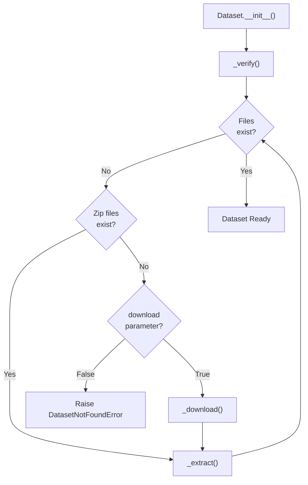
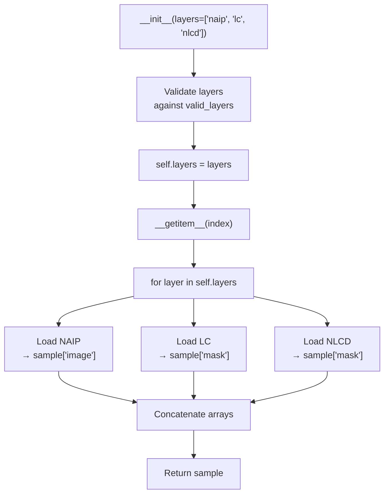
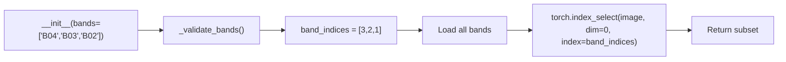
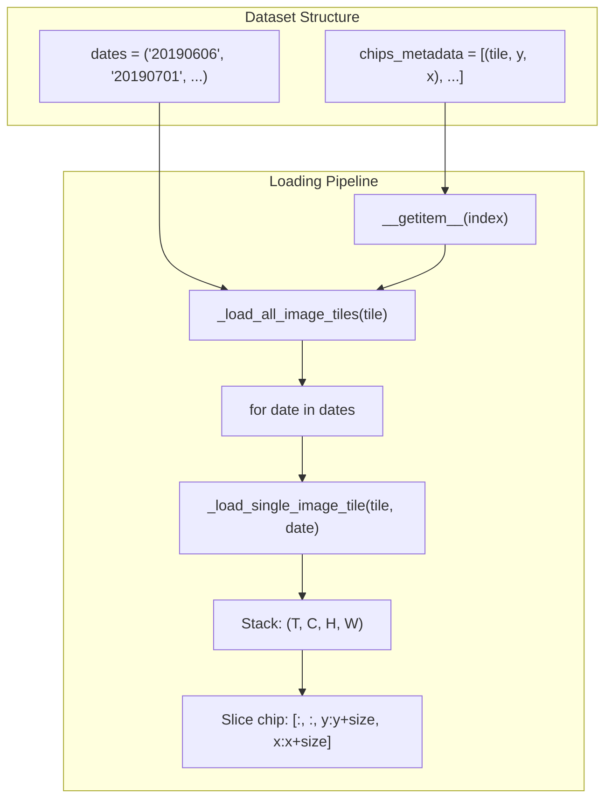
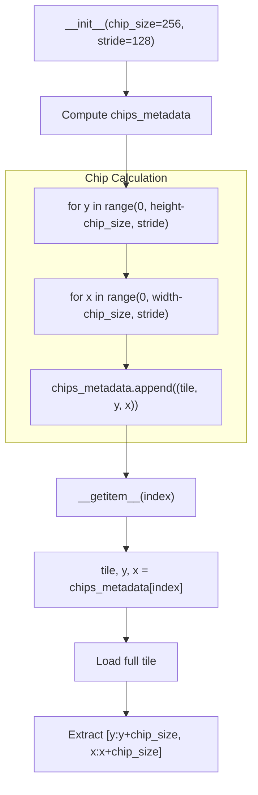
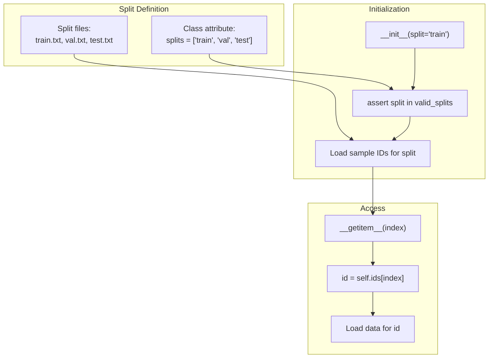

<!-- source: DeepWiki mcp.deepwiki.com · repo torchgeo/torchgeo · page 2.4 Common Dataset Patterns · fetched 2026-10-21 -->

# Common Dataset Patterns

<details>
<summary>Relevant source files</summary>

The following files were used as context for generating this wiki page:

- [tests/datasets/test_benin_cashews.py](tests/datasets/test_benin_cashews.py)
- [tests/datasets/test_cowc.py](tests/datasets/test_cowc.py)
- [tests/datasets/test_cv4a_kenya_crop_type.py](tests/datasets/test_cv4a_kenya_crop_type.py)
- [tests/datasets/test_cyclone.py](tests/datasets/test_cyclone.py)
- [tests/datasets/test_eddmaps.py](tests/datasets/test_eddmaps.py)
- [tests/datasets/test_gbif.py](tests/datasets/test_gbif.py)
- [tests/datasets/test_inaturalist.py](tests/datasets/test_inaturalist.py)
- [tests/datasets/test_landcoverai.py](tests/datasets/test_landcoverai.py)
- [tests/datasets/test_sen12ms.py](tests/datasets/test_sen12ms.py)
- [torchgeo/datasets/agrifieldnet.py](torchgeo/datasets/agrifieldnet.py)
- [torchgeo/datasets/benin_cashews.py](torchgeo/datasets/benin_cashews.py)
- [torchgeo/datasets/chesapeake.py](torchgeo/datasets/chesapeake.py)
- [torchgeo/datasets/cowc.py](torchgeo/datasets/cowc.py)
- [torchgeo/datasets/cv4a_kenya_crop_type.py](torchgeo/datasets/cv4a_kenya_crop_type.py)
- [torchgeo/datasets/cyclone.py](torchgeo/datasets/cyclone.py)
- [torchgeo/datasets/eddmaps.py](torchgeo/datasets/eddmaps.py)
- [torchgeo/datasets/enviroatlas.py](torchgeo/datasets/enviroatlas.py)
- [torchgeo/datasets/gbif.py](torchgeo/datasets/gbif.py)
- [torchgeo/datasets/globbiomass.py](torchgeo/datasets/globbiomass.py)
- [torchgeo/datasets/inaturalist.py](torchgeo/datasets/inaturalist.py)
- [torchgeo/datasets/landcoverai.py](torchgeo/datasets/landcoverai.py)
- [torchgeo/datasets/openbuildings.py](torchgeo/datasets/openbuildings.py)
- [torchgeo/datasets/sen12ms.py](torchgeo/datasets/sen12ms.py)
- [torchgeo/datasets/south_africa_crop_type.py](torchgeo/datasets/south_africa_crop_type.py)

</details>


This page documents recurring design patterns found across TorchGeo's dataset implementations. These patterns provide reusable solutions for common challenges in geospatial dataset handling, including data acquisition, loading optimization, multi-layer composition, and visualization. Understanding these patterns is essential for implementing custom datasets (see [Creating Custom Datasets](#2.5)) and for using existing datasets effectively.

For information about the core dataset abstractions and base classes, see [Core Dataset Abstractions](#2.1). For an overview of available datasets, see [Dataset Catalog](#2.2).

---

## Data Acquisition Pattern

Nearly all TorchGeo datasets implement a three-stage data acquisition workflow: verification, download, and extraction. This pattern ensures datasets are available locally before attempting to load data, with optional automatic downloading.

### Workflow Architecture



Sources: [torchgeo/datasets/chesapeake.py:168-186](), [torchgeo/datasets/landcoverai.py:103-121](), [torchgeo/datasets/cyclone.py:141-154]()

### Implementation Pattern

Datasets typically implement three methods following this pattern:

**`_verify()` Method**: Checks for data availability and orchestrates the workflow.

```python
def _verify(self) -> None:
    # Check if extracted files exist
    if self.files:  # or custom existence check
        return
    
    # Check if archives exist
    if self._check_archives():
        self._extract()
        return
    
    # Download if requested
    if not self.download:
        raise DatasetNotFoundError(self)
    
    self._download()
    self._extract()
```

**`_download()` Method**: Downloads dataset files from remote sources.

```python
def _download(self) -> None:
    for filename, md5 in zip(self.filenames, self.md5s):
        download_url(
            self.url + filename,
            self.root,
            md5=md5 if self.checksum else None
        )
```

**`_extract()` Method**: Extracts compressed archives.

```python
def _extract(self) -> None:
    for file in glob.iglob(os.path.join(self.root, '**', '*.zip'), recursive=True):
        extract_archive(file)
```

Sources: [torchgeo/datasets/chesapeake.py:168-199](), [torchgeo/datasets/landcoverai.py:140-146](), [torchgeo/datasets/cowc.py:167-191]()

### Checksum Validation

Most datasets support MD5 checksum validation to ensure data integrity. Checksums are stored as class attributes and used during download:

| Dataset | Checksum Storage | Usage |
|---------|-----------------|-------|
| Chesapeake | `md5s: ClassVar[dict[int, str]]` | Per-year checksums |
| LandCoverAI | `md5: str` | Single file checksum |
| SEN12MS | `md5s: tuple[str, ...]` | Multiple file checksums |
| OpenBuildings | `md5s: ClassVar[dict[str, str]]` | Per-tile checksums |

The `checksum` parameter in `__init__()` controls whether validation is performed. When `True`, downloads and file reads verify MD5 hashes, which may be slow but ensures data integrity.

Sources: [torchgeo/datasets/chesapeake.py:254-257](), [torchgeo/datasets/landcoverai.py:67](), [torchgeo/datasets/sen12ms.py:150-165](), [torchgeo/datasets/openbuildings.py:61-198]()

---

## Data Loading Optimization

### LRU Caching Pattern

Datasets that load data from disk frequently use `functools.lru_cache` to cache loaded tiles or chips, avoiding redundant I/O operations:


**Common Usage Pattern**:

```python
@lru_cache(maxsize=128)
def _load_single_image_tile(self, tile: str, date: str) -> Tensor:
    """Load imagery for a single tile and date."""
    directory = os.path.join(self.root, 'data', tile, date)
    # ... load and return tensor
```

**Datasets Using LRU Caching**:
- `CV4AKenyaCropType`: Caches tiles and labels [torchgeo/datasets/cv4a_kenya_crop_type.py:195-242]()
- `BeninSmallHolderCashews`: Caches scenes and masks [torchgeo/datasets/benin_cashews.py:249-323]()
- `LandCoverAI`: Caches images and targets [torchgeo/datasets/landcoverai.py:361-393]()
- `TropicalCyclone`: Caches images [torchgeo/datasets/cyclone.py:120-139]()

Sources: [torchgeo/datasets/cv4a_kenya_crop_type.py:195-264](), [torchgeo/datasets/benin_cashews.py:249-323](), [torchgeo/datasets/landcoverai.py:361-393]()

### Cache Parameter

Many `RasterDataset` subclasses expose a `cache` parameter in `__init__()` that controls whether file handles are cached. This is distinct from LRU caching and is handled by the base `RasterDataset` class for efficient raster file access:

```python
def __init__(
    self,
    paths: Path | Iterable[Path] = 'data',
    crs: CRS | None = None,
    res: float | tuple[float, float] | None = None,
    transforms: Callable[[Sample], Sample] | None = None,
    cache: bool = True,  # Cache rasterio file handles
    download: bool = False,
    checksum: bool = False,
) -> None:
```

Sources: [torchgeo/datasets/chesapeake.py:126-166](), [torchgeo/datasets/landcoverai.py:203-232]()

---

## Multi-Layer Dataset Pattern

Some datasets provide multiple data layers that can be loaded simultaneously. This pattern is common for datasets that include both input data (imagery) and various label types or auxiliary data.

### Layer Selection Architecture



Sources: [torchgeo/datasets/chesapeake.py:372-382](), [torchgeo/datasets/chesapeake.py:496-576]()

### Implementation Example: ChesapeakeCVPR

The `ChesapeakeCVPR` dataset demonstrates the multi-layer pattern:

**Valid Layers**: Defined as class attribute
```python
valid_layers = (
    'naip-new',
    'naip-old',
    'landsat-leaf-on',
    'landsat-leaf-off',
    'nlcd',
    'lc',
    'buildings',
    'prior_from_cooccurrences_101_31_no_osm_no_buildings',
)
```

**Layer Loading**: In `__getitem__()`, layers are categorized and loaded into appropriate sample keys:
```python
for layer in self.layers:
    fn = filenames[layer]
    data, _ = rasterio.mask.mask(f, [query_geom_transformed], crop=True)
    
    if layer in ['naip-new', 'naip-old', 'landsat-leaf-on', 'landsat-leaf-off']:
        sample['image'].append(data)
    elif layer in ['lc', 'nlcd', 'buildings', 'prior_...']:
        sample['mask'].append(data)
```

Sources: [torchgeo/datasets/chesapeake.py:372-382](), [torchgeo/datasets/chesapeake.py:532-563]()

### EnviroAtlas Pattern

`EnviroAtlas` extends this with a `prior_as_input` flag to control whether prior layers are treated as input or supervision:

```python
if layer in ['prior', 'prior_no_osm_no_buildings']:
    if self.prior_as_input:
        sample['image'].append(data)
    else:
        sample['mask'].append(data)
```

Sources: [torchgeo/datasets/enviroatlas.py:380-384]()

---

## Band Subsetting Pattern

Many multi-spectral datasets allow users to select a subset of bands to load, reducing memory usage and focusing on relevant spectral information.

### Band Subsetting Workflow



### Implementation Patterns

**Pattern 1: Pre-defined Band Sets** (SEN12MS):
```python
BAND_SETS: ClassVar[dict[str, tuple[str, ...]]] = {
    'all': ('VV', 'VH', 'B01', 'B02', ..., 'B12'),
    's1': ('VV', 'VH'),
    's2-all': ('B01', 'B02', ..., 'B12'),
    's2-reduced': ('B02', 'B03', 'B04', 'B08', 'B10', 'B11'),
}

def __init__(self, bands: Sequence[str] = BAND_SETS['all'], ...):
    self.band_indices = torch.tensor([self.band_names.index(b) for b in bands])
```

**Pattern 2: Custom Band Selection** (CV4AKenyaCropType, BeninSmallHolderCashews):
```python
def __init__(self, bands: Sequence[str] = all_bands, ...):
    assert set(bands) <= set(self.all_bands)
    self.bands = bands

def _load_single_scene(self, date: str) -> Tensor:
    img = torch.zeros(len(self.bands), height, width)
    for band_index, band_name in enumerate(self.bands):
        filepath = os.path.join(self.root, f'{date}_{band_name}_10m.tif')
        # Load only requested bands
```

Sources: [torchgeo/datasets/sen12ms.py:69-122](), [torchgeo/datasets/sen12ms.py:216-239](), [torchgeo/datasets/cv4a_kenya_crop_type.py:105-136](), [torchgeo/datasets/benin_cashews.py:163-196]()

---

## Time-Series Data Pattern

Several datasets handle time-series data where each sample contains imagery from multiple time steps. This pattern is essential for crop type classification and change detection tasks.

### Time-Series Architecture



Sources: [torchgeo/datasets/cv4a_kenya_crop_type.py:154-185](), [torchgeo/datasets/benin_cashews.py:211-239]()

### Implementation: CV4AKenyaCropType

**Date Sequence**: Defined as class attribute
```python
dates = (
    '20190606', '20190701', '20190706', '20190711', '20190721',
    '20190805', '20190815', '20190825', '20190909', '20190919',
    '20190924', '20191004', '20191103',
)
```

**Multi-temporal Loading**:
```python
def _load_all_image_tiles(self, tile: str) -> Tensor:
    img = torch.zeros(
        len(self.dates),      # Time dimension
        len(self.bands),      # Channel dimension
        self.tile_height,     # Height
        self.tile_width,      # Width
    )
    for date_index, date in enumerate(self.dates):
        img[date_index] = self._load_single_image_tile(tile, date)
    return img
```

**Plotting**: Time-series datasets provide a `time_step` parameter in their `plot()` method:
```python
def plot(self, sample: Sample, time_step: int = 0, ...):
    image = sample['image'][time_step, rgb_indices]
```

Sources: [torchgeo/datasets/cv4a_kenya_crop_type.py:69-83](), [torchgeo/datasets/cv4a_kenya_crop_type.py:217-241](), [torchgeo/datasets/cv4a_kenya_crop_type.py:285-345]()

---

## Chip-Based Indexing Pattern

Some datasets with large continuous imagery pre-compute chip metadata during initialization to enable efficient random access. This pattern is common for datasets that extract fixed-size patches from large tiles.

### Chip Metadata Computation



Sources: [torchgeo/datasets/cv4a_kenya_crop_type.py:142-153](), [torchgeo/datasets/benin_cashews.py:199-209]()

### Implementation Example

**Chip Metadata Computation** (CV4AKenyaCropType):
```python
self.chips_metadata = []
for tile_index in range(len(self.tiles)):
    for y in [
        *list(range(0, self.tile_height - self.chip_size, stride)),
        self.tile_height - self.chip_size,  # Include edge
    ]:
        for x in [
            *list(range(0, self.tile_width - self.chip_size, stride)),
            self.tile_width - self.chip_size,
        ]:
            self.chips_metadata.append((tile_index, y, x))
```

**Chip Extraction** in `__getitem__()`:
```python
def __getitem__(self, index: int) -> Sample:
    tile_index, y, x = self.chips_metadata[index]
    tile = self.tiles[tile_index]
    
    img = self._load_all_image_tiles(tile)  # Full tile
    img = img[:, :, y:y+self.chip_size, x:x+self.chip_size]  # Extract chip
```

**Dataset Length**: The number of chips determines dataset length:
```python
def __len__(self) -> int:
    return len(self.chips_metadata)
```

Sources: [torchgeo/datasets/cv4a_kenya_crop_type.py:142-185](), [torchgeo/datasets/benin_cashews.py:199-239]()

---

## Visualization Pattern

All TorchGeo datasets implement a standardized `plot()` method for visualizing samples. This pattern ensures consistent visualization across different dataset types.

### Plot Method Signature

The standard signature across datasets:

```python
def plot(
    self,
    sample: Sample,
    show_titles: bool = True,
    suptitle: str | None = None
) -> Figure:
    """Plot a sample from the dataset.
    
    Args:
        sample: a sample returned by :meth:`__getitem__`
        show_titles: flag indicating whether to show titles above each panel
        suptitle: optional suptitle to use for figure
        
    Returns:
        a matplotlib Figure with the rendered sample
    """
```

Sources: [torchgeo/datasets/chesapeake.py:201-248](), [torchgeo/datasets/landcoverai.py:148-189](), [torchgeo/datasets/cyclone.py:166-201]()

### Color Map Pattern

Datasets with categorical labels define color maps as class attributes:

```python
cmap: ClassVar[dict[int, tuple[int, int, int, int]]] = {
    0: (0, 0, 0, 0),           # Transparent background
    1: (97, 74, 74, 255),      # Building
    2: (38, 115, 0, 255),      # Woodland
    3: (0, 197, 255, 255),     # Water
    4: (207, 207, 207, 255),   # Road
}
```

**Color Map Application**:
```python
# Convert to colormap tensor
cmap = torch.zeros(max(self.cmap) + 1, 4, dtype=torch.uint8)
for key, value in self.cmap.items():
    cmap[key] = torch.tensor(value)

mask = sample['mask'].squeeze(0)
mask = cmap[mask]  # Apply colormap
```

Alternatively, using matplotlib:
```python
from matplotlib.colors import ListedColormap

lc_colors = np.zeros((max(self.cmap.keys()) + 1, 4))
lc_colors[list(self.cmap.keys())] = list(self.cmap.values())
self._lc_cmap = ListedColormap(lc_colors[:, :3] / 255)

# In plot()
axs[1].imshow(mask, vmin=0, vmax=4, cmap=self._lc_cmap, interpolation='none')
```

Sources: [torchgeo/datasets/landcoverai.py:69-99](), [torchgeo/datasets/chesapeake.py:218-223](), [torchgeo/datasets/chesapeake.py:84-124]()

### Prediction Visualization

The plot method detects and visualizes predictions when present:

```python
def plot(self, sample: Sample, ...) -> Figure:
    image = sample['image']
    mask = sample['mask']
    
    showing_predictions = 'prediction' in sample
    ncols = 2 if showing_predictions else 1
    
    fig, axs = plt.subplots(1, ncols)
    axs[0].imshow(mask)
    
    if showing_predictions:
        axs[1].imshow(sample['prediction'])
        if show_titles:
            axs[1].set_title('Prediction')
```

Sources: [torchgeo/datasets/landcoverai.py:164-186](), [torchgeo/datasets/cyclone.py:183-196]()

### RGB Band Selection

Multi-spectral datasets that support plotting must handle RGB band selection:

```python
rgb_bands = ('B04', 'B03', 'B02')

def plot(self, sample: Sample, ...) -> Figure:
    rgb_indices = []
    for band in self.rgb_bands:
        if band in self.bands:
            rgb_indices.append(self.bands.index(band))
        else:
            raise RGBBandsMissingError()
    
    image = sample['image'][rgb_indices]
```

Sources: [torchgeo/datasets/cv4a_kenya_crop_type.py:308-336](), [torchgeo/datasets/sen12ms.py:331-336]()

---

## Split Handling Pattern

Many benchmark datasets support train/val/test splits, with split information stored in metadata files or class attributes.

### Split Implementation Patterns



### Pattern 1: Split Files (LandCoverAI)

Split membership is stored in text files:
```python
def __init__(self, root: Path, split: str = 'train', ...):
    assert split in ['train', 'val', 'test']
    self.split = split
    
    with open(os.path.join(self.root, split + '.txt')) as f:
        self.ids = f.readlines()

def __getitem__(self, index: int) -> Sample:
    id_ = self.ids[index].rstrip()
    return {'image': self._load_image(id_), 'mask': self._load_target(id_)}
```

Sources: [torchgeo/datasets/landcoverai.py:305-351]()

### Pattern 2: Split Attribute (SEN12MS)

Split membership is determined by a reference file:
```python
def __init__(self, split: str = 'train', ...):
    assert split in ['train', 'test']
    self.split = split
    
    with open(os.path.join(self.root, split + '_list.txt')) as f:
        self.ids = [line.rstrip() for line in f.readlines()]
```

Sources: [torchgeo/datasets/sen12ms.py:167-214]()

### Pattern 3: Split Filtering (ChesapeakeCVPR)

For geospatial datasets, splits filter the spatial index:
```python
splits = (
    [f'{state}-train' for state in states]
    + [f'{state}-val' for state in states]
    + [f'{state}-test' for state in states]
)

def __init__(self, splits: Sequence[str] = ['de-train'], ...):
    for split in splits:
        assert split in self.splits
    
    gdf = gpd.read_file(os.path.join(root, 'spatial_index.geojson'))
    gdf = gdf[gdf['split'].isin(splits)]  # Filter by split
    self.index = gdf
```

Sources: [torchgeo/datasets/chesapeake.py:382-494]()

---

## Abstract Base Class Pattern

Some dataset families use abstract base classes to share common functionality across variants:

### ABC Structure

```mermaid
classDiagram
    class COWC {
        <<abstract>>
        +base_url: str*
        +filenames: tuple*
        +md5s: tuple*
        +filename: str*
        +__init__(root, split, ...)
        +_verify()
        +_download()
    }
    
    class COWCCounting {
        +base_url = 'https://.../counting/'
        +filenames = (...)
        +md5s = (...)
        +filename = 'COWC_{}_list_64_class.txt'
    }
    
    class COWCDetection {
        +base_url = 'https://.../detection/'
        +filenames = (...)
        +md5s = (...)
        +filename = 'COWC_{}_list_detection.txt'
    }
    
    class Chesapeake {
        <<abstract>>
        +md5s: dict*
        +state: str
        +_verify()
        +_download()
        +_extract()
    }
    
    class ChesapeakeDC {
        +md5s = {2013: '...', 2017: '...'}
    }
    
    class ChesapeakePA {
        +md5s = {2013: '...', 2017: '...'}
    }
    
    NonGeoDataset <|-- COWC
    COWC <|-- COWCCounting
    COWC <|-- COWCDetection
    
    RasterDataset <|-- Chesapeake
    Chesapeake <|-- ChesapeakeDC
    Chesapeake <|-- ChesapeakePA
```

**COWC Example**:
- Base class: `COWC(NonGeoDataset, abc.ABC)` [torchgeo/datasets/cowc.py:24-231]()
- Defines abstract properties: `base_url`, `filenames`, `md5s`, `filename`
- Subclasses: `COWCCounting`, `COWCDetection` [torchgeo/datasets/cowc.py:233-288]()

**Chesapeake Example**:
- Base class: `Chesapeake(RasterDataset, ABC)` [torchgeo/datasets/chesapeake.py:32-248]()
- Abstract property: `md5s` [torchgeo/datasets/chesapeake.py:74-77]()
- State extracted from class name: `self.state = self.__class__.__name__[-2:].lower()` [torchgeo/datasets/chesapeake.py:80-82]()
- Subclasses: `ChesapeakeDC`, `ChesapeakeDE`, `ChesapeakeMD`, etc. [torchgeo/datasets/chesapeake.py:251-311]()

**LandCoverAI Example**:
- Base class: `LandCoverAIBase(Dataset[Sample], abc.ABC)` [torchgeo/datasets/landcoverai.py:30-190]()
- Shared: Verification, plotting, color maps
- Subclasses: `LandCoverAIGeo(RasterDataset)`, `LandCoverAI(NonGeoDataset)` [torchgeo/datasets/landcoverai.py:192-444]()

Sources: [torchgeo/datasets/cowc.py:24-288](), [torchgeo/datasets/chesapeake.py:32-311](), [torchgeo/datasets/landcoverai.py:30-444]()

---

