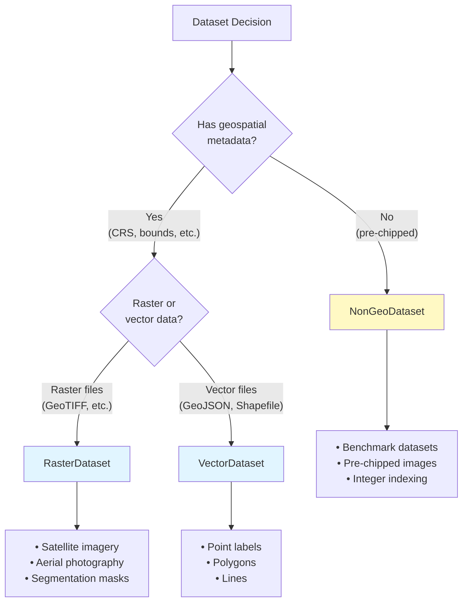
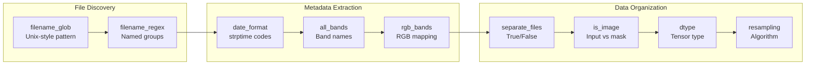
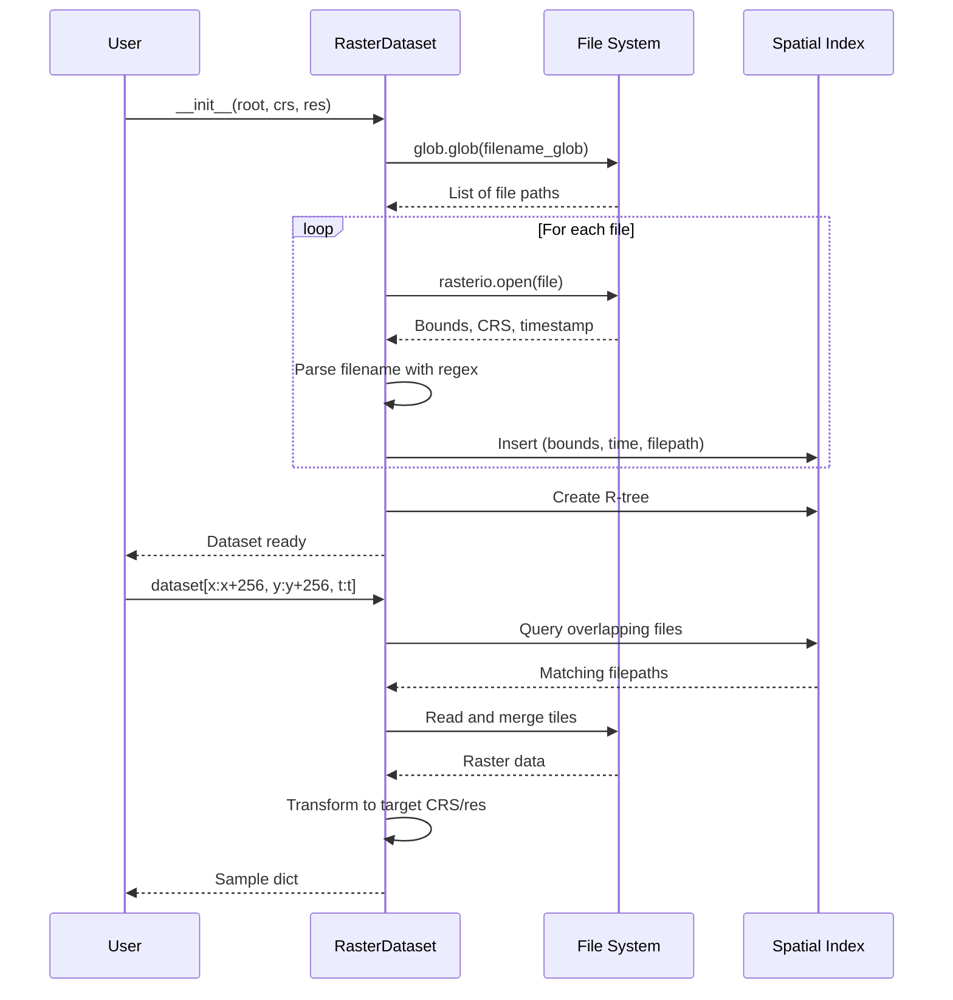
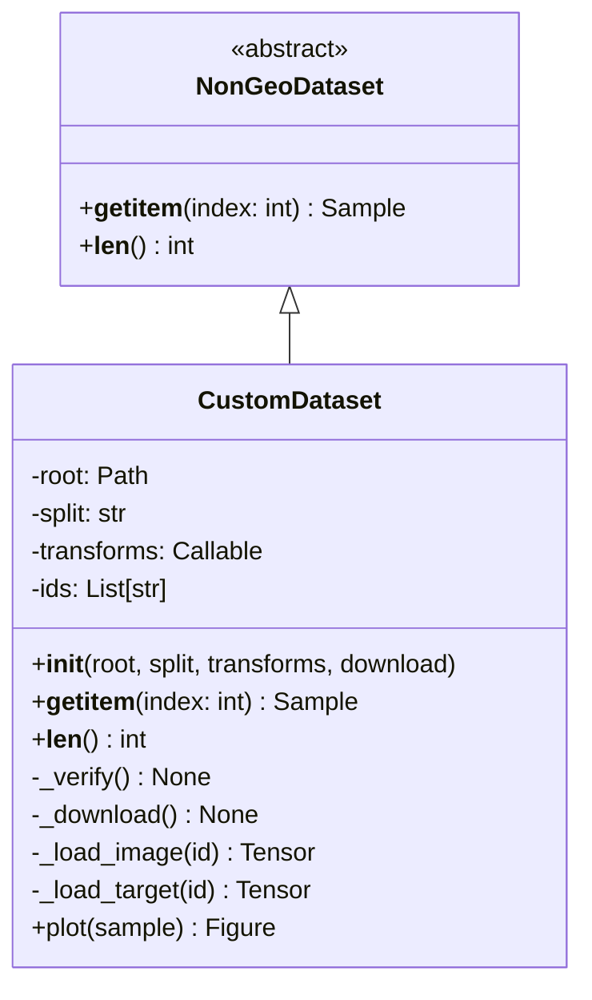
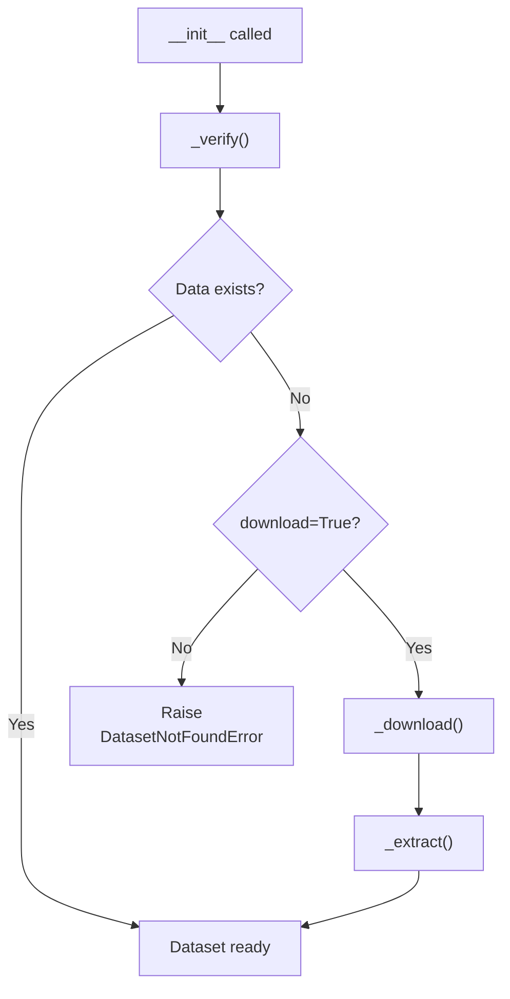
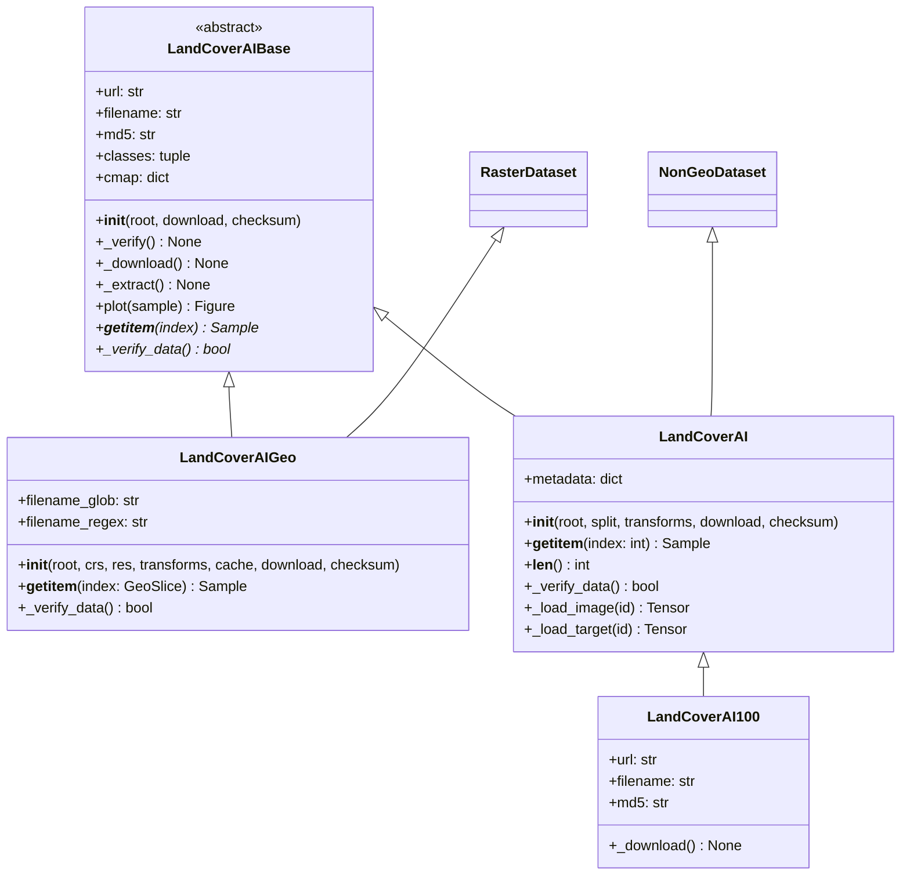

<!-- source: DeepWiki mcp.deepwiki.com · repo torchgeo/torchgeo · page 2.5 Creating Custom Datasets · fetched 2026-10-21 -->

# Creating Custom Datasets

<details>
<summary>Relevant source files</summary>

The following files were used as context for generating this wiki page:

- [docs/tutorials/basic_usage.rst](docs/tutorials/basic_usage.rst)
- [docs/tutorials/cli.ipynb](docs/tutorials/cli.ipynb)
- [docs/tutorials/custom_raster_dataset.ipynb](docs/tutorials/custom_raster_dataset.ipynb)
- [docs/tutorials/custom_segmentation_trainer.ipynb](docs/tutorials/custom_segmentation_trainer.ipynb)
- [docs/tutorials/earthquake_detection.ipynb](docs/tutorials/earthquake_detection.ipynb)
- [docs/tutorials/embeddings.ipynb](docs/tutorials/embeddings.ipynb)
- [docs/tutorials/indices.ipynb](docs/tutorials/indices.ipynb)
- [docs/tutorials/pretrained_weights.ipynb](docs/tutorials/pretrained_weights.ipynb)
- [docs/tutorials/pytorch.ipynb](docs/tutorials/pytorch.ipynb)
- [docs/tutorials/trainers.ipynb](docs/tutorials/trainers.ipynb)
- [docs/tutorials/transforms.ipynb](docs/tutorials/transforms.ipynb)
- [tests/datasets/test_benin_cashews.py](tests/datasets/test_benin_cashews.py)
- [tests/datasets/test_cowc.py](tests/datasets/test_cowc.py)
- [tests/datasets/test_cv4a_kenya_crop_type.py](tests/datasets/test_cv4a_kenya_crop_type.py)
- [tests/datasets/test_cyclone.py](tests/datasets/test_cyclone.py)
- [tests/datasets/test_landcoverai.py](tests/datasets/test_landcoverai.py)
- [tests/datasets/test_sen12ms.py](tests/datasets/test_sen12ms.py)
- [torchgeo/datasets/benin_cashews.py](torchgeo/datasets/benin_cashews.py)
- [torchgeo/datasets/cowc.py](torchgeo/datasets/cowc.py)
- [torchgeo/datasets/cv4a_kenya_crop_type.py](torchgeo/datasets/cv4a_kenya_crop_type.py)
- [torchgeo/datasets/cyclone.py](torchgeo/datasets/cyclone.py)
- [torchgeo/datasets/landcoverai.py](torchgeo/datasets/landcoverai.py)
- [torchgeo/datasets/sen12ms.py](torchgeo/datasets/sen12ms.py)

</details>


## Purpose and Scope

This document provides a comprehensive guide for creating custom dataset classes in TorchGeo. It covers the decision-making process for selecting the appropriate base class, implementing core functionality, and integrating with the TorchGeo ecosystem.

For information about the core dataset abstractions and their interfaces, see [Core Dataset Abstractions](#2.1). For examples of existing dataset implementations, see [Dataset Catalog](#2.2). For information about combining datasets, see [Dataset Composition and Indexing](#2.3).

## Choosing a Base Class

The first step in creating a custom dataset is selecting the appropriate base class. TorchGeo provides two primary categories of datasets, each with specific subclasses designed to reduce code duplication.



**Decision criteria:**

| Criterion | GeoDataset | NonGeoDataset |
|-----------|-----------|---------------|
| Geospatial metadata | ✓ CRS, bounds, resolution | ✗ No coordinate system |
| File organization | Raw data, any structure | Pre-chipped, organized splits |
| Indexing method | Spatiotemporal slicing | Integer indexing |
| Use case | Uncurated raw data | Benchmark datasets |
| Example | Landsat, Sentinel-2 | EuroSAT, ImageNet |

To verify if your data has geospatial metadata, run `gdalinfo` on a sample file. If it returns CRS and bounding box information, use `GeoDataset`.

**Sources:** [docs/tutorials/custom_raster_dataset.ipynb:34-75]()

## Creating a RasterDataset

`RasterDataset` is the most common base class for geospatial imagery. It automatically handles file discovery, spatial indexing, and coordinate transformations.

### Core Class Attributes



**Sources:** [docs/tutorials/custom_raster_dataset.ipynb:197-262]()

### Required Attributes

The following table describes the class-level attributes that must be defined:

| Attribute | Type | Purpose | Example |
|-----------|------|---------|---------|
| `filename_glob` | `str` | Unix glob pattern to find files | `'T*_B02_10m.tif'` |
| `filename_regex` | `str` | Regex with named groups for metadata | `r'^.{6}_(?P<date>\d{8}T\d{6})_(?P<band>B0[\d])'` |
| `date_format` | `str` | strptime format for timestamp | `'%Y%m%dT%H%M%S'` |
| `is_image` | `bool` | True for inputs, False for masks | `True` |
| `separate_files` | `bool` | True if bands are in separate files | `True` |

### Optional Attributes

| Attribute | Type | Default | Purpose |
|-----------|------|---------|---------|
| `all_bands` | `Sequence[str]` | `None` | Names of all spectral bands |
| `rgb_bands` | `Sequence[str]` | `None` | Bands corresponding to R, G, B |
| `dtype` | `torch.dtype` | `torch.float32` for images,<br/>`torch.long` for masks | Tensor data type |
| `resampling` | `Resampling` | Bilinear for float,<br/>Nearest for int | Rasterio resampling algorithm |

### Example Implementation: Sentinel-2 Dataset

```python
class Sentinel2(RasterDataset):
    filename_glob = 'T*_B02_10m.tif'
    filename_regex = r'^.{6}_(?P<date>\d{8}T\d{6})_(?P<band>B0[\d])'
    date_format = '%Y%m%dT%H%M%S'
    is_image = True
    separate_files = True
    all_bands = ('B02', 'B03', 'B04', 'B08')
    rgb_bands = ('B04', 'B03', 'B02')
```

This minimal implementation provides:
- Automatic file discovery based on `filename_glob`
- Timestamp extraction from filenames using `filename_regex`
- Band stacking for multi-file spectral data
- Spatial indexing via R-tree
- CRS transformation support

**Sources:** [docs/tutorials/custom_raster_dataset.ipynb:264-281]()

### Workflow: RasterDataset Instantiation



**Sources:** [torchgeo/datasets/landcoverai.py:192-282](), [docs/tutorials/custom_raster_dataset.ipynb:289-303]()

## Creating a NonGeoDataset

`NonGeoDataset` is used for benchmark datasets that lack geospatial metadata. These datasets typically consist of pre-chipped images organized into train/val/test splits.

### Required Methods

All `NonGeoDataset` subclasses must implement three methods:



| Method | Signature | Purpose |
|--------|-----------|---------|
| `__init__` | `(root, split, transforms, download, checksum)` | Initialize dataset, verify/download data |
| `__getitem__` | `(index: int) -> Sample` | Load and return a single data sample |
| `__len__` | `() -> int` | Return total number of samples |

**Sources:** [torchgeo/datasets/cyclone.py:53-119]()

### Common Implementation Patterns

#### Pattern 1: Verification and Download

Most datasets follow a standard workflow for ensuring data availability:



Example from LandCoverAI:

```python
def __init__(self, root='data', split='train', transforms=None, 
             download=False, checksum=False):
    self.root = root
    self.split = split
    self.transforms = transforms
    self._verify()

def _verify(self):
    if self._verify_data():
        return
    if os.path.exists(os.path.join(self.root, self.filename)):
        self._extract()
        return
    if not self.download:
        raise DatasetNotFoundError(self)
    self._download()
    self._extract()
```

**Sources:** [torchgeo/datasets/landcoverai.py:77-121]()

#### Pattern 2: Lazy Loading with Caching

For datasets with many samples, use `functools.lru_cache` to cache loaded data:

```python
from functools import lru_cache

@lru_cache(maxsize=128)
def _load_image(self, image_id: str) -> Tensor:
    filename = os.path.join(self.root, f'{image_id}.tif')
    with rasterio.open(filename) as src:
        array = src.read()
        tensor = torch.from_numpy(array)
        return tensor
```

This pattern is used extensively in time-series datasets where the same tiles are accessed multiple times.

**Sources:** [torchgeo/datasets/cyclone.py:120-139](), [torchgeo/datasets/cv4a_kenya_crop_type.py:195-264]()

#### Pattern 3: On-the-Fly Chip Extraction

For datasets too large to store pre-chipped, extract chips dynamically:

```python
def __init__(self, root, chip_size=256, stride=128, ...):
    self.chip_size = chip_size
    self.stride = stride
    
    # Pre-compute chip locations
    self.chips_metadata = []
    for y in range(0, tile_height - chip_size, stride):
        for x in range(0, tile_width - chip_size, stride):
            self.chips_metadata.append((tile_index, y, x))

def __getitem__(self, index):
    tile_index, y, x = self.chips_metadata[index]
    img = self._load_tile(tile_index)
    return img[:, y:y+self.chip_size, x:x+self.chip_size]
```

**Sources:** [torchgeo/datasets/cv4a_kenya_crop_type.py:141-193](), [torchgeo/datasets/benin_cashews.py:199-239]()

### Example Implementation: Simple Classification Dataset

```python
class CustomClassificationDataset(NonGeoDataset):
    url = 'https://example.com/dataset.zip'
    md5 = 'abc123...'
    
    def __init__(self, root='data', split='train', transforms=None, 
                 download=False, checksum=False):
        assert split in ['train', 'val', 'test']
        
        self.root = root
        self.split = split
        self.transforms = transforms
        self.checksum = checksum
        
        if download:
            self._download()
        if not self._check_integrity():
            raise DatasetNotFoundError(self)
        
        # Load split file
        with open(os.path.join(root, f'{split}.txt')) as f:
            self.ids = [line.strip() for line in f]
    
    def __getitem__(self, index: int) -> Sample:
        id_ = self.ids[index]
        sample = {
            'image': self._load_image(id_),
            'label': self._load_label(id_)
        }
        if self.transforms:
            sample = self.transforms(sample)
        return sample
    
    def __len__(self) -> int:
        return len(self.ids)
    
    def _load_image(self, id_: str) -> Tensor:
        filename = os.path.join(self.root, 'images', f'{id_}.jpg')
        with Image.open(filename) as img:
            array = np.array(img)
            tensor = torch.from_numpy(array).permute(2, 0, 1)
            return tensor
    
    def _load_label(self, id_: str) -> Tensor:
        filename = os.path.join(self.root, 'labels', f'{id_}.txt')
        with open(filename) as f:
            label = int(f.read().strip())
            return torch.tensor(label)
```

**Sources:** [torchgeo/datasets/landcoverai.py:284-394](), [torchgeo/datasets/cowc.py:66-166]()

## Advanced Patterns

### Abstract Base Classes

For datasets with multiple variants, use an abstract base class to share common functionality:



The abstract base class defines:
- Common attributes (`url`, `md5`, `classes`, `cmap`)
- Shared methods (`_verify`, `_download`, `_extract`, `plot`)
- Abstract methods that subclasses must implement

**Sources:** [torchgeo/datasets/landcoverai.py:30-190]()

### Multi-File Datasets with Separate Bands

For datasets where spectral bands are stored in separate files:

```python
@lru_cache(maxsize=128)
def _load_single_scene(self, tile: str, date: str) -> Tensor:
    img = torch.zeros(
        len(self.bands), self.tile_height, self.tile_width, 
        dtype=torch.float32
    )
    for band_index, band_name in enumerate(self.bands):
        filepath = os.path.join(
            self.root, f'{tile}_{date}_{band_name}.tif'
        )
        with rasterio.open(filepath) as src:
            array = src.read().astype(np.float32)
            img[band_index] = torch.from_numpy(array)
    return img

def __getitem__(self, index: int) -> Sample:
    tile, date = self.metadata[index]
    img = self._load_single_scene(tile, date)
    
    if self.transforms:
        img = self.transforms(img)
    
    return {'image': img, 'tile': tile, 'date': date}
```

**Sources:** [torchgeo/datasets/benin_cashews.py:249-299](), [torchgeo/datasets/cv4a_kenya_crop_type.py:217-264]()

### Time-Series Data

For datasets with temporal dimension:

```python
def __init__(self, root, chip_size=256, ...):
    self.dates = ('20190606', '20190701', '20190706', ...)
    
    # Pre-compute chip metadata
    self.chips_metadata = []
    for tile_index in range(len(self.tiles)):
        for y in range(0, self.tile_height - chip_size, stride):
            for x in range(0, self.tile_width - chip_size, stride):
                self.chips_metadata.append((tile_index, y, x))

@lru_cache(maxsize=128)
def _load_all_dates(self, tile: str) -> Tensor:
    """Load imagery across all time steps."""
    img = torch.zeros(
        len(self.dates), len(self.bands), 
        self.tile_height, self.tile_width
    )
    for date_index, date in enumerate(self.dates):
        img[date_index] = self._load_single_scene(tile, date)
    return img

def __getitem__(self, index: int) -> Sample:
    tile_index, y, x = self.chips_metadata[index]
    
    # Load all time steps
    img = self._load_all_dates(self.tiles[tile_index])
    
    # Extract chip
    img = img[:, :, y:y+self.chip_size, x:x+self.chip_size]
    
    return {'image': img}
```

**Sources:** [torchgeo/datasets/cv4a_kenya_crop_type.py:141-185](), [torchgeo/datasets/benin_cashews.py:211-299]()

### Custom __getitem__ for GeoDatasets

While `RasterDataset` provides a default `__getitem__`, you can override it for custom behavior:

```python
def __getitem__(self, index: GeoSlice) -> Sample:
    # Parse the spatiotemporal index
    x, y, t = self._disambiguate_slice(index)
    
    # Query the spatial index
    interval = pd.Interval(t.start, t.stop)
    df = self.index.iloc[self.index.index.overlaps(interval)]
    df = df.cx[x.start:x.stop, y.start:y.stop]
    
    # Load image and mask from different directories
    img_filepaths = df.filepath
    mask_filepaths = img_filepaths.apply(
        lambda x: x.replace('images', 'masks')
    )
    
    # Merge and transform
    img = self._merge_files(img_filepaths, index, self.band_indexes)
    mask = self._merge_files(mask_filepaths, index, self.band_indexes)
    
    sample = {
        'bounds': self._slice_to_tensor(index),
        'image': img.float(),
        'mask': mask.long(),
        'transform': torch.tensor(transform)
    }
    
    if self.transforms:
        sample = self.transforms(sample)
    
    return sample
```

This pattern is useful when:
- Images and labels are in different directories
- You need custom merging logic
- You want to add additional metadata

**Sources:** [torchgeo/datasets/landcoverai.py:242-281]()

## Integration with TorchGeo Ecosystem

### Adding Transform Support

All datasets should accept a `transforms` argument and apply it in `__getitem__`:

```python
def __init__(self, root, transforms=None, ...):
    self.transforms = transforms

def __getitem__(self, index):
    sample = {
        'image': self._load_image(index),
        'mask': self._load_mask(index)
    }
    
    if self.transforms is not None:
        sample = self.transforms(sample)
    
    return sample
```

TorchGeo transforms work with dictionary inputs where keys indicate data type (`'image'`, `'mask'`, `'label'`, etc.).

**Sources:** [docs/tutorials/transforms.ipynb:352-362](), [torchgeo/datasets/landcoverai.py:305-351]()

### Adding Plot Methods

Datasets should implement a `plot` method for visualization:

```python
def plot(self, sample: Sample, show_titles: bool = True, 
         suptitle: str | None = None) -> Figure:
    """Plot a sample from the dataset.
    
    Args:
        sample: Sample returned by __getitem__
        show_titles: Whether to show titles above panels
        suptitle: Optional suptitle for the figure
        
    Returns:
        Matplotlib figure with rendered sample
    """
    # Extract RGB bands
    rgb_indices = [self.all_bands.index(b) for b in self.rgb_bands]
    image = sample['image'][rgb_indices].permute(1, 2, 0)
    
    # Normalize to [0, 1]
    image = torch.clamp(image / 10000, 0, 1).numpy()
    
    # Create figure
    fig, ax = plt.subplots()
    ax.imshow(image)
    ax.axis('off')
    
    if show_titles:
        ax.set_title('RGB Image')
    if suptitle:
        plt.suptitle(suptitle)
    
    return fig
```

**Sources:** [docs/tutorials/custom_raster_dataset.ipynb:322-357](), [torchgeo/datasets/landcoverai.py:148-189]()

### Custom Parameters

Override `__init__` to add dataset-specific parameters:

```python
class DownloadableDataset(RasterDataset):
    def __init__(self, paths, crs=None, res=None, bands=None, 
                 transforms=None, cache=True, download=False):
        # Custom logic before parent initialization
        if download:
            self._download()
        
        # Call parent constructor
        super().__init__(paths, crs, res, bands, transforms, cache)
    
    def _download(self):
        download_url(self.url, self.root, md5=self.md5)
        extract_archive(os.path.join(self.root, self.filename))
```

Common custom parameters:
- `download`: Automatically download dataset if not found
- `checksum`: Verify MD5/SHA256 checksums
- `split`: Train/val/test split
- `chip_size`: Size of extracted patches
- `bands`: Subset of spectral bands to load

**Sources:** [docs/tutorials/custom_raster_dataset.ipynb:404-424](), [torchgeo/datasets/landcoverai.py:203-232]()

## Testing Custom Datasets

Every custom dataset should have comprehensive tests covering:

### Basic Functionality Tests

```python
def test_getitem(dataset):
    """Test that __getitem__ returns correct sample structure."""
    sample = dataset[0]
    assert isinstance(sample, dict)
    assert isinstance(sample['image'], torch.Tensor)
    assert sample['image'].ndim == 3  # CxHxW

def test_len(dataset):
    """Test that __len__ returns correct count."""
    assert len(dataset) > 0

def test_invalid_index(dataset):
    """Test that invalid indices raise appropriate errors."""
    with pytest.raises(IndexError):
        dataset[len(dataset)]
```

### Download and Verification Tests

```python
def test_already_downloaded(dataset):
    """Test that re-initialization doesn't re-download."""
    # Should not raise error
    CustomDataset(root=dataset.root, download=True)

def test_not_downloaded(tmp_path):
    """Test that missing data raises error when download=False."""
    with pytest.raises(DatasetNotFoundError):
        CustomDataset(root=tmp_path, download=False)

def test_checksum(monkeypatch, tmp_path):
    """Test that corrupted files are detected."""
    monkeypatch.setattr(CustomDataset, 'md5', 'incorrect_hash')
    with pytest.raises(RuntimeError):
        CustomDataset(root=tmp_path, download=True, checksum=True)
```

### Plot Tests

```python
def test_plot(dataset):
    """Test that plot method works without errors."""
    sample = dataset[0]
    fig = dataset.plot(sample, suptitle='Test')
    plt.close(fig)

def test_plot_with_prediction(dataset):
    """Test plotting with prediction overlay."""
    sample = dataset[0]
    sample['prediction'] = sample['mask'].clone()
    fig = dataset.plot(sample)
    plt.close(fig)
```

**Sources:** [tests/datasets/test_landcoverai.py:26-131](), [tests/datasets/test_sen12ms.py:18-105]()

## Real-World Examples

The following table shows how existing TorchGeo datasets map to the patterns described above:

| Dataset | Base Class | Key Features | File References |
|---------|-----------|--------------|-----------------|
| **LandCoverAI** | Abstract base → Geo + NonGeo | Separate image/mask directories, multiple variants | [landcoverai.py:30-444]() |
| **CV4AKenyaCropType** | NonGeoDataset | Time-series, on-the-fly chipping, band subsetting | [cv4a_kenya_crop_type.py:22-346]() |
| **BeninSmallHolderCashews** | NonGeoDataset | GeoJSON rasterization, time-series, azcopy download | [benin_cashews.py:24-405]() |
| **SEN12MS** | NonGeoDataset | Multi-source (SAR+optical), band validation | [sen12ms.py:22-368]() |
| **TropicalCyclone** | NonGeoDataset | CSV metadata, LRU cache, image resizing | [cyclone.py:23-202]() |
| **COWC** | Abstract base → Counting + Detection | Multiple variants from single base, integrity checking | [cowc.py:24-304]() |

**Sources:** [torchgeo/datasets/landcoverai.py](), [torchgeo/datasets/cv4a_kenya_crop_type.py](), [torchgeo/datasets/benin_cashews.py](), [torchgeo/datasets/sen12ms.py](), [torchgeo/datasets/cyclone.py](), [torchgeo/datasets/cowc.py]()

## Contributing Datasets

If your custom dataset might benefit other users, consider contributing it to TorchGeo. Requirements include:

1. **Documentation**: Docstrings with dataset description, citation, and usage examples
2. **Testing**: Comprehensive test suite covering all functionality
3. **Data availability**: Publicly accessible download URL or instructions
4. **Licensing**: Compatible with TorchGeo's MIT license

See the [Contributing Guide](https://torchgeo.readthedocs.io/en/stable/user/contributing.html) for detailed submission instructions.

**Sources:** [docs/tutorials/custom_raster_dataset.ipynb:432-435]()

---

