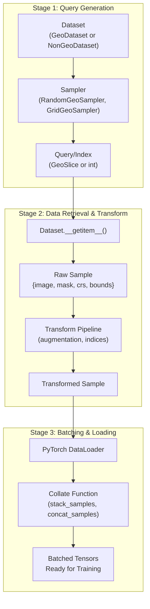
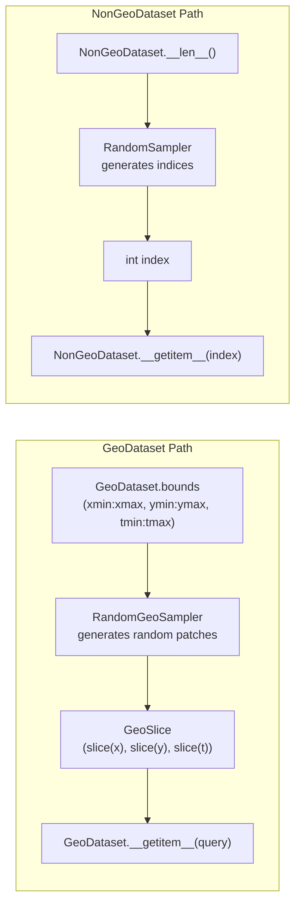
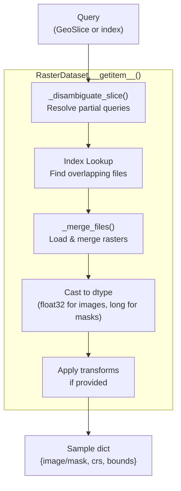
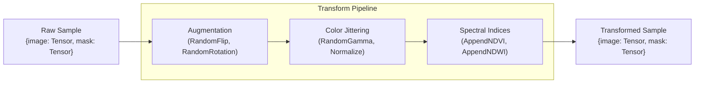
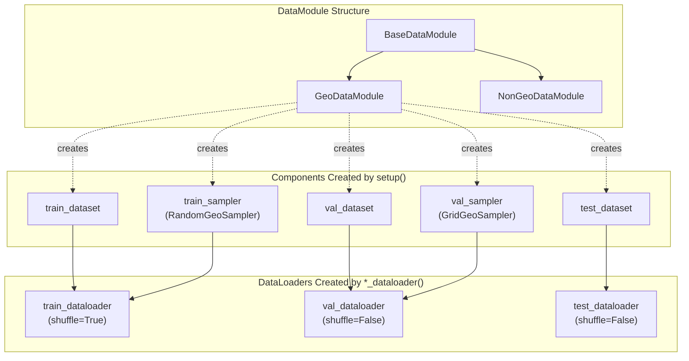
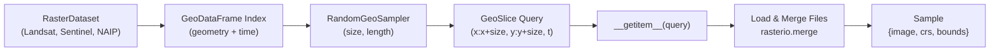
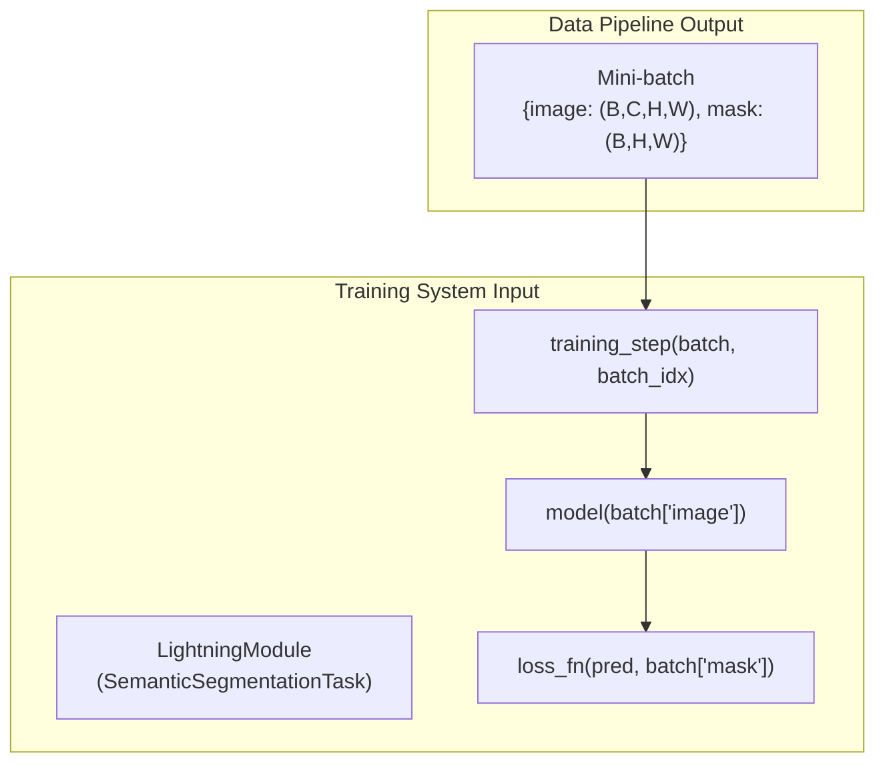
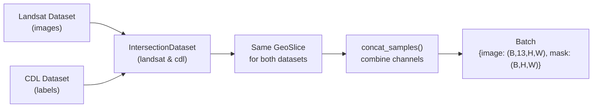
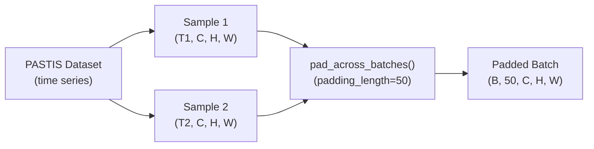

<!-- source: DeepWiki mcp.deepwiki.com · repo torchgeo/torchgeo · page 3 Data Loading Pipeline · fetched 2026-10-21 -->

# Data Loading Pipeline

Relevant source files

The following files were used as context for generating this wiki page:

- [docs/api/datamodules.rst](docs/api/datamodules.rst)
- [docs/api/datasets.rst](docs/api/datasets.rst)
- [tests/data/deepglobelandcover/data.py](tests/data/deepglobelandcover/data.py)
- [tests/data/deepglobelandcover/data.zip](tests/data/deepglobelandcover/data.zip)
- [tests/data/naip/data.py](tests/data/naip/data.py)
- [tests/data/naip/m_3807511_ne_18_060_20181104.tif](tests/data/naip/m_3807511_ne_18_060_20181104.tif)
- [tests/data/naip/m_3807511_ne_18_060_20190605.tif](tests/data/naip/m_3807511_ne_18_060_20190605.tif)
- [tests/data/vector/data.py](tests/data/vector/data.py)
- [tests/data/vector/vector_2024.geojson](tests/data/vector/vector_2024.geojson)
- [tests/data/vector/vector_2024.parquet](tests/data/vector/vector_2024.parquet)
- [tests/datasets/test_deepglobelandcover.py](tests/datasets/test_deepglobelandcover.py)
- [tests/datasets/test_geo.py](tests/datasets/test_geo.py)
- [tests/datasets/test_utils.py](tests/datasets/test_utils.py)
- [tests/trainers/test_segmentation.py](tests/trainers/test_segmentation.py)
- [torchgeo/datamodules/__init__.py](torchgeo/datamodules/__init__.py)
- [torchgeo/datasets/__init__.py](torchgeo/datasets/__init__.py)
- [torchgeo/datasets/cdl.py](torchgeo/datasets/cdl.py)
- [torchgeo/datasets/deepglobelandcover.py](torchgeo/datasets/deepglobelandcover.py)
- [torchgeo/datasets/geo.py](torchgeo/datasets/geo.py)
- [torchgeo/datasets/landsat.py](torchgeo/datasets/landsat.py)
- [torchgeo/datasets/naip.py](torchgeo/datasets/naip.py)
- [torchgeo/datasets/sentinel.py](torchgeo/datasets/sentinel.py)
- [torchgeo/datasets/utils.py](torchgeo/datasets/utils.py)

## Purpose and Scope

The data loading pipeline in TorchGeo is responsible for transforming raw geospatial data from datasets into batched tensors ready for model training. This pipeline bridges the dataset layer (see [Dataset System](#2)) with the training system (see [Training System](#5)) by handling spatial/temporal sampling, data augmentation, and batch preparation.

This page covers the overall architecture and flow of data through the pipeline. For implementation details on specific components, see:
- [Samplers](#3.1) for spatial/temporal query generation
- [Transforms and Augmentation](#3.2) for preprocessing and augmentation
- [DataModules](#3.3) for train/val/test splitting and DataLoader configuration

---

## Pipeline Architecture

The data loading pipeline consists of three main stages that operate sequentially to prepare data for training:

**Sources:** [torchgeo/datasets/geo.py:50-309](), [torchgeo/datasets/utils.py:474-559]()

---

## Pipeline Components

### Query Generation and Sampling

The pipeline begins with query generation, which differs fundamentally between geospatial and non-geospatial datasets:

| Component | GeoDataset Pipeline | NonGeoDataset Pipeline |
|-----------|---------------------|------------------------|
| **Input** | Spatiotemporal bounds | Integer index |
| **Sampler** | `RandomGeoSampler`, `GridGeoSampler` | Standard PyTorch sampler |
| **Query Format** | `GeoSlice` (slice objects for x, y, t) | `int` |
| **Index Structure** | `GeoDataFrame` with geometry + time | List-based integer indexing |

**GeoSlice Format:**  The `GeoSlice` type alias represents spatiotemporal queries as a tuple of 1-3 slice objects: `(slice(xmin, xmax, xres), slice(ymin, ymax, yres), slice(tmin, tmax, tres))`. Partial slices are disambiguated using the dataset's full bounds.

**Sources:** [torchgeo/datasets/utils.py:48-50](), [torchgeo/datasets/geo.py:116-142]()

---

### Data Retrieval with `__getitem__`

When a dataset's `__getitem__` method is called with a query, it performs the following operations:

**Key Implementation Details:**

1. **Spatial Index Query:** The GeoDataFrame index is queried using `.cx[xmin:xmax, ymin:ymax]` for spatial filtering and `.index.overlaps(interval)` for temporal filtering [torchgeo/datasets/geo.py:518-522]()

2. **File Merging:** For datasets with multiple overlapping files, `rasterio.merge.merge()` combines them into a single array [torchgeo/datasets/geo.py:587-589]()

3. **Transform Application:** If transforms are provided in the dataset constructor, they are applied after data loading but before returning [torchgeo/datasets/geo.py:558-559]()

4. **Caching:** The `cache` parameter enables LRU caching of file handles via `_cached_load_warp_file()` to speed up repeated sampling [torchgeo/datasets/geo.py:594-604]()

**Sources:** [torchgeo/datasets/geo.py:506-561]()

---

### Transform Pipeline

Transforms are applied to samples after data loading but before batching. TorchGeo supports standard PyTorch/Kornia transforms plus custom geospatial transforms:

**Transform Categories:**

- **Augmentation:** Spatial (flip, rotation, crop) and radiometric (brightness, contrast) augmentations
- **Spectral Indices:** Compute NDVI, NDWI, and other vegetation/water indices from multispectral bands
- **Normalization:** Per-channel mean/std normalization for pretrained models

Transforms are passed to the dataset constructor and stored as `self.transforms`, then applied in `__getitem__()` immediately before returning the sample.

**Sources:** [torchgeo/datasets/geo.py:404-405](), [torchgeo/datasets/geo.py:558-559]()

---

## DataModules and Batching

The final stage wraps datasets, samplers, and transforms into PyTorch Lightning DataModules that handle train/val/test splitting and DataLoader configuration:

**Collation Functions:**

DataLoaders use custom collation functions to combine individual samples into batches:

| Function | Purpose | Use Case |
|----------|---------|----------|
| `stack_samples()` | Stack samples along new batch dimension | Standard minibatch creation |
| `concat_samples()` | Concatenate samples along channel dimension | Multi-modal fusion (IntersectionDataset) |
| `merge_samples()` | Merge overlapping samples by taking maximum | Union of datasets |
| `pad_across_batches()` | Pad variable-length sequences | Time series with different lengths |

**Sources:** [torchgeo/datasets/utils.py:474-560](), [torchgeo/datamodules/geo.py:1-200]()

---

## Pipeline Variants

TorchGeo implements two distinct pipeline variants optimized for different dataset types:

### GeoDataset Pipeline

For spatially-indexed datasets like Landsat, Sentinel, or NAIP:

**Key Characteristics:**
- Queries are spatiotemporal bounding boxes (GeoSlice)
- Multiple files may overlap a single query and must be merged
- CRS and resolution can be specified to automatically warp data
- Supports both single-file and separate-file-per-band datasets

**Sources:** [torchgeo/datasets/geo.py:311-624]()

---

### NonGeoDataset Pipeline

For pre-curated datasets like EuroSAT, RESISC45, or BigEarthNet:

**Key Characteristics:**
- Queries are simple integer indices
- Each index maps to exactly one file (no merging required)
- No CRS or spatial information in returned samples
- Uses standard PyTorch samplers and data loaders

**Sources:** [torchgeo/datasets/geo.py:1048-1178]()

---

## Integration with Training

The data loading pipeline integrates with the training system through PyTorch Lightning's DataModule interface:

The DataModule provides three methods that the Trainer calls automatically:
- `train_dataloader()`: Returns DataLoader for training with shuffling enabled
- `val_dataloader()`: Returns DataLoader for validation with shuffling disabled
- `test_dataloader()`: Returns DataLoader for testing with shuffling disabled

Each DataLoader is configured with:
- `batch_size`: Number of samples per batch
- `num_workers`: Number of parallel data loading processes
- `collate_fn`: Function to combine samples into batches (e.g., `stack_samples`)
- `sampler`: Strategy for generating queries/indices (e.g., `RandomGeoSampler`)

**Sources:** [torchgeo/datamodules/geo.py:1-200](), [tests/trainers/test_segmentation.py:1-289]()

---

## Common Pipeline Patterns

### Multi-Modal Fusion

When combining multiple data sources (e.g., imagery + labels), use `IntersectionDataset` with `concat_samples`:

**Sources:** [torchgeo/datasets/geo.py:158-172](), [torchgeo/datasets/utils.py:495-514]()

---

### Time Series Data

For temporal sequences with variable lengths, use `pad_across_batches` as the collate function:

The function pads shorter sequences to a fixed length and truncates longer sequences, issuing a warning if truncation occurs.

**Sources:** [torchgeo/datasets/utils.py:425-471](), [torchgeo/datamodules/pastis.py:1-90]()

---

## Performance Optimization

The pipeline includes several optimization strategies:

| Strategy | Implementation | Benefit |
|----------|----------------|---------|
| **File Handle Caching** | `@functools.lru_cache` on `_cached_load_warp_file()` | Avoid repeated file opens for overlapping queries |
| **Parallel Loading** | `num_workers > 0` in DataLoader | Load data in parallel processes |
| **Pin Memory** | `pin_memory=True` in DataLoader | Faster GPU transfer |
| **WarpedVRT** | `rasterio.vrt.WarpedVRT` for CRS/resolution changes | Lazy reprojection without copying data |

**Sources:** [torchgeo/datasets/geo.py:594-624](), [torchgeo/datasets/geo.py:606-623]()

---

## Summary

The TorchGeo data loading pipeline provides a flexible architecture for transforming raw geospatial data into training-ready batches. Key design decisions include:

1. **Dual Pathways**: Separate optimized pipelines for geospatial (query-based) and non-geospatial (index-based) datasets
2. **Composability**: Datasets, samplers, transforms, and collation functions can be mixed and matched
3. **Lazy Evaluation**: Data is only loaded when needed, and CRS/resolution transformations are performed lazily
4. **Standard Interfaces**: Builds on PyTorch's Dataset/DataLoader and Lightning's DataModule abstractions

For implementation details on each component, see the child pages: [Samplers](#3.1), [Transforms and Augmentation](#3.2), and [DataModules](#3.3).

---

