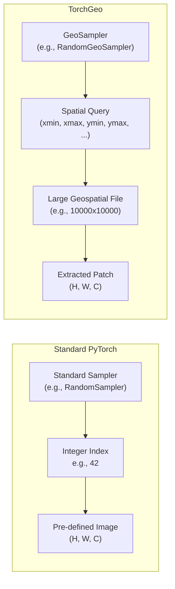
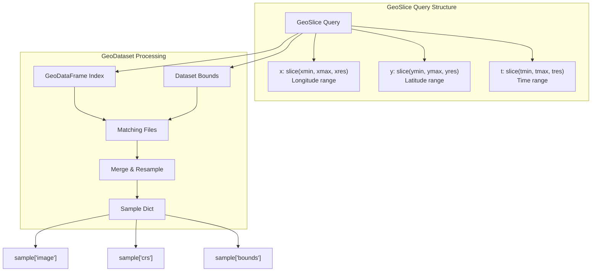
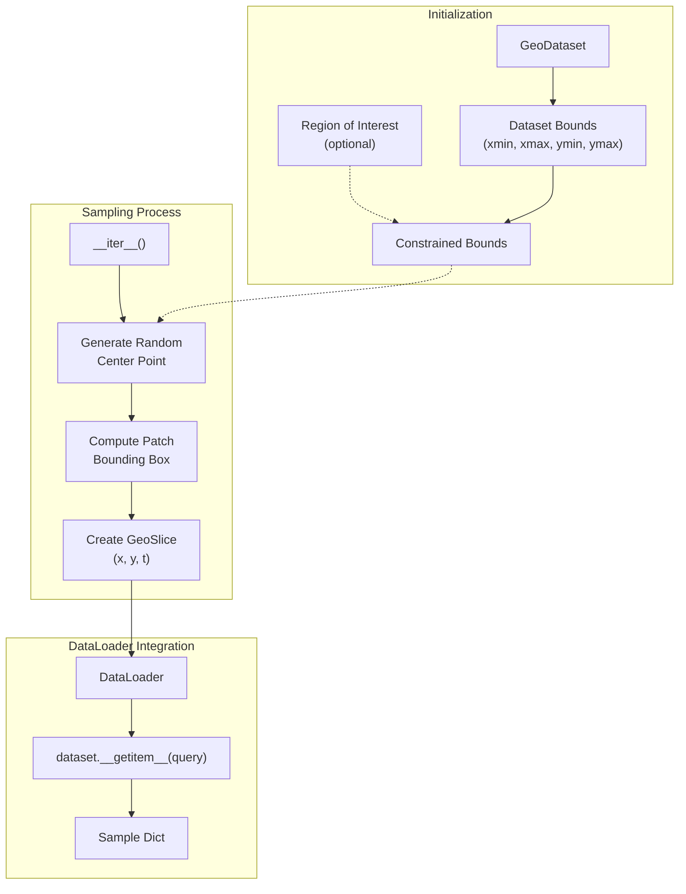
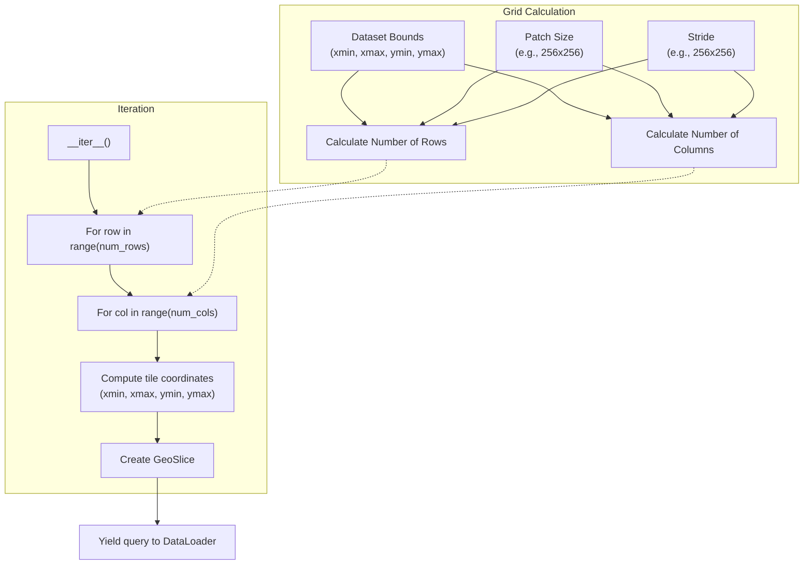
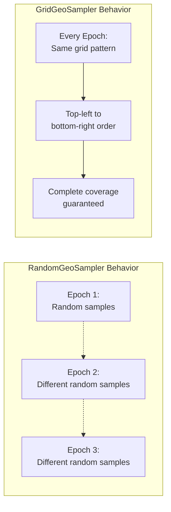
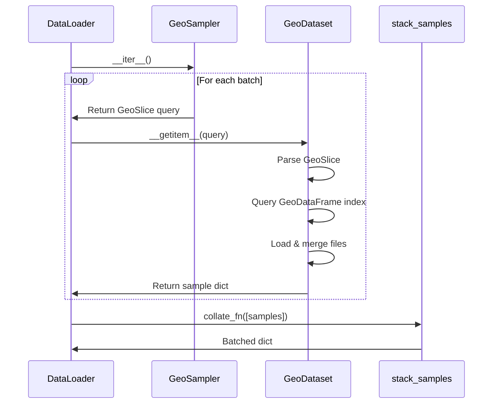
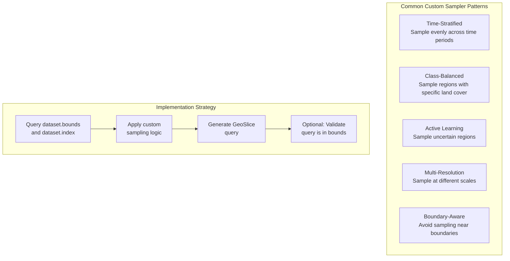

<!-- source: DeepWiki mcp.deepwiki.com · repo torchgeo/torchgeo · page 3.1 Samplers · fetched 2026-10-21 -->

# Samplers

<details>
<summary>Relevant source files</summary>

The following files were used as context for generating this wiki page:

- [docs/api/models/changestar.rst](docs/api/models/changestar.rst)
- [docs/api/models/convlstm.rst](docs/api/models/convlstm.rst)
- [requirements/style.txt](requirements/style.txt)
- [tests/data/copernicus/pretrain/data.py](tests/data/copernicus/pretrain/data.py)
- [tests/data/copernicus/pretrain/example-000000.tar](tests/data/copernicus/pretrain/example-000000.tar)
- [tests/data/naip/data.py](tests/data/naip/data.py)
- [tests/data/naip/m_3807511_ne_18_060_20181104.tif](tests/data/naip/m_3807511_ne_18_060_20181104.tif)
- [tests/data/naip/m_3807511_ne_18_060_20190605.tif](tests/data/naip/m_3807511_ne_18_060_20190605.tif)
- [tests/data/vector/data.py](tests/data/vector/data.py)
- [tests/data/vector/vector_2024.geojson](tests/data/vector/vector_2024.geojson)
- [tests/data/vector/vector_2024.parquet](tests/data/vector/vector_2024.parquet)
- [tests/datasets/test_geo.py](tests/datasets/test_geo.py)
- [tests/datasets/test_openstreetmap.py](tests/datasets/test_openstreetmap.py)
- [tests/datasets/test_utils.py](tests/datasets/test_utils.py)
- [torchgeo/datamodules/caffe.py](torchgeo/datamodules/caffe.py)
- [torchgeo/datasets/bright.py](torchgeo/datasets/bright.py)
- [torchgeo/datasets/cdl.py](torchgeo/datasets/cdl.py)
- [torchgeo/datasets/copernicus/pretrain.py](torchgeo/datasets/copernicus/pretrain.py)
- [torchgeo/datasets/cropharvest.py](torchgeo/datasets/cropharvest.py)
- [torchgeo/datasets/digital_typhoon.py](torchgeo/datasets/digital_typhoon.py)
- [torchgeo/datasets/everwatch.py](torchgeo/datasets/everwatch.py)
- [torchgeo/datasets/geo.py](torchgeo/datasets/geo.py)
- [torchgeo/datasets/landsat.py](torchgeo/datasets/landsat.py)
- [torchgeo/datasets/naip.py](torchgeo/datasets/naip.py)
- [torchgeo/datasets/openstreetmap.py](torchgeo/datasets/openstreetmap.py)
- [torchgeo/datasets/reforestree.py](torchgeo/datasets/reforestree.py)
- [torchgeo/datasets/sentinel.py](torchgeo/datasets/sentinel.py)
- [torchgeo/datasets/soda.py](torchgeo/datasets/soda.py)
- [torchgeo/datasets/splits.py](torchgeo/datasets/splits.py)
- [torchgeo/datasets/utils.py](torchgeo/datasets/utils.py)
- [torchgeo/models/copernicusfm.py](torchgeo/models/copernicusfm.py)
- [torchgeo/models/croma.py](torchgeo/models/croma.py)
- [torchgeo/models/fcsiam.py](torchgeo/models/fcsiam.py)
- [torchgeo/models/panopticon.py](torchgeo/models/panopticon.py)

</details>


## Purpose and Scope

Samplers in TorchGeo provide spatiotemporal sampling strategies for `GeoDataset` objects. Unlike standard PyTorch samplers that return integer indices, TorchGeo samplers generate coordinate-based queries that specify geographic regions and time intervals to sample from geospatial datasets.

This page covers:
- Coordinate-based sampling concepts for geospatial data
- Built-in sampler classes (`RandomGeoSampler`, `GridGeoSampler`)
- Integration with PyTorch `DataLoader`
- Custom sampler implementation patterns

For information about the datasets being sampled, see [Core Dataset Abstractions](#2.1). For data preprocessing and augmentation after sampling, see [Transforms and Augmentation](#3.2).

---

## Geospatial Sampling Concepts

Traditional computer vision datasets contain discrete, pre-defined images indexed by integers (0, 1, 2, ...). Geospatial datasets differ fundamentally: they contain continuous spatial coverage stored in large raster files that may cover entire continents. A single file from the Cropland Data Layer (CDL) dataset, for example, covers the entire continental United States.

**The Problem**: These files are too large to load entirely into memory, and you typically want to extract smaller patches for training neural networks.

**The Solution**: TorchGeo samplers generate spatial queries that extract patches on-the-fly from large geospatial files based on geographic coordinates rather than file indices.



**Sources**: [README.md:69-97](), [torchgeo/datasets/geo.py:50-223]()

---

## GeoSlice: Coordinate-Based Indexing

TorchGeo samplers generate queries using the `GeoSlice` type, which represents a spatiotemporal bounding box as Python slice objects:

```python
# GeoSlice structure: (x_slice, y_slice, time_slice)
query = (
    slice(xmin, xmax, xres),  # x: longitude range and resolution
    slice(ymin, ymax, yres),  # y: latitude range and resolution  
    slice(tmin, tmax, tres)   # t: time range and step
)
```

**Key Properties**:
- Coordinates are in the dataset's CRS (Coordinate Reference System)
- Resolution (step) parameters control output size
- Time uses `pd.Timestamp` objects for temporal queries
- Partial slices are supported (e.g., only specifying xmin)



**Type Definition**: The `GeoSlice` type alias represents valid query formats:
- `slice`: Single dimension (x only)
- `tuple[slice]`: Single dimension in tuple
- `tuple[slice, slice]`: Two dimensions (x, y)
- `tuple[slice, slice, slice]`: Three dimensions (x, y, t)

**Sources**: [torchgeo/datasets/utils.py:48-50](), [torchgeo/datasets/geo.py:116-157]()

---

## RandomGeoSampler

`RandomGeoSampler` generates random spatial patches from a `GeoDataset` by sampling uniformly from the dataset's spatial bounds.

### Usage Pattern

```python
from torch.utils.data import DataLoader
from torchgeo.datasets import Landsat8
from torchgeo.samplers import RandomGeoSampler
from torchgeo.datasets import stack_samples

# Create dataset
dataset = Landsat8(paths="data/")

# Create sampler: extract 256x256 pixel patches, 10000 samples per epoch
sampler = RandomGeoSampler(dataset, size=256, length=10000)

# Create dataloader
dataloader = DataLoader(
    dataset,
    batch_size=128,
    sampler=sampler,
    collate_fn=stack_samples
)

# Training loop
for batch in dataloader:
    image = batch['image']  # Shape: (128, C, 256, 256)
    # train model...
```

### Key Parameters

| Parameter | Type | Description |
|-----------|------|-------------|
| `dataset` | `GeoDataset` | Dataset to sample from |
| `size` | `int \| tuple[int, int]` | Patch size in pixels (height, width) or single value |
| `length` | `int` | Number of samples per epoch |
| `roi` | `Polygon \| None` | Optional region of interest to constrain sampling |
| `units` | `str` | Units for size: `"px"` (pixels) or `"crs"` (CRS units) |

### How It Works



**Random Sampling Strategy**:
1. For each iteration, generate random center coordinates (x, y) within bounds
2. Compute patch bounding box around center based on `size` parameter
3. Convert to `GeoSlice` query with appropriate resolution
4. Return query to `DataLoader`, which calls `dataset[query]`
5. Dataset extracts and returns the requested patch

**Sources**: [README.md:90-97](), [docs/tutorials/custom_raster_dataset.ipynb:129-135]()

---

## GridGeoSampler

`GridGeoSampler` provides systematic grid-based sampling, dividing the dataset's spatial extent into a regular grid of patches. This is useful for:
- **Inference**: Ensure complete coverage of a region
- **Validation**: Reproducible sampling without randomness
- **Mosaicking**: Extract tiles that can be stitched together

### Usage Pattern

```python
from torchgeo.samplers import GridGeoSampler

# Create sampler: divide dataset into 256x256 pixel tiles
sampler = GridGeoSampler(dataset, size=256, stride=256)

# For inference, often want no overlap
dataloader = DataLoader(
    dataset,
    batch_size=4,
    sampler=sampler,
    collate_fn=stack_samples
)

# Process entire dataset systematically
predictions = []
for batch in dataloader:
    pred = model(batch['image'])
    predictions.append(pred)
```

### Key Parameters

| Parameter | Type | Description |
|-----------|------|-------------|
| `dataset` | `GeoDataset` | Dataset to sample from |
| `size` | `int \| tuple[int, int]` | Patch size in pixels |
| `stride` | `int \| tuple[int, int]` | Step size between patches (overlap control) |
| `roi` | `Polygon \| None` | Optional region of interest |
| `units` | `str` | Units for size/stride: `"px"` or `"crs"` |

### Grid Generation Strategy



**Grid Layout Example**: For a dataset with bounds (0, 1000, 0, 1000) and size=256, stride=256:
- Creates a 4x4 grid (1000/256 ≈ 4 tiles per dimension)
- Tile 0: (0, 256, 0, 256)
- Tile 1: (256, 512, 0, 256)
- Tile 2: (512, 768, 0, 256)
- ...continues in row-major order

**Stride vs. Size**:
- `stride == size`: No overlap between patches (efficient, complete coverage)
- `stride < size`: Overlapping patches (useful for edge effects in predictions)
- `stride > size`: Gaps between patches (generally not recommended)

**Sources**: [README.md:90-97](), [torchgeo/datasets/geo.py:50-90]()

---

## Sampler Comparison

| Feature | RandomGeoSampler | GridGeoSampler |
|---------|------------------|----------------|
| **Sampling pattern** | Random locations | Systematic grid |
| **Coverage** | Probabilistic (may miss regions) | Guaranteed complete |
| **Determinism** | Non-deterministic | Deterministic |
| **Length** | User-specified (`length` parameter) | Computed from grid size |
| **Use case** | Training | Validation, inference |
| **Overlap control** | Random (uncontrolled) | Controlled via `stride` |



**Sources**: [README.md:90-97]()

---

## Integration with DataLoader

TorchGeo samplers integrate seamlessly with PyTorch's `DataLoader` but require special handling due to coordinate-based indexing.

### Sampler Flow in DataLoader



### Required Components

**1. Sampler**: Generates `GeoSlice` queries
```python
sampler = RandomGeoSampler(dataset, size=256, length=10000)
```

**2. Dataset**: Accepts `GeoSlice` in `__getitem__`
```python
# GeoDataset implements this interface
def __getitem__(self, query: GeoSlice) -> dict[str, Any]:
    # Returns: {'image': Tensor, 'crs': CRS, 'bounds': GeoSlice}
    ...
```

**3. Collate Function**: Combines samples into batches
- `stack_samples`: Stacks tensors along new batch dimension
- `concat_samples`: Concatenates tensors along channel dimension (for IntersectionDataset)
- `merge_samples`: Merges samples (for UnionDataset)

### Complete Example

```python
from torch.utils.data import DataLoader
from torchgeo.datasets import Landsat8, CDL, stack_samples
from torchgeo.samplers import RandomGeoSampler

# Create datasets
landsat = Landsat8(paths="data/landsat/")
cdl = CDL(paths="data/cdl/")

# Intersection: sample from regions with both Landsat and CDL
dataset = landsat & cdl

# Sampler configuration
sampler = RandomGeoSampler(
    dataset,
    size=256,      # 256x256 pixel patches
    length=10000   # 10000 samples per epoch
)

# DataLoader configuration
dataloader = DataLoader(
    dataset,
    batch_size=32,
    sampler=sampler,
    collate_fn=stack_samples,  # Required for batching
    num_workers=4
)

# Usage
for batch in dataloader:
    images = batch['image']  # Landsat data: (32, C_landsat, 256, 256)
    masks = batch['mask']    # CDL labels: (32, 256, 256)
    # Train model...
```

**Sources**: [README.md:77-105](), [torchgeo/datasets/utils.py:474-492]()

---

## Custom Samplers

You can implement custom sampling strategies by subclassing PyTorch's `Sampler` and yielding `GeoSlice` queries.

### Sampler Interface

```python
from torch.utils.data import Sampler
from torchgeo.datasets import GeoDataset
from torchgeo.datasets.utils import GeoSlice

class CustomGeoSampler(Sampler[GeoSlice]):
    def __init__(self, dataset: GeoDataset, **kwargs):
        self.dataset = dataset
        # Initialize sampling parameters
        
    def __iter__(self) -> Iterator[GeoSlice]:
        # Yield GeoSlice queries
        for _ in range(self.length):
            query = self._generate_query()
            yield query
            
    def __len__(self) -> int:
        return self.length
```

### Example: Time-Stratified Sampler

Sample evenly across temporal dimension:

```python
import pandas as pd
from typing import Iterator

class TimeStratifiedSampler(Sampler[GeoSlice]):
    """Sample patches evenly across time periods."""
    
    def __init__(
        self,
        dataset: GeoDataset,
        size: int,
        length: int,
        time_bins: int = 12  # Monthly bins
    ):
        self.dataset = dataset
        self.size = size
        self.length = length
        self.time_bins = time_bins
        
        # Get temporal bounds
        bounds = dataset.bounds
        self.tmin = bounds[2].start
        self.tmax = bounds[2].stop
        
        # Create time bins
        time_range = pd.date_range(
            self.tmin, self.tmax, periods=time_bins + 1
        )
        self.time_bins_list = [
            (time_range[i], time_range[i + 1])
            for i in range(len(time_range) - 1)
        ]
    
    def __iter__(self) -> Iterator[GeoSlice]:
        for _ in range(self.length):
            # Select random time bin
            tmin, tmax = random.choice(self.time_bins_list)
            
            # Generate random spatial coordinates
            bounds = self.dataset.bounds
            xmin = random.uniform(
                bounds[0].start,
                bounds[0].stop - self.size * bounds[0].step
            )
            ymin = random.uniform(
                bounds[1].start,
                bounds[1].stop - self.size * bounds[1].step
            )
            
            # Create query
            xres, yres = self.dataset.res
            query = (
                slice(xmin, xmin + self.size * xres, xres),
                slice(ymin, ymin + self.size * yres, yres),
                slice(tmin, tmax, 1)
            )
            yield query
    
    def __len__(self) -> int:
        return self.length
```

### Custom Sampler Patterns



**Key Considerations**:
1. **Bounds Checking**: Ensure generated queries are within `dataset.bounds`
2. **Resolution**: Use `dataset.res` for pixel-to-coordinate conversion
3. **Index Access**: Can query `dataset.index` (GeoDataFrame) for metadata-aware sampling
4. **Performance**: Avoid expensive operations in `__iter__` (called frequently)

**Sources**: [torchgeo/datasets/geo.py:50-223](), [torchgeo/datasets/utils.py:48-50]()

---

## Best Practices

### 1. Size and Resolution

Match sampler `size` to your model's input requirements:

```python
# For a model expecting 224x224 inputs
sampler = RandomGeoSampler(dataset, size=224, length=10000)

# Resolution is automatically determined from dataset.res
# Actual geographic size = 224 * dataset.res[0] meters (or CRS units)
```

### 2. Epoch Length

Choose `length` based on dataset size and training needs:

```python
# Rule of thumb: length should provide diverse samples
# For large datasets (continental scale):
sampler = RandomGeoSampler(dataset, size=256, length=10000)

# For smaller datasets (single region):
sampler = RandomGeoSampler(dataset, size=256, length=1000)

# For validation (use GridGeoSampler for determinism):
sampler = GridGeoSampler(dataset, size=256, stride=256)
```

### 3. Multi-Modal Sampling

When using `IntersectionDataset` (combining multiple datasets):

```python
# Both datasets must overlap spatially and temporally
landsat = Landsat8(paths="data/landsat/")
sentinel = Sentinel2(paths="data/sentinel/")

# Intersection ensures queries exist in both datasets
dataset = landsat & sentinel

# Sampler only generates queries in overlapping regions
sampler = RandomGeoSampler(dataset, size=256, length=5000)
```

### 4. ROI Constraints

Restrict sampling to specific geographic regions:

```python
from shapely.geometry import box

# Define region of interest (in dataset's CRS)
roi = box(minx, miny, maxx, maxy)

# Sampler only generates queries within ROI
sampler = RandomGeoSampler(
    dataset, 
    size=256, 
    length=5000,
    roi=roi
)
```

### 5. Memory Considerations

```python
# Large batch size * large patch size = high memory usage
# Example: 32 batches * 512x512 * 13 channels * 4 bytes/float32
# = 432 MB per batch

# Reduce memory by:
# 1. Smaller batch size
dataloader = DataLoader(dataset, batch_size=16, sampler=sampler)

# 2. Smaller patch size  
sampler = RandomGeoSampler(dataset, size=256, length=10000)

# 3. Fewer bands
dataset = Landsat8(bands=['SR_B4', 'SR_B3', 'SR_B2'])  # RGB only
```

### 6. Reproducibility

```python
import torch
import random
import numpy as np

# Set seeds for reproducibility
def set_seed(seed: int):
    torch.manual_seed(seed)
    random.seed(seed)
    np.random.seed(seed)

set_seed(42)

# RandomGeoSampler will produce same samples with same seed
sampler = RandomGeoSampler(dataset, size=256, length=10000)

# For validation, prefer deterministic GridGeoSampler
val_sampler = GridGeoSampler(dataset, size=256, stride=256)
```

**Sources**: [README.md:77-105](), [torchgeo/datasets/geo.py:50-223]()

---

## Summary

TorchGeo samplers provide coordinate-based sampling for geospatial datasets:

| Component | Purpose |
|-----------|---------|
| **GeoSlice** | Spatiotemporal query format using slice objects |
| **RandomGeoSampler** | Random spatial sampling for training |
| **GridGeoSampler** | Systematic grid sampling for inference |
| **Custom Samplers** | Domain-specific sampling strategies |
| **stack_samples** | Collate function for batching samples |

**Key Workflow**:
1. Create `GeoDataset` (e.g., `Landsat8`, `Sentinel2`)
2. Create sampler (`RandomGeoSampler` or `GridGeoSampler`)
3. Pass to `DataLoader` with `collate_fn=stack_samples`
4. Iterate to get batched samples for training

This architecture enables efficient training on large-scale geospatial data by extracting patches on-the-fly rather than pre-processing entire datasets.

**Sources**: [README.md:69-105](), [torchgeo/datasets/geo.py:1-309](), [torchgeo/datasets/utils.py:48-50](), [docs/tutorials/custom_raster_dataset.ipynb:129-180]()

---

