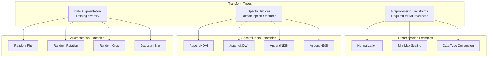
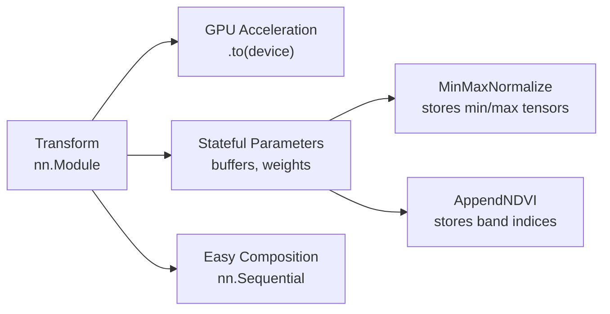
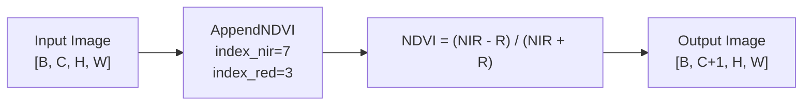
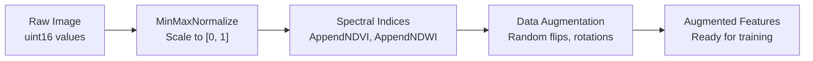
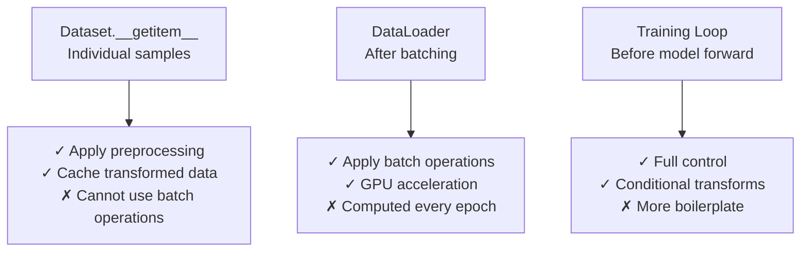
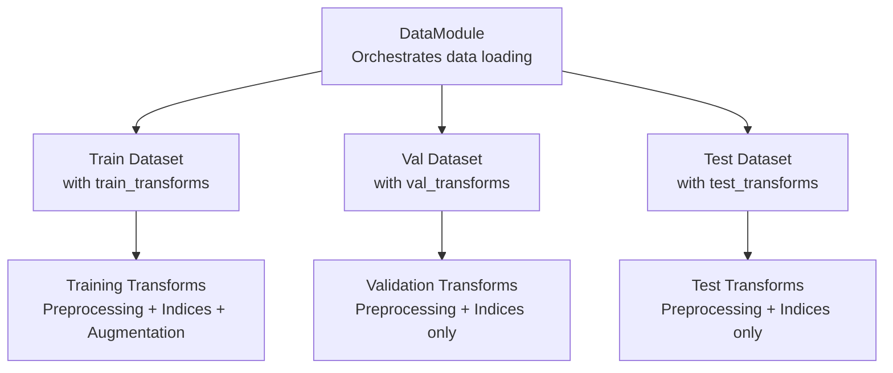

<!-- source: DeepWiki mcp.deepwiki.com · repo torchgeo/torchgeo · page 3.2 Transforms and Augmentation · fetched 2026-10-21 -->

# Transforms and Augmentation

<details>
<summary>Relevant source files</summary>

The following files were used as context for generating this wiki page:

- [docs/api/models/changestar.rst](docs/api/models/changestar.rst)
- [docs/api/models/convlstm.rst](docs/api/models/convlstm.rst)
- [docs/tutorials/basic_usage.rst](docs/tutorials/basic_usage.rst)
- [docs/tutorials/cli.ipynb](docs/tutorials/cli.ipynb)
- [docs/tutorials/custom_raster_dataset.ipynb](docs/tutorials/custom_raster_dataset.ipynb)
- [docs/tutorials/custom_segmentation_trainer.ipynb](docs/tutorials/custom_segmentation_trainer.ipynb)
- [docs/tutorials/earthquake_detection.ipynb](docs/tutorials/earthquake_detection.ipynb)
- [docs/tutorials/embeddings.ipynb](docs/tutorials/embeddings.ipynb)
- [docs/tutorials/indices.ipynb](docs/tutorials/indices.ipynb)
- [docs/tutorials/pretrained_weights.ipynb](docs/tutorials/pretrained_weights.ipynb)
- [docs/tutorials/pytorch.ipynb](docs/tutorials/pytorch.ipynb)
- [docs/tutorials/trainers.ipynb](docs/tutorials/trainers.ipynb)
- [docs/tutorials/transforms.ipynb](docs/tutorials/transforms.ipynb)
- [requirements/style.txt](requirements/style.txt)
- [tests/data/copernicus/pretrain/data.py](tests/data/copernicus/pretrain/data.py)
- [tests/data/copernicus/pretrain/example-000000.tar](tests/data/copernicus/pretrain/example-000000.tar)
- [tests/datasets/test_openstreetmap.py](tests/datasets/test_openstreetmap.py)
- [torchgeo/datamodules/caffe.py](torchgeo/datamodules/caffe.py)
- [torchgeo/datasets/bright.py](torchgeo/datasets/bright.py)
- [torchgeo/datasets/copernicus/pretrain.py](torchgeo/datasets/copernicus/pretrain.py)
- [torchgeo/datasets/cropharvest.py](torchgeo/datasets/cropharvest.py)
- [torchgeo/datasets/digital_typhoon.py](torchgeo/datasets/digital_typhoon.py)
- [torchgeo/datasets/everwatch.py](torchgeo/datasets/everwatch.py)
- [torchgeo/datasets/openstreetmap.py](torchgeo/datasets/openstreetmap.py)
- [torchgeo/datasets/reforestree.py](torchgeo/datasets/reforestree.py)
- [torchgeo/datasets/soda.py](torchgeo/datasets/soda.py)
- [torchgeo/datasets/splits.py](torchgeo/datasets/splits.py)
- [torchgeo/models/copernicusfm.py](torchgeo/models/copernicusfm.py)
- [torchgeo/models/croma.py](torchgeo/models/croma.py)
- [torchgeo/models/fcsiam.py](torchgeo/models/fcsiam.py)
- [torchgeo/models/panopticon.py](torchgeo/models/panopticon.py)

</details>


This page documents TorchGeo's data transformation and augmentation system, which provides preprocessing, spectral index computation, and data augmentation capabilities specifically designed for geospatial and multispectral imagery. For information about datasets and data loading, see [Dataset System](#2). For training workflows that use these transforms, see [Training System](#5).

---

## Overview

TorchGeo provides a comprehensive transform system built on PyTorch's `nn.Module` interface. Unlike standard computer vision transforms that operate on RGB images, TorchGeo's transforms are designed to handle:

- **Multispectral imagery** with arbitrary numbers of channels (3-369+ bands)
- **Dictionary-based samples** with keys like `"image"`, `"mask"`, `"label"`, `"bbox_xyxy"`
- **Both single samples and batched data** without code changes
- **GPU acceleration** for large-scale preprocessing operations
- **Geospatial-specific operations** such as spectral indices

The transform system is located in the `torchgeo.transforms` module and integrates seamlessly with external libraries like Kornia and torchvision.

Sources: [docs/tutorials/transforms.ipynb:36-39](), [docs/tutorials/transforms.ipynb:360-362](), [README.md:173-174]()

---

## Transform Categories



**Transform Categories in TorchGeo**

Transforms fall into three main categories, each serving a distinct purpose in the data pipeline:

| Category | Purpose | Applied To | Examples |
|----------|---------|------------|----------|
| Preprocessing | Normalize data for neural networks | Train + Val + Test | Scaling, normalization, type conversion |
| Spectral Indices | Compute domain-specific features | Train + Val + Test | NDVI, NDWI, NDBI, NDSI |
| Data Augmentation | Artificially increase dataset diversity | Train only | Random flips, rotations, crops |

Sources: [docs/tutorials/pytorch.ipynb:210-218](), [docs/tutorials/transforms.ipynb:351-362](), [docs/tutorials/indices.ipynb:31-35]()

---

## Transform API and Design

### Dictionary-Based Interface

TorchGeo transforms operate on dictionary samples with standard keys:

```python
sample = {
    'image': Tensor,      # Input imagery [C, H, W]
    'mask': Tensor,       # Ground truth labels [H, W] or [C, H, W]
    'label': Tensor,      # Class labels (for classification)
    'bbox_xyxy': Tensor,  # Bounding boxes (for detection)
}
```

Transforms modify the sample dictionary in-place and return it. This design allows transforms to simultaneously operate on multiple related tensors (e.g., applying the same random flip to both image and mask).

Sources: [docs/tutorials/custom_raster_dataset.ipynb:236-239](), [docs/tutorials/transforms.ipynb:119-120]()

### nn.Module Architecture

All TorchGeo transforms inherit from `nn.Module`, providing several advantages:



**nn.Module Design Benefits**

The module-based design enables:
- **GPU acceleration**: Push transforms and data to GPU for faster preprocessing
- **Stateful operations**: Store normalization statistics or band indices as module parameters
- **Composability**: Chain transforms using `nn.Sequential` or `K.AugmentationSequential`
- **Integration**: Work seamlessly with PyTorch training loops

Sources: [docs/tutorials/transforms.ipynb:490-493](), [docs/tutorials/transforms.ipynb:130-145]()

### Batch and Sample Operations

TorchGeo transforms work with both individual samples and batches without code changes:

```python
# Single sample: dict with tensors of shape [C, H, W]
sample = dataset[0]
transformed = transform(sample)

# Batch: dict with tensors of shape [B, C, H, W]
batch = next(dataloader)
transformed = transform(batch)
```

This flexibility allows transforms to be applied at different points in the pipeline—either in the dataset's `__getitem__` method or in the training loop.

Sources: [docs/tutorials/transforms.ipynb:360-362](), [docs/tutorials/transforms.ipynb:303-320]()

---

## Spectral Indices

Spectral indices are mathematical combinations of spectral bands that highlight specific phenomena like vegetation health, water content, or urban development. TorchGeo provides transforms that compute these indices and append them as additional channels.



**Spectral Index Transform Pipeline**

### Available Spectral Indices

| Transform | Formula | Purpose | Range |
|-----------|---------|---------|-------|
| `AppendNDVI` | (NIR - R) / (NIR + R) | Vegetation health | [-1, 1] |
| `AppendNDWI` | (G - NIR) / (G + NIR) | Water content | [-1, 1] |
| `AppendNDBI` | (SWIR - NIR) / (SWIR + NIR) | Built-up areas | [-1, 1] |
| `AppendNDSI` | (G - SWIR) / (G + SWIR) | Snow/ice detection | [-1, 1] |

Each transform appends the computed index to the channel dimension (dim=0 for unbatched, dim=1 for batched tensors).

Sources: [docs/tutorials/indices.ipynb:176-179](), [docs/tutorials/indices.ipynb:219-221](), [docs/tutorials/indices.ipynb:261-263]()

### Using Spectral Index Transforms

The spectral index transforms require band index arguments to identify which channels correspond to which spectral bands:

```python
# For Sentinel-2 imagery with 13 bands
# Band indices: 0=B01, 1=B02, 2=B03, 3=B04, ..., 7=B08, ..., 11=B11
transform = indices.AppendNDVI(index_nir=7, index_red=3)

# Input: [13, 64, 64]
batch = next(dataloader)
x = batch['image']  # shape: [B, 13, 64, 64]

# Apply transform
x = transform(x)  # shape: [B, 14, 64, 64]
```

Multiple indices can be chained to compute several features:

```python
transforms = nn.Sequential(
    indices.AppendNDBI(index_swir=11, index_nir=7),
    indices.AppendNDSI(index_green=3, index_swir=11),
    indices.AppendNDVI(index_nir=7, index_red=3),
    indices.AppendNDWI(index_green=2, index_nir=7),
)
# Input: [B, 13, H, W] → Output: [B, 17, H, W]
```

Sources: [docs/tutorials/transforms.ipynb:407-413](), [docs/tutorials/transforms.ipynb:433-446](), [docs/tutorials/indices.ipynb:190-202]()

### Spectral Index Values and Interpretation

Each spectral index produces values in the range [-1, 1]. The interpretation depends on the index:

- **NDVI (Vegetation)**: High values (>0.3) indicate healthy vegetation, low values (<0) indicate no vegetation
- **NDWI (Water)**: High values (>0.3) indicate water bodies, low values indicate land
- **NDBI (Built-up)**: High values indicate urban areas, low values indicate non-urban land
- **NDSI (Snow)**: High values indicate snow/ice, low values indicate snow-free surfaces

Sources: [docs/tutorials/indices.ipynb:176-179](), [docs/tutorials/indices.ipynb:219-221](), [docs/tutorials/indices.ipynb:261-263]()

---

## Data Augmentation

Data augmentation artificially increases dataset diversity during training by applying random transformations. TorchGeo primarily relies on the Kornia library for augmentation operations.

### Integration with Kornia

Kornia provides GPU-accelerated augmentation operations that work seamlessly with TorchGeo's dictionary-based interface:

```python
import kornia.augmentation as K

# Create augmentation pipeline
augment = K.AugmentationSequential(
    K.RandomHorizontalFlip(p=0.5),
    K.RandomVerticalFlip(p=0.5),
    K.RandomRotation(degrees=90, p=0.5),
    K.RandomGaussianBlur(kernel_size=(3, 3), sigma=(0.1, 2.0), p=0.25),
    data_keys=None,  # Required for dictionary input
)

# Apply to batch
batch = augment(batch)  # Transforms both 'image' and 'mask' consistently
```

**Important**: When using Kornia with dictionary inputs, set `data_keys=None` during pipeline creation.

Sources: [docs/tutorials/transforms.ipynb:456-483](), [docs/tutorials/earth_surface_water.ipynb:305-315]()

### Combining Preprocessing and Augmentation

A typical training pipeline combines preprocessing, spectral indices, and augmentation:



**Complete Transform Pipeline**

Example implementation:

```python
transforms = K.AugmentationSequential(
    MinMaxNormalize(mins, maxs),           # Preprocessing
    indices.AppendNDVI(index_nir=7, index_red=3),  # Feature engineering
    K.RandomHorizontalFlip(p=0.5),         # Augmentation
    K.RandomVerticalFlip(p=0.5),
    data_keys=None,
)
```

Sources: [docs/tutorials/transforms.ipynb:468-483](), [docs/tutorials/earth_surface_water.ipynb:305-326]()

---

## Custom Transform Implementation

Custom transforms should inherit from `K.IntensityAugmentationBase2D` for intensity-based operations or implement the transform interface directly:

```python
class MinMaxNormalize(K.IntensityAugmentationBase2D):
    """Normalize channels to [0, 1] using min/max values."""
    
    def __init__(self, mins: Tensor, maxs: Tensor) -> None:
        super().__init__(p=1)
        # Store normalization parameters as buffers
        self.flags = {
            'mins': mins.view(1, -1, 1, 1),
            'maxs': maxs.view(1, -1, 1, 1)
        }
    
    def apply_transform(
        self,
        input: Tensor,
        params: dict[str, Tensor],
        flags: dict[str, int],
        transform: Tensor | None = None,
    ) -> Tensor:
        return (input - flags['mins']) / (flags['maxs'] - flags['mins'] + 1e-10)
```

Key design considerations:
- **Inherit from appropriate base**: Use Kornia's base classes for integration
- **Store parameters as buffers**: Use `self.flags` or `self.register_buffer()` for stateful values
- **Handle batching**: Ensure shape broadcasting works for both [C, H, W] and [B, C, H, W]
- **GPU compatibility**: Use tensor operations that work on both CPU and GPU

Sources: [docs/tutorials/transforms.ipynb:130-145](), [docs/tutorials/earth_surface_water.ipynb:177-180]()

---

## Using Transforms in Datasets

Transforms can be applied in three locations in the data pipeline:



**Transform Application Points**

### In Dataset Constructor

Pass transforms to dataset constructors:

```python
train_dataset = EuroSAT100(
    root=root,
    split='train',
    transforms=transforms,  # Applied in __getitem__
    download=True
)
```

This applies transforms to individual samples before batching. Useful for preprocessing that can be cached.

Sources: [docs/tutorials/trainers.ipynb:148-152](), [docs/tutorials/earth_surface_water.ipynb:190-196]()

### In DataModule

DataModules encapsulate dataset creation and transform logic:

```python
class EuroSAT100DataModule(NonGeoDataModule):
    def setup(self, stage: str) -> None:
        if stage == 'fit':
            self.train_dataset = EuroSAT100(
                root=self.root,
                split='train',
                transforms=self.train_transforms,  # Training-specific
            )
            self.val_dataset = EuroSAT100(
                root=self.root,
                split='val',
                transforms=self.val_transforms,  # Validation-specific
            )
```

DataModules allow different transforms for train/val/test splits and handle augmentation logic separation.

Sources: [README.md:174-189](), [docs/tutorials/trainers.ipynb:148-152]()

### In Training Loop

For maximum control, apply transforms directly in the training loop:

```python
def train(dataloader):
    for batch in dataloader:
        x = batch['image'].to(device)
        y = batch['label'].to(device)
        x = preprocess(x)
        x = augment(x)  # Only during training
        
        y_hat = model(x)
        loss = loss_fn(y_hat, y)
```

This approach provides conditional transform application and fine-grained control.

Sources: [docs/tutorials/pytorch.ipynb:345-364]()

---

## GPU Acceleration

TorchGeo transforms are `nn.Module` instances and can be moved to GPU for significant performance gains on large batches:

```python
device = 'cuda' if torch.cuda.is_available() else 'cpu'

# Move transform to GPU
transforms_gpu = K.AugmentationSequential(
    MinMaxNormalize(mins.to(device), maxs.to(device)),
    indices.AppendNDVI(index_nir=7, index_red=3),
    K.RandomHorizontalFlip(p=0.5),
    data_keys=None,
).to(device)

# Move data to GPU
def get_batch_gpu():
    return dict(image=torch.randn(64, 13, 512, 512).to(device))

# Apply transforms on GPU
batch = get_batch_gpu()
batch = transforms_gpu(batch)  # Much faster than CPU
```

Benchmark results show significant speedups for large-scale operations, especially when combining multiple transforms and processing large batches.

Sources: [docs/tutorials/transforms.ipynb:516-580]()

---

## Integration with DataModules

The typical pattern for using transforms in TorchGeo follows this structure:



**DataModule Transform Organization**

Key principle: **Augmentation only during training, preprocessing everywhere**.

```python
# Preprocessing applied to all splits
preprocess = K.AugmentationSequential(
    MinMaxNormalize(mins, maxs),
    indices.AppendNDVI(index_nir=7, index_red=3),
    data_keys=None,
)

# Augmentation only for training
train_transforms = K.AugmentationSequential(
    MinMaxNormalize(mins, maxs),
    indices.AppendNDVI(index_nir=7, index_red=3),
    K.RandomHorizontalFlip(p=0.5),  # Augmentation
    K.RandomVerticalFlip(p=0.5),    # Augmentation
    data_keys=None,
)

datamodule = EuroSAT100DataModule(
    root=root,
    batch_size=batch_size,
    train_transforms=train_transforms,
    val_transforms=preprocess,
    test_transforms=preprocess,
)
```

Sources: [README.md:173-189](), [docs/tutorials/trainers.ipynb:148-152]()

---

## Best Practices

| Practice | Rationale |
|----------|-----------|
| Apply preprocessing to all splits | Ensures consistent data representation |
| Apply augmentation only to training split | Prevents data leakage and maintains valid evaluation |
| Use GPU transforms for large batches | Significant speedup for intensive operations |
| Chain transforms with `AugmentationSequential` | Ensures consistent random state across augmentations |
| Store normalization statistics in transform | Enables consistent preprocessing between train and inference |
| Set `data_keys=None` for Kornia with dictionaries | Required for proper dictionary handling |
| Append indices before augmentation | Augmentations apply to all channels including indices |

Sources: [docs/tutorials/transforms.ipynb:360-362](), [docs/tutorials/transforms.ipynb:456-483](), [docs/tutorials/pytorch.ipynb:210-229]()

---

## Additional Resources

For more information on preprocessing and augmentation:

- **Kornia documentation**: [kornia.readthedocs.io/augmentation](https://kornia.readthedocs.io/en/latest/augmentation.html)
- **torchvision transforms**: [pytorch.org/vision/transforms](https://pytorch.org/vision/main/transforms.html)
- **Spectral indices database**: [indexdatabase.de](https://www.indexdatabase.de/db/i.php)
- **Awesome Spectral Indices**: [github.com/awesome-spectral-indices](https://github.com/awesome-spectral-indices/awesome-spectral-indices)

Sources: [docs/tutorials/transforms.ipynb:634-640](), [docs/tutorials/indices.ipynb:32-35]()

---

