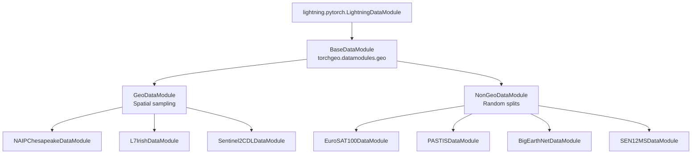
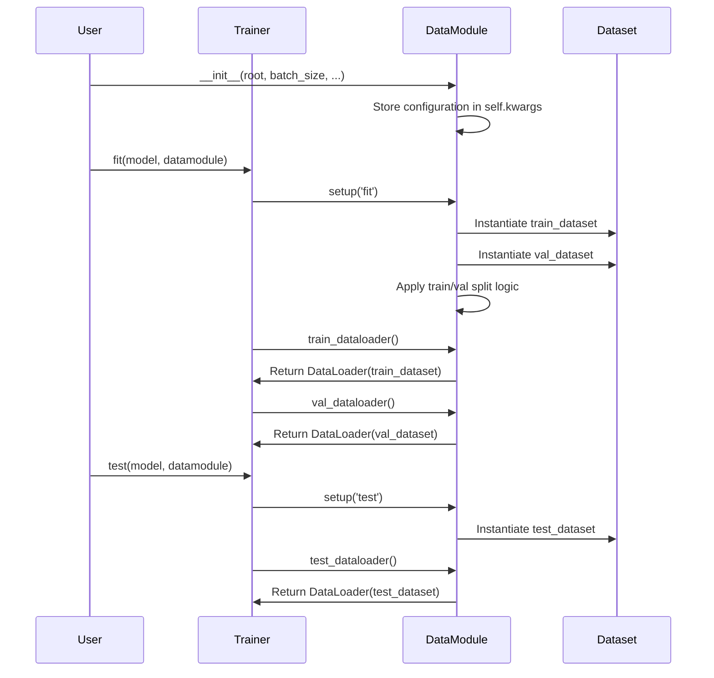
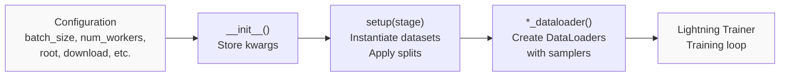

<!-- source: DeepWiki mcp.deepwiki.com · repo torchgeo/torchgeo · page 3.3 DataModules · fetched 2026-10-21 -->

# DataModules

<details>
<summary>Relevant source files</summary>

The following files were used as context for generating this wiki page:

- [docs/api/datamodules.rst](docs/api/datamodules.rst)
- [docs/api/datasets.rst](docs/api/datasets.rst)
- [docs/tutorials/basic_usage.rst](docs/tutorials/basic_usage.rst)
- [docs/tutorials/cli.ipynb](docs/tutorials/cli.ipynb)
- [docs/tutorials/custom_raster_dataset.ipynb](docs/tutorials/custom_raster_dataset.ipynb)
- [docs/tutorials/custom_segmentation_trainer.ipynb](docs/tutorials/custom_segmentation_trainer.ipynb)
- [docs/tutorials/earthquake_detection.ipynb](docs/tutorials/earthquake_detection.ipynb)
- [docs/tutorials/embeddings.ipynb](docs/tutorials/embeddings.ipynb)
- [docs/tutorials/indices.ipynb](docs/tutorials/indices.ipynb)
- [docs/tutorials/pretrained_weights.ipynb](docs/tutorials/pretrained_weights.ipynb)
- [docs/tutorials/pytorch.ipynb](docs/tutorials/pytorch.ipynb)
- [docs/tutorials/trainers.ipynb](docs/tutorials/trainers.ipynb)
- [docs/tutorials/transforms.ipynb](docs/tutorials/transforms.ipynb)
- [tests/data/deepglobelandcover/data.py](tests/data/deepglobelandcover/data.py)
- [tests/data/deepglobelandcover/data.zip](tests/data/deepglobelandcover/data.zip)
- [tests/datasets/test_deepglobelandcover.py](tests/datasets/test_deepglobelandcover.py)
- [tests/trainers/test_segmentation.py](tests/trainers/test_segmentation.py)
- [torchgeo/datamodules/__init__.py](torchgeo/datamodules/__init__.py)
- [torchgeo/datasets/__init__.py](torchgeo/datasets/__init__.py)
- [torchgeo/datasets/deepglobelandcover.py](torchgeo/datasets/deepglobelandcover.py)

</details>


DataModules are PyTorch Lightning components that encapsulate all data preparation logic for training workflows in TorchGeo. They handle dataset instantiation, train/val/test splitting, data loading, batching, and optional transforms in a reusable, configuration-driven way.

For information about the underlying datasets themselves, see [Dataset System](#2). For information about samplers used by GeoDataModules, see [Samplers](#3.1). For information about transforms applied by DataModules, see [Transforms and Augmentation](#3.2). For information about using DataModules in training workflows, see [Training System](#5).

## Purpose and Scope

DataModules serve as the data preparation layer in TorchGeo's training pipeline. They abstract away the complexity of:

* Dataset instantiation and configuration
* Train/validation/test split management
* DataLoader creation with appropriate batching strategies
* Transform and augmentation application
* Collation functions for heterogeneous data

This abstraction enables reproducible experiments and simplifies the interface between datasets and trainers.

---

## Architecture

DataModules in TorchGeo follow a hierarchical design built on PyTorch Lightning's `LightningDataModule` interface. The inheritance structure differentiates between geospatial and non-geospatial data requirements.

### Class Hierarchy



Sources: [torchgeo/datamodules/__init__.py:1-136](), [docs/api/datamodules.rst:1-318]()

### Base Classes

**BaseDataModule** ([torchgeo/datamodules/geo.py:40-140]())

The abstract base class that defines the common interface for all TorchGeo DataModules. Key responsibilities:

* Abstract methods: `setup()`, `train_dataloader()`, `val_dataloader()`, `test_dataloader()`
* Configuration storage: `batch_size`, `num_workers`
* Dataset instantiation via `self.kwargs`

**GeoDataModule** ([torchgeo/datamodules/geo.py:143-303]())

Specialized for geospatial datasets that inherit from `GeoDataset`. Uses spatial sampling strategies rather than random index-based splitting.

Key features:
* Requires `sampler` parameter (e.g., `RandomGeoSampler`, `GridGeoSampler`)
* Uses `BoundingBox` queries for spatial/temporal indexing
* Supports dataset intersection via `&` operator for multi-modal learning
* Collation via `stack_samples` function

**NonGeoDataModule** ([torchgeo/datamodules/geo.py:306-417]())

Specialized for pre-curated benchmark datasets that inherit from `NonGeoDataset`. Uses random or predefined train/val/test splits.

Key features:
* Supports `train_split`, `val_split`, `test_split` parameters (ratios or indices)
* Standard integer-based indexing
* Random splitting with reproducible seeds
* Collation via `torch.utils.data.default_collate`

---

## Using DataModules

### Basic Instantiation

DataModules are instantiated with dataset-specific parameters plus common configuration options:

```python
from torchgeo.datamodules import EuroSAT100DataModule

datamodule = EuroSAT100DataModule(
    root='/path/to/data',
    batch_size=32,
    num_workers=4,
    download=True
)
```

Sources: [docs/tutorials/trainers.ipynb:147-152]()

### Integration with Lightning Trainer

DataModules integrate seamlessly with PyTorch Lightning's training loop:

```python
from lightning.pytorch import Trainer
from torchgeo.trainers import ClassificationTask

task = ClassificationTask(model='resnet18', in_channels=13, num_classes=10)
trainer = Trainer(max_epochs=10)
trainer.fit(model=task, datamodule=datamodule)
```

The `Trainer.fit()` method automatically calls:
1. `datamodule.setup('fit')` - prepares train and val datasets
2. `datamodule.train_dataloader()` - creates training DataLoader
3. `datamodule.val_dataloader()` - creates validation DataLoader

Sources: [docs/tutorials/trainers.ipynb:271-272]()

### Lifecycle Methods



Sources: [torchgeo/datamodules/geo.py:40-417]()

---

## Available DataModules

TorchGeo provides DataModules for over 50 datasets. They are organized by type:

### Geospatial DataModules

DataModules that work with `GeoDataset` subclasses and use spatial sampling:

| DataModule | Dataset Type | Sampling Strategy | Use Case |
|------------|-------------|-------------------|----------|
| `NAIPChesapeakeDataModule` | Multi-dataset fusion | `RandomGeoSampler` | Semantic segmentation with aerial imagery and land cover |
| `L7IrishDataModule` | Landsat + labels | `RandomGeoSampler` | Cloud detection |
| `L8BiomeDataModule` | Landsat + labels | `RandomGeoSampler` | Biome classification |
| `Sentinel2CDLDataModule` | Sentinel-2 + CDL | `RandomGeoSampler` | Crop type mapping |
| `Sentinel2EuroCropsDataModule` | Sentinel-2 + EuroCrops | `RandomGeoSampler` | Crop type mapping (Europe) |
| `IOBenchDataModule` | Benchmark dataset | `GridGeoSampler` | I/O performance testing |

Sources: [docs/api/datamodules.rst:6-56]()

### Non-Geospatial DataModules

DataModules that work with `NonGeoDataset` subclasses and use random splitting:

| DataModule | Dataset | Task | # Classes | Image Size |
|------------|---------|------|-----------|------------|
| `EuroSAT100DataModule` | EuroSAT100 | Classification | 10 | 64×64 |
| `EuroSATDataModule` | EuroSAT | Classification | 10 | 64×64 |
| `BigEarthNetDataModule` | BigEarthNet | Multi-label classification | 19-43 | 120×120 |
| `SEN12MSDataModule` | SEN12MS | Semantic segmentation | 33 | 256×256 |
| `PASTISDataModule` | PASTIS | Instance segmentation | 19 | 128×128×T |
| `LandCoverAIDataModule` | LandCover.ai | Semantic segmentation | 5 | 512×512 |
| `DeepGlobeLandCoverDataModule` | DeepGlobe | Semantic segmentation | 7 | 2448×2448 |

Sources: [docs/api/datamodules.rst:57-295]()

---

## Key Components

### Train/Val/Test Splitting

**Non-Geo DataModules:**

Support multiple splitting strategies via constructor parameters:

```python
# Ratio-based splitting (sum must equal 1.0)
datamodule = EuroSATDataModule(
    root='data/',
    train_split=0.7,
    val_split=0.15,
    test_split=0.15
)

# Index-based splitting
datamodule = EuroSATDataModule(
    root='data/',
    train_split=[0, 1, 2, 3, 4],  # specific indices
    val_split=[5, 6],
    test_split=[7, 8]
)
```

Splits are applied in `setup()` using `torch.utils.data.random_split` with a fixed seed for reproducibility.

**Geo DataModules:**

Use spatial/temporal bounding boxes to define regions:

```python
from torchgeo.datasets import BoundingBox

datamodule = NAIPChesapeakeDataModule(
    naip_root='naip/',
    chesapeake_root='chesapeake/',
    sampler=RandomGeoSampler(roi=BoundingBox(...), size=256, length=100)
)
```

The sampler's region-of-interest (ROI) determines which spatial area is used for sampling.

Sources: [torchgeo/datamodules/geo.py:306-417](), [torchgeo/datamodules/pastis.py:59-75]()

### Batching and DataLoaders

DataModules create PyTorch `DataLoader` instances with appropriate configuration:

```python
def train_dataloader(self) -> DataLoader:
    return DataLoader(
        self.train_dataset,
        batch_size=self.batch_size,
        num_workers=self.num_workers,
        shuffle=True,  # or sampler for GeoDataModule
        collate_fn=self.collate_fn
    )
```

Key parameters:
* `batch_size`: Number of samples per batch
* `num_workers`: Parallel workers for data loading
* `shuffle`: Random ordering (NonGeo) or sampler (Geo)
* `collate_fn`: Custom collation for heterogeneous data

Sources: [torchgeo/datamodules/geo.py:367-378]()

### Transforms and Augmentation

DataModules can apply transforms to samples. Transforms are typically stored as instance variables and applied during dataset instantiation:

```python
class PASTISDataModule(NonGeoDataModule):
    def __init__(self, **kwargs):
        super().__init__(PASTIS, **kwargs)
        self.aug = K.AugmentationSequential(
            K.VideoSequential(K.Normalize(mean=self.mean, std=self.std)),
            data_keys=None,
        )
    
    def setup(self, stage):
        self.train_dataset = PASTIS(**self.kwargs, transforms=self.aug)
        self.val_dataset = PASTIS(**self.kwargs)
```

Common pattern: apply augmentation to training data only, preprocessing to all splits.

Sources: [torchgeo/datamodules/pastis.py:53-75]()

### Collation Functions

**Standard Collation:**

Most NonGeo DataModules use PyTorch's default collation:

```python
from torch.utils.data import default_collate

dataloader = DataLoader(dataset, collate_fn=default_collate)
```

**Spatial Collation:**

Geo DataModules use `stack_samples` to merge spatially adjacent samples:

```python
from torchgeo.datasets import stack_samples

dataloader = DataLoader(dataset, collate_fn=stack_samples)
```

This function stacks image tensors and merges bounding boxes.

**Custom Collation:**

Time-series datasets may require padding to handle variable sequence lengths:

```python
from torchgeo.datasets.utils import pad_across_batches

def collate_fn(batch):
    return pad_across_batches(batch, padding_length=61)
```

Sources: [torchgeo/datamodules/pastis.py:43-49](), [torchgeo/datasets/__init__.py:171-177]()

---

## DataModule Configuration Flow



Sources: [torchgeo/datamodules/geo.py:40-417]()

---

## GeoDataModule vs NonGeoDataModule

### Comparison Table

| Feature | GeoDataModule | NonGeoDataModule |
|---------|---------------|------------------|
| **Base Dataset** | `GeoDataset` | `NonGeoDataset` |
| **Indexing** | Spatiotemporal bounding boxes | Integer indices |
| **Splitting** | Spatial regions (via samplers) | Random or predefined splits |
| **Sampling** | `RandomGeoSampler`, `GridGeoSampler` | Random shuffle or sequential |
| **Multi-modal** | Dataset intersection (`&` operator) | Single dataset or concatenation |
| **Collation** | `stack_samples` | `default_collate` |
| **Use Cases** | Raw satellite imagery, custom AOIs | Benchmark datasets, pre-curated patches |

### Example: GeoDataModule with Multi-Modal Fusion

```python
from torchgeo.datamodules import NAIPChesapeakeDataModule
from torchgeo.samplers import RandomGeoSampler

# Fuses NAIP aerial imagery with Chesapeake land cover
datamodule = NAIPChesapeakeDataModule(
    naip_root='naip/',
    chesapeake_root='chesapeake/',
    sampler=RandomGeoSampler(dataset, size=256, length=1000),
    batch_size=32
)
```

The DataModule internally uses `naip_dataset & chesapeake_dataset` to create an `IntersectionDataset` that spatially aligns the two data sources.

Sources: [docs/api/datamodules.rst:34-37]()

### Example: NonGeoDataModule with Random Splits

```python
from torchgeo.datamodules import EuroSAT100DataModule

# Pre-curated dataset with predefined splits
datamodule = EuroSAT100DataModule(
    root='eurosat/',
    batch_size=32,
    val_split_pct=0.2,  # 20% validation
    test_split_pct=0.2  # 20% test
)
```

Sources: [docs/tutorials/trainers.ipynb:147-152]()

---

## Advanced Usage

### Custom Sampling Strategies

GeoDataModules accept any sampler implementing the sampling protocol:

```python
from torchgeo.samplers import RandomGeoSampler, Units

sampler = RandomGeoSampler(
    dataset,
    size=256,           # patch size in pixels
    length=10000,       # number of samples per epoch
    roi=BoundingBox(minx=-100, maxx=-90, miny=30, maxy=40, 
                    mint=0, maxt=100),  # spatial-temporal bounds
    units=Units.EPSG4326
)

datamodule = CustomGeoDataModule(
    root='data/',
    sampler=sampler,
    batch_size=16
)
```

Sources: [docs/tutorials/custom_raster_dataset.ipynb:377-380]()

### Plotting Samples

Many DataModules include a `plot()` method for visualization:

```python
datamodule.setup('fit')
sample = datamodule.val_dataset[0]
datamodule.plot(sample)
```

This is useful for debugging and understanding data distributions.

Sources: [docs/tutorials/earthquake_detection.ipynb:188-192]()

### Accessing Statistics

Some DataModules expose dataset statistics as properties:

```python
datamodule = PASTISDataModule(root='data/')
print(datamodule.mean)  # Per-channel mean
print(datamodule.std)   # Per-channel std
```

These can be used for normalization or custom preprocessing.

Sources: [torchgeo/datamodules/pastis.py:53-57]()

---

## Creating Custom DataModules

To create a custom DataModule, subclass either `GeoDataModule` or `NonGeoDataModule`:

**For Non-Geo Datasets:**

```python
from torchgeo.datamodules import NonGeoDataModule
from torchgeo.datasets import CustomDataset

class CustomDataModule(NonGeoDataModule):
    def __init__(self, batch_size=32, num_workers=4, **kwargs):
        super().__init__(
            CustomDataset, 
            batch_size=batch_size, 
            num_workers=num_workers,
            **kwargs
        )
```

**For Geo Datasets:**

```python
from torchgeo.datamodules import GeoDataModule
from torchgeo.datasets import CustomGeoDataset

class CustomGeoDataModule(GeoDataModule):
    def __init__(self, sampler, batch_size=32, num_workers=4, **kwargs):
        super().__init__(
            CustomGeoDataset,
            batch_size=batch_size,
            num_workers=num_workers,
            sampler=sampler,
            **kwargs
        )
```

See [Creating Custom Tasks](#5.4) for more advanced customization patterns.

Sources: [torchgeo/datamodules/geo.py:40-417]()

---

## Common Patterns

### Pattern 1: Download and Use

```python
datamodule = EuroSAT100DataModule(
    root='data/',
    batch_size=32,
    download=True  # Automatically download if not present
)
```

### Pattern 2: Multi-Sensor Fusion

```python
# Combines Sentinel-2 imagery with Cropland Data Layer labels
datamodule = Sentinel2CDLDataModule(
    sentinel2_root='s2/',
    cdl_root='cdl/',
    sampler=sampler,
    batch_size=16
)
```

### Pattern 3: Time-Series with Padding

```python
datamodule = PASTISDataModule(
    root='data/',
    batch_size=8,
    padding_length=61,  # Pad sequences to this length
    collate_fn=lambda batch: pad_across_batches(batch, 61)
)
```

Sources: [torchgeo/datamodules/pastis.py:23-49](), [docs/api/datamodules.rst:34-50]()

---

## Error Handling

DataModules raise specific exceptions for common issues:

**MisconfigurationException** ([torchgeo/datamodules/utils.py]())

Raised when DataModule configuration is invalid:
* Missing required datasets
* Invalid split ratios
* Incompatible sampler/dataset combinations

```python
try:
    trainer.fit(model, datamodule)
except MisconfigurationException as e:
    print(f"Configuration error: {e}")
```

**DatasetNotFoundError**

Raised when dataset files are missing and `download=False`:

```python
datamodule = EuroSAT100DataModule(
    root='nonexistent/',
    download=False  # Will raise DatasetNotFoundError
)
```

Sources: [docs/api/datamodules.rst:314-318](), [tests/trainers/test_segmentation.py:124-129]()

---

## Summary

DataModules in TorchGeo provide a standardized interface for data preparation in training workflows. Key takeaways:

1. **Abstraction**: Encapsulate dataset instantiation, splitting, batching, and transforms
2. **Two Types**: `GeoDataModule` for spatial sampling, `NonGeoDataModule` for random splits
3. **Lightning Integration**: Seamless compatibility with PyTorch Lightning training loops
4. **Rich Ecosystem**: 50+ built-in DataModules for common datasets
5. **Extensible**: Easy to create custom DataModules for new datasets

For training workflows using DataModules, see [Training Workflows](#5.5). For detailed dataset documentation, see [Dataset Catalog](#2.2).

Sources: [torchgeo/datamodules/__init__.py:1-136](), [docs/api/datamodules.rst:1-318](), [docs/tutorials/trainers.ipynb:99-152]()

---

