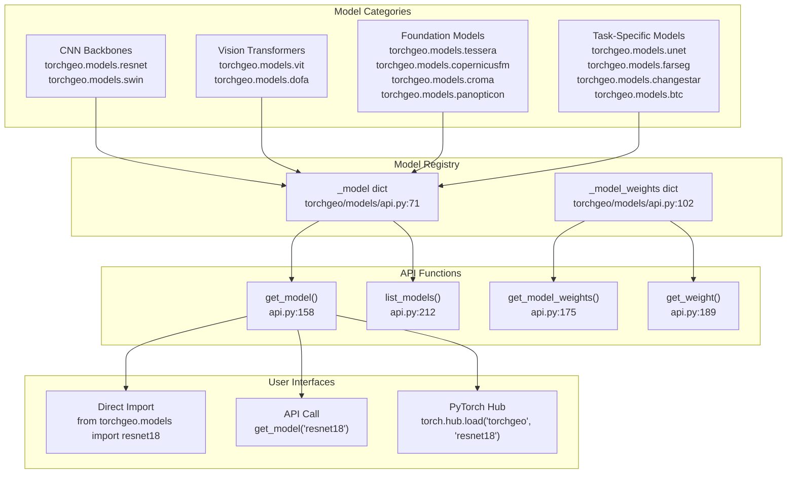
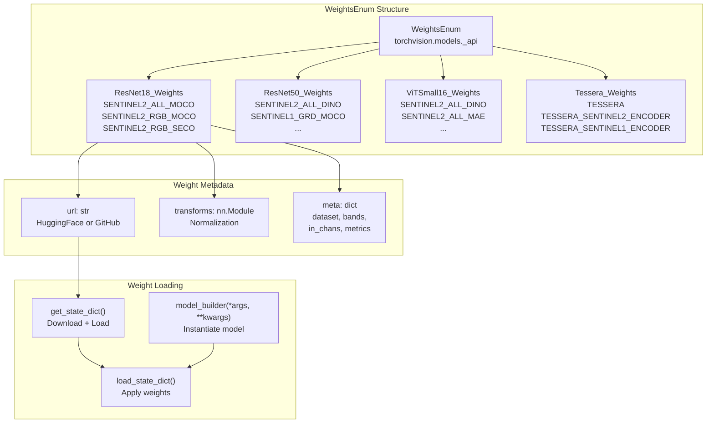
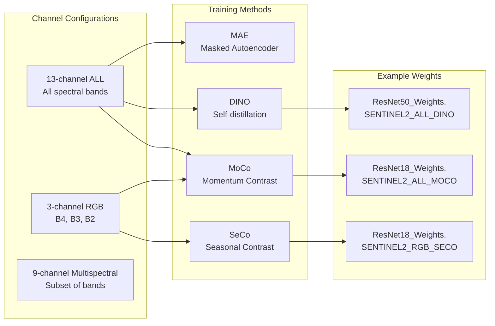
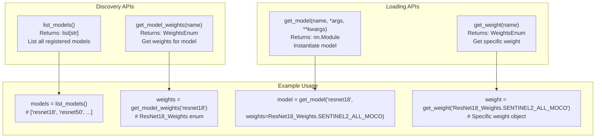
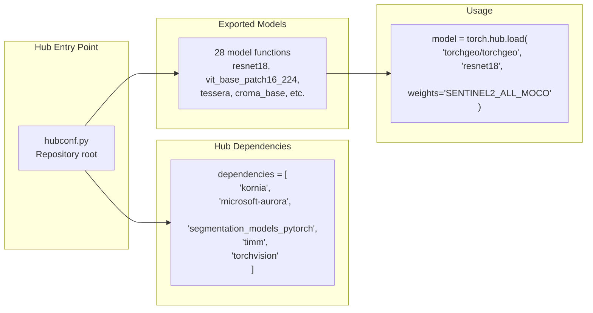
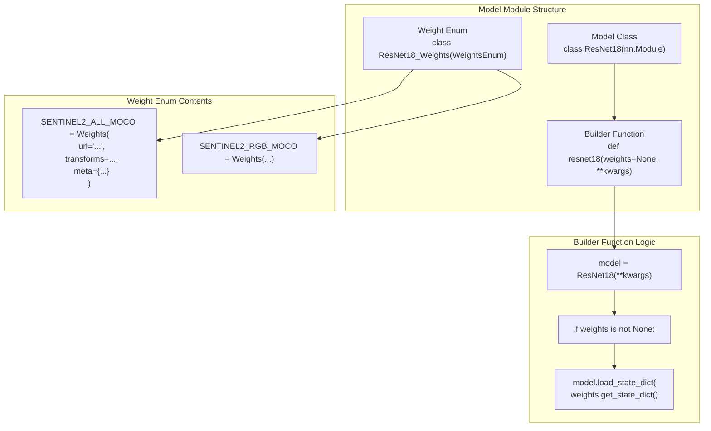
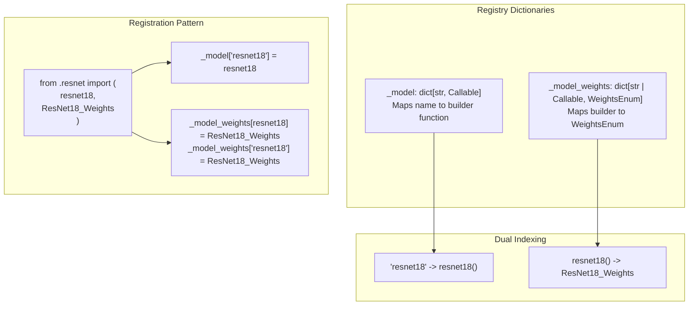

<!-- source: DeepWiki mcp.deepwiki.com · repo torchgeo/torchgeo · page 4 Models and Pre-trained Weights · fetched 2026-10-21 -->

# Models and Pre-trained Weights

<details>
<summary>Relevant source files</summary>

The following files were used as context for generating this wiki page:

- [docs/api/models.rst](docs/api/models.rst)
- [docs/api/models/tessera.rst](docs/api/models/tessera.rst)
- [docs/api/weights/agnostic.csv](docs/api/weights/agnostic.csv)
- [docs/api/weights/sentinel1.csv](docs/api/weights/sentinel1.csv)
- [docs/api/weights/sentinel2.csv](docs/api/weights/sentinel2.csv)
- [hubconf.py](hubconf.py)
- [requirements/models.txt](requirements/models.txt)
- [tests/models/test_api.py](tests/models/test_api.py)
- [torchgeo/models/__init__.py](torchgeo/models/__init__.py)
- [torchgeo/models/api.py](torchgeo/models/api.py)
- [torchgeo/models/tessera.py](torchgeo/models/tessera.py)

</details>


This document covers TorchGeo's model ecosystem, which provides 50+ model architectures and 100+ pre-trained weight sets for geospatial machine learning. The models span CNN backbones, vision transformers, task-specific architectures, and foundation models. Pre-trained weights are organized by sensor type (Sentinel-1/2, Landsat, NAIP, sensor-agnostic) to facilitate transfer learning from satellite imagery.

For information about training these models, see [Training System](#5). For details on model architectures used in specific tasks, see [Task Architecture](#5.1). For foundation model implementations specifically, see [Foundation Models](#4.4).

## Model Architecture Organization

TorchGeo's model zoo is organized into four primary categories based on architecture type and intended use. All models are accessible through a unified API that follows the torchvision design pattern.



**Sources:** [torchgeo/models/__init__.py:1-152](), [torchgeo/models/api.py:1-221](), [hubconf.py:1-79]()

### Model Categories

| Category | Models | Primary Use Case | Example Architectures |
|----------|--------|------------------|----------------------|
| **CNN Backbones** | ResNet-18/50/152, Swin Transformer variants | Feature extraction, classification | [torchgeo/models/resnet.py](), [torchgeo/models/swin.py]() |
| **Vision Transformers** | ViT (Small/Base/Large/Huge), DINOv2, ScaleMAE | Self-supervised learning, large-scale pretraining | [torchgeo/models/vit.py](), [torchgeo/models/scale_mae.py]() |
| **Foundation Models** | Tessera, CROMA, CopernicusFM, DOFA, Panopticon | Multi-modal, sensor-agnostic, time-series | [torchgeo/models/tessera.py](), [torchgeo/models/dofa.py]() |
| **Task-Specific** | U-Net, FarSeg, ChangeStar, ChangeViT, BTC | Segmentation, change detection | [torchgeo/models/unet.py](), [torchgeo/models/changestar.py]() |

**Sources:** [torchgeo/models/__init__.py:1-152](), [docs/api/models.rst:1-125]()

## Pre-trained Weights System

TorchGeo implements a type-safe weight management system based on the `WeightsEnum` pattern from torchvision. Each model architecture has an associated `WeightsEnum` class containing one or more pre-trained weight sets with metadata about sensor type, input channels, training dataset, and performance metrics.



**Sources:** [torchgeo/models/api.py:102-155](), [torchgeo/models/resnet.py](), [torchgeo/models/tessera.py:290-361]()

### WeightsEnum Pattern

Each weight enum entry contains:

1. **URL**: Download location for pre-trained checkpoint (typically HuggingFace or GitHub)
2. **Transforms**: Pre-configured normalization transforms matching training statistics
3. **Metadata**: Dictionary with keys:
   - `dataset`: Training dataset name
   - `publication`: ArXiv or paper link
   - `repo`: Source code repository
   - `bands`: List of spectral bands (e.g., `['B2', 'B3', 'B4']`)
   - `in_chans`: Number of input channels
   - Performance metrics for benchmark datasets (e.g., `BigEarthNet`, `EuroSAT`)

**Sources:** [torchgeo/models/tessera.py:290-361](), [docs/api/weights/sentinel2.csv:1-54]()

## Weight Organization by Sensor Type

Pre-trained weights are categorized by the sensor/satellite they were trained on, enabling users to select weights matching their data source. This sensor-aware organization is critical for transfer learning effectiveness.

### Sensor-Agnostic Weights

These weights can be used with imagery from any satellite/sensor. Many support dynamic spatial, temporal, or spectral domains through their architecture or training data.

| Weight | Spatial | Temporal | Spectral | Key Feature |
|--------|---------|----------|----------|-------------|
| `CopernicusFM_Base_Weights.CopernicusFM_ViT` | explicit | explicit | explicit | Multi-modal foundation model |
| `CROMABase_Weights.CROMA_VIT` | implicit | - | implicit | Cross-modal alignment |
| `DOFABase16_Weights.DOFA_MAE` | implicit | - | explicit | Dynamic spectral support |
| `Panopticon_Weights.VIT_BASE14` | implicit | - | explicit | Sensor-agnostic pre-training |
| `Tessera_Weights.TESSERA` | - | explicit | - | Time-series foundation model |

**Notes:**
- **explicit**: Support built into model architecture (e.g., positional encodings for resolution)
- **implicit**: Support from training data diversity (e.g., multiple resolutions in dataset)

**Sources:** [docs/api/weights/agnostic.csv:1-11]()

### Sentinel-2 Weights

Sentinel-2 is the most extensively supported sensor with weights spanning multiple training methods and channel configurations.



**Sources:** [docs/api/weights/sentinel2.csv:1-54]()

#### Sentinel-2 Weight Table (Selected)

| Weight | Channels | Method | BigEarthNet | EuroSAT | So2Sat |
|--------|----------|--------|-------------|---------|--------|
| `ResNet50_Weights.SENTINEL2_ALL_DINO` | 13 | DINO | 90.7 | 99.1 | 63.6 |
| `ResNet50_Weights.SENTINEL2_ALL_MOCO` | 13 | MoCo | 91.8 | 99.1 | 60.9 |
| `ViTSmall16_Weights.SENTINEL2_ALL_DINO` | 13 | DINO | 90.5 | 99.0 | 62.2 |
| `ViTBase16_Weights.SENTINEL2_ALL_MAE` | 13 | MAE | - | - | - |
| `ResNet18_Weights.SENTINEL2_RGB_SECO` | 3 | SeCo | 87.27 | 93.14 | - |

**Sources:** [docs/api/weights/sentinel2.csv:1-54]()

### Sentinel-1 Weights

Sentinel-1 SAR imagery weights primarily use 2-channel (VV, VH polarizations) or 3-channel (VV, VH, DOY) configurations.

| Weight | Channels | Method | Description |
|--------|----------|--------|-------------|
| `ResNet50_Weights.SENTINEL1_GRD_MOCO` | 2 | MoCo | Ground Range Detected product |
| `ViTSmall16_Weights.SENTINEL1_GRD_MAE` | 2 | MAE | Masked autoencoder pre-training |
| `Tessera_Weights.TESSERA_SENTINEL1_ENCODER` | 3 | Supervised | Time-series encoder with DOY |

**Sources:** [docs/api/weights/sentinel1.csv:1-22]()

### Landsat and NAIP Weights

Landsat and NAIP weights are less common but available for specific use cases. Most weights target supervised learning tasks rather than self-supervised pre-training.

**Sources:** [docs/api/weights/landsat.csv](), [docs/api/weights/naip.csv]()

## Model and Weight APIs

TorchGeo provides four primary functions for programmatic model and weight discovery, following the torchvision API design.

### API Function Overview



**Sources:** [torchgeo/models/api.py:158-221]()

### Function Signatures

#### `get_model(name, *args, **kwargs)`

Instantiates a model by name from the model registry.

```python
# Example: Load ResNet-18 with Sentinel-2 pre-trained weights
from torchgeo.models import get_model, ResNet18_Weights

model = get_model(
    'resnet18',
    weights=ResNet18_Weights.SENTINEL2_ALL_MOCO,
    in_chans=13
)
```

**Location:** [torchgeo/models/api.py:158-172]()

#### `get_model_weights(name)`

Returns the `WeightsEnum` class associated with a model builder function or name.

```python
# Example: Discover available weights for a model
from torchgeo.models import get_model_weights

weights_enum = get_model_weights('resnet18')
# Returns: ResNet18_Weights enum class

for weight in weights_enum:
    print(weight, weight.meta['dataset'])
```

**Location:** [torchgeo/models/api.py:175-186]()

#### `get_weight(name)`

Returns a specific weight enum value by its fully qualified name.

```python
# Example: Load a specific weight by string name
from torchgeo.models import get_weight

weight = get_weight('ResNet18_Weights.SENTINEL2_ALL_MOCO')
transforms = weight.transforms
state_dict = weight.get_state_dict(progress=True)
```

**Location:** [torchgeo/models/api.py:189-209]()

#### `list_models()`

Returns a list of all registered model names.

```python
# Example: List all available models
from torchgeo.models import list_models

models = list_models()
# Returns: ['resnet18', 'resnet50', 'vit_base_patch16_224', ...]
```

**Location:** [torchgeo/models/api.py:212-220]()

**Sources:** [torchgeo/models/api.py:158-221](), [tests/models/test_api.py:1-167]()

## PyTorch Hub Integration

All models with pre-trained weights are accessible through PyTorch Hub, providing a standardized interface for model loading without requiring TorchGeo installation.



**Sources:** [hubconf.py:1-79]()

### Hub Loading Example

```python
import torch

# Load model from PyTorch Hub
model = torch.hub.load(
    'torchgeo/torchgeo',
    'resnet18',
    weights='SENTINEL2_ALL_MOCO'
)

# List available models
torch.hub.list('torchgeo/torchgeo')
```

Hub loading automatically installs required dependencies specified in [hubconf.py:72-78]().

**Sources:** [hubconf.py:1-79]()

## Model Implementation Patterns

### Standard Model Implementation

Most models follow a consistent pattern with a model class, weight enum, and builder function.



**Sources:** [torchgeo/models/resnet.py](), [torchgeo/models/vit.py]()

### Foundation Model Pattern

Foundation models like Tessera support multiple weight variants (full model, encoder-only) and handle loading differently.

```python
# Example from Tessera implementation
def tessera(weights=None, *args, **kwargs):
    model = Tessera(*args, **kwargs)
    
    if weights is None:
        return model
    
    if weights == Tessera_Weights.TESSERA:
        # Load full model
        model.load_state_dict(weights.get_state_dict(progress=True))
        return model
    elif weights == Tessera_Weights.TESSERA_SENTINEL2_ENCODER:
        # Load encoder only
        model.s2_backbone.load_state_dict(weights.get_state_dict(progress=True))
        return model.s2_backbone
    # ...
```

**Location:** [torchgeo/models/tessera.py:363-403]()

**Sources:** [torchgeo/models/tessera.py:1-404]()

## Usage Patterns

### Loading Pre-trained Models

Three common patterns for loading pre-trained models:

```python
# Pattern 1: Direct import with weight enum
from torchgeo.models import resnet18, ResNet18_Weights

model = resnet18(weights=ResNet18_Weights.SENTINEL2_ALL_MOCO)

# Pattern 2: Using get_model API
from torchgeo.models import get_model, get_weight

weight = get_weight('ResNet18_Weights.SENTINEL2_ALL_MOCO')
model = get_model('resnet18', weights=weight)

# Pattern 3: PyTorch Hub
import torch
model = torch.hub.load('torchgeo/torchgeo', 'resnet18', 
                       weights='SENTINEL2_ALL_MOCO')
```

### Accessing Transforms and Metadata

Each weight includes pre-configured transforms and metadata:

```python
from torchgeo.models import ResNet18_Weights

weight = ResNet18_Weights.SENTINEL2_ALL_MOCO

# Access normalization transforms
transforms = weight.transforms  # Returns nn.Module with normalization

# Access metadata
dataset = weight.meta['dataset']  # Training dataset
bands = weight.meta['bands']      # List of spectral bands
in_chans = weight.meta['in_chans']  # Number of input channels
```

### Multi-Weight Selection

Some models have 20+ weight variants. Use metadata filtering to select appropriate weights:

```python
from torchgeo.models import ResNet50_Weights

# Find all Sentinel-2 13-channel weights
sentinel2_13ch = [
    w for w in ResNet50_Weights 
    if 'SENTINEL2_ALL' in w.name
]

# Find weights with performance metrics
best_weights = sorted(
    [w for w in ResNet50_Weights if 'BigEarthNet' in w.meta],
    key=lambda w: w.meta.get('BigEarthNet', 0),
    reverse=True
)[0]
```

**Sources:** [docs/api/weights/sentinel2.csv:1-54](), [torchgeo/models/api.py:1-221]()

## Model Registry Implementation

The model registry uses two dictionaries mapping model names and builder functions to their respective enums.



The dual indexing in `_model_weights` [torchgeo/models/api.py:102-155]() allows querying by either function reference or string name, supporting both programmatic and interactive use cases.

**Sources:** [torchgeo/models/api.py:71-155]()

---

