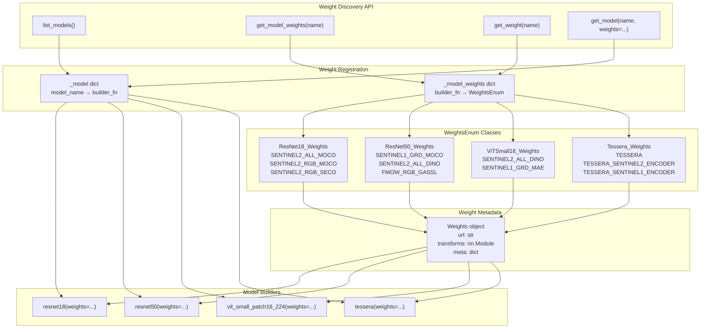
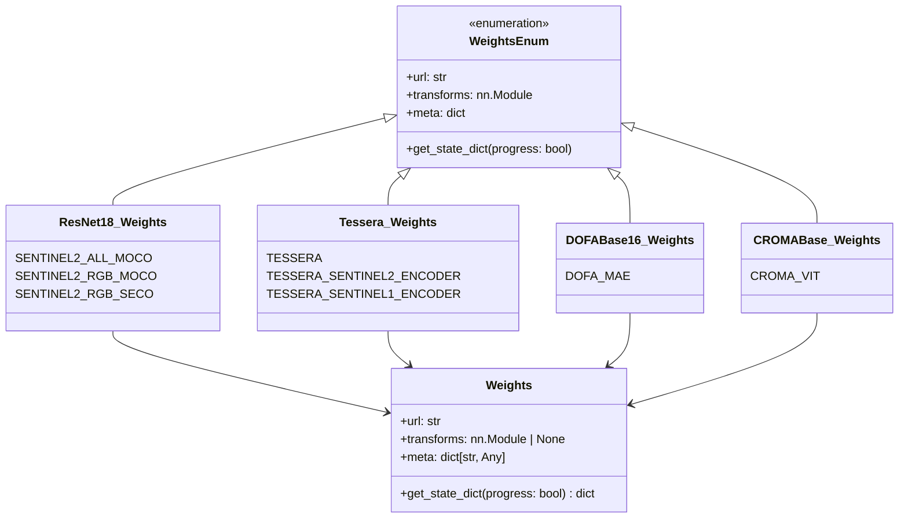
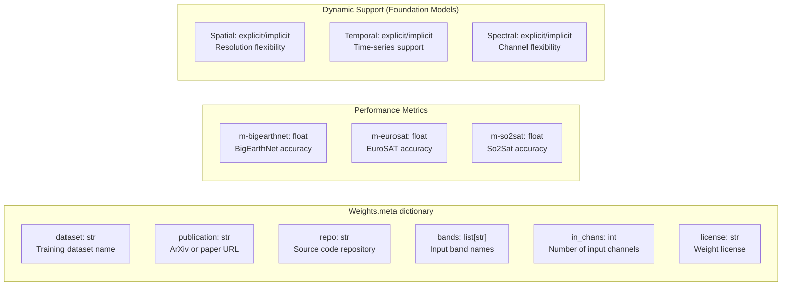
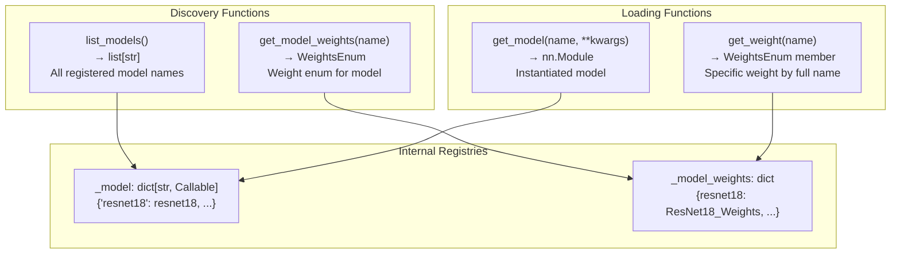
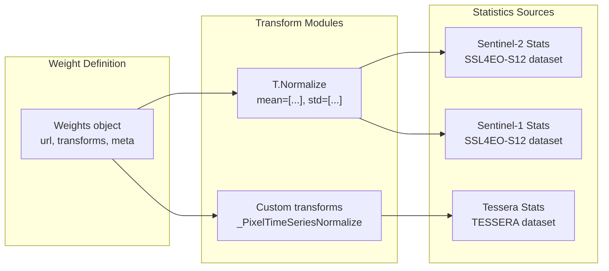
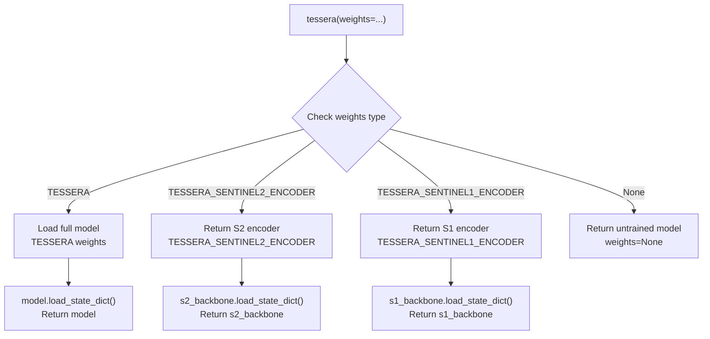

<!-- source: DeepWiki mcp.deepwiki.com · repo torchgeo/torchgeo · page 4.2 Pre-trained Weights System · fetched 2026-10-21 -->

# Pre-trained Weights System

<details>
<summary>Relevant source files</summary>

The following files were used as context for generating this wiki page:

- [docs/api/models.rst](docs/api/models.rst)
- [docs/api/models/tessera.rst](docs/api/models/tessera.rst)
- [docs/api/weights/agnostic.csv](docs/api/weights/agnostic.csv)
- [docs/api/weights/sentinel1.csv](docs/api/weights/sentinel1.csv)
- [docs/api/weights/sentinel2.csv](docs/api/weights/sentinel2.csv)
- [hubconf.py](hubconf.py)
- [requirements/models.txt](requirements/models.txt)
- [tests/models/test_api.py](tests/models/test_api.py)
- [torchgeo/models/__init__.py](torchgeo/models/__init__.py)
- [torchgeo/models/api.py](torchgeo/models/api.py)
- [torchgeo/models/tessera.py](torchgeo/models/tessera.py)

</details>


## Purpose and Scope

This document describes TorchGeo's pre-trained weights system, which provides type-safe access to 100+ pre-trained model weights organized by sensor type and training methodology. The system enables programmatic discovery, loading, and metadata querying of weights for transfer learning on geospatial tasks.

For information about model architectures themselves, see [Model Zoo](#4.1). For guidance on using these weights in training workflows, see [Loading and Using Models](#4.3).

## Architecture Overview

The pre-trained weights system follows the design pattern established by torchvision's `WeightsEnum` API. Each model architecture has an associated `WeightsEnum` class that enumerates available pre-trained weights with their metadata, transforms, and download URLs.



**Sources:** [torchgeo/models/api.py:1-221](), [torchgeo/models/__init__.py:1-152]()

## WeightsEnum Classes

Each model architecture with pre-trained weights has an associated `WeightsEnum` class that inherits from `torchvision.models._api.WeightsEnum`. These classes define enum members where each member represents a specific set of pre-trained weights.

### Structure



### Example: Tessera Weights Definition

The `Tessera_Weights` enum demonstrates the typical structure:

[torchgeo/models/tessera.py:290-361]()

Each enum member is a `Weights` object containing:
- `url`: Download URL for the checkpoint (typically hosted on HuggingFace)
- `transforms`: Preprocessing transforms (normalization with sensor-specific statistics)
- `meta`: Dictionary with dataset, publication, repository, bands, input channels, and other model-specific metadata

**Sources:** [torchgeo/models/tessera.py:290-361](), [torchgeo/models/api.py:1-221]()

## Weight Organization by Sensor Type

Weights are organized by the sensor type they were trained on, allowing users to select weights matching their input data characteristics.

### Sensor Categories

| Category | Description | Representative Weights | CSV File |
|----------|-------------|------------------------|----------|
| **Sensor-Agnostic** | Trained on multi-sensor data or designed for any sensor | `CopernicusFM_ViT`, `DOFA_MAE`, `Panopticon_VIT_BASE14`, `CROMA_VIT` | [docs/api/weights/agnostic.csv:1-11]() |
| **Sentinel-2** | Optical multispectral (13 channels: ALL, 9 channels: MI/SI, 3 channels: RGB) | `SENTINEL2_ALL_MOCO`, `SENTINEL2_RGB_SECO`, `SENTINEL2_MI_MS_SATLAS` | [docs/api/weights/sentinel2.csv:1-54]() |
| **Sentinel-1** | Synthetic Aperture Radar (2 channels: VV/VH, 3 channels: VV/VH/DOY) | `SENTINEL1_GRD_MOCO`, `SENTINEL1_GRD_MAE` | [docs/api/weights/sentinel1.csv:1-22]() |
| **Landsat** | Multispectral (8 bands across Landsat missions) | Listed in landsat.csv | [docs/api/models.rst:66-74]() |
| **NAIP** | Aerial RGB-NIR (4 channels) | Listed in naip.csv | [docs/api/models.rst:76-84]() |
| **Aerial** | High-resolution aerial imagery | Listed in aerial.csv | [docs/api/models.rst:106-114]() |
| **Atmospheric** | Weather and climate data | Listed in atmospheric.csv | [docs/api/models.rst:116-124]() |

### Naming Convention

Weight names follow the pattern: `<Model>_Weights.<SENSOR>_<MODALITY>_<METHOD>`

Examples:
- `ResNet50_Weights.SENTINEL2_ALL_MOCO` - ResNet-50 trained on all 13 Sentinel-2 bands using MoCo
- `ViTSmall16_Weights.SENTINEL1_GRD_MAE` - ViT-Small trained on Sentinel-1 GRD data using MAE
- `Swin_V2_T_Weights.SENTINEL2_MI_MS_SATLAS` - Swin-V2-Tiny trained on multispectral Sentinel-2 (multi-image) from SatlasPretrain

**Sources:** [docs/api/weights/sentinel2.csv:1-54](), [docs/api/weights/sentinel1.csv:1-22](), [docs/api/weights/agnostic.csv:1-11](), [docs/api/models.rst:45-124]()

## Weight Metadata

Each weight contains rich metadata describing its provenance, capabilities, and performance.

### Standard Metadata Fields



### Metadata Example: DOFA Weights

From [docs/api/weights/agnostic.csv:5-6]():

```csv
DOFABase16_Weights.DOFA_MAE,https://github.com/zhu-xlab/DOFA,https://arxiv.org/abs/2403.15356,
CC-BY-4.0,implicit,-,explicit,65.7,50.9,95.8,96.9,55.1,93.9,94.5,81.4,58.8,51.5,33.0,65.3
```

This indicates:
- **Spatial support**: Implicit (trained on diverse resolutions)
- **Temporal support**: None (single-image)
- **Spectral support**: Explicit (architecture handles variable channels)
- **Performance**: 65.7% on BigEarthNet, 93.9% on EuroSAT, etc.

### License Information

Common licenses used:
- `CC-BY-4.0`: Creative Commons Attribution
- `Apache-2.0`: Apache License 2.0
- `MIT`: MIT License
- `ODC-BY`: Open Data Commons Attribution
- `OpenRAIL`: Responsible AI License
- `non-commercial`: Research-only usage

**Sources:** [docs/api/weights/agnostic.csv:1-11](), [docs/api/weights/sentinel2.csv:1-54](), [torchgeo/models/tessera.py:296-322]()

## API Functions

The API layer provides four primary functions for discovering and loading weights.

### Function Reference



### list_models()

Returns a list of all registered model names.

[torchgeo/models/api.py:212-221]()

```python
models = list_models()
# ['aurora_swin_unet', 'copernicusfm_base', 'croma_base', ...]
```

### get_model_weights(name)

Retrieves the `WeightsEnum` class associated with a model.

[torchgeo/models/api.py:175-187]()

```python
from torchgeo.models import get_model_weights, resnet18

# By function reference
weights_enum = get_model_weights(resnet18)

# By string name
weights_enum = get_model_weights('resnet18')
# Returns: ResNet18_Weights enum class

# Iterate over available weights
for weight in weights_enum:
    print(weight, weight.meta['dataset'])
```

### get_weight(name)

Retrieves a specific weight enum member by its fully qualified name.

[torchgeo/models/api.py:189-210]()

```python
from torchgeo.models import get_weight

weight = get_weight('ResNet18_Weights.SENTINEL2_ALL_MOCO')
# Returns: ResNet18_Weights.SENTINEL2_ALL_MOCO

# Access metadata
print(weight.meta['bands'])  # ['B1', 'B2', ...]
print(weight.url)  # Download URL
```

### get_model(name, *args, **kwargs)

Instantiates a model by name, optionally loading pre-trained weights.

[torchgeo/models/api.py:158-173]()

```python
from torchgeo.models import get_model, ResNet18_Weights

# Load model with specific weights
model = get_model('resnet18', weights=ResNet18_Weights.SENTINEL2_ALL_MOCO)

# Load model without weights
model = get_model('resnet18', in_chans=13)
```

**Sources:** [torchgeo/models/api.py:158-221](), [tests/models/test_api.py:132-167]()

## Weight Registration System

The internal registration system uses two dictionaries to map model names and builder functions to their associated weights.

### Registration Dictionaries

#### _model Dictionary

Maps model name strings to builder functions:

[torchgeo/models/api.py:71-100]()

```python
_model: dict[str, Callable[..., nn.Module]] = {
    'resnet18': resnet18,
    'resnet50': resnet50,
    'tessera': tessera,
    'dofa_base_patch16_224': dofa_base_patch16_224,
    # ... 30+ entries
}
```

#### _model_weights Dictionary

Maps both builder functions and model name strings to their `WeightsEnum` classes:

[torchgeo/models/api.py:102-155]()

```python
_model_weights: dict[str | Callable[..., nn.Module], WeightsEnum] = {
    # By function reference
    resnet18: ResNet18_Weights,
    resnet50: ResNet50_Weights,
    tessera: Tessera_Weights,
    # By string name (duplicate entries for convenience)
    'resnet18': ResNet18_Weights,
    'resnet50': ResNet50_Weights,
    'tessera': Tessera_Weights,
    # ... 50+ entries
}
```

This dual-key design allows querying by either the function reference or string name.

### PyTorch Hub Integration

Models are also registered for PyTorch Hub via [hubconf.py:1-79]():

```python
# hubconf.py defines entry points
from torchgeo.models import resnet18, tessera, ...

dependencies = [
    'kornia',
    'microsoft-aurora',
    'segmentation_models_pytorch',
    'timm',
    'torchvision',
]
```

Users can load models directly from PyTorch Hub:

```python
import torch
model = torch.hub.load('torchgeo/torchgeo', 'resnet18', 
                       weights='ResNet18_Weights.SENTINEL2_ALL_MOCO')
```

**Sources:** [torchgeo/models/api.py:71-155](), [hubconf.py:1-79](), [torchgeo/models/__init__.py:1-152]()

## Weight Transforms

Each weight has an associated `transforms` attribute containing preprocessing operations required for that specific weight. These transforms typically include normalization with dataset-specific statistics.

### Transform Pipeline Structure



### Example: Tessera Transforms

Tessera uses custom normalization for pixel time-series data:

[torchgeo/models/tessera.py:17-93]()

The model defines sensor-specific statistics:
- `_TESSERA_S2_MEAN`: Mean values for 10 Sentinel-2 bands + DOY channel
- `_TESSERA_S2_STD`: Standard deviations for Sentinel-2
- `_TESSERA_S1_MEAN`: Mean values for 2 Sentinel-1 bands + DOY channel
- `_TESSERA_S1_STD`: Standard deviations for Sentinel-1
- `_TESSERA_MEAN` and `_TESSERA_STD`: Combined statistics for both sensors

The transforms are assigned to weights:

[torchgeo/models/tessera.py:296-298](), [torchgeo/models/tessera.py:324-326](), [torchgeo/models/tessera.py:349-351]()

```python
TESSERA = Weights(
    url='https://hf.co/isaaccorley/tessera/resolve/.../model.pth',
    transforms=_tessera_transforms,  # Combined S1+S2 normalization
    meta={...}
)

TESSERA_SENTINEL2_ENCODER = Weights(
    url='https://hf.co/isaaccorley/tessera/resolve/.../s2_encoder.pth',
    transforms=_tessera_s2_transforms,  # S2-only normalization
    meta={...}
)
```

### Transform Application

When loading a model with weights, apply the transforms to input data:

```python
from torchgeo.models import tessera, Tessera_Weights

# Load model and get transforms
weight = Tessera_Weights.TESSERA_SENTINEL2_ENCODER
model = tessera(weights=weight)
transforms = weight.transforms

# Apply transforms to input
# input shape: (batch, time, channels)
normalized_input = transforms(input)
output = model(normalized_input)
```

**Sources:** [torchgeo/models/tessera.py:17-93](), [torchgeo/models/tessera.py:290-361]()

## Model-Specific Weight Loading

Some models implement custom weight loading logic to support multiple weight variants or encoder-only loading.

### Example: Tessera Weight Loading

The `tessera()` builder function handles three types of weights:

[torchgeo/models/tessera.py:363-404]()



Implementation:

```python
def tessera(weights: Tessera_Weights | None = None, *args, **kwargs) -> nn.Module:
    model = Tessera(*args, **kwargs)
    
    if weights is None:
        return model
    
    if weights == Tessera_Weights.TESSERA:
        model.load_state_dict(weights.get_state_dict(progress=True), strict=True)
        return model
    elif weights == Tessera_Weights.TESSERA_SENTINEL2_ENCODER:
        model.s2_backbone.load_state_dict(
            weights.get_state_dict(progress=True), strict=True
        )
        return model.s2_backbone  # Return encoder only
    elif weights == Tessera_Weights.TESSERA_SENTINEL1_ENCODER:
        model.s1_backbone.load_state_dict(
            weights.get_state_dict(progress=True), strict=True
        )
        return model.s1_backbone  # Return encoder only
```

This pattern allows loading individual encoders for transfer learning when only one sensor type is available.

**Sources:** [torchgeo/models/tessera.py:363-404]()

## Complete Weight Enumeration

The following table lists all available `WeightsEnum` classes and the number of weight variants each provides:

| WeightsEnum Class | Model Type | Weight Variants | Source File |
|-------------------|------------|-----------------|-------------|
| `Aurora_Weights` | Weather forecasting | 1 | [torchgeo/models/aurora.py]() |
| `CopernicusFM_Base_Weights` | Foundation model | 1 | [torchgeo/models/copernicusfm.py]() |
| `CROMABase_Weights` | Foundation model | 1 | [torchgeo/models/croma.py]() |
| `CROMALarge_Weights` | Foundation model | 1 | [torchgeo/models/croma.py]() |
| `DOFABase16_Weights` | Foundation model | 1 | [torchgeo/models/dofa.py]() |
| `DOFALarge16_Weights` | Foundation model | 1 | [torchgeo/models/dofa.py]() |
| `EarthLoc_Weights` | Geolocation | 1 | [torchgeo/models/earthloc.py]() |
| `Panopticon_Weights` | Foundation model | 1 | [torchgeo/models/panopticon.py]() |
| `ResNet18_Weights` | CNN backbone | 3 (Sentinel-2) | [torchgeo/models/resnet.py]() |
| `ResNet50_Weights` | CNN backbone | 17 (Sentinel-1/2, multi-sensor) | [torchgeo/models/resnet.py]() |
| `ResNet152_Weights` | CNN backbone | 4 (Sentinel-2) | [torchgeo/models/resnet.py]() |
| `ScaleMAELarge16_Weights` | Self-supervised | 1 | [torchgeo/models/scale_mae.py]() |
| `Swin_T_Weights` | Swin Transformer | Multiple | [torchgeo/models/swin.py]() |
| `Swin_S_Weights` | Swin Transformer | Multiple | [torchgeo/models/swin.py]() |
| `Swin_B_Weights` | Swin Transformer | Multiple | [torchgeo/models/swin.py]() |
| `Swin_V2_T_Weights` | Swin Transformer V2 | 4 (Sentinel-2) | [torchgeo/models/swin.py]() |
| `Swin_V2_B_Weights` | Swin Transformer V2 | 6 (Sentinel-1/2) | [torchgeo/models/swin.py]() |
| `SwinBackbone_Weights` | Swin backbone | Multiple | [torchgeo/models/swin.py]() |
| `Tessera_Weights` | Time-series foundation | 3 (full model + encoders) | [torchgeo/models/tessera.py]() |
| `TileNet_Weights` | Triplet network | 1 | [torchgeo/models/tilenet.py]() |
| `Unet_Weights` | Segmentation | 7 (Sentinel-2) | [torchgeo/models/unet.py]() |
| `ViTSmall16_Weights` | Vision Transformer | 5 (Sentinel-1/2) | [torchgeo/models/vit.py]() |
| `ViTBase16_Weights` | Vision Transformer | 3 (Sentinel-1/2) | [torchgeo/models/vit.py]() |
| `ViTLarge16_Weights` | Vision Transformer | 4 (Sentinel-1/2) | [torchgeo/models/vit.py]() |
| `ViTHuge14_Weights` | Vision Transformer | 3 (Sentinel-1/2) | [torchgeo/models/vit.py]() |
| `ViTSmall14_DINOv2_Weights` | DINOv2 | 2 (Sentinel-1/2) | [torchgeo/models/vit.py]() |
| `ViTBase14_DINOv2_Weights` | DINOv2 | 2 (Sentinel-1/2) | [torchgeo/models/vit.py]() |

**Total**: 27 `WeightsEnum` classes providing 100+ individual weight variants.

**Sources:** [torchgeo/models/__init__.py:70-151](), [torchgeo/models/api.py:102-155](), [tests/models/test_api.py:102-129]()

---

