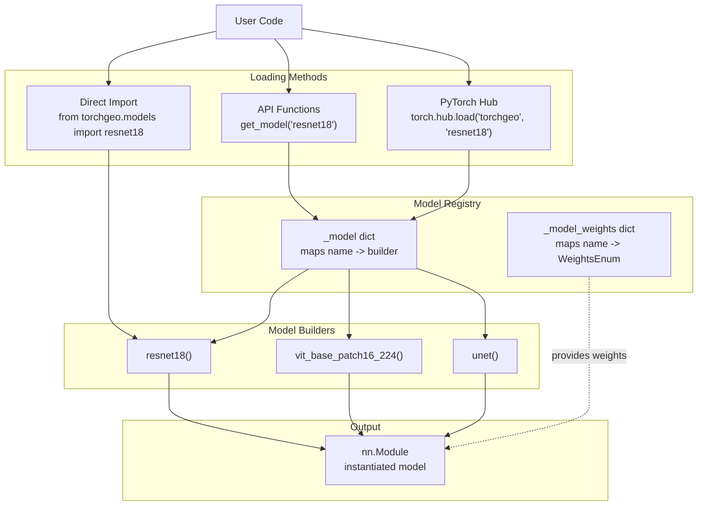
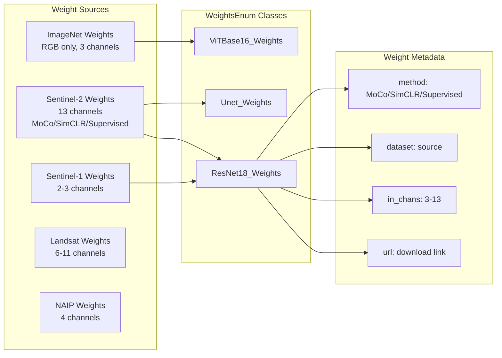
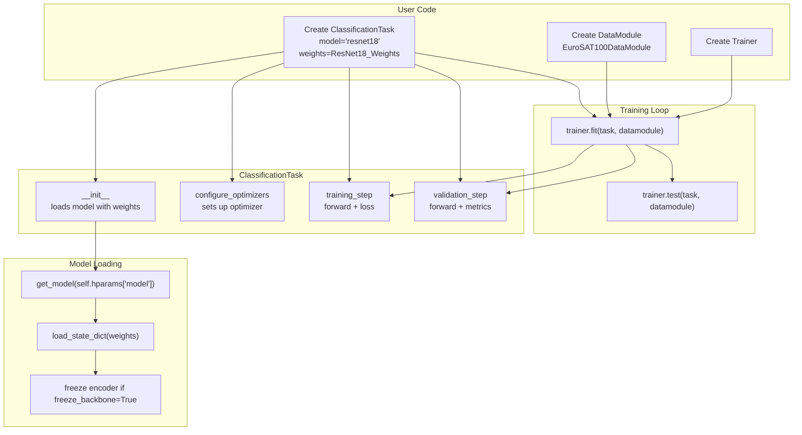
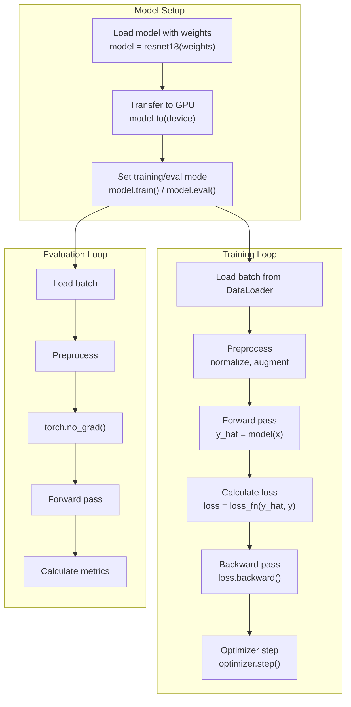
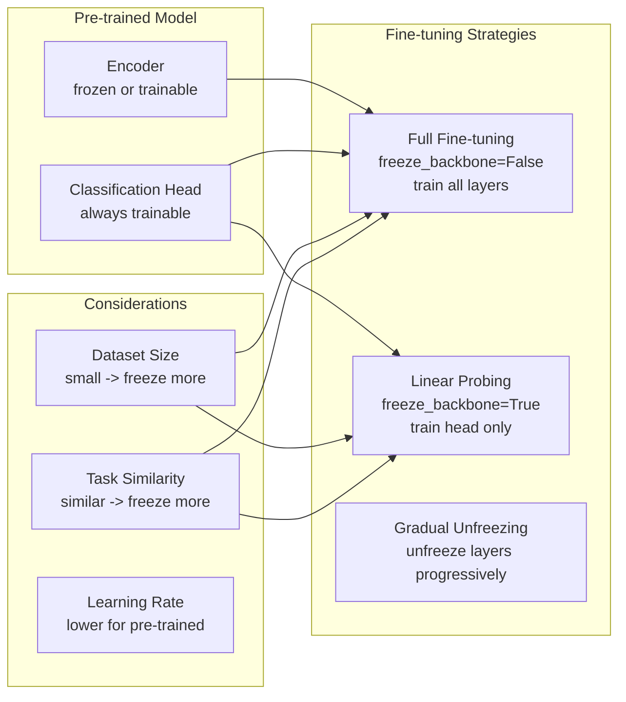

<!-- source: DeepWiki mcp.deepwiki.com · repo torchgeo/torchgeo · page 4.3 Loading and Using Models · fetched 2026-10-21 -->

# Loading and Using Models

<details>
<summary>Relevant source files</summary>

The following files were used as context for generating this wiki page:

- [docs/api/models.rst](docs/api/models.rst)
- [docs/api/models/tessera.rst](docs/api/models/tessera.rst)
- [docs/api/weights/agnostic.csv](docs/api/weights/agnostic.csv)
- [docs/api/weights/sentinel1.csv](docs/api/weights/sentinel1.csv)
- [docs/api/weights/sentinel2.csv](docs/api/weights/sentinel2.csv)
- [docs/tutorials/basic_usage.rst](docs/tutorials/basic_usage.rst)
- [docs/tutorials/cli.ipynb](docs/tutorials/cli.ipynb)
- [docs/tutorials/custom_raster_dataset.ipynb](docs/tutorials/custom_raster_dataset.ipynb)
- [docs/tutorials/custom_segmentation_trainer.ipynb](docs/tutorials/custom_segmentation_trainer.ipynb)
- [docs/tutorials/earthquake_detection.ipynb](docs/tutorials/earthquake_detection.ipynb)
- [docs/tutorials/embeddings.ipynb](docs/tutorials/embeddings.ipynb)
- [docs/tutorials/indices.ipynb](docs/tutorials/indices.ipynb)
- [docs/tutorials/pretrained_weights.ipynb](docs/tutorials/pretrained_weights.ipynb)
- [docs/tutorials/pytorch.ipynb](docs/tutorials/pytorch.ipynb)
- [docs/tutorials/trainers.ipynb](docs/tutorials/trainers.ipynb)
- [docs/tutorials/transforms.ipynb](docs/tutorials/transforms.ipynb)
- [hubconf.py](hubconf.py)
- [requirements/models.txt](requirements/models.txt)
- [tests/models/test_api.py](tests/models/test_api.py)
- [torchgeo/models/__init__.py](torchgeo/models/__init__.py)
- [torchgeo/models/api.py](torchgeo/models/api.py)
- [torchgeo/models/tessera.py](torchgeo/models/tessera.py)

</details>


This page describes how to load and use models from TorchGeo's model zoo. It covers the different loading mechanisms, how to use pre-trained weights, and how to integrate models into training workflows.

For information about available models and architectures, see [Model Zoo](#4.1). For details about the pre-trained weights system and sensor-specific weights, see [Pre-trained Weights System](#4.2). For information about training workflows with tasks and trainers, see [Training System](#5).

## Model Loading Methods

TorchGeo provides three mechanisms for loading models: direct import, API functions, and PyTorch Hub. Each method suits different use cases.



**Sources:** [torchgeo/models/api.py:59-84](), [torchgeo/models/__init__.py:1-124](), [hubconf.py:1-72]()

### Direct Import

The most straightforward method is to import model builder functions directly from `torchgeo.models`. This is recommended for interactive use and when you know the specific model you need.

```python
from torchgeo.models import resnet18, ResNet18_Weights

# Create model without weights
model = resnet18()

# Create model with pre-trained weights
model = resnet18(weights=ResNet18_Weights.SENTINEL2_ALL_MOCO)
```

All model builder functions are exported from [torchgeo/models/__init__.py:6-53]() and follow a consistent naming convention. Available models include:
- Vision backbones: `resnet18`, `resnet50`, `resnet152`, `vit_small_patch16_224`, `vit_base_patch16_224`, `swin_v2_t`, `swin_v2_b`
- Segmentation models: `unet`, `fcn`, `farseg`
- Specialty models: `croma_base`, `croma_large`, `dofa_base_patch16_224`, `scalemae_large_patch16`, `earthloc`, `panopticon_vitb14`
- Atmospheric models: `aurora_swin_unet`
- Detection models: `yolo`

**Sources:** [torchgeo/models/__init__.py:1-124](), [docs/tutorials/pretrained_weights.ipynb:70-77](), [docs/tutorials/pytorch.ipynb:243-253]()

### API Functions

The API functions provide programmatic access to models and weights, useful for configuration-driven workflows where model names come from strings.

#### get_model

Instantiate a model by name:

```python
from torchgeo.models import get_model

model = get_model('resnet18', in_channels=13, num_classes=10)
```

The function signature is `get_model(name: str, *args, **kwargs) -> nn.Module`, where `name` is the model builder function name and additional arguments are passed through to the builder.

**Sources:** [torchgeo/models/api.py:134-148]()

#### get_model_weights

Get the weights enum class for a model:

```python
from torchgeo.models import get_model_weights, resnet18

# By function reference
weights_enum = get_model_weights(resnet18)

# By name string
weights_enum = get_model_weights('resnet18')

# List available weights
for weight in weights_enum:
    print(weight, weight.meta)
```

**Sources:** [torchgeo/models/api.py:151-162]()

#### get_weight

Get a specific weight enum value by its full name:

```python
from torchgeo.models import get_weight

weight = get_weight('ResNet18_Weights.SENTINEL2_ALL_MOCO')
model = resnet18(weights=weight)
```

**Sources:** [torchgeo/models/api.py:165-185]()

#### list_models

List all registered models:

```python
from torchgeo.models import list_models

models = list_models()
# ['aurora_swin_unet', 'copernicusfm_base', 'croma_base', ...]
```

**Sources:** [torchgeo/models/api.py:188-196]()

### PyTorch Hub

PyTorch Hub provides one-line model loading for quick experimentation:

```python
import torch

model = torch.hub.load('torchgeo/torchgeo', 'resnet18', 
                       weights='SENTINEL2_ALL_MOCO')
```

The hub configuration is defined in [hubconf.py:1-72]() and lists all available models. Dependencies for hub loading include `kornia`, `microsoft-aurora`, `segmentation_models_pytorch`, `timm`, `torchvision`, and `ultralytics` as specified in [hubconf.py:64-71]().

**Sources:** [hubconf.py:1-72](), [docs/api/models.rst:1-219]()

## Loading Pre-trained Weights



**Sources:** [docs/api/models.rst:153-218](), [torchgeo/models/resnet.py]() (implied)

### Using Weight Enums

Weight enums follow torchvision's Multi-Weight API pattern. Each enum value contains metadata and a download URL:

```python
from torchgeo.models import ResNet18_Weights, resnet18

# Access weight enum
weights = ResNet18_Weights.SENTINEL2_ALL_MOCO

# Inspect metadata
print(f"URL: {weights.url}")
print(f"Input channels: {weights.meta['in_chans']}")
print(f"Dataset: {weights.meta['dataset']}")
print(f"Method: {weights.meta['method']}")

# Load model with weights
model = resnet18(weights=weights)
```

The metadata dictionary typically includes:
- `in_chans`: Number of input channels (e.g., 3 for RGB, 13 for Sentinel-2)
- `dataset`: Source dataset for pre-training
- `method`: Training method (MoCo, SimCLR, supervised, etc.)
- `publication`: Link to paper
- `url`: Download link for weights file

**Sources:** [docs/tutorials/pretrained_weights.ipynb:76-143]()

### Sensor-Specific Weights

TorchGeo provides weights pre-trained on various satellite sensors. The key advantage over ImageNet weights is support for multispectral imagery beyond RGB:

| Sensor Category | Example Weights | Input Channels | Spatial Resolution |
|----------------|-----------------|----------------|-------------------|
| Sensor-Agnostic | `CROMA`, `DOFA` | Variable | Variable |
| Landsat | `ResNet50_Weights.LANDSAT_TM_TOA_MOCO` | 6-11 | 30m |
| NAIP | `ResNet18_Weights.NAIP_RGB_MOCO` | 3-4 | 1m |
| Sentinel-1 | `ResNet50_Weights.SENTINEL1_GRD_MOCO` | 2-3 | 10m |
| Sentinel-2 | `ResNet18_Weights.SENTINEL2_ALL_MOCO` | 13 | 10-60m |
| Atmospheric | `Aurora_Weights.HRES_T0_AURORA` | Variable | 0.1-0.4° |

The full catalog of weights is documented in [docs/api/models.rst:153-218]() with CSV tables for each sensor category.

**Sources:** [docs/api/models.rst:153-218](), [docs/api/weights/sentinel2.csv](), [docs/api/weights/landsat.csv](), [docs/api/weights/sentinel1.csv](), [docs/api/weights/naip.csv](), [docs/api/weights/atmospheric.csv:1-9]()

## Using Models with Lightning Tasks



**Sources:** [docs/tutorials/trainers.ipynb:1-315](), [torchgeo/trainers/]() (implied)

### Basic Training Example

TorchGeo's Lightning tasks provide a high-level interface for training models. The task automatically handles model initialization, optimizer configuration, and the training loop:

```python
from lightning.pytorch import Trainer
from torchgeo.datamodules import EuroSAT100DataModule
from torchgeo.models import ResNet18_Weights
from torchgeo.trainers import ClassificationTask

# Create task with pre-trained weights
task = ClassificationTask(
    model='resnet18',
    weights=ResNet18_Weights.SENTINEL2_ALL_MOCO,
    in_channels=13,
    num_classes=10,
    lr=0.1,
    patience=5
)

# Create data module
datamodule = EuroSAT100DataModule(
    root='data/',
    batch_size=10,
    num_workers=2,
    download=True
)

# Create trainer and fit
trainer = Trainer(max_epochs=50)
trainer.fit(model=task, datamodule=datamodule)
```

The task parameters include:
- `model`: Model architecture name or custom `nn.Module`
- `weights`: Pre-trained weights enum or `None`
- `in_channels`: Number of input channels
- `num_classes`: Number of output classes
- `loss`: Loss function name (e.g., 'ce', 'jaccard', 'focal')
- `lr`: Learning rate
- `freeze_backbone`: Whether to freeze encoder during training

**Sources:** [docs/tutorials/trainers.ipynb:175-192](), [docs/tutorials/trainers.ipynb:133-151]()

### Available Task Types

TorchGeo provides tasks for common remote sensing problems:

| Task Class | Purpose | Example Datasets |
|-----------|---------|-----------------|
| `ClassificationTask` | Single-label classification | EuroSAT, So2Sat |
| `MultiLabelClassificationTask` | Multi-label classification | BigEarthNet |
| `SemanticSegmentationTask` | Pixel-wise segmentation | Chesapeake, LandCover.ai |
| `RegressionTask` | Value prediction | SustainBench Crop Yield |
| `ObjectDetectionTask` | Bounding box detection | FAIR1M, xView |
| `InstanceSegmentationTask` | Instance-level segmentation | - |
| `ChangeDetectionTask` | Temporal change detection | OSCD |
| `PixelwiseRegressionTask` | Pixel-wise value prediction | - |

Self-supervised tasks are also available for pre-training without labels:
- `BYOLTask`: Bootstrap Your Own Latent
- `MoCoTask`: Momentum Contrast
- `SimCLRTask`: Simple Contrastive Learning

**Sources:** [docs/tutorials/trainers.ipynb:159-162](), System Diagram 4 from context

## Using Models with PyTorch Directly

For users who prefer more control or don't want to use Lightning, models can be used directly with PyTorch:



**Sources:** [docs/tutorials/pytorch.ipynb:1-506]()

### Training Script Example

```python
import torch
from torch import nn, optim
from torch.utils.data import DataLoader
from torchgeo.datasets import EuroSAT100
from torchgeo.models import ResNet18_Weights, resnet18

# Setup
device = 'cuda' if torch.cuda.is_available() else 'cpu'
model = resnet18(ResNet18_Weights.SENTINEL2_ALL_MOCO).to(device)
loss_fn = nn.CrossEntropyLoss()
optimizer = optim.SGD(model.parameters(), lr=1e-2)

# Data
dataset = EuroSAT100(root='data/', split='train', download=True)
dataloader = DataLoader(dataset, batch_size=10, shuffle=True)

# Training loop
for epoch in range(epochs):
    model.train()
    for batch in dataloader:
        x = batch['image'].to(device)
        y = batch['label'].to(device)
        
        # Forward pass
        y_hat = model(x)
        loss = loss_fn(y_hat, y)
        
        # Backward pass
        loss.backward()
        optimizer.step()
        optimizer.zero_grad()
```

**Sources:** [docs/tutorials/pytorch.ipynb:334-365](), [docs/tutorials/pytorch.ipynb:236-305]()

### Evaluation Example

```python
model.eval()
correct = 0
with torch.no_grad():
    for batch in val_dataloader:
        x = batch['image'].to(device)
        y = batch['label'].to(device)
        
        y_hat = model(x)
        correct += (y_hat.argmax(1) == y).sum().item()

accuracy = correct / len(val_dataloader.dataset)
```

**Sources:** [docs/tutorials/pytorch.ipynb:378-399]()

## Fine-tuning Pre-trained Models



**Sources:** [docs/tutorials/trainers.ipynb:175-192](), [docs/tutorials/pretrained_weights.ipynb:149-190]()

### With Lightning Tasks

The `ClassificationTask` and other tasks support freezing the encoder (backbone) during training:

```python
task = ClassificationTask(
    model='resnet18',
    weights=ResNet18_Weights.SENTINEL2_ALL_MOCO,
    in_channels=13,
    num_classes=10,
    freeze_backbone=True,  # Only train classification head
    lr=0.1
)
```

When `freeze_backbone=True`, only the final classification layer is trained. This is useful for:
- Small datasets where full fine-tuning might overfit
- Quick experiments to verify pre-trained weights are useful
- Transfer learning with limited computational resources

**Sources:** [docs/tutorials/trainers.ipynb:183-191]()

### With timm Integration

For users who prefer timm directly, TorchGeo weights can be loaded into timm models:

```python
import timm
from torchgeo.models import ResNet18_Weights

weights = ResNet18_Weights.SENTINEL2_ALL_MOCO
in_chans = weights.meta['in_chans']

# Create timm model
model = timm.create_model('resnet18', in_chans=in_chans, num_classes=10)

# Load TorchGeo pre-trained weights
model.load_state_dict(weights.get_state_dict(progress=True), strict=False)
```

The `strict=False` parameter allows loading weights when the output layer dimensions differ.

**Sources:** [docs/tutorials/pretrained_weights.ipynb:176-184]()

## Model Inference

### Feature Extraction

Pre-trained models can be used as feature extractors for classical ML models:

```python
import torch
from torchgeo.models import ResNet50_Weights, resnet50

# Load model and set to eval mode
model = resnet50(ResNet50_Weights.SENTINEL1_GRD_MOCO).eval()
device = 'cuda' if torch.cuda.is_available() else 'cpu'
model = model.to(device)

# Extract embeddings
embeddings = []
with torch.no_grad():
    for batch in dataloader:
        x = batch['image'].to(device)
        emb = model(x)  # Returns feature vector
        embeddings.append(emb.cpu().numpy())

# Train classical ML model on embeddings
from sklearn.ensemble import RandomForestClassifier
clf = RandomForestClassifier()
clf.fit(embeddings_train, labels_train)
```

**Sources:** [docs/tutorials/earthquake_detection.ipynb:244-273](), [docs/tutorials/earthquake_detection.ipynb:318-324]()

### Prediction Pipeline

For production inference, consider preprocessing and transforms:

```python
from torchgeo.models import ResNet18_Weights, resnet18

# Load model with transforms
weights = ResNet18_Weights.SENTINEL2_ALL_MOCO
model = resnet18(weights=weights)
transforms = weights.transforms()  # Get preprocessing transforms

# Inference
model.eval()
with torch.no_grad():
    # Apply transforms
    sample_transformed = transforms(sample)
    
    # Get predictions
    predictions = model(sample_transformed['image'])
    predicted_class = predictions.argmax(1)
```

The `weights.transforms()` method returns the preprocessing used during training (normalization, etc.).

**Sources:** [docs/tutorials/earthquake_detection.ipynb:253-273]()

## Command-Line Interface Usage

Models can also be loaded via TorchGeo's CLI for configuration-driven workflows:

```yaml
# config.yaml
model:
  class_path: ClassificationTask
  init_args:
    model: 'resnet18'
    weights: 'SENTINEL2_ALL_MOCO'
    in_channels: 13
    num_classes: 10
data:
  class_path: EuroSAT100DataModule
  init_args:
    batch_size: 8
```

```bash
torchgeo fit --config config.yaml
```

The CLI automatically resolves weight strings to enum values using `get_weight()`.

**Sources:** [docs/tutorials/cli.ipynb:1-290](), [docs/tutorials/cli.ipynb:132-168]()

## Advanced Usage

### Custom Model Architectures

Users can pass custom `nn.Module` instances directly to tasks:

```python
import torch.nn as nn
from torchgeo.trainers import ClassificationTask

class CustomModel(nn.Module):
    def __init__(self):
        super().__init__()
        # Define layers
        
    def forward(self, x):
        # Forward pass
        return x

model = CustomModel()
task = ClassificationTask(model=model, loss='ce', lr=0.01)
```

**Sources:** [docs/tutorials/custom_segmentation_trainer.ipynb:1-361]()

### Channel Adaptation

When using pre-trained weights with different numbers of channels than the target dataset:

1. **Zero-padding**: Pad extra channels with zeros
2. **Channel repetition**: Repeat existing channels
3. **Re-initialization**: Re-initialize first conv layer
4. **Channel selection**: Use subset of available channels

These strategies are handled automatically when weight metadata specifies `in_chans` that differs from model input.

**Sources:** Inferred from weight metadata in [docs/api/models.rst:153-218]()

### Atmospheric Models

The Aurora model requires special handling due to its structured input:

```python
from torchgeo.models import Aurora_Weights, aurora_swin_unet
from aurora import Batch, Metadata

weights = Aurora_Weights.HRES_T0_AURORA
model = aurora_swin_unet(weights=weights)

# Create structured batch
batch = Batch(
    surf_vars={k: torch.randn(...) for k in weights.meta['surf_vars']},
    atmos_vars={k: torch.randn(...) for k in weights.meta['atmos_vars']},
    static_vars={k: torch.randn(...) for k in weights.meta['static_vars']},
    metadata=Metadata(lat=..., lon=..., time=..., atmos_levels=...)
)

# Forward pass
predictions = model(batch)
```

**Sources:** [torchgeo/models/aurora.py:1-241](), [tests/models/test_aurora.py:45-64]()

---

**Page Sources:** [torchgeo/models/__init__.py:1-124](), [torchgeo/models/api.py:1-197](), [hubconf.py:1-72](), [docs/tutorials/trainers.ipynb:1-315](), [docs/tutorials/pretrained_weights.ipynb:1-226](), [docs/tutorials/pytorch.ipynb:1-506](), [docs/tutorials/earthquake_detection.ipynb:1-431](), [docs/api/models.rst:1-219](), [tests/models/test_api.py:1-153]()

---

