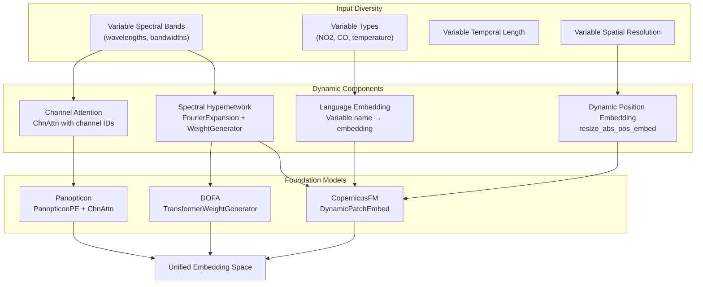
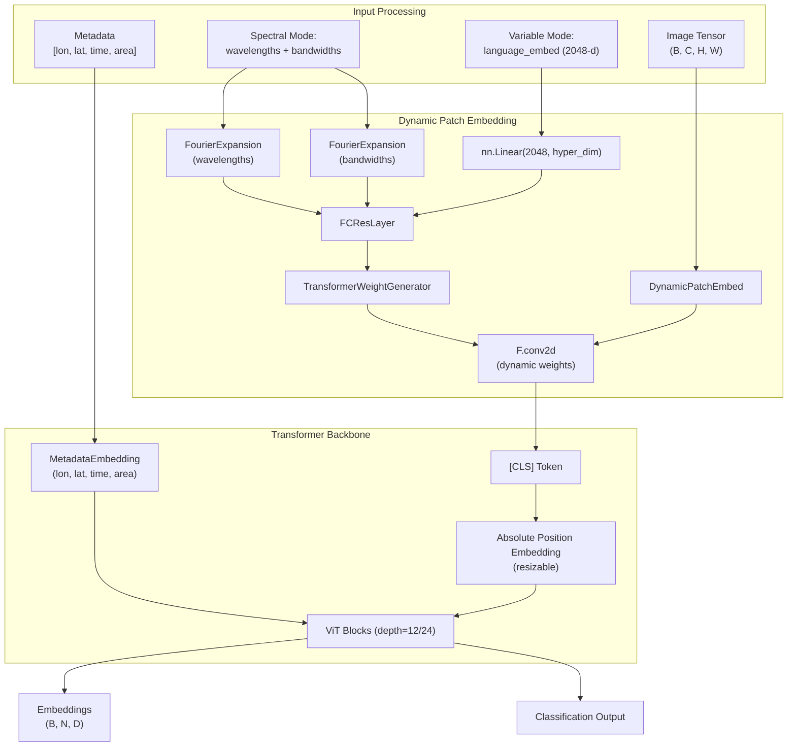
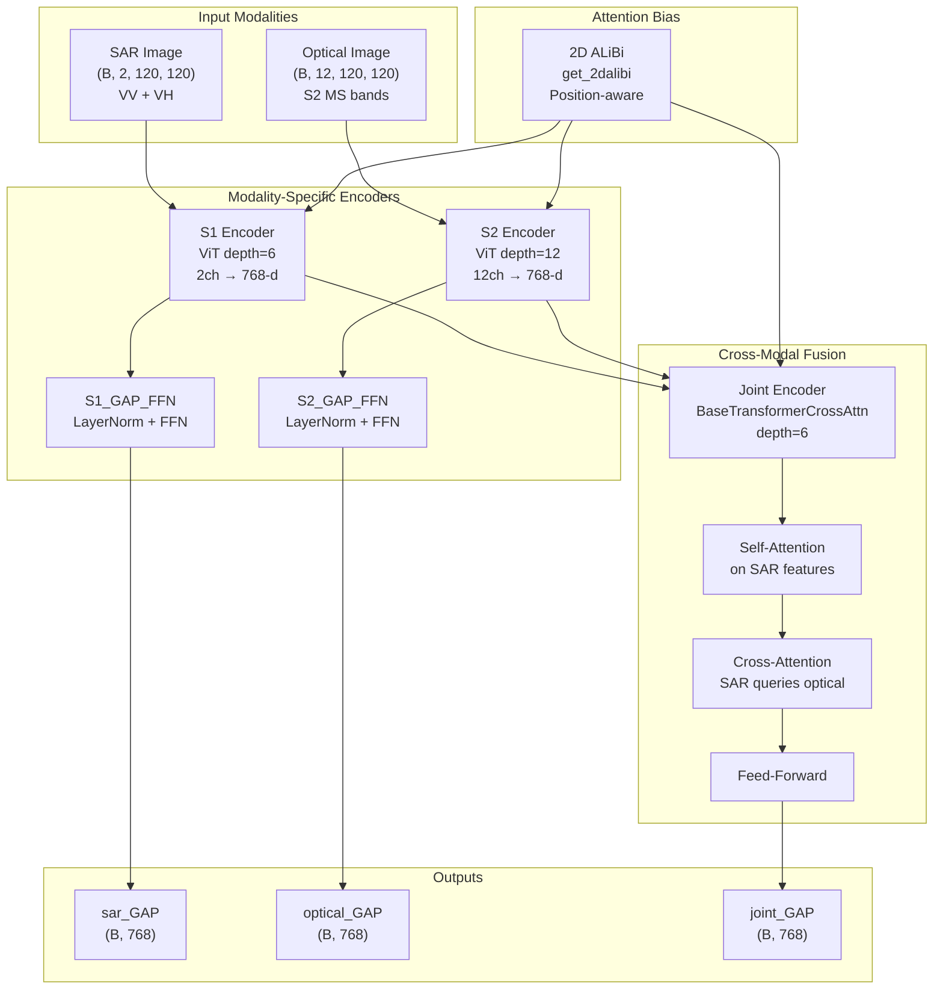
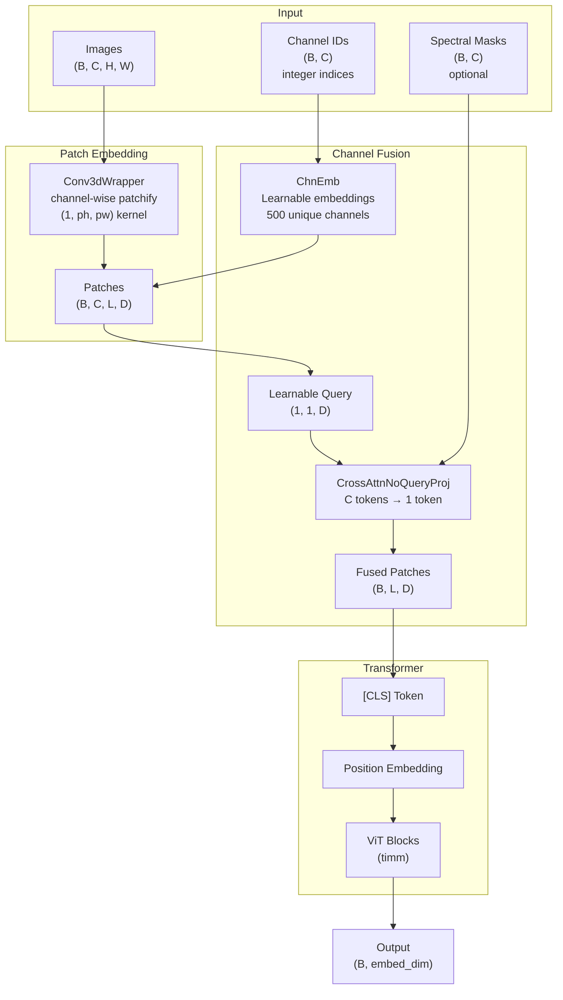
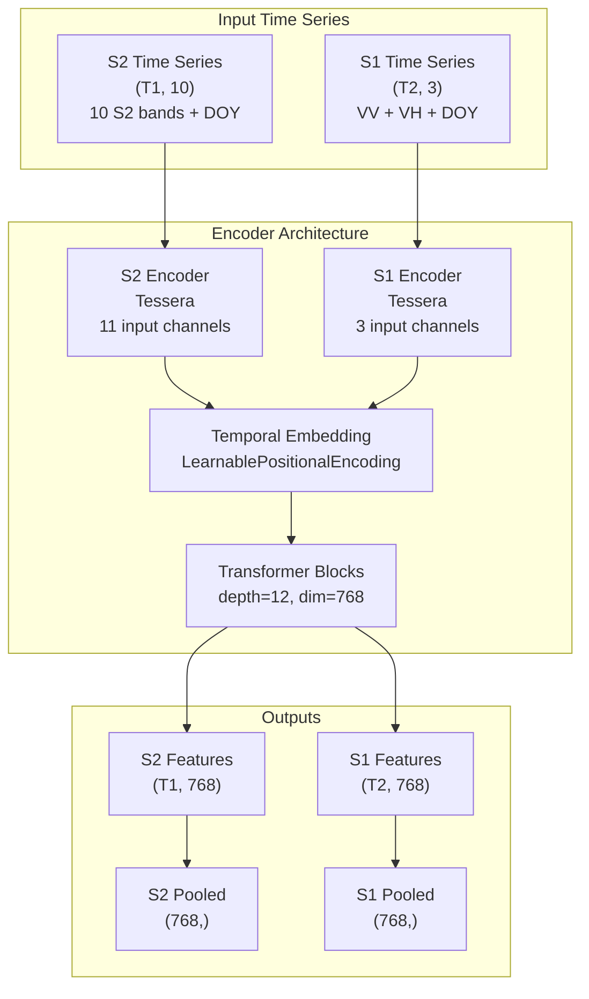
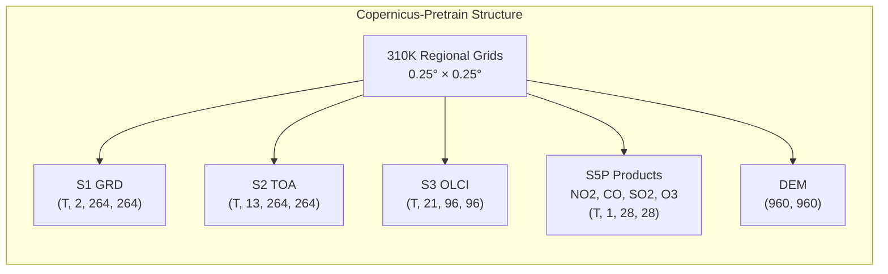

<!-- source: DeepWiki mcp.deepwiki.com · repo torchgeo/torchgeo · page 4.4 Foundation Models · fetched 2026-10-21 -->

# Foundation Models

<details>
<summary>Relevant source files</summary>

The following files were used as context for generating this wiki page:

- [docs/api/models.rst](docs/api/models.rst)
- [docs/api/models/changestar.rst](docs/api/models/changestar.rst)
- [docs/api/models/convlstm.rst](docs/api/models/convlstm.rst)
- [docs/api/models/tessera.rst](docs/api/models/tessera.rst)
- [docs/api/weights/agnostic.csv](docs/api/weights/agnostic.csv)
- [docs/api/weights/sentinel1.csv](docs/api/weights/sentinel1.csv)
- [docs/api/weights/sentinel2.csv](docs/api/weights/sentinel2.csv)
- [hubconf.py](hubconf.py)
- [requirements/models.txt](requirements/models.txt)
- [requirements/style.txt](requirements/style.txt)
- [tests/data/copernicus/pretrain/data.py](tests/data/copernicus/pretrain/data.py)
- [tests/data/copernicus/pretrain/example-000000.tar](tests/data/copernicus/pretrain/example-000000.tar)
- [tests/datasets/test_openstreetmap.py](tests/datasets/test_openstreetmap.py)
- [tests/models/test_api.py](tests/models/test_api.py)
- [torchgeo/datamodules/caffe.py](torchgeo/datamodules/caffe.py)
- [torchgeo/datasets/bright.py](torchgeo/datasets/bright.py)
- [torchgeo/datasets/copernicus/pretrain.py](torchgeo/datasets/copernicus/pretrain.py)
- [torchgeo/datasets/cropharvest.py](torchgeo/datasets/cropharvest.py)
- [torchgeo/datasets/digital_typhoon.py](torchgeo/datasets/digital_typhoon.py)
- [torchgeo/datasets/everwatch.py](torchgeo/datasets/everwatch.py)
- [torchgeo/datasets/openstreetmap.py](torchgeo/datasets/openstreetmap.py)
- [torchgeo/datasets/reforestree.py](torchgeo/datasets/reforestree.py)
- [torchgeo/datasets/soda.py](torchgeo/datasets/soda.py)
- [torchgeo/datasets/splits.py](torchgeo/datasets/splits.py)
- [torchgeo/models/__init__.py](torchgeo/models/__init__.py)
- [torchgeo/models/api.py](torchgeo/models/api.py)
- [torchgeo/models/copernicusfm.py](torchgeo/models/copernicusfm.py)
- [torchgeo/models/croma.py](torchgeo/models/croma.py)
- [torchgeo/models/fcsiam.py](torchgeo/models/fcsiam.py)
- [torchgeo/models/panopticon.py](torchgeo/models/panopticon.py)
- [torchgeo/models/tessera.py](torchgeo/models/tessera.py)

</details>


Foundation models in TorchGeo are large-scale pre-trained models designed to work across multiple sensors, modalities, and tasks. Unlike traditional models pre-trained on specific sensors (e.g., Sentinel-2), foundation models use architectural innovations to handle diverse input types, spatial resolutions, temporal sequences, and spectral characteristics. This page documents the foundation model implementations, their architectures, and usage patterns.

For information about standard pre-trained models and weights, see page [4.2](#4.2). For the model loading API, see page [4.3](#4.3).

---

## Overview

TorchGeo includes five foundation models that support sensor-agnostic or multi-modal remote sensing applications:

| Model | Key Feature | Input Modes | Architecture |
|-------|-------------|-------------|--------------|
| **CopernicusFM** | Spectral & variable hypernetworks | Multi-sensor (S1-S5P) | ViT with dynamic patch embedding |
| **CROMA** | Cross-modal learning (SAR + optical) | Sentinel-1 & Sentinel-2 | Dual ViT encoders with cross-attention |
| **DOFA** | Dynamic One-For-All | Multi-spectral (wavelength-aware) | ViT with spectral hypernetwork |
| **Panopticon** | Channel attention with embeddings | Multi-sensor with channel IDs | ViT with channel fusion |
| **Tessera** | Pixel time-series encoding | Sentinel-1 & Sentinel-2 sequences | Encoder-only transformer |

All foundation models are accessible through the unified API in [torchgeo/models/api.py:158-221]() and exported in [torchgeo/models/__init__.py:1-152]().

**Sources:** [torchgeo/models/__init__.py:1-152](), [docs/api/weights/agnostic.csv:1-11](), [torchgeo/models/api.py:1-221]()

---

## Foundation Model Architecture Patterns

### Dynamic Input Handling

Foundation models use specialized techniques to handle varying input characteristics:



**Sources:** [torchgeo/models/copernicusfm.py:141-363](), [torchgeo/models/panopticon.py:18-176](), [torchgeo/models/dofa.py]() (referenced)

---

## CopernicusFM

CopernicusFM is the most flexible foundation model, supporting both spectral and variable-based inputs through dual hypernetwork modes.

### Architecture



### Input Modes

**Spectral Mode** (for remote sensing imagery):
- Requires wavelengths (nm) and bandwidths (nm) for each channel
- Uses Fourier expansion to encode spectral characteristics
- Example: Sentinel-2 RGB-NIR with wavelengths [490, 560, 665, 842]

**Variable Mode** (for climate/atmospheric data):
- Requires language embedding from variable name (e.g., "Sentinel 5P Nitrogen Dioxide")
- Uses pre-computed 2048-d embeddings from Llama 3.2 1B
- Example: S5P NO2, temperature, precipitation variables

### Key Classes and Functions

- `CopernicusFM` [torchgeo/models/copernicusfm.py:365-525]() - Main model class
- `DynamicPatchEmbed` [torchgeo/models/copernicusfm.py:213-363]() - Hypernetwork-based patch embedding
- `FourierExpansion` [torchgeo/models/copernicusfm.py:141-211]() - Wavelength/bandwidth encoding
- `resize_abs_pos_embed` [torchgeo/models/copernicusfm.py:26-77]() - Dynamic position embedding resizing
- `pi_resize_patch_embed` [torchgeo/models/copernicusfm.py:79-139]() - Pseudo-inverse patch embedding resizing
- `copernicusfm_base` [torchgeo/models/copernicusfm.py:754-782]() - Constructor function
- `CopernicusFM_Base_Weights` [torchgeo/models/copernicusfm.py:738-752]() - Pre-trained weights enum

### Usage Example

```python
# Spectral mode
model = copernicusfm_base(weights=CopernicusFM_Base_Weights.CopernicusFM_ViT)
x = torch.randn(1, 4, 224, 224)
metadata = torch.full((1, 4), float('nan'))  # [lon, lat, delta_time, area]
wavelengths = [490, 560, 665, 842]  # B, G, R, NIR (Sentinel-2)
bandwidths = [65, 35, 30, 115]
output = model(x, metadata, wavelengths=wavelengths, bandwidths=bandwidths, 
               input_mode='spectral', kernel_size=16)

# Variable mode
varname = 'Sentinel 5P Nitrogen Dioxide'
language_embed = get_language_embedding(varname)  # User provides
output = model(x, metadata, language_embed=language_embed, 
               input_mode='variable', kernel_size=16)
```

**Sources:** [torchgeo/models/copernicusfm.py:365-782](), [torchgeo/models/copernicusfm.py:141-363](), [docs/api/weights/agnostic.csv:2-2]()

---

## CROMA

CROMA (Cross-modal Remote sensing Outcome) performs cross-modal learning between SAR (Sentinel-1) and optical (Sentinel-2) imagery.

### Architecture



### Key Design Decisions

1. **Fixed Image Size**: CROMA requires 120×120 images (must be multiple of 8)
2. **Fixed Channel Counts**: 2 channels for SAR (VV, VH), 12 channels for optical (S2 multispectral)
3. **Asymmetric Depth**: SAR encoder is shallower (depth=6) than optical encoder (depth=12)
4. **2D ALiBi**: Uses 2D attention bias instead of learned position embeddings [torchgeo/models/croma.py:155-184]()

### Key Classes

- `CROMA` [torchgeo/models/croma.py:19-153]() - Main model class
- `ViT` [torchgeo/models/croma.py:453-498]() - Vision transformer backbone
- `BaseTransformerCrossAttn` [torchgeo/models/croma.py:392-451]() - Cross-attention fusion module
- `get_2dalibi` [torchgeo/models/croma.py:155-184]() - 2D attention bias generator
- `croma_base` / `croma_large` [torchgeo/models/croma.py:586-646]() - Constructor functions
- `CROMABase_Weights` / `CROMALarge_Weights` [torchgeo/models/croma.py:500-536]() - Pre-trained weights

### Usage Example

```python
# Both modalities
model = croma_base(weights=CROMABase_Weights.CROMA_VIT)
x_sar = torch.randn(1, 2, 120, 120)
x_optical = torch.randn(1, 12, 120, 120)
outputs = model(x_sar=x_sar, x_optical=x_optical)
# outputs: {'sar_GAP', 'optical_GAP', 'joint_GAP', 'sar_encodings', 'optical_encodings', 'joint_encodings'}

# SAR only
model = CROMA(modalities=['sar'])
outputs = model(x_sar=x_sar)
# outputs: {'sar_GAP', 'sar_encodings'}

# Optical only
model = CROMA(modalities=['optical'])
outputs = model(x_optical=x_optical)
# outputs: {'optical_GAP', 'optical_encodings'}
```

**Sources:** [torchgeo/models/croma.py:1-646](), [docs/api/weights/agnostic.csv:3-4]()

---

## Panopticon

Panopticon uses channel attention with learnable channel embeddings to fuse arbitrary spectral bands into a fixed-dimension representation.

### Architecture



### Channel Embedding System

Panopticon uses a learnable embedding table to encode spectral characteristics:

- **500 unique channel IDs** supported [torchgeo/models/panopticon.py:185-232]()
- **Concatenated embeddings**: position (100-d) + statistics (embed_dim - 100)
- **Masked channels**: Optional masking for data augmentation during pre-training

### Key Classes

- `Panopticon` [torchgeo/models/panopticon.py:239-330]() - Main model class
- `PanopticonPE` [torchgeo/models/panopticon.py:18-87]() - Panopticon-specific patch embedding
- `ChnAttn` [torchgeo/models/panopticon.py:119-176]() - Channel attention fusion
- `ChnEmb` [torchgeo/models/panopticon.py:185-232]() - Channel embedding module
- `panopticon_vitb14` [torchgeo/models/panopticon.py:333-367]() - Constructor function
- `Panopticon_Weights` [torchgeo/models/panopticon.py:370-382]() - Pre-trained weights

### Usage Example

```python
model = panopticon_vitb14(weights=Panopticon_Weights.VIT_BASE14)

# Define channel IDs for input bands
# Example: B, G, R, NIR channels mapped to Panopticon's channel ID space
x_dict = {
    'imgs': torch.randn(1, 4, 224, 224),
    'chn_ids': torch.tensor([[10, 20, 30, 40]]),  # User-defined mapping
}
output = model(x_dict)
```

**Sources:** [torchgeo/models/panopticon.py:1-382](), [docs/api/weights/agnostic.csv:7-7]()

---

## Tessera

Tessera is specialized for pixel-wise time-series modeling of Sentinel-1 and Sentinel-2 data.

### Architecture



### Input Format

Tessera expects **pixel-wise time series** where each sample is a sequence of observations at a single location:

- **S2 Input**: `(time_steps, 11)` - 10 spectral bands + day-of-year
- **S1 Input**: `(time_steps, 3)` - VV, VH, day-of-year
- **Day-of-Year Encoding**: Sine-cosine encoding of temporal position [torchgeo/models/tessera.py:88-104]()

### Normalization

Tessera uses sensor-specific normalization:
- **S2**: Mean/std from [torchgeo/models/tessera.py:18-29]()
- **S1**: Mean/std from [torchgeo/models/tessera.py:42-47]()

### Key Classes

- `Tessera` [torchgeo/models/tessera.py:107-253]() - Main encoder class
- `_PixelTimeSeriesNormalize` [torchgeo/models/tessera.py:52-85]() - Time-series normalization
- `_AddDayOfYearEncoding` [torchgeo/models/tessera.py:88-104]() - Temporal encoding
- `tessera` [torchgeo/models/tessera.py:256-285]() - Constructor function
- `Tessera_Weights` [torchgeo/models/tessera.py:288-301]() - Pre-trained weights

### Usage Example

```python
model = tessera(weights=Tessera_Weights.TESSERA)

# S2 time series: 10 bands + DOY
s2_input = torch.randn(5, 11)  # 5 time steps

# S1 time series: VV + VH + DOY  
s1_input = torch.randn(8, 3)   # 8 time steps

# Forward pass returns both encodings
s2_features, s1_features = model(s2_input, s1_input)
# s2_features: (5, 768), s1_features: (8, 768)

# Can also use single modality
s2_features, _ = model(s2_input, None)
```

**Sources:** [torchgeo/models/tessera.py:1-301](), [docs/api/weights/agnostic.csv:10-10](), [docs/api/weights/sentinel2.csv:45-45](), [docs/api/weights/sentinel1.csv:21-21]()

---

## DOFA (Referenced)

DOFA (Dynamic One-For-All) is a wavelength-aware foundation model that uses spectral hypernetworks to generate dynamic weights for arbitrary spectral bands.

### Key Components

- **Spectral Hypernetwork**: Similar to CopernicusFM's spectral mode but DOFA-specific
- **Dynamic Weight Generation**: `TransformerWeightGenerator` creates patch embedding weights based on wavelength encoding
- **Flexible Input**: Can handle any number of spectral bands with corresponding wavelengths

DOFA is referenced in [torchgeo/models/copernicusfm.py:23-23]() where CopernicusFM imports `FCResLayer` and `TransformerWeightGenerator` from it.

### Available Weights

- `DOFABase16_Weights.DOFA_MAE` - Base model (768-d)
- `DOFALarge16_Weights.DOFA_MAE` - Large model (1024-d)

**Note**: Full implementation details are not in the provided files, but DOFA follows a similar pattern to CopernicusFM's spectral mode.

**Sources:** [docs/api/weights/agnostic.csv:5-6](), [torchgeo/models/api.py:22-29](), [torchgeo/models/__init__.py:14-22]()

---

## Loading Foundation Models

All foundation models follow the same loading pattern using the WeightsEnum API:

```python
from torchgeo.models import (
    copernicusfm_base, CopernicusFM_Base_Weights,
    croma_base, CROMABase_Weights,
    panopticon_vitb14, Panopticon_Weights,
    tessera, Tessera_Weights,
    dofa_base_patch16_224, DOFABase16_Weights,
    get_model, get_weight, list_models
)

# Method 1: Direct constructor with weights
model = copernicusfm_base(weights=CopernicusFM_Base_Weights.CopernicusFM_ViT)

# Method 2: Via get_model API
model = get_model('copernicusfm_base', weights=CopernicusFM_Base_Weights.CopernicusFM_ViT)

# Method 3: Via get_weight for string-based weight names
weights = get_weight('CopernicusFM_Base_Weights.CopernicusFM_ViT')
model = copernicusfm_base(weights=weights)

# Method 4: PyTorch Hub
model = torch.hub.load('microsoft/torchgeo', 'copernicusfm_base', 
                       weights='DEFAULT', trust_repo=True)
```

**Sources:** [torchgeo/models/api.py:158-221](), [hubconf.py:1-79]()

---

## Pre-training Datasets

Foundation models are pre-trained on large-scale multi-modal datasets:

### Copernicus-Pretrain

CopernicusFM uses the Copernicus-Pretrain dataset which extends SSL4EO-S12 to all Sentinel missions:



The dataset class `CopernicusPretrain` [torchgeo/datasets/copernicus/pretrain.py:19-191]() provides an IterableDataset interface using WebDataset for efficient distributed loading.

**Sources:** [torchgeo/datasets/copernicus/pretrain.py:1-191](), [docs/api/weights/agnostic.csv:2-2]()

---

## Comparison Table

| Feature | CopernicusFM | CROMA | DOFA | Panopticon | Tessera |
|---------|--------------|-------|------|------------|---------|
| **Input Flexibility** | Any sensor via wavelengths or variables | SAR + Optical fixed | Any sensor via wavelengths | Any sensor via channel IDs | S1/S2 time series |
| **Temporal Support** | Metadata time encoding | Single timestamp | Single timestamp | Single timestamp | Native sequence modeling |
| **Spatial Support** | Explicit (patch area metadata) | Implicit (120×120 fixed) | Implicit | Implicit | Pixel-wise (no spatial) |
| **Spectral Support** | Explicit (wavelength encoding) | Fixed (2ch SAR, 12ch optical) | Explicit (wavelength encoding) | Learnable (channel embeddings) | Fixed (10ch S2, 2ch S1) |
| **Architecture** | ViT with dynamic patch embed | Dual ViT + cross-attention | ViT with dynamic patch embed | ViT with channel attention | Transformer encoder |
| **Embed Dim** | 1024 | 768 (base), 1024 (large) | 768 (base), 1024 (large) | 768 | 768 |
| **Depth** | 12 (base), 24 (large) | 12 (S2), 6 (S1), 6 (joint) | 12 (base), 24 (large) | 12 | 12 |
| **Best For** | Heterogeneous multi-sensor tasks | SAR-optical fusion | Multi-spectral classification | General multi-sensor | Crop monitoring, change detection |

**Sources:** [torchgeo/models/copernicusfm.py:365-525](), [torchgeo/models/croma.py:19-153](), [torchgeo/models/panopticon.py:239-330](), [torchgeo/models/tessera.py:107-253](), [docs/api/weights/agnostic.csv:1-11]()

---

## Common Operations

### Resizing Position Embeddings

Foundation models support variable input sizes through position embedding interpolation:

```python
# CopernicusFM and Panopticon support dynamic resizing
from torchgeo.models.copernicusfm import resize_abs_pos_embed

# Original model trained on 224×224
model = copernicusfm_base(weights=CopernicusFM_Base_Weights.CopernicusFM_ViT)

# Resize for 448×448 input
new_pos_embed = resize_abs_pos_embed(
    model.pos_embed,
    new_size=(448, 448),
    old_size=(224, 224),
    num_prefix_tokens=1,  # [CLS] token
)
model.pos_embed = nn.Parameter(new_pos_embed)
```

### Extracting Features

All foundation models can extract intermediate features:

```python
# CopernicusFM
model = copernicusfm_base(weights=...)
output = model(x, metadata, ...)  # Returns (B, N, D) patch embeddings

# CROMA - multiple output types
output_dict = model(x_sar=..., x_optical=...)
# Keys: 'sar_encodings', 'optical_encodings', 'joint_encodings', 
#       'sar_GAP', 'optical_GAP', 'joint_GAP'

# Panopticon
output = model(x_dict)  # Returns (B, embed_dim) global features

# Tessera
s2_features, s1_features = model(s2_input, s1_input)
# Returns per-timestep features: (T, 768)
```

**Sources:** [torchgeo/models/copernicusfm.py:26-77](), [torchgeo/models/croma.py:117-153](), [torchgeo/models/panopticon.py:285-330](), [torchgeo/models/tessera.py:177-253]()

---

## Performance Benchmarks

Foundation models are evaluated on multiple downstream tasks:

| Model | BigEarthNet | ForestNet | Brick Kiln | PV4GER | So2Sat | EuroSAT |
|-------|-------------|-----------|------------|--------|--------|---------|
| DOFA Base | 65.7 | 50.9 | 95.8 | 96.9 | 55.1 | 93.9 |
| DOFA Large | 67.5 | 54.6 | 96.9 | 97.3 | 60.1 | 97.1 |
| Panopticon | - | 56.3 | 96.7 | 96.4 | 61.7 | 96.4 |
| CROMA Base | - | - | - | - | - | - |
| CopernicusFM | - | - | - | - | - | - |

Performance metrics from [docs/api/weights/agnostic.csv:5-7](). Note that not all models report the same benchmarks, as they are optimized for different use cases.

**Sources:** [docs/api/weights/agnostic.csv:1-11]()

---

