<!-- source: DeepWiki mcp.deepwiki.com · repo torchgeo/torchgeo · page 5 Training System · fetched 2026-10-21 -->

# Training System

<details>
<summary>Relevant source files</summary>

The following files were used as context for generating this wiki page:

- [tests/conf/vhr10_ins_seg.yaml](tests/conf/vhr10_ins_seg.yaml)
- [tests/conf/vhr10_obj_det.yaml](tests/conf/vhr10_obj_det.yaml)
- [tests/models/test_btc.py](tests/models/test_btc.py)
- [tests/trainers/test_byol.py](tests/trainers/test_byol.py)
- [tests/trainers/test_classification.py](tests/trainers/test_classification.py)
- [tests/trainers/test_detection.py](tests/trainers/test_detection.py)
- [tests/trainers/test_instance_segmentation.py](tests/trainers/test_instance_segmentation.py)
- [tests/trainers/test_moco.py](tests/trainers/test_moco.py)
- [tests/trainers/test_regression.py](tests/trainers/test_regression.py)
- [tests/trainers/test_simclr.py](tests/trainers/test_simclr.py)
- [torchgeo/__init__.py](torchgeo/__init__.py)
- [torchgeo/models/btc.py](torchgeo/models/btc.py)
- [torchgeo/trainers/__init__.py](torchgeo/trainers/__init__.py)
- [torchgeo/trainers/base.py](torchgeo/trainers/base.py)
- [torchgeo/trainers/byol.py](torchgeo/trainers/byol.py)
- [torchgeo/trainers/classification.py](torchgeo/trainers/classification.py)
- [torchgeo/trainers/detection.py](torchgeo/trainers/detection.py)
- [torchgeo/trainers/instance_segmentation.py](torchgeo/trainers/instance_segmentation.py)
- [torchgeo/trainers/iobench.py](torchgeo/trainers/iobench.py)
- [torchgeo/trainers/moco.py](torchgeo/trainers/moco.py)
- [torchgeo/trainers/regression.py](torchgeo/trainers/regression.py)
- [torchgeo/trainers/segmentation.py](torchgeo/trainers/segmentation.py)
- [torchgeo/trainers/simclr.py](torchgeo/trainers/simclr.py)

</details>


The training system provides PyTorch Lightning-based tasks for training and evaluating deep learning models on geospatial data. It implements a hierarchical task architecture that supports supervised learning (classification, segmentation, detection, regression), self-supervised learning (BYOL, MoCo, SimCLR), and utility tasks (I/O benchmarking).

For information about the dataset system and data loading, see [Dataset System](#2). For information about pre-trained models and weights, see [Models and Pre-trained Weights](#4). For information about DataModules that prepare data for training, see [DataModules](#3.3).

## Architecture Overview

The training system is built on PyTorch Lightning's `LightningModule` abstraction, with all tasks inheriting from a common `BaseTask` that provides standard functionality for optimization, logging, and hyperparameter management.

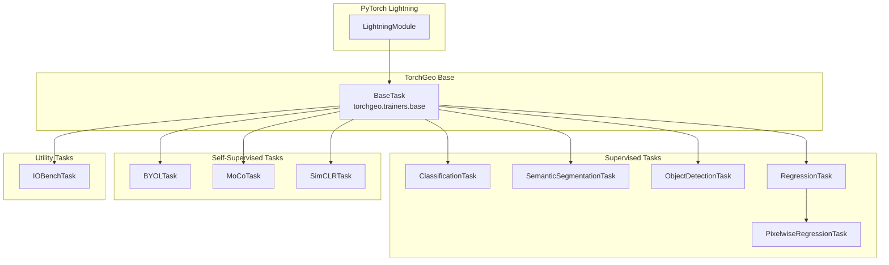

**Sources:** [torchgeo/trainers/base.py:16-82](), [torchgeo/trainers/__init__.py:1-32]()

## BaseTask: Common Foundation

The `BaseTask` class provides the foundation for all training tasks. It inherits from `LightningModule` and implements common patterns for initialization, optimization, and training loop management.

### Key Responsibilities

| Responsibility | Implementation |
|---|---|
| **Hyperparameter Management** | Automatically saves task configuration via `save_hyperparameters()` |
| **Model Configuration** | Abstract `configure_models()` method for task-specific model setup |
| **Loss Configuration** | Optional `configure_losses()` method for loss criterion setup |
| **Metrics Configuration** | Optional `configure_metrics()` method for performance metric setup |
| **Optimizer Setup** | Default `configure_optimizers()` returns AdamW with ReduceLROnPlateau scheduler |
| **Forward Pass** | Default `forward()` delegates to `self.model` |

### BaseTask Structure

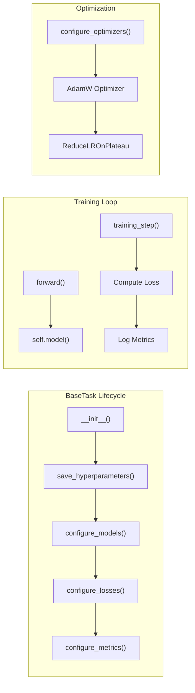

**Sources:** [torchgeo/trainers/base.py:16-82]()

### Common Attributes

```python
# BaseTask attributes
ignore: Sequence[str] | str | None = 'weights'  # Params to ignore when saving hparams
model: Any  # The neural network model
monitor: str = 'val_loss'  # Metric to monitor for callbacks/scheduler
mode: str = 'min'  # Whether to minimize or maximize monitored metric
```

**Sources:** [torchgeo/trainers/base.py:22-32]()

## Task Lifecycle and Methods

All tasks implement a standard lifecycle through PyTorch Lightning's training loop. The following diagram shows the method call sequence during training:

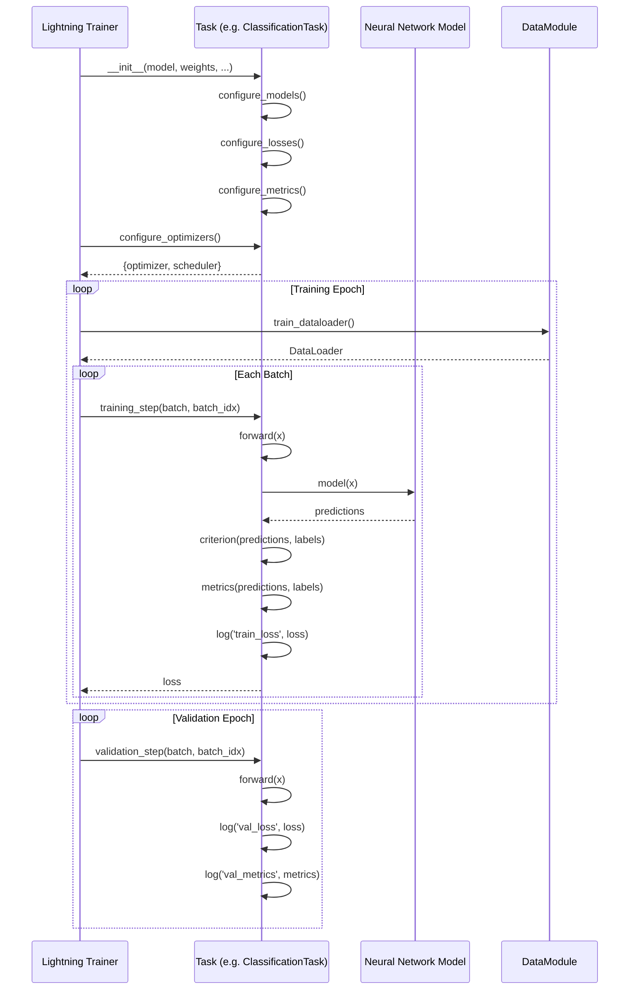

**Sources:** [torchgeo/trainers/base.py:16-82](), [torchgeo/trainers/classification.py:164-190](), [torchgeo/trainers/segmentation.py:257-283]()

### Required Method Implementations

Each task type implements the following methods:

| Method | Purpose | Return Type |
|---|---|---|
| `configure_models()` | Initialize the neural network model | `None` |
| `configure_losses()` | Initialize loss criterion(s) | `None` |
| `configure_metrics()` | Initialize performance metrics | `None` |
| `training_step(batch, batch_idx)` | Compute training loss and metrics | `Tensor` (loss) |
| `validation_step(batch, batch_idx)` | Compute validation loss and metrics | `None` |
| `test_step(batch, batch_idx)` | Compute test loss and metrics | `None` |
| `predict_step(batch, batch_idx)` | Generate predictions | `Tensor` |

**Sources:** [torchgeo/trainers/base.py:46-82](), [torchgeo/trainers/classification.py:82-296]()

## Supervised Learning Tasks

Supervised tasks train models using labeled data. TorchGeo provides tasks for the four main supervised learning paradigms.

### Classification Tasks

The `ClassificationTask` handles image-level classification for binary, multiclass, and multilabel problems.

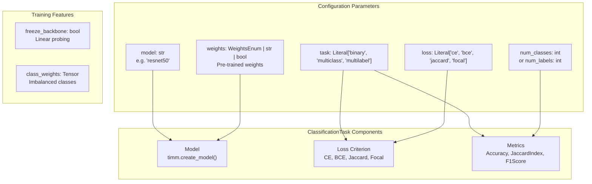

**Configuration Example:**
```python
# Binary classification
task = ClassificationTask(
    model='resnet50',
    weights=True,  # ImageNet weights
    in_channels=3,
    task='binary',
    loss='bce'
)

# Multiclass with class weights
task = ClassificationTask(
    model='resnet50',
    in_channels=13,  # Sentinel-2
    task='multiclass',
    num_classes=10,
    loss='ce',
    class_weights=[1.0, 2.0, 1.5, ...]  # Weight per class
)

# Multilabel classification
task = ClassificationTask(
    model='resnet50',
    in_channels=14,
    task='multilabel',
    num_labels=19,
    loss='bce'
)
```

**Sources:** [torchgeo/trainers/classification.py:29-308]()

### Semantic Segmentation Tasks

The `SemanticSegmentationTask` performs pixel-wise classification for segmentation problems.

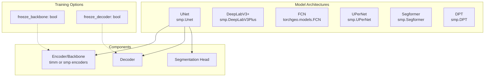

**Model Selection:**
```python
# UNet with ResNet50 backbone
task = SemanticSegmentationTask(
    model='unet',
    backbone='resnet50',
    weights=True,
    in_channels=3,
    num_classes=5,
    loss='ce'
)

# DeepLabV3+ with custom backbone
task = SemanticSegmentationTask(
    model='deeplabv3+',
    backbone='efficientnet-b0',
    in_channels=13,
    num_classes=10,
    loss='focal',
    freeze_backbone=True  # Fine-tune decoder only
)

# FCN (simple architecture, no pre-training)
task = SemanticSegmentationTask(
    model='fcn',
    in_channels=4,
    num_classes=2,
    num_filters=64,
    loss='jaccard'
)
```

**Sources:** [torchgeo/trainers/segmentation.py:27-404]()

### Object Detection Tasks

The `ObjectDetectionTask` supports bounding box detection using torchvision detection models.

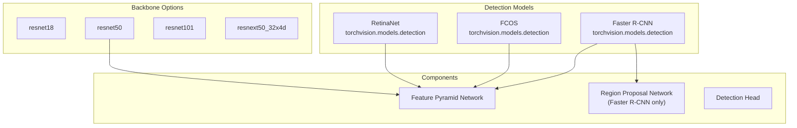

**Detection Configuration:**
```python
# Faster R-CNN
task = ObjectDetectionTask(
    model='faster-rcnn',
    backbone='resnet50',
    weights=True,
    in_channels=3,
    num_classes=10,  # Including background
    freeze_backbone=True
)

# RetinaNet with custom channels
task = ObjectDetectionTask(
    model='retinanet',
    backbone='resnet101',
    in_channels=4,  # RGB + NIR
    num_classes=5
)
```

**Input/Output Format:**
```python
# Input batch format
batch = {
    'image': Tensor,  # (B, C, H, W)
    'bbox_xyxy': list[Tensor],  # List of (N, 4) tensors
    'label': list[Tensor]  # List of (N,) tensors
}

# Output predictions
predictions = [
    {'boxes': Tensor, 'labels': Tensor, 'scores': Tensor},
    ...
]
```

**Sources:** [torchgeo/trainers/detection.py:54-368]()

### Regression Tasks

TorchGeo provides two regression task types:

| Task | Use Case | Target |
|---|---|---|
| `RegressionTask` | Image-level regression | Single value per image |
| `PixelwiseRegressionTask` | Pixel-level regression | Value per pixel |

**Image-Level Regression:**
```python
# Predict single value (e.g., crop yield, wind speed)
task = RegressionTask(
    model='resnet50',
    weights=True,
    in_channels=3,
    num_outputs=1,
    loss='mse'
)
```

**Pixel-Level Regression:**
```python
# Predict value per pixel (e.g., elevation, temperature)
task = PixelwiseRegressionTask(
    model='unet',
    backbone='resnet50',
    in_channels=4,
    loss='mae',
    freeze_backbone=False,
    freeze_decoder=False
)
```

**Sources:** [torchgeo/trainers/regression.py:26-350]()

## Self-Supervised Learning Tasks

Self-supervised learning (SSL) tasks enable pre-training models on unlabeled data using contrastive learning approaches. These tasks learn representations without requiring manual annotations.

### SSL Task Comparison

| Task | Method | Key Features | Memory Bank | Projection Head |
|---|---|---|---|---|
| `BYOLTask` | Bootstrap Your Own Latent | No negative samples, momentum encoder | No | Yes (MLP) |
| `MoCoTask` | Momentum Contrast | Momentum encoder, queue | Yes (v1/v2) | Yes (v2+) |
| `SimCLRTask` | Simple Contrastive Learning | Large batches, strong augmentation | Optional (v2) | Yes |

**Sources:** [torchgeo/trainers/byol.py:284-407](), [torchgeo/trainers/moco.py:118-444](), [torchgeo/trainers/simclr.py:56-323]()

### BYOL: Bootstrap Your Own Latent

BYOL uses two identical networks (online and target) without requiring negative samples.

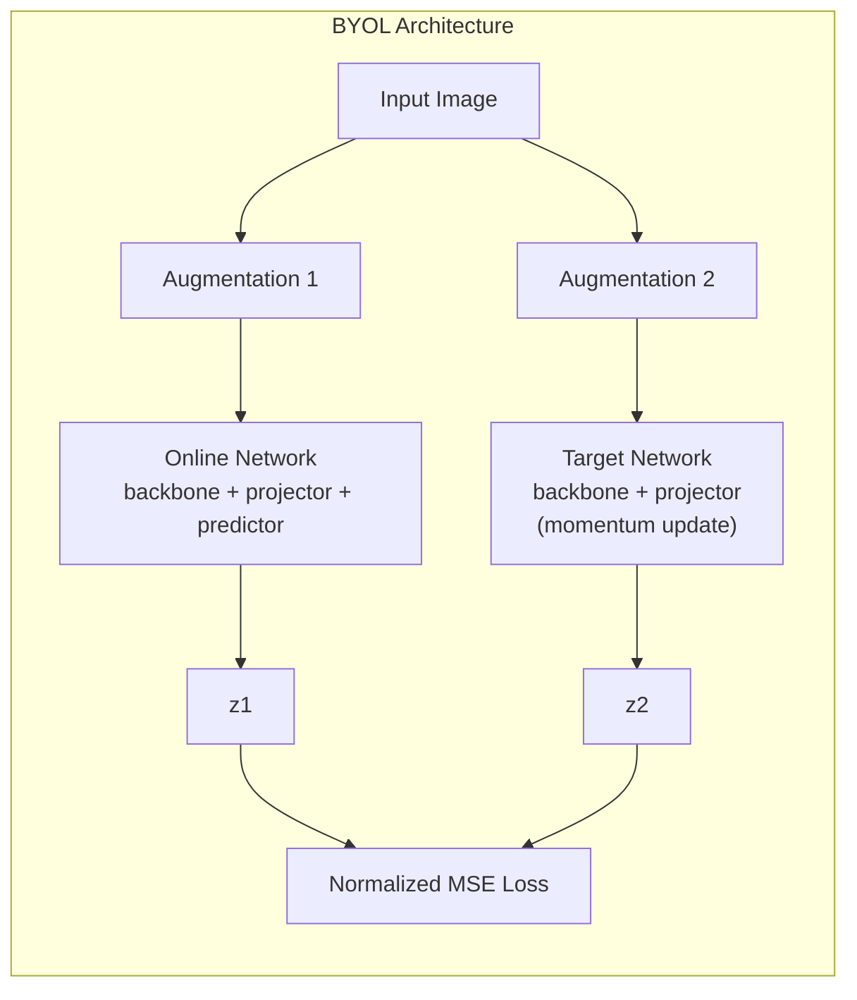

**BYOL Configuration:**
```python
task = BYOLTask(
    model='resnet50',
    weights=None,
    in_channels=13,  # Sentinel-2
    lr=1e-3,
    patience=10
)
```

**Sources:** [torchgeo/trainers/byol.py:207-407]()

### MoCo: Momentum Contrast

MoCo maintains a queue of negative samples and uses a momentum-updated encoder.

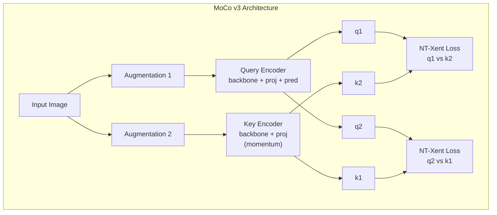

**MoCo Configuration:**
```python
# MoCo v3 (recommended)
task = MoCoTask(
    model='resnet50',
    in_channels=13,
    version=3,
    layers=3,
    output_dim=256,
    lr=9.6,  # 0.6 * batch_size / 256
    memory_bank_size=0,  # No queue in v3
    moco_momentum=0.99
)

# MoCo v2
task = MoCoTask(
    model='resnet50',
    version=2,
    layers=2,
    memory_bank_size=65536,  # Queue size
    moco_momentum=0.999
)
```

**Sources:** [torchgeo/trainers/moco.py:118-444]()

### SimCLR: Simple Contrastive Learning

SimCLR uses strong data augmentation and large batches for contrastive learning.

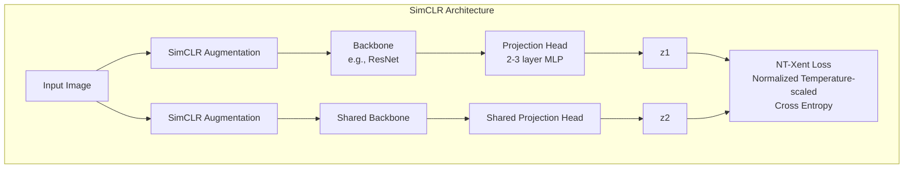

**SimCLR Configuration:**
```python
# SimCLR v2 (recommended)
task = SimCLRTask(
    model='resnet50',
    weights=None,
    in_channels=13,
    version=2,
    layers=3,
    lr=4.8,  # 0.3 * batch_size / 256
    memory_bank_size=64000,
    temperature=0.07,
    size=224  # Crop size
)
```

**Sources:** [torchgeo/trainers/simclr.py:56-323]()

### SSL Data Requirements

Self-supervised tasks expect specific input formats:

```python
# Option 1: Single view (augmentations applied by task)
batch = {
    'image': Tensor  # (B, C, H, W)
}

# Option 2: Two views pre-stacked
batch = {
    'image': Tensor  # (B, 2*C, H, W) - two augmented views concatenated
}
```

All SSL tasks implement no-op `validation_step()`, `test_step()`, and `predict_step()` since they don't use labeled data.

**Sources:** [torchgeo/trainers/byol.py:351-407](), [torchgeo/trainers/moco.py:366-444](), [torchgeo/trainers/simclr.py:223-286]()

## Configuration and Customization

### Weight Loading Mechanisms

Tasks support multiple weight initialization strategies:

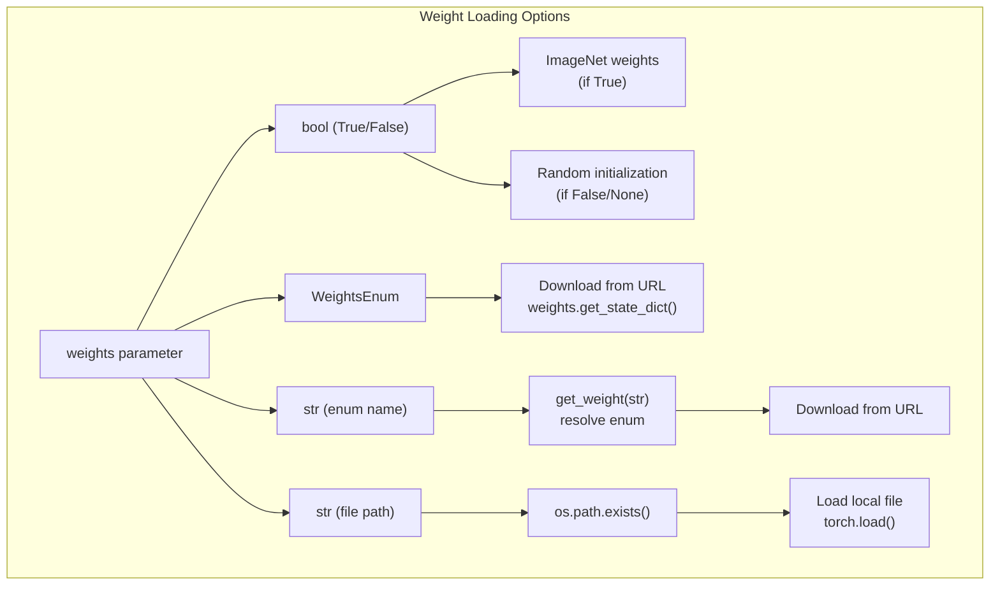

**Weight Loading Examples:**
```python
# ImageNet pre-training
task = ClassificationTask(model='resnet50', weights=True)

# TorchGeo pre-trained weights (enum)
from torchgeo.models import ResNet18_Weights
task = ClassificationTask(
    model='resnet18',
    weights=ResNet18_Weights.SENTINEL2_ALL_MOCO,
    in_channels=13
)

# TorchGeo weights (string)
task = ClassificationTask(
    model='resnet18',
    weights='SENTINEL2_ALL_MOCO',
    in_channels=13
)

# Local checkpoint
task = ClassificationTask(
    model='resnet50',
    weights='/path/to/checkpoint.pth'
)
```

**Sources:** [torchgeo/trainers/classification.py:82-103](), [torchgeo/trainers/segmentation.py:121-193]()

### Freezing Layers

Tasks support selective layer freezing for transfer learning:

| Task | Freeze Options | Use Case |
|---|---|---|
| `ClassificationTask` | `freeze_backbone` | Linear probing on classifier head |
| `SemanticSegmentationTask` | `freeze_backbone`, `freeze_decoder` | Fine-tune specific components |
| `PixelwiseRegressionTask` | `freeze_backbone`, `freeze_decoder` | Fine-tune specific components |
| `ObjectDetectionTask` | `freeze_backbone` | Fine-tune detection head |
| `RegressionTask` | `freeze_backbone` | Linear probing on regression head |

**Freezing Examples:**
```python
# Linear probing: freeze backbone, train classifier only
task = ClassificationTask(
    model='resnet50',
    weights=True,
    freeze_backbone=True,
    num_classes=10
)

# Fine-tune decoder only
task = SemanticSegmentationTask(
    model='unet',
    backbone='resnet50',
    weights=True,
    freeze_backbone=True,
    freeze_decoder=False,
    num_classes=5
)
```

**Sources:** [torchgeo/trainers/classification.py:104-109](), [torchgeo/trainers/segmentation.py:184-192]()

### Loss Functions

Tasks support multiple loss functions optimized for different scenarios:

**Classification Losses:**
| Loss | Parameter Value | Best For |
|---|---|---|
| Cross Entropy | `'ce'` | Multiclass, supports class weights |
| Binary Cross Entropy | `'bce'` | Binary/multilabel |
| Jaccard (IoU) | `'jaccard'` | Imbalanced classes |
| Focal Loss | `'focal'` | Severe class imbalance |

**Segmentation Losses:**
| Loss | Parameter Value | Features |
|---|---|---|
| Cross Entropy | `'ce'` | Supports `ignore_index`, `class_weights` |
| Binary Cross Entropy | `'bce'` | Binary segmentation |
| Jaccard Loss | `'jaccard'` | IoU-based, handles `ignore_index` |
| Focal Loss | `'focal'` | Hard example mining |

**Regression Losses:**
| Loss | Parameter Value | Metric |
|---|---|---|
| Mean Squared Error | `'mse'` | L2 loss |
| Mean Absolute Error | `'mae'` | L1 loss |

**Loss Configuration Examples:**
```python
# Focal loss for imbalanced segmentation
task = SemanticSegmentationTask(
    model='unet',
    loss='focal',
    num_classes=10,
    ignore_index=0  # Ignore background
)

# CE with class weights
task = ClassificationTask(
    loss='ce',
    class_weights=[1.0, 2.0, 1.5],  # Weight rare classes higher
    num_classes=3
)
```

**Sources:** [torchgeo/trainers/classification.py:111-127](), [torchgeo/trainers/segmentation.py:194-225](), [torchgeo/trainers/regression.py:111-126]()

### Metrics

Tasks automatically configure appropriate metrics based on the task type:

**Classification Metrics:**
```python
# Configured in ClassificationTask.configure_metrics()
metrics = {
    'OverallAccuracy': Accuracy(average='micro'),  # Total correct / total samples
    'AverageAccuracy': Accuracy(average='macro'),  # Mean per-class accuracy
    'JaccardIndex': JaccardIndex(),  # IoU
    'F1Score': FBetaScore(beta=1.0, average='micro')
}
# Logged with prefixes: train_*, val_*, test_*
```

**Segmentation Metrics:**
```python
# Configured in SemanticSegmentationTask.configure_metrics()
metrics = {
    'Accuracy': Accuracy(average='micro'),  # Overall pixel accuracy
    'JaccardIndex': JaccardIndex(average='micro')  # Mean IoU
}
```

**Detection Metrics:**
```python
# Configured in ObjectDetectionTask.configure_metrics()
metrics = {
    'MeanAveragePrecision': MeanAveragePrecision(average='macro')
    # Includes mAP, mAR at different IoU thresholds
}
```

**Regression Metrics:**
```python
# Configured in RegressionTask.configure_metrics()
metrics = {
    'RMSE': MeanSquaredError(squared=False),
    'MSE': MeanSquaredError(squared=True),
    'MAE': MeanAbsoluteError()
}
```

**Sources:** [torchgeo/trainers/classification.py:128-162](), [torchgeo/trainers/segmentation.py:226-256](), [torchgeo/trainers/detection.py:222-239](), [torchgeo/trainers/regression.py:128-147]()

## Training Execution

### Python API

Tasks integrate with PyTorch Lightning's `Trainer` for training execution:

```python
from lightning.pytorch import Trainer
from torchgeo.trainers import ClassificationTask
from torchgeo.datamodules import EuroSATDataModule

# Initialize datamodule
datamodule = EuroSATDataModule(
    root='data/eurosat',
    batch_size=64,
    num_workers=4
)

# Initialize task
task = ClassificationTask(
    model='resnet50',
    weights=True,
    in_channels=13,
    num_classes=10,
    loss='ce',
    lr=1e-3
)

# Initialize trainer
trainer = Trainer(
    accelerator='gpu',
    devices=1,
    max_epochs=50,
    callbacks=[...],  # Early stopping, checkpointing, etc.
    logger=[...]  # TensorBoard, WandB, etc.
)

# Train
trainer.fit(model=task, datamodule=datamodule)

# Test
trainer.test(model=task, datamodule=datamodule)

# Predict
predictions = trainer.predict(model=task, datamodule=datamodule)
```

**Sources:** [tests/trainers/test_classification.py:209-220]()

### Command-Line Interface

TorchGeo provides a CLI for configuration-driven training:

```bash
# Training
torchgeo fit --config config.yaml

# Testing
torchgeo test --config config.yaml

# Prediction
torchgeo predict --config config.yaml
```

**Configuration File Structure:**
```yaml
# config.yaml
trainer:
  accelerator: gpu
  devices: 1
  max_epochs: 50
  log_every_n_steps: 10

model:
  class_path: torchgeo.trainers.ClassificationTask
  init_args:
    model: resnet50
    weights: true
    in_channels: 13
    num_classes: 10
    loss: ce
    lr: 0.001
    patience: 10

data:
  class_path: torchgeo.datamodules.EuroSATDataModule
  init_args:
    root: data/eurosat
    batch_size: 64
    num_workers: 4
```

**Sources:** [tests/trainers/test_classification.py:94-125]()

### Callbacks and Logging

Lightning's callback system integrates seamlessly with tasks:

```python
from lightning.pytorch.callbacks import (
    ModelCheckpoint,
    EarlyStopping,
    LearningRateMonitor
)
from lightning.pytorch.loggers import TensorBoardLogger

# Configure callbacks
callbacks = [
    ModelCheckpoint(
        monitor='val_OverallAccuracy',
        mode='max',
        save_top_k=3
    ),
    EarlyStopping(
        monitor='val_loss',
        patience=10,
        mode='min'
    ),
    LearningRateMonitor(logging_interval='step')
]

# Configure logger
logger = TensorBoardLogger('logs', name='my_experiment')

# Use with trainer
trainer = Trainer(callbacks=callbacks, logger=logger, ...)
```

Tasks automatically log:
- Loss values (`train_loss`, `val_loss`, `test_loss`)
- Metrics (with `train_*`, `val_*`, `test_*` prefixes)
- Visualization plots (for validation batches when DataModule has `plot()` method)

**Sources:** [torchgeo/trainers/classification.py:215-251](), [torchgeo/trainers/segmentation.py:308-359]()

### Visualization During Training

Tasks automatically generate visualization plots during validation if the DataModule implements a `plot()` method:

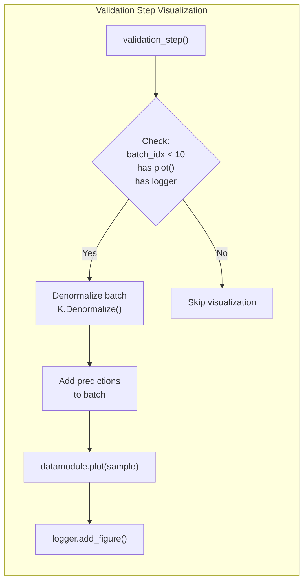

**Sources:** [torchgeo/trainers/classification.py:215-251](), [torchgeo/trainers/segmentation.py:308-359]()

## Integration with DataModules

Tasks are designed to work seamlessly with TorchGeo's DataModule system. The integration flow:

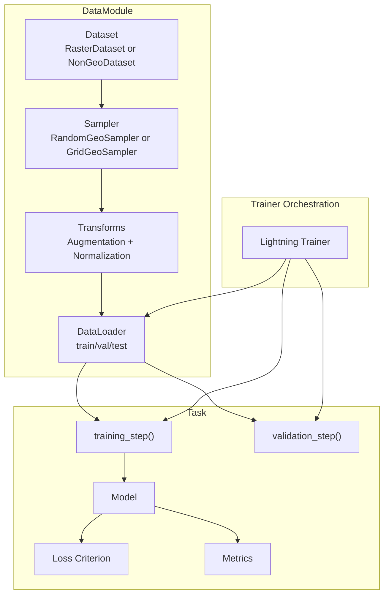

**Expected Batch Format:**

| Task Type | Expected Keys | Value Shapes |
|---|---|---|
| Classification | `'image'`, `'label'` | `(B, C, H, W)`, `(B,)` or `(B, L)` |
| Segmentation | `'image'`, `'mask'` | `(B, C, H, W)`, `(B, H, W)` |
| Detection | `'image'`, `'bbox_xyxy'`, `'label'` | `(B, C, H, W)`, `list[Tensor]`, `list[Tensor]` |
| Regression | `'image'`, `'label'` or `'mask'` | `(B, C, H, W)`, `(B,)` or `(B, H, W)` |
| SSL | `'image'` | `(B, C, H, W)` or `(B, 2*C, H, W)` |

**Sources:** [torchgeo/trainers/classification.py:164-190](), [torchgeo/trainers/segmentation.py:257-283](), [torchgeo/trainers/detection.py:241-264](), [torchgeo/trainers/regression.py:149-174]()

## Utility Tasks

### IOBenchTask

The `IOBenchTask` is a minimal task for benchmarking I/O performance without actual training:

```python
from torchgeo.trainers import IOBenchTask
from torchgeo.datamodules import MyDataModule

task = IOBenchTask()
datamodule = MyDataModule(...)

# Benchmark data loading speed
trainer = Trainer(max_epochs=1)
trainer.fit(model=task, datamodule=datamodule)
```

The task performs no-op training/validation/test/predict steps, allowing measurement of pure data pipeline performance.

**Sources:** [torchgeo/trainers/iobench.py:16-79]()

## Summary

The TorchGeo training system provides:

1. **Unified Task Architecture**: All tasks inherit from `BaseTask` with consistent interfaces
2. **Multiple Task Types**: Supervised (classification, segmentation, detection, regression) and self-supervised (BYOL, MoCo, SimCLR) learning
3. **Flexible Configuration**: Support for various models, backbones, losses, and metrics
4. **Weight Management**: Multiple strategies for loading pre-trained weights including sensor-specific weights
5. **Transfer Learning**: Fine-grained control over layer freezing for efficient transfer learning
6. **Lightning Integration**: Full compatibility with PyTorch Lightning's ecosystem (callbacks, loggers, distributed training)
7. **CLI Support**: Configuration-driven training for reproducible experiments
8. **Visualization**: Automatic plotting during validation for visual debugging

For implementation details of specific task types, see [Supervised Learning Tasks](#5.2) and [Self-Supervised Learning](#5.3). For information about creating custom tasks, see [Creating Custom Tasks](#5.4).

---

