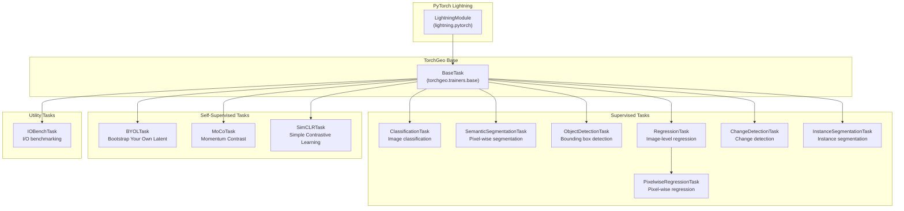
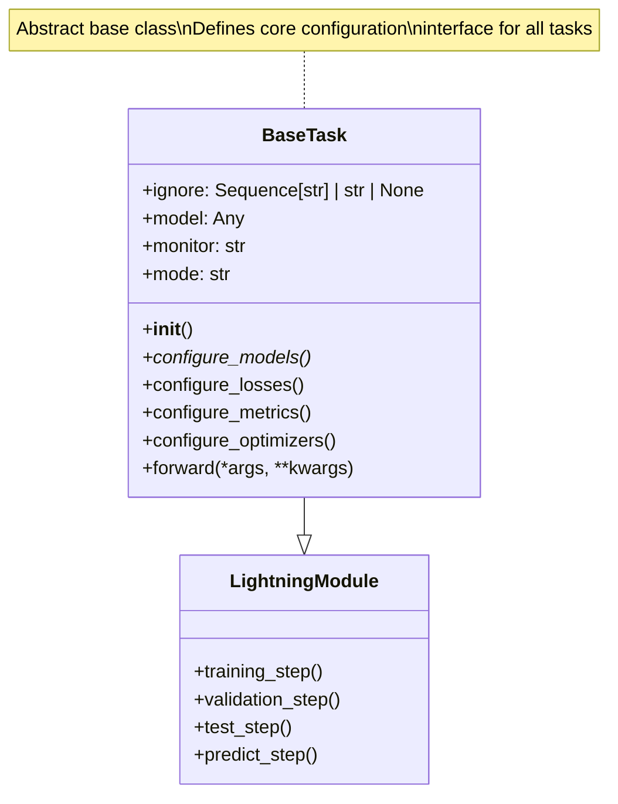
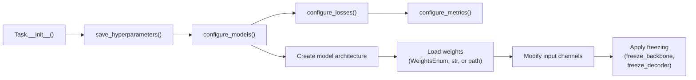
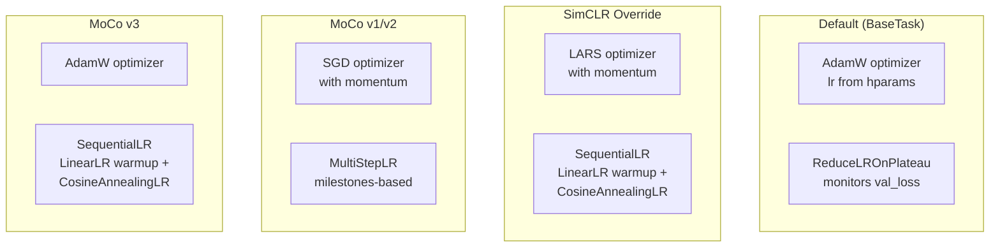
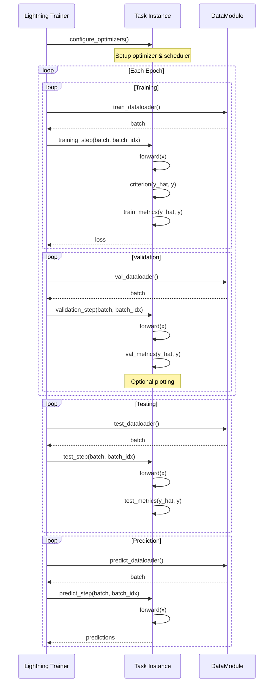
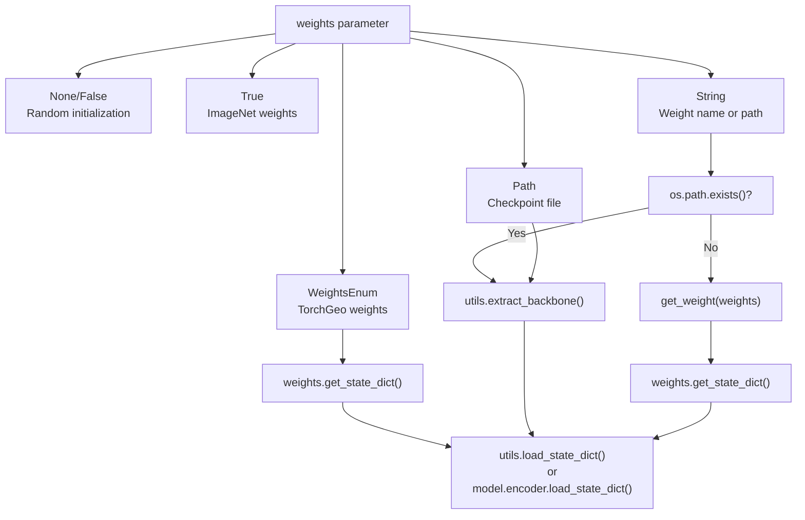
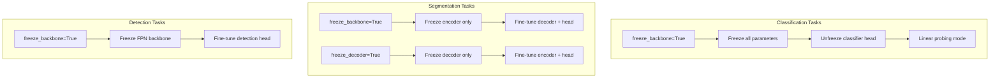
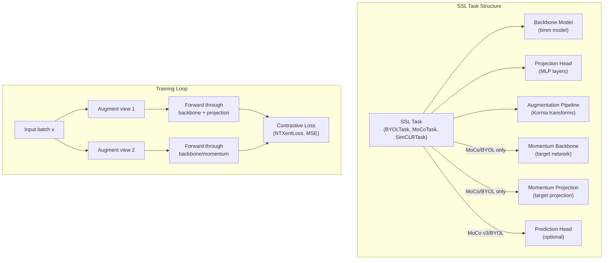
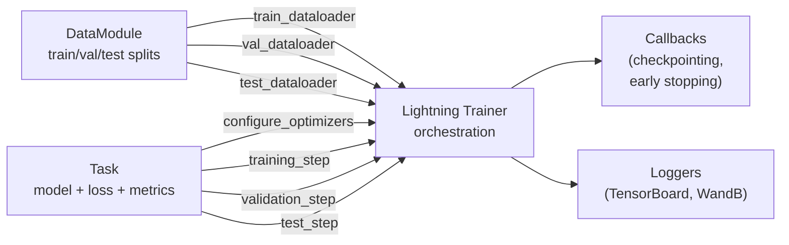

<!-- source: DeepWiki mcp.deepwiki.com · repo torchgeo/torchgeo · page 5.1 Task Architecture · fetched 2026-10-21 -->

# Task Architecture

<details>
<summary>Relevant source files</summary>

The following files were used as context for generating this wiki page:

- [tests/conf/vhr10_ins_seg.yaml](tests/conf/vhr10_ins_seg.yaml)
- [tests/conf/vhr10_obj_det.yaml](tests/conf/vhr10_obj_det.yaml)
- [tests/models/test_btc.py](tests/models/test_btc.py)
- [tests/trainers/test_byol.py](tests/trainers/test_byol.py)
- [tests/trainers/test_classification.py](tests/trainers/test_classification.py)
- [tests/trainers/test_detection.py](tests/trainers/test_detection.py)
- [tests/trainers/test_instance_segmentation.py](tests/trainers/test_instance_segmentation.py)
- [tests/trainers/test_moco.py](tests/trainers/test_moco.py)
- [tests/trainers/test_regression.py](tests/trainers/test_regression.py)
- [tests/trainers/test_simclr.py](tests/trainers/test_simclr.py)
- [torchgeo/models/btc.py](torchgeo/models/btc.py)
- [torchgeo/trainers/base.py](torchgeo/trainers/base.py)
- [torchgeo/trainers/byol.py](torchgeo/trainers/byol.py)
- [torchgeo/trainers/classification.py](torchgeo/trainers/classification.py)
- [torchgeo/trainers/detection.py](torchgeo/trainers/detection.py)
- [torchgeo/trainers/instance_segmentation.py](torchgeo/trainers/instance_segmentation.py)
- [torchgeo/trainers/iobench.py](torchgeo/trainers/iobench.py)
- [torchgeo/trainers/moco.py](torchgeo/trainers/moco.py)
- [torchgeo/trainers/regression.py](torchgeo/trainers/regression.py)
- [torchgeo/trainers/segmentation.py](torchgeo/trainers/segmentation.py)
- [torchgeo/trainers/simclr.py](torchgeo/trainers/simclr.py)

</details>


## Purpose and Scope

This document describes the architecture of TorchGeo's training task system, which provides a unified interface for training geospatial machine learning models using PyTorch Lightning. The task hierarchy defines how models, loss functions, metrics, and optimization strategies are configured and orchestrated during training.

For information about specific task implementations for supervised learning, see [Supervised Learning Tasks](#5.2). For self-supervised learning approaches, see [Self-Supervised Learning](#5.3). For guidance on creating custom tasks, see [Creating Custom Tasks](#5.4). For the complete training workflow including CLI and configuration, see [Training Workflows](#5.5).

---

## Task Hierarchy Overview

The task system is organized around an abstract base class `BaseTask` that inherits from PyTorch Lightning's `LightningModule`. All training tasks in TorchGeo extend this base class and fall into three categories:



**Sources:** [torchgeo/trainers/__init__.py:1-33](), [torchgeo/trainers/base.py:16-82]()

---

## BaseTask Abstract Class

The `BaseTask` class provides core functionality shared across all training tasks:

### Key Responsibilities

| Responsibility | Method/Attribute | Description |
|---------------|------------------|-------------|
| Model initialization | `configure_models()` | Create and configure the neural network |
| Loss function setup | `configure_losses()` | Initialize loss criterion |
| Metrics setup | `configure_metrics()` | Initialize performance metrics |
| Optimization | `configure_optimizers()` | Setup optimizer and learning rate scheduler |
| Hyperparameter management | `save_hyperparameters()` | Automatic saving of constructor arguments |
| Forward pass | `forward()` | Pass input through the model |

### BaseTask Structure



### Hyperparameter Management

Tasks automatically save their constructor arguments as hyperparameters using Lightning's `save_hyperparameters()` method. The `ignore` attribute specifies which parameters should be excluded (typically non-serializable objects like weights):

```python
# Example from BaseTask.__init__
self.save_hyperparameters(ignore=self.ignore)
```

**Sources:** [torchgeo/trainers/base.py:16-82]()

---

## Configuration Methods

Each task implements a set of configuration methods called during initialization:

### Model Configuration

The abstract method `configure_models()` must be implemented by all concrete tasks. This method:
- Creates the model architecture (e.g., ResNet, U-Net, Faster R-CNN)
- Loads pre-trained weights if specified
- Applies architecture-specific modifications (e.g., changing input channels)
- Handles freezing of backbone/decoder layers



**Sources:** [torchgeo/trainers/base.py:34-49](), [torchgeo/trainers/classification.py:82-110](), [torchgeo/trainers/segmentation.py:121-193]()

### Loss Configuration

The `configure_losses()` method initializes the loss criterion. Common patterns include:

| Task Type | Common Loss Functions | Implementation Location |
|-----------|----------------------|-------------------------|
| Classification | CrossEntropyLoss, BCEWithLogitsLoss, JaccardLoss, FocalLoss | [torchgeo/trainers/classification.py:111-127]() |
| Segmentation | CrossEntropyLoss, BCEWithLogitsLoss, JaccardLoss, FocalLoss | [torchgeo/trainers/segmentation.py:194-225]() |
| Regression | MSELoss, L1Loss | [torchgeo/trainers/regression.py:111-127]() |
| Detection | Built into model | [torchgeo/trainers/detection.py:112-221]() |

**Sources:** [torchgeo/trainers/classification.py:111-127](), [torchgeo/trainers/segmentation.py:194-225](), [torchgeo/trainers/regression.py:111-127]()

### Metrics Configuration

The `configure_metrics()` method initializes TorchMetrics collections for train, validation, and test phases:

```python
# Common pattern from ClassificationTask
metrics = MetricCollection({
    'OverallAccuracy': Accuracy(average='micro', **kwargs),
    'AverageAccuracy': Accuracy(average='macro', **kwargs),
    'JaccardIndex': JaccardIndex(**kwargs),
    'F1Score': FBetaScore(beta=1.0, average='micro', **kwargs),
})
self.train_metrics = metrics.clone(prefix='train_')
self.val_metrics = metrics.clone(prefix='val_')
self.test_metrics = metrics.clone(prefix='test_')
```

**Sources:** [torchgeo/trainers/classification.py:128-163](), [torchgeo/trainers/segmentation.py:226-256]()

### Optimizer Configuration

The default `configure_optimizers()` in `BaseTask` uses AdamW with ReduceLROnPlateau scheduler. Tasks can override this for custom optimization strategies (e.g., MoCo and SimCLR use different optimizers):



**Sources:** [torchgeo/trainers/base.py:56-70](), [torchgeo/trainers/simclr.py:287-323](), [torchgeo/trainers/moco.py:290-334]()

---

## Task Lifecycle Methods

Tasks implement Lightning's training loop hooks to define behavior at each stage:

### Core Lifecycle Methods



### Training Step Pattern

All supervised tasks follow a similar pattern in `training_step()`:

| Step | Operation | Code Location |
|------|-----------|---------------|
| 1. Extract batch | `x = batch['image']`, `y = batch['label'/'mask']` | [torchgeo/trainers/classification.py:177-179]() |
| 2. Forward pass | `y_hat = self(x)` | [torchgeo/trainers/classification.py:180]() |
| 3. Update metrics | `self.train_metrics(y_hat, y)` | [torchgeo/trainers/classification.py:181-182]() |
| 4. Compute loss | `loss = self.criterion(y_hat, y)` | [torchgeo/trainers/classification.py:187-188]() |
| 5. Log metrics | `self.log('train_loss', loss)` | [torchgeo/trainers/classification.py:188]() |
| 6. Return loss | `return loss` | [torchgeo/trainers/classification.py:190]() |

**Sources:** [torchgeo/trainers/classification.py:164-191](), [torchgeo/trainers/segmentation.py:257-284](), [torchgeo/trainers/regression.py:149-175]()

### Validation Step with Plotting

Validation steps optionally generate plots for the first 10 batches when using compatible DataModules:

```python
if (
    batch_idx < 10
    and hasattr(self.trainer, 'datamodule')
    and hasattr(self.trainer.datamodule, 'plot')
    and self.logger
    and hasattr(self.logger, 'experiment')
    and hasattr(self.logger.experiment, 'add_figure')
):
    # Denormalize, create predictions, plot
    fig = datamodule.plot(sample)
    summary_writer.add_figure(f'image/{batch_idx}', fig, global_step=self.global_step)
```

**Sources:** [torchgeo/trainers/classification.py:215-252](), [torchgeo/trainers/segmentation.py:308-359]()

### Predict Step

The `predict_step()` method returns model predictions with appropriate activation functions:

```python
# Classification example
match self.hparams['task']:
    case 'binary' | 'multilabel':
        y_hat = y_hat.sigmoid()  # Binary/multilabel uses sigmoid
    case 'multiclass':
        y_hat = y_hat.softmax(dim=1)  # Multiclass uses softmax
return y_hat
```

**Sources:** [torchgeo/trainers/classification.py:274-297](), [torchgeo/trainers/segmentation.py:381-404]()

---

## Weight Loading System

Tasks support multiple weight initialization strategies:

### Weight Types



### Weight Loading Implementations

Different task types load weights into different model components:

| Task Type | Target Component | Code Reference |
|-----------|-----------------|----------------|
| Classification | `self.model` (entire model) | [torchgeo/trainers/classification.py:95-103]() |
| Segmentation | `self.model.encoder` (backbone only) | [torchgeo/trainers/segmentation.py:174-183]() |
| Regression | `self.model` (entire model) | [torchgeo/trainers/regression.py:95-103]() |
| PixelwiseRegression | `self.model.encoder` (backbone only) | [torchgeo/trainers/regression.py:332-340]() |
| BYOL | `backbone` (passed to BYOL wrapper) | [torchgeo/trainers/byol.py:340-348]() |
| SimCLR | `self.backbone` (separate from projection) | [torchgeo/trainers/simclr.py:164-172]() |
| MoCo | `self.backbone` (separate from projection) | [torchgeo/trainers/moco.py:246-254]() |

**Sources:** [torchgeo/trainers/classification.py:82-110](), [torchgeo/trainers/segmentation.py:121-193](), [torchgeo/trainers/byol.py:329-350]()

---

## Model Freezing Strategies

Tasks support selective freezing of model components for transfer learning:

### Freezing Options



### Implementation Pattern

```python
# Classification/Regression pattern
if self.hparams['freeze_backbone']:
    for param in self.model.parameters():
        param.requires_grad = False
    for param in self.model.get_classifier().parameters():
        param.requires_grad = True

# Segmentation pattern
if self.hparams['freeze_backbone'] and model != 'fcn':
    for param in self.model.encoder.parameters():
        param.requires_grad = False

if self.hparams['freeze_decoder'] and model != 'fcn':
    for param in self.model.decoder.parameters():
        param.requires_grad = False
```

**Sources:** [torchgeo/trainers/classification.py:104-110](), [torchgeo/trainers/segmentation.py:184-193](), [torchgeo/trainers/detection.py:149-207]()

---

## Task-Specific Attributes

Tasks define monitoring attributes for callbacks and schedulers:

### Monitoring Configuration

| Attribute | Purpose | Default Values | Override Examples |
|-----------|---------|----------------|-------------------|
| `monitor` | Metric to track for callbacks | `'val_loss'` (supervised) | `'train_loss'` (SSL), `'val_map'` (detection) |
| `mode` | Optimization direction | `'min'` (loss), `'max'` (accuracy) | Detection uses `'max'` for mAP |
| `ignore` | Hyperparams to exclude from saving | `'weights'` | MoCo/SimCLR also ignore augmentation functions |

```python
# BaseTask defaults
monitor = 'val_loss'
mode = 'min'
ignore = 'weights'

# ObjectDetectionTask overrides
monitor = 'val_map'
mode = 'max'

# SimCLRTask overrides
ignore = ('weights', 'augmentations')
monitor = 'train_loss'
```

**Sources:** [torchgeo/trainers/base.py:23-32](), [torchgeo/trainers/detection.py:60-63](), [torchgeo/trainers/simclr.py:71-73]()

---

## Self-Supervised Task Patterns

SSL tasks differ significantly from supervised tasks:

### SSL Architectural Pattern



### Key Differences

| Aspect | Supervised Tasks | Self-Supervised Tasks |
|--------|-----------------|----------------------|
| Labels required | Yes (`batch['label']` or `batch['mask']`) | No (uses augmented views) |
| Loss function | Task-specific (CE, BCE, etc.) | Contrastive (NTXentLoss, normalized MSE) |
| Validation/Test | Computes metrics on labeled data | No-op (only trains) |
| Output | Predictions (classification, segmentation) | Feature embeddings |
| Optimizer | Usually AdamW | LARS (SimCLR), SGD/AdamW (MoCo), AdamW (BYOL) |

**Sources:** [torchgeo/trainers/byol.py:284-407](), [torchgeo/trainers/simclr.py:56-323](), [torchgeo/trainers/moco.py:118-444]()

---

## Task Registration and Discovery

All tasks are registered in the package's `__init__.py` for easy import:

```python
# From torchgeo/trainers/__init__.py
from .base import BaseTask
from .byol import BYOLTask
from .classification import ClassificationTask, MultiLabelClassificationTask
from .detection import ObjectDetectionTask
from .segmentation import SemanticSegmentationTask
# ... etc

__all__ = (
    'BaseTask',
    'BYOLTask',
    'ClassificationTask',
    # ... etc
)
```

Users can import tasks using:
```python
from torchgeo.trainers import ClassificationTask
```

**Sources:** [torchgeo/trainers/__init__.py:1-33]()

---

## Integration with DataModules

Tasks work seamlessly with DataModules for complete training pipelines:



The task's `monitor` attribute tells callbacks which metric to track:
```python
# In trainer.fit()
trainer = Trainer(
    callbacks=[
        ModelCheckpoint(monitor=task.monitor, mode=task.mode),
        EarlyStopping(monitor=task.monitor, mode=task.mode)
    ]
)
trainer.fit(model=task, datamodule=datamodule)
```

**Sources:** [torchgeo/trainers/base.py:56-70]()

---

