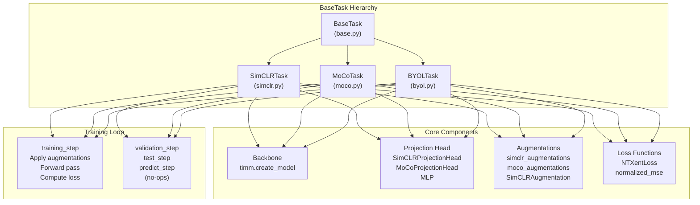
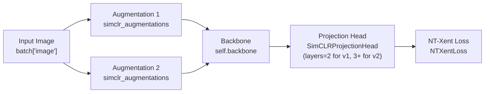
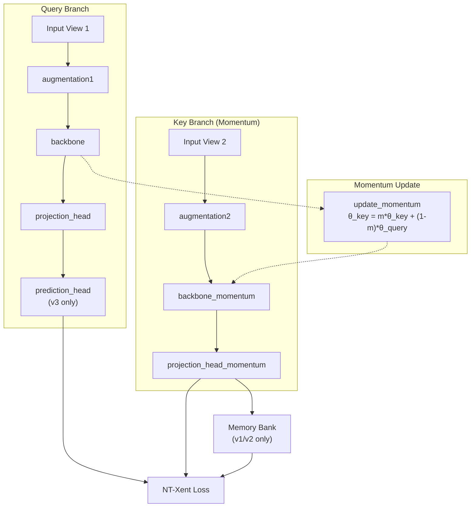
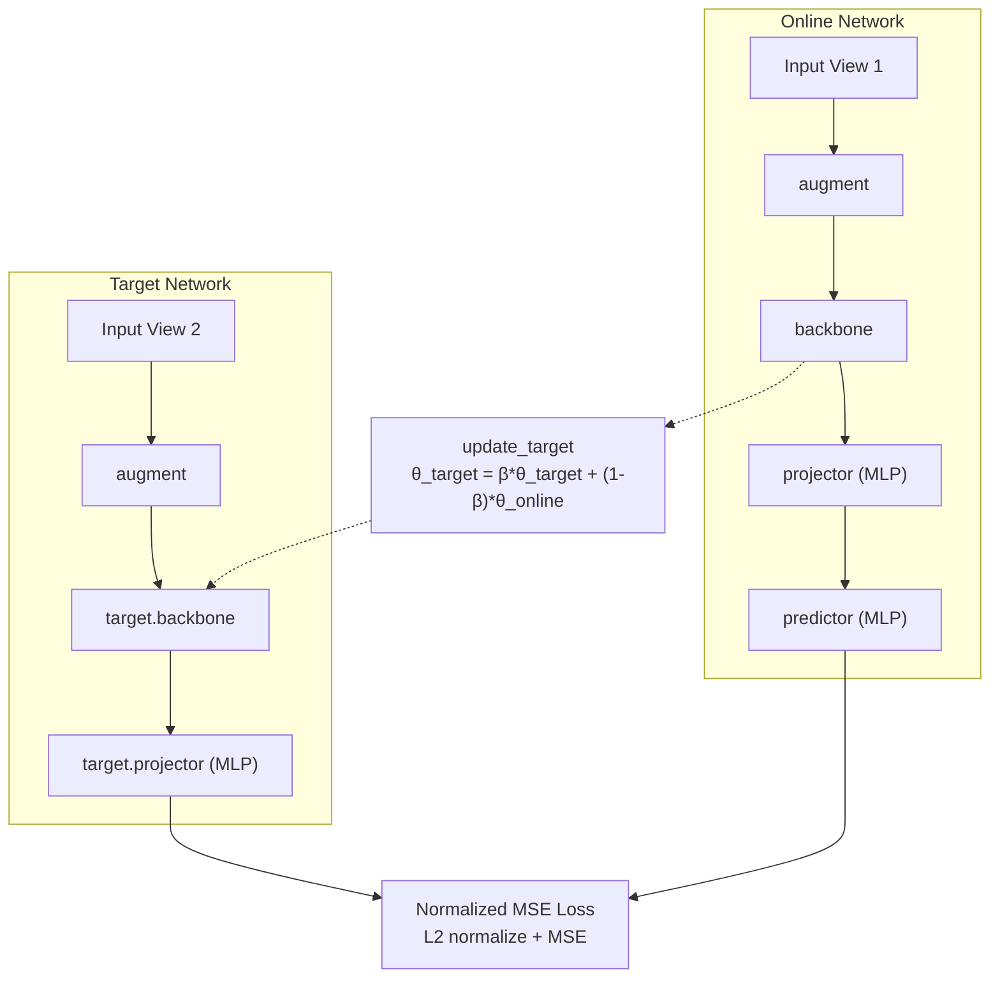
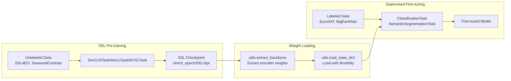

<!-- source: DeepWiki mcp.deepwiki.com · repo torchgeo/torchgeo · page 5.3 Self-Supervised Learning · fetched 2026-10-21 -->

# Self-Supervised Learning

<details>
<summary>Relevant source files</summary>

The following files were used as context for generating this wiki page:

- [tests/conf/vhr10_ins_seg.yaml](tests/conf/vhr10_ins_seg.yaml)
- [tests/conf/vhr10_obj_det.yaml](tests/conf/vhr10_obj_det.yaml)
- [tests/models/test_btc.py](tests/models/test_btc.py)
- [tests/trainers/test_byol.py](tests/trainers/test_byol.py)
- [tests/trainers/test_classification.py](tests/trainers/test_classification.py)
- [tests/trainers/test_detection.py](tests/trainers/test_detection.py)
- [tests/trainers/test_instance_segmentation.py](tests/trainers/test_instance_segmentation.py)
- [tests/trainers/test_moco.py](tests/trainers/test_moco.py)
- [tests/trainers/test_regression.py](tests/trainers/test_regression.py)
- [tests/trainers/test_simclr.py](tests/trainers/test_simclr.py)
- [torchgeo/models/btc.py](torchgeo/models/btc.py)
- [torchgeo/trainers/base.py](torchgeo/trainers/base.py)
- [torchgeo/trainers/byol.py](torchgeo/trainers/byol.py)
- [torchgeo/trainers/classification.py](torchgeo/trainers/classification.py)
- [torchgeo/trainers/detection.py](torchgeo/trainers/detection.py)
- [torchgeo/trainers/instance_segmentation.py](torchgeo/trainers/instance_segmentation.py)
- [torchgeo/trainers/iobench.py](torchgeo/trainers/iobench.py)
- [torchgeo/trainers/moco.py](torchgeo/trainers/moco.py)
- [torchgeo/trainers/regression.py](torchgeo/trainers/regression.py)
- [torchgeo/trainers/segmentation.py](torchgeo/trainers/segmentation.py)
- [torchgeo/trainers/simclr.py](torchgeo/trainers/simclr.py)

</details>


This page documents TorchGeo's self-supervised learning (SSL) trainers for pre-training models on unlabeled satellite imagery. Self-supervised learning enables learning useful representations from vast amounts of unlabeled remote sensing data by solving pretext tasks. For supervised training tasks like classification and segmentation, see [Supervised Learning Tasks](#5.2). For information on using pre-trained weights produced by SSL, see [Pre-trained Weights System](#4.2).

## Overview

TorchGeo implements three contrastive learning frameworks for self-supervised pre-training:

- **SimCLRTask**: Simple framework for contrastive learning (v1 and v2)
- **MoCoTask**: Momentum contrast learning (v1, v2, and v3)
- **BYOLTask**: Bootstrap your own latent without negative pairs

All SSL tasks inherit from [BaseTask](torchgeo/trainers/base.py:16-82) and share common characteristics:
- No labels required during training
- Generate embeddings that can be fine-tuned for downstream tasks
- Use specialized augmentations adapted for multispectral imagery
- Operate on unlabeled datasets like SSL4EO, SeasonalContrast, and HySpecNet

**Key Difference from Supervised Tasks**: SSL tasks implement `training_step` to maximize agreement between augmented views of the same image, while `validation_step`, `test_step`, and `predict_step` are no-ops. They monitor `'train_loss'` instead of `'val_loss'`.

Sources: [torchgeo/trainers/simclr.py:1-323](), [torchgeo/trainers/moco.py:1-445](), [torchgeo/trainers/byol.py:1-407](), [torchgeo/trainers/base.py:1-82]()

## SSL Task Architecture



Sources: [torchgeo/trainers/base.py:16-82](), [torchgeo/trainers/simclr.py:56-323](), [torchgeo/trainers/moco.py:118-445](), [torchgeo/trainers/byol.py:284-407]()

## SimCLRTask

`SimCLRTask` implements the SimCLR framework, which learns representations by maximizing agreement between differently augmented views of the same image using contrastive loss.

### Architecture



Sources: [torchgeo/trainers/simclr.py:56-323]()

### Key Parameters

| Parameter | Type | Default | Description |
|-----------|------|---------|-------------|
| `model` | `str` | `'resnet50'` | Backbone architecture from timm |
| `weights` | `WeightsEnum \| str \| bool \| None` | `None` | Initial weights (enum, path, True for ImageNet, None for random) |
| `in_channels` | `int` | `3` | Number of input channels |
| `version` | `int` | `2` | SimCLR version (1 or 2) |
| `layers` | `int` | `3` | Projection head layers (2 for v1, 3+ for v2) |
| `hidden_dim` | `int \| None` | `None` | Hidden dimension (defaults to backbone output dim) |
| `output_dim` | `int \| None` | `None` | Output dimension (defaults to backbone output dim) |
| `lr` | `float` | `4.8` | Learning rate (scaled: 0.3 × batch_size / 256) |
| `temperature` | `float` | `0.07` | Temperature for NT-Xent loss |
| `memory_bank_size` | `int` | `64000` | Size of memory bank (0 for v1, 64K for v2) |
| `size` | `int` | `224` | Crop size for augmentations |

Sources: [torchgeo/trainers/simclr.py:74-150]()

### Version Differences

**SimCLR v1**:
- 2-layer projection head
- No memory bank (all negatives from current batch)
- Weight decay: 1e-6

**SimCLR v2**:
- 3+ layer projection head
- Memory bank with 64K negatives
- Weight decay: 1e-4

The implementation validates hyperparameters and warns if they don't match the requested version:

```python
# From simclr.py:130-141
assert version in range(1, 3)
if version == 1:
    if layers > 2:
        warnings.warn('SimCLR v1 only uses 2 layers in its projection head')
    if memory_bank_size > 0:
        warnings.warn('SimCLR v1 does not use a memory bank')
```

Sources: [torchgeo/trainers/simclr.py:130-142]()

### Training Process

The `training_step` method [torchgeo/trainers/simclr.py:223-272]():

1. Extracts input image from batch
2. Checks if input contains one or two views (stacked in channel dimension)
3. Applies augmentations to both views
4. Passes augmented views through backbone and projection head
5. Computes NT-Xent contrastive loss
6. Logs metrics including `train_ssl_std` (monitors representation collapse)

```python
# From simclr.py:256-259
z1, h1 = self(x1)
z2, _ = self(x2)

loss: Tensor = self.criterion(z1, z2)
```

Sources: [torchgeo/trainers/simclr.py:223-272]()

### Optimizer Configuration

SimCLR uses LARS optimizer with cosine annealing and linear warmup [torchgeo/trainers/simclr.py:287-322]():

```python
# From simclr.py:298-318
optimizer = LARS(
    self.parameters(),
    lr=self.hparams['lr'],
    momentum=self.hparams['momentum'],
    weight_decay=self.hparams['weight_decay'],
)
scheduler = SequentialLR(
    optimizer,
    schedulers=[
        LinearLR(optimizer, total_iters=warmup_epochs),
        CosineAnnealingLR(optimizer, T_max=max_epochs),
    ],
    milestones=[warmup_epochs],
)
```

Sources: [torchgeo/trainers/simclr.py:287-322]()

## MoCoTask

`MoCoTask` implements Momentum Contrast, which uses a momentum-updated encoder to build a large and consistent dictionary for contrastive learning.

### Architecture



Sources: [torchgeo/trainers/moco.py:118-445]()

### Key Parameters

| Parameter | Type | Default | Description |
|-----------|------|---------|-------------|
| `model` | `str` | `'resnet50'` | Backbone architecture from timm |
| `weights` | `WeightsEnum \| str \| bool \| None` | `None` | Initial weights |
| `in_channels` | `int` | `3` | Number of input channels |
| `version` | `int` | `3` | MoCo version (1, 2, or 3) |
| `layers` | `int` | `3` | Projection head layers (not used in v1, 2 for v2, 3 for v3) |
| `hidden_dim` | `int` | `4096` | Hidden dimension in projection head |
| `output_dim` | `int` | `256` | Output dimension |
| `lr` | `float` | `9.6` | Learning rate (0.03 × batch_size / 256 for v1/2, 0.6 × batch_size / 256 for v3) |
| `temperature` | `float` | `1` | Temperature (0.07 for v1/2, 1 for v3) |
| `memory_bank_size` | `int` | `0` | Memory bank size (65536 for v1/2, 0 for v3) |
| `moco_momentum` | `float` | `0.99` | Momentum for updating key encoder (0.999 for v1/2, 0.99 for v3) |

Sources: [torchgeo/trainers/moco.py:138-225]()

### Version Differences

**MoCo v1**:
- No projection head (uses backbone features directly)
- Large memory bank (65536)
- Fixed momentum (0.999)
- SGD optimizer with MultiStepLR

**MoCo v2**:
- 2-layer MLP projection head
- Large memory bank (65536)
- Fixed momentum (0.999)
- SGD optimizer with MultiStepLR

**MoCo v3**:
- 3-layer projection head + 2-layer prediction head
- No memory bank (symmetric loss like SimCLR)
- Cosine-scheduled momentum (0.99 → 1.0)
- AdamW optimizer with cosine annealing

Sources: [torchgeo/trainers/moco.py:202-217](), [torchgeo/trainers/moco.py:290-333]()

### Momentum Update

The key encoder is updated using exponential moving average [torchgeo/trainers/moco.py:366-420]():

```python
# MoCo v1/v2: Fixed momentum
update_momentum(self.backbone, self.backbone_momentum, m)
update_momentum(self.projection_head, self.projection_head_momentum, m)

# MoCo v3: Cosine-scheduled momentum
m = cosine_schedule(self.current_epoch, max_steps, m, 1)
```

Sources: [torchgeo/trainers/moco.py:396-420]()

### Optimizer Configuration

Different optimizers for different versions [torchgeo/trainers/moco.py:290-333]():

```python
# MoCo v3: AdamW with warmup + cosine annealing
if self.hparams['version'] == 3:
    optimizer = AdamW(...)
    scheduler = SequentialLR(
        optimizer,
        schedulers=[
            LinearLR(optimizer, start_factor=1/warmup_epochs, ...),
            CosineAnnealingLR(optimizer, T_max=max_epochs),
        ],
        ...
    )
else:
    # MoCo v1/v2: SGD with multi-step decay
    optimizer = SGD(...)
    scheduler = MultiStepLR(optimizer, milestones=self.hparams['schedule'])
```

Sources: [torchgeo/trainers/moco.py:290-333]()

## BYOLTask

`BYOLTask` implements Bootstrap Your Own Latent, which learns representations without negative pairs by predicting the representation of one augmented view from another.

### Architecture



Sources: [torchgeo/trainers/byol.py:207-407]()

### Key Parameters

| Parameter | Type | Default | Description |
|-----------|------|---------|-------------|
| `model` | `str` | `'resnet50'` | Backbone architecture from timm |
| `weights` | `WeightsEnum \| str \| bool \| None` | `None` | Initial weights |
| `in_channels` | `int` | `3` | Number of input channels |
| `lr` | `float` | `1e-3` | Learning rate |
| `patience` | `int` | `10` | Patience for learning rate scheduler |

The `BYOL` model class [torchgeo/trainers/byol.py:207-283]() has additional internal parameters:

| Parameter | Default | Description |
|-----------|---------|-------------|
| `projection_size` | `256` | Size of projection head output |
| `hidden_size` | `4096` | Hidden layer size in MLP |
| `beta` | `0.99` | Momentum for target network update |
| `image_size` | `(224, 224)` | Input image size |

Sources: [torchgeo/trainers/byol.py:284-350](), [torchgeo/trainers/byol.py:218-244]()

### BYOL Components

**BackboneWrapper** [torchgeo/trainers/byol.py:115-205]():
- Wraps a backbone model and attaches a projection head
- Uses forward hooks to extract features from a specific layer
- Creates projection head lazily after first forward pass

**MLP Projection Head** [torchgeo/trainers/byol.py:81-113]():
```python
class MLP(nn.Module):
    def __init__(self, dim, projection_size=256, hidden_size=4096):
        super().__init__()
        self.mlp = nn.Sequential(
            nn.Linear(dim, hidden_size),
            nn.BatchNorm1d(hidden_size),
            nn.ReLU(inplace=True),
            nn.Linear(hidden_size, projection_size),
        )
```

**Normalized MSE Loss** [torchgeo/trainers/byol.py:22-36]():
```python
def normalized_mse(x: Tensor, y: Tensor) -> Tensor:
    x = F.normalize(x, dim=-1)
    y = F.normalize(y, dim=-1)
    mse = torch.mean(2 - 2 * (x * y).sum(dim=-1))
    return mse
```

Sources: [torchgeo/trainers/byol.py:22-36](), [torchgeo/trainers/byol.py:81-113](), [torchgeo/trainers/byol.py:115-205]()

### Training Process

The `training_step` method [torchgeo/trainers/byol.py:351-395]():

1. Applies augmentations to two views
2. Passes both views through online network (backbone → projector → predictor)
3. Passes both views through target network (backbone → projector, no predictor)
4. Computes symmetric normalized MSE loss
5. Updates target network with exponential moving average

```python
# From byol.py:384-393
pred1 = self(x1)  # Online network prediction
pred2 = self(x2)
with torch.no_grad():
    targ1 = self.model.target(x1)  # Target network projection
    targ2 = self.model.target(x2)

loss = torch.mean(normalized_mse(pred1, targ2) + normalized_mse(pred2, targ1))
self.model.update_target()  # EMA update
```

Sources: [torchgeo/trainers/byol.py:351-395]()

## Augmentation Strategies for Remote Sensing

All three SSL tasks use custom augmentations adapted for multispectral satellite imagery. Standard computer vision augmentations like color jitter and grayscale conversion don't work for multispectral data.

### Augmentation Comparison

| Augmentation | SimCLR | MoCo v1/v2 | MoCo v3 | BYOL | Notes |
|--------------|--------|------------|---------|------|-------|
| RandomResizedCrop | ✓ (0.75-1.33) | ✓ (0.2-1.0) | ✓ (0.08-1.0) | ✓ | Scale ranges differ |
| RandomHorizontalFlip | ✓ | ✓ | ✓ | ✓ | Added for satellite imagery |
| RandomVerticalFlip | ✓ | ✓ | ✓ | ✗ | Added for satellite imagery |
| RandomBrightness | ✓ (0.2-1.8) | ✓ (0.6-1.4) | ✓ (0.6-1.4) | ✗ | Replaces color jitter |
| RandomContrast | ✓ (0.2-1.8) | ✓ (0.6-1.4) | ✓ (0.6-1.4) | ✗ | Replaces color jitter |
| RandomGrayscale | ✓ (p=0.2) | ✓ (p=0.2) | ✓ (p=0.2) | ✗ | Custom weighted version |
| RandomGaussianBlur | ✓ (p=1.0) | ✗ | ✓ (p=1.0 or 0.1) | ✓ (p=0.1) | Kernel size adaptive |
| RandomSolarize | ✗ | ✗ | ✓ (p=0.2) | ✗ | Only in MoCo v3 |

Sources: [torchgeo/trainers/simclr.py:30-54](), [torchgeo/trainers/moco.py:39-116](), [torchgeo/trainers/byol.py:41-79]()

### RandomGrayscale for Multispectral Imagery

Standard `ColorJitter` and `RandomGrayscale` from Kornia/torchvision assume RGB inputs. TorchGeo provides a custom `RandomGrayscale` transform that accepts weight vectors for computing grayscale from arbitrary spectral bands.

**SimCLR Example** [torchgeo/trainers/simclr.py:30-54]():
```python
def simclr_augmentations(size: int, weights: Tensor) -> nn.Module:
    ks = size // 10 // 2 * 2 + 1  # Adaptive kernel size
    return K.AugmentationSequential(
        K.RandomResizedCrop(size=(size, size), ratio=(0.75, 1.33)),
        K.RandomHorizontalFlip(),
        K.RandomVerticalFlip(),  # Added for satellite imagery
        # Not appropriate for multispectral imagery
        # K.ColorJitter(brightness=0.8, contrast=0.8, saturation=0.8, hue=0.2, p=0.8)
        K.RandomBrightness(brightness=(0.2, 1.8), p=0.8),
        K.RandomContrast(contrast=(0.2, 1.8), p=0.8),
        T.RandomGrayscale(weights=weights, p=0.2),  # Custom transform
        K.RandomGaussianBlur(kernel_size=(ks, ks), sigma=(0.1, 2)),
        data_keys=['input'],
    )
```

**Default Weights**: If not specified, grayscale weights default to uniform averaging across all channels:
```python
# From simclr.py:146 and moco.py:221
grayscale_weights = grayscale_weights or torch.ones(in_channels)
```

Sources: [torchgeo/trainers/simclr.py:30-54](), [torchgeo/trainers/moco.py:39-116](), [torchgeo/transforms/__init__.py]()

### Asymmetric Augmentations

MoCo v3 uses different augmentations for the two views:

```python
# From moco.py:86-114
aug1 = K.AugmentationSequential(
    K.RandomResizedCrop(size=(size, size), scale=(0.08, 1)),
    # ... brightness, contrast, grayscale
    K.RandomGaussianBlur(kernel_size=(ks, ks), sigma=(0.1, 2), p=1),  # Strong blur
    K.RandomHorizontalFlip(),
    K.RandomVerticalFlip(),
    data_keys=['input'],
)
aug2 = K.AugmentationSequential(
    K.RandomResizedCrop(size=(size, size), scale=(0.08, 1)),
    # ... brightness, contrast, grayscale
    K.RandomGaussianBlur(kernel_size=(ks, ks), sigma=(0.1, 2), p=0.1),  # Weak blur
    K.RandomSolarize(p=0.2),  # Additional transform
    K.RandomHorizontalFlip(),
    K.RandomVerticalFlip(),
    data_keys=['input'],
)
```

Sources: [torchgeo/trainers/moco.py:86-114]()

## Usage Patterns

### Basic Training

```python
from lightning.pytorch import Trainer
from torchgeo.datamodules import SSL4EOL12DataModule
from torchgeo.trainers import SimCLRTask

# Create datamodule with unlabeled data
datamodule = SSL4EOL12DataModule(
    root='data/ssl4eo',
    batch_size=256,
    num_workers=4,
)

# Create SSL task
task = SimCLRTask(
    model='resnet50',
    in_channels=13,  # Sentinel-2 all bands
    version=2,
    lr=0.3 * 256 / 256,  # Scale learning rate with batch size
    size=224,
)

# Train
trainer = Trainer(max_epochs=200, accelerator='gpu', devices=1)
trainer.fit(model=task, datamodule=datamodule)
```

Sources: [tests/trainers/test_simclr.py:27-67](), [tests/conf/ssl4eo_s12_simclr_1.yaml]()

### Loading Pre-trained Weights

After SSL pre-training, use the learned weights for supervised fine-tuning:

```python
from torchgeo.trainers import ClassificationTask

# Extract backbone weights from SSL checkpoint
task = ClassificationTask(
    model='resnet50',
    weights='path/to/simclr_checkpoint.ckpt',  # Path to SSL checkpoint
    in_channels=13,
    num_classes=10,
    freeze_backbone=True,  # Linear probing
)
```

Or use pre-trained weights from TorchGeo's model zoo:

```python
from torchgeo.models import ResNet18_Weights

task = ClassificationTask(
    model='resnet18',
    weights=ResNet18_Weights.SENTINEL2_ALL_MOCO,  # Pre-trained with MoCo
    in_channels=13,
    num_classes=10,
)
```

Sources: [tests/trainers/test_classification.py:128-191](), [torchgeo/trainers/classification.py:83-111]()

### CLI Configuration

SSL tasks can be configured via YAML for the TorchGeo CLI:

```yaml
# ssl4eo_simclr.yaml
model:
  class_path: SimCLRTask
  init_args:
    model: resnet50
    in_channels: 13
    version: 2
    lr: 4.8
    size: 224
    memory_bank_size: 64000

data:
  class_path: SSL4EOS12DataModule
  init_args:
    batch_size: 256
    num_workers: 4
  dict_kwargs:
    root: data/ssl4eo
    
trainer:
  max_epochs: 200
  accelerator: gpu
  devices: 1
```

```bash
torchgeo fit --config ssl4eo_simclr.yaml
```

Sources: [tests/conf/ssl4eo_s12_simclr_1.yaml](), [tests/trainers/test_simclr.py:41-67]()

### Custom Augmentations

You can provide custom augmentation modules:

```python
import kornia.augmentation as K
from torchgeo.trainers import SimCLRTask

custom_aug = K.AugmentationSequential(
    K.RandomResizedCrop(size=(256, 256)),
    K.RandomHorizontalFlip(),
    # Your custom augmentations
    data_keys=['input'],
)

task = SimCLRTask(
    model='resnet50',
    augmentations=custom_aug,  # Override default augmentations
)
```

Sources: [torchgeo/trainers/simclr.py:74-150](), [torchgeo/trainers/moco.py:138-225]()

## Method Comparison

### Conceptual Differences

```mermaid
graph TB
    subgraph "SimCLR: Symmetric Contrastive Learning"
        SimInput["Same Image"]
        SimAug1["Augmentation"]
        SimAug2["Augmentation"]
        SimEnc1["Encoder + Projector"]
        SimEnc2["Same Encoder + Projector"]
        SimLoss["Maximize Agreement<br/>Minimize with Negatives"]
        
        SimInput --> SimAug1
        SimInput --> SimAug2
        SimAug1 --> SimEnc1
        SimAug2 --> SimEnc2
        SimEnc1 --> SimLoss
        SimEnc2 --> SimLoss
    end
    
    subgraph "MoCo: Queue-based Contrastive Learning"
        MoCoInput["Same Image"]
        MoCoAug1["Augmentation"]
        MoCoAug2["Augmentation"]
        MoCoQuery["Query Encoder"]
        MoCoKey["Momentum Key Encoder"]
        MoCoQueue["Queue (Memory Bank)"]
        MoCoLoss["Contrastive Loss"]
        
        MoCoInput --> MoCoAug1
        MoCoInput --> MoCoAug2
        MoCoAug1 --> MoCoQuery
        MoCoAug2 --> MoCoKey
        MoCoQuery --> MoCoLoss
        MoCoKey --> MoCoQueue
        MoCoQueue --> MoCoLoss
    end
    
    subgraph "BYOL: No Negatives"
        BYOLInput["Same Image"]
        BYOLAug1["Augmentation"]
        BYOLAug2["Augmentation"]
        BYOLOnline["Online Network<br/>+ Predictor"]
        BYOLTarget["Target Network<br/>(no predictor)"]
        BYOLLoss["Normalized MSE<br/>(no negatives)"]
        
        BYOLInput --> BYOLAug1
        BYOLInput --> BYOLAug2
        BYOLAug1 --> BYOLOnline
        BYOLAug2 --> BYOLTarget
        BYOLOnline --> BYOLLoss
        BYOLTarget --> BYOLLoss
    end
```



Sources: [torchgeo/trainers/simclr.py:56-323](), [torchgeo/trainers/moco.py:118-445](), [torchgeo/trainers/byol.py:207-407]()

### Implementation Comparison

| Feature | SimCLR | MoCo | BYOL |
|---------|--------|------|------|
| **Negative Samples** | From batch or memory bank | From memory bank (v1/v2) or batch (v3) | None |
| **Encoder Updates** | Both encoders updated together | Momentum update for key encoder | Momentum update for target |
| **Projection Head** | Shared between views | Separate for query/key | Asymmetric (online has predictor) |
| **Loss Function** | NT-Xent (contrastive) | NT-Xent (contrastive) | Normalized MSE (regression) |
| **Memory Bank** | Optional (v2: 64K) | Optional (v1/v2: 65K, v3: none) | None |
| **Optimizer** | LARS | SGD (v1/v2), AdamW (v3) | AdamW |
| **LR Schedule** | Linear warmup + cosine | Multi-step (v1/v2), warmup + cosine (v3) | ReduceLROnPlateau |
| **Batch Size** | Large (256+) | Large (256+) | Can be smaller |
| **Symmetry** | Symmetric loss | Symmetric (v3), asymmetric (v1/v2) | Asymmetric (predictor) |

Sources: [torchgeo/trainers/simclr.py:56-323](), [torchgeo/trainers/moco.py:118-445](), [torchgeo/trainers/byol.py:284-407]()

### Performance Monitoring

All SSL tasks log `train_ssl_std` to monitor representation collapse [torchgeo/trainers/simclr.py:262-269]():

```python
# Calculate mean normalized standard deviation over feature dimensions
output = h1.detach()
output = F.normalize(output, dim=1)
output_std = torch.std(output, dim=0)
output_std = torch.mean(output_std, dim=0)
self.avg_output_std = 0.9 * self.avg_output_std + (1 - 0.9) * output_std.item()
```

If `train_ssl_std` << 1/√d (where d is feature dimension), the model is collapsing to trivial solutions.

Sources: [torchgeo/trainers/simclr.py:262-269](), [torchgeo/trainers/moco.py:422-430]()

## Integration with Downstream Tasks

SSL pre-trained weights integrate seamlessly with supervised tasks via the weight loading system:



The `utils.extract_backbone` function [torchgeo/trainers/utils.py]() extracts only the backbone weights from SSL checkpoints, discarding projection heads and prediction heads that are specific to the SSL task.

Sources: [torchgeo/trainers/classification.py:96-103](), [torchgeo/trainers/segmentation.py:176-183]()

---

