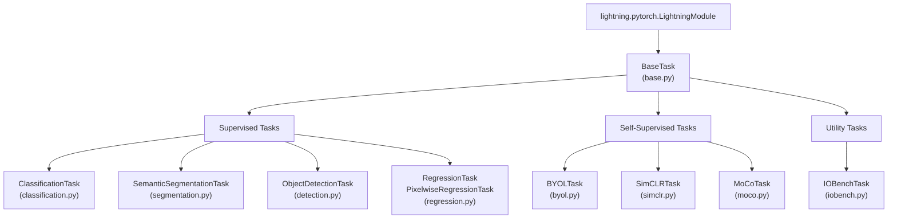
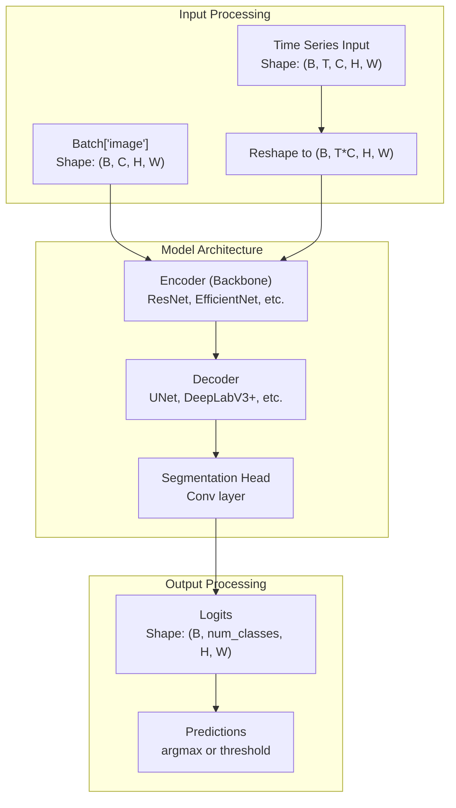
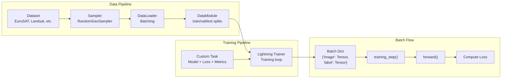

<!-- source: DeepWiki mcp.deepwiki.com · repo torchgeo/torchgeo · page 5.4 Creating Custom Tasks · fetched 2026-10-21 -->

# Creating Custom Tasks

<details>
<summary>Relevant source files</summary>

The following files were used as context for generating this wiki page:

- [docs/tutorials/basic_usage.rst](docs/tutorials/basic_usage.rst)
- [docs/tutorials/cli.ipynb](docs/tutorials/cli.ipynb)
- [docs/tutorials/custom_raster_dataset.ipynb](docs/tutorials/custom_raster_dataset.ipynb)
- [docs/tutorials/custom_segmentation_trainer.ipynb](docs/tutorials/custom_segmentation_trainer.ipynb)
- [docs/tutorials/earthquake_detection.ipynb](docs/tutorials/earthquake_detection.ipynb)
- [docs/tutorials/embeddings.ipynb](docs/tutorials/embeddings.ipynb)
- [docs/tutorials/indices.ipynb](docs/tutorials/indices.ipynb)
- [docs/tutorials/pretrained_weights.ipynb](docs/tutorials/pretrained_weights.ipynb)
- [docs/tutorials/pytorch.ipynb](docs/tutorials/pytorch.ipynb)
- [docs/tutorials/trainers.ipynb](docs/tutorials/trainers.ipynb)
- [docs/tutorials/transforms.ipynb](docs/tutorials/transforms.ipynb)
- [tests/conf/vhr10_ins_seg.yaml](tests/conf/vhr10_ins_seg.yaml)
- [tests/conf/vhr10_obj_det.yaml](tests/conf/vhr10_obj_det.yaml)
- [tests/models/test_btc.py](tests/models/test_btc.py)
- [tests/trainers/test_byol.py](tests/trainers/test_byol.py)
- [tests/trainers/test_classification.py](tests/trainers/test_classification.py)
- [tests/trainers/test_detection.py](tests/trainers/test_detection.py)
- [tests/trainers/test_instance_segmentation.py](tests/trainers/test_instance_segmentation.py)
- [tests/trainers/test_moco.py](tests/trainers/test_moco.py)
- [tests/trainers/test_regression.py](tests/trainers/test_regression.py)
- [tests/trainers/test_simclr.py](tests/trainers/test_simclr.py)
- [torchgeo/models/btc.py](torchgeo/models/btc.py)
- [torchgeo/trainers/base.py](torchgeo/trainers/base.py)
- [torchgeo/trainers/byol.py](torchgeo/trainers/byol.py)
- [torchgeo/trainers/classification.py](torchgeo/trainers/classification.py)
- [torchgeo/trainers/detection.py](torchgeo/trainers/detection.py)
- [torchgeo/trainers/instance_segmentation.py](torchgeo/trainers/instance_segmentation.py)
- [torchgeo/trainers/iobench.py](torchgeo/trainers/iobench.py)
- [torchgeo/trainers/moco.py](torchgeo/trainers/moco.py)
- [torchgeo/trainers/regression.py](torchgeo/trainers/regression.py)
- [torchgeo/trainers/segmentation.py](torchgeo/trainers/segmentation.py)
- [torchgeo/trainers/simclr.py](torchgeo/trainers/simclr.py)

</details>


This page explains how to create custom training tasks by subclassing TorchGeo's task classes. Custom tasks allow you to implement specialized training workflows, custom loss functions, or novel model architectures while leveraging TorchGeo's training infrastructure.

For information about the existing task types and their usage, see [Supervised Learning Tasks](#5.2) and [Self-Supervised Learning](#5.3). For information about training workflows and using the CLI, see [Training Workflows](#5.5).

## Overview

TorchGeo tasks are PyTorch Lightning modules that encapsulate model architecture, loss functions, metrics, and training logic. All tasks inherit from `BaseTask`, which provides a consistent interface for training, validation, and testing.

### BaseTask Architecture



**Sources:** [torchgeo/trainers/base.py:16-81](), [torchgeo/trainers/classification.py:29-297](), [torchgeo/trainers/segmentation.py:27-404](), [torchgeo/trainers/detection.py:54-368]()

### Task Lifecycle

```mermaid
graph LR
    Init["__init__()"] --> SaveHparams["save_hyperparameters()"]
    SaveHparams --> ConfigModels["configure_models()"]
    ConfigModels --> ConfigLosses["configure_losses()"]
    ConfigLosses --> ConfigMetrics["configure_metrics()"]
    
    ConfigMetrics --> Training["Training Loop"]
    
    Training --> TrainStep["training_step()"]
    TrainStep --> Forward["forward()"]
    Forward --> ComputeLoss["Compute Loss"]
    ComputeLoss --> UpdateMetrics["Update Metrics"]
    UpdateMetrics --> LogMetrics["Log Metrics"]
    
    Training --> ValStep["validation_step()"]
    ValStep --> ValForward["forward()"]
    ValForward --> ValLoss["Compute Loss"]
    ValLoss --> ValMetrics["Update Metrics"]
    ValMetrics --> ValLog["Log Metrics"]
```



**Sources:** [torchgeo/trainers/base.py:34-44](), [torchgeo/trainers/classification.py:164-190](), [torchgeo/trainers/classification.py:192-251]()

## Required vs Optional Methods

The following table summarizes which methods you need to implement when creating a custom task:

| Method | Required | Purpose | Default Behavior |
|--------|----------|---------|------------------|
| `configure_models()` | ✓ | Initialize the model | Abstract method, must implement |
| `configure_losses()` | ✗ | Initialize loss criterion | No-op |
| `configure_metrics()` | ✗ | Initialize performance metrics | No-op |
| `configure_optimizers()` | ✗ | Initialize optimizer and scheduler | AdamW + ReduceLROnPlateau |
| `training_step()` | ✗ | Compute training loss | Inherited from parent task |
| `validation_step()` | ✗ | Compute validation loss | Inherited from parent task |
| `test_step()` | ✗ | Compute test loss | Inherited from parent task |
| `predict_step()` | ✗ | Generate predictions | Inherited from parent task |
| `forward()` | ✗ | Forward pass through model | `self.model(x)` |

**Sources:** [torchgeo/trainers/base.py:46-69]()

## Creating a Custom Classification Task

Let's create a custom classification task that uses a weighted cross-entropy loss and custom metrics. This example demonstrates the minimal structure needed.

### Step 1: Define the Task Class

```python
# Imports from base task
from torchgeo.trainers import BaseTask
from torchvision.models._api import WeightsEnum

class CustomClassificationTask(BaseTask):
    """Custom classification task with weighted loss."""
    
    def __init__(
        self,
        model: str = 'resnet50',
        weights: WeightsEnum | str | bool | None = None,
        in_channels: int = 3,
        num_classes: int = 10,
        class_weights: list[float] | None = None,
        lr: float = 1e-3,
        patience: int = 10,
    ) -> None:
        """Initialize task.
        
        Args:
            model: Name of timm model to use
            weights: Initial weights (WeightsEnum, path, True, or None)
            in_channels: Number of input channels
            num_classes: Number of classes
            class_weights: Optional class weights for loss
            lr: Learning rate
            patience: Scheduler patience
        """
        self.weights = weights
        super().__init__()
```

The key pattern here is storing `weights` before calling `super().__init__()` because it's not serializable and needs to be in the `ignore` list.

**Sources:** [torchgeo/trainers/classification.py:32-80](), [torchgeo/trainers/base.py:34-44]()

### Step 2: Implement configure_models()

This method must load and initialize your model. Here's the typical pattern for a timm-based classifier:

```python
def configure_models(self) -> None:
    """Initialize the model."""
    import timm
    import os
    from torchgeo.models import get_weight
    from torchgeo.trainers import utils
    
    weights = self.weights
    
    # Create model from timm
    self.model = timm.create_model(
        self.hparams['model'],
        num_classes=self.hparams['num_classes'],
        in_chans=self.hparams['in_channels'],
        pretrained=weights is True,
    )
    
    # Load custom weights if provided
    if weights and weights is not True:
        if isinstance(weights, WeightsEnum):
            state_dict = weights.get_state_dict(progress=True)
        elif os.path.exists(weights):
            _, state_dict = utils.extract_backbone(weights)
        else:
            state_dict = get_weight(weights).get_state_dict(progress=True)
        utils.load_state_dict(self.model, state_dict)
```

This pattern handles three weight scenarios:
1. `True`: Use ImageNet weights from timm
2. `WeightsEnum` or string name: Load TorchGeo pretrained weights
3. File path: Load checkpoint from disk

**Sources:** [torchgeo/trainers/classification.py:82-102](), [torchgeo/models/__init__.py]()

### Step 3: Implement configure_losses()

Define your loss function based on hyperparameters:

```python
def configure_losses(self) -> None:
    """Initialize the loss criterion."""
    import torch.nn as nn
    import torch
    
    class_weights = self.hparams.get('class_weights')
    if class_weights is not None:
        class_weights = torch.tensor(class_weights, dtype=torch.float32)
    
    self.criterion = nn.CrossEntropyLoss(weight=class_weights)
```

**Sources:** [torchgeo/trainers/classification.py:111-126]()

### Step 4: Implement configure_metrics()

Set up performance metrics using `torchmetrics`:

```python
def configure_metrics(self) -> None:
    """Initialize performance metrics."""
    from torchmetrics import MetricCollection
    from torchmetrics.classification import Accuracy, FBetaScore
    
    metrics = MetricCollection({
        'OverallAccuracy': Accuracy(
            task='multiclass',
            num_classes=self.hparams['num_classes'],
            average='micro'
        ),
        'AverageAccuracy': Accuracy(
            task='multiclass', 
            num_classes=self.hparams['num_classes'],
            average='macro'
        ),
        'F1Score': FBetaScore(
            task='multiclass',
            num_classes=self.hparams['num_classes'],
            beta=1.0,
            average='micro'
        ),
    })
    
    # Clone for each split
    self.train_metrics = metrics.clone(prefix='train_')
    self.val_metrics = metrics.clone(prefix='val_')
    self.test_metrics = metrics.clone(prefix='test_')
```

The `MetricCollection` groups metrics together for efficient computation. Cloning with prefixes automatically prepends 'train_', 'val_', or 'test_' to metric names when logging.

**Sources:** [torchgeo/trainers/classification.py:128-162]()

### Step 5: Implement Training Steps

Implement the training, validation, and test steps:

```python
def training_step(self, batch: Any, batch_idx: int, dataloader_idx: int = 0) -> Tensor:
    """Compute training loss and metrics.
    
    Args:
        batch: Output of DataLoader
        batch_idx: Index of this batch
        dataloader_idx: Index of current dataloader
        
    Returns:
        Loss tensor
    """
    x = batch['image']
    y = batch['label']
    batch_size = x.shape[0]
    
    # Forward pass
    y_hat = self(x)
    
    # Compute loss
    loss = self.criterion(y_hat, y)
    
    # Update and log metrics
    self.train_metrics(y_hat, y)
    self.log('train_loss', loss, batch_size=batch_size)
    self.log_dict(self.train_metrics, batch_size=batch_size)
    
    return loss

def validation_step(self, batch: Any, batch_idx: int, dataloader_idx: int = 0) -> None:
    """Compute validation loss and metrics."""
    x = batch['image']
    y = batch['label']
    batch_size = x.shape[0]
    
    y_hat = self(x)
    loss = self.criterion(y_hat, y)
    
    self.val_metrics(y_hat, y)
    self.log('val_loss', loss, batch_size=batch_size)
    self.log_dict(self.val_metrics, batch_size=batch_size)

def test_step(self, batch: Any, batch_idx: int, dataloader_idx: int = 0) -> None:
    """Compute test loss and metrics."""
    x = batch['image']
    y = batch['label']
    batch_size = x.shape[0]
    
    y_hat = self(x)
    loss = self.criterion(y_hat, y)
    
    self.test_metrics(y_hat, y)
    self.log('test_loss', loss, batch_size=batch_size)
    self.log_dict(self.test_metrics, batch_size=batch_size)
```

**Sources:** [torchgeo/trainers/classification.py:164-272]()

### Step 6: Implement Prediction Step (Optional)

For inference, implement `predict_step()` with appropriate post-processing:

```python
def predict_step(self, batch: Any, batch_idx: int, dataloader_idx: int = 0) -> Tensor:
    """Generate predictions.
    
    Args:
        batch: Output of DataLoader
        batch_idx: Index of this batch
        dataloader_idx: Index of current dataloader
        
    Returns:
        Class probabilities
    """
    x = batch['image']
    y_hat = self(x)
    
    # Apply softmax for probabilities
    y_hat = y_hat.softmax(dim=1)
    
    return y_hat
```

**Sources:** [torchgeo/trainers/classification.py:274-296]()

## Creating a Custom Segmentation Task

Segmentation tasks are similar but work with pixel-wise predictions. Here's the key differences:

### Model Configuration for Segmentation

```python
def configure_models(self) -> None:
    """Initialize segmentation model."""
    import segmentation_models_pytorch as smp
    
    model_name = self.hparams['model']  # e.g., 'unet', 'deeplabv3+'
    backbone = self.hparams['backbone']  # e.g., 'resnet50'
    
    if model_name == 'unet':
        self.model = smp.Unet(
            encoder_name=backbone,
            encoder_weights='imagenet' if self.weights is True else None,
            in_channels=self.hparams['in_channels'],
            classes=self.hparams['num_classes'],
        )
    elif model_name == 'deeplabv3+':
        self.model = smp.DeepLabV3Plus(
            encoder_name=backbone,
            encoder_weights='imagenet' if self.weights is True else None,
            in_channels=self.hparams['in_channels'],
            classes=self.hparams['num_classes'],
        )
    
    # Load custom weights for encoder if provided
    if self.weights and self.weights is not True:
        # Load into encoder only
        if isinstance(self.weights, WeightsEnum):
            state_dict = self.weights.get_state_dict(progress=True)
        else:
            state_dict = get_weight(self.weights).get_state_dict(progress=True)
        self.model.encoder.load_state_dict(state_dict)
```

For segmentation, weights are typically loaded only into the encoder (backbone), while the decoder and segmentation head are trained from scratch.

**Sources:** [torchgeo/trainers/segmentation.py:121-193]()

### Segmentation-Specific Considerations



**Sources:** [torchgeo/trainers/segmentation.py:107-119](), [torchgeo/trainers/segmentation.py:121-193]()

### Loss Functions for Segmentation

Segmentation tasks often need specialized loss functions:

```python
def configure_losses(self) -> None:
    """Initialize segmentation loss."""
    import segmentation_models_pytorch as smp
    import torch.nn as nn
    
    loss_type = self.hparams['loss']
    ignore_index = self.hparams.get('ignore_index')
    
    if loss_type == 'ce':
        # Cross entropy with optional ignore index
        ignore_value = -1000 if ignore_index is None else ignore_index
        self.criterion = nn.CrossEntropyLoss(ignore_index=ignore_value)
        
    elif loss_type == 'jaccard':
        # Jaccard/IoU loss - exclude ignored classes from class list
        classes = [
            i for i in range(self.hparams['num_classes']) 
            if i != ignore_index
        ]
        self.criterion = smp.losses.JaccardLoss(
            mode='multiclass',
            classes=classes
        )
        
    elif loss_type == 'focal':
        # Focal loss for imbalanced classes
        self.criterion = smp.losses.FocalLoss(
            mode='multiclass',
            ignore_index=ignore_index,
            normalized=True
        )
```

**Sources:** [torchgeo/trainers/segmentation.py:194-224]()

## Advanced Customization

### Custom Optimizer and Scheduler

Override `configure_optimizers()` to use a custom optimizer or learning rate schedule:

```python
def configure_optimizers(self):
    """Initialize optimizer and scheduler."""
    import torch.optim as optim
    from torch.optim.lr_scheduler import CosineAnnealingLR, LinearLR, SequentialLR
    
    # Use SGD with momentum instead of AdamW
    optimizer = optim.SGD(
        self.parameters(),
        lr=self.hparams['lr'],
        momentum=0.9,
        weight_decay=1e-4
    )
    
    # Warmup followed by cosine annealing
    warmup_scheduler = LinearLR(
        optimizer,
        start_factor=0.01,
        total_iters=10
    )
    cosine_scheduler = CosineAnnealingLR(
        optimizer,
        T_max=self.hparams['max_epochs'] - 10
    )
    
    scheduler = SequentialLR(
        optimizer,
        schedulers=[warmup_scheduler, cosine_scheduler],
        milestones=[10]
    )
    
    return {
        'optimizer': optimizer,
        'lr_scheduler': {'scheduler': scheduler, 'interval': 'epoch'}
    }
```

**Sources:** [torchgeo/trainers/simclr.py:287-319](), [torchgeo/trainers/moco.py:336-387]()

### Freezing Model Components

You can freeze parts of the model during training:

```python
def configure_models(self) -> None:
    """Initialize model with optional frozen layers."""
    # ... model creation code ...
    
    # Freeze backbone
    if self.hparams.get('freeze_backbone', False):
        for param in self.model.encoder.parameters():
            param.requires_grad = False
    
    # Freeze decoder
    if self.hparams.get('freeze_decoder', False):
        for param in self.model.decoder.parameters():
            param.requires_grad = False
```

This is useful for fine-tuning pretrained models or linear probing experiments.

**Sources:** [torchgeo/trainers/segmentation.py:184-192](), [torchgeo/trainers/classification.py:104-109]()

### Handling Multiple Input Formats

Some tasks need to handle different input formats (e.g., time series):

```python
def forward(self, x: Tensor) -> Tensor:
    """Forward pass supporting time series inputs.
    
    Args:
        x: Input tensor of shape (B, C, H, W) or (B, T, C, H, W)
        
    Returns:
        Model output
    """
    from einops import rearrange
    
    # Handle time series by flattening temporal dimension
    if x.ndim == 5:
        x = rearrange(x, 'b t c h w -> b (t c) h w')
    
    return self.model(x)
```

**Sources:** [torchgeo/trainers/segmentation.py:107-119]()

### Custom Monitoring Metric

Change which metric to monitor for checkpointing and early stopping:

```python
class CustomTask(BaseTask):
    """Task that monitors F1 score instead of loss."""
    
    monitor = 'val_F1Score'  # Override default 'val_loss'
    mode = 'max'  # Maximize instead of minimize
```

**Sources:** [torchgeo/trainers/base.py:29-32](), [torchgeo/trainers/detection.py:60-62]()

## Testing Your Custom Task

### Unit Testing Pattern

TorchGeo's test suite provides patterns for testing custom tasks:

```python
import pytest
from lightning.pytorch import Trainer
from torchgeo.datamodules import YourDataModule

def test_custom_task(fast_dev_run: bool) -> None:
    """Test custom task with fast dev run."""
    datamodule = YourDataModule(
        root='tests/data/your_dataset',
        batch_size=2,
        num_workers=0
    )
    
    task = CustomClassificationTask(
        model='resnet18',
        in_channels=3,
        num_classes=10,
        lr=1e-3
    )
    
    trainer = Trainer(
        accelerator='cpu',
        fast_dev_run=fast_dev_run,
        log_every_n_steps=1,
        max_epochs=1
    )
    
    # Test training
    trainer.fit(model=task, datamodule=datamodule)
    
    # Test evaluation
    trainer.test(model=task, datamodule=datamodule)
    
    # Test prediction
    trainer.predict(model=task, datamodule=datamodule)
```

**Sources:** [tests/trainers/test_classification.py:94-125]()

### Testing with Mocked Models

For faster tests, mock the model creation:

```python
from unittest.mock import Mock
from pytest import MonkeyPatch

def mock_create_model(*args, **kwargs):
    """Mock timm.create_model for testing."""
    return SimpleTestModel(
        in_chans=kwargs['in_chans'],
        num_classes=kwargs['num_classes']
    )

def test_with_mock(monkeypatch: MonkeyPatch) -> None:
    """Test with mocked model."""
    monkeypatch.setattr(timm, 'create_model', mock_create_model)
    
    task = CustomClassificationTask(
        model='resnet18',
        num_classes=10
    )
```

**Sources:** [tests/trainers/test_classification.py:60-102]()

## Integration with DataModules

Your custom task works seamlessly with TorchGeo DataModules through the standard PyTorch Lightning interface:



**Sources:** [docs/tutorials/trainers.ipynb:148-192]()

### Usage Example

```python
from lightning.pytorch import Trainer
from torchgeo.datamodules import EuroSAT100DataModule
from torchgeo.models import ResNet18_Weights

# Create datamodule
datamodule = EuroSAT100DataModule(
    root='data/',
    batch_size=32,
    num_workers=4,
    download=True
)

# Create custom task
task = CustomClassificationTask(
    model='resnet18',
    weights=ResNet18_Weights.SENTINEL2_ALL_MOCO,
    in_channels=13,
    num_classes=10,
    lr=0.1,
    patience=5
)

# Train
trainer = Trainer(
    accelerator='gpu',
    devices=1,
    max_epochs=50,
    callbacks=[early_stopping, checkpoint],
    logger=tensorboard_logger
)

trainer.fit(model=task, datamodule=datamodule)
trainer.test(model=task, datamodule=datamodule)
```

**Sources:** [docs/tutorials/trainers.ipynb:148-221]()

## Common Patterns Summary

| Pattern | Purpose | Example Usage |
|---------|---------|---------------|
| Store weights before `super().__init__()` | Exclude non-serializable objects | `self.weights = weights` |
| Use `self.hparams` | Access hyperparameters | `self.hparams['lr']` |
| Clone metrics for splits | Separate train/val/test metrics | `metrics.clone(prefix='train_')` |
| Load state dict carefully | Handle different weight formats | Check WeightsEnum, path, or True |
| Log with batch_size | Proper metric aggregation | `self.log('loss', loss, batch_size=batch_size)` |
| Override `forward()` for custom processing | Handle special input formats | Time series reshaping |
| Set `monitor` and `mode` | Control checkpointing/early stopping | `monitor='val_F1Score', mode='max'` |

**Sources:** [torchgeo/trainers/classification.py:32-296](), [torchgeo/trainers/segmentation.py:27-404](), [torchgeo/trainers/base.py:16-81]()

---

