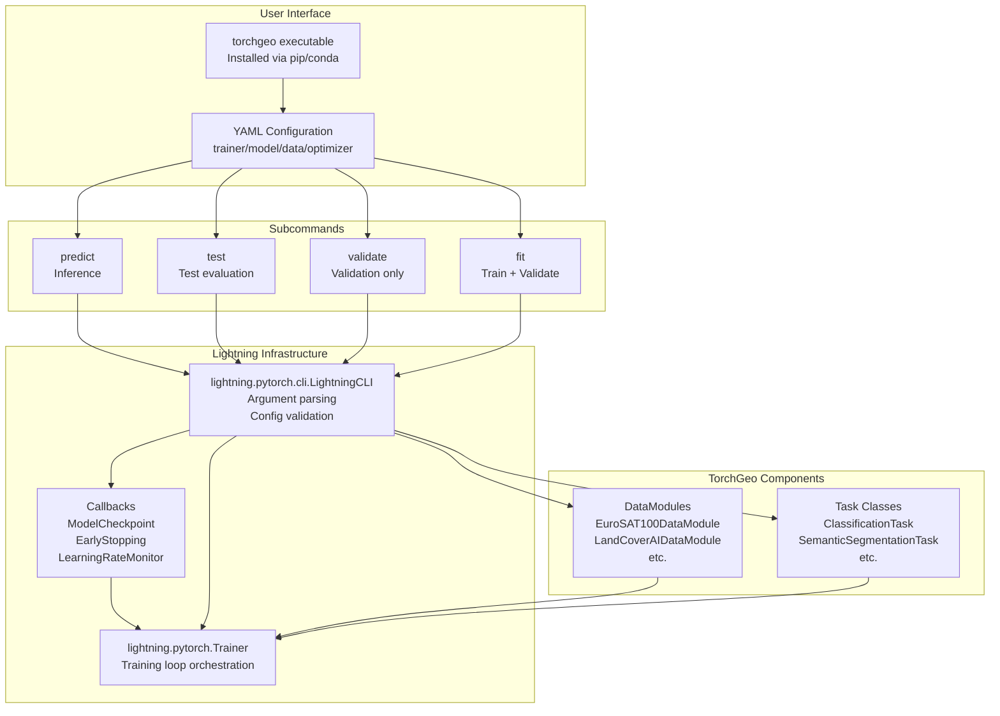
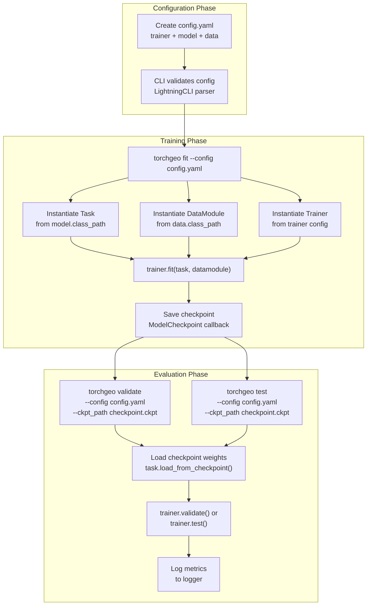
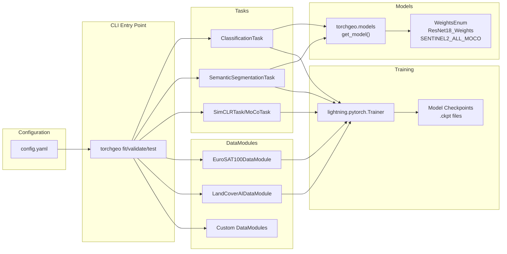

<!-- source: DeepWiki mcp.deepwiki.com · repo torchgeo/torchgeo · page 5.5 Command Line Interface · fetched 2026-10-21 -->

# Command Line Interface

<details>
<summary>Relevant source files</summary>

The following files were used as context for generating this wiki page:

- [docs/tutorials/basic_usage.rst](docs/tutorials/basic_usage.rst)
- [docs/tutorials/cli.ipynb](docs/tutorials/cli.ipynb)
- [docs/tutorials/custom_raster_dataset.ipynb](docs/tutorials/custom_raster_dataset.ipynb)
- [docs/tutorials/custom_segmentation_trainer.ipynb](docs/tutorials/custom_segmentation_trainer.ipynb)
- [docs/tutorials/earthquake_detection.ipynb](docs/tutorials/earthquake_detection.ipynb)
- [docs/tutorials/embeddings.ipynb](docs/tutorials/embeddings.ipynb)
- [docs/tutorials/indices.ipynb](docs/tutorials/indices.ipynb)
- [docs/tutorials/pretrained_weights.ipynb](docs/tutorials/pretrained_weights.ipynb)
- [docs/tutorials/pytorch.ipynb](docs/tutorials/pytorch.ipynb)
- [docs/tutorials/trainers.ipynb](docs/tutorials/trainers.ipynb)
- [docs/tutorials/transforms.ipynb](docs/tutorials/transforms.ipynb)
- [torchgeo/__init__.py](torchgeo/__init__.py)
- [torchgeo/trainers/__init__.py](torchgeo/trainers/__init__.py)

</details>


The TorchGeo Command Line Interface (CLI) provides a no-code solution for training, validating, and testing geospatial deep learning models. Built on [PyTorch Lightning's LightningCLI](https://lightning.ai/docs/pytorch/stable/api/lightning.pytorch.cli.LightningCLI.html), it enables users to configure experiments entirely through YAML files, promoting reproducibility and simplifying hyperparameter tuning. For programmatic training workflows using Python code, see [Training Workflows](#5.6).

The CLI serves as a bridge between TorchGeo's task classes ([Supervised Learning Tasks](#5.2), [Self-Supervised Learning](#5.3)) and data modules ([DataModules](#3.3)), allowing users to combine any compatible trainer and dataset through configuration rather than code.

## CLI Architecture



**Sources:** [docs/tutorials/cli.ipynb:1-400]()

## Installation and Invocation

The `torchgeo` executable is installed automatically when TorchGeo is installed via pip, conda, or spack:

```bash
pip install torchgeo
```

After installation, the CLI can be invoked directly:

```bash
torchgeo --help
```

The CLI provides four primary subcommands corresponding to the PyTorch Lightning `Trainer` methods:
- `fit`: Train and validate a model
- `validate`: Run validation on a trained model
- `test`: Evaluate a trained model on the test set
- `predict`: Generate predictions without labels

**Sources:** [docs/tutorials/cli.ipynb:36-64]()

## Configuration System

### YAML Structure

TorchGeo CLI experiments are configured through YAML files with five main sections:

| Section | Required | Purpose | Example Classes |
|---------|----------|---------|-----------------|
| `trainer` | Yes | Lightning Trainer configuration | `max_epochs`, `accelerator`, `callbacks` |
| `model` | Yes | Task/trainer specification | `ClassificationTask`, `SemanticSegmentationTask` |
| `data` | Yes | DataModule specification | `EuroSAT100DataModule`, `LandCoverAIDataModule` |
| `optimizer` | No | Optimizer override | `torch.optim.AdamW`, `torch.optim.SGD` |
| `lr_scheduler` | No | Learning rate scheduler | `CosineAnnealingLR`, `ReduceLROnPlateau` |

Each section uses `class_path` to specify the class to instantiate and `init_args` to pass constructor arguments:

```yaml
model:
  class_path: ClassificationTask
  init_args:
    model: 'resnet18'
    in_channels: 13
    num_classes: 10
    lr: 1e-3
```

**Sources:** [docs/tutorials/cli.ipynb:136-193]()

### Trainer Configuration

The `trainer` section configures the PyTorch Lightning `Trainer` and its callbacks:

```yaml
trainer:
  max_epochs: 50
  accelerator: 'auto'
  devices: 1
  default_root_dir: './experiments'
  callbacks:
    - class_path: lightning.pytorch.callbacks.ModelCheckpoint
      init_args:
        monitor: val_loss
        mode: min
        save_top_k: 1
        save_last: true
    - class_path: lightning.pytorch.callbacks.EarlyStopping
      init_args:
        monitor: val_loss
        patience: 10
```

Common trainer arguments:
- `max_epochs`: Maximum number of training epochs
- `accelerator`: Hardware accelerator (`'auto'`, `'gpu'`, `'cpu'`, `'tpu'`)
- `devices`: Number of devices to use
- `default_root_dir`: Directory for logs and checkpoints
- `fast_dev_run`: Run single batch for debugging (`true`/`false`)
- `log_every_n_steps`: Logging frequency

**Sources:** [docs/tutorials/cli.ipynb:147-162](), [docs/tutorials/trainers.ipynb:215-250]()

### Model Configuration

The `model` section specifies which task class to use and its initialization parameters:

```yaml
model:
  class_path: ClassificationTask
  init_args:
    model: 'resnet18'
    weights: SENTINEL2_ALL_MOCO
    in_channels: 13
    num_classes: 10
    loss: 'ce'
    lr: 1e-3
```

Available task classes are documented in [torchgeo/trainers/__init__.py:1-33]():
- `ClassificationTask`, `MultiLabelClassificationTask`
- `SemanticSegmentationTask`, `PixelwiseRegressionTask`
- `ObjectDetectionTask`, `InstanceSegmentationTask`
- `ChangeDetectionTask`
- `SimCLRTask`, `MoCoTask`, `BYOLTask` (self-supervised)

**Sources:** [docs/tutorials/cli.ipynb:163-169](), [torchgeo/trainers/__init__.py:1-33]()

### Data Configuration

The `data` section specifies the DataModule and its parameters:

```yaml
data:
  class_path: EuroSAT100DataModule
  init_args:
    batch_size: 32
    num_workers: 4
  dict_kwargs:
    root: '/data/eurosat'
    download: true
```

The `dict_kwargs` field passes additional keyword arguments directly to the underlying dataset constructor. This allows dataset-specific options like `root`, `download`, `split`, etc. to be configured.

**Sources:** [docs/tutorials/cli.ipynb:170-177]()

### Optimizer and Scheduler Configuration

Custom optimizers and learning rate schedulers can be specified to override the defaults:

```yaml
optimizer:
  class_path: torch.optim.AdamW
  init_args:
    lr: 1e-3
    weight_decay: 0.01

lr_scheduler:
  class_path: torch.optim.lr_scheduler.CosineAnnealingLR
  init_args:
    T_max: 50
    eta_min: 1e-6
```

If omitted, the CLI uses the defaults defined in the task's `configure_optimizers` method (typically `AdamW` with `ReduceLROnPlateau`).

**Sources:** [docs/tutorials/cli.ipynb:178-189](), [docs/tutorials/cli.ipynb:216-229]()

## Discovering Available Options

The CLI provides interactive help for discovering configuration options:

### Global Help

```bash
torchgeo --help
```

Lists all available subcommands (`fit`, `validate`, `test`, `predict`).

### Subcommand Help

```bash
torchgeo fit --help
```

Shows all options for the `fit` subcommand, including trainer, model, data, optimizer, and scheduler configuration.

### Model-Specific Help

```bash
torchgeo fit --model.help ClassificationTask
```

Displays all initialization parameters for `ClassificationTask`, including:
- `model`: Architecture name (e.g., `'resnet18'`)
- `weights`: Pretrained weights enum
- `in_channels`: Number of input channels
- `num_classes`: Number of output classes
- `loss`: Loss function identifier
- `lr`: Learning rate

### Data-Specific Help

```bash
torchgeo fit --data.help EuroSAT100DataModule
```

Shows DataModule-specific options like `batch_size`, `num_workers`, and dataset paths.

**Sources:** [docs/tutorials/cli.ipynb:54-125]()

## Workflow Execution



**Sources:** [docs/tutorials/cli.ipynb:300-359]()

### Training

Train a model using a configuration file:

```bash
torchgeo fit --config experiments/eurosat_resnet18.yaml
```

During training:
1. CLI parses the YAML configuration
2. Instantiates the task class specified in `model.class_path`
3. Instantiates the DataModule specified in `data.class_path`
4. Creates a Lightning `Trainer` with specified callbacks
5. Calls `trainer.fit(model=task, datamodule=datamodule)`
6. Checkpoints are saved to `default_root_dir/lightning_logs/version_X/checkpoints/`

**Sources:** [docs/tutorials/cli.ipynb:300-313]()

### Validation

Evaluate a trained model on the validation set:

```bash
torchgeo validate \
  --config experiments/eurosat_resnet18.yaml \
  --ckpt_path experiments/lightning_logs/version_0/checkpoints/best.ckpt
```

The CLI loads the checkpoint and runs validation without additional training.

**Sources:** [docs/tutorials/cli.ipynb:320-339]()

### Testing

Evaluate final performance on the test set:

```bash
torchgeo test \
  --config experiments/eurosat_resnet18.yaml \
  --ckpt_path experiments/lightning_logs/version_0/checkpoints/best.ckpt
```

Test metrics are logged to the configured logger (TensorBoard, CSV, etc.).

**Sources:** [docs/tutorials/cli.ipynb:346-359]()

## Callbacks

Callbacks extend the training loop with custom functionality. They are specified in the `trainer.callbacks` list:

### ModelCheckpoint

Saves model checkpoints during training:

```yaml
callbacks:
  - class_path: lightning.pytorch.callbacks.ModelCheckpoint
    init_args:
      monitor: val_loss
      mode: min
      save_top_k: 5
      save_last: true
      filename: 'model-{epoch:02d}-{val_loss:.4f}'
```

Key parameters:
- `monitor`: Metric to track (e.g., `'val_loss'`, `'val_Accuracy'`)
- `mode`: `'min'` to minimize, `'max'` to maximize
- `save_top_k`: Number of best checkpoints to keep (`-1` for all)
- `save_last`: Also save most recent checkpoint
- `filename`: Checkpoint filename template with metric placeholders

**Sources:** [docs/tutorials/cli.ipynb:240-253]()

### LearningRateMonitor

Logs the current learning rate to the logger:

```yaml
callbacks:
  - class_path: lightning.pytorch.callbacks.LearningRateMonitor
    init_args:
      logging_interval: epoch
```

Useful for verifying learning rate schedules are working correctly.

**Sources:** [docs/tutorials/cli.ipynb:240-253]()

### EarlyStopping

Stops training when a metric stops improving:

```yaml
callbacks:
  - class_path: lightning.pytorch.callbacks.EarlyStopping
    init_args:
      monitor: val_loss
      patience: 10
      mode: min
      min_delta: 0.001
```

Prevents overfitting by terminating training when validation loss plateaus.

**Sources:** [docs/tutorials/cli.ipynb:264-271](), [docs/tutorials/trainers.ipynb:219-220]()

### Other Callbacks

Additional callbacks available from PyTorch Lightning:

| Callback | Purpose |
|----------|---------|
| `StochasticWeightAveraging` | Improve generalization through weight averaging |
| `GradientAccumulationScheduler` | Simulate larger batch sizes |
| `DeviceStatsMonitor` | Log GPU memory and utilization |
| `RichProgressBar` | Enhanced progress bar with rich formatting |

See [PyTorch Lightning Callbacks documentation](https://lightning.ai/docs/pytorch/stable/extensions/callbacks.html) for complete list.

**Sources:** [docs/tutorials/cli.ipynb:260-293]()

## Example Configurations

### Classification Example

Complete configuration for training a ResNet-18 classifier on EuroSAT:

```yaml
trainer:
  max_epochs: 50
  accelerator: auto
  default_root_dir: ./experiments/eurosat
  callbacks:
    - class_path: lightning.pytorch.callbacks.ModelCheckpoint
      init_args:
        monitor: val_Accuracy
        mode: max
        save_top_k: 3
    - class_path: lightning.pytorch.callbacks.LearningRateMonitor
      init_args:
        logging_interval: epoch

model:
  class_path: ClassificationTask
  init_args:
    model: resnet18
    weights: SENTINEL2_ALL_MOCO
    in_channels: 13
    num_classes: 10
    loss: ce
    lr: 1e-3

data:
  class_path: EuroSAT100DataModule
  init_args:
    batch_size: 32
    num_workers: 4
  dict_kwargs:
    root: /data/eurosat
    download: true

optimizer:
  class_path: torch.optim.AdamW
  init_args:
    lr: 1e-3
    weight_decay: 0.01

lr_scheduler:
  class_path: torch.optim.lr_scheduler.CosineAnnealingLR
  init_args:
    T_max: 50
    eta_min: 1e-6
```

**Sources:** [docs/tutorials/cli.ipynb:136-193]()

### Segmentation Example

Configuration for semantic segmentation with a U-Net:

```yaml
trainer:
  max_epochs: 100
  accelerator: gpu
  devices: 1

model:
  class_path: SemanticSegmentationTask
  init_args:
    model: unet
    backbone: resnet18
    weights: true
    in_channels: 3
    num_classes: 6
    loss: jaccard
    lr: 1e-3

data:
  class_path: LandCoverAI100DataModule
  init_args:
    batch_size: 16
    num_workers: 8
  dict_kwargs:
    root: /data/landcoverai
    download: true
```

**Sources:** [docs/tutorials/custom_segmentation_trainer.ipynb:212-247]()

## Integration with TorchGeo Ecosystem

The CLI integrates seamlessly with other TorchGeo components:



- **Tasks**: All task classes in [torchgeo/trainers/]() are CLI-compatible
- **DataModules**: Any Lightning DataModule can be referenced via `class_path`
- **Models**: Uses the same model zoo and weights system as the Python API ([Models and Pre-trained Weights](#4))
- **Checkpoints**: Can be loaded in Python code via `task.load_from_checkpoint()`

**Sources:** [docs/tutorials/cli.ipynb:1-400](), [docs/tutorials/trainers.ipynb:1-344]()

## CLI vs. Python API Comparison

| Aspect | CLI | Python API |
|--------|-----|------------|
| Configuration | YAML files | Python code |
| Flexibility | Limited to exposed parameters | Full programmatic control |
| Reproducibility | Config files are version-controllable | Requires discipline to track settings |
| Learning curve | Minimal Python knowledge needed | Requires Python + Lightning knowledge |
| Customization | Via custom task/datamodule classes | Direct code modification |
| Hyperparameter tuning | Easy to sweep with multiple YAML files | Requires scripting |
| Debugging | Limited to Lightning logs | Full Python debugging tools |

The CLI is ideal for:
- Beginners learning TorchGeo
- Reproducible experiments with standard architectures
- Hyperparameter sweeps across multiple configurations
- Production pipelines with fixed workflows

The Python API ([Training Workflows](#5.6)) is better for:
- Custom training logic beyond standard tasks
- Research requiring novel architectures or losses
- Integration into larger Python applications
- Advanced debugging and profiling

**Sources:** [docs/tutorials/cli.ipynb:1-24](), [docs/tutorials/trainers.ipynb:1-344](), [docs/tutorials/pytorch.ipynb:1-507]()

## Advanced Features

### Command-Line Overrides

Individual config values can be overridden from the command line:

```bash
torchgeo fit --config config.yaml \
  --trainer.max_epochs=100 \
  --model.init_args.lr=1e-4 \
  --data.init_args.batch_size=64
```

This allows configuration variants without modifying the base YAML file.

### Multiple Configurations

Multiple config files can be composed:

```bash
torchgeo fit \
  --config base_config.yaml \
  --config model_override.yaml \
  --config data_override.yaml
```

Later files override earlier ones, enabling modular configuration.

### Custom Tasks and DataModules

Users can reference custom classes by providing the full import path:

```yaml
model:
  class_path: my_package.trainers.CustomClassificationTask
  init_args:
    custom_param: value

data:
  class_path: my_package.datamodules.CustomDataModule
  init_args:
    custom_option: true
```

The custom classes must be importable from the environment where the CLI runs. See [Creating Custom Tasks](#5.4) for details on extending task classes.

**Sources:** [docs/tutorials/cli.ipynb:366-371](), [docs/tutorials/custom_segmentation_trainer.ipynb:1-332]()

### Environment Variables

The CLI respects standard PyTorch environment variables:
- `TORCH_HOME`: Location for cached model weights
- `CUDA_VISIBLE_DEVICES`: GPU selection
- `OMP_NUM_THREADS`: CPU parallelism

These can be set before invoking the CLI:

```bash
export CUDA_VISIBLE_DEVICES=0,1
torchgeo fit --config config.yaml --trainer.devices=2
```

**Sources:** Documentation inference from PyTorch Lightning behavior

## Logging and Checkpointing

### Default Logging

By default, the CLI uses TensorBoard logging with logs saved to `default_root_dir/lightning_logs/version_X/`:

```
experiments/
└── lightning_logs/
    └── version_0/
        ├── checkpoints/
        │   ├── epoch=49-step=100.ckpt
        │   └── last.ckpt
        ├── hparams.yaml
        └── events.out.tfevents...
```

The `hparams.yaml` file contains the full resolved configuration for reproducibility.

### Custom Loggers

Alternative loggers can be specified in the trainer configuration:

```yaml
trainer:
  logger:
    class_path: lightning.pytorch.loggers.CSVLogger
    init_args:
      save_dir: ./logs
      name: experiment_1
```

Supported loggers include `CSVLogger`, `TensorBoardLogger`, `WandbLogger`, `MLFlowLogger`, etc.

**Sources:** [docs/tutorials/trainers.ipynb:215-220](), [docs/tutorials/earthquake_detection.ipynb:359-365]()

### Checkpoint Structure

Checkpoints saved by `ModelCheckpoint` contain:
- Model state dict
- Optimizer state dict
- Learning rate scheduler state
- Hyperparameters from config
- Training step/epoch counters

Checkpoints can be loaded in Python:

```python
from torchgeo.trainers import ClassificationTask

task = ClassificationTask.load_from_checkpoint('path/to/checkpoint.ckpt')
```

**Sources:** [docs/tutorials/custom_segmentation_trainer.ipynb:289-303]()

## Troubleshooting

### Common Issues

| Error | Cause | Solution |
|-------|-------|----------|
| `ModuleNotFoundError` | Task/DataModule class not found | Verify `class_path` is correct and package is installed |
| `TypeError: __init__() got unexpected keyword` | Invalid `init_args` parameter | Check parameter names with `--model.help` or `--data.help` |
| `RuntimeError: CUDA out of memory` | Batch size too large | Reduce `batch_size` in data config |
| `FileNotFoundError` | Dataset path incorrect | Verify `root` path in `dict_kwargs` |
| `ValueError: checkpoint contains hyperparameters` | Checkpoint/config mismatch | Ensure config matches checkpoint hyperparameters |

### Debug Mode

Enable debug logging with Lightning's verbose mode:

```bash
torchgeo fit --config config.yaml --trainer.fast_dev_run=true
```

`fast_dev_run=true` runs a single batch through the entire training/validation loop for quick debugging.

**Sources:** [docs/tutorials/trainers.ipynb:136-137](), [docs/tutorials/custom_segmentation_trainer.ipynb:215]()

## Best Practices

1. **Version Control Configs**: Store YAML files in version control alongside code
2. **Reproducibility**: Include the `hparams.yaml` from `lightning_logs/` in results
3. **Checkpoint Strategy**: Use `save_top_k` to keep best models, `save_last` for resuming
4. **Learning Rate Schedules**: Match scheduler `T_max` to `max_epochs`
5. **Batch Size**: Start small and increase until GPU memory is utilized
6. **Monitoring**: Always include `LearningRateMonitor` to verify scheduler behavior
7. **Validation**: Run `validate` before `test` to check for issues
8. **Documentation**: Comment YAML files to explain hyperparameter choices

**Sources:** [docs/tutorials/cli.ipynb:1-400]()

---

