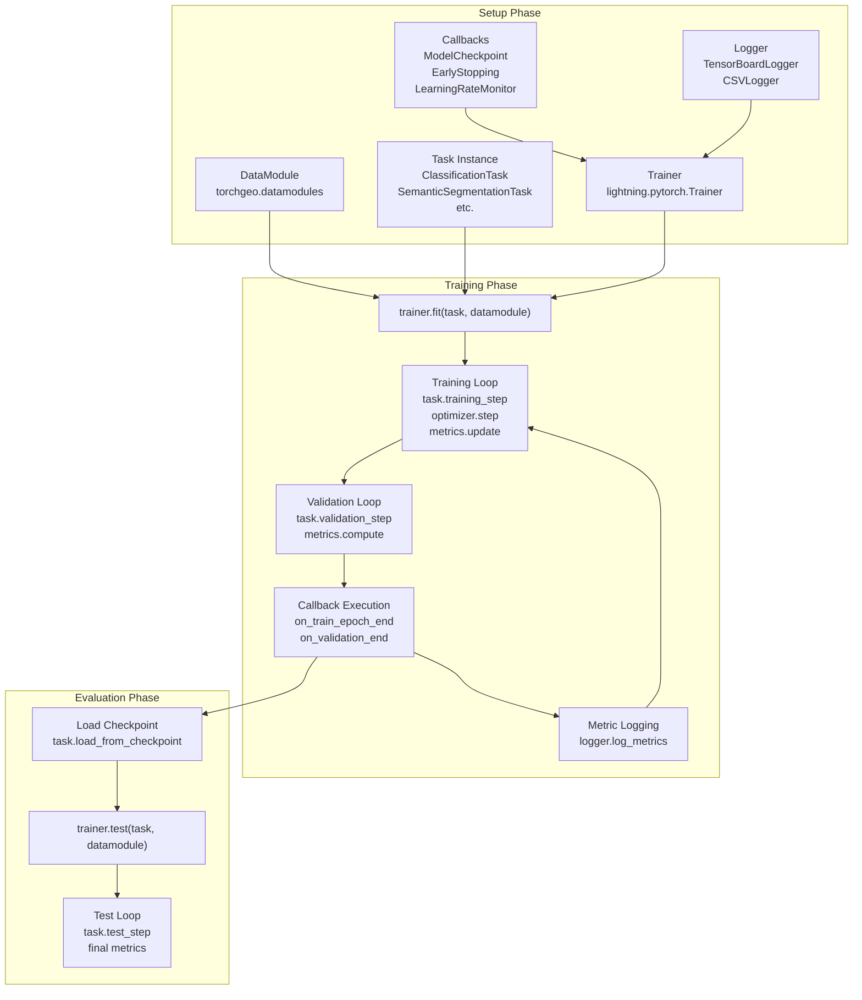
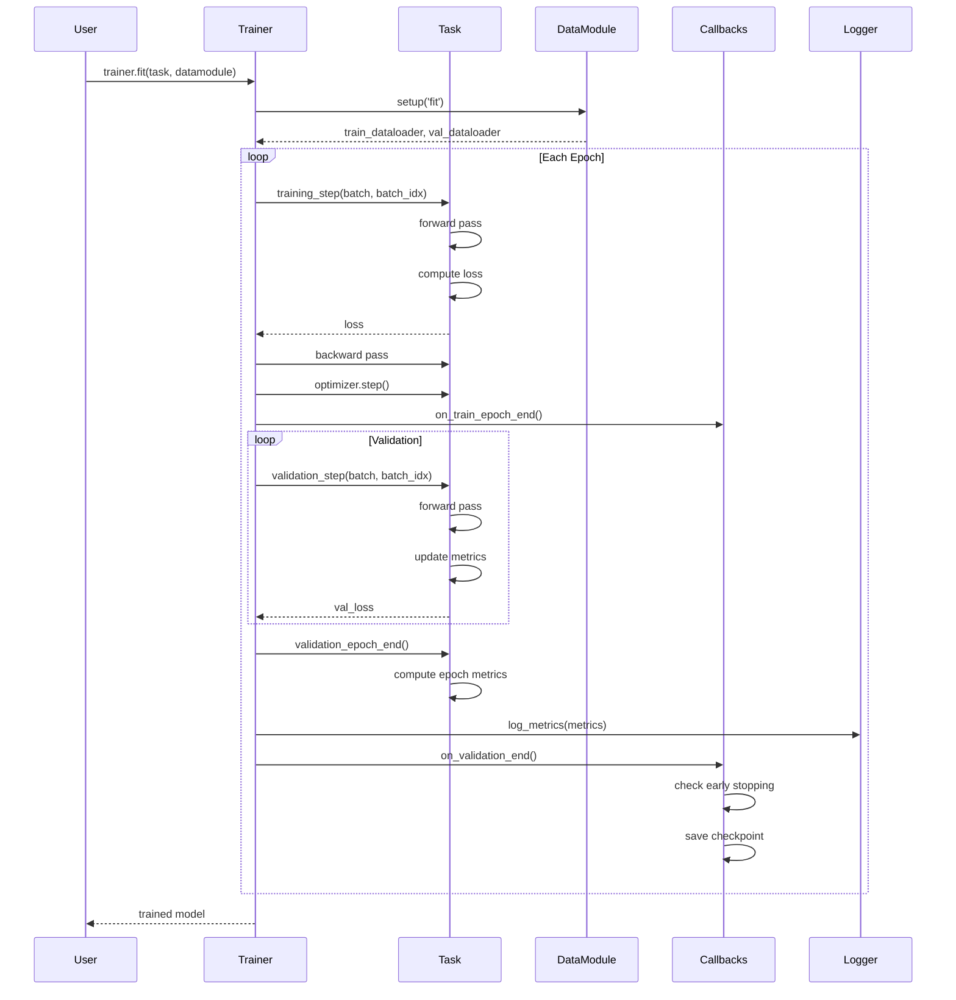
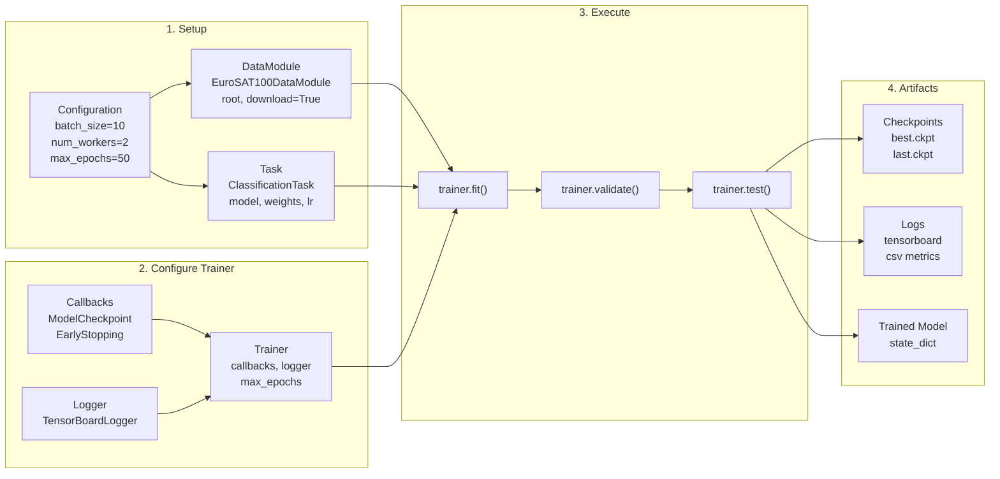

<!-- source: DeepWiki mcp.deepwiki.com · repo torchgeo/torchgeo · page 5.6 Training Workflows · fetched 2026-10-21 -->

# Training Workflows

<details>
<summary>Relevant source files</summary>

The following files were used as context for generating this wiki page:

- [docs/tutorials/basic_usage.rst](docs/tutorials/basic_usage.rst)
- [docs/tutorials/cli.ipynb](docs/tutorials/cli.ipynb)
- [docs/tutorials/custom_raster_dataset.ipynb](docs/tutorials/custom_raster_dataset.ipynb)
- [docs/tutorials/custom_segmentation_trainer.ipynb](docs/tutorials/custom_segmentation_trainer.ipynb)
- [docs/tutorials/earthquake_detection.ipynb](docs/tutorials/earthquake_detection.ipynb)
- [docs/tutorials/embeddings.ipynb](docs/tutorials/embeddings.ipynb)
- [docs/tutorials/indices.ipynb](docs/tutorials/indices.ipynb)
- [docs/tutorials/pretrained_weights.ipynb](docs/tutorials/pretrained_weights.ipynb)
- [docs/tutorials/pytorch.ipynb](docs/tutorials/pytorch.ipynb)
- [docs/tutorials/trainers.ipynb](docs/tutorials/trainers.ipynb)
- [docs/tutorials/transforms.ipynb](docs/tutorials/transforms.ipynb)
- [torchgeo/__init__.py](torchgeo/__init__.py)
- [torchgeo/trainers/__init__.py](torchgeo/trainers/__init__.py)

</details>


This page documents end-to-end training workflows in TorchGeo, covering how to combine datasets, models, tasks, and trainers to train and evaluate models. For details on the task architecture and inheritance hierarchy, see [Task Architecture](#5.1). For CLI-based workflows using YAML configuration, see [Command Line Interface](#5.5). For creating custom task classes, see [Creating Custom Tasks](#5.4).

## Overview

TorchGeo leverages PyTorch Lightning to provide a structured training framework. A complete training workflow involves:

1. **DataModule**: Encapsulates dataset loading, splitting, and batching
2. **Task**: Encapsulates model, optimizer, loss, metrics, and training logic
3. **Trainer**: Orchestrates training loop, callbacks, logging, and device management
4. **Callbacks**: Hook into training events for checkpointing, early stopping, etc.
5. **Loggers**: Record metrics for visualization and analysis

## Training Workflow Diagram



**Sources**: [docs/tutorials/trainers.ipynb:27-314]()

## Component Instantiation

### DataModule Setup

DataModules provide train/val/test data loaders with consistent preprocessing and augmentation. TorchGeo includes pre-built DataModules for all benchmark datasets.

```python
from torchgeo.datamodules import EuroSAT100DataModule

datamodule = EuroSAT100DataModule(
    root='/path/to/data',
    batch_size=10,
    num_workers=2,
    download=True
)
```

Key parameters:
- `root`: Dataset storage location
- `batch_size`: Samples per mini-batch
- `num_workers`: Parallel data loading processes
- `download`: Automatically download dataset if missing

**Sources**: [docs/tutorials/trainers.ipynb:148-152](), [docs/tutorials/earthquake_detection.ipynb:148-153]()

### Task Configuration

Tasks combine models, optimizers, losses, and metrics into a single Lightning module. Each task type corresponds to a different computer vision problem.

```python
from torchgeo.trainers import ClassificationTask
from torchgeo.models import ResNet18_Weights

task = ClassificationTask(
    loss='ce',                                    # Cross-entropy loss
    model='resnet18',                             # Model architecture
    weights=ResNet18_Weights.SENTINEL2_ALL_MOCO,  # Pre-trained weights
    in_channels=13,                               # Input channels
    num_classes=10,                               # Output classes
    lr=0.1,                                       # Learning rate
    patience=5                                    # LR scheduler patience
)
```

Common parameters across all tasks:
- `model`: Architecture name (string or nn.Module)
- `weights`: Pre-trained weights enum or None
- `in_channels`: Number of input channels
- `lr`: Initial learning rate
- `loss`: Loss function name

**Sources**: [docs/tutorials/trainers.ipynb:183-192](), [docs/tutorials/earthquake_detection.ipynb:348-350]()

### Trainer Instantiation

The Lightning `Trainer` controls the training loop, device placement, callbacks, and logging.

```python
from lightning.pytorch import Trainer
from lightning.pytorch.callbacks import ModelCheckpoint, EarlyStopping
from lightning.pytorch.loggers import TensorBoardLogger

checkpoint_callback = ModelCheckpoint(
    monitor='val_loss',
    dirpath='/path/to/checkpoints',
    save_top_k=1,
    save_last=True
)

early_stopping_callback = EarlyStopping(
    monitor='val_loss',
    min_delta=0.0,
    patience=10
)

logger = TensorBoardLogger(
    save_dir='/path/to/logs',
    name='experiment_name'
)

trainer = Trainer(
    callbacks=[checkpoint_callback, early_stopping_callback],
    logger=logger,
    max_epochs=50,
    accelerator='auto',    # 'gpu', 'cpu', or 'auto'
    devices=1              # Number of devices to use
)
```

**Sources**: [docs/tutorials/trainers.ipynb:216-250](), [docs/tutorials/earthquake_detection.ipynb:360-376]()

## Training Execution Flow



**Sources**: [docs/tutorials/trainers.ipynb:271](), [docs/tutorials/pytorch.ipynb:345-446]()

## Callbacks Configuration

Callbacks provide hooks into the training lifecycle without modifying task code. TorchGeo workflows commonly use three categories:

### Model Checkpointing

`ModelCheckpoint` saves model weights at specified intervals or based on metric performance.

| Parameter | Description | Example |
|-----------|-------------|---------|
| `monitor` | Metric to track | `'val_loss'`, `'val_Accuracy'` |
| `mode` | Minimize or maximize | `'min'`, `'max'` |
| `save_top_k` | Number of best models to keep | `1`, `5`, `-1` (all) |
| `save_last` | Always save most recent | `True`, `False` |
| `filename` | Checkpoint naming template | `'epoch={epoch}-loss={val_loss:.4f}'` |
| `dirpath` | Checkpoint directory | `'/path/to/checkpoints'` |
| `every_n_epochs` | Save frequency | `1`, `10` |

**Example**: Multiple checkpoint strategies

```python
from lightning.pytorch.callbacks import ModelCheckpoint

callbacks = [
    # Save best model by validation loss
    ModelCheckpoint(
        monitor='val_loss',
        mode='min',
        save_top_k=5,
        filename='best-{epoch:02d}-{val_loss:.4f}'
    ),
    # Save periodic checkpoints
    ModelCheckpoint(
        every_n_epochs=50,
        save_top_k=-1,
        filename='periodic-{epoch:02d}'
    ),
    # Always save last checkpoint
    ModelCheckpoint(
        save_last=True,
        filename='last'
    )
]
```

**Sources**: [docs/tutorials/trainers.ipynb:216-218](), [docs/tutorials/custom_segmentation_trainer.ipynb:164-173](), [docs/tutorials/cli.ipynb:152-158]()

### Early Stopping

`EarlyStopping` terminates training when a monitored metric stops improving, preventing overfitting and saving compute.

| Parameter | Description | Example |
|-----------|-------------|---------|
| `monitor` | Metric to track | `'val_loss'`, `'val_Accuracy'` |
| `patience` | Epochs without improvement before stopping | `10`, `20` |
| `mode` | Minimize or maximize | `'min'`, `'max'` |
| `min_delta` | Minimum change to qualify as improvement | `0.0`, `0.001` |
| `stopping_threshold` | Stop when metric reaches value | `0.95`, `0.01` |

```python
from lightning.pytorch.callbacks import EarlyStopping

early_stopping = EarlyStopping(
    monitor='val_loss',
    patience=10,
    mode='min',
    min_delta=0.0
)
```

**Sources**: [docs/tutorials/trainers.ipynb:219](), [docs/tutorials/cli.ipynb:264-270]()

### Learning Rate Monitoring

`LearningRateMonitor` logs the current learning rate, useful for debugging scheduler behavior.

```python
from lightning.pytorch.callbacks import LearningRateMonitor

lr_monitor = LearningRateMonitor(
    logging_interval='epoch'  # 'step' or 'epoch'
)
```

Custom callbacks can be implemented by inheriting from `lightning.pytorch.callbacks.Callback`:

```python
class CustomCallback(Callback):
    def on_train_epoch_start(self, trainer, pl_module):
        # Log learning rate
        lr = pl_module.optimizers().param_groups[0]['lr']
        pl_module.logger.experiment.add_scalar('lr', lr, pl_module.current_epoch)
```

**Sources**: [docs/tutorials/custom_segmentation_trainer.ipynb:175-182](), [docs/tutorials/cli.ipynb:159-161]()

## Logging Configuration

Loggers record metrics for visualization and analysis. Lightning supports multiple logger backends simultaneously.

### TensorBoard Logger

```python
from lightning.pytorch.loggers import TensorBoardLogger

logger = TensorBoardLogger(
    save_dir='/path/to/logs',
    name='experiment_name',
    version='version_0'
)
```

View logs: `tensorboard --logdir /path/to/logs`

### CSV Logger

```python
from lightning.pytorch.loggers import CSVLogger

logger = CSVLogger(
    save_dir='/path/to/logs',
    name='experiment_name'
)
```

Metrics saved to `{save_dir}/{name}/version_X/metrics.csv`

### Weights & Biases Logger

```python
from lightning.pytorch.loggers import WandbLogger

logger = WandbLogger(
    project='project_name',
    name='run_name',
    save_dir='/path/to/logs'
)
```

**Sources**: [docs/tutorials/trainers.ipynb:220](), [docs/tutorials/earthquake_detection.ipynb:364]()

## Training and Evaluation Methods

### Training

```python
# Train and validate
trainer.fit(model=task, datamodule=datamodule)

# Resume from checkpoint
trainer.fit(
    model=task,
    datamodule=datamodule,
    ckpt_path='/path/to/checkpoint.ckpt'
)
```

### Validation

```python
# Validate current model
trainer.validate(model=task, datamodule=datamodule)

# Validate from checkpoint
trainer.validate(
    model=task,
    datamodule=datamodule,
    ckpt_path='/path/to/checkpoint.ckpt'
)
```

### Testing

```python
# Test current model
trainer.test(model=task, datamodule=datamodule)

# Test best checkpoint
trainer.test(
    model=task,
    datamodule=datamodule,
    ckpt_path='best'
)

# Load checkpoint manually
task = ClassificationTask.load_from_checkpoint('/path/to/checkpoint.ckpt')
trainer.test(model=task, datamodule=datamodule)
```

**Sources**: [docs/tutorials/trainers.ipynb:271-313](), [docs/tutorials/earthquake_detection.ipynb:386-396](), [docs/tutorials/custom_segmentation_trainer.ipynb:276-302]()

## Distributed Training

Lightning automatically handles multi-GPU and multi-node training with minimal configuration changes.

### Single-Node Multi-GPU

```python
trainer = Trainer(
    accelerator='gpu',
    devices=4,                    # Use 4 GPUs
    strategy='ddp'                # Distributed Data Parallel
)
```

### Multi-Node

```python
trainer = Trainer(
    accelerator='gpu',
    devices=4,
    num_nodes=2,                  # 2 nodes × 4 GPUs = 8 total
    strategy='ddp'
)
```

Launch command:
```bash
torchrun --nproc_per_node=4 --nnodes=2 train_script.py
```

### Automatic Mixed Precision

Enable 16-bit precision for faster training:

```python
trainer = Trainer(
    precision='16-mixed',         # Mixed precision
    accelerator='gpu',
    devices=1
)
```

**Sources**: PyTorch Lightning documentation on distributed training

## Complete Workflow Example



### Step-by-Step Implementation

```python
import os
import tempfile
from lightning.pytorch import Trainer
from lightning.pytorch.callbacks import ModelCheckpoint, EarlyStopping
from lightning.pytorch.loggers import TensorBoardLogger
from torchgeo.datamodules import EuroSAT100DataModule
from torchgeo.trainers import ClassificationTask
from torchgeo.models import ResNet18_Weights

# 1. Configuration
root = os.path.join(tempfile.gettempdir(), 'experiment')
batch_size = 10
num_workers = 2
max_epochs = 50

# 2. DataModule
datamodule = EuroSAT100DataModule(
    root=root,
    batch_size=batch_size,
    num_workers=num_workers,
    download=True
)

# 3. Task
task = ClassificationTask(
    loss='ce',
    model='resnet18',
    weights=ResNet18_Weights.SENTINEL2_ALL_MOCO,
    in_channels=13,
    num_classes=10,
    lr=0.1,
    patience=5
)

# 4. Callbacks
checkpoint_callback = ModelCheckpoint(
    monitor='val_loss',
    dirpath=root,
    save_top_k=1,
    save_last=True
)

early_stopping_callback = EarlyStopping(
    monitor='val_loss',
    min_delta=0.0,
    patience=10
)

# 5. Logger
logger = TensorBoardLogger(
    save_dir=root,
    name='eurosat_experiment'
)

# 6. Trainer
trainer = Trainer(
    callbacks=[checkpoint_callback, early_stopping_callback],
    logger=logger,
    max_epochs=max_epochs,
    accelerator='auto'
)

# 7. Train
trainer.fit(model=task, datamodule=datamodule)

# 8. Test
trainer.test(model=task, datamodule=datamodule, ckpt_path='best')
```

**Sources**: [docs/tutorials/trainers.ipynb:117-314]()

## Hyperparameter Configuration

Common hyperparameters and their typical ranges:

| Parameter | Purpose | Typical Range | Notes |
|-----------|---------|---------------|-------|
| `batch_size` | Samples per mini-batch | 8-128 | Larger = faster, more memory |
| `lr` | Initial learning rate | 1e-5 to 1e-1 | Task and model dependent |
| `max_epochs` | Training duration | 10-1000 | Use early stopping |
| `patience` | LR scheduler patience | 5-20 | Epochs without improvement |
| `num_workers` | Parallel data loaders | 0-8 | CPU core dependent |
| `weight_decay` | L2 regularization | 0-0.01 | Prevent overfitting |

### Learning Rate Schedulers

Tasks use `ReduceLROnPlateau` by default, but custom schedulers can be configured:

```python
# Cosine annealing
from torch.optim.lr_scheduler import CosineAnnealingLR

# Override configure_optimizers in custom task
def configure_optimizers(self):
    optimizer = torch.optim.AdamW(self.parameters(), lr=self.hparams['lr'])
    scheduler = CosineAnnealingLR(optimizer, T_max=50, eta_min=1e-6)
    return {
        'optimizer': optimizer,
        'lr_scheduler': {'scheduler': scheduler, 'monitor': self.monitor}
    }
```

**Sources**: [docs/tutorials/custom_segmentation_trainer.ipynb:116-132](), [docs/tutorials/cli.ipynb:184-188]()

## Workflow Patterns

### Pattern 1: Quick Prototyping

Minimal configuration for rapid experimentation:

```python
datamodule = EuroSAT100DataModule(root='data', batch_size=32)
task = ClassificationTask(model='resnet18', in_channels=13, num_classes=10)
trainer = Trainer(max_epochs=10, fast_dev_run=False)
trainer.fit(task, datamodule)
```

### Pattern 2: Production Training

Full configuration with callbacks and logging:

```python
trainer = Trainer(
    max_epochs=100,
    callbacks=[
        ModelCheckpoint(monitor='val_loss', save_top_k=3),
        EarlyStopping(monitor='val_loss', patience=15),
        LearningRateMonitor(logging_interval='epoch')
    ],
    logger=TensorBoardLogger('logs', name='production'),
    accelerator='gpu',
    devices=4,
    precision='16-mixed'
)
```

### Pattern 3: Hyperparameter Tuning

Iterate over configurations programmatically:

```python
for lr in [1e-4, 1e-3, 1e-2]:
    for batch_size in [16, 32, 64]:
        task = ClassificationTask(model='resnet18', lr=lr, ...)
        datamodule = EuroSAT100DataModule(batch_size=batch_size, ...)
        trainer = Trainer(max_epochs=50, logger=WandbLogger(...))
        trainer.fit(task, datamodule)
```

**Sources**: [docs/tutorials/trainers.ipynb:117-136](), [docs/tutorials/earthquake_detection.ipynb:117-133]()

## Debugging and Profiling

### Fast Development Run

Test full pipeline with single batch:

```python
trainer = Trainer(fast_dev_run=True)
trainer.fit(task, datamodule)
```

### Limiting Batches

Train/validate on subset for quick iterations:

```python
trainer = Trainer(
    limit_train_batches=0.1,      # 10% of training data
    limit_val_batches=0.1,        # 10% of validation data
    max_epochs=5
)
```

### Profiling

Identify bottlenecks:

```python
from lightning.pytorch.profilers import SimpleProfiler

trainer = Trainer(
    profiler=SimpleProfiler(dirpath='profiling', filename='profile')
)
```

**Sources**: [docs/tutorials/trainers.ipynb:136](), [docs/tutorials/earthquake_detection.ipynb:133]()

## Related Pages

- [Task Architecture](#5.1): BaseTask design and lifecycle hooks
- [Supervised Learning Tasks](#5.2): Classification, segmentation, detection tasks
- [Self-Supervised Learning](#5.3): Contrastive learning workflows
- [Creating Custom Tasks](#5.4): Extending task classes
- [Command Line Interface](#5.5): YAML-based training configuration

---

