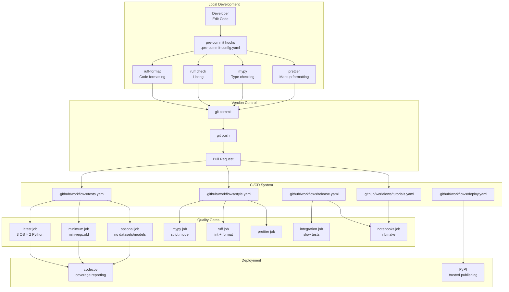
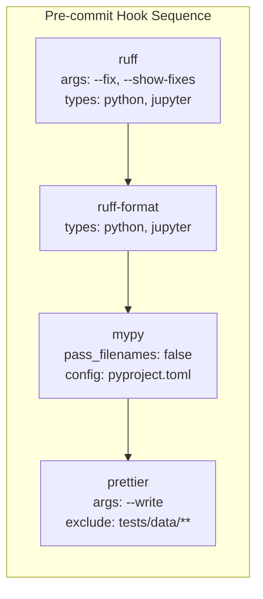
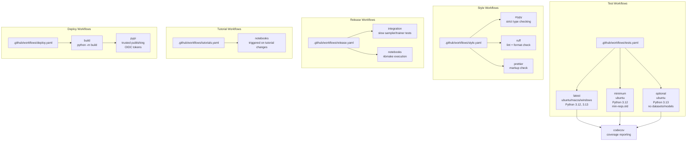
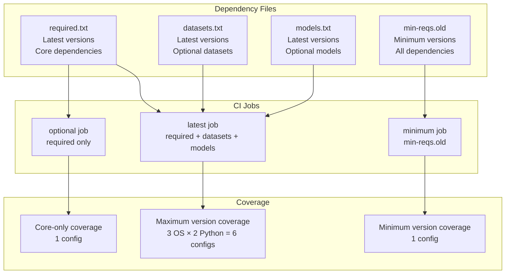

<!-- source: DeepWiki mcp.deepwiki.com · repo torchgeo/torchgeo · page 6 Development and Contributing · fetched 2026-10-21 -->

# Development and Contributing

<details>
<summary>Relevant source files</summary>

The following files were used as context for generating this wiki page:

- [.devcontainer/devcontainer.json](.devcontainer/devcontainer.json)
- [.github/dependabot.yml](.github/dependabot.yml)
- [.github/labeler.yml](.github/labeler.yml)
- [.github/workflows/deploy.yaml](.github/workflows/deploy.yaml)
- [.github/workflows/labeler.yml](.github/workflows/labeler.yml)
- [.github/workflows/release.yaml](.github/workflows/release.yaml)
- [.github/workflows/style.yaml](.github/workflows/style.yaml)
- [.github/workflows/tests.yaml](.github/workflows/tests.yaml)
- [.github/workflows/tutorials.yaml](.github/workflows/tutorials.yaml)
- [.pre-commit-config.yaml](.pre-commit-config.yaml)
- [pyproject.toml](pyproject.toml)
- [requirements/datasets.txt](requirements/datasets.txt)
- [requirements/min-reqs.old](requirements/min-reqs.old)
- [requirements/required.txt](requirements/required.txt)

</details>


This document provides comprehensive guidance for contributors to TorchGeo, covering development environment setup, code quality standards, testing infrastructure, CI/CD pipelines, dependency management, and documentation practices. This page is intended for developers who want to contribute code, documentation, or tests to the TorchGeo project.

For information about using TorchGeo in your projects, see [Overview](#1). For training workflows and CLI usage, see [Training System](#5).

## Overview of Development Infrastructure

TorchGeo maintains high code quality through a multi-layered validation system that includes pre-commit hooks, continuous integration testing, automated style checking, and comprehensive documentation builds. The development workflow is designed to catch issues early while maintaining contributor productivity.



**Sources:** [.pre-commit-config.yaml:1-47](), [.github/workflows/tests.yaml:1-120](), [.github/workflows/style.yaml:1-92]()

## Development Environment Setup

### Installing from Source

To set up a development environment, clone the repository and install TorchGeo in editable mode with development dependencies:

```bash
git clone https://github.com/torchgeo/torchgeo.git
cd torchgeo
pip install -e .[all]
```

The `[all]` extra installs all optional dependency groups defined in [pyproject.toml:156-158]():
- `datasets`: Dependencies for dataset implementations (h5py, laspy, netcdf4, rioxarray, etc.)
- `docs`: Sphinx documentation dependencies
- `models`: Foundation model dependencies (microsoft-aurora)
- `style`: Code quality tools (mypy, ruff, pandas-stubs, types-*)
- `tests`: Testing framework (pytest, pytest-cov, nbmake)

### Dependency Organization

TorchGeo organizes dependencies into multiple requirement files for different use cases:

| File | Purpose | Key Dependencies |
|------|---------|------------------|
| `requirements/required.txt` | Core functionality | torch, torchvision, lightning, rasterio, geopandas |
| `requirements/datasets.txt` | Dataset implementations | h5py, laspy, netcdf4, rioxarray, xarray |
| `requirements/models.txt` | Foundation models | microsoft-aurora |
| `requirements/style.txt` | Code quality | mypy, ruff, type stubs |
| `requirements/tests.txt` | Testing framework | pytest, pytest-cov, nbmake |
| `requirements/min-reqs.old` | Minimum versions | Pinned to minimum supported versions |

The `min-reqs.old` file [requirements/min-reqs.old:1-44]() contains the minimum supported versions of all dependencies, tested in the `minimum` CI job to ensure backward compatibility.

**Sources:** [pyproject.toml:37-159](), [requirements/required.txt:1-22](), [requirements/datasets.txt:1-13](), [requirements/min-reqs.old:1-44]()

### DevContainer Configuration

TorchGeo provides a development container configuration [.devcontainer/devcontainer.json:1-46]() for VS Code with:
- Python 3.13 base image
- Pre-configured extensions: ruff, mypy-type-checker, Jupyter
- Auto-install of `.[all]` dependencies on container start
- GPU support (optional)
- Pytest integration enabled

**Sources:** [.devcontainer/devcontainer.json:1-46]()

## Code Quality Standards

TorchGeo enforces strict code quality standards through automated tooling. All checks must pass before code can be merged.

### Formatting and Linting with Ruff

Ruff is the primary tool for code formatting and linting, configured in [pyproject.toml:334-356](). Key configurations:

**Formatting Settings:**
- Quote style: Single quotes (`quote-style = "single"`)
- Docstring code formatting enabled (`docstring-code-format = true`)
- Magic trailing comma disabled (`skip-magic-trailing-comma = true`)

**Linting Rules:**
- `ANN`: Type annotation checks (except `ANN401` for Any types)
- `D`: Docstring conventions (Google style)
- `I`: Import sorting
- `RUF`: Ruff-specific rules
- `UP`: Python version upgrade suggestions

Files in `docs/` and `tests/` are exempt from certain rules via [pyproject.toml:347-349]().

**Usage:**
```bash
ruff check --fix .
ruff format .
```

**Sources:** [pyproject.toml:334-356](), [.github/workflows/style.yaml:65-68]()

### Type Checking with Mypy

Mypy enforces strict type safety configured in [pyproject.toml:178-216](). The configuration enables:

**Strict Mode Flags:**
- `disallow_untyped_calls = true`: All function calls must have type information
- `disallow_untyped_defs = true`: All function definitions must be typed
- `disallow_incomplete_defs = true`: Partial type hints not allowed
- `disallow_any_generics = true`: Generic types must be parameterized
- `strict = true`: Enable all optional error checking

**Import Handling:**
- `ignore_missing_imports = true`: Don't fail on untyped third-party libraries
- `disable_error_code = "import-untyped"`: Suppress untyped import warnings
- Package scanning: `packages = ["torchgeo", "tests"]`
- Gitignore-aware exclusions (`exclude_gitignore = true`)

**Usage:**
```bash
mypy
```

**Sources:** [pyproject.toml:178-216](), [.github/workflows/style.yaml:39-40]()

### Markup Formatting with Prettier

Prettier formats Markdown, YAML, JSON, and other markup files. Configuration in [package.json]() and usage in [.github/workflows/style.yaml:88]().

**Usage:**
```bash
npx prettier --check .
npx prettier --write .
```

**Sources:** [.github/workflows/style.yaml:69-88](), [.pre-commit-config.yaml:38-46]()

### Pre-commit Hooks

The `.pre-commit-config.yaml` [.pre-commit-config.yaml:1-47]() file defines hooks that run automatically before each commit:



The mypy hook includes pinned versions of key dependencies [.pre-commit-config.yaml:21-36]() to ensure consistent type checking. Note that `pass_filenames: false` means mypy runs on the entire project, not just changed files.

**Installation:**
```bash
pip install pre-commit
pre-commit install
```

**Sources:** [.pre-commit-config.yaml:1-47]()

## Testing Infrastructure

### Test Organization

Tests are organized in the `tests/` directory with structure mirroring the source code:

```
tests/
├── datamodules/     # LightningDataModule tests
├── datasets/        # Dataset implementation tests
├── losses/          # Loss function tests
├── models/          # Model architecture tests
├── samplers/        # Sampler tests (includes slow tests)
├── trainers/        # Trainer tests (includes slow tests)
└── transforms/      # Transform tests
```

### Pytest Configuration

Configuration in [pyproject.toml:218-331]() includes:

**Test Markers:**
- `slow`: Marks tests as slow (skipped by default via `addopts = "-m 'not slow'"`)

**Test Paths:**
- `testpaths = ["tests", "docs/tutorials"]`: Tests include both unit tests and notebook execution

**Warning Filters:**
The configuration includes extensive warning filters [pyproject.toml:222-317]() to suppress expected warnings from dependencies while surfacing genuine issues. Categories include:
- Deprecation warnings from dependencies (Pillow, PyTorch, Lightning, etc.)
- Expected warnings (Lightning's num_workers warnings, GPU availability)
- Known issues in dependencies (rasterio ABCs, scikit-image dtypes)

**Temporary Path Management:**
- `tmp_path_retention_policy = "failed"`: Only keep temporary files for failed tests
- `tmp_path_retention_count = 1`: Keep only the last failed test's files

**Sources:** [pyproject.toml:218-331]()

### Running Tests

**Run all fast tests:**
```bash
pytest
```

**Run all tests including slow:**
```bash
pytest -m slow
```

**Run with coverage:**
```bash
pytest --cov=torchgeo --cov-report=xml
```

**Run notebook tests:**
```bash
pytest --nbmake docs/tutorials
```

**Sources:** [.github/workflows/tests.yaml:45-48](), [.github/workflows/release.yaml:38-41]()

## CI/CD Pipeline

TorchGeo uses GitHub Actions for continuous integration and deployment. The pipeline includes five main workflows:



**Sources:** [.github/workflows/tests.yaml:1-120](), [.github/workflows/style.yaml:1-92](), [.github/workflows/release.yaml:1-72](), [.github/workflows/tutorials.yaml:1-46](), [.github/workflows/deploy.yaml:1-46]()

### Tests Workflow

The `tests.yaml` workflow [.github/workflows/tests.yaml:1-120]() runs on all pushes and pull requests to `main` and `release**` branches. It includes three jobs:

**1. Latest Job** [.github/workflows/tests.yaml:15-52]()
- **Matrix:** 3 operating systems (ubuntu-latest, macos-latest, windows-latest) × 2 Python versions (3.12, 3.13) = 6 configurations
- **Dependencies:** Installs from `required.txt`, `datasets.txt`, `models.txt`, `tests.txt`
- **Cache:** Dependencies cached by OS, architecture, Python version, and requirements file hashes
- **Tests:** Full pytest suite with coverage reporting to Codecov

**2. Minimum Job** [.github/workflows/tests.yaml:53-84]()
- **Purpose:** Verify compatibility with minimum supported dependency versions
- **Dependencies:** Installs from `min-reqs.old`
- **Configuration:** Ubuntu + Python 3.12 only

**3. Optional Job** [.github/workflows/tests.yaml:85-116]()
- **Purpose:** Verify core functionality works without optional dependencies
- **Dependencies:** Only `required.txt` and `tests.txt` (excludes `datasets.txt` and `models.txt`)
- **Configuration:** Ubuntu + Python 3.13

All jobs report coverage to Codecov using token authentication [.github/workflows/tests.yaml:50-52]().

**Sources:** [.github/workflows/tests.yaml:15-116]()

### Style Workflow

The `style.yaml` workflow [.github/workflows/style.yaml:1-92]() enforces code quality standards through three independent jobs:

**1. Mypy Job** [.github/workflows/style.yaml:15-40]()
- Runs `mypy` in strict mode
- Installs all dependencies to avoid false positives from missing imports

**2. Ruff Job** [.github/workflows/style.yaml:41-68]()
- Runs `ruff check --output-format=github --no-fix .` for linting
- Runs `ruff format --diff` to verify formatting
- Only installs style dependencies (not full project)

**3. Prettier Job** [.github/workflows/style.yaml:69-88]()
- Uses Node.js 20 with npm caching
- Runs `npx prettier --check .`

**Sources:** [.github/workflows/style.yaml:1-92]()

### Release Workflow

The `release.yaml` workflow [.github/workflows/release.yaml:1-72]() runs additional validation before releases:

**1. Integration Job** [.github/workflows/release.yaml:13-42]()
- Runs slow tests for samplers and trainers: `pytest -m slow --durations=10 tests/samplers tests/trainers`
- Validates CLI functionality: `python -m torchgeo --help` and `torchgeo --help`

**2. Notebooks Job** [.github/workflows/release.yaml:43-68]()
- Executes all tutorial notebooks with `pytest --nbmake --durations=10 docs/tutorials`
- Includes additional dependencies: `planetary_computer pystac tensorboard h5py scikit-learn`

**Sources:** [.github/workflows/release.yaml:1-72]()

### Deploy Workflow

The `deploy.yaml` workflow [.github/workflows/deploy.yaml:1-46]() publishes releases to PyPI using trusted publishing:

**1. Build Job** [.github/workflows/deploy.yaml:7-27]()
- Builds source distribution and wheel: `python3 -m build`
- Uploads artifacts for downstream jobs

**2. PyPI Job** [.github/workflows/deploy.yaml:28-46]()
- Uses OIDC trusted publishing (no API tokens required)
- Requires `id-token: write` permission
- Downloads build artifacts and publishes via `pypa/gh-action-pypi-publish`

**Sources:** [.github/workflows/deploy.yaml:1-46]()

### Concurrency Control

All workflows use concurrency groups to cancel redundant runs [.github/workflows/tests.yaml:117-119]():

```yaml
concurrency:
  group: ${{ github.workflow }}-${{ github.event.pull_request.head.label || github.head_ref || github.ref }}
  cancel-in-progress: ${{ github.ref != 'refs/heads/main' }}
```

This cancels previous workflow runs for the same PR when new commits are pushed, but preserves runs on `main` to maintain complete CI history.

**Sources:** [.github/workflows/tests.yaml:117-119]()

## Dependency Management

### Version Constraints

TorchGeo uses version ranges in [pyproject.toml:37-89]() with lower bounds based on required features:

| Dependency | Minimum Version | Reason |
|------------|----------------|--------|
| `torch` | 2.2 | Python 3.12 wheels |
| `lightning` | 2.0, excluding 2.3.*, 2.5.0, 2.5.5-2.5.6 | CLI args support, bug avoidance |
| `rasterio` | 1.4.3 | Positive y-resolution in merge, WarpedVRT support |
| `geopandas` | 0.13 | `GeoDataFrame.get_coordinates()` method |
| `kornia` | 0.8.2 | VideoSequential fix |
| `timm` | 1.0.3 | `forward_intermediates` support for ViT |

Comments in `pyproject.toml` explain the rationale for each constraint and excluded versions.

**Sources:** [pyproject.toml:37-89]()

### Automated Dependency Updates

Dependabot [.github/dependabot.yml:1-31]() automatically creates pull requests for dependency updates:

**Update Schedules:**
- `pip` dependencies: Daily (from `/requirements` directory)
- `github-actions`: Weekly
- `devcontainers`: Weekly
- `npm`: Weekly (lockfile-only)

**Grouped Updates:**
The `torch` and `pandas` ecosystems are updated together to avoid compatibility issues:

```yaml
groups:
  pandas:
    patterns: ['pandas', 'pandas[parquet]']
  torch:
    patterns: ['torch', 'torchvision']
```

This ensures that torchvision (which pins torch) is updated in the same PR as torch itself.

**Sources:** [.github/dependabot.yml:1-31]()

### Dependency Testing Strategy



This three-tier testing strategy ensures:
1. **Latest versions work** across all supported platforms
2. **Minimum versions work** to establish lower bounds
3. **Core functionality works** without optional dependencies

**Sources:** [.github/workflows/tests.yaml:15-116](), [requirements/required.txt:1-22](), [requirements/min-reqs.old:1-44]()

## Pull Request Automation

### Automatic Labeling

The `labeler.yml` workflow [.github/workflows/labeler.yml:1-17]() automatically applies labels to pull requests based on changed files. Configuration in [.github/labeler.yml:1-48]() defines mappings:

| Label | File Pattern |
|-------|-------------|
| `datamodules` | `torchgeo/datamodules/**` |
| `datasets` | `torchgeo/datasets/**` |
| `losses` | `torchgeo/losses/**` |
| `models` | `torchgeo/models/**` |
| `samplers` | `torchgeo/samplers/**` |
| `trainers` | `torchgeo/trainers/**` |
| `transforms` | `torchgeo/transforms/**` |
| `dependencies` | `pyproject.toml`, `requirements/**`, `.github/dependabot.yml` |
| `documentation` | `docs/**`, `*.md`, `.readthedocs.yaml` |
| `testing` | `tests/**`, `.github/workflows/**` |

The `sync-labels: true` setting ensures labels are updated if more files are added to the PR.

**Sources:** [.github/workflows/labeler.yml:1-17](), [.github/labeler.yml:1-48]()

## Documentation System

TorchGeo's documentation is built with Sphinx and hosted on ReadTheDocs. For detailed information about the documentation system configuration, see [Documentation System](#6.6).

### Contributing Guidelines

**Before submitting a pull request:**

1. **Install pre-commit hooks:** `pre-commit install`
2. **Run tests locally:** `pytest`
3. **Check type safety:** `mypy`
4. **Format code:** `ruff format . && ruff check --fix .`
5. **Update documentation:** If adding features, update relevant docstrings and tutorials

**Pull request requirements:**
- All CI checks must pass (tests, style, tutorials if applicable)
- Code coverage should not decrease significantly
- New features should include tests and documentation
- Breaking changes must be discussed in an issue first

**Sources:** [pyproject.toml:1-378](), [.github/workflows/tests.yaml:1-120](), [.pre-commit-config.yaml:1-47]()

---

