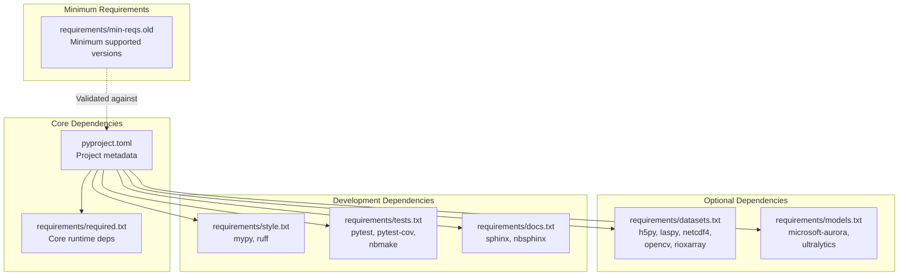
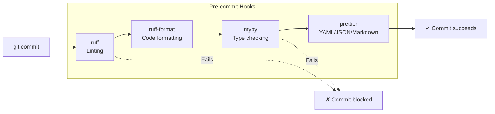
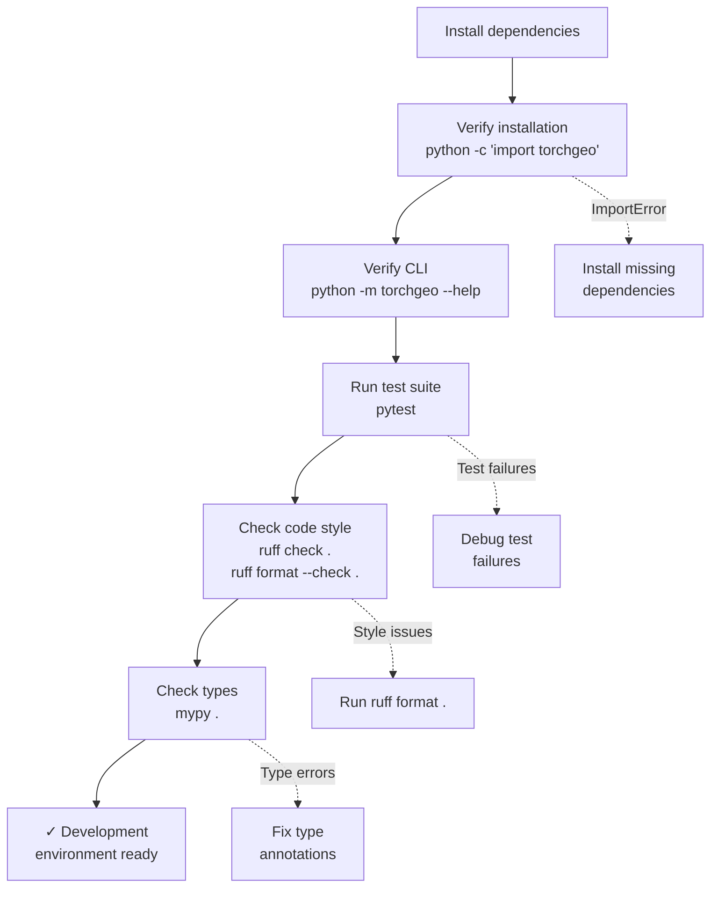
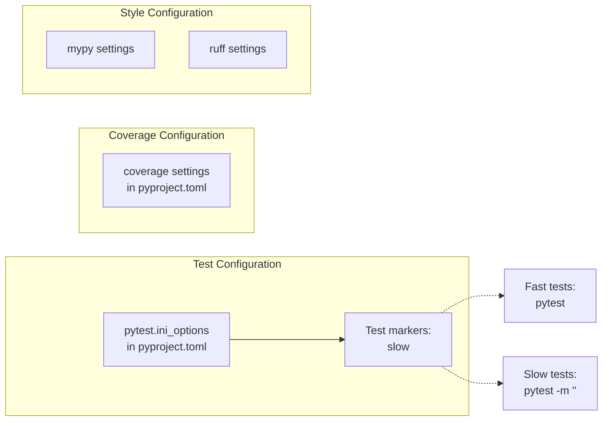

<!-- source: DeepWiki mcp.deepwiki.com · repo torchgeo/torchgeo · page 6.1 Development Setup · fetched 2026-10-21 -->

# Development Setup

<details>
<summary>Relevant source files</summary>

The following files were used as context for generating this wiki page:

- [.github/dependabot.yml](.github/dependabot.yml)
- [.pre-commit-config.yaml](.pre-commit-config.yaml)
- [pyproject.toml](pyproject.toml)
- [requirements/datasets.txt](requirements/datasets.txt)
- [requirements/min-reqs.old](requirements/min-reqs.old)
- [requirements/required.txt](requirements/required.txt)

</details>


## Purpose and Scope

This document covers the setup process for developing TorchGeo, including installing dependencies, configuring development tools, and verifying your environment. For information about code quality standards and tools, see [Code Quality Standards](#6.2). For testing infrastructure and patterns, see [Testing Infrastructure](#6.3). For details about the CI/CD pipeline, see [CI/CD Pipeline](#6.4).

## Prerequisites

TorchGeo requires:
- **Python 3.11 or later** (versions 3.11, 3.12, and 3.13 are officially supported)
- **Git** for version control
- **pip** for package management

The minimum Python version is enforced in [pyproject.toml:13]().

## Installation Methods

### Standard Development Installation

Clone the repository and install in editable mode:

```bash
git clone https://github.com/torchgeo/torchgeo.git
cd torchgeo
pip install -e .[all]
```

The `-e` flag creates an editable installation, allowing code changes to take effect immediately without reinstalling. The `[all]` extra installs all optional dependencies.

**Sources:** [pyproject.toml:152-154]()

### Selective Installation

Install only the dependencies you need based on your development focus:

| Dependency Group | Installation Command | Purpose |
|-----------------|---------------------|---------|
| Required only | `pip install -e .` | Core functionality |
| + Datasets | `pip install -e .[datasets]` | All dataset implementations |
| + Models | `pip install -e .[models]` | All model implementations |
| + Style tools | `pip install -e .[style]` | Code quality tools |
| + Test tools | `pip install -e .[tests]` | Testing infrastructure |
| + Documentation | `pip install -e .[docs]` | Documentation building |
| All dependencies | `pip install -e .[all]` | Everything |

**Sources:** [pyproject.toml:93-154]()

### Development Container

For a pre-configured development environment, use the provided VS Code dev container:

1. Install Docker and VS Code with the Remote Containers extension
2. Open the repository in VS Code
3. Click "Reopen in Container" when prompted

The container automatically runs `pip install -e .[all]` on startup and includes pre-configured extensions for Python development.

**Sources:** [.devcontainer/devcontainer.json:1-45]()

## Dependency Architecture



**Dependency Organization**

The dependency structure follows a multi-file strategy:

- **`pyproject.toml`**: Source of truth for all dependencies with minimum version constraints
- **`requirements/required.txt`**: Pinned versions of core dependencies for reproducible CI builds
- **`requirements/*.txt`**: Pinned versions of optional dependencies grouped by purpose
- **`requirements/min-reqs.old`**: Minimum versions tested in CI to ensure compatibility

This separation allows:
1. Users to install only what they need
2. CI to test both minimum and latest versions
3. Reproducible builds through pinned versions

**Sources:** [pyproject.toml:37-154](), [requirements/required.txt:1-22](), [requirements/datasets.txt:1-13](), [requirements/style.txt:1-4](), [requirements/tests.txt:1-6](), [requirements/min-reqs.old:1-45]()

## Pre-commit Hooks

Pre-commit hooks automatically check code quality before each commit. Install and configure them:

```bash
pip install pre-commit
pre-commit install
```

### Hook Configuration



The pre-commit configuration executes three tools:

1. **ruff**: Lints and formats Python and Jupyter files with auto-fix enabled
2. **mypy**: Type-checks Python code with strict settings
3. **prettier**: Formats YAML, JSON, and Markdown files

**Sources:** [.pre-commit-config.yaml:1-46]()

### Pre-commit Tool Versions

| Tool | Version | Configuration |
|------|---------|---------------|
| ruff | v0.13.0 | [.pre-commit-config.yaml:2-14]() |
| mypy | v1.16.0 | [.pre-commit-config.yaml:15-36]() |
| prettier | v3.1.0 | [.pre-commit-config.yaml:37-45]() |

### Bypassing Hooks

To commit without running hooks (not recommended):

```bash
git commit --no-verify
```

Note that CI will still run these checks, so bypassing locally only delays failure detection.

## Verification Workflow



### Quick Verification Commands

After installation, verify your setup with these commands:

```bash
# Test import
python -c "import torchgeo; print(torchgeo.__version__)"

# Test CLI
python -m torchgeo --help
torchgeo --help

# Run fast tests (exclude slow integration tests)
pytest

# Run all tests including integration tests
pytest -m ""

# Check code style
ruff check .
ruff format --check .

# Check types
mypy .
```

**Sources:** [.github/workflows/tests.yaml:44-47](), [.github/workflows/style.yaml:65-68](), [.github/workflows/style.yaml:39-40]()

## Development Environment Variables



Key configuration locations:

- **Pytest settings**: [pyproject.toml:211-318]()
- **Coverage settings**: [pyproject.toml:165-172]()
- **Mypy settings**: [pyproject.toml:174-209]()
- **Ruff settings**: [pyproject.toml:319-342]()

**Sources:** [pyproject.toml:165-342]()

## IDE Configuration

### VS Code

The dev container includes recommended extensions:

- `charliermarsh.ruff` - Ruff integration
- `ms-python.python` - Python language support
- `ms-python.mypy-type-checker` - Mypy integration
- `ms-toolsai.jupyter` - Jupyter notebook support

**Settings applied automatically:**
- Format on save enabled
- Organize imports on save
- Pytest integration enabled
- Default interpreter: `/usr/local/bin/python`

**Sources:** [.devcontainer/devcontainer.json:20-43]()

### Manual IDE Setup

For IDEs without dev container support, configure:

1. **Python interpreter**: Point to your virtual environment's Python
2. **Linter**: Configure ruff with `pyproject.toml`
3. **Type checker**: Configure mypy with `pyproject.toml`
4. **Formatter**: Use ruff format
5. **Test runner**: Use pytest with configuration from `pyproject.toml`

## CI Environment Replication

The CI runs tests across multiple configurations. To replicate CI locally:

### Latest Dependencies

```bash
pip install -r requirements/required.txt \
            -r requirements/datasets.txt \
            -r requirements/models.txt \
            -r requirements/tests.txt
pytest --cov=torchgeo --cov-report=xml
```

**Sources:** [.github/workflows/tests.yaml:36-46]()

### Minimum Dependencies

```bash
pip install -r requirements/min-reqs.old
pytest --cov=torchgeo --cov-report=xml
```

**Sources:** [.github/workflows/tests.yaml:69-79]()

### Optional Dependencies Only

```bash
pip install -r requirements/required.txt \
            -r requirements/tests.txt
pytest --cov=torchgeo --cov-report=xml
```

**Sources:** [.github/workflows/tests.yaml:101-111]()

## Dependency Caching

CI uses dependency caching to speed up builds. The cache key includes:

```
${{ runner.os }}-${{ runner.arch }}-Python-${{ python-version }}-${{ hashFiles('requirements/*.txt') }}
```

This ensures cache invalidation when:
- OS changes
- Architecture changes
- Python version changes
- Any requirement file changes

**Sources:** [.github/workflows/tests.yaml:30-35]()

## Common Setup Issues

| Issue | Symptom | Solution |
|-------|---------|----------|
| Import errors | `ModuleNotFoundError` | Install missing dependencies with appropriate extras |
| GDAL/rasterio issues | Build failures | Ensure system GDAL libraries installed |
| Mypy errors | Type checking failures | Update mypy version to match CI |
| Test failures | Pytest errors | Check Python version compatibility (3.11+) |
| Pre-commit slow | Long hook execution | Pre-commit cache may need rebuild |

## Next Steps

After setting up your environment:

1. Review [Code Quality Standards](#6.2) for style guidelines
2. Review [Testing Infrastructure](#6.3) for testing patterns
3. Review [CI/CD Pipeline](#6.4) to understand automated checks
4. Review [Dependency Management](#6.5) for dependency update procedures

---

