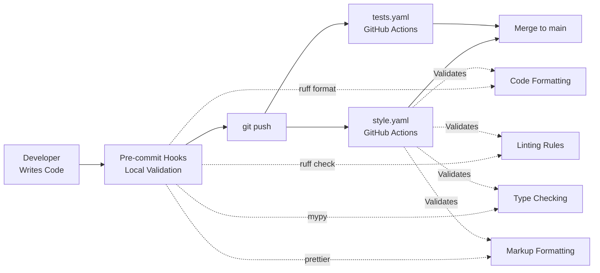
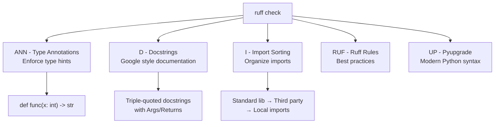
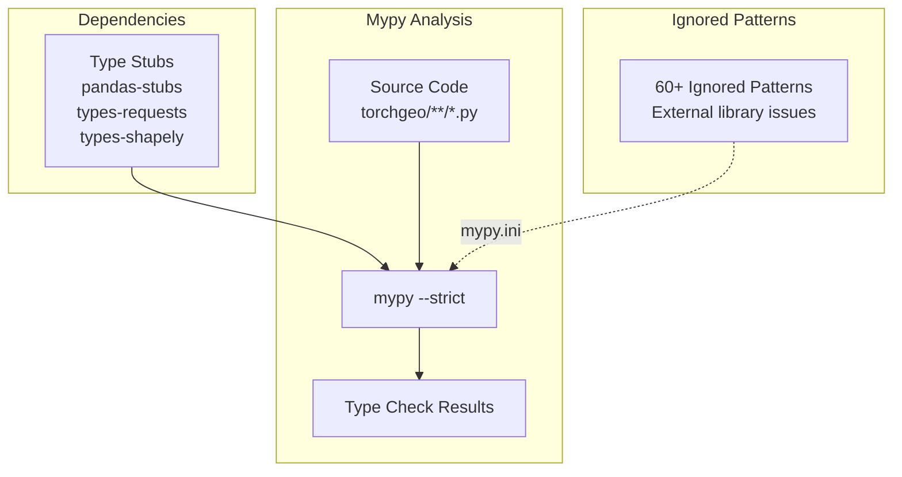
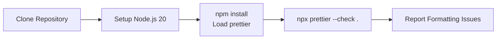
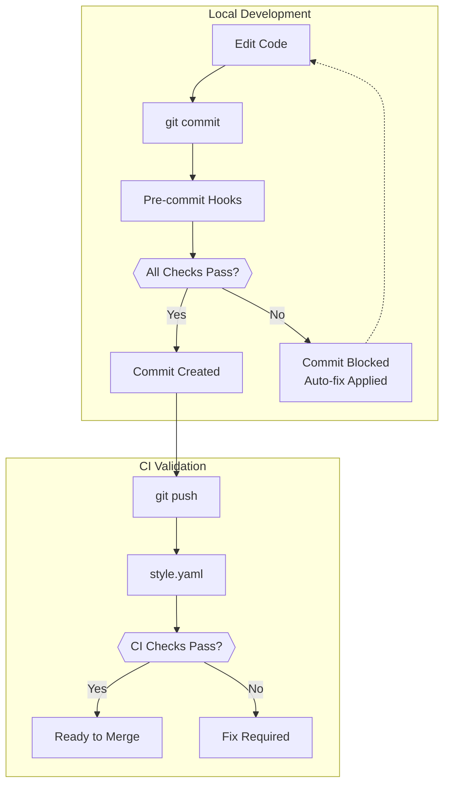
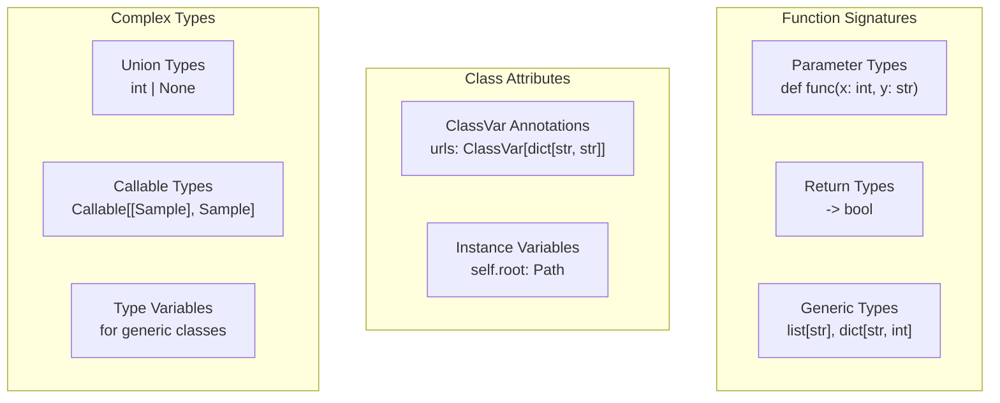
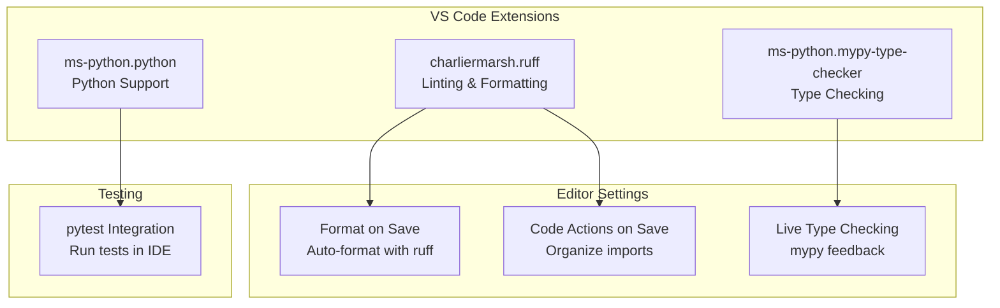
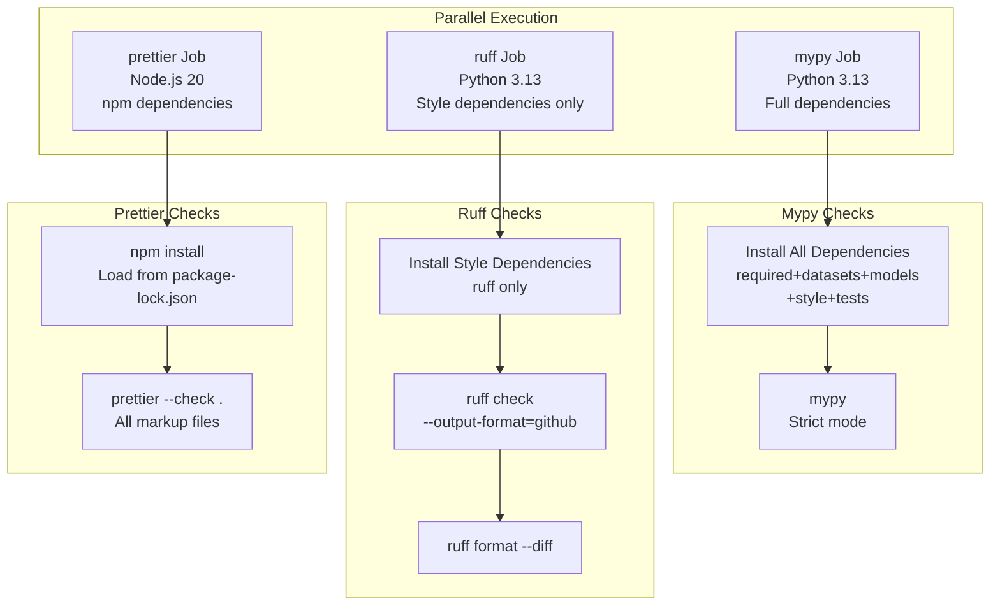

<!-- source: DeepWiki mcp.deepwiki.com · repo torchgeo/torchgeo · page 6.2 Code Quality Standards · fetched 2026-10-21 -->

# Code Quality Standards

<details>
<summary>Relevant source files</summary>

The following files were used as context for generating this wiki page:

- [.devcontainer/devcontainer.json](.devcontainer/devcontainer.json)
- [.github/labeler.yml](.github/labeler.yml)
- [.github/workflows/deploy.yaml](.github/workflows/deploy.yaml)
- [.github/workflows/labeler.yml](.github/workflows/labeler.yml)
- [.github/workflows/release.yaml](.github/workflows/release.yaml)
- [.github/workflows/style.yaml](.github/workflows/style.yaml)
- [.github/workflows/tests.yaml](.github/workflows/tests.yaml)
- [.github/workflows/tutorials.yaml](.github/workflows/tutorials.yaml)
- [docs/api/models/changestar.rst](docs/api/models/changestar.rst)
- [docs/api/models/convlstm.rst](docs/api/models/convlstm.rst)
- [requirements/style.txt](requirements/style.txt)
- [tests/data/copernicus/pretrain/data.py](tests/data/copernicus/pretrain/data.py)
- [tests/data/copernicus/pretrain/example-000000.tar](tests/data/copernicus/pretrain/example-000000.tar)
- [tests/datasets/test_openstreetmap.py](tests/datasets/test_openstreetmap.py)
- [torchgeo/datamodules/caffe.py](torchgeo/datamodules/caffe.py)
- [torchgeo/datasets/bright.py](torchgeo/datasets/bright.py)
- [torchgeo/datasets/copernicus/pretrain.py](torchgeo/datasets/copernicus/pretrain.py)
- [torchgeo/datasets/cropharvest.py](torchgeo/datasets/cropharvest.py)
- [torchgeo/datasets/digital_typhoon.py](torchgeo/datasets/digital_typhoon.py)
- [torchgeo/datasets/everwatch.py](torchgeo/datasets/everwatch.py)
- [torchgeo/datasets/openstreetmap.py](torchgeo/datasets/openstreetmap.py)
- [torchgeo/datasets/reforestree.py](torchgeo/datasets/reforestree.py)
- [torchgeo/datasets/soda.py](torchgeo/datasets/soda.py)
- [torchgeo/datasets/splits.py](torchgeo/datasets/splits.py)
- [torchgeo/models/copernicusfm.py](torchgeo/models/copernicusfm.py)
- [torchgeo/models/croma.py](torchgeo/models/croma.py)
- [torchgeo/models/fcsiam.py](torchgeo/models/fcsiam.py)
- [torchgeo/models/panopticon.py](torchgeo/models/panopticon.py)

</details>


This page documents the code quality standards enforced in TorchGeo, including linting, type checking, formatting, and testing practices. These standards ensure consistency, maintainability, and correctness across the codebase. For information about the testing infrastructure itself, see [Testing Infrastructure](#6.3). For CI/CD automation, see [CI/CD Pipeline](#6.4).

## Overview

TorchGeo maintains high code quality through automated tooling at multiple stages:

- **Pre-commit hooks** catch issues immediately during development
- **CI workflows** enforce standards on all pull requests
- **Multiple validation layers** covering formatting, linting, type safety, and documentation

The primary tools are:
- **ruff** - Fast Python linter and formatter
- **mypy** - Static type checker
- **prettier** - Markup and configuration file formatter

---

## Tool Configuration and Workflow

### Quality Enforcement Pipeline



**Sources:** [.github/workflows/style.yaml](), [requirements/style.txt]()

---

## Ruff: Linting and Formatting

Ruff is a fast Python linter and formatter that replaces multiple legacy tools (flake8, isort, black, etc.). TorchGeo uses ruff for both code formatting and linting.

### Configuration

Ruff configuration is defined in `pyproject.toml` with the following key settings:

| Setting | Purpose |
|---------|---------|
| **Line length** | 88 characters (black-compatible) |
| **Target version** | Python 3.10+ |
| **Rule sets** | ANN (annotations), D (docstrings), I (import sorting), RUF (ruff-specific), UP (pyupgrade) |
| **Docstring style** | Google convention |

### Enabled Rule Categories



### CI Enforcement

The style workflow runs ruff checks on every push and pull request:

```yaml
# From .github/workflows/style.yaml:65-68
- name: Run ruff checks
  run: |
    ruff check --output-format=github --no-fix .
    ruff format --diff
```

The `--output-format=github` flag provides inline annotations on pull requests, and `--no-fix` ensures the CI only validates (doesn't modify) code.

**Sources:** [.github/workflows/style.yaml:41-68](), [requirements/style.txt:4]()

---

## Mypy: Static Type Checking

Mypy enforces type safety throughout the codebase using Python's type hint system.

### Strict Mode Configuration

TorchGeo runs mypy in **strict mode**, which requires:

- All functions must have type annotations
- No untyped function calls allowed
- No untyped definitions allowed
- Strict equality checks

### Type Checking Workflow



### Type Stub Dependencies

To provide type information for external libraries, TorchGeo installs type stub packages:

```python
# From requirements/style.txt:1-6
mypy==1.19.1
pandas-stubs==2.3.3.260113
ruff==0.14.13
types-requests==2.32.4.20260107
types-shapely==2.1.0.20250917
```

These stubs enable mypy to understand types for pandas DataFrames, HTTP requests, and geometric operations.

### CI Integration

The mypy check runs on Python 3.13 with full dependencies:

```yaml
# From .github/workflows/style.yaml:15-40
mypy:
  name: mypy
  runs-on: ubuntu-latest
  steps:
    - name: Clone repo
    - name: Set up python (3.13)
    - name: Install dependencies
      run: pip install -r requirements/required.txt \
                       -r requirements/datasets.txt \
                       -r requirements/models.txt \
                       -r requirements/style.txt \
                       -r requirements/tests.txt
    - name: Run mypy checks
      run: mypy
```

The check must pass before code can be merged.

**Sources:** [.github/workflows/style.yaml:15-40](), [requirements/style.txt:1-6]()

---

## Prettier: Markup Formatting

Prettier formats non-Python files including Markdown, YAML, JSON, and TOML. This ensures consistency across documentation and configuration files.

### Configuration Files

Prettier is configured via `package.json` and `.prettierrc`:

| File Type | Formatting Rules |
|-----------|------------------|
| **Markdown (.md)** | Line wrapping, consistent list formatting |
| **YAML (.yaml, .yml)** | Consistent indentation, quote style |
| **JSON (.json)** | 2-space indentation, trailing commas |
| **TOML (.toml)** | Consistent spacing and alignment |

### CI Enforcement



The prettier workflow installs dependencies from `package-lock.json` and validates all markup files:

```yaml
# From .github/workflows/style.yaml:69-88
prettier:
  name: prettier
  runs-on: ubuntu-latest
  steps:
    - name: Set up nodejs
      uses: actions/setup-node@v6.2.0
      with:
        node-version: '20'
        cache: 'npm'
    - name: Run prettier formatting
      run: npx prettier --check .
```

**Sources:** [.github/workflows/style.yaml:69-88]()

---

## Pre-commit Hooks

Pre-commit hooks run automatically before each `git commit`, catching issues immediately during development.

### Hook Configuration

While the pre-commit configuration file isn't shown in the provided files, the development container configuration reveals the hooks in use:

```json
// From .devcontainer/devcontainer.json:38-40
"python.editor.codeActionsOnSave": {
  "source.organizeImports": true
}
```

### Local vs CI Validation



Pre-commit hooks provide **immediate feedback** and can **auto-fix** many issues (formatting, import sorting), while CI provides **authoritative validation** that cannot be bypassed.

**Sources:** [.devcontainer/devcontainer.json:38-40]()

---

## Docstring Standards

TorchGeo uses **Google-style docstrings** for all public APIs. This standard is enforced by ruff's `D` rule category.

### Google Docstring Format

```python
def example_function(param1: int, param2: str) -> bool:
    """Short description (one line).

    Longer description paragraph explaining the function's purpose
    and behavior in detail.

    Args:
        param1: Description of param1.
        param2: Description of param2.

    Returns:
        Description of the return value.

    Raises:
        ValueError: When param1 is negative.
        TypeError: When param2 is not a string.

    Example:
        >>> example_function(5, "test")
        True
    """
```

### Required Documentation Sections

| Section | When Required | Purpose |
|---------|---------------|---------|
| **Short description** | Always | One-line summary |
| **Long description** | Complex functions | Detailed explanation |
| **Args** | If parameters exist | Document each parameter |
| **Returns** | If returns value | Describe return value |
| **Raises** | If raises exceptions | Document exceptions |
| **Example** | Public APIs | Usage example |
| **.. versionadded::** | New features | Version tracking |

### Examples from Codebase

The dataset implementations demonstrate proper docstring usage:

```python
# From torchgeo/datasets/openstreetmap.py:85-113
def __init__(
    self,
    bbox: tuple[float, float, float, float],
    classes: list[dict[str, Any]],
    paths: Path = 'data',
    res: float | tuple[float, float] = (0.0001, 0.0001),
    transforms: Callable[[Sample], Sample] | None = None,
    download: bool = False,
) -> None:
    """Initialize a new OpenStreetMap dataset instance.

    Args:
        bbox: bounding box for initial data fetch as (xmin, ymin, xmax, ymax)...
        classes: list of dicts defining feature classes. Each dict must have:
            - 'name' (str): class name
            - 'selector' (list[dict[str, Any]]): list of OSM tag filters
        paths: paths directory where dataset will be stored
        res: resolution of the dataset in units of EPSG:4326 (degrees)...
        transforms: a function/transform that takes input sample...
        download: if True, download dataset and store it...

    Raises:
        DatasetNotFoundError: if dataset is not found and download is False
        ValueError: if invalid class configuration
    """
```

**Sources:** [torchgeo/datasets/openstreetmap.py:85-113](), [requirements/style.txt:4]()

---

## Type Annotation Standards

All functions, methods, and public APIs must have complete type annotations.

### Required Type Hints



### Type Annotation Examples

From model weights enums:

```python
# From torchgeo/models/croma.py:500-517
class CROMABase_Weights(WeightsEnum):  # type: ignore[misc]
    """CROMA base model weights.

    .. versionadded:: 0.7
    """

    CROMA_VIT = Weights(
        url='https://hf.co/torchgeo/croma/resolve/.../CROMA_base-0238d814.pt',
        transforms=nn.Identity(),
        meta={
            'dataset': 'SSL4EO',
            'model': 'vit',
            'publication': 'https://arxiv.org/abs/2311.00566',
            'repo': 'https://github.com/antofuller/CROMA',
            'ssl_method': 'croma',
        },
    )
```

From dataset implementations:

```python
# From torchgeo/datasets/bright.py:83-88
px_class_values: ClassVar[dict[int, str]] = {
    0: 'background',
    1: 'intact',
    2: 'damaged',
    3: 'destroyed',
}
```

### Type Checking for External Libraries

Type stubs handle external libraries without native type hints:

```python
# Types for pandas, requests, shapely are provided by:
pandas-stubs==2.3.3.260113
types-requests==2.32.4.20260107
types-shapely==2.1.0.20250917
```

**Sources:** [torchgeo/models/croma.py:500-517](), [torchgeo/datasets/bright.py:83-88](), [requirements/style.txt:2-6]()

---

## Development Environment Integration

The DevContainer configuration shows recommended VS Code settings for maintaining code quality during development.

### VS Code Integration



### Configuration Details

From the DevContainer settings:

```json
// From .devcontainer/devcontainer.json:22-42
"extensions": [
  "charliermarsh.ruff",           // Ruff linter/formatter
  "ms-python.python",             // Python language support
  "ms-python.mypy-type-checker",  // Type checking
  "ms-toolsai.jupyter"            // Notebook support
],
"settings": {
  "python.editor.formatOnSave": true,
  "python.editor.formatOnSaveMode": "file",
  "python.editor.codeActionsOnSave": {
    "source.organizeImports": true
  },
  "python.testing.pytestEnabled": true
}
```

These settings ensure developers get **immediate feedback** as they write code, catching issues before commit.

**Sources:** [.devcontainer/devcontainer.json:22-42]()

---

## CI Workflow Details

The style workflow runs on every push and pull request to `main` and `release**` branches.

### Workflow Stages



### Caching Strategy

All jobs use GitHub Actions caching to speed up dependency installation:

```yaml
# From .github/workflows/style.yaml:26-31
- name: Cache dependencies
  uses: actions/cache@v5.0.2
  with:
    path: ${{ env.pythonLocation }}
    key: ${{ runner.os }}-${{ runner.arch }}-Python-${{ steps.setup-python.outputs.python-version }}-${{ hashFiles('requirements/*.txt') }}
```

This reduces CI time by reusing installed dependencies when requirements haven't changed.

### Concurrency Control

```yaml
# From .github/workflows/style.yaml:89-91
concurrency:
  group: ${{ github.workflow }}-${{ github.event.pull_request.head.label }}
  cancel-in-progress: ${{ github.ref != 'refs/heads/main' }}
```

This configuration:
- **Groups** concurrent runs by PR branch
- **Cancels** in-progress runs when new commits are pushed (except on main)
- **Saves** CI resources and provides faster feedback

**Sources:** [.github/workflows/style.yaml:1-91]()

---

## Quality Metrics and Coverage

While not enforced as blockers, TorchGeo tracks quality metrics to monitor codebase health.

### Tracked Metrics

| Metric | Tool | Purpose |
|--------|------|---------|
| **Code Coverage** | pytest-cov + codecov | Measure test coverage percentage |
| **Type Coverage** | mypy | Track typed vs untyped code |
| **Linting Issues** | ruff | Monitor code quality violations |

### Coverage Reporting

From the test workflows:

```yaml
# From .github/workflows/tests.yaml:46-52
- name: Run pytest checks
  run: |
    pytest --cov=torchgeo --cov-report=xml
    python3 -m torchgeo --help
- name: Report coverage
  uses: codecov/codecov-action@v5.5.2
  with:
    token: ${{ secrets.CODECOV_TOKEN }}
```

Coverage reports are uploaded to Codecov on every CI run, providing visibility into test coverage trends.

**Sources:** [.github/workflows/tests.yaml:46-52]()

---

## Common Patterns and Best Practices

### Pattern: Type-Safe Dictionary Access

```python
# From torchgeo/datasets/digital_typhoon.py:24-28
class _SampleSequenceDict(TypedDict):
    """Sample sequence dictionary."""

    id: str
    seq_id: list[int]
```

Using `TypedDict` provides type safety for dictionary structures with known keys.

### Pattern: ClassVar for Class-Level Constants

```python
# From torchgeo/datasets/digital_typhoon.py:90-93
md5sums: ClassVar[dict[str, str]] = {
    'aa': '9e77a5f74783f7909dee0fb936053b17',
    'ab': '46aebdcba6e4e2df1619e4a3d7e556bb',
}
```

`ClassVar` annotations distinguish class-level variables from instance attributes.

### Pattern: Comprehensive Validation

```python
# From torchgeo/datasets/openstreetmap.py:140-163
def _validate_classes(self, classes: list[dict[str, Any]]) -> None:
    """Validate classes configuration.

    Args:
        classes: list of class definitions to validate...

    Raises:
        ValueError: if classes configuration is invalid
    """
    if not isinstance(classes, list) or not classes:
        raise ValueError('classes must be a non-empty list')

    for i, class_def in enumerate(classes):
        if not isinstance(class_def, dict):
            raise ValueError(f'Class {i} must be a dictionary')
        if 'name' not in class_def or 'selector' not in class_def:
            raise ValueError(f'Class {i} must have "name" and "selector" keys')
```

Input validation with clear error messages and type checking.

**Sources:** [torchgeo/datasets/digital_typhoon.py:24-28](), [torchgeo/datasets/digital_typhoon.py:90-93](), [torchgeo/datasets/openstreetmap.py:140-163]()

---

## Summary

TorchGeo's code quality standards enforce:

1. **Automated formatting** with ruff (no debates about style)
2. **Type safety** with mypy strict mode (catch errors before runtime)
3. **Consistent documentation** with Google-style docstrings
4. **Multi-layer validation** (pre-commit hooks → CI workflows)
5. **Developer-friendly tooling** (IDE integration, auto-fix capabilities)

These standards are **non-negotiable** for merging code to main, ensuring the codebase remains maintainable as it scales.

---

