<!-- source: DeepWiki mcp.deepwiki.com · repo torchgeo/torchgeo · page 6.3 Testing Infrastructure · fetched 2026-10-21 -->

# Testing Infrastructure

<details>
<summary>Relevant source files</summary>

The following files were used as context for generating this wiki page:

- [.devcontainer/devcontainer.json](.devcontainer/devcontainer.json)
- [.github/labeler.yml](.github/labeler.yml)
- [.github/workflows/deploy.yaml](.github/workflows/deploy.yaml)
- [.github/workflows/labeler.yml](.github/workflows/labeler.yml)
- [.github/workflows/release.yaml](.github/workflows/release.yaml)
- [.github/workflows/style.yaml](.github/workflows/style.yaml)
- [.github/workflows/tests.yaml](.github/workflows/tests.yaml)
- [.github/workflows/tutorials.yaml](.github/workflows/tutorials.yaml)
- [requirements/tests.txt](requirements/tests.txt)
- [tests/datasets/test_ssl4eo.py](tests/datasets/test_ssl4eo.py)
- [tests/models/test_rcf.py](tests/models/test_rcf.py)
- [tests/test_requirements.py](tests/test_requirements.py)
- [torchgeo/datamodules/seco.py](torchgeo/datamodules/seco.py)
- [torchgeo/datasets/biomassters.py](torchgeo/datasets/biomassters.py)
- [torchgeo/datasets/mapinwild.py](torchgeo/datasets/mapinwild.py)
- [torchgeo/datasets/seasonet.py](torchgeo/datasets/seasonet.py)
- [torchgeo/datasets/skippd.py](torchgeo/datasets/skippd.py)
- [torchgeo/datasets/ssl4eo.py](torchgeo/datasets/ssl4eo.py)
- [torchgeo/datasets/ssl4eo_benchmark.py](torchgeo/datasets/ssl4eo_benchmark.py)
- [torchgeo/models/rcf.py](torchgeo/models/rcf.py)

</details>


This page documents TorchGeo's comprehensive testing infrastructure, including test organization, pytest patterns, fixtures, CI/CD integration, and coverage reporting. For information about code quality standards (linting, type checking), see [Code Quality Standards](#6.2). For CI/CD pipeline details, see [CI/CD Pipeline](#6.4).

## Overview

TorchGeo employs a multi-tiered testing strategy with three distinct test categories:

1. **Unit Tests**: Fast tests executed on every commit across multiple OS and Python versions
2. **Integration Tests**: Slower tests (marked with `@pytest.mark.slow`) executed only on release branches
3. **Notebook Tests**: Tutorial validation executed on release branches and when tutorials change

The testing infrastructure is built on `pytest` and integrated with GitHub Actions for continuous testing, with code coverage tracking via Codecov.

Sources: [.github/workflows/tests.yaml:1-120](), [.github/workflows/release.yaml:1-72]()

## Test Organization Structure

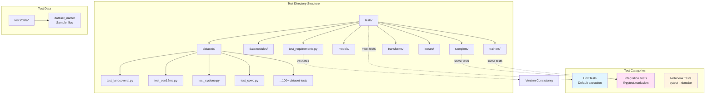

Tests are organized to mirror the source code structure in `torchgeo/`, with each module having a corresponding test directory. Test data is stored in `tests/data/` with subdirectories for each dataset containing minimal sample files.

Sources: [tests/datasets/test_landcoverai.py:1-138](), [tests/datasets/test_sen12ms.py:1-105](), [tests/datasets/test_cyclone.py:1-72]()

## Testing Dependencies

The test suite requires specific dependencies defined in [requirements/tests.txt:1-6]():

| Package | Version | Purpose |
|---------|---------|---------|
| `nbmake` | 1.5.5 | Executes and validates Jupyter notebooks |
| `packaging` | 25.0 | Version parsing for dependency validation |
| `pytest` | 9.0.2 | Core testing framework |
| `pytest-cov` | 7.0.0 | Code coverage measurement |

These dependencies are installed in all CI testing workflows alongside core and optional dependencies.

Sources: [requirements/tests.txt:1-6]()

## CI/CD Test Matrix

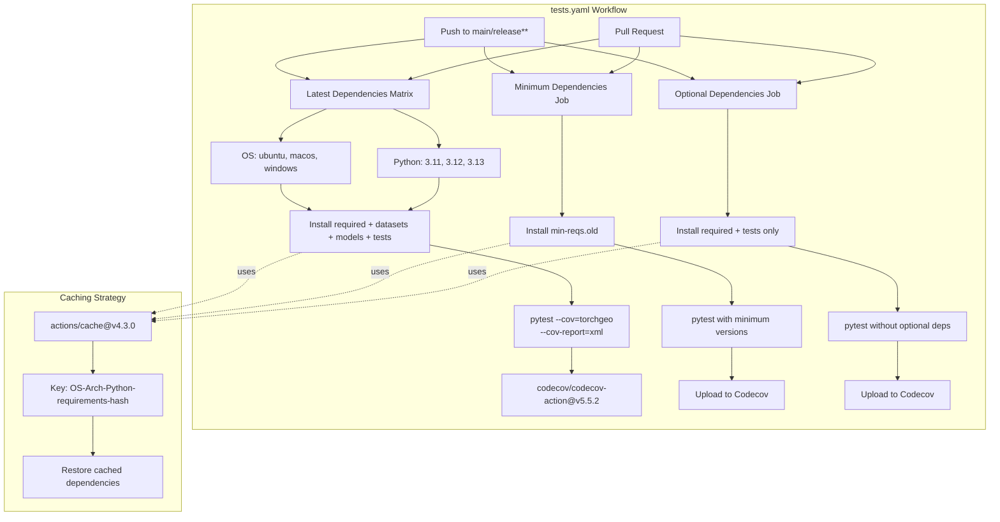

The test workflow executes three distinct test jobs:

1. **latest**: Tests with latest dependencies across 3 OSes × 3 Python versions = 9 combinations
2. **minimum**: Tests with minimum supported dependency versions (Ubuntu, Python 3.11)
3. **optional**: Tests without optional dependencies to ensure core functionality works

Sources: [.github/workflows/tests.yaml:14-116]()

## Integration and Notebook Testing

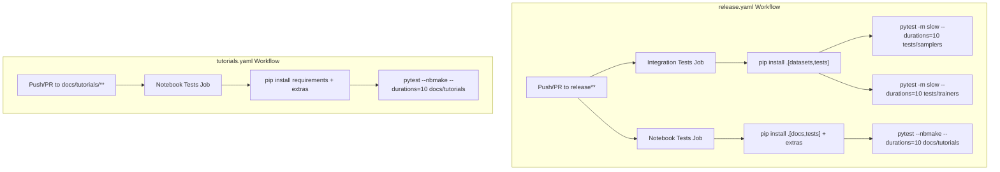

Integration tests are marked with `@pytest.mark.slow` and include:
- Sampler tests with large datasets [.github/workflows/release.yaml:39]()
- Trainer tests with full training loops [.github/workflows/release.yaml:40]()

Notebook tests validate that all tutorials execute without errors using `pytest --nbmake`.

Sources: [.github/workflows/release.yaml:12-72](), [.github/workflows/tutorials.yaml:1-46]()

## Common Test Patterns

### Fixture-Based Dataset Testing

Dataset tests follow a consistent pattern using pytest fixtures with parametrization:

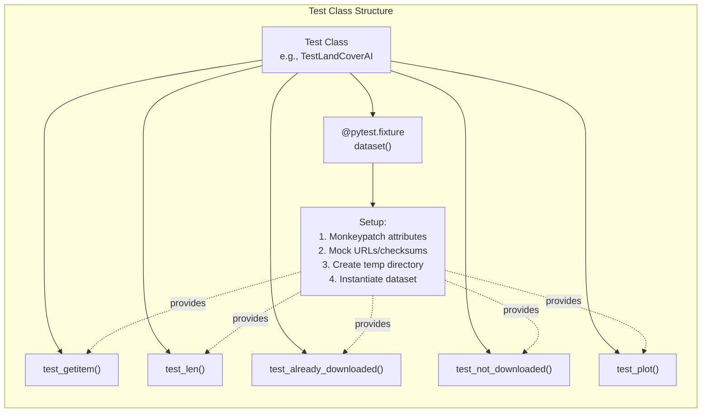

Example from [tests/datasets/test_landcoverai.py:76-94]():

**Fixture Setup Pattern**:
- Uses `@pytest.fixture` with `params` for parametrization
- Monkeypatches URLs, MD5 checksums, and class attributes
- Creates temporary directories via `tmp_path`
- Returns initialized dataset instance

**Standard Test Methods**:
- `test_getitem()`: Validates sample structure and tensor types
- `test_len()`: Checks dataset length
- `test_already_downloaded()`: Tests idempotent download
- `test_not_downloaded()`: Validates error when data missing
- `test_plot()`: Ensures plotting functions work

Sources: [tests/datasets/test_landcoverai.py:26-138](), [tests/datasets/test_sen12ms.py:18-105]()

### Monkeypatching Pattern

Tests extensively use `pytest.MonkeyPatch` to mock external dependencies:

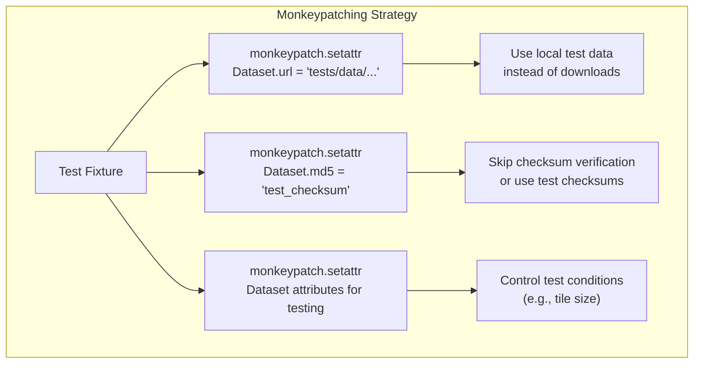

Examples:
- Mock URLs to point to local test data: [tests/datasets/test_landcoverai.py:31-32]()
- Mock checksums for test files: [tests/datasets/test_landcoverai.py:29-30]()
- Mock dataset dimensions for faster tests: [tests/datasets/test_cv4a_kenya_crop_type.py:31-32]()

This pattern enables:
1. Tests that run without internet access
2. Fast execution with minimal test data
3. Predictable test conditions

Sources: [tests/datasets/test_landcoverai.py:28-35](), [tests/datasets/test_cv4a_kenya_crop_type.py:24-35]()

### Parametrized Testing Pattern

Pytest parametrization allows testing multiple configurations with a single test function:

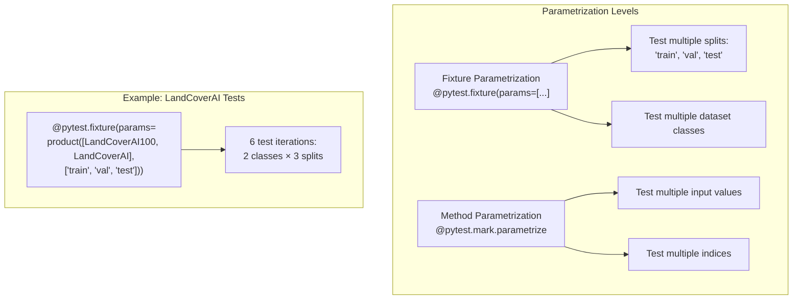

Example from [tests/datasets/test_landcoverai.py:76-78]():
- Tests both `LandCoverAI` and `LandCoverAI100` classes
- Tests all three splits: 'train', 'val', 'test'
- Results in 6 test iterations from a single fixture

Sources: [tests/datasets/test_landcoverai.py:76-94](), [tests/datasets/test_cyclone.py:20-34]()

### Error Testing Pattern

Tests validate error conditions and exceptions:

| Test Pattern | Example | Purpose |
|--------------|---------|---------|
| Missing dataset | `test_not_downloaded()` | Validates `DatasetNotFoundError` when data absent |
| Invalid split | `test_invalid_split()` | Ensures `AssertionError` for invalid arguments |
| Missing bands | `test_invalid_bands()` | Validates band selection errors |
| Out of bounds | `test_out_of_bounds_query()` | Tests spatial query edge cases |
| RGB bands missing | `test_plot_rgb()` | Validates `RGBBandsMissingError` for plotting |

Example from [tests/datasets/test_landcoverai.py:52-54]():
```python
def test_not_downloaded(self, tmp_path: Path) -> None:
    with pytest.raises(DatasetNotFoundError, match='Dataset not found'):
        LandCoverAIGeo(tmp_path)
```

Sources: [tests/datasets/test_landcoverai.py:52-54](), [tests/datasets/test_sen12ms.py:67-72](), [tests/datasets/test_cowc.py:68-74]()

## Dataset-Specific Testing Patterns

### GeoDataset Testing

GeoDatasets require spatial query testing:

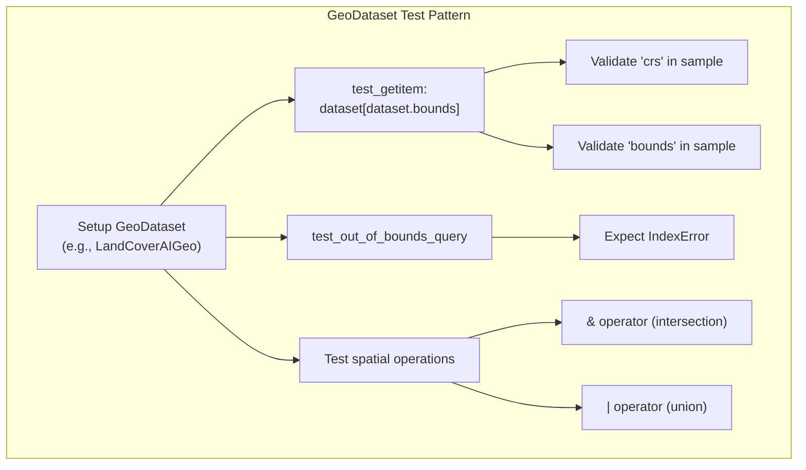

Key differences from NonGeoDataset tests:
- Use spatial slicing: `dataset[xmin:xmax, ymin:ymax, tmin:tmax]` [tests/datasets/test_landcoverai.py:38]()
- Validate CRS and bounds in returned samples [tests/datasets/test_landcoverai.py:38-41]()
- Test out-of-bounds queries [tests/datasets/test_landcoverai.py:56-60]()

Sources: [tests/datasets/test_landcoverai.py:26-71]()

### NonGeoDataset Testing

NonGeoDatasets use integer indexing:

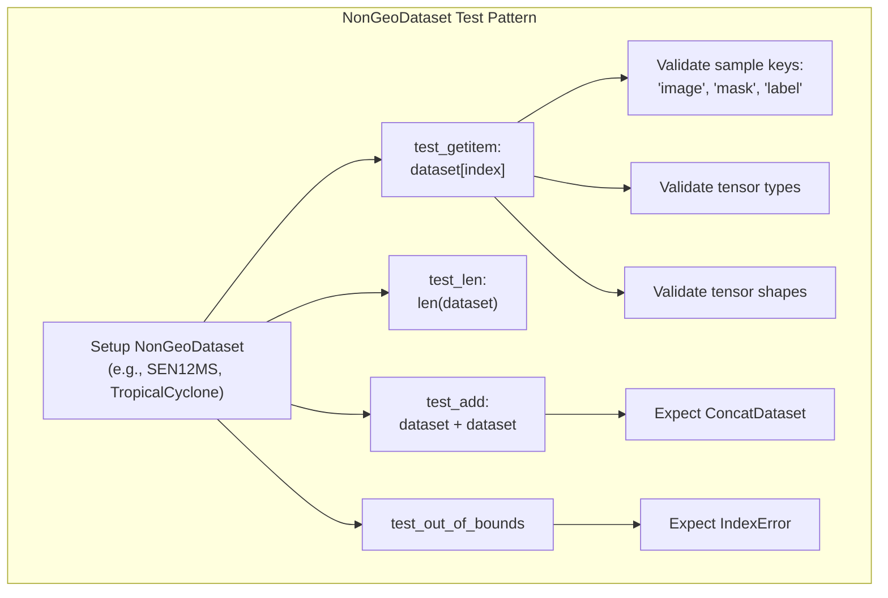

Example from [tests/datasets/test_sen12ms.py:44-48]():
- Integer indexing: `dataset[0]`
- Validate image tensor shape based on band selection
- Test concatenation with `+` operator

Sources: [tests/datasets/test_sen12ms.py:18-105](), [tests/datasets/test_cyclone.py:19-72]()

### Download Testing Pattern

Download tests validate dataset downloading logic:

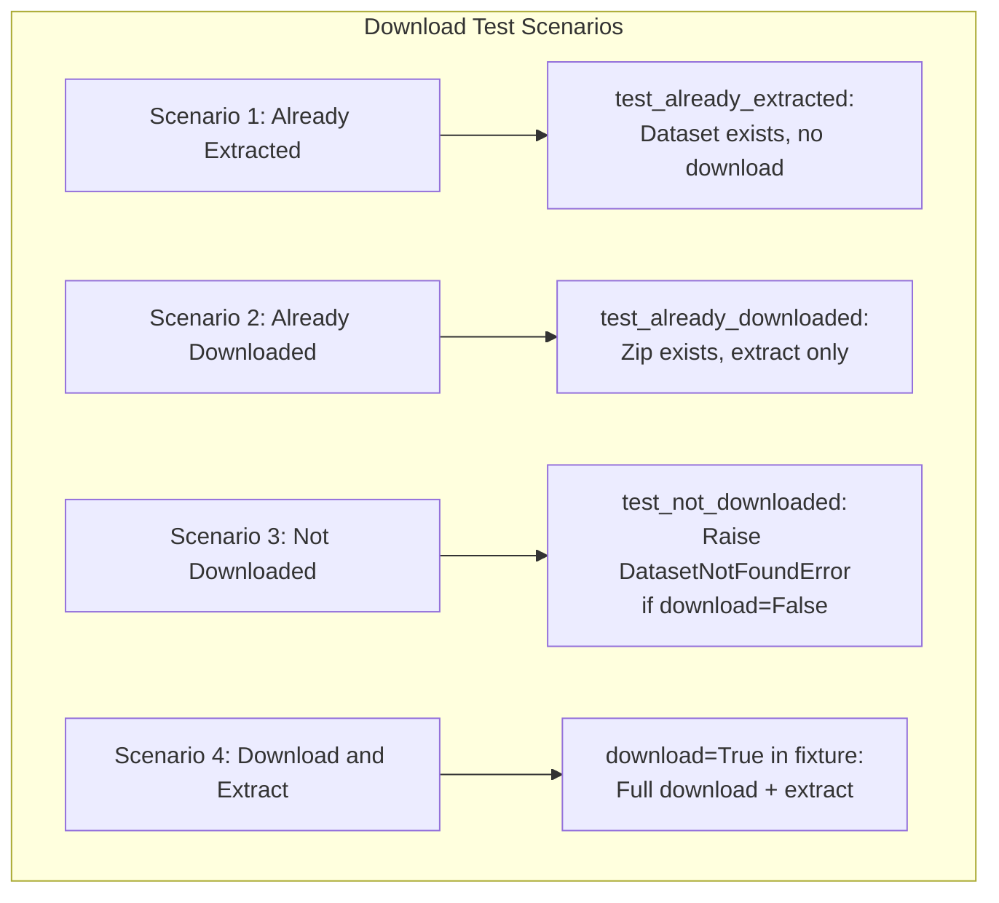

Tests verify:
- Idempotent download behavior [tests/datasets/test_landcoverai.py:43-44]()
- Extraction from existing archives [tests/datasets/test_landcoverai.py:46-50]()
- Error when data missing and download=False [tests/datasets/test_landcoverai.py:52-54]()

Sources: [tests/datasets/test_landcoverai.py:43-54](), [tests/datasets/test_sen12ms.py:67-72]()

### Visualization Testing

All datasets implement a `plot()` method that requires testing:

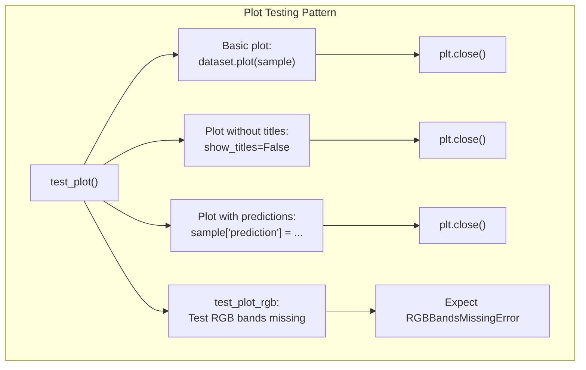

Example from [tests/datasets/test_landcoverai.py:62-70]():
```python
def test_plot(self, dataset: LandCoverAIGeo) -> None:
    x = dataset[dataset.bounds].copy()
    dataset.plot(x, suptitle='Test')
    plt.close()
    dataset.plot(x, show_titles=False)
    plt.close()
    x['prediction'] = x['mask'][:, :, 0].clone().unsqueeze(2)
    dataset.plot(x)
    plt.close()
```

Tests ensure:
- Basic plotting works without errors
- Optional parameters function correctly
- Prediction visualization works
- Missing RGB bands raise appropriate errors

Sources: [tests/datasets/test_landcoverai.py:62-70](), [tests/datasets/test_sen12ms.py:90-104]()

## Test Data Management

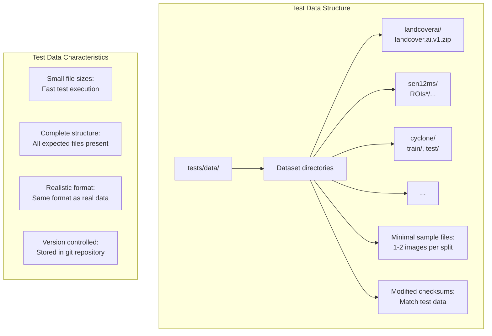

Test data principles:
- **Minimal**: Only 1-2 samples per dataset to keep repository size small
- **Complete**: Contains all file types required by dataset (images, masks, metadata)
- **Realistic**: Uses actual file formats (GeoTIFF, HDF5, CSV) but with reduced dimensions
- **Versioned**: Committed to repository for reproducible tests

Example: LandCoverAI test data at [tests/data/landcoverai/]() contains a minimal zip file with 2 images and 2 masks in proper structure.

Sources: [tests/datasets/test_landcoverai.py:31](), [tests/datasets/test_sen12ms.py:39]()

## Coverage Reporting

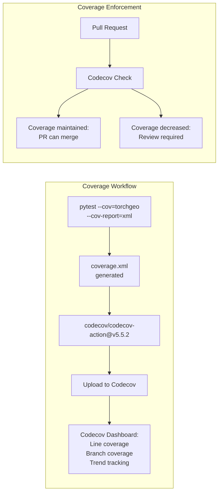

Coverage is measured and reported for:
- All three test jobs: latest, minimum, optional
- Uploaded with unique tokens: [.github/workflows/tests.yaml:50-52]()
- Tracked in Codecov dashboard with historical trends
- Enforced via GitHub status checks on pull requests

The coverage report includes:
- Line coverage percentage
- Branch coverage percentage
- Per-file coverage breakdowns
- Coverage diffs for pull requests

Sources: [.github/workflows/tests.yaml:45-52]()

## Dependency Consistency Testing

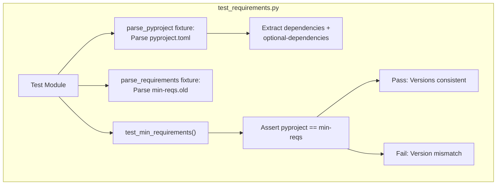

The [tests/test_requirements.py:1-58]() module validates that:
1. `pyproject.toml` dependencies match `requirements/min-reqs.old`
2. All optional dependencies are properly declared
3. Version specifiers are consistent across files

This prevents version drift between dependency specifications and ensures developers use correct minimum versions.

Sources: [tests/test_requirements.py:1-58]()

## Testing Best Practices

### Fixtures Over Setup/Teardown

TorchGeo tests prefer pytest fixtures over `setUp()`/`tearDown()` methods:

**Benefits**:
- Explicit dependencies via function parameters
- Easy parametrization via `params` argument
- Better test isolation through scope control
- Composition through fixture dependencies

Example fixture from SSL4EOL tests: [tests/datasets/test_ssl4eo.py:22-60]()

### Temporary Directories

All tests use `tmp_path` fixture for temporary file operations:
- Automatic cleanup after test completion
- Prevents pollution of working directory
- Ensures test isolation
- Compatible with parallel execution

Examples: [tests/datasets/test_ssl4eo.py:23](), [tests/models/test_rcf.py:48]()

### Type Hints

Test functions include type hints for:
- Fixture parameters
- Return types
- Improved IDE support
- Self-documenting test interfaces

Example: [tests/datasets/test_landcoverai.py:37]()

### Descriptive Test Names

Test method names clearly describe what is being tested:
- `test_getitem()` - Tests `__getitem__` implementation
- `test_already_downloaded()` - Tests download idempotency  
- `test_out_of_bounds_query()` - Tests error handling for invalid queries
- `test_plot_rgb()` - Tests RGB visualization requirements

Sources: [tests/datasets/test_landcoverai.py:37-70]()

---

This testing infrastructure ensures TorchGeo maintains high code quality, compatibility across platforms and Python versions, and reliable functionality for all dataset and model implementations. The combination of fast unit tests, slower integration tests, and notebook validation provides comprehensive coverage while maintaining rapid feedback for developers.

---

