<!-- source: DeepWiki mcp.deepwiki.com · repo torchgeo/torchgeo · page 6.4 CI/CD Pipeline · fetched 2026-10-21 -->

# CI/CD Pipeline

<details>
<summary>Relevant source files</summary>

The following files were used as context for generating this wiki page:

- [.devcontainer/devcontainer.json](.devcontainer/devcontainer.json)
- [.github/labeler.yml](.github/labeler.yml)
- [.github/workflows/deploy.yaml](.github/workflows/deploy.yaml)
- [.github/workflows/labeler.yml](.github/workflows/labeler.yml)
- [.github/workflows/release.yaml](.github/workflows/release.yaml)
- [.github/workflows/style.yaml](.github/workflows/style.yaml)
- [.github/workflows/tests.yaml](.github/workflows/tests.yaml)
- [.github/workflows/tutorials.yaml](.github/workflows/tutorials.yaml)

</details>


## Purpose and Scope

This document describes the GitHub Actions-based Continuous Integration and Continuous Deployment (CI/CD) infrastructure for TorchGeo. The CI/CD pipeline ensures code quality, validates functionality across multiple environments, and automates releases to PyPI.

For information about the code quality tools themselves (ruff, mypy, prettier), see [Code Quality Standards](#6.2). For testing infrastructure details (pytest, fixtures, test organization), see [Testing Infrastructure](#6.3). For dependency management strategies, see [Dependency Management](#6.5).

## System Overview

The CI/CD system consists of six primary GitHub Actions workflows that automate testing, style checking, release validation, deployment, and repository maintenance. All workflows are defined in [.github/workflows]() and use dependency caching to minimize execution time.

### Workflow Architecture

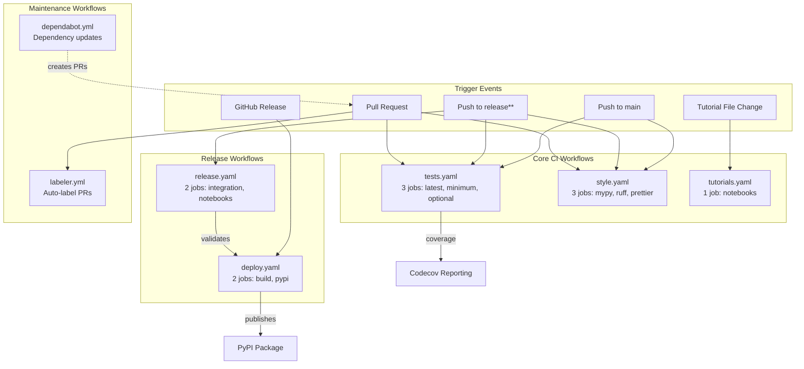

Sources: [.github/workflows/tests.yaml](), [.github/workflows/style.yaml](), [.github/workflows/release.yaml](), [.github/workflows/deploy.yaml](), [.github/workflows/tutorials.yaml](), [.github/workflows/labeler.yml](), [.github/dependabot.yml]()

## Testing Workflow (`tests.yaml`)

The primary testing workflow validates code functionality across operating systems, Python versions, and dependency configurations.

### Job Matrix Configuration

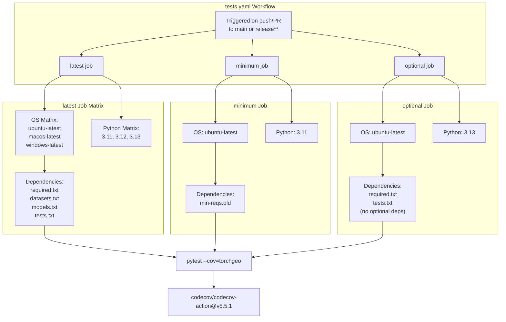

Sources: [.github/workflows/tests.yaml:15-115]()

### Job Descriptions

| Job | Purpose | Configuration |
|-----|---------|---------------|
| `latest` | Test with latest dependencies | Matrix: 3 OS × 3 Python versions = 9 test runs |
| `minimum` | Test with minimum supported versions | Single run: Ubuntu + Python 3.11 + min-reqs.old |
| `optional` | Test without optional dependencies | Single run: Ubuntu + Python 3.13 + required deps only |

The workflow uses [actions/cache@v4.3.0]() to cache the Python environment based on a hash of requirement files [.github/workflows/tests.yaml:30-35](). This cache is skipped on macOS due to reliability issues [.github/workflows/tests.yaml:36]().

### Test Execution Steps

Each job follows this sequence:

1. **Clone Repository**: Uses [actions/checkout@v5.0.0]() [.github/workflows/tests.yaml:23-24]()
2. **Setup Python**: Uses [actions/setup-python@v6.0.0]() with matrix Python version [.github/workflows/tests.yaml:25-29]()
3. **Cache Dependencies**: Caches `${{ env.pythonLocation }}` with hash key [.github/workflows/tests.yaml:30-36]()
4. **Install Dependencies**: Runs `pip install` if cache miss [.github/workflows/tests.yaml:37-41]()
5. **Run Tests**: Executes `pytest --cov=torchgeo --cov-report=xml` [.github/workflows/tests.yaml:44-47]()
6. **Verify CLI**: Tests `python3 -m torchgeo --help` [.github/workflows/tests.yaml:47]()
7. **Report Coverage**: Uploads to Codecov [.github/workflows/tests.yaml:48-51]()

Sources: [.github/workflows/tests.yaml:15-115]()

### Concurrency Control

All workflows use concurrency groups to cancel in-progress runs when new commits are pushed [.github/workflows/tests.yaml:116-118]():

```yaml
concurrency:
  group: ${{ github.workflow }}-${{ github.event.pull_request.head.label || github.head_ref || github.ref }}
  cancel-in-progress: ${{ github.ref != 'refs/heads/main' }}
```

This prevents wasting resources on outdated PR commits while preserving main branch runs for historical records.

Sources: [.github/workflows/tests.yaml:116-118]()

## Style Workflow (`style.yaml`)

The style workflow enforces code quality standards through type checking, linting, and formatting.

### Style Job Configuration

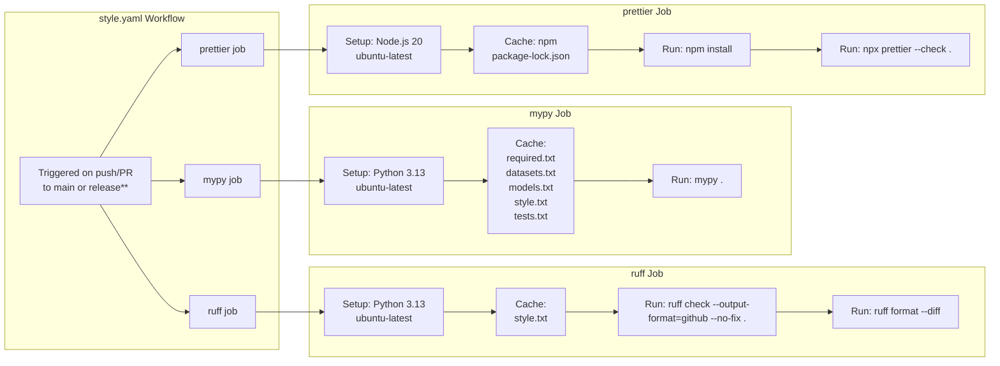

Sources: [.github/workflows/style.yaml:14-92]()

### Style Tool Responsibilities

| Tool | Purpose | Configuration | Scope |
|------|---------|---------------|-------|
| `mypy` | Static type checking | [pyproject.toml:174-209]() | Python files (strict mode) |
| `ruff` | Linting & formatting | [pyproject.toml:319-341]() | Python + Jupyter notebooks |
| `prettier` | YAML/JSON/Markdown formatting | [package-lock.json]() | Config files & docs |

The `mypy` job installs all optional dependencies to validate types across the entire codebase [.github/workflows/style.yaml:32-36](). The `ruff` job runs both linting (`ruff check`) and formatting (`ruff format`) in read-only mode to detect violations [.github/workflows/style.yaml:65-68](). The `prettier` job uses npm caching to avoid repeated installations [.github/workflows/style.yaml:79-80]().

Sources: [.github/workflows/style.yaml:14-92](), [pyproject.toml:174-209](), [pyproject.toml:319-341]()

## Release Workflow (`release.yaml`)

The release workflow performs expensive integration tests that are skipped in regular CI runs. It is triggered only on release branches.

### Release Job Structure

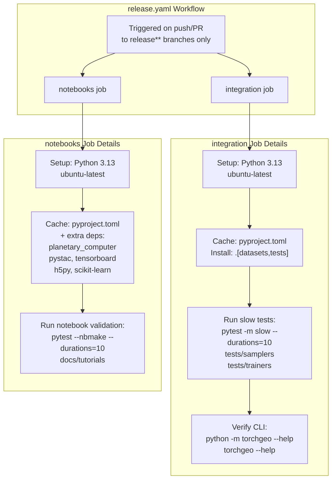

Sources: [.github/workflows/release.yaml:12-72]()

### Integration Testing Strategy

The `integration` job runs tests marked with `@pytest.mark.slow` that are skipped in standard CI [.github/workflows/release.yaml:38-40]():

- **Sampler tests**: Validate spatial sampling strategies with realistic datasets
- **Trainer tests**: Execute full training loops with multiple epochs

These tests are resource-intensive and can take several minutes each, justifying their exclusion from the regular test matrix.

The `notebooks` job validates all Jupyter tutorials in [docs/tutorials]() by executing them with [pytest-nbmake]() [.github/workflows/release.yaml:67-68](). This ensures documentation examples remain functional across releases. Additional dependencies like `planetary_computer`, `pystac`, and `tensorboard` are installed to support tutorial requirements [.github/workflows/release.yaml:63]().

Sources: [.github/workflows/release.yaml:12-72](), [pyproject.toml:211-217]()

## Deploy Workflow (`deploy.yaml`)

The deploy workflow publishes TorchGeo to PyPI when a GitHub release is created. It consists of two sequential jobs that build and publish the package.

### Deployment Pipeline

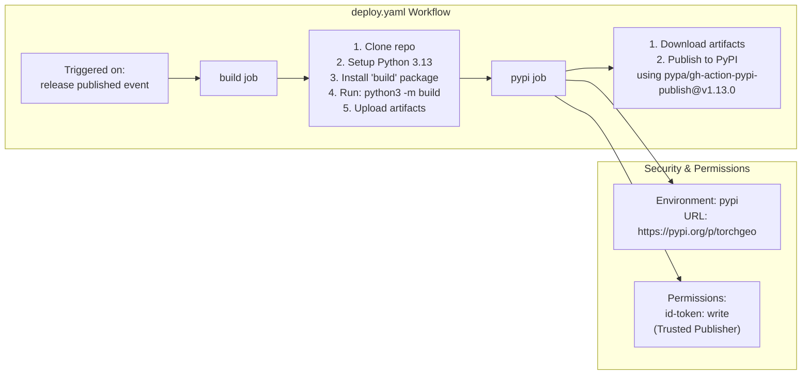

Sources: [.github/workflows/deploy.yaml:1-46]()

### Deployment Security

The workflow uses GitHub's Trusted Publisher mechanism for PyPI authentication [.github/workflows/deploy.yaml:32-36]():

- **Environment**: The `pypi` job runs in the `pypi` environment, which is protected
- **Permissions**: Only `id-token: write` permission is granted (no secrets required)
- **OIDC**: GitHub generates a temporary token that PyPI validates

This approach eliminates the need for long-lived API tokens and provides improved security through short-lived credentials.

Sources: [.github/workflows/deploy.yaml:28-45]()

### Build Artifacts

The `build` job creates both source distribution (`.tar.gz`) and wheel (`.whl`) files using [python3 -m build]() [.github/workflows/deploy.yaml:22](). These artifacts are uploaded with [actions/upload-artifact@v4.6.2]() and downloaded by the `pypi` job using [actions/download-artifact@v5.0.0]() [.github/workflows/deploy.yaml:23-27](), [.github/workflows/deploy.yaml:38-43]().

Sources: [.github/workflows/deploy.yaml:1-46]()

## Tutorials Workflow (`tutorials.yaml`)

The tutorials workflow runs a subset of CI checks specifically for tutorial file changes to provide fast feedback on documentation updates.

### Tutorial-Specific CI

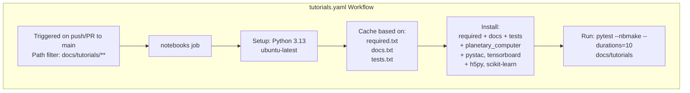

Sources: [.github/workflows/tutorials.yaml:1-46]()

This workflow is optimized for documentation contributors:

- **Path filtering**: Only runs when files in [docs/tutorials]() change [.github/workflows/tutorials.yaml:6-12]()
- **Fast feedback**: Runs a single Ubuntu job instead of full matrix
- **Targeted validation**: Only tests tutorials, not entire codebase

The workflow uses a different cache key suffix (`-tutorials`) to avoid conflicts with other workflows [.github/workflows/tutorials.yaml:33]().

Sources: [.github/workflows/tutorials.yaml:1-46]()

## Labeler Workflow (`labeler.yml`)

The labeler workflow automatically applies labels to pull requests based on which files were modified.

### Auto-Labeling System

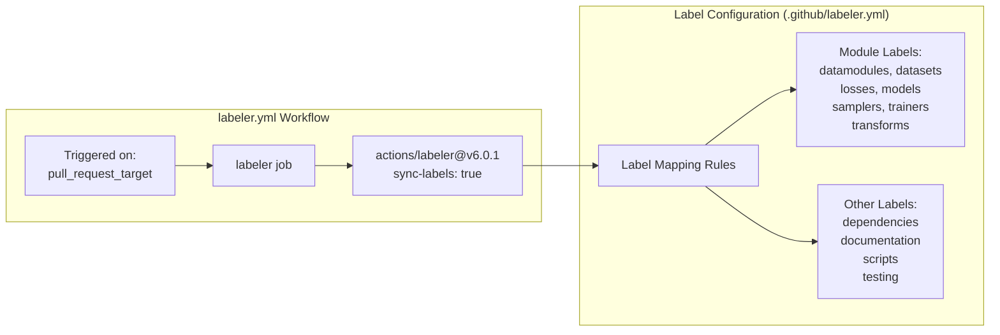

Sources: [.github/workflows/labeler.yml:1-17](), [.github/labeler.yml:1-49]()

### Label Mapping Rules

The labeler configuration in [.github/labeler.yml]() uses file path patterns to determine labels:

| Label | Triggered By | Example Files |
|-------|--------------|---------------|
| `datamodules` | `torchgeo/datamodules/**` | Data module implementations |
| `datasets` | `torchgeo/datasets/**` | Dataset implementations |
| `models` | `torchgeo/models/**` | Model architectures |
| `dependencies` | `pyproject.toml`, `requirements/**` | Dependency changes |
| `documentation` | `docs/**`, `*.md` | Documentation updates |
| `testing` | `tests/**`, `.github/workflows/**` | Test or CI changes |

The workflow uses `pull_request_target` instead of `pull_request` to allow labeling PRs from forks [.github/workflows/labeler.yml:3](). The `sync-labels: true` option removes labels when files are reverted [.github/workflows/labeler.yml:16]().

Sources: [.github/workflows/labeler.yml:1-17](), [.github/labeler.yml:1-49]()

## Dependabot Configuration (`dependabot.yml`)

Dependabot automatically creates pull requests to update dependencies on a scheduled basis.

### Update Strategy Configuration

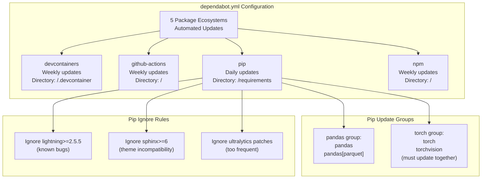

Sources: [.github/dependabot.yml:1-43]()

### Ecosystem-Specific Configuration

| Ecosystem | Schedule | Purpose | Special Rules |
|-----------|----------|---------|---------------|
| `devcontainers` | Weekly | Update [.devcontainer/devcontainer.json]() base image | None |
| `github-actions` | Weekly | Update action versions in [.github/workflows]() | None |
| `pip` | Daily | Update Python dependencies in [requirements]() | Groups + ignores |
| `npm` | Weekly | Update prettier and related tools | Lockfile-only updates |

The `pip` ecosystem uses dependency grouping to ensure related packages update together [.github/dependabot.yml:16-25]():

- **pandas group**: `pandas` and `pandas[parquet]` must have matching versions
- **torch group**: `torch` and `torchvision` have coupled version requirements

Ignore rules prevent problematic updates [.github/dependabot.yml:26-37]():

- **lightning 2.5.5+**: Contains checkpoint loading bugs (tracked in issue #2995)
- **sphinx 6+**: Incompatible with pytorch-sphinx-theme
- **ultralytics patches**: Daily releases create excessive PR noise

The `npm` ecosystem uses `versioning-strategy: lockfile-only` to update [package-lock.json]() without modifying [package.json]() [.github/dependabot.yml:42]().

Sources: [.github/dependabot.yml:1-43]()

## Cache Strategy

All workflows employ sophisticated caching to minimize build times and reduce GitHub Actions usage.

### Cache Key Construction

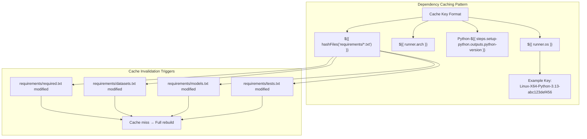

Sources: [.github/workflows/tests.yaml:30-35](), [.github/workflows/style.yaml:26-31]()

### Platform-Specific Behavior

The `tests.yaml` workflow disables caching on macOS due to reliability issues [.github/workflows/tests.yaml:36]():

```yaml
if: ${{ runner.os != 'macOS' }}
```

This prevents flaky cache hits that can occur on macOS runners while maintaining cache benefits on Linux and Windows.

### Cache Location

Python environment caches use `${{ env.pythonLocation }}` as the cache path [.github/workflows/tests.yaml:34](). This environment variable is set by [actions/setup-python]() and points to the Python installation directory, including all installed packages in `site-packages`.

Sources: [.github/workflows/tests.yaml:30-36](), [.github/workflows/style.yaml:26-31]()

## Workflow Triggers and Branch Protection

The CI/CD system uses different trigger conditions to balance thoroughness with resource efficiency.

### Trigger Matrix

| Workflow | Push to `main` | Push to `release**` | Pull Request | Release Published | Path Filter |
|----------|----------------|---------------------|--------------|-------------------|-------------|
| `tests.yaml` | ✓ | ✓ | ✓ | ✗ | None |
| `style.yaml` | ✓ | ✓ | ✓ | ✗ | None |
| `release.yaml` | ✗ | ✓ | ✓ to `release**` | ✗ | None |
| `deploy.yaml` | ✗ | ✗ | ✗ | ✓ | None |
| `tutorials.yaml` | ✓ | ✗ | ✓ | ✗ | `docs/tutorials/**` |
| `labeler.yml` | ✗ | ✗ | ✓ | ✗ | None |

Sources: [.github/workflows/tests.yaml:2-10](), [.github/workflows/style.yaml:2-10](), [.github/workflows/release.yaml:2-8](), [.github/workflows/deploy.yaml:2-5](), [.github/workflows/tutorials.yaml:2-12](), [.github/workflows/labeler.yml:2-3]()

### Branch Protection Implications

The trigger configuration enforces a release branch workflow:

1. **Development**: PRs to `main` run `tests.yaml`, `style.yaml`, `tutorials.yaml`, and `labeler.yml`
2. **Release Candidates**: Pushes to `release**` branches trigger `release.yaml` for expensive integration tests
3. **Production**: GitHub releases trigger `deploy.yaml` to publish to PyPI

This staged approach ensures expensive tests only run when preparing for release, reducing CI costs during active development.

Sources: [.github/workflows/tests.yaml:2-10](), [.github/workflows/release.yaml:2-8](), [.github/workflows/deploy.yaml:2-5]()

## Integration with Code Quality Tools

The CI/CD pipeline enforces the code quality standards defined in [pyproject.toml]() and validated by the tools documented in [Code Quality Standards](#6.2).

### Tool Configuration Mapping

| CI Job | Configuration Source | Enforced Standards |
|--------|---------------------|-------------------|
| `mypy` | [pyproject.toml:174-209]() | Type annotations, strict mode |
| `ruff check` | [pyproject.toml:328-341]() | Import sorting, linting rules |
| `ruff format` | [pyproject.toml:324-326]() | Single quotes, no trailing commas |
| `prettier` | [.prettierrc.yaml]() | YAML/JSON/Markdown formatting |
| `pytest` | [pyproject.toml:211-317]() | Test discovery, warning filters |

The `style.yaml` workflow runs these tools in read-only mode to detect violations [.github/workflows/style.yaml:40](), [.github/workflows/style.yaml:65-68](), [.github/workflows/style.yaml:88](). Local enforcement is handled by pre-commit hooks (see [Development Setup](#6.1)).

Sources: [.github/workflows/style.yaml:14-92](), [pyproject.toml:174-209](), [pyproject.toml:211-317](), [pyproject.toml:319-341]()

## Dependency Installation Patterns

Each workflow uses different dependency installation strategies based on its requirements.

### Installation Strategy Comparison

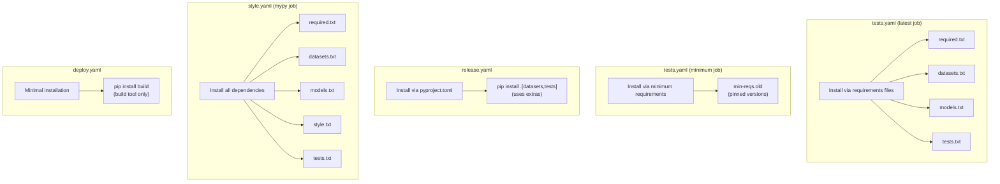

Sources: [.github/workflows/tests.yaml:38-40](), [.github/workflows/tests.yaml:70-72](), [.github/workflows/release.yaml:30-33](), [.github/workflows/style.yaml:32-36](), [.github/workflows/deploy.yaml:17-18]()

### Requirements Files vs Extras

The project uses two installation approaches:

1. **Requirements files** (`.txt`): Used in `tests.yaml` and `style.yaml` for granular control over dependency versions [requirements/required.txt](), [requirements/datasets.txt](), [requirements/models.txt]()
2. **Extras** (`[datasets,tests]`): Used in `release.yaml` for simpler, user-facing installation [pyproject.toml:93-154]()

The `minimum` job uses [requirements/min-reqs.old]() with pinned minimum versions to ensure backward compatibility [.github/workflows/tests.yaml:72]().

Sources: [.github/workflows/tests.yaml:38-40](), [.github/workflows/tests.yaml:70-72](), [.github/workflows/release.yaml:30-33](), [requirements/required.txt](), [requirements/min-reqs.old](), [pyproject.toml:93-154]()

## Coverage Reporting

Test coverage is tracked and reported to Codecov for all test jobs.

### Coverage Collection Flow

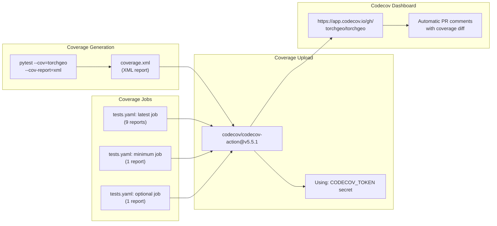

Sources: [.github/workflows/tests.yaml:44-51](), [.github/workflows/tests.yaml:76-83](), [.github/workflows/tests.yaml:108-115]()

### Coverage Configuration

Coverage settings are defined in [pyproject.toml:165-172]():

- **Exclusions**: `@overload` decorated functions are excluded from coverage [pyproject.toml:169-171]()
- **Reporting**: `show_missing = true` lists uncovered lines [pyproject.toml:172]()

All three test jobs (latest, minimum, optional) report coverage independently, providing insight into coverage across different dependency configurations.

Sources: [.github/workflows/tests.yaml:44-51](), [pyproject.toml:165-172]()

## Workflow Relationships

The CI/CD workflows have implicit dependencies and relationships that enforce quality gates.

### Quality Gate Flow

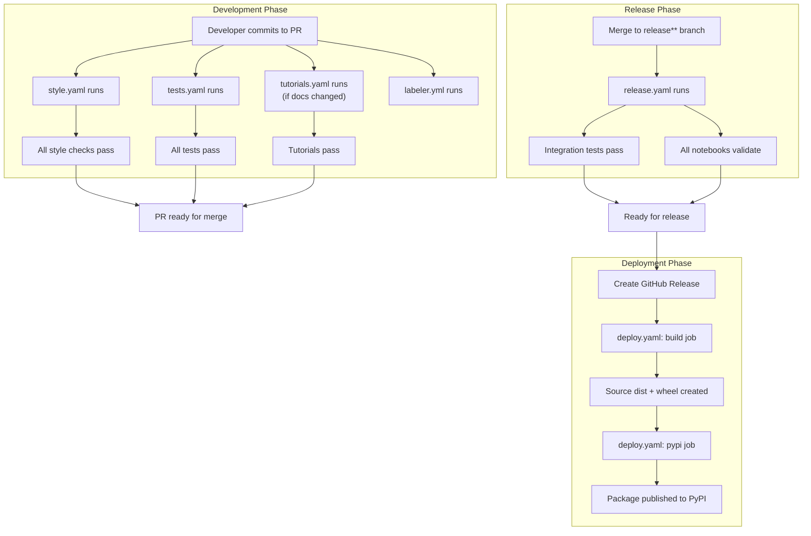

Sources: [.github/workflows/tests.yaml](), [.github/workflows/style.yaml](), [.github/workflows/release.yaml](), [.github/workflows/deploy.yaml]()

This flow enforces three quality gates:

1. **Development Gate**: Basic functionality and style must pass for PR approval
2. **Release Gate**: Expensive integration and notebook tests must pass before release
3. **Deployment Gate**: Only triggered by manual GitHub release creation

The staged approach balances fast feedback during development with thorough validation before production deployment.

Sources: [.github/workflows/tests.yaml:2-10](), [.github/workflows/release.yaml:2-8](), [.github/workflows/deploy.yaml:2-5]()

---

