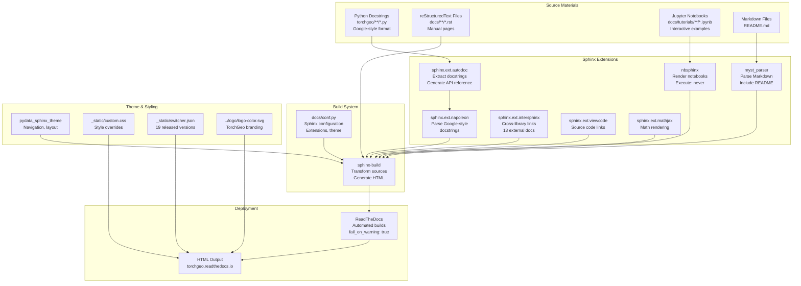
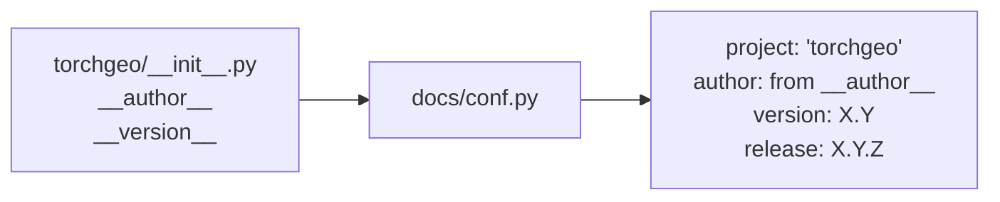
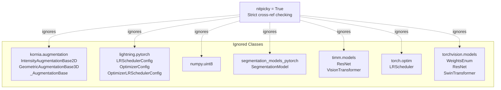
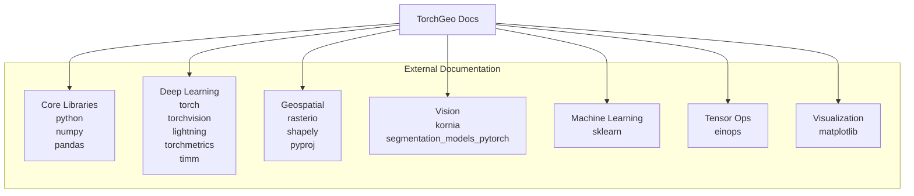
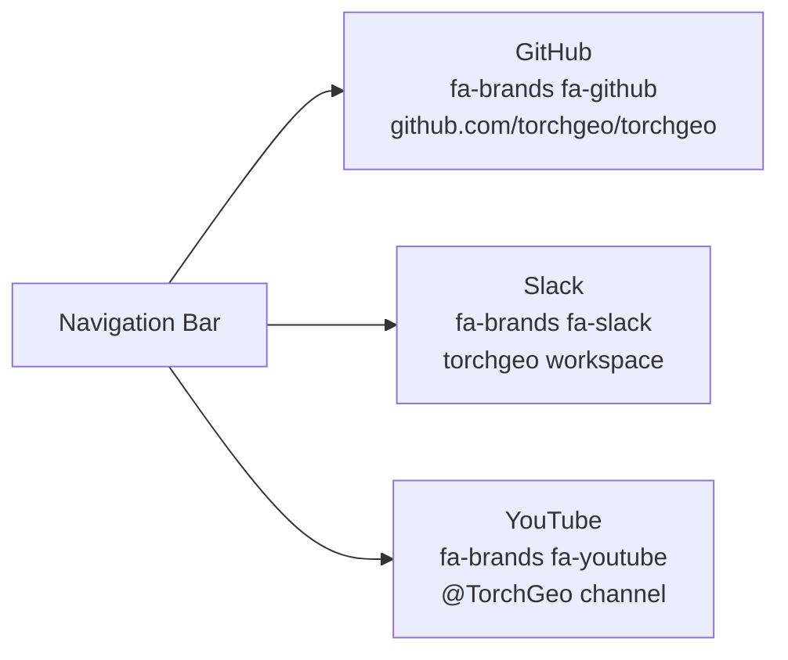
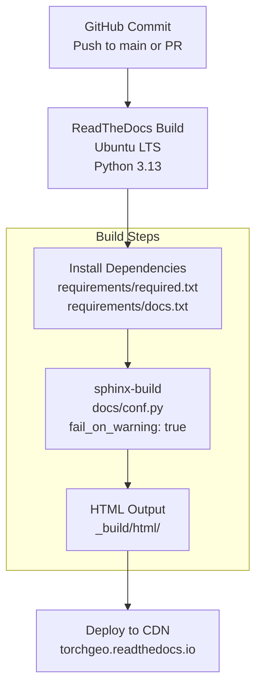
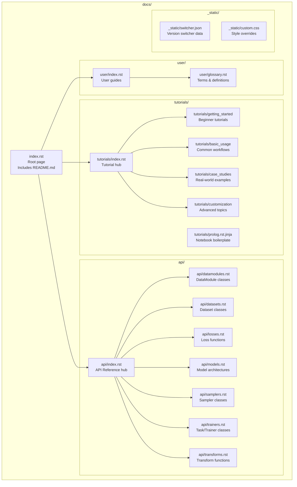

<!-- source: DeepWiki mcp.deepwiki.com · repo torchgeo/torchgeo · page 6.6 Documentation System · fetched 2026-10-21 -->

# Documentation System

<details>
<summary>Relevant source files</summary>

The following files were used as context for generating this wiki page:

- [.readthedocs.yaml](.readthedocs.yaml)
- [docs/_static/switcher.json](docs/_static/switcher.json)
- [docs/api/index.rst](docs/api/index.rst)
- [docs/conf.py](docs/conf.py)
- [docs/index.rst](docs/index.rst)
- [docs/tutorials/index.rst](docs/tutorials/index.rst)
- [docs/user/glossary.rst](docs/user/glossary.rst)
- [requirements/docs.txt](requirements/docs.txt)

</details>


## Purpose and Scope

The TorchGeo documentation system is a Sphinx-based technical documentation infrastructure that generates API reference documentation, user guides, and interactive tutorials. This page explains the configuration, extensions, build pipeline, and ReadTheDocs integration that powers the documentation at https://torchgeo.readthedocs.io.

For information about contributing code and testing, see [Testing Infrastructure](#6.3) and [CI/CD Pipeline](#6.4).

---

## Architecture Overview

The documentation system uses Sphinx to transform reStructuredText files, Python docstrings, and Jupyter notebooks into HTML documentation. The build pipeline is configured in [docs/conf.py:1-182]() and deployed automatically via ReadTheDocs.



**Sources:** [docs/conf.py:36-44](), [.readthedocs.yaml:1-23](), [requirements/docs.txt:1-7]()

---

## Sphinx Configuration

The primary configuration file is [docs/conf.py:1-182](), which defines project metadata, extension settings, theme options, and build behavior.

### Project Metadata



The configuration extracts project metadata from the package itself [docs/conf.py:20-28]():

| Configuration Key | Source | Purpose |
|-------------------|--------|---------|
| `project` | Hard-coded | Display name: `'torchgeo'` |
| `copyright` | Hard-coded | `'TorchGeo Contributors'` |
| `author` | `torchgeo.__author__` | Author attribution |
| `version` | `torchgeo.__version__` (major.minor) | Short version for display |
| `release` | `torchgeo.__version__` | Full version with patch/dev suffix |

**Sources:** [docs/conf.py:20-28]()

### Extension Configuration

Seven Sphinx extensions are enabled [docs/conf.py:36-44]():

| Extension | Purpose | Configuration Section |
|-----------|---------|----------------------|
| `myst_parser` | Parse Markdown files (README.md) | [docs/conf.py:176]() |
| `sphinx.ext.autodoc` | Extract API documentation from docstrings | [docs/conf.py:146-153]() |
| `sphinx.ext.intersphinx` | Link to external library documentation | [docs/conf.py:156-173]() |
| `sphinx.ext.mathjax` | Render mathematical equations | No additional config |
| `sphinx.ext.napoleon` | Parse Google-style docstrings | No additional config |
| `sphinx.ext.viewcode` | Add links to source code | No additional config |
| `nbsphinx` | Render Jupyter notebooks | [docs/conf.py:179-181]() |

**Sources:** [docs/conf.py:36-44]()

### Nitpicky Mode and Ignore Patterns

Nitpicky mode is enabled [docs/conf.py:55]() to enforce strict cross-reference checking. However, certain undocumented external classes are ignored to prevent build failures [docs/conf.py:56-72]():



**Sources:** [docs/conf.py:55-72]()

---

## Extension Details

### Autodoc: API Reference Generation

The `sphinx.ext.autodoc` extension automatically generates API documentation from Python docstrings. Configuration [docs/conf.py:146-153]():

| Option | Value | Purpose |
|--------|-------|---------|
| `autodoc_default_options['members']` | `True` | Include all members (methods, attributes) |
| `autodoc_default_options['special-members']` | `True` | Include special methods (`__init__`, `__getitem__`, etc.) |
| `autodoc_default_options['show-inheritance']` | `True` | Display base class hierarchy |
| `autodoc_member_order` | `'bysource'` | Preserve source code order |
| `autodoc_typehints` | `'description'` | Show type hints in description, not signature |
| `autodoc_typehints_description_target` | `'documented'` | Only add type hints for documented parameters |

**Note:** Sphinx 5.3+ is required [docs/conf.py:53]() to support section titles inside autodoc class docstrings.

**Sources:** [docs/conf.py:146-153]()

### Intersphinx: Cross-Library Links

The `sphinx.ext.intersphinx` extension enables linking to external library documentation. Thirteen external projects are mapped [docs/conf.py:156-173]():



**Intersphinx Mapping Table:**

| Library | Documentation URL |
|---------|------------------|
| `python` | https://docs.python.org/3 |
| `numpy` | https://numpy.org/doc/stable/ |
| `pandas` | https://pandas.pydata.org/docs/ |
| `torch` | https://docs.pytorch.org/docs/stable/ |
| `torchvision` | https://docs.pytorch.org/vision/stable/ |
| `lightning` | https://lightning.ai/docs/pytorch/stable/ |
| `torchmetrics` | https://lightning.ai/docs/torchmetrics/stable/ |
| `rasterio` | https://rasterio.readthedocs.io/en/stable/ |
| `shapely` | https://shapely.readthedocs.io/en/stable/ |
| `pyproj` | https://pyproj4.github.io/pyproj/stable/ |
| `kornia` | https://kornia.readthedocs.io/en/stable/ |
| `segmentation_models_pytorch` | https://smp.readthedocs.io/en/stable/ |
| `sklearn` | https://scikit-learn.org/stable/ |
| `timm` | https://huggingface.co/docs/timm/main/en/ |
| `matplotlib` | https://matplotlib.org/stable/ |
| `einops` | https://einops.rocks/ |

**Sources:** [docs/conf.py:156-173]()

### NBSphinx: Notebook Rendering

The `nbsphinx` extension renders Jupyter notebooks as documentation pages. Key configuration [docs/conf.py:179-181]():

- **Execution:** `nbsphinx_execute = 'never'` — notebooks are never executed during build to avoid heavy computation and dependency issues
- **Prolog:** Each notebook includes a prolog from [docs/tutorials/prolog.rst.jinja]() with common boilerplate (import paths, warnings, etc.)

**Sources:** [docs/conf.py:179-181]()

### MyST Parser: Markdown Support

The `myst_parser` extension allows including Markdown files like [README.md]() directly in the documentation [docs/index.rst:3-4]():

- **Suppress warnings:** `suppress_warnings = ['myst.header']` prevents warnings about header levels [docs/conf.py:176]()

**Sources:** [docs/conf.py:176](), [docs/index.rst:3-4]()

---

## Theme and Styling

### PyData Sphinx Theme

The documentation uses the `pydata_sphinx_theme` [docs/conf.py:79](), a modern responsive theme designed for scientific Python projects.

**Theme Configuration** [docs/conf.py:103-136]():

| Option | Value | Purpose |
|--------|-------|---------|
| `collapse_navigation` | `False` | Keep navigation tree expanded |
| `show_nav_level` | `2` | Show 2 levels in left sidebar |
| `show_toc_level` | `2` | Show 2 levels in right sidebar table of contents |
| `navigation_depth` | `4` | Generate toctree to depth 4 |
| `navbar_align` | `'left'` | Align navigation bar to left |
| `header_links_before_dropdown` | `6` | Show 6 header links before dropdown |

**Icon Links** [docs/conf.py:110-126]():



**Sources:** [docs/conf.py:103-136]()

### Version Switcher

The version switcher allows users to navigate between 19 released versions [docs/_static/switcher.json:1-98](). Version matching logic [docs/conf.py:82-98]():

| Environment Variable | Computed `version_match` | Switcher Behavior |
|---------------------|--------------------------|-------------------|
| `READTHEDOCS_VERSION` is integer (PR build) | `'dev'` or `f'v{release}'` | Show development version |
| `READTHEDOCS_VERSION='latest'` | `'dev'` | Show "dev" in switcher |
| `READTHEDOCS_VERSION='stable'` | `f'v{release}'` | Show stable version number |
| Local development (`'dev'` in release) | `'dev'` | Use relative JSON path |
| Local development (released version) | `f'v{release}'` | Use absolute JSON URL |

**Version Switcher JSON Structure** [docs/_static/switcher.json:1-98]():

- **Dev version:** `"name": "dev"`, points to `latest/`
- **Stable version:** `"preferred": true`, currently `v0.8.0`
- **Historical versions:** 18 previous releases from `v0.7.2` down to `v0.1.0`

**Sources:** [docs/conf.py:82-98](), [docs/_static/switcher.json:1-98]()

### Branding Assets

| Asset | Path | Usage |
|-------|------|-------|
| Logo (light/dark) | `../logo/logo-color.svg` | Navbar logo [docs/conf.py:129-130]() |
| Favicon | `../logo/favicon.ico` | Browser tab icon [docs/conf.py:138]() |
| Custom CSS | `_static/custom.css` | Style overrides [docs/conf.py:141]() |

**Sources:** [docs/conf.py:129-141]()

---

## ReadTheDocs Integration

ReadTheDocs builds and hosts the documentation automatically on every commit. Configuration is in [.readthedocs.yaml:1-23]().



**Configuration Details** [.readthedocs.yaml:8-22]():

| Setting | Value | Purpose |
|---------|-------|---------|
| `build.os` | `ubuntu-lts-latest` | Use latest Ubuntu LTS |
| `build.tools.python` | `'3.13'` | Python version for build |
| `python.install[0]` | `requirements/required.txt` | Install core dependencies |
| `python.install[1]` | `requirements/docs.txt` | Install Sphinx and extensions |
| `sphinx.configuration` | `docs/conf.py` | Sphinx config file path |
| `sphinx.fail_on_warning` | `true` | Treat warnings as errors |

**Note:** The `fail_on_warning: true` setting ensures documentation quality by preventing builds with warnings from deploying.

**Sources:** [.readthedocs.yaml:1-23]()

---

## Documentation Structure

The documentation follows a hierarchical structure organized by audience and content type.



**Main Index Structure** [docs/index.rst:6-12]():

- **User guides:** General usage information, installation, architecture
- **Tutorials:** Step-by-step examples and notebooks
- **API Reference:** Automatically generated from docstrings

**Sources:** [docs/index.rst:1-12](), [docs/api/index.rst:1-16](), [docs/tutorials/index.rst:1-13](), [docs/user/glossary.rst:1-61]()

---

## Glossary

The documentation includes a glossary of domain-specific terms [docs/user/glossary.rst:1-61]() to bridge the knowledge gap between deep learning and remote sensing researchers.

**Term Categories:**

| Category | Terms |
|----------|-------|
| Spatial concepts | AOI, ROI, CRS, SRS, projection |
| Image concepts | chip, patch, tile, swath, tiling, stitching |
| Computer vision tasks | classification, semantic segmentation, instance segmentation, object detection, regression |

**Sources:** [docs/user/glossary.rst:1-61]()

---

## Building Documentation Locally

Developers can build the documentation locally to preview changes before committing.

**Prerequisites:**

```bash
pip install -r requirements/required.txt
pip install -r requirements/docs.txt
```

**Build Commands:**

```bash
# Build HTML documentation
sphinx-build -b html docs/ docs/_build/html/

# Build with warnings as errors (same as ReadTheDocs)
sphinx-build -b html -W docs/ docs/_build/html/

# Clean previous builds
rm -rf docs/_build/
```

**Common Build Issues:**

| Issue | Cause | Solution |
|-------|-------|----------|
| Missing intersphinx targets | External library documentation changed | Update `nitpick_ignore` in [docs/conf.py:56-72]() |
| Notebook execution failures | `nbsphinx_execute != 'never'` | Verify [docs/conf.py:179]() |
| Import errors during autodoc | Missing dependencies | Install from [requirements/required.txt:1-15]() |
| Version switcher failures (local) | Incorrect `version_match` logic | Check [docs/conf.py:82-98]() |

**Sources:** [requirements/docs.txt:1-7](), [docs/conf.py:1-182]()

---

## Summary

The TorchGeo documentation system is built on Sphinx with seven extensions that enable automatic API reference generation, cross-library linking, notebook rendering, and Markdown parsing. The `pydata_sphinx_theme` provides a modern interface with version switching across 19 releases. ReadTheDocs automates builds with strict warning enforcement (`fail_on_warning: true`) to maintain documentation quality. The hierarchical structure separates user guides, tutorials, and API reference, with a glossary bridging domain-specific knowledge gaps.

**Key Files:**

- Configuration: [docs/conf.py:1-182]()
- ReadTheDocs: [.readthedocs.yaml:1-23]()
- Dependencies: [requirements/docs.txt:1-7]()
- Version data: [docs/_static/switcher.json:1-98]()
- Entry point: [docs/index.rst:1-12]()

---

