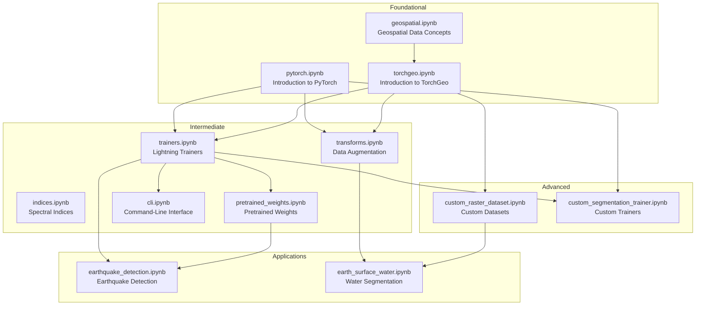
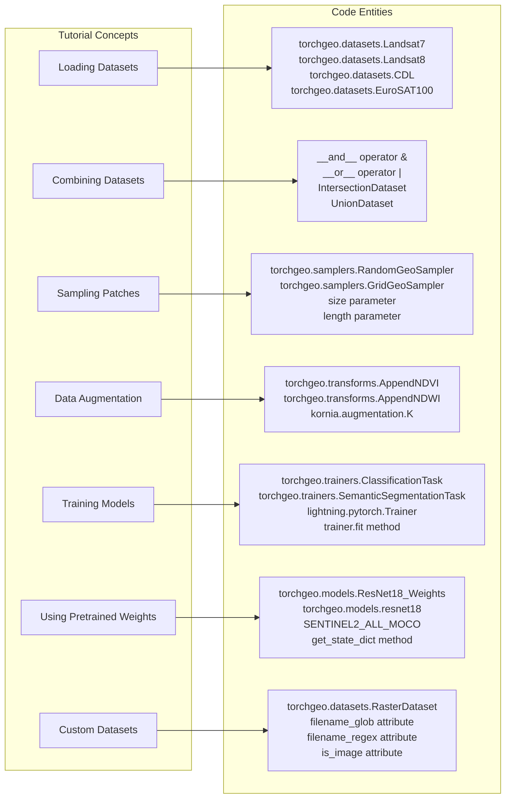
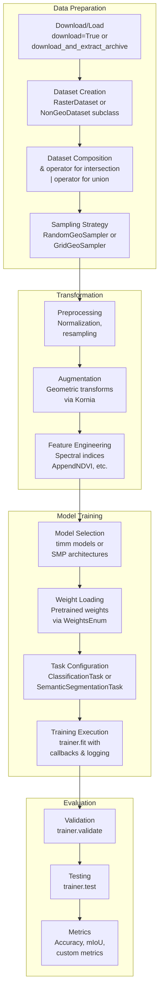

<!-- source: DeepWiki mcp.deepwiki.com · repo torchgeo/torchgeo · page 7 Tutorials and Examples · fetched 2026-10-21 -->

# Tutorials and Examples

<details>
<summary>Relevant source files</summary>

The following files were used as context for generating this wiki page:

- [docs/tutorials/basic_usage.rst](docs/tutorials/basic_usage.rst)
- [docs/tutorials/cli.ipynb](docs/tutorials/cli.ipynb)
- [docs/tutorials/custom_raster_dataset.ipynb](docs/tutorials/custom_raster_dataset.ipynb)
- [docs/tutorials/custom_segmentation_trainer.ipynb](docs/tutorials/custom_segmentation_trainer.ipynb)
- [docs/tutorials/earthquake_detection.ipynb](docs/tutorials/earthquake_detection.ipynb)
- [docs/tutorials/embeddings.ipynb](docs/tutorials/embeddings.ipynb)
- [docs/tutorials/indices.ipynb](docs/tutorials/indices.ipynb)
- [docs/tutorials/pretrained_weights.ipynb](docs/tutorials/pretrained_weights.ipynb)
- [docs/tutorials/pytorch.ipynb](docs/tutorials/pytorch.ipynb)
- [docs/tutorials/trainers.ipynb](docs/tutorials/trainers.ipynb)
- [docs/tutorials/transforms.ipynb](docs/tutorials/transforms.ipynb)

</details>


This section provides practical, hands-on guides for using TorchGeo to solve geospatial machine learning problems. The tutorials progress from foundational concepts to advanced workflows, covering dataset loading, model training, custom implementations, and real-world applications. Each tutorial is available as an executable Jupyter notebook that can be run locally, on Google Colab, or in Lightning Studio.

For API documentation of the components used in these tutorials, see the following sections:
- Dataset system details: [Dataset System](#2)
- Training system details: [Training System](#5)
- Model and weights details: [Models and Pre-trained Weights](#4)

## Tutorial Organization

TorchGeo tutorials are organized into three tiers based on prerequisite knowledge and complexity:

| Tier | Prerequisites | Topics Covered |
|------|--------------|----------------|
| **Foundational** | Basic Python, basic machine learning concepts | PyTorch basics, geospatial data fundamentals, TorchGeo overview |
| **Intermediate** | Foundational tutorials, PyTorch experience | Dataset composition, transforms, training workflows, pretrained weights |
| **Advanced** | Intermediate tutorials, deep learning experience | Custom datasets, custom tasks, multi-modal fusion, specialized applications |

All tutorials are stored in [docs/tutorials/]() as Jupyter notebooks (`.ipynb` files) and can be executed interactively. The [docs/tutorials/prolog.rst.jinja:1-32]() template provides badges for opening tutorials in Lightning Studio or Google Colab.

**Sources**: [README.md:39-51](), [docs/tutorials/prolog.rst.jinja:1-32]()

## Tutorial Dependency Graph



This diagram shows the recommended order for working through tutorials. Foundational tutorials provide essential background, intermediate tutorials cover common workflows, and advanced tutorials demonstrate customization.

**Sources**: [docs/tutorials/pytorch.ipynb:1-505](), [docs/tutorials/geospatial.ipynb:1-397](), [docs/tutorials/torchgeo.ipynb:1-313](), [docs/tutorials/trainers.ipynb:1-343]()

## Foundational Tutorials

### Introduction to PyTorch

**File**: [docs/tutorials/pytorch.ipynb]()

This tutorial covers PyTorch fundamentals required for using TorchGeo:

- **Datasets**: Creating instances of `torch.utils.data.Dataset` to load `(x, y)` pairs
- **DataLoaders**: Using `torch.utils.data.DataLoader` for mini-batch loading with `batch_size` parameter
- **Transforms**: Applying preprocessing with `kornia.augmentation.Normalize` and augmentation with `K.RandomHorizontalFlip`, `K.RandomVerticalFlip`
- **Models**: Loading architectures with `torchgeo.models.resnet18` and weights via `ResNet18_Weights.SENTINEL2_ALL_MOCO`
- **Loss Functions**: Computing error with `nn.CrossEntropyLoss()`
- **Optimizers**: Updating parameters with `optim.SGD(model.parameters(), lr=1e-2)`
- **Training Loop**: Iterating through epochs with forward pass (`model(x)`), loss calculation, backward pass (`loss.backward()`), and parameter updates (`optimizer.step()`)
- **Evaluation**: Computing metrics like accuracy on validation and test sets

The tutorial uses the `EuroSAT100` dataset (100-image subset) for land cover classification and achieves training in approximately 100 epochs.

**Sources**: [docs/tutorials/pytorch.ipynb:60-82](), [docs/tutorials/pytorch.ipynb:114-153](), [docs/tutorials/pytorch.ipynb:186-203](), [docs/tutorials/pytorch.ipynb:236-253](), [docs/tutorials/pytorch.ipynb:260-281](), [docs/tutorials/pytorch.ipynb:288-305]()

### Introduction to Geospatial Data

**File**: [docs/tutorials/geospatial.ipynb]()

This tutorial explains unique challenges of geospatial data:

- **Data Modalities**: Tabular, multispectral (3-15 bands), hyperspectral (hundreds of bands), radar (SAR, InSAR), and lidar (3D point clouds)
- **Multispectral Images**: Tensor format `x ∈ ℝ^(C×H×W)` where `C` is spectral bands, `H` is height, `W` is width
- **Resolution Types**:
  - Spatial resolution (GSD): Low (>30m like MODIS), Medium (5-30m like Sentinel-2), High (1-5m like Planet), Very High (<1m like WorldView-3)
  - Temporal resolution: Biweekly (polar orbits) to continuous (geostationary)
  - Spectral resolution: Number and bandwidth of spectral bands
- **Preprocessing Requirements**:
  - Reprojection: Converting between CRS using `gdalwarp -s_srs EPSG:5070 -t_srs EPSG:4326`
  - Resampling: Aligning to common resolution using `gdalwarp -tr 30 30`
  - Rasterization: Converting vector to raster with `gdal_rasterize`

The tutorial provides context for why specialized tools like TorchGeo are necessary compared to standard computer vision libraries.

**Sources**: [docs/tutorials/geospatial.ipynb:69-101](), [docs/tutorials/geospatial.ipynb:149-175](), [docs/tutorials/geospatial.ipynb:181-205](), [docs/tutorials/geospatial.ipynb:212-273]()

### Introduction to TorchGeo

**File**: [docs/tutorials/torchgeo.ipynb]()

This tutorial demonstrates TorchGeo's core capabilities for handling geospatial data:

- **GeoDataset vs NonGeoDataset**: `GeoDataset` for uncurated data with geospatial metadata, `NonGeoDataset` for curated benchmarks
- **Loading Landsat**: Creating `Landsat7` and `Landsat8` datasets with band selection:
  ```python
  landsat7 = Landsat7(paths="...", bands=["SR_B1", ..., "SR_B7"])
  landsat8 = Landsat8(paths="...", bands=["SR_B2", ..., "SR_B8"])
  ```
- **Dataset Composition**: 
  - Union operator `|`: Combine Landsat 7 and 8: `landsat = landsat7 | landsat8`
  - Intersection operator `&`: Align imagery and labels: `dataset = landsat & cdl`
- **Geospatial Sampling**: Using `RandomGeoSampler(dataset, size=256, length=10000)` to extract fixed-size patches
- **Automatic Handling**: TorchGeo automatically reprojects to matching CRS, resamples to common resolution, and ensures pixel alignment

The tutorial illustrates a complete workflow from loading multiple Landsat scenes and CDL masks to sampling aligned image-mask pairs for semantic segmentation.

**Sources**: [docs/tutorials/torchgeo.ipynb:86-108](), [docs/tutorials/torchgeo.ipynb:131-163](), [docs/tutorials/torchgeo.ipynb:182-202](), [docs/tutorials/torchgeo.ipynb:215-275]()

## Tutorial-to-Code Entity Mapping

This diagram maps tutorial concepts to specific TorchGeo classes and functions:



This mapping allows users to quickly locate the relevant classes and methods in the codebase when following tutorial examples.

**Sources**: [docs/tutorials/torchgeo.ipynb:131-163](), [docs/tutorials/transforms.ipynb:86-101](), [docs/tutorials/trainers.ipynb:76-90](), [docs/tutorials/pretrained_weights.ipynb:72-76](), [docs/tutorials/custom_raster_dataset.ipynb:118-135]()

## Intermediate Workflows

### Lightning Trainers

**File**: [docs/tutorials/trainers.ipynb]()

This tutorial demonstrates using TorchGeo's Lightning-based training system:

- **DataModule Setup**: Creating `EuroSAT100DataModule(root="...", batch_size=10, num_workers=2, download=True)`
- **Task Configuration**: Initializing `ClassificationTask` with:
  - `model='resnet18'`: Architecture selection
  - `weights=ResNet18_Weights.SENTINEL2_ALL_MOCO`: Pretrained weights
  - `in_channels=13`: Sentinel-2 band count
  - `num_classes=10`: EuroSAT classes
  - `lr=0.1`: Learning rate
  - `patience=5`: Early stopping patience
- **Trainer Configuration**: Setting up `Trainer` with:
  - `ModelCheckpoint(monitor='val_loss', save_top_k=1)`: Best model saving
  - `EarlyStopping(monitor='val_loss', patience=10)`: Training termination
  - `TensorBoardLogger(save_dir=..., name='tutorial_logs')`: Metric logging
- **Training Execution**: Running `trainer.fit(model=task, datamodule=datamodule)`
- **Evaluation**: Testing with `trainer.test(model=task, datamodule=datamodule)`

The tutorial demonstrates complete training workflow from data loading to final evaluation using TorchGeo's prebuilt components.

**Sources**: [docs/tutorials/trainers.ipynb:87-90](), [docs/tutorials/trainers.ipynb:147-151](), [docs/tutorials/trainers.ipynb:183-192](), [docs/tutorials/trainers.ipynb:216-250]()

### Data Transforms and Augmentation

**File**: [docs/tutorials/transforms.ipynb]()

This tutorial covers data preprocessing and augmentation for multispectral imagery:

- **Custom Transforms**: Defining `MinMaxNormalize` as `K.IntensityAugmentationBase2D` subclass for per-band normalization
- **Dataset Statistics**: Using precomputed min/max values across 13 Sentinel-2 bands (e.g., B01: 1013-2309, B02: 676-4543.05)
- **Appending Indices**: Chaining spectral indices:
  ```python
  transforms = nn.Sequential(
      MinMaxNormalize(mins, maxs),
      indices.AppendNDBI(index_swir=11, index_nir=7),
      indices.AppendNDVI(index_nir=7, index_red=3),
      indices.AppendNDWI(index_green=2, index_nir=7)
  )
  ```
- **Kornia Integration**: Combining with geometric augmentations using `K.AugmentationSequential`:
  - `K.RandomHorizontalFlip(p=0.5)`
  - `K.RandomVerticalFlip(p=0.5)`
  - `K.RandomAffine(degrees=(0, 90), p=0.25)`
  - `K.RandomResizedCrop(size=(512, 512), scale=(0.8, 1.0))`
- **GPU Acceleration**: Moving transforms to GPU with `.to(device)` for significant speedup on large batches

The tutorial shows transforms operate on both individual samples and batches, are fully compatible with torchvision and Kornia, and can be chained using `nn.Sequential`.

**Sources**: [docs/tutorials/transforms.ipynb:88-101](), [docs/tutorials/transforms.ipynb:166-222](), [docs/tutorials/transforms.ipynb:360-361](), [docs/tutorials/transforms.ipynb:433-446]()

### Spectral Indices

**File**: [docs/tutorials/indices.ipynb]()

This tutorial demonstrates computing and visualizing spectral indices:

- **NDVI (Normalized Difference Vegetation Index)**:
  - Formula: `(NIR - R) / (NIR + R)`
  - Implementation: `AppendNDVI(index_nir=7, index_red=3)`
  - Interpretation: Low values = no/unhealthy vegetation, high values = healthy vegetation
  - Visualization: Diverging red-yellow-green colormap for -1 to 1 range
- **NDWI (Normalized Difference Water Index)**:
  - Formula: `(G - NIR) / (G + NIR)`
  - Implementation: `AppendNDWI(index_green=2, index_nir=7)`
  - Interpretation: Low values = no water, high values = water bodies
  - Visualization: Diverging brown-white-blue-green colormap
- **NDBI (Normalized Difference Built-up Index)**:
  - Formula: `(SWIR - NIR) / (SWIR + NIR)`
  - Implementation: `AppendNDBI(index_swir=11, index_nir=7)`
  - Interpretation: Low values = no urban land, high values = urban areas
  - Visualization: Terrain colormap from blue to brown

All indices are appended to the channel dimension (dim=0), increasing from 13 to 14+ channels. The tutorial provides formulas, implementations, and visualization examples for analyzing EuroSAT imagery.

**Sources**: [docs/tutorials/indices.ipynb:86-94](), [docs/tutorials/indices.ipynb:167-202](), [docs/tutorials/indices.ipynb:210-244](), [docs/tutorials/indices.ipynb:252-286]()

### Pretrained Weights

**File**: [docs/tutorials/pretrained_weights.ipynb]()

This tutorial explains using sensor-specific pretrained weights:

- **Weight Categories**:
  - Sensor-agnostic: RGB-only weights like ImageNet
  - Sentinel-1: 2-3 channel SAR weights
  - Sentinel-2: 13 channel multispectral weights
  - Landsat: 6-11 channel weights for TM/ETM/OLI
  - NAIP: Aerial imagery weights
- **Loading Weights**: Two approaches:
  ```python
  # Via TorchGeo wrapper
  model = resnet18(ResNet18_Weights.SENTINEL2_ALL_MOCO)
  
  # Via timm directly
  in_chans = weights.meta['in_chans']
  model = timm.create_model('resnet18', in_chans=in_chans, num_classes=10)
  model.load_state_dict(weights.get_state_dict(progress=True), strict=False)
  ```
- **Weight Metadata**: Accessing properties via `weights.meta`:
  - `in_chans`: Input channel count (e.g., 13 for Sentinel-2)
  - `dataset`: Source dataset (e.g., "ssl4eo-s12")
  - `method`: Training method (e.g., "moco", "simclr", "supervised")
- **WeightsEnum API**: Following torchvision's Multi-Weight API with `url` and `meta` attributes

Complete list of available weights documented in [docs/api/models.html]().

**Sources**: [docs/tutorials/pretrained_weights.ipynb:72-104](), [docs/tutorials/pretrained_weights.ipynb:110-143](), [docs/tutorials/pretrained_weights.ipynb:156-184]()

### Command-Line Interface

**File**: [docs/tutorials/cli.ipynb]()

This tutorial demonstrates TorchGeo's configuration-driven CLI:

- **Subcommands**: Available via `torchgeo` executable:
  - `fit`: Train and validate
  - `validate`: Validation only
  - `test`: Test evaluation
  - `predict`: Generate predictions
- **Configuration Structure**: YAML files with three sections:
  ```yaml
  trainer:
    max_epochs: 1
    default_root_dir: '/tmp/cli'
  model:
    class_path: ClassificationTask
    init_args:
      model: 'resnet18'
      in_channels: 13
      num_classes: 10
  data:
    class_path: EuroSAT100DataModule
    init_args:
      batch_size: 8
    dict_kwargs:
      root: '/tmp/cli'
      download: true
  ```
- **Help System**: Getting available options:
  - `torchgeo --help`: List subcommands
  - `torchgeo fit --help`: Trainer options
  - `torchgeo fit --model.help ClassificationTask`: Task-specific options
  - `torchgeo fit --data.help EuroSAT100DataModule`: DataModule options
- **Execution**: Running workflows:
  ```bash
  torchgeo fit --config config.yaml
  torchgeo validate --config config.yaml --ckpt_path=...
  torchgeo test --config config.yaml --ckpt_path=...
  ```

The CLI enables reproducible experiments without writing Python code, making it ideal for hyperparameter sweeps and standardized benchmarks.

**Sources**: [docs/tutorials/cli.ipynb:18-24](), [README.md:193-243](), [docs/tutorials/cli.ipynb:132-168](), [docs/tutorials/cli.ipynb:190-202]()

## Advanced Topics

### Creating Custom Raster Datasets

**File**: [docs/tutorials/custom_raster_dataset.ipynb]()

This tutorial explains subclassing `RasterDataset` for new data sources:

- **Base Class Selection**: Using `RasterDataset` for geospatial raster data vs `NonGeoDataset` for benchmark datasets
- **Required Attributes**:
  - `filename_glob`: Pattern to find files (e.g., `'T*_B02_10m.tif'`)
  - `filename_regex`: Extract metadata from filenames (e.g., `r'^.{6}_(?P<date>\d{8}T\d{6})_(?P<band>B0[\d])'`)
  - `date_format`: Parse timestamps (e.g., `'%Y%m%dT%H%M%S'`)
  - `is_image`: Boolean flag (`True` for inputs, `False` for masks)
  - `separate_files`: Whether bands stored separately (`True` for Sentinel-2)
  - `all_bands`: List of band names (e.g., `('B02', 'B03', 'B04', 'B08')`)
  - `rgb_bands`: RGB channel mapping (e.g., `('B04', 'B03', 'B02')`)
- **Example Implementation**:
  ```python
  class Sentinel2(RasterDataset):
      filename_glob = 'T*_B02_10m.tif'
      filename_regex = r'^.{6}_(?P<date>\d{8}T\d{6})_(?P<band>B0[\d])'
      date_format = '%Y%m%dT%H%M%S'
      is_image = True
      separate_files = True
      all_bands = ('B02', 'B03', 'B04', 'B08')
      rgb_bands = ('B04', 'B03', 'B02')
  ```
- **Custom Plot Method**: Override `plot()` to visualize RGB composites with proper band selection and scaling
- **Custom Parameters**: Override `__init__` to add functionality like automatic downloading

The tutorial demonstrates complete workflow from defining the dataset class to loading and visualizing Sentinel-2 imagery.

**Sources**: [docs/tutorials/custom_raster_dataset.ipynb:34-75](), [docs/tutorials/custom_raster_dataset.ipynb:208-281](), [docs/tutorials/custom_raster_dataset.ipynb:320-387](), [docs/tutorials/custom_raster_dataset.ipynb:404-424]()

### Creating Custom Trainers

**File**: [docs/tutorials/custom_segmentation_trainer.ipynb]()

This tutorial demonstrates extending `SemanticSegmentationTask`:

- **Overridable Methods**:
  - `__init__`: Add custom hyperparameters (e.g., `tmax`, `eta_min` for scheduler)
  - `configure_optimizers`: Replace with custom optimizer/scheduler:
    ```python
    optimizer = AdamW(self.parameters(), lr=self.hparams['lr'])
    scheduler = CosineAnnealingLR(optimizer, T_max=tmax, eta_min=eta_min)
    ```
  - `configure_metrics`: Add custom metrics:
    ```python
    return MetricCollection({
        'MeanIoU': JaccardIndex(task='multiclass', num_classes=num_classes),
        'Precision': Precision(task='multiclass', num_classes=num_classes),
        'Recall': Recall(task='multiclass', num_classes=num_classes)
    })
    ```
  - `configure_callbacks`: Stack multiple callbacks:
    ```python
    return [
        ModelCheckpoint(monitor='val_MeanIoU', mode='max', save_top_k=1),
        ModelCheckpoint(every_n_epochs=5)
    ]
    ```
  - `on_train_epoch_start`: Custom logging (e.g., learning rate per epoch)
- **Usage**: Instantiate like built-in tasks:
  ```python
  task = CustomSemanticSegmentationTask(
      model='unet',
      backbone='resnet18',
      in_channels=3,
      num_classes=5,
      tmax=50,
      eta_min=1e-6
  )
  ```

The tutorial shows customizing training routines for specific research questions while maintaining compatibility with Lightning ecosystem.

**Sources**: [docs/tutorials/custom_segmentation_trainer.ipynb:90-152](), [docs/tutorials/custom_segmentation_trainer.ipynb:154-217](), [docs/tutorials/custom_segmentation_trainer.ipynb:219-267]()

## Example Applications

### Earthquake Detection

**File**: [docs/tutorials/earthquake_detection.ipynb]()

This tutorial demonstrates two approaches for earthquake prediction using QuakeSet dataset:

- **Dataset**: `QuakeSetDataModule` with SAR imagery pairs (pre/post event) from Sentinel-1:
  - 4 channels total: 2 for pre-event, 2 for post-event
  - Task: Binary classification (earthquake occurred or not)
  - Data format: HDF5 files loaded via `download=True`
- **Approach 1 - Pretrained Embeddings + Classical ML**:
  ```python
  rn_model = resnet50(ResNet50_Weights.SENTINEL1_GRD_MOCO).eval()
  # Extract features for pre and post images separately
  pre = model_transform({'image': img[:, :2]})['image']
  post = model_transform({'image': img[:, 2:]})['image']
  embs = torch.concat([rn_model(pre), rn_model(post)], axis=1)
  # Train RandomForestClassifier on embeddings
  clf = RandomForestClassifier(n_estimators=100)
  clf.fit(embeddings['train'], labels['train'])
  ```
- **Approach 2 - End-to-End Deep Learning**:
  ```python
  task = ClassificationTask(
      model='resnet18',
      in_channels=4,
      task='binary',
      loss='bce',
      lr=0.0001
  )
  trainer.fit(model=task, datamodule=datamodule)
  ```

The tutorial compares feature extraction + classical ML vs end-to-end deep learning for earthquake detection.

**Sources**: [docs/tutorials/earthquake_detection.ipynb:38-44](), [docs/tutorials/earthquake_detection.ipynb:108-153](), [docs/tutorials/earthquake_detection.ipynb:203-324](), [docs/tutorials/earthquake_detection.ipynb:330-397]()

### Earth Surface Water Segmentation

**File**: [docs/tutorials/earth_surface_water.ipynb]()

This tutorial demonstrates custom semantic segmentation workflow:

- **Dataset Creation**: Manual setup using `RasterDataset`:
  ```python
  train_imgs = RasterDataset(
      paths=(root / 'tra_scene').as_posix(),
      crs='epsg:3395',
      res=10,
      transforms=scale
  )
  train_msks = RasterDataset(
      paths=(root / 'tra_truth').as_posix(),
      crs='epsg:3395',
      res=10
  )
  train_msks.is_image = False
  train_dset = train_imgs & train_msks
  ```
- **Custom Samplers**: `RandomGeoSampler(dataset, size=512, length=130, units=Units.PIXELS)` for 512×512 patches
- **Data Augmentation**: Custom transforms for Sentinel-2 imagery:
  - Normalization: Scaling by `1e-4` to convert to reflectance
  - Indices: `AppendNDWI` for water detection
  - Geometric: Random flips and rotations via Kornia
- **Model Architecture**: `DeepLabV3` with ResNet backbone:
  ```python
  model = smp.DeepLabV3Plus(
      encoder_name='resnet18',
      encoder_weights='imagenet',
      in_channels=5,  # 4 bands + NDWI
      classes=3
  )
  ```
- **Training Loop**: Manual implementation with:
  - Loss: `nn.CrossEntropyLoss()`
  - Optimizer: `optim.Adam(model.parameters())`
  - Metrics: `jaccard_score` for IoU computation

The tutorial demonstrates complete workflow from raw geospatial data to trained segmentation model without using pre-built TorchGeo trainers.

**Sources**: [docs/tutorials/earth_surface_water.ipynb:38-48](), [docs/tutorials/earth_surface_water.ipynb:139-215](), [docs/tutorials/earth_surface_water.ipynb:300-445](), [docs/tutorials/earth_surface_water.ipynb:505-704]()

## Tutorial Workflow Patterns

Common patterns across tutorials:



This workflow is followed by most tutorials with variations based on specific requirements.

**Sources**: [docs/tutorials/torchgeo.ipynb:131-275](), [docs/tutorials/transforms.ipynb:360-446](), [docs/tutorials/trainers.ipynb:147-271]()

## Running Tutorials Locally

All tutorials can be executed in multiple environments:

**Installation**:
```bash
pip install torchgeo
```

**Running Locally**:
```bash
jupyter notebook docs/tutorials/
```

**Google Colab**: Click "Open in Colab" badge at top of each tutorial webpage

**Lightning Studio**: Click "Open in Studio" badge at top of each tutorial webpage

**Configuration Variables**: Many tutorials define control variables at the top:
```python
batch_size = 10      # Batch size for training
num_workers = 2      # DataLoader workers
max_epochs = 50      # Training epochs
fast_dev_run = False # Quick testing mode
```

These can be modified to adjust training duration, memory usage, or enable rapid prototyping with `fast_dev_run=True`.

**Sources**: [docs/user/installation.rst:1-84](), [docs/tutorials/trainers.ipynb:118-137](), [docs/tutorials/pytorch.ipynb:410-425]()

## Additional Resources

For deeper understanding of specific components:

- **Dataset Implementation**: See [Creating Custom Datasets](#2.4) for detailed dataset authoring
- **Model Architectures**: See [Model Zoo](#4.1) for available architectures
- **Training Customization**: See [Creating Custom Tasks](#5.4) for task implementation
- **CLI Usage**: Full LightningCLI documentation at https://lightning.ai/docs/pytorch/stable/cli/lightning_cli.html

External resources referenced in tutorials:
- Index Database: https://www.indexdatabase.de/db/i.php
- Awesome Spectral Indices: https://github.com/awesome-spectral-indices/awesome-spectral-indices
- Kornia Augmentations: https://kornia.readthedocs.io/en/latest/augmentation.html
- PyTorch Tutorials: https://pytorch.org/tutorials/

**Sources**: [docs/tutorials/indices.ipynb:32-36](), [docs/tutorials/transforms.ipynb:634-640](), [docs/tutorials/pytorch.ipynb:471-478](), [README.md:39-51]()

---

