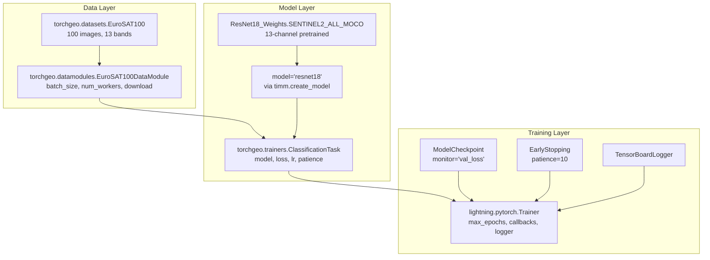
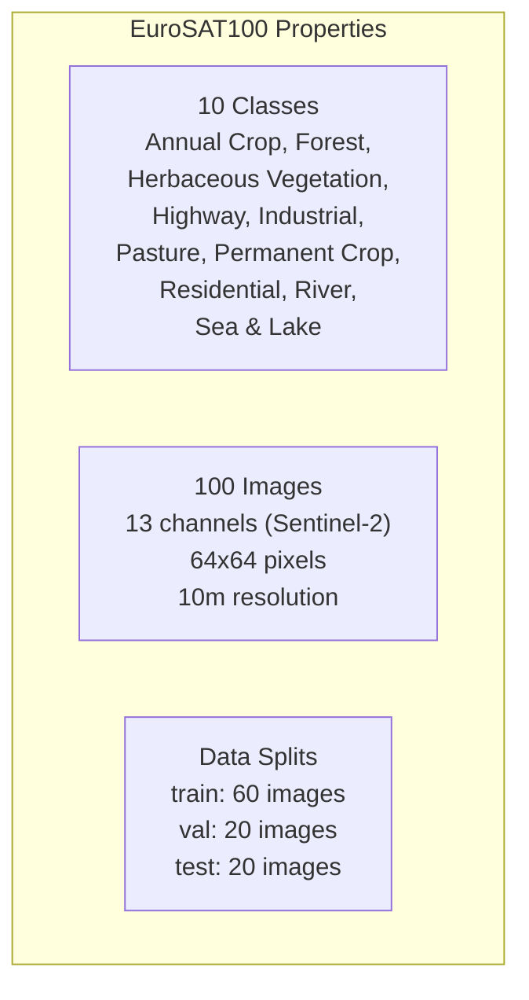
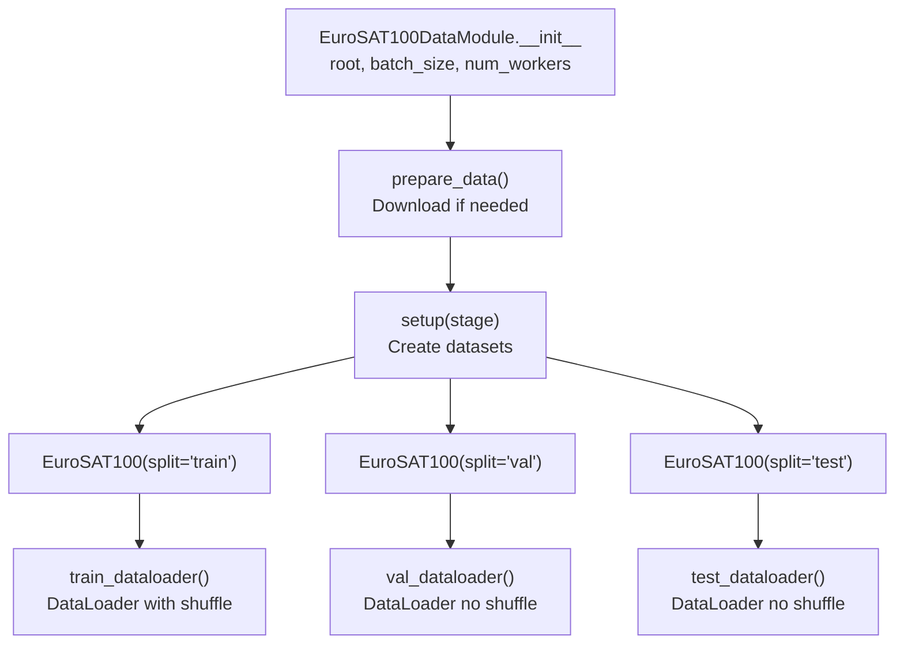
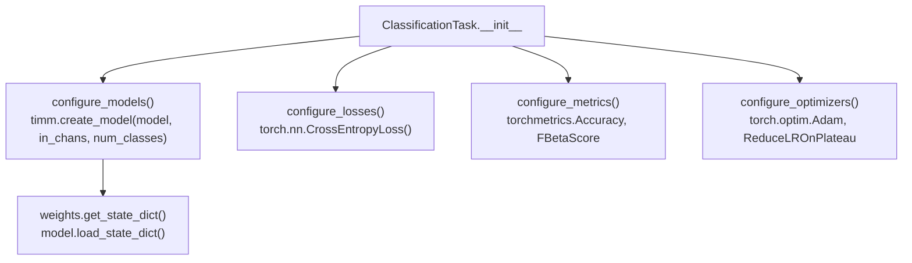
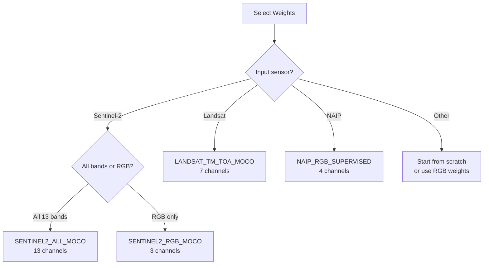
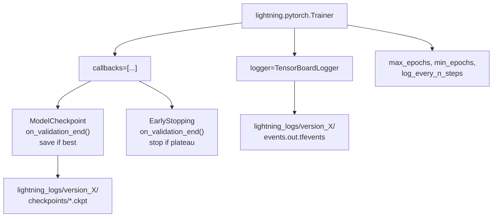
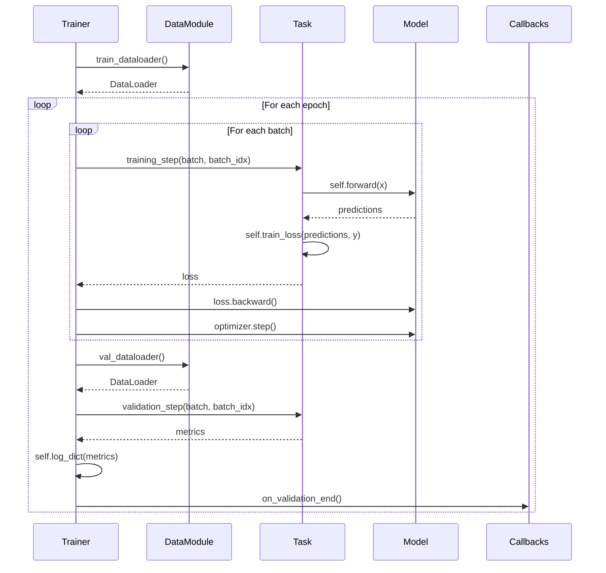
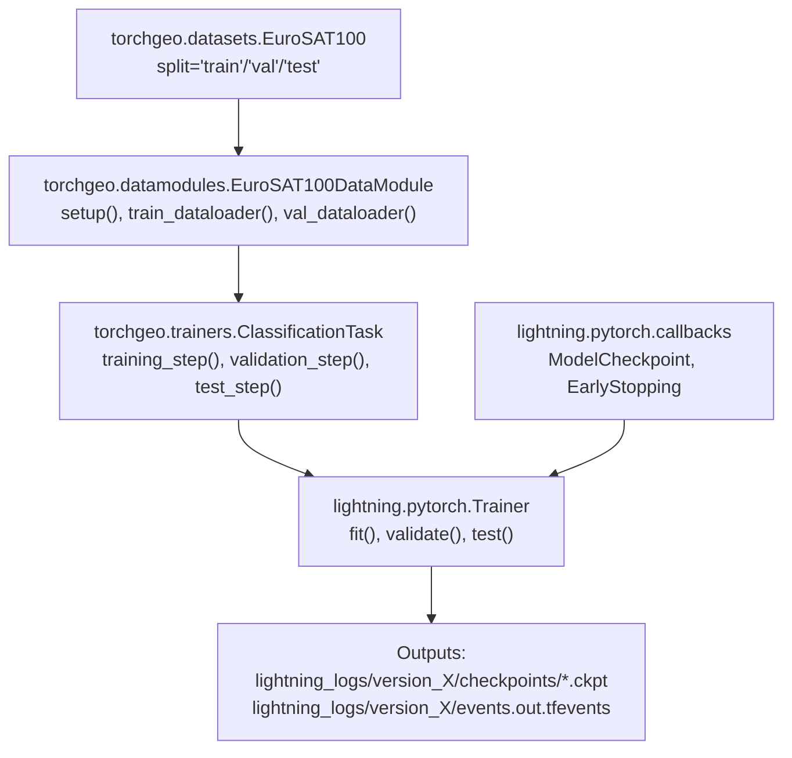
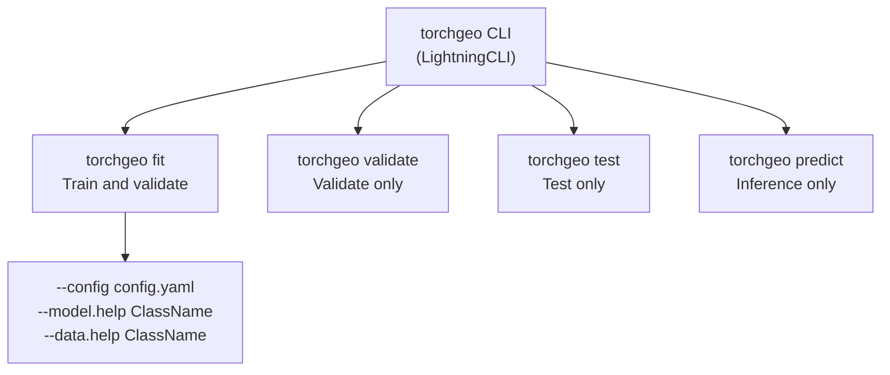

<!-- source: DeepWiki mcp.deepwiki.com · repo torchgeo/torchgeo · page 7.1 Getting Started Tutorial · fetched 2026-10-21 -->

# Getting Started Tutorial

<details>
<summary>Relevant source files</summary>

The following files were used as context for generating this wiki page:

- [docs/tutorials/basic_usage.rst](docs/tutorials/basic_usage.rst)
- [docs/tutorials/cli.ipynb](docs/tutorials/cli.ipynb)
- [docs/tutorials/custom_raster_dataset.ipynb](docs/tutorials/custom_raster_dataset.ipynb)
- [docs/tutorials/custom_segmentation_trainer.ipynb](docs/tutorials/custom_segmentation_trainer.ipynb)
- [docs/tutorials/earthquake_detection.ipynb](docs/tutorials/earthquake_detection.ipynb)
- [docs/tutorials/embeddings.ipynb](docs/tutorials/embeddings.ipynb)
- [docs/tutorials/indices.ipynb](docs/tutorials/indices.ipynb)
- [docs/tutorials/pretrained_weights.ipynb](docs/tutorials/pretrained_weights.ipynb)
- [docs/tutorials/pytorch.ipynb](docs/tutorials/pytorch.ipynb)
- [docs/tutorials/trainers.ipynb](docs/tutorials/trainers.ipynb)
- [docs/tutorials/transforms.ipynb](docs/tutorials/transforms.ipynb)

</details>


This page provides a practical, hands-on introduction to training your first model with TorchGeo. You will learn how to load a dataset, configure a training task, train a model, and evaluate results. This tutorial uses the EuroSAT100 dataset as a simple example to demonstrate the complete workflow.

For information about the underlying PyTorch concepts, see the Introduction to PyTorch tutorial. For advanced workflows including multi-modal fusion and custom transforms, see [Advanced Workflows](#7.2).

## Overview of the Training Workflow

TorchGeo provides pre-built components for geospatial machine learning. The basic workflow consists of five steps:


**Workflow Components with Code Entities**



Sources: [docs/tutorials/trainers.ipynb:76-90](), [docs/tutorials/trainers.ipynb:148-152](), [docs/tutorials/trainers.ipynb:183-192]()

## Installation

Install TorchGeo using pip, conda, or spack. The pip installation is recommended for most users:

```bash
pip install torchgeo
```

For optional dependencies needed for specific datasets or models:

```bash
pip install torchgeo[datasets,models]
```

For development or testing:

```bash
pip install torchgeo[style,tests,all]
```

Sources: [README.md:27-36](), [docs/user/installation.rst:1-84]()

## Basic Imports

Import the core components:

```python
from lightning.pytorch import Trainer
from lightning.pytorch.callbacks import EarlyStopping, ModelCheckpoint
from lightning.pytorch.loggers import TensorBoardLogger

from torchgeo.datamodules import EuroSAT100DataModule
from torchgeo.models import ResNet18_Weights
from torchgeo.trainers import ClassificationTask
```

**Key Modules:**
- `torchgeo.datasets` - Dataset implementations (e.g., `EuroSAT100`, `Landsat8`, `Sentinel2`)
- `torchgeo.datamodules` - Lightning DataModules (e.g., `EuroSAT100DataModule`)
- `torchgeo.trainers` - Task classes (e.g., `ClassificationTask`, `SemanticSegmentationTask`)
- `torchgeo.models` - Model functions and weight enums (e.g., `resnet18()`, `ResNet18_Weights`)

Sources: [docs/tutorials/trainers.ipynb:76-90]()

## Loading a Dataset

TorchGeo provides two types of datasets:

| Type | Use Case | Examples |
|------|----------|----------|
| **GeoDataset** | Raw geospatial data with spatial metadata | `Landsat8`, `Sentinel2`, `NAIP` |
| **NonGeoDataset** | Pre-curated benchmark datasets | `EuroSAT100`, `BigEarthNet`, `PASTIS` |

For this tutorial, we use `EuroSAT100`, a subset of the EuroSAT dataset containing 100 multispectral satellite images across 10 land cover classes.

**Dataset Classes and Image Properties**



The dataset is loaded automatically by the DataModule in the next step.

Sources: [docs/api/datasets.rst:1-213](), [docs/tutorials/trainers.ipynb:99-104](), [docs/tutorials/pytorch.ipynb:114-153]()

## Configuring a DataModule

DataModules handle data preparation including downloading, splitting, batching, and transforms:

```python
# Configuration parameters
batch_size = 10
num_workers = 2
root = './data'

# Initialize the DataModule
datamodule = EuroSAT100DataModule(
    root=root, 
    batch_size=batch_size, 
    num_workers=num_workers, 
    download=True
)
```

**DataModule Workflow**



The DataModule automatically:
- Downloads and checksums via `prepare_data()`
- Creates train/val/test splits via `setup()`
- Applies transforms if specified
- Returns PyTorch `DataLoader` objects with batching

Sources: [docs/tutorials/trainers.ipynb:148-152]()

## Creating a Task

Tasks are Lightning modules that encapsulate model, loss, metrics, and optimization. For classification, use `ClassificationTask`:

```python
# Create the classification task
task = ClassificationTask(
    loss='ce',                                    # Cross-entropy loss
    model='resnet18',                             # ResNet-18 via timm
    weights=ResNet18_Weights.SENTINEL2_ALL_MOCO,  # Pretrained weights
    in_channels=13,                               # Sentinel-2 has 13 bands
    num_classes=10,                               # 10 land cover classes
    lr=0.1,                                       # Learning rate
    patience=5                                    # For ReduceLROnPlateau
)
```

**ClassificationTask Internal Components**



**Available Task Classes:**

| Task | Use Case | Module Path |
|------|----------|-------------|
| `ClassificationTask` | Image classification | `torchgeo.trainers.ClassificationTask` |
| `SemanticSegmentationTask` | Semantic segmentation | `torchgeo.trainers.SemanticSegmentationTask` |
| `ObjectDetectionTask` | Object detection | `torchgeo.trainers.ObjectDetectionTask` |
| `RegressionTask` | Regression | `torchgeo.trainers.RegressionTask` |

Sources: [docs/tutorials/trainers.ipynb:183-192]()

## Using Pretrained Weights

TorchGeo provides sensor-specific pretrained weights that significantly improve performance on remote sensing tasks:

```python
from torchgeo.models import ResNet18_Weights

# Available weight options for ResNet-18
weights = ResNet18_Weights.SENTINEL2_ALL_MOCO  # 13-channel Sentinel-2
# or
weights = ResNet18_Weights.SENTINEL2_RGB_MOCO  # 3-channel RGB
# or
weights = ResNet18_Weights.LANDSAT_TM_TOA_MOCO  # Landsat TM
```

**Weight Selection Strategy**



Weight metadata includes the number of input channels, source dataset, and training method. The task automatically loads the correct weights and adjusts the model architecture accordingly.

Sources: [docs/tutorials/pretrained_weights.ipynb:1-226](), [README.md:157-171](), [docs/api/weights/landsat.csv:1-12]()

## Training Configuration

Configure the Lightning Trainer with callbacks and logging:

```python
import os
import tempfile

# Set up directories
default_root_dir = os.path.join(tempfile.gettempdir(), 'experiments')

# Configure callbacks
checkpoint_callback = ModelCheckpoint(
    monitor='val_loss', 
    dirpath=default_root_dir, 
    save_top_k=1, 
    save_last=True
)

early_stopping_callback = EarlyStopping(
    monitor='val_loss', 
    min_delta=0.0, 
    patience=10
)

# Configure logger
logger = TensorBoardLogger(
    save_dir=default_root_dir, 
    name='tutorial_logs'
)

# Create trainer
trainer = Trainer(
    callbacks=[checkpoint_callback, early_stopping_callback],
    logger=logger,
    min_epochs=1,
    max_epochs=50,
    log_every_n_steps=1
)
```

**Trainer Configuration Flow**



Sources: [docs/tutorials/trainers.ipynb:215-249]()

## Training the Model

Execute training with a single command:

```python
# Train the model
trainer.fit(model=task, datamodule=datamodule)
```

**Training Loop Method Calls**



The `training_step()` and `validation_step()` methods are defined in the task class. The trainer orchestrates data loading, forward/backward passes, and callback execution.

Sources: [docs/tutorials/trainers.ipynb:271-272]()

## Monitoring Training

View training progress using TensorBoard:

```python
# In Jupyter notebook
%load_ext tensorboard
%tensorboard --logdir "$default_root_dir"

# Or from command line
tensorboard --logdir experiments/
```

TensorBoard displays:
- Training and validation loss curves
- Classification metrics (accuracy, F1-score)
- Learning rate schedule
- Model computation graphs
- Sample predictions (if implemented in task)

Sources: [docs/tutorials/trainers.ipynb:274-292]()

## Evaluating Results

After training, evaluate on the test set:

```python
# Test the trained model
trainer.test(model=task, datamodule=datamodule)

# Or load best checkpoint and test
trainer.test(
    model=task, 
    datamodule=datamodule, 
    ckpt_path='best'
)
```

The test results include overall accuracy, per-class metrics, and other classification statistics defined in `configure_metrics()`.

**Complete Pipeline with Code Entities**



Sources: [docs/tutorials/trainers.ipynb:313-314]()

## Command-Line Alternative

TorchGeo provides a CLI via the `torchgeo` executable for running experiments from YAML config files:

**Creating a Configuration File (config.yaml)**

```yaml
trainer:
  max_epochs: 20
  callbacks:
    - class_path: lightning.pytorch.callbacks.ModelCheckpoint
      init_args:
        monitor: val_loss
        save_top_k: 1

model:
  class_path: ClassificationTask
  init_args:
    model: 'resnet18'
    weights: SENTINEL2_ALL_MOCO
    in_channels: 13
    num_classes: 10
    lr: 0.1

data:
  class_path: EuroSAT100DataModule
  init_args:
    batch_size: 8
  dict_kwargs:
    root: './data'
    download: true

optimizer:
  class_path: torch.optim.AdamW
  init_args:
    lr: 0.001

lr_scheduler:
  class_path: torch.optim.lr_scheduler.CosineAnnealingLR
  init_args:
    T_max: 20
```

**Running Training and Testing**

```bash
# Train model
torchgeo fit --config config.yaml

# Validate model
torchgeo validate --config config.yaml --ckpt_path=path/to/checkpoint.ckpt

# Test model
torchgeo test --config config.yaml --ckpt_path=best
```

**CLI Subcommands**



The CLI uses PyTorch Lightning's `LightningCLI` for configuration-based training, enabling reproducible experiments without Python code.

Sources: [docs/tutorials/cli.ipynb:23-359]()

## Complete Example

Here is a minimal complete example that you can run:

```python
import os
import tempfile
from lightning.pytorch import Trainer
from lightning.pytorch.callbacks import ModelCheckpoint

from torchgeo.datamodules import EuroSAT100DataModule
from torchgeo.models import ResNet18_Weights
from torchgeo.trainers import ClassificationTask

# Configuration
root = os.path.join(tempfile.gettempdir(), 'eurosat')
batch_size = 10
max_epochs = 20

# Setup data
datamodule = EuroSAT100DataModule(
    root=root,
    batch_size=batch_size,
    num_workers=2,
    download=True
)

# Setup model
task = ClassificationTask(
    model='resnet18',
    weights=ResNet18_Weights.SENTINEL2_ALL_MOCO,
    in_channels=13,
    num_classes=10,
    lr=0.1
)

# Setup trainer
checkpoint_callback = ModelCheckpoint(monitor='val_loss', save_top_k=1)
trainer = Trainer(
    callbacks=[checkpoint_callback],
    max_epochs=max_epochs,
    accelerator='auto'
)

# Train
trainer.fit(model=task, datamodule=datamodule)

# Test
trainer.test(model=task, datamodule=datamodule, ckpt_path='best')
```

This complete workflow demonstrates:
1. Loading the EuroSAT100 dataset via a DataModule
2. Creating a classification task with pretrained weights
3. Configuring the Lightning Trainer
4. Training and evaluating the model

Sources: [docs/tutorials/trainers.ipynb:1-344](), [README.md:174-189]()

## Next Steps

After completing this tutorial, you can explore:

- **Custom Datasets**: Create your own RasterDataset or NonGeoDataset for your data - see the Custom Raster Datasets tutorial
- **Advanced Training**: Learn about custom tasks, multi-modal fusion, and specialized architectures - see [Advanced Workflows](#7.2)
- **Transforms and Indices**: Apply data augmentation and compute spectral indices - see the Transforms and Indices tutorials
- **Pretrained Models**: Explore available pretrained weights for different sensors - see the Pretrained Weights tutorial
- **CLI Usage**: Run reproducible experiments from configuration files - see the Command-Line Interface tutorial

For a complete list of available datasets, models, and tasks, refer to the API documentation.

Sources: [README.md:1-276](), [docs/tutorials/custom_raster_dataset.ipynb:1-463](), [docs/tutorials/transforms.ipynb:1-642]()

---

