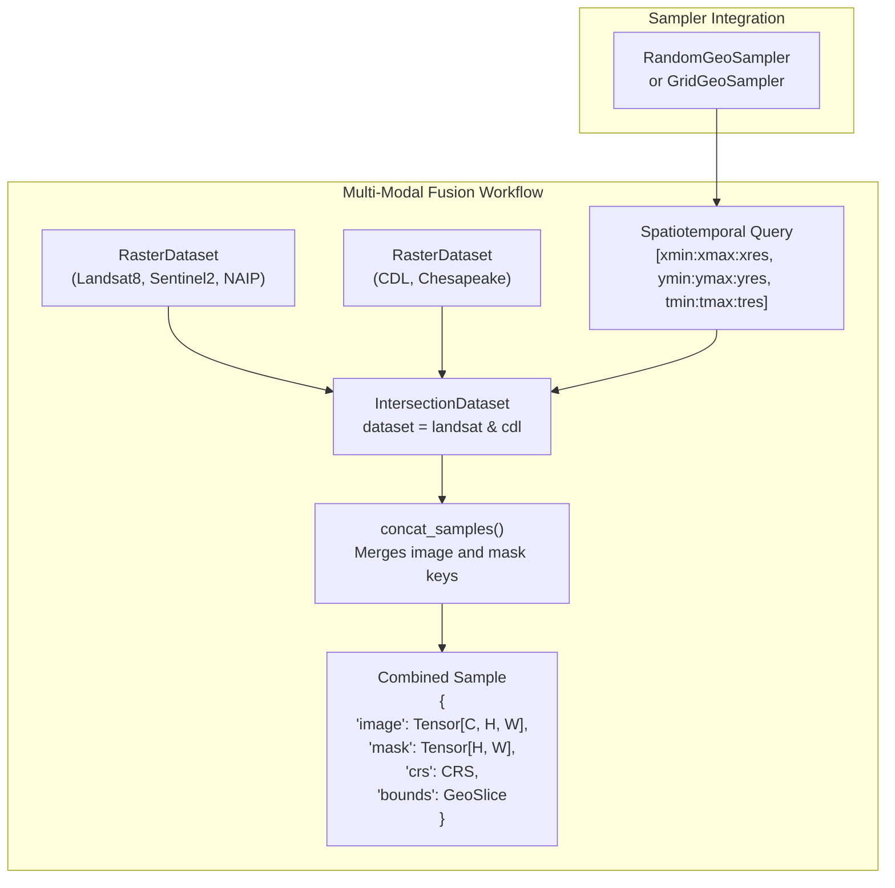
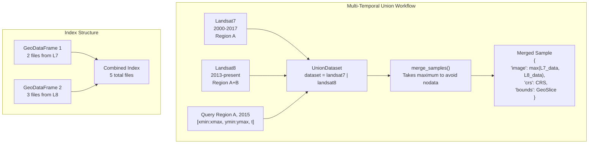
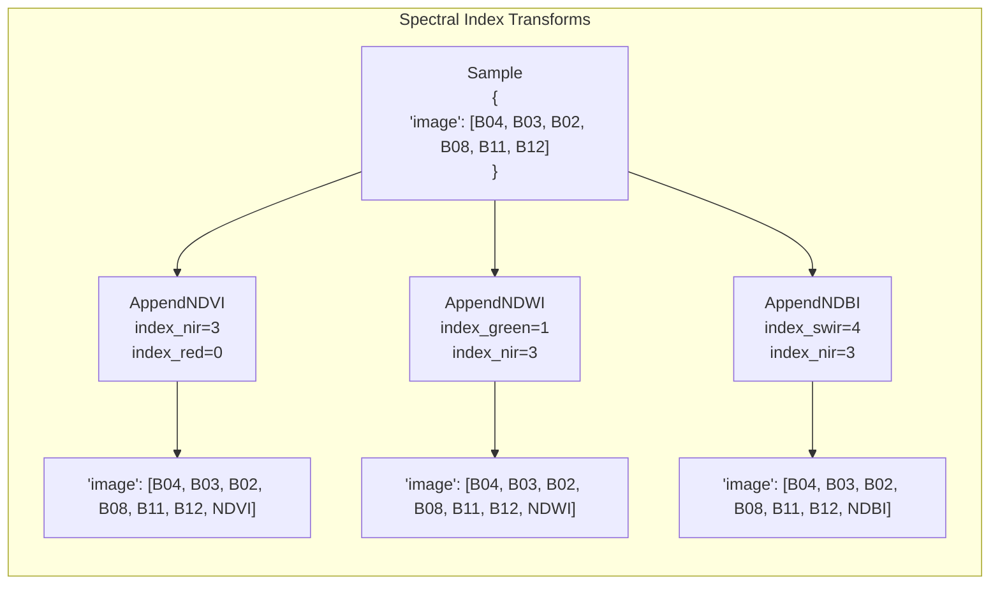
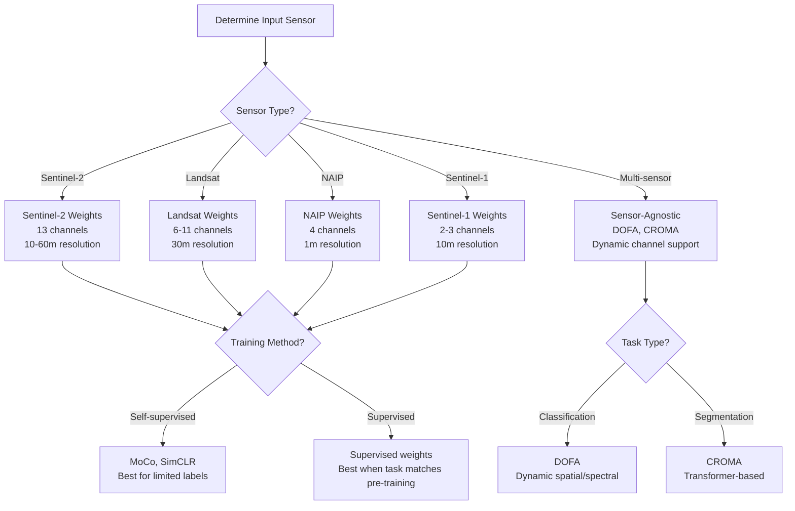
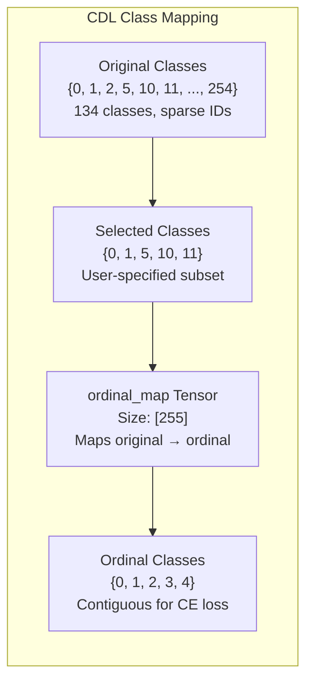
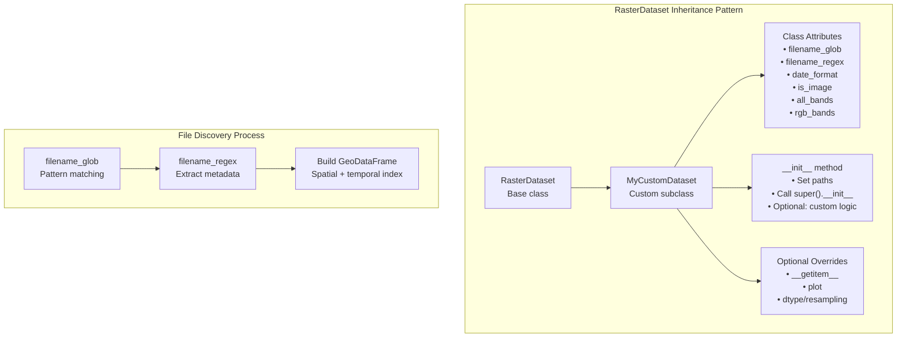
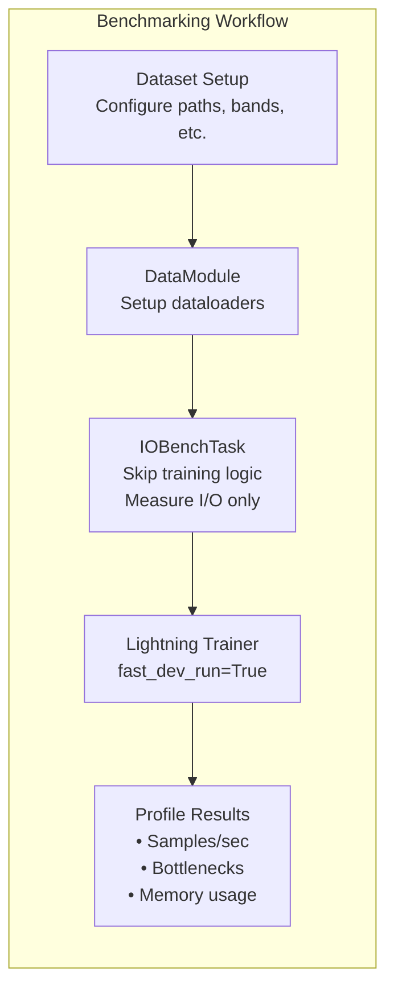

<!-- source: DeepWiki mcp.deepwiki.com · repo torchgeo/torchgeo · page 7.2 Advanced Workflows · fetched 2026-10-21 -->

# Advanced Workflows

<details>
<summary>Relevant source files</summary>

The following files were used as context for generating this wiki page:

- [docs/tutorials/basic_usage.rst](docs/tutorials/basic_usage.rst)
- [docs/tutorials/cli.ipynb](docs/tutorials/cli.ipynb)
- [docs/tutorials/custom_raster_dataset.ipynb](docs/tutorials/custom_raster_dataset.ipynb)
- [docs/tutorials/custom_segmentation_trainer.ipynb](docs/tutorials/custom_segmentation_trainer.ipynb)
- [docs/tutorials/earthquake_detection.ipynb](docs/tutorials/earthquake_detection.ipynb)
- [docs/tutorials/embeddings.ipynb](docs/tutorials/embeddings.ipynb)
- [docs/tutorials/indices.ipynb](docs/tutorials/indices.ipynb)
- [docs/tutorials/pretrained_weights.ipynb](docs/tutorials/pretrained_weights.ipynb)
- [docs/tutorials/pytorch.ipynb](docs/tutorials/pytorch.ipynb)
- [docs/tutorials/trainers.ipynb](docs/tutorials/trainers.ipynb)
- [docs/tutorials/transforms.ipynb](docs/tutorials/transforms.ipynb)

</details>


## Purpose and Scope

This page covers advanced usage patterns in TorchGeo for sophisticated geospatial machine learning workflows. These patterns go beyond basic dataset loading and training to address real-world scenarios involving multiple data sources, custom preprocessing, and specialized requirements.

**Covered Topics:**
- Multi-modal data fusion (combining imagery with ground truth)
- Multi-temporal mosaicking (combining data from different time periods or sensors)
- Custom spectral indices and transforms
- Transfer learning with sensor-specific pre-trained weights
- Custom class mapping and label remapping
- Creating custom dataset classes
- Performance optimization and benchmarking

**Related Pages:**
- For basic dataset usage, see [Dataset System](#2)
- For creating simple custom datasets, see [Creating Custom Datasets](#2.4)
- For training fundamentals, see [Training System](#5)

---

## Multi-Modal Data Fusion

Multi-modal fusion combines multiple geospatial datasets that overlap spatially and temporally. The most common use case is pairing imagery (e.g., Landsat, Sentinel-2) with ground truth labels (e.g., CDL, Chesapeake land cover) for supervised learning.

### Dataset Intersection Pattern

TorchGeo uses the `&` operator to create an `IntersectionDataset`, which ensures that queries return data from all constituent datasets at the same location and time.



**Diagram: Multi-modal fusion using IntersectionDataset**

**Key Implementation Details:**

The `&` operator is implemented via `__and__` method which creates an `IntersectionDataset`:

[torchgeo/datasets/geo.py:158-172]()

The `IntersectionDataset` queries both datasets and merges results using `concat_samples`:

[torchgeo/datasets/utils.py:495-514]()

**Usage Example:**

```python
from torchgeo.datasets import Landsat8, CDL
from torchgeo.samplers import RandomGeoSampler
from torch.utils.data import DataLoader

# Load imagery and labels
landsat = Landsat8(paths='data/landsat', bands=['SR_B4', 'SR_B3', 'SR_B2'])
cdl = CDL(paths='data/cdl', years=[2023])

# Combine datasets - queries must exist in BOTH
dataset = landsat & cdl

# Sample random patches
sampler = RandomGeoSampler(dataset, size=256, length=1000)
dataloader = DataLoader(dataset, sampler=sampler, batch_size=32)

# Each batch contains both image and mask
for batch in dataloader:
    images = batch['image']  # [32, 3, 256, 256]
    masks = batch['mask']    # [32, 256, 256]
```

**CRS and Resolution Handling:**

When combining datasets with different CRS or resolutions, TorchGeo automatically warps data to match:

[torchgeo/datasets/geo.py:234-247]()
[torchgeo/datasets/geo.py:259-273]()

The first dataset's CRS and resolution are used by default, but can be explicitly set during initialization.

**Sources:** [torchgeo/datasets/geo.py:158-188](), [torchgeo/datasets/utils.py:495-514](), [tests/datasets/test_geo.py:121-143]()

---

## Multi-Temporal Mosaicking

Multi-temporal mosaicking combines datasets that may not spatially or temporally overlap, creating a virtual mosaic. Use cases include:
- Combining data from different satellites (Landsat 7 and Landsat 8)
- Mosaicking scenes from different regions (Chesapeake NY and PA)
- Merging historical and recent imagery

### Dataset Union Pattern

The `|` operator creates a `UnionDataset`, which returns data from *at least one* constituent dataset:



**Diagram: Multi-temporal mosaicking using UnionDataset**

**Key Implementation:**

The `|` operator creates a `UnionDataset`:

[torchgeo/datasets/geo.py:174-188]()

The `merge_samples` utility merges overlapping data by taking the maximum value, which replaces nodata (typically 0) with actual data:

[torchgeo/datasets/utils.py:517-539]()

**Practical Example: Landsat Time Series**

```python
from torchgeo.datasets import Landsat7, Landsat8, Landsat9

# Load different Landsat missions
l7 = Landsat7(paths='data/landsat7')
l8 = Landsat8(paths='data/landsat8')
l9 = Landsat9(paths='data/landsat9')

# Create continuous time series covering 2000-2024
dataset = l7 | l8 | l9

# Query will use whichever mission(s) have data at that time/place
sample = dataset[x:x+256, y:y+256, t_start:t_end]
```

**Sources:** [torchgeo/datasets/geo.py:174-188](), [torchgeo/datasets/utils.py:517-539](), [tests/datasets/test_geo.py:145-167]()

---

## Custom Transforms and Spectral Indices

Spectral indices like NDVI, NDWI, and NDBI are derived measurements that highlight specific land cover types. TorchGeo provides built-in transforms for common indices and patterns for creating custom ones.

### Built-in Spectral Indices



**Diagram: Appending spectral indices to imagery**

**Transform Classes:**

Each index transform inherits from `nn.Module` and operates on dictionaries:

[torchgeo/transforms/indices.py]() (entire file implements AppendNDVI, AppendNDWI, AppendNDBI, etc.)

**Usage Pattern:**

```python
from torchgeo.transforms import AppendNDVI, AppendNDWI, AppendNDBI
from torchvision.transforms import Compose

# For Sentinel-2 imagery (band order: B04, B03, B02, B08, B11, B12)
transforms = Compose([
    AppendNDVI(index_nir=3, index_red=0),    # (B08 - B04) / (B08 + B04)
    AppendNDWI(index_green=1, index_nir=3),  # (B03 - B08) / (B03 + B08)
    AppendNDBI(index_swir=4, index_nir=3),   # (B11 - B08) / (B11 + B08)
])

dataset = Sentinel2(paths='data', transforms=transforms)
sample = dataset[query]
# sample['image'] now has 9 channels: 6 original + 3 indices
```

### Creating Custom Transforms

Custom transforms follow the same pattern - accept and return dictionaries:

```python
import torch
import torch.nn as nn

class AppendEVI(nn.Module):
    """Enhanced Vegetation Index: 2.5 * (NIR - Red) / (NIR + 6*Red - 7.5*Blue + 1)"""
    
    def __init__(self, index_nir: int, index_red: int, index_blue: int):
        super().__init__()
        self.index_nir = index_nir
        self.index_red = index_red
        self.index_blue = index_blue
    
    def forward(self, sample: dict[str, Any]) -> dict[str, Any]:
        nir = sample['image'][self.index_nir]
        red = sample['image'][self.index_red]
        blue = sample['image'][self.index_blue]
        
        evi = 2.5 * (nir - red) / (nir + 6*red - 7.5*blue + 1)
        evi = torch.nan_to_num(evi, nan=0.0, posinf=0.0, neginf=0.0)
        
        sample['image'] = torch.cat([sample['image'], evi.unsqueeze(0)])
        return sample
```

**Chaining Multiple Transforms:**

```python
from torchvision.transforms import Compose
import kornia.augmentation as K

transforms = Compose([
    # Spectral indices
    AppendNDVI(index_nir=3, index_red=0),
    AppendEVI(index_nir=3, index_red=0, index_blue=2),
    
    # Data augmentation (using Kornia)
    K.AugmentationSequential(
        K.RandomHorizontalFlip(p=0.5),
        K.RandomVerticalFlip(p=0.5),
        K.RandomRotation(degrees=90, p=0.5),
        data_keys=['image', 'mask'],
    ),
])
```

**Sources:** [docs/tutorials/indices.ipynb](), [docs/tutorials/transforms.ipynb](), [torchgeo/transforms/indices.py]()

---

## Transfer Learning with Pre-trained Weights

TorchGeo provides sensor-specific pre-trained weights trained on large-scale satellite imagery datasets. These weights significantly improve performance on downstream tasks compared to ImageNet pre-training or training from scratch.

### Weight Selection Strategy



**Diagram: Decision tree for selecting pre-trained weights**

### Available Weight Enums

The model API provides weight enums following torchvision's multi-weight pattern:

[torchgeo/models/__init__.py:28-53]() (exports weight enums)

Example weight enum structure:

```python
class ResNet18_Weights(WeightsEnum):
    SENTINEL2_ALL_MOCO = Weights(
        url='https://...',
        meta={
            'dataset': 'Sentinel-2 L2A',
            'in_chans': 13,
            'model': 'resnet18',
            'publication': 'https://...',
            'ssl_method': 'moco',
        }
    )
    SENTINEL2_RGB_MOCO = Weights(...)
    LANDSAT_TM_TOA_MOCO = Weights(...)
```

### Using Pre-trained Weights

**Method 1: Direct weight specification**

```python
from torchgeo.models import resnet18, ResNet18_Weights

# Load with specific weights
model = resnet18(weights=ResNet18_Weights.SENTINEL2_ALL_MOCO)

# Model initialized with 13 input channels
# Fine-tune for your task with different number of classes
```

**Method 2: API query functions**

[torchgeo/models/api.py:95-140]() (get_model implementation)

```python
from torchgeo.models import get_model, list_models

# List all available models
models = list_models()
# ['resnet18', 'resnet50', 'vit_small_patch16_224', ...]

# Get model with default weights
model = get_model('resnet18', weights='DEFAULT')

# Get model with specific weights
model = get_model('resnet18', weights='SENTINEL2_ALL_MOCO')
```

**Method 3: In training tasks**

```python
from torchgeo.trainers import ClassificationTask
from torchgeo.models import ResNet18_Weights

task = ClassificationTask(
    model='resnet18',
    weights=ResNet18_Weights.SENTINEL2_ALL_MOCO,
    in_channels=13,
    num_classes=10,
    lr=0.001,
)
```

### Channel Adaptation Strategies

When your data has different channels than pre-trained weights:

**Strategy 1: Band selection** - Use only channels that match pre-trained weights
```python
# Pre-trained on RGB (3 channels)
sentinel2 = Sentinel2(bands=['B04', 'B03', 'B02'])  # Red, Green, Blue only
```

**Strategy 2: Weight replication** - Replicate pre-trained weights across channels (torchgeo handles automatically)

**Strategy 3: Dynamic architectures** - Use models with dynamic channel support
```python
from torchgeo.models import dofa_base_patch16_224, DOFABase16_Weights

# DOFA handles arbitrary channel counts
model = dofa_base_patch16_224(
    weights=DOFABase16_Weights.DOFA_BASE_PATCH16_MS,
    in_chans=10  # Any number of channels
)
```

**Sources:** [torchgeo/models/api.py](), [docs/api/models.rst:154-218](), [docs/tutorials/pretrained_weights.ipynb](), [tests/models/test_api.py]()

---

## Custom Class Mapping

Many geospatial datasets have sparse or unbalanced class distributions. Custom class mapping allows you to:
- Remap sparse class IDs to contiguous ranges (0, 1, 2, ...)
- Merge similar classes
- Filter to specific classes of interest
- Handle dataset-specific encoding schemes

### Ordinal Mapping Pattern

The CDL dataset demonstrates this pattern with 134 original classes:



**Diagram: Class remapping in CDL dataset**

**Implementation in CDL:**

[torchgeo/datasets/cdl.py:209-289]() (initialization and mapping setup)

Key components:
1. **Class selection** during initialization:
```python
cdl = CDL(
    paths='data',
    years=[2023],
    classes=[0, 1, 5, 10, 11, 12, 21, 23, 24, 36]  # Select specific classes
)
```

2. **ordinal_map tensor** - maps original class IDs to 0-based indices:
[torchgeo/datasets/cdl.py:263-273]()

3. **Remapping in __getitem__**:
[torchgeo/datasets/cdl.py:275-289]()

### Creating Custom Remapping

For your own datasets:

```python
import torch
from torchgeo.datasets import RasterDataset

class MyLandCover(RasterDataset):
    """Custom land cover with class remapping."""
    
    # Original class definitions
    CLASSES = {
        0: 'background',
        10: 'water',
        20: 'forest',
        30: 'grass',
        40: 'urban',
        50: 'agriculture',
    }
    
    def __init__(self, paths, classes=None, **kwargs):
        super().__init__(paths, **kwargs)
        
        # Default to all classes
        if classes is None:
            classes = list(self.CLASSES.keys())
        
        self.classes = classes
        
        # Create mapping tensor
        max_id = max(self.CLASSES.keys())
        self.ordinal_map = torch.zeros(max_id + 1, dtype=self.dtype)
        self.ordinal_cmap = {}
        
        # Map selected classes to 0, 1, 2, ...
        for ordinal_id, original_id in enumerate(self.classes):
            self.ordinal_map[original_id] = ordinal_id
            self.ordinal_cmap[ordinal_id] = self.CLASSES[original_id]
    
    def __getitem__(self, query):
        sample = super().__getitem__(query)
        # Apply remapping
        sample['mask'] = self.ordinal_map[sample['mask']]
        return sample

# Usage: Merge forest and grass into single "vegetation" class
dataset = MyLandCover(
    paths='data',
    classes=[0, 10, 20, 40]  # Exclude grass (30) and agriculture (50)
)
# Classes now: 0=background, 1=water, 2=forest, 3=urban
```

**Color Map Remapping:**

For visualization, also remap color maps:

[torchgeo/datasets/cdl.py:363-384]() (CDL plot method with ordinal_cmap)

**Sources:** [torchgeo/datasets/cdl.py:209-289](), [tests/datasets/test_cdl.py:55-72]()

---

## Custom Datasets

Creating custom datasets allows you to work with proprietary data or new sensors. TorchGeo provides base classes that handle most of the complexity.

### Subclassing RasterDataset



**Diagram: Pattern for creating custom RasterDataset subclasses**

### Required Attributes

[torchgeo/datasets/geo.py:311-361]() (RasterDataset class attributes)

| Attribute | Purpose | Example |
|-----------|---------|---------|
| `filename_glob` | Pattern to find files | `'*_B04.tif'` |
| `filename_regex` | Extract date/metadata | `r'^.*_(?P<date>\d{8})_B04\.tif$'` |
| `date_format` | Parse date strings | `'%Y%m%d'` |
| `is_image` | True for imagery, False for masks | `True` |
| `all_bands` | Available band names (optional) | `('B04', 'B03', 'B02', 'B08')` |
| `rgb_bands` | Bands for RGB visualization (optional) | `('B04', 'B03', 'B02')` |
| `separate_files` | One file per band vs all bands in one file | `False` |

### Complete Example

```python
from torchgeo.datasets import RasterDataset

class CustomSatellite(RasterDataset):
    """Custom satellite dataset with 4 bands."""
    
    # Pattern to match files: mysat_20230101_scene1.tif
    filename_glob = 'mysat_*_*.tif'
    
    # Extract date from filename
    filename_regex = r'^mysat_(?P<date>\d{8})_.*\.tif$'
    date_format = '%Y%m%d'
    
    # This is imagery, not a mask
    is_image = True
    
    # Band information
    all_bands = ('red', 'green', 'blue', 'nir')
    rgb_bands = ('red', 'green', 'blue')
    
    def __init__(self, paths, **kwargs):
        # Call parent constructor - this handles:
        # - Finding files matching filename_glob
        # - Parsing dates with filename_regex
        # - Building spatial index
        # - Setting up warping/resampling
        super().__init__(paths, **kwargs)
        
        # Optional: Add custom initialization
        print(f"Loaded {len(self)} files")

# Usage
dataset = CustomSatellite(
    paths='data/mysat',
    crs='EPSG:32610',  # UTM Zone 10N
    res=10.0,           # 10m resolution
    bands=['red', 'green', 'blue', 'nir']
)
```

### Separate Band Files

For datasets where each band is in a separate file (like Landsat or Sentinel-2):

[torchgeo/datasets/landsat.py:38-97]() (Landsat base class)
[torchgeo/datasets/sentinel.py:261-334]() (Sentinel-2 implementation)

```python
class MySeparateBands(RasterDataset):
    """Dataset with separate files per band."""
    
    # Match first band only
    filename_glob = 'scene_*_B1.tif'
    
    # Regex must have 'band' group
    filename_regex = r'^scene_(?P<date>\d{8})_(?P<band>B[1-4])\.tif$'
    date_format = '%Y%m%d'
    
    # Enable separate file mode
    separate_files = True
    all_bands = ('B1', 'B2', 'B3', 'B4')
    rgb_bands = ('B3', 'B2', 'B1')

# When querying, TorchGeo automatically finds and loads all band files
dataset = MySeparateBands(paths='data', bands=['B1', 'B2', 'B3'])
sample = dataset[query]  # Loads B1, B2, B3 files and stacks them
```

**Sources:** [docs/tutorials/custom_raster_dataset.ipynb](), [torchgeo/datasets/geo.py:311-624](), [torchgeo/datasets/landsat.py:19-146](), [torchgeo/datasets/sentinel.py:261-334]()

---

## Benchmarking and Performance Optimization

TorchGeo includes utilities for profiling I/O performance and optimizing data loading.

### I/O Benchmarking



**Diagram: I/O benchmarking workflow using IOBenchTask**

The `IOBenchTask` measures pure data loading performance by skipping model operations:

[torchgeo/trainers/iobench.py]() (IOBenchTask implementation)

```python
from torchgeo.trainers import IOBenchTask
from torchgeo.datamodules import SomeDataModule
from lightning.pytorch import Trainer

# Setup data
datamodule = SomeDataModule(
    root='data',
    batch_size=32,
    num_workers=4,
)

# Create benchmarking task
task = IOBenchTask()

# Profile I/O performance
trainer = Trainer(
    fast_dev_run=100,  # Run 100 batches
    enable_checkpointing=False,
    logger=False,
)
trainer.fit(task, datamodule=datamodule)
```

### Optimization Strategies

**1. Cache File Handles**

Enable caching to avoid reopening files repeatedly:

```python
dataset = RasterDataset(paths='data', cache=True)
```

Implementation uses `functools.lru_cache`:
[torchgeo/datasets/geo.py:594-604]()

**2. Optimize Number of Workers**

| Scenario | Recommended Workers |
|----------|-------------------|
| Small files, fast storage | 0-2 (CPU-bound) |
| Large files, fast storage | 4-8 (I/O parallelism) |
| Slow storage (network) | 8-16 (hide latency) |
| GPU bottleneck | Fewer workers |

**3. Use Appropriate Sampler Length**

```python
# For RandomGeoSampler, length determines epoch size
sampler = RandomGeoSampler(
    dataset,
    size=256,
    length=10000  # Larger = better data diversity but longer epoch
)
```

**4. Batch Size and Resolution Trade-offs**

| Configuration | Memory | Speed | Use Case |
|---------------|--------|-------|----------|
| Large batch, small patches | High | Fast | Classification |
| Small batch, large patches | High | Slower | Segmentation |
| Small batch, small patches | Low | Fast | Debugging |

**5. Pre-compute Indices**

For datasets with spectral indices, compute them once and save:

```python
from torchgeo.transforms import AppendNDVI
import torch

# Compute and save
dataset = Landsat8(paths='data')
transforms = AppendNDVI(index_nir=3, index_red=0)

for i, sample in enumerate(dataset):
    sample = transforms(sample)
    torch.save(sample['image'], f'preprocessed/{i}.pt')

# Load preprocessed
class PreprocessedDataset(NonGeoDataset):
    def __getitem__(self, idx):
        return torch.load(f'preprocessed/{idx}.pt')
```

**6. Spatial Index Optimization**

For datasets with many files, ensure GeoDataFrame spatial index is built:

[torchgeo/datasets/geo.py:501-504]() (index creation)

The spatial index (`.cx` accessor) enables fast spatial queries:
[torchgeo/datasets/geo.py:522]()

**Sources:** [torchgeo/trainers/iobench.py](), [torchgeo/datasets/geo.py:594-604](), [docs/tutorials/trainers.ipynb]()

---

## Complete Workflow Example

Here's a complete example combining multiple advanced patterns:

```python
"""
Multi-modal fusion with custom transforms and transfer learning
Task: Semantic segmentation of agricultural fields using Landsat-8 and CDL
"""

from torchgeo.datasets import Landsat8, CDL
from torchgeo.samplers import RandomGeoSampler
from torchgeo.transforms import AppendNDVI, AppendNDWI
from torchgeo.trainers import SemanticSegmentationTask
from torchgeo.models import ResNet50_Weights
from torchvision.transforms import Compose
import kornia.augmentation as K
from torch.utils.data import DataLoader
from lightning.pytorch import Trainer

# 1. Load and combine datasets
landsat = Landsat8(
    paths='data/landsat',
    bands=['SR_B2', 'SR_B3', 'SR_B4', 'SR_B5', 'SR_B6', 'SR_B7']
)

cdl = CDL(
    paths='data/cdl',
    years=[2023],
    classes=[0, 1, 5, 10, 12, 36, 37]  # Crop types of interest
)

# Multi-modal fusion
dataset = landsat & cdl

# 2. Custom transforms
transforms = Compose([
    # Spectral indices
    AppendNDVI(index_nir=3, index_red=2),  # B5 and B4
    AppendNDWI(index_green=1, index_nir=3),  # B3 and B5
    
    # Data augmentation
    K.AugmentationSequential(
        K.RandomHorizontalFlip(p=0.5),
        K.RandomVerticalFlip(p=0.5),
        K.RandomRotation(degrees=90, p=0.5),
        data_keys=['image', 'mask'],
    ),
])

dataset.transforms = transforms

# 3. Sampling strategy
sampler = RandomGeoSampler(
    dataset,
    size=256,      # 256x256 patches
    length=10000,  # 10k samples per epoch
)

dataloader = DataLoader(
    dataset,
    sampler=sampler,
    batch_size=32,
    num_workers=8,
    collate_fn=stack_samples,
)

# 4. Task with transfer learning
task = SemanticSegmentationTask(
    model='unet',
    backbone='resnet50',
    weights=ResNet50_Weights.LANDSAT_TM_TOA_MOCO,
    in_channels=8,  # 6 bands + 2 indices
    num_classes=7,  # Remapped CDL classes
    loss='ce',
    lr=1e-3,
)

# 5. Training
trainer = Trainer(
    accelerator='gpu',
    devices=1,
    max_epochs=50,
    callbacks=[EarlyStopping(monitor='val_loss', patience=5)],
)

trainer.fit(task, dataloader)
```

This workflow demonstrates:
- ✓ Multi-modal fusion (Landsat + CDL)
- ✓ Custom transforms (spectral indices + augmentation)
- ✓ Transfer learning (Landsat pre-trained weights)
- ✓ Custom class mapping (CDL class filtering)
- ✓ Efficient sampling (RandomGeoSampler)

**Sources:** Multiple sources combined from previous sections.