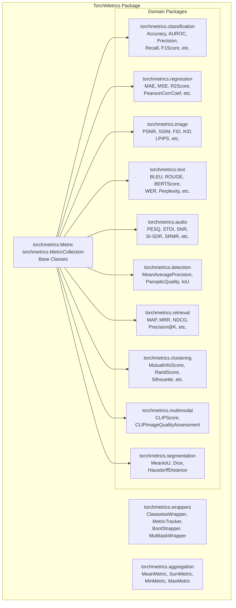
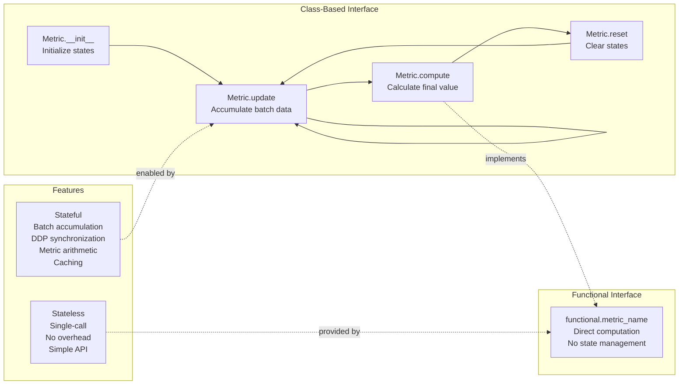
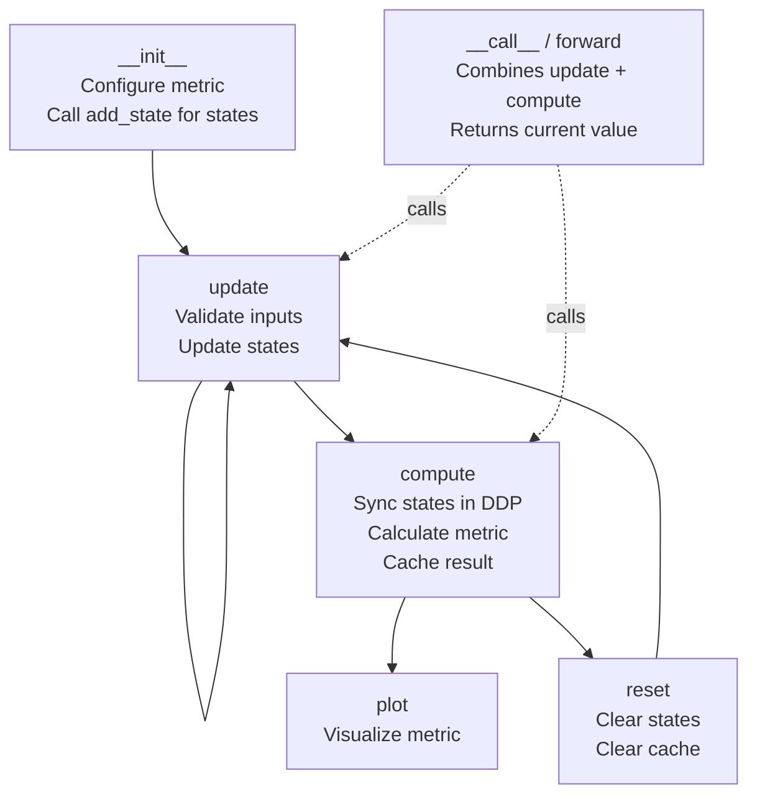
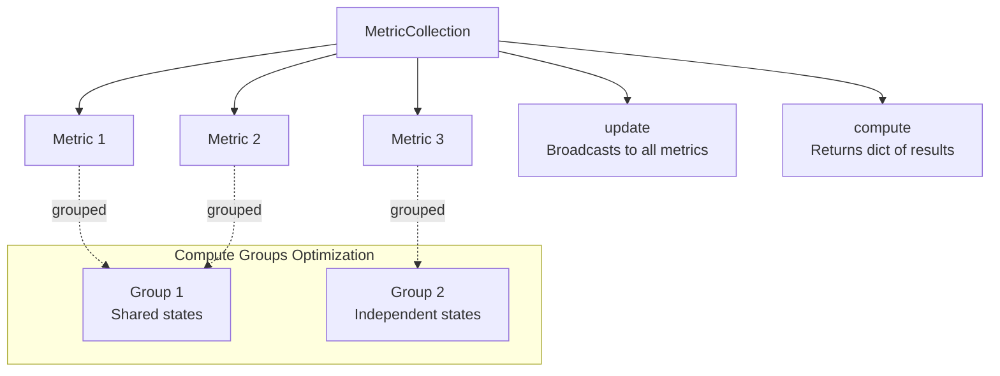
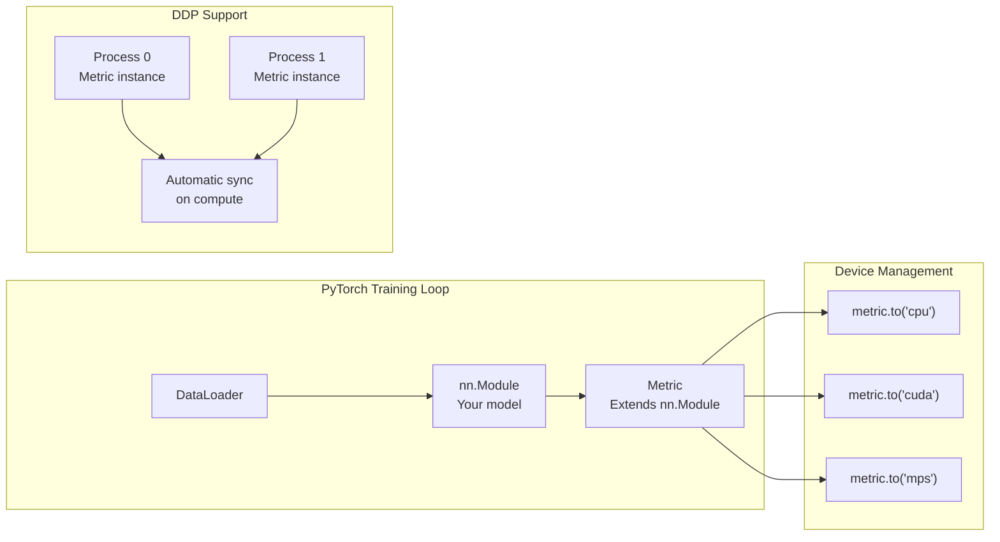
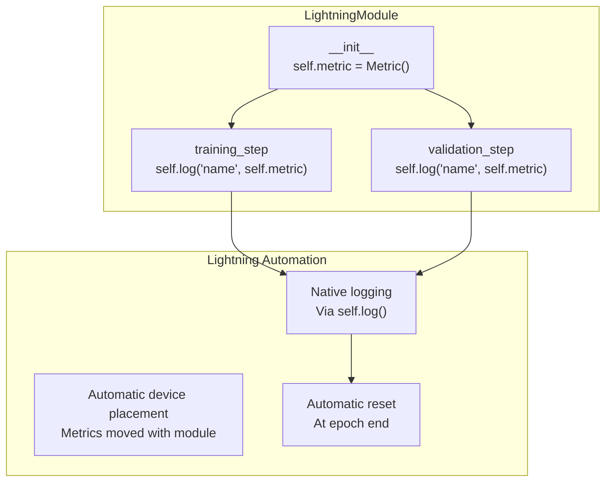
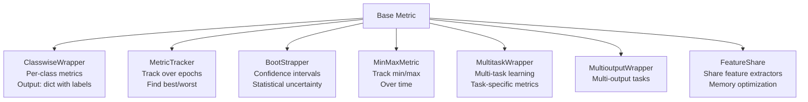

<!-- source: DeepWiki mcp.deepwiki.com · repo Lightning-AI/torchmetrics · page 1 Overview · fetched 2026-10-21 -->

# Overview

<details>
<summary>Relevant source files</summary>

The following files were used as context for generating this wiki page:

- [CHANGELOG.md](CHANGELOG.md)
- [LICENSE](LICENSE)
- [README.md](README.md)
- [docs/source/_templates/theme_variables.jinja](docs/source/_templates/theme_variables.jinja)
- [docs/source/all-metrics.rst](docs/source/all-metrics.rst)
- [docs/source/conf.py](docs/source/conf.py)
- [docs/source/index.rst](docs/source/index.rst)
- [docs/source/links.rst](docs/source/links.rst)
- [docs/source/pages/implement.rst](docs/source/pages/implement.rst)
- [docs/source/pages/lightning.rst](docs/source/pages/lightning.rst)
- [docs/source/pages/overview.rst](docs/source/pages/overview.rst)
- [docs/source/pages/quickstart.rst](docs/source/pages/quickstart.rst)
- [requirements/integrate.txt](requirements/integrate.txt)
- [src/torchmetrics/__about__.py](src/torchmetrics/__about__.py)
- [src/torchmetrics/__init__.py](src/torchmetrics/__init__.py)
- [src/torchmetrics/classification/__init__.py](src/torchmetrics/classification/__init__.py)
- [src/torchmetrics/functional/__init__.py](src/torchmetrics/functional/__init__.py)
- [src/torchmetrics/functional/classification/__init__.py](src/torchmetrics/functional/classification/__init__.py)
- [src/torchmetrics/functional/pairwise/__init__.py](src/torchmetrics/functional/pairwise/__init__.py)
- [src/torchmetrics/functional/regression/__init__.py](src/torchmetrics/functional/regression/__init__.py)
- [src/torchmetrics/regression/__init__.py](src/torchmetrics/regression/__init__.py)
- [tests/integrations/lightning/boring_model.py](tests/integrations/lightning/boring_model.py)
- [tests/integrations/test_lightning.py](tests/integrations/test_lightning.py)

</details>


This page introduces TorchMetrics, its core purpose, installation, and fundamental architecture. For detailed information about using metrics with PyTorch Lightning, see [Integration with PyTorch Lightning](#1.2). For implementing your own metrics, see the implementing metrics pages in the development section.

## What is TorchMetrics

TorchMetrics is a collection of 100+ PyTorch metric implementations providing a standardized interface for evaluating machine learning models. The library addresses common pain points in metric computation: automatic batch accumulation, distributed training synchronization, and consistent API design across different metric types.

**Core Features:**
- Standardized interface for reproducibility
- Automatic accumulation over batches
- Distributed training compatibility with automatic synchronization
- Both stateful (class-based) and stateless (functional) APIs
- Native PyTorch Lightning integration

**Sources:** [README.md:107-116](), [src/torchmetrics/__about__.py:9-17](), [docs/source/index.rst:13-21]()

## Installation

TorchMetrics can be installed via pip or conda:

```bash
# PyPI
pip install torchmetrics

# Conda
conda install -c conda-forge torchmetrics

# With domain-specific dependencies
pip install torchmetrics[audio]    # Audio metrics
pip install torchmetrics[image]    # Image quality metrics
pip install torchmetrics[text]     # Text/NLP metrics
pip install torchmetrics[all]      # All optional dependencies
```

**Minimum Requirements:**
- Python 3.9-3.12
- PyTorch 2.0+
- NumPy
- Lightning-utilities

**Sources:** [README.md:52-103](), [docs/source/index.rst:37-65]()

## Library Organization

TorchMetrics is organized into domain-specific packages, each containing metrics for a particular type of evaluation task:



**Package Import Structure:**

| Domain | Import Path | Key Metrics |
|--------|------------|-------------|
| Classification | `torchmetrics.classification` | `Accuracy`, `AUROC`, `Precision`, `Recall`, `F1Score`, `ConfusionMatrix` |
| Regression | `torchmetrics.regression` | `MeanAbsoluteError`, `MeanSquaredError`, `R2Score`, `PearsonCorrCoef` |
| Image | `torchmetrics.image` | `PeakSignalNoiseRatio`, `StructuralSimilarityIndexMeasure`, `FrechetInceptionDistance` |
| Text | `torchmetrics.text` | `BLEUScore`, `ROUGEScore`, `BERTScore`, `WordErrorRate` |
| Audio | `torchmetrics.audio` | `PerceptualEvaluationSpeechQuality`, `ShortTimeObjectiveIntelligibility` |
| Detection | `torchmetrics.detection` | `MeanAveragePrecision`, `PanopticQuality`, `IntersectionOverUnion` |

**Sources:** [src/torchmetrics/__init__.py:37-167](), [src/torchmetrics/classification/__init__.py:1-238](), [docs/source/pages/overview.rst:7-12]()

## Dual Interface Pattern

TorchMetrics provides two complementary interfaces for computing metrics: **class-based (modular)** and **functional**.



### Class-Based Metrics

Class-based metrics inherit from `torchmetrics.Metric` and maintain internal states for accumulating data across batches:

```python
# Example from classification
from torchmetrics.classification import MulticlassAccuracy

# Initialize metric
metric = MulticlassAccuracy(num_classes=5)
metric.to(device)

# Accumulate over batches
for batch_preds, batch_targets in dataloader:
    metric.update(batch_preds, batch_targets)

# Compute final value (automatically syncs in DDP)
final_accuracy = metric.compute()

# Reset for next epoch
metric.reset()
```

**Key Characteristics:**
- States defined via `add_state()` in `__init__`
- `update()` accumulates batch statistics
- `compute()` calculates final metric with automatic DDP synchronization
- `reset()` clears states for reuse
- Supports metric arithmetic (addition, composition)

**Sources:** [docs/source/pages/overview.rst:124-162](), [README.md:124-162](), [src/torchmetrics/metric.py]()

### Functional Metrics

Functional metrics are stateless functions in the `torchmetrics.functional` namespace:

```python
from torchmetrics.functional.classification import multiclass_accuracy

# Direct computation on full dataset
accuracy = multiclass_accuracy(all_preds, all_targets, num_classes=5)
```

**Key Characteristics:**
- No internal state
- Input tensors → output tensor
- Lower overhead
- Useful for single-batch evaluation or custom accumulation logic

**Functional implementations underpin class-based metrics.** Each class-based metric typically calls its functional counterpart in the `compute()` method after synchronizing states.

**Sources:** [docs/source/pages/overview.rst:461-470](), [README.md:275-293](), [src/torchmetrics/functional/__init__.py:1-253]()

## Core Architecture

### Metric Base Class Lifecycle

The `torchmetrics.Metric` base class implements a standardized lifecycle for all metrics:



**State Management:**
- **Tensor states**: Fixed memory (O(1)), in-place updates (e.g., `correct`, `total` counters)
- **List states**: Growing memory (O(n)), append operations (e.g., storing all predictions)

**Distribution Strategy:**
- States automatically sync across processes when `compute()` is called
- Controlled by `dist_reduce_fx` parameter: `"sum"`, `"mean"`, `"cat"`, `"min"`, `"max"`, or custom function
- `sync_on_compute=True` (default) enables automatic synchronization

**Sources:** [docs/source/pages/overview.rst:14-22](), [docs/source/pages/implement.rst:18-73](), [CHANGELOG.md:14-27]()

### MetricCollection

`torchmetrics.MetricCollection` bundles multiple metrics for efficient computation:



**Features:**
- Single `update()` call updates all metrics
- Single `compute()` call returns dictionary of results
- Automatic compute group detection for 2-3x speedup
- Supports `prefix`/`postfix` for logging
- Cloneable with `.clone()` for train/val/test splits

**Example:**
```python
from torchmetrics import MetricCollection
from torchmetrics.classification import MulticlassAccuracy, MulticlassPrecision, MulticlassRecall

metrics = MetricCollection([
    MulticlassAccuracy(num_classes=10),
    MulticlassPrecision(num_classes=10),
    MulticlassRecall(num_classes=10)
])

# Single update
metrics.update(preds, targets)

# Single compute returns dict
result = metrics.compute()
# {'MulticlassAccuracy': tensor(0.85), 'MulticlassPrecision': tensor(0.83), ...}
```

**Sources:** [docs/source/pages/overview.rst:316-404](), [CHANGELOG.md:390-401]()

## Integration with PyTorch

TorchMetrics works seamlessly with pure PyTorch code. Metrics are `torch.nn.Module` subclasses and follow familiar PyTorch patterns:



**Device Placement:**
- Metrics states are buffers/parameters like `nn.Module`
- Use `.to(device)` to move metrics
- When metrics are module attributes, they move automatically with parent module

**DDP Compatibility:**
- Metrics automatically synchronize states across processes
- No manual `all_reduce` operations needed
- Works with `torch.nn.parallel.DistributedDataParallel`

**Sources:** [docs/source/pages/overview.rst:78-132](), [README.md:164-233](), [tests/integrations/test_lightning.py:47-80]()

## Integration with PyTorch Lightning

PyTorch Lightning provides enhanced integration features:



**Lightning Benefits:**
1. **Automatic device placement**: Metrics automatically move to correct device when defined as module attributes
2. **Native logging**: `self.log('metric_name', metric_object)` handles everything
3. **Automatic reset**: Metrics reset at end of train/val/test epoch
4. **Integration with callbacks**: Metrics accessible in Lightning callbacks

**Example:**
```python
from lightning.pytorch import LightningModule
from torchmetrics.classification import MulticlassAccuracy

class MyModel(LightningModule):
    def __init__(self):
        super().__init__()
        self.train_acc = MulticlassAccuracy(num_classes=10)
        self.val_acc = MulticlassAccuracy(num_classes=10)
    
    def training_step(self, batch, batch_idx):
        x, y = batch
        preds = self(x)
        # Automatic device placement + logging
        self.log('train_acc', self.train_acc(preds, y))
    
    def validation_step(self, batch, batch_idx):
        x, y = batch
        preds = self(x)
        self.log('val_acc', self.val_acc(preds, y))
    # Metrics automatically reset at epoch end
```

**Sources:** [docs/source/pages/lightning.rst:1-307](), [docs/source/pages/overview.rst:98-106](), [tests/integrations/test_lightning.py:183-263]()

## Metric Domains

TorchMetrics organizes metrics into nine primary domains:

### Classification Metrics

Located in `torchmetrics.classification`, covering binary, multiclass, and multilabel classification tasks. Major refactor in v0.9.0-v1.0.0 introduced task-specific classes (`Binary*`, `Multiclass*`, `Multilabel*`).

**Key metrics:** `Accuracy`, `AUROC`, `Precision`, `Recall`, `F1Score`, `ConfusionMatrix`, `ROC`, `PrecisionRecallCurve`

**Sources:** [src/torchmetrics/classification/__init__.py:1-238]()

### Regression Metrics

Located in `torchmetrics.regression`, for continuous value prediction evaluation.

**Key metrics:** `MeanAbsoluteError`, `MeanSquaredError`, `R2Score`, `PearsonCorrCoef`, `SpearmanCorrCoef`, `KLDivergence`

**Sources:** [src/torchmetrics/regression/__init__.py:1-60]()

### Image Metrics

Located in `torchmetrics.image`, for image quality assessment.

**Categories:**
- Reference-based: `PSNR`, `SSIM`, `MS-SSIM`
- Feature-based: `FID`, `KID`, `InceptionScore`
- Perceptual: `LPIPS`, `ARNIQA`, `CLIPIQA`

**Sources:** [docs/source/links.rst:33-186]()

### Text Metrics

Located in `torchmetrics.text`, for NLP and text generation evaluation.

**Categories:**
- N-gram based: `BLEUScore`, `ROUGEScore`, `CHRFScore`
- Edit distance: `WordErrorRate`, `CharErrorRate`
- Semantic: `BERTScore`, `InfoLM`
- QA: `SQuAD`

**Sources:** [docs/source/links.rst:51-96]()

### Audio Metrics

Located in `torchmetrics.audio`, for audio quality and speech evaluation.

**Key metrics:** `PESQ`, `STOI`, `SNR`, `SI-SDR`, `SI-SNR`, `SRMR`, `NISQA`

**Sources:** [docs/source/links.rst:111-128]()

### Detection Metrics

Located in `torchmetrics.detection`, for object detection evaluation.

**Key metrics:** `MeanAveragePrecision`, `PanopticQuality`, `IntersectionOverUnion`, `CompleteIntersectionOverUnion`

**Sources:** [docs/source/links.rst:43-155]()

### Retrieval Metrics

Located in `torchmetrics.retrieval`, for information retrieval evaluation.

**Key metrics:** `RetrievalMAP`, `RetrievalMRR`, `RetrievalNDCG`, `RetrievalPrecision`, `RetrievalRecall`

**Sources:** [docs/source/links.rst:4-50]()

### Clustering Metrics

Located in `torchmetrics.clustering`, for unsupervised learning evaluation.

**Key metrics:** `MutualInfoScore`, `RandScore`, `AdjustedRandScore`, `NormalizedMutualInfoScore`, `DaviesBouldinScore`, `Silhouette`

**Sources:** [CHANGELOG.md:467-480]()

### Multimodal Metrics

Located in `torchmetrics.multimodal`, for cross-modal evaluation.

**Key metrics:** `CLIPScore`, `CLIPImageQualityAssessment`, `LipVertexError`

**Sources:** [docs/source/links.rst:108-152]()

## Metric Wrappers

The `torchmetrics.wrappers` package provides composable functionality extensions:



**Common Wrappers:**
- `ClasswiseWrapper`: Compute metrics per class with label information
- `MetricTracker`: Track best/worst metric values over training
- `BootStrapper`: Add confidence intervals via bootstrap resampling
- `MinMaxMetric`: Track minimum/maximum values
- `MultitaskWrapper`: Handle multi-task learning scenarios
- `FeatureShare`: Share expensive feature extractors between metrics (e.g., for FID, KID)

**Sources:** [docs/source/pages/overview.rst:406-458](), [src/torchmetrics/__init__.py:160-167](), [CHANGELOG.md:405-406]()

## Version Information

**Current Version:** 1.9.0dev

**Supported Platforms:**
- Python: 3.9, 3.10, 3.11, 3.12
- PyTorch: 2.0+
- Operating Systems: Linux, macOS, Windows

**License:** Apache 2.0

**Sources:** [src/torchmetrics/__about__.py:1-28](), [LICENSE:1-201](), [README.md:20-36]()

---

