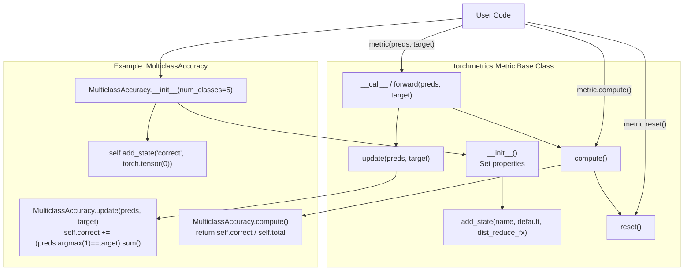
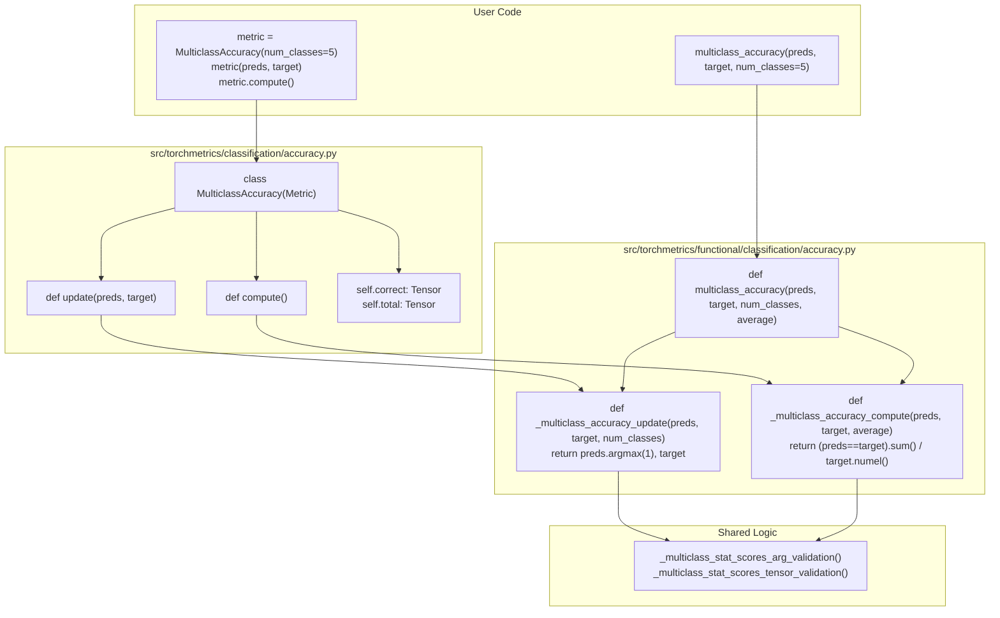

<!-- source: DeepWiki mcp.deepwiki.com · repo Lightning-AI/torchmetrics · page 1.1 Getting Started · fetched 2026-10-21 -->

# Getting Started

<details>
<summary>Relevant source files</summary>

The following files were used as context for generating this wiki page:

- [CHANGELOG.md](CHANGELOG.md)
- [LICENSE](LICENSE)
- [README.md](README.md)
- [docs/source/_templates/theme_variables.jinja](docs/source/_templates/theme_variables.jinja)
- [docs/source/all-metrics.rst](docs/source/all-metrics.rst)
- [docs/source/conf.py](docs/source/conf.py)
- [docs/source/index.rst](docs/source/index.rst)
- [docs/source/pages/implement.rst](docs/source/pages/implement.rst)
- [docs/source/pages/lightning.rst](docs/source/pages/lightning.rst)
- [docs/source/pages/overview.rst](docs/source/pages/overview.rst)
- [docs/source/pages/quickstart.rst](docs/source/pages/quickstart.rst)
- [requirements/integrate.txt](requirements/integrate.txt)
- [src/torchmetrics/__about__.py](src/torchmetrics/__about__.py)
- [tests/integrations/lightning/boring_model.py](tests/integrations/lightning/boring_model.py)
- [tests/integrations/test_lightning.py](tests/integrations/test_lightning.py)

</details>


This page provides a quick start guide to using TorchMetrics, covering installation and basic usage patterns for both module-based and functional metrics. For a deeper understanding of TorchMetrics architecture and advanced features, see [Overview](#1). For integration with PyTorch Lightning, see [Integration with PyTorch Lightning](#1.2). For implementing custom metrics, see the implementation guide at [Implementing a Metric](#15).

---

## Installation

### Basic Installation

TorchMetrics can be installed via pip or conda:

```bash
# Using pip
pip install torchmetrics

# Using conda
conda install -c conda-forge torchmetrics

# Using uv (fast installer)
uv add torchmetrics
```

**Sources:** [README.md:54-73]()

### Installing Domain-Specific Dependencies

Many metrics require additional dependencies for specialized domains. Install them using extras:

| Extra | Domains Covered | Install Command |
|-------|----------------|-----------------|
| `audio` | Audio quality metrics (PESQ, STOI, SNR, etc.) | `pip install torchmetrics[audio]` |
| `image` | Image quality metrics (PSNR, SSIM, FID, etc.) | `pip install torchmetrics[image]` |
| `text` | Text/NLP metrics (BLEU, ROUGE, BERTScore, etc.) | `pip install torchmetrics[text]` |
| `all` | All domain-specific metrics | `pip install torchmetrics[all]` |

For development work, install with the `dev` extra:

```bash
pip install torchmetrics[dev]
```

**Sources:** [README.md:88-95](), [docs/source/pages/quickstart.rst:19-42]()

---

## Module-Based Metrics

Module-based metrics are the primary interface in TorchMetrics. They are subclasses of `torch.nn.Module` that maintain internal state for accumulating results across batches and synchronizing across distributed devices.

### Basic Workflow

```python
import torch
import torchmetrics

# Initialize metric
metric = torchmetrics.classification.Accuracy(task="multiclass", num_classes=5)

# Move metric to appropriate device
device = "cuda" if torch.cuda.is_available() else "cpu"
metric.to(device)

# Process multiple batches
n_batches = 10
for i in range(n_batches):
    # Simulate predictions and targets
    preds = torch.randn(10, 5).softmax(dim=-1).to(device)
    target = torch.randint(5, (10,)).to(device)
    
    # Update metric state with current batch
    # This also returns the metric value for this batch
    batch_acc = metric(preds, target)
    print(f"Accuracy on batch {i}: {batch_acc}")

# Compute final metric across all batches
final_acc = metric.compute()
print(f"Accuracy on all data: {final_acc}")

# Reset metric state for next epoch
metric.reset()
```

**Sources:** [README.md:136-162](), [docs/source/pages/quickstart.rst:82-106](), [docs/source/pages/overview.rst:25-56]()

### Metric Lifecycle and Internal Methods



**Diagram: Module Metric Lifecycle with Concrete Implementation**

The three core methods that define a metric's behavior:

| Method | Purpose | When Called | Implementation Location |
|--------|---------|-------------|------------------------|
| `update(preds, target)` | Accumulates predictions and targets into internal states | Called for each batch | User implements in custom metric |
| `compute()` | Synchronizes states across devices (if distributed) and calculates final metric | Called at epoch end or when result needed | User implements in custom metric |
| `reset()` | Clears all metric states back to default values | Called after `compute()` to prepare for next epoch | Automatically handled by `Metric` base class |

**Sources:** [docs/source/pages/overview.rst:14-21](), [docs/source/pages/implement.rst:22-40](), [README.md:236-266]()

### Key Features of Module Metrics

1. **Automatic State Management**: Internal states (registered via `add_state`) are automatically managed, moved to correct devices, and synchronized in distributed settings.

2. **Distributed Training Support**: When `compute()` is called in DDP mode, metric states are automatically gathered and reduced across all processes.

3. **Dual-Purpose Forward**: Calling `metric(preds, target)` both updates the internal state AND returns the metric value for the current batch.

**Sources:** [docs/source/pages/overview.rst:14-22](), [README.md:126-131]()

---

## Functional Metrics

Functional metrics are stateless functions that directly compute metric values from input tensors without accumulation. They are simpler but lack automatic batch accumulation and distributed synchronization.

### Basic Usage

```python
import torch
import torchmetrics

# Simulate a classification problem
preds = torch.randn(10, 5).softmax(dim=-1)
target = torch.randint(5, (10,))

# Compute metric directly from inputs
acc = torchmetrics.functional.classification.multiclass_accuracy(
    preds, target, num_classes=5
)
print(f"Accuracy: {acc}")
```

**Sources:** [README.md:280-293](), [docs/source/pages/quickstart.rst:48-68]()

### Relationship Between Module and Functional APIs



**Diagram: Code Structure of Module and Functional APIs**

The functional API implementation pattern followed in TorchMetrics:

| Function Pattern | Location | Purpose | Example Path |
|-----------------|----------|---------|--------------|
| Private update `_metric_update(...)` | `src/torchmetrics/functional/{domain}/{metric}.py` | Input validation and preprocessing | `_multiclass_accuracy_update()` |
| Private compute `_metric_compute(...)` | `src/torchmetrics/functional/{domain}/{metric}.py` | Core metric calculation | `_multiclass_accuracy_compute()` |
| Public functional `metric(...)` | `src/torchmetrics/functional/{domain}/{metric}.py` | Public interface wrapping update + compute | `multiclass_accuracy()` |
| Module class | `src/torchmetrics/{domain}/{metric}.py` | Stateful wrapper with `add_state()` | `MulticlassAccuracy` |

Module metrics internally call the same private functional implementations (`_metric_update` and `_metric_compute`) to avoid code duplication.

**Sources:** [docs/source/pages/implement.rst:250-262](), [docs/source/pages/overview.rst:461-471](), [README.md:236-266]()

### When to Use Each API

| Use Module-Based When | Use Functional When |
|----------------------|---------------------|
| Training loops with multiple batches | Single batch evaluation |
| Distributed training (DDP/multi-GPU) | Simple forward passes |
| Integration with PyTorch Lightning | Computing metrics inside model's `forward()` |
| Need metric persistence via `state_dict()` | Memory-constrained environments (no state storage) |
| Evaluating on validation/test sets | One-shot metric computation |

The module API provides accumulation via `update()` calls across batches and synchronization via `compute()` in distributed settings, while the functional API is stateless and computes results immediately from inputs.

**Sources:** [docs/source/pages/overview.rst:461-471](), [docs/source/pages/quickstart.rst:48-68]()

---

## Device Management

Metrics are subclasses of `torch.nn.Module`, so their states must be on the same device as input tensors.

### Manual Device Placement

```python
import torch
import torchmetrics

# Initialize metric (defaults to CPU)
metric = torchmetrics.classification.BinaryAccuracy()

# Move to GPU
device = torch.device("cuda", 0)
metric = metric.to(device)

# Inputs must be on same device
preds = torch.tensor([0, 1, 0, 0], device=device)
target = torch.tensor([1, 1, 0, 0], device=device)

# Compute metric
acc = metric(preds, target)
print(f"Device: {acc.device}")  # Output: cuda:0
```

### Automatic Device Placement in Modules

```mermaid
graph TB
    subgraph "Correct: Direct Attribute Assignment"
        Model1["class MyModel(nn.Module)"]
        Attr["self.accuracy = BinaryAccuracy()"]
        To1["model.to('cuda')"]
        Result1["✓ metric.device == 'cuda'"]
        
        Model1 --> Attr
        Attr --> To1
        To1 --> Result1
    end
    
    subgraph "Incorrect: Python List"
        Model2["class MyModel(nn.Module)"]
        List["self.metrics = [BinaryAccuracy()]"]
        To2["model.to('cuda')"]
        Result2["✗ metric.device == 'cpu'"]
        
        Model2 --> List
        List --> To2
        To2 --> Result2
    end
    
    subgraph "Correct: nn.ModuleList"
        Model3["class MyModel(nn.Module)"]
        ModList["self.metrics = nn.ModuleList([BinaryAccuracy()])"]
        To3["model.to('cuda')"]
        Result3["✓ metric.device == 'cuda'"]
        
        Model3 --> ModList
        ModList --> To3
        To3 --> Result3
    end
```



**Diagram: Device Management Patterns for Metrics in nn.Module**

When metrics are properly defined as child modules, they automatically move with the parent module:

```python
import torch
import torch.nn as nn
import torchmetrics

class MyModel(nn.Module):
    def __init__(self):
        super().__init__()
        self.layer = nn.Linear(10, 10)
        # Metric defined as attribute - will be recognized as child module
        self.accuracy = torchmetrics.classification.BinaryAccuracy()
    
    def forward(self, x):
        return self.layer(x)

model = MyModel()
# Moving model also moves the metric
model.to("cuda")
print(model.accuracy.device)  # Output: cuda:0
```

**Important**: Metrics must be direct attributes (not inside Python `list` or `dict`) to be recognized as child modules. Use `torch.nn.ModuleList` or `torch.nn.ModuleDict` for collections, or use `torchmetrics.MetricCollection` for multiple metrics.

**Sources:** [docs/source/pages/overview.rst:77-107](), [docs/source/pages/overview.rst:98-106]()

---

## Basic Example: Complete Training Loop

Here's a complete example showing module metrics in a typical training scenario:

```python
import torch
import torch.nn as nn
import torchmetrics

# Define model
model = nn.Sequential(
    nn.Linear(20, 64),
    nn.ReLU(),
    nn.Linear(64, 5)
)

# Define metrics for each phase
train_acc = torchmetrics.classification.Accuracy(task="multiclass", num_classes=5)
val_acc = torchmetrics.classification.Accuracy(task="multiclass", num_classes=5)

# Move everything to device
device = "cuda" if torch.cuda.is_available() else "cpu"
model.to(device)
train_acc.to(device)
val_acc.to(device)

# Training loop
n_epochs = 3
for epoch in range(n_epochs):
    # Training phase
    model.train()
    for batch_idx in range(10):  # 10 training batches
        x = torch.randn(32, 20).to(device)
        y = torch.randint(0, 5, (32,)).to(device)
        
        logits = model(x)
        preds = logits.softmax(dim=-1)
        
        # Update metric (also returns batch value)
        batch_acc = train_acc(preds, y)
        
    # Compute and print epoch training accuracy
    epoch_train_acc = train_acc.compute()
    print(f"Epoch {epoch} - Train Accuracy: {epoch_train_acc:.4f}")
    train_acc.reset()  # Reset for next epoch
    
    # Validation phase
    model.eval()
    with torch.no_grad():
        for batch_idx in range(5):  # 5 validation batches
            x = torch.randn(32, 20).to(device)
            y = torch.randint(0, 5, (32,)).to(device)
            
            logits = model(x)
            preds = logits.softmax(dim=-1)
            
            val_acc.update(preds, y)
    
    # Compute and print epoch validation accuracy
    epoch_val_acc = val_acc.compute()
    print(f"Epoch {epoch} - Val Accuracy: {epoch_val_acc:.4f}")
    val_acc.reset()  # Reset for next epoch
```

**Sources:** [docs/source/pages/overview.rst:25-56]()

---

## Common Metrics Quick Reference

### Classification Metrics

```python
from torchmetrics.classification import (
    BinaryAccuracy,
    MulticlassAccuracy, 
    MultilabelAccuracy,
    BinaryAUROC,
    MulticlassF1Score,
    BinaryPrecision,
    BinaryRecall,
)

# Binary classification (task introduced in v0.9.0+ refactor)
binary_acc = BinaryAccuracy()
binary_auroc = BinaryAUROC()

# Multiclass classification
mc_acc = MulticlassAccuracy(num_classes=10)
mc_f1 = MulticlassF1Score(num_classes=10, average='macro')

# Multilabel classification
ml_acc = MultilabelAccuracy(num_labels=5)
```

### Regression Metrics

```python
from torchmetrics.regression import (
    MeanSquaredError,
    MeanAbsoluteError,
    R2Score,
    PearsonCorrCoef,
)

mse = MeanSquaredError()
mae = MeanAbsoluteError()
r2 = R2Score()
pearson = PearsonCorrCoef()
```

### Image Metrics

```python
from torchmetrics.image import (
    PeakSignalNoiseRatio,
    StructuralSimilarityIndexMeasure,
    FrechetInceptionDistance,
)

# Requires: pip install torchmetrics[image]
psnr = PeakSignalNoiseRatio(data_range=1.0)
ssim = StructuralSimilarityIndexMeasure(data_range=1.0)
fid = FrechetInceptionDistance(feature=2048)
```

### Text Metrics

```python
from torchmetrics.text import (
    BLEUScore,
    ROUGEScore,
    WordErrorRate,
    BERTScore,
)

# Requires: pip install torchmetrics[text]
bleu = BLEUScore()
rouge = ROUGEScore()
wer = WordErrorRate()
bert_score = BERTScore(model_name_or_path='bert-base-uncased')
```

**Sources:** [README.md:296-312](), [CHANGELOG.md:63-76](), [CHANGELOG.md:140-148]()

---

## Next Steps

Now that you understand the basics of TorchMetrics, explore these topics:

- **[Overview](#1)**: Deep dive into the architecture, distributed training support, and advanced features like MetricCollection and metric arithmetic.

- **[Integration with PyTorch Lightning](#1.2)**: Learn how to use metrics in Lightning for automatic device management and simplified logging.

- **[Core Architecture](#2)**: Understand the Metric base class, state management, and distributed synchronization mechanisms.

- **[Classification Metrics](#3)**, **[Regression Metrics](#4)**, **[Image Metrics](#5)**, etc.: Explore domain-specific metric implementations.

- **[Metric Wrappers](#12)**: Learn about ClasswiseWrapper, BootStrapper, MetricTracker, and other composition patterns.

- **[Implementing a Metric](#15)**: Create your own custom metrics following TorchMetrics conventions.

**Sources:** [docs/source/index.rst:1-294](), [docs/source/pages/quickstart.rst:1-133]()

---

