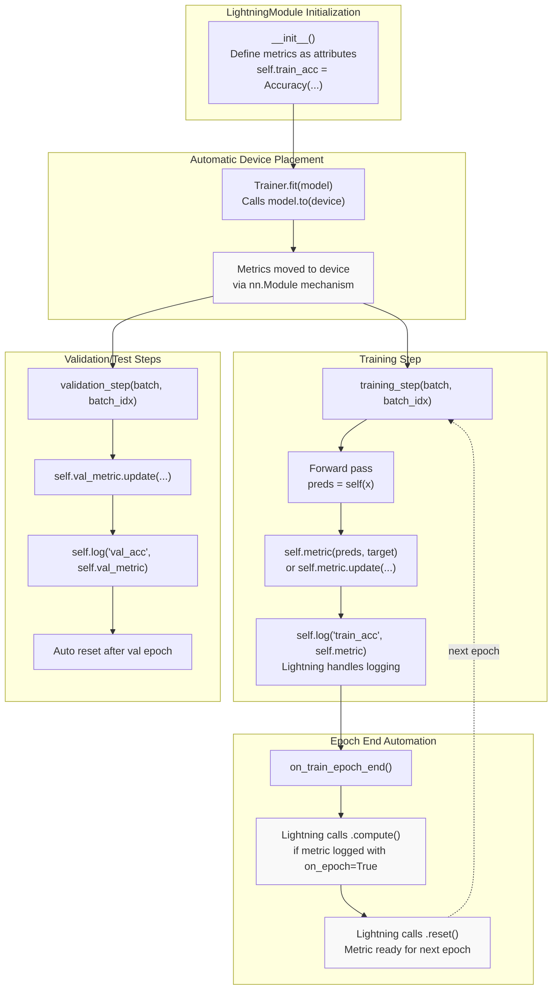
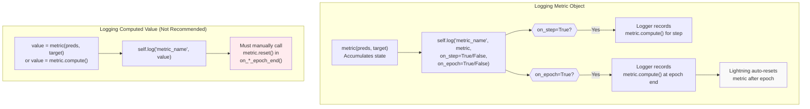
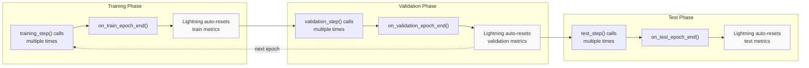
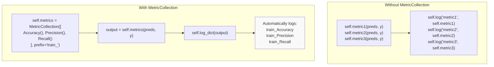

<!-- source: DeepWiki mcp.deepwiki.com · repo Lightning-AI/torchmetrics · page 1.2 Integration with PyTorch Lightning · fetched 2026-10-21 -->

# Integration with PyTorch Lightning

<details>
<summary>Relevant source files</summary>

The following files were used as context for generating this wiki page:

- [CHANGELOG.md](CHANGELOG.md)
- [LICENSE](LICENSE)
- [README.md](README.md)
- [docs/source/_templates/theme_variables.jinja](docs/source/_templates/theme_variables.jinja)
- [docs/source/all-metrics.rst](docs/source/all-metrics.rst)
- [docs/source/conf.py](docs/source/conf.py)
- [docs/source/index.rst](docs/source/index.rst)
- [docs/source/pages/implement.rst](docs/source/pages/implement.rst)
- [docs/source/pages/lightning.rst](docs/source/pages/lightning.rst)
- [docs/source/pages/overview.rst](docs/source/pages/overview.rst)
- [docs/source/pages/quickstart.rst](docs/source/pages/quickstart.rst)
- [requirements/integrate.txt](requirements/integrate.txt)
- [src/torchmetrics/__about__.py](src/torchmetrics/__about__.py)
- [tests/integrations/lightning/boring_model.py](tests/integrations/lightning/boring_model.py)
- [tests/integrations/test_lightning.py](tests/integrations/test_lightning.py)

</details>


## Purpose and Scope

This page documents the integration between TorchMetrics and PyTorch Lightning, focusing on the additional automation and convenience features available when using metrics within Lightning modules. For general information about TorchMetrics architecture and standalone PyTorch usage, see page [1](#1) and page [1.1](#1.1). For details on the core `Metric` base class and its lifecycle, see page [2.1](#2.1).

TorchMetrics was originally created as part of PyTorch Lightning and maintains deep integration with the framework. While TorchMetrics works perfectly well with pure PyTorch, using it within `LightningModule` provides three primary benefits:

1. **Automatic Device Placement**: Metrics are automatically moved to the correct device without explicit `.to(device)` calls
2. **Native Logging Support**: Metrics integrate seamlessly with Lightning's `self.log()` mechanism
3. **Automatic Reset**: Metric states are automatically reset at epoch boundaries

**Sources**: [docs/source/pages/lightning.rst:1-29](), [README.md:117-121](), [docs/source/pages/overview.rst:98-107]()

---

## Integration Architecture Overview

The following diagram illustrates how TorchMetrics integrates into the PyTorch Lightning training loop, highlighting the automatic behaviors that distinguish Lightning integration from standalone usage:

**Diagram: TorchMetrics Integration with Lightning Training Loop**



**Sources**: [docs/source/pages/lightning.rst:21-29](), [tests/integrations/test_lightning.py:82-181]()

---

## Automatic Device Placement

When metrics are defined as attributes of a `LightningModule`, they inherit the standard `torch.nn.Module` device management behavior. This means metrics are automatically moved to the correct device when the Lightning `Trainer` calls `.to(device)` on the model.

**Key Requirements for Automatic Device Placement**:

| Requirement | Details | Example |
|------------|---------|---------|
| **Proper Child Module Registration** | Metrics must be correctly identified as child modules via `.children()` | Direct assignment: `self.metric = Accuracy()` ✓ |
| **Avoid Native Collections** | Do not use Python `list` or `dict` | Use `nn.ModuleList` or `nn.ModuleDict` instead ✓ |
| **Use MetricCollection** | For multiple metrics, wrap in `MetricCollection` | `self.metrics = MetricCollection([...])` ✓ |

**Correct Usage Pattern**:

```python
# As shown in docs/source/pages/overview.rst:108-130
class MyLightningModule(LightningModule):
    def __init__(self):
        super().__init__()
        # These metrics will be automatically moved to the correct device
        self.train_acc = BinaryAccuracy()
        self.metrics_list = nn.ModuleList([Accuracy(), Precision()])
        self.metrics_dict = nn.ModuleDict({'acc': Accuracy()})
        self.metric_collection = MetricCollection([Accuracy(), F1Score()])
```

The metric states (internal buffers) are automatically placed on the same device as the model, ensuring that when `self.metric(preds, target)` is called, all tensors are on the correct device.

**Sources**: [docs/source/pages/overview.rst:98-131](), [docs/source/pages/lightning.rst:23-24]()

---

## Native Logging Support

Lightning's `self.log()` and `self.log_dict()` methods natively support TorchMetrics `Metric` objects. This integration provides significant advantages over manual logging.

**Diagram: Metric Logging Flow in Lightning**



### Logging Metric Objects vs Computed Values

**Recommended Approach: Log the Metric Object**

```python
# From docs/source/pages/lightning.rst:78-98
class MyModule(LightningModule):
    def __init__(self):
        self.train_acc = Accuracy(task="multiclass", num_classes=num_classes)
    
    def training_step(self, batch, batch_idx):
        preds = self(x)
        # Update metric state
        self.train_acc(preds, y)
        # Log the metric object - Lightning handles compute() and reset()
        self.log('train_acc', self.train_acc, on_step=True, on_epoch=True)
```

When logging the metric object:
- Lightning calls `.compute()` automatically based on `on_step` and `on_epoch` flags
- Lightning calls `.reset()` automatically at epoch end
- No manual state management required

**Alternative: Manual Logging (Requires Manual Reset)**

```python
# From docs/source/pages/lightning.rst:103-129
def training_step(self, batch, batch_idx):
    batch_value = self.train_acc(preds, y)
    self.log('train_acc_step', batch_value)

def on_train_epoch_end(self):
    # Must manually reset when logging values
    self.train_acc.reset()
```

**Sources**: [docs/source/pages/lightning.rst:58-141](), [tests/integrations/test_lightning.py:183-326]()

### Understanding `on_step` and `on_epoch` Flags

| Flag Combination | Behavior | Use Case |
|-----------------|----------|----------|
| `on_step=True, on_epoch=False` | Logs metric value each step | Monitoring per-batch metrics |
| `on_step=False, on_epoch=True` | Logs metric value at epoch end only | Epoch-level aggregated metrics |
| `on_step=True, on_epoch=True` | Logs both step and epoch values | Comprehensive monitoring |

**Important**: The `sync_dist`, `sync_dist_group`, and `reduce_fx` flags in `self.log()` do **not** affect metric logging. Metrics have their own built-in distributed synchronization logic via the `Metric` base class.

**Sources**: [docs/source/pages/lightning.rst:68-76]()

---

## Automatic Reset Behavior

One of the most significant benefits of Lightning integration is automatic metric reset at epoch boundaries. The following diagram shows when reset occurs across different training phases:

**Diagram: Automatic Reset in Lightning Training Cycle**



**Reset Timing**:
- **Training**: Metrics are reset after `on_train_epoch_end()` completes
- **Validation**: Metrics are reset after `on_validation_epoch_end()` completes
- **Test**: Metrics are reset after `on_test_epoch_end()` completes

This automatic reset only occurs when metrics are logged as objects using `self.log('name', metric_object)`. If you manually log computed values, you must handle reset yourself in the appropriate `on_*_epoch_end()` hook.

**Sources**: [docs/source/pages/lightning.rst:28](), [tests/integrations/test_lightning.py:82-181]()

---

## Usage Patterns

### Basic Single Metric Pattern

```python
# Pattern from docs/source/pages/lightning.rst:32-47
class MyModel(LightningModule):
    def __init__(self, num_classes):
        super().__init__()
        self.accuracy = Accuracy(task="multiclass", num_classes=num_classes)
    
    def training_step(self, batch, batch_idx):
        x, y = batch
        preds = self(x)
        # Update and log in one call
        self.accuracy(preds, y)
        self.log('train_acc', self.accuracy, on_epoch=True)
```

### Separate Metrics Per Phase

```python
# Pattern from docs/source/pages/lightning.rst:78-98
class MyModule(LightningModule):
    def __init__(self, num_classes):
        super().__init__()
        # Separate metric instances for train/val/test
        self.train_acc = Accuracy(task="multiclass", num_classes=num_classes)
        self.valid_acc = Accuracy(task="multiclass", num_classes=num_classes)
    
    def training_step(self, batch, batch_idx):
        self.train_acc(preds, y)
        self.log('train_acc', self.train_acc, on_step=True, on_epoch=False)
    
    def validation_step(self, batch, batch_idx):
        self.valid_acc(preds, y)
        self.log('valid_acc', self.valid_acc, on_step=True, on_epoch=True)
```

### Update-Only Pattern for Epoch-Level Metrics

When logging only at epoch level, calling `metric.update()` directly avoids unnecessary computation:

```python
# Recommended pattern from docs/source/pages/lightning.rst:142-154
class MyModule(LightningModule):
    def __init__(self, num_classes):
        super().__init__()
        self.valid_acc = Accuracy(task="multiclass", num_classes=num_classes)
    
    def validation_step(self, batch, batch_idx):
        # Use update() to avoid computing metric at each step
        self.valid_acc.update(logits, y)
        # Metric will be computed once at epoch end
        self.log('valid_acc', self.valid_acc, on_step=False, on_epoch=True)
```

**Sources**: [docs/source/pages/lightning.rst:32-154](), [tests/integrations/test_lightning.py:47-80]()

---

## MetricCollection Integration

`MetricCollection` provides streamlined logging of multiple metrics by replacing `self.log()` with `self.log_dict()`:

**Diagram: MetricCollection in Lightning**



### Recommended Pattern with Prefix/Clone

```python
# Pattern from docs/source/pages/overview.rst:349-382
class MyModule(LightningModule):
    def __init__(self, num_classes):
        super().__init__()
        metrics = MetricCollection([
            Accuracy(task="multiclass", num_classes=num_classes),
            Precision(task="multiclass", num_classes=num_classes),
            Recall(task="multiclass", num_classes=num_classes)
        ])
        # Clone with different prefixes for different phases
        self.train_metrics = metrics.clone(prefix='train_')
        self.valid_metrics = metrics.clone(prefix='val_')
    
    def training_step(self, batch, batch_idx):
        output = self.train_metrics(preds, y)
        self.log_dict(output)  # Logs train_Accuracy, train_Precision, train_Recall
    
    def validation_step(self, batch, batch_idx):
        self.valid_metrics.update(preds, y)
    
    def on_validation_epoch_end(self):
        output = self.valid_metrics.compute()
        self.log_dict(output)  # Logs val_Accuracy, val_Precision, val_Recall
        self.valid_metrics.reset()  # Still need manual reset when using compute()
```

**Sources**: [docs/source/pages/overview.rst:349-382](), [docs/source/pages/lightning.rst:156-192](), [tests/integrations/test_lightning.py:328-367]()

---

## Advanced Integration Topics

### Multiple DataLoaders

When using multiple dataloaders in validation or test, create separate metric instances for each:

```python
# Pattern from docs/source/pages/lightning.rst:239-257
class MyModule(LightningModule):
    def __init__(self, num_classes):
        super().__init__()
        # Separate metrics for each dataloader
        self.val_acc = nn.ModuleList([
            Accuracy(task="multiclass", num_classes=num_classes) 
            for _ in range(2)
        ])
    
    def val_dataloader(self):
        return [DataLoader(...), DataLoader(...)]
    
    def validation_step(self, batch, batch_idx, dataloader_idx):
        preds = self(x)
        # Use dataloader_idx to select correct metric
        self.val_acc[dataloader_idx](preds, y)
        self.log('val_acc', self.val_acc[dataloader_idx])
```

### Wrapper Metrics with Lightning

Different wrappers have different logging behaviors:

**ClasswiseWrapper**: Returns a dict - must be logged manually

```python
# From docs/source/pages/lightning.rst:200-234
class MyModule(LightningModule):
    def __init__(self):
        super().__init__()
        self.metrics = MetricCollection({
            "macro_acc": MinMaxMetric(MulticlassAccuracy(num_classes=5, average="macro")),
            "weighted_acc": MinMaxMetric(MulticlassAccuracy(num_classes=5, average="weighted")),
        }, prefix="train_")
    
    def training_step(self, batch, batch_idx):
        # Cannot log MetricCollection with wrappers directly
        # Must compute and flatten manually
        batch_values = self.metrics(preds, target)
        self.log_dict(batch_values, on_step=True, on_epoch=False)
    
    def on_train_epoch_end(self):
        self.metrics.reset()
```

**MetricTracker**: Special case - not a Metric subclass, requires manual logging

```python
# From docs/source/pages/lightning.rst:302-306
# MetricTracker output must be logged manually in on_*_epoch_end()
# because it inherits from nn.ModuleList, not Metric
```

**Sources**: [docs/source/pages/lightning.rst:194-306](), [tests/integrations/test_lightning.py:369-457]()

### DDP-Specific Considerations with Lightning

When using `rank_zero_only` decorator, disable `sync_on_compute`:

```python
# Pattern from docs/source/pages/lightning.rst:270-286
from pytorch_lightning.utilities import rank_zero_only

class MyModule(LightningModule):
    def __init__(self):
        super().__init__()
        # Disable sync when using rank_zero_only
        self.metric = FrechetInceptionDistance(sync_on_compute=False)
    
    @rank_zero_only
    def validation_step(self, batch, batch_idx):
        self.metric(image, real=True)
        self.metric(generated_image, real=False)
        val = self.metric.compute()  # Only computed on rank 0
        self.log('val_fid', val)
```

**Sources**: [docs/source/pages/lightning.rst:265-286]()

---

## Common Pitfalls and Solutions

### Pitfall 1: Logging Nested MetricCollections with Wrappers

**Problem**: Directly logging a `MetricCollection` containing wrapper metrics (e.g., `ClasswiseWrapper`, `MinMaxMetric`) fails because these wrappers return non-scalar tensors (dicts/lists).

**Solution**: Compute the metrics manually and log the flattened dict:

| ❌ Wrong | ✅ Correct |
|---------|-----------|
| `self.log_dict(self.metrics)` | `values = self.metrics(preds, y)`<br/>`self.log_dict(values)` |

**Sources**: [docs/source/pages/lightning.rst:200-234]()

### Pitfall 2: Mixing Logging Methods

**Problem**: Logging the metric object in `training_step()` and then logging `metric.compute()` in `on_train_epoch_end()` causes Lightning to reset the metric before the second log, resulting in errors.

**Solution**: Choose one logging method and stick with it:

```python
# Either log the object everywhere
def training_step(self, batch, batch_idx):
    self.metric(preds, y)
    self.log('metric', self.metric)  # Lightning handles compute and reset

# OR log values everywhere with manual reset
def training_step(self, batch, batch_idx):
    value = self.metric(preds, y)
    self.log('metric', value)

def on_train_epoch_end(self):
    self.metric.reset()  # Must manually reset
```

**Sources**: [docs/source/pages/lightning.rst:259-263]()

### Pitfall 3: Reusing Metrics Across Phases

**Problem**: Using the same metric instance for training, validation, and testing mixes internal states.

**Solution**: Always create separate metric instances for each phase:

```python
class MyModule(LightningModule):
    def __init__(self):
        super().__init__()
        self.train_acc = Accuracy(...)
        self.val_acc = Accuracy(...)
        self.test_acc = Accuracy(...)
```

**Sources**: [docs/source/pages/lightning.rst:235-238](), [docs/source/pages/overview.rst:57-62]()

### Pitfall 4: Calling `forward()` Instead of `update()`

**Problem**: Logging `self.metric(preds, target)` instead of logging the metric object causes Lightning to log a tensor instead of the metric object.

**Solution**: Separate the update and logging calls:

```python
# ❌ Wrong - logs a tensor, not the metric
self.log('train_acc', self.metric(preds, target))

# ✅ Correct - updates metric, then logs the object
self.metric(preds, target)
self.log('train_acc', self.metric)
```

**Sources**: [docs/source/pages/lightning.rst:288-300]()

---

## Summary Table: Lightning vs Standalone Usage

| Feature | With Lightning | Standalone PyTorch |
|---------|---------------|-------------------|
| **Device Placement** | Automatic via `model.to(device)` | Manual `metric.to(device)` required |
| **Logging** | `self.log('name', metric)` | Manual logging to logger/tensorboard |
| **Reset** | Automatic at epoch end | Manual `metric.reset()` required |
| **Compute** | Automatic based on `on_epoch` flag | Manual `metric.compute()` required |
| **State Management** | Handled by Lightning | Manual management |
| **Multi-GPU Sync** | Built into metric + Lightning | Manual with `torch.distributed` |

**Sources**: [docs/source/pages/lightning.rst:21-29](), [docs/source/pages/overview.rst:23-56](), [README.md:117-121]()

---

