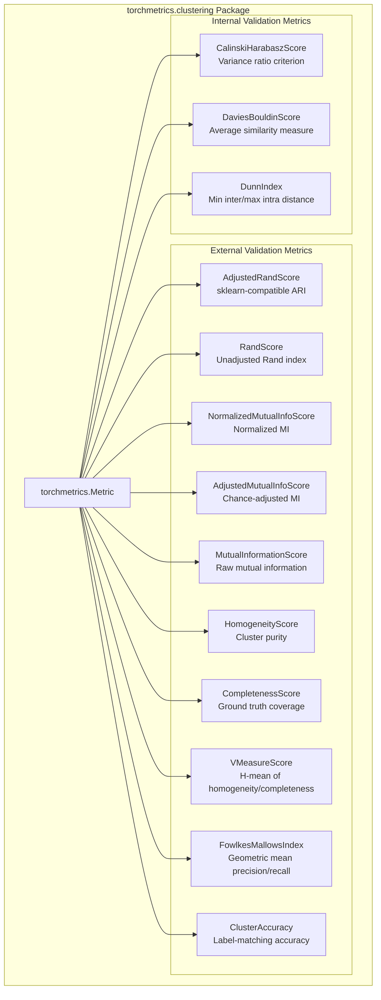
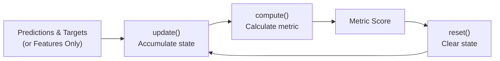
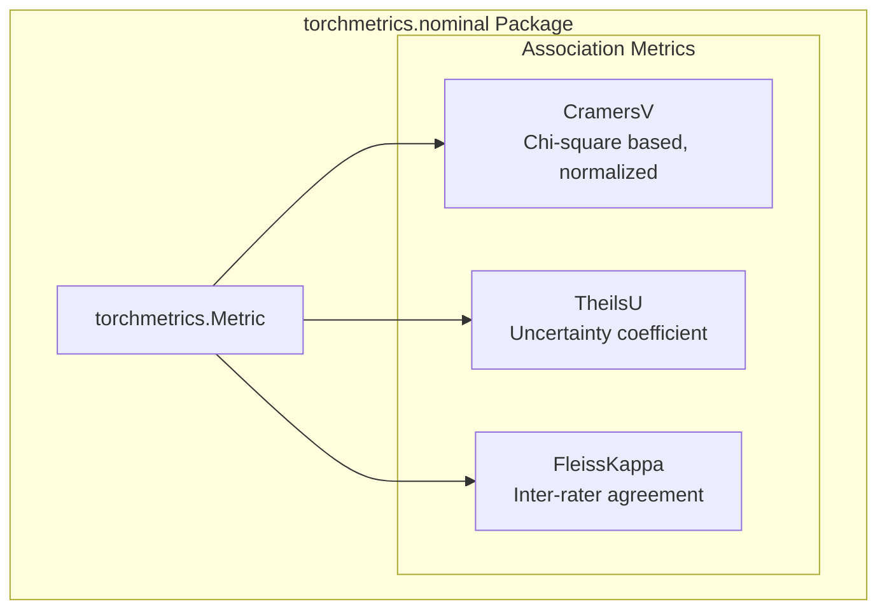
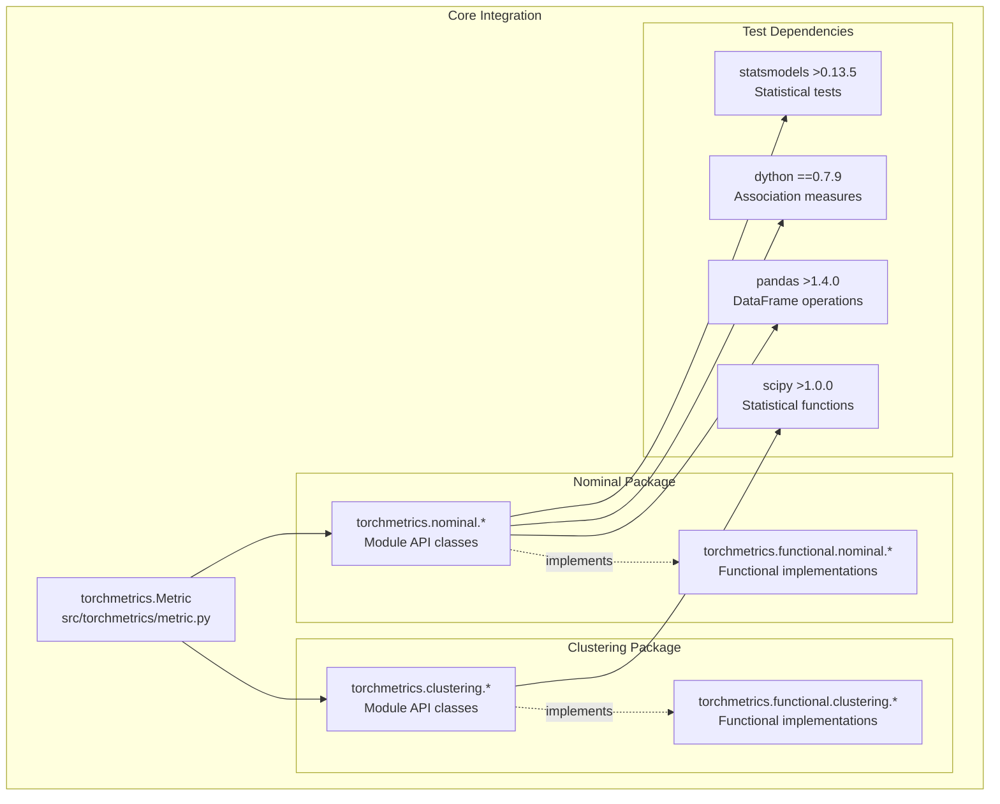

<!-- source: DeepWiki mcp.deepwiki.com · repo Lightning-AI/torchmetrics · page 10 Clustering and Nominal Metrics · fetched 2026-10-21 -->

# Clustering and Nominal Metrics

Relevant source files

The following files were used as context for generating this wiki page:

- [CHANGELOG.md](CHANGELOG.md)
- [docs/source/links.rst](docs/source/links.rst)
- [docs/source/regression/critical_success_index.rst](docs/source/regression/critical_success_index.rst)
- [examples/audio/text_to_speech.py](examples/audio/text_to_speech.py)
- [requirements/_docs.txt](requirements/_docs.txt)
- [requirements/classification_test.txt](requirements/classification_test.txt)
- [requirements/image_test.txt](requirements/image_test.txt)
- [requirements/nominal_test.txt](requirements/nominal_test.txt)
- [requirements/segmentation_test.txt](requirements/segmentation_test.txt)
- [requirements/visual.txt](requirements/visual.txt)
- [src/torchmetrics/__init__.py](src/torchmetrics/__init__.py)
- [src/torchmetrics/classification/__init__.py](src/torchmetrics/classification/__init__.py)
- [src/torchmetrics/functional/__init__.py](src/torchmetrics/functional/__init__.py)
- [src/torchmetrics/functional/classification/__init__.py](src/torchmetrics/functional/classification/__init__.py)
- [src/torchmetrics/functional/image/__init__.py](src/torchmetrics/functional/image/__init__.py)
- [src/torchmetrics/functional/pairwise/__init__.py](src/torchmetrics/functional/pairwise/__init__.py)
- [src/torchmetrics/functional/regression/__init__.py](src/torchmetrics/functional/regression/__init__.py)
- [src/torchmetrics/functional/regression/csi.py](src/torchmetrics/functional/regression/csi.py)
- [src/torchmetrics/image/__init__.py](src/torchmetrics/image/__init__.py)
- [src/torchmetrics/regression/__init__.py](src/torchmetrics/regression/__init__.py)
- [src/torchmetrics/regression/csi.py](src/torchmetrics/regression/csi.py)
- [tests/unittests/image/test_csi.py](tests/unittests/image/test_csi.py)

## Purpose and Scope

This page covers TorchMetrics' implementation of metrics for evaluating clustering algorithm performance and categorical (nominal) data relationships. Clustering metrics evaluate the quality of clustering algorithms and their results, while nominal metrics assess associations between categorical variables.

These metrics are distinct from classification metrics (see page 3), which evaluate predictive model performance, and regression metrics (see page 4), which evaluate continuous value predictions. Instead, clustering and nominal metrics focus on unsupervised learning evaluation and statistical relationships in categorical data.

## Clustering Metrics Overview

Clustering metrics evaluate the quality of clustering algorithms by measuring various aspects such as cluster separation, compactness, and agreement with ground truth labels when available. TorchMetrics provides both external validation metrics (which require ground truth) and internal validation metrics (which do not).

**Clustering Metrics Class Hierarchy**

Sources: [CHANGELOG.md:467-479](), [CHANGELOG.md:145]()

### External vs. Internal Validation

Clustering metrics fall into two categories based on whether they require ground truth labels:

**External Validation Metrics** (require ground truth):
- `AdjustedRandScore`, `RandScore`: Measure agreement between predicted and true clusterings
- `NormalizedMutualInfoScore`, `AdjustedMutualInfoScore`, `MutualInformationScore`: Information-theoretic overlap
- `HomogeneityScore`: Each cluster contains only members of a single class
- `CompletenessScore`: All members of a class are assigned to the same cluster
- `VMeasureScore`: Harmonic mean of homogeneity and completeness
- `FowlkesMallowsIndex`: Geometric mean of pairwise precision and recall
- `ClusterAccuracy`: Best label-matching accuracy between predicted and true clusters

**Internal Validation Metrics** (no ground truth needed):
- `CalinskiHarabaszScore`: Ratio of between-cluster to within-cluster dispersion
- `DaviesBouldinScore`: Average similarity between each cluster and its most similar one (lower is better)
- `DunnIndex`: Ratio of minimum inter-cluster distance to maximum intra-cluster distance

Sources: [CHANGELOG.md:467-479](), [CHANGELOG.md:145]()

### Clustering Metrics Implementation Pattern

All clustering metrics follow the standard TorchMetrics lifecycle with `update()`, `compute()`, and `reset()` methods:

**Standard Metric Lifecycle for Clustering Metrics**

Sources: [CHANGELOG.md:467-479]()

## Nominal Metrics Overview

Nominal metrics evaluate relationships between categorical variables without assuming any ordering. These metrics are essential for understanding associations in categorical data and measuring the strength of relationships between discrete variables.

**Nominal Metrics Class Hierarchy**

The nominal metrics package provides measures of association and agreement for categorical data. These metrics handle contingency tables and provide statistical measures of relationship strength.

Sources: [requirements/nominal_test.txt:1-8]()

## Integration with Core TorchMetrics Architecture

Both clustering and nominal metrics follow the standard TorchMetrics patterns, inheriting from the base `Metric` class and providing both module and functional APIs.

**Architecture Integration with Core TorchMetrics**

Sources: [requirements/nominal_test.txt:1-8]()

## Key Dependencies

The clustering and nominal metrics require specialized statistical computing libraries beyond the core PyTorch dependencies:

| Dependency | Version Range | Purpose |
|------------|---------------|---------|
| `pandas` | >1.4.0, <=2.3.2 | Data manipulation and contingency table operations |
| `dython` | ==0.7.9 | Association measures for categorical data |
| `scipy` | >1.0.0, <1.17.0 | Statistical functions and distance metrics |
| `statsmodels` | >0.13.5, <0.15.0 | Advanced statistical modeling and tests |

These dependencies enable computation of complex statistical measures that are not available in standard PyTorch operations. For testing, additional reference implementations are used to validate metric correctness.

Sources: [requirements/nominal_test.txt:1-8]()

## Metric Characteristics and Use Cases

### Clustering Metrics Characteristics

| Metric | Range | Higher is Better | Requires Ground Truth | Primary Use Case |
|--------|-------|------------------|----------------------|------------------|
| `AdjustedRandScore` | [-1, 1] | Yes | Yes | Comparing clustering results with known labels |
| `RandScore` | [0, 1] | Yes | Yes | Raw agreement measure (not chance-adjusted) |
| `NormalizedMutualInfoScore` | [0, 1] | Yes | Yes | Information-theoretic cluster comparison |
| `MutualInformationScore` | [0, ∞) | Yes | Yes | Raw information overlap (not normalized) |
| `HomogeneityScore` | [0, 1] | Yes | Yes | Evaluating cluster purity |
| `CompletenessScore` | [0, 1] | Yes | Yes | Evaluating ground truth coverage |
| `VMeasureScore` | [0, 1] | Yes | Yes | Balanced measure of homogeneity and completeness |
| `FowlkesMallowsIndex` | [0, 1] | Yes | Yes | Pairwise precision-recall balance |
| `ClusterAccuracy` | [0, 1] | Yes | Yes | Best-matching label accuracy |
| `CalinskiHarabaszScore` | [0, ∞) | Yes | No | Variance-based cluster separation |
| `DaviesBouldinScore` | [0, ∞) | No | No | Average cluster similarity |
| `DunnIndex` | [0, ∞) | Yes | No | Distance ratio evaluation |

Sources: [CHANGELOG.md:467-479](), [CHANGELOG.md:145]()

### Nominal Metrics Characteristics

| Metric | Range | Higher is Better | Description |
|--------|-------|------------------|-------------|
| `CramersV` | [0, 1] | Yes | Chi-square based association, normalized for table dimensions |
| `TheilsU` | [0, 1] | Yes | Asymmetric uncertainty coefficient (directional measure) |
| `FleissKappa` | [-1, 1] | Yes | Inter-rater agreement beyond chance |

Sources: [requirements/nominal_test.txt:1-8]()

## Usage Patterns

Like other TorchMetrics domains, nominal and clustering metrics provide both stateful (module) and stateless (functional) interfaces. The module interface maintains state across multiple `update()` calls, while the functional interface computes metrics directly from inputs.

The metrics handle various data formats including pandas DataFrames for nominal data and PyTorch tensors for clustering results, making them suitable for integration with both traditional data science workflows and deep learning pipelines.

Sources: [requirements/nominal_test.txt:4-7]()

---

