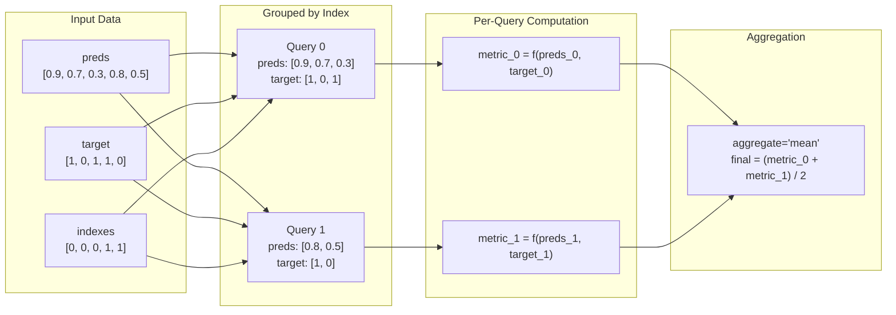
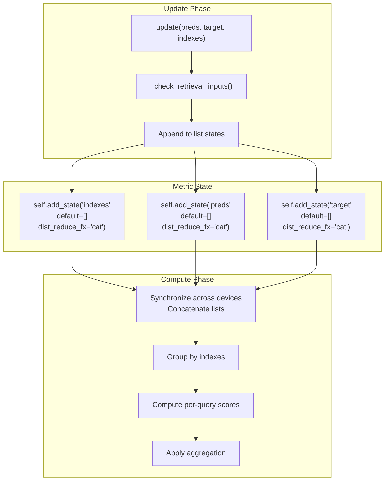

<!-- source: DeepWiki mcp.deepwiki.com · repo Lightning-AI/torchmetrics · page 11 Retrieval Metrics · fetched 2026-10-21 -->

# Retrieval Metrics

<details>
<summary>Relevant source files</summary>

The following files were used as context for generating this wiki page:

- [CHANGELOG.md](CHANGELOG.md)
- [docs/source/links.rst](docs/source/links.rst)
- [src/torchmetrics/__init__.py](src/torchmetrics/__init__.py)
- [src/torchmetrics/classification/__init__.py](src/torchmetrics/classification/__init__.py)
- [src/torchmetrics/functional/__init__.py](src/torchmetrics/functional/__init__.py)
- [src/torchmetrics/functional/classification/__init__.py](src/torchmetrics/functional/classification/__init__.py)
- [src/torchmetrics/functional/pairwise/__init__.py](src/torchmetrics/functional/pairwise/__init__.py)
- [src/torchmetrics/functional/regression/__init__.py](src/torchmetrics/functional/regression/__init__.py)
- [src/torchmetrics/regression/__init__.py](src/torchmetrics/regression/__init__.py)

</details>


Retrieval metrics evaluate information retrieval systems by measuring how well predictions rank relevant items. These metrics assess ranking quality when a model must return an ordered list of items (e.g., documents, products, search results) in response to a query, where some items are relevant and others are not.

For classification metrics that evaluate categorical predictions, see [Classification Metrics](#3). For detection metrics that evaluate bounding box predictions, see [Detection and Segmentation Metrics](#8).

---

## Overview and Purpose

The retrieval package provides metrics for evaluating ranked retrieval results in information retrieval tasks. Unlike classification metrics that evaluate discrete predictions, retrieval metrics assess the quality of ordered lists where items have varying degrees of relevance.

**Key characteristics:**
- All metrics operate on query-document pairs grouped by query indexes
- Support both binary relevance (relevant/not relevant) and graded relevance (multiple relevance levels)
- Designed for distributed training with proper synchronization across devices
- Provide both modular (class-based) and functional APIs following the standard torchmetrics pattern

**Input format:**
```python
preds: Tensor      # Prediction scores for each item
target: Tensor     # Relevance labels (binary or graded)
indexes: Tensor    # Query identifiers to group items by query
```

The `indexes` tensor is critical: it groups predictions and targets by query, allowing metrics to compute per-query scores before aggregating.

Sources: [CHANGELOG.md:891-1415]()

---

## Architecture and Common Patterns

```mermaid
graph TB
    subgraph "Retrieval Metric Base"
        BASE["Retrieval Base Class<br/>(abstract)"]
        UPDATE["_update(preds, target, indexes)"]
        COMPUTE["_compute()"]
        INDEX_VAL["_check_indexes()"]
    end
    
    subgraph "Ranking Metrics"
        MAP["RetrievalMAP<br/>Mean Average Precision"]
        MRR["RetrievalMRR<br/>Mean Reciprocal Rank"]
        NDCG["RetrievalNormalizedDCG<br/>Normalized DCG"]
        RPRECISION["RetrievalRPrecision<br/>R-Precision"]
        HITRATE["RetrievalHitRate<br/>Hit Rate @ K"]
    end
    
    subgraph "Threshold-Based Metrics"
        PRECISION["RetrievalPrecision<br/>Precision @ K"]
        RECALL["RetrievalRecall<br/>Recall @ K"]
        FALLOUT["RetrievalFallOut<br/>Fall-Out @ K"]
    end
    
    subgraph "Curve Metrics"
        PR_CURVE["RetrievalPrecisionRecallCurve"]
        RECALL_FIXED["RetrievalRecallAtFixedPrecision"]
        AUROC["RetrievalAUROC"]
    end
    
    subgraph "State Management"
        INDEXES_STATE["indexes: List[Tensor]"]
        PREDS_STATE["preds: List[Tensor]"]
        TARGET_STATE["target: List[Tensor]"]
    end
    
    BASE --> UPDATE
    BASE --> COMPUTE
    BASE --> INDEX_VAL
    
    BASE --> MAP & MRR & NDCG & RPRECISION & HITRATE
    BASE --> PRECISION & RECALL & FALLOUT
    BASE --> PR_CURVE & RECALL_FIXED & AUROC
    
    UPDATE --> INDEXES_STATE & PREDS_STATE & TARGET_STATE
    COMPUTE --> INDEXES_STATE & PREDS_STATE & TARGET_STATE
```



**Diagram: Retrieval Metrics Class Hierarchy**

All retrieval metrics inherit from a common base that handles:
- Index-based grouping via `indexes` parameter
- List-based state storage for predictions, targets, and indexes
- Validation of input shapes and data types
- Distributed synchronization using `dist_reduce_fx="cat"`

Sources: [CHANGELOG.md:891-1415]()

---

## Index-Based Query Grouping

The `indexes` tensor is fundamental to retrieval metrics. It groups predictions and targets by query, enabling per-query metric computation.



**Diagram: Index-Based Grouping Flow**

**Validation rules:**
- `indexes` must have the same shape as `preds` and `target`
- `indexes` must be integers (any integer dtype)
- Items with the same index value belong to the same query
- Empty queries (no predictions for an index) are typically skipped

Sources: [CHANGELOG.md:1071](), [CHANGELOG.md:94]()

---

## Aggregation Strategies

The `aggregate` argument controls how per-query scores are combined into a final metric value.

| Aggregation | Behavior | Use Case |
|-------------|----------|----------|
| `'mean'` (default) | Average scores across queries | Standard evaluation |
| `'median'` | Median score across queries | Robust to outliers |
| `'max'` | Maximum score across queries | Best-case performance |
| `'min'` | Minimum score across queries | Worst-case performance |
| `None` | Return per-query scores | Custom aggregation or analysis |

**Example usage:**
```python
# Standard mean aggregation
map_metric = RetrievalMAP(aggregate='mean')

# Return per-query scores for custom processing
map_metric = RetrievalMAP(aggregate=None)
scores = map_metric(preds, target, indexes)  # Returns [score_q0, score_q1, ...]
```

Sources: [CHANGELOG.md:413-414]()

---

## Core Retrieval Metrics

### RetrievalMAP - Mean Average Precision

Measures the average precision across all queries, where precision is evaluated at each relevant item position.

**Formula (per query):**
```
AP = (1/R) * Σ(P(k) * rel(k))
```
where R is the total number of relevant items, P(k) is precision at rank k, and rel(k) indicates if item at rank k is relevant.

**Key parameters:**
- `top_k`: Optional integer to evaluate only top-k predictions
- `empty_target_action`: Behavior when query has no relevant items (`'neg'`, `'pos'`, `'skip'`)
- `ignore_index`: Label to ignore in target

**Implementation notes:**
- Ignores zero and negative prediction scores as of v1.7.4
- Uses list states for distributed training: `indexes`, `preds`, `target`

Sources: [CHANGELOG.md:614](), [CHANGELOG.md:94](), [CHANGELOG.md:394]()

---

### RetrievalMRR - Mean Reciprocal Rank

Measures the average of reciprocal ranks of the first relevant item for each query.

**Formula (per query):**
```
RR = 1 / rank_of_first_relevant_item
```

**Key parameters:**
- `top_k`: Only consider top-k predictions when finding first relevant item
- `empty_target_action`: Behavior when query has no relevant items

**Use case:** Effective when only the first relevant result matters (e.g., question answering, navigational search).

Sources: [CHANGELOG.md:517]()

---

### RetrievalNormalizedDCG - Normalized Discounted Cumulative Gain

Evaluates ranking quality with graded relevance, where items at higher ranks contribute more to the score. Normalized by ideal DCG.

**Formula (per query):**
```
DCG@k = Σ(i=1 to k) (2^rel_i - 1) / log2(i + 1)
nDCG@k = DCG@k / IDCG@k
```

**Key parameters:**
- `k`: Number of top results to evaluate (default: `None` for all items)
- `empty_target_action`: Behavior when query has no relevant items

**Implementation notes:**
- Supports graded relevance (multi-level target values)
- Fixed tie-breaking behavior in v1.1.2 for deterministic results

Sources: [CHANGELOG.md:488]()

---

### RetrievalPrecision and RetrievalRecall

Standard precision and recall metrics adapted for ranking evaluation.

**RetrievalPrecision:**
- Measures fraction of retrieved items that are relevant in top-k
- `k`: Number of top predictions to evaluate
- `adaptive_k`: If `True`, uses k = min(k, num_relevant_items) per query

**RetrievalRecall:**
- Measures fraction of relevant items that are retrieved in top-k
- `k`: Number of top predictions to evaluate

**Performance optimization:**
- Uses `torch.topk` instead of `torch.argsort` for better performance with large result sets

Sources: [CHANGELOG.md:973](), [CHANGELOG.md:1160]()

---

### Additional Metrics

**RetrievalRPrecision:**
- Precision at R, where R is the number of relevant items for the query
- Automatically adapts k to the number of relevant items per query

**RetrievalHitRate:**
- Binary metric: 1 if any relevant item appears in top-k, 0 otherwise
- Useful for measuring if the system retrieves at least one relevant item

**RetrievalFallOut:**
- Fraction of non-relevant items retrieved in top-k
- Complements precision by measuring false positive rate

**RetrievalAUROC:**
- Area under ROC curve for retrieval tasks
- Measures ranking quality as threshold varies

Sources: [CHANGELOG.md:1177-1178](), [CHANGELOG.md:412](), [CHANGELOG.md:1415]()

---

## Curve-Based Metrics

### RetrievalPrecisionRecallCurve

Computes precision and recall values at different thresholds for plotting PR curves.

**Returns:**
- `precision`: Tensor of precision values
- `recall`: Tensor of recall values
- `thresholds`: Tensor of threshold values

**Use case:** Analyzing trade-offs between precision and recall across different operating points.

---

### RetrievalRecallAtFixedPrecision

Finds the maximum recall achievable at a specified minimum precision level.

**Key parameters:**
- `min_precision`: Minimum precision threshold (e.g., 0.95 for 95% precision)

**Use case:** Determining how many relevant items can be retrieved while maintaining precision above a threshold.

Sources: [CHANGELOG.md:891-892]()

---

## Special Parameters and Features

### ignore_index Parameter

The `ignore_index` parameter allows excluding certain target values from metric computation.

```python
metric = RetrievalMAP(ignore_index=-1)

# Items with target=-1 are excluded from computation
preds = torch.tensor([0.9, 0.7, 0.5])
target = torch.tensor([1, 0, -1])  # Last item ignored
indexes = torch.tensor([0, 0, 0])
```

Sources: [CHANGELOG.md:1071]()

---

### Handling Zero and Negative Predictions

As of version 1.7.4, retrieval metrics automatically ignore predictions with zero or negative scores, as these typically indicate invalid or filtered-out items in real-world systems.

**Behavior:**
- Predictions where `preds <= 0` are excluded before ranking
- Corresponding targets and indexes are also excluded
- Warning is issued if all predictions for a query are filtered out

Sources: [CHANGELOG.md:94]()

---

## State Management and Distributed Training

Retrieval metrics use list-based states for compatibility with distributed training:



**Diagram: Retrieval Metrics State Flow**

**Key points:**
- Lists allow variable-length batches and queries
- `dist_reduce_fx="cat"` concatenates data across devices during synchronization
- Grouping by indexes happens after all data is collected
- Per-query computation ensures correct metric semantics

Sources: [CHANGELOG.md:394]()

---

## Functional API

All retrieval metrics provide functional counterparts for stateless computation:

```python
from torchmetrics.functional.retrieval import (
    retrieval_average_precision,
    retrieval_reciprocal_rank,
    retrieval_normalized_dcg,
    retrieval_precision,
    retrieval_recall,
)

# Direct computation without state
map_score = retrieval_average_precision(preds, target, indexes)
```

**Functional API characteristics:**
- No state management - compute directly from inputs
- Suitable for one-time calculations
- Lower memory overhead for simple use cases
- Cannot be used with PyTorch Lightning automatic logging

Sources: [CHANGELOG.md:891-1415]()

---

## Usage Patterns

### Basic Usage

```python
from torchmetrics.retrieval import RetrievalMAP

# Initialize metric
map_metric = RetrievalMAP()

# Multiple update calls (e.g., across batches)
for batch in dataloader:
    preds, target, indexes = batch
    map_metric.update(preds, target, indexes)

# Compute final score
final_map = map_metric.compute()
map_metric.reset()
```

---

### Custom Aggregation

```python
# Get per-query scores for custom processing
map_metric = RetrievalMAP(aggregate=None)
map_metric.update(preds, target, indexes)
per_query_scores = map_metric.compute()

# Custom aggregation: weighted by query size
query_sizes = compute_query_sizes(indexes)
weighted_map = (per_query_scores * query_sizes).sum() / query_sizes.sum()
```

---

### Multiple Metrics with MetricCollection

```python
from torchmetrics import MetricCollection
from torchmetrics.retrieval import RetrievalMAP, RetrievalMRR, RetrievalNormalizedDCG

# Efficient multi-metric computation
metrics = MetricCollection({
    'MAP': RetrievalMAP(),
    'MRR': RetrievalMRR(),
    'NDCG@10': RetrievalNormalizedDCG(k=10),
})

metrics.update(preds, target, indexes)
results = metrics.compute()  # {'MAP': ..., 'MRR': ..., 'NDCG@10': ...}
```

Sources: [CHANGELOG.md:413-414]()

---

## Performance Considerations

### Optimization Techniques

1. **Top-k optimization:** Using `torch.topk` instead of full sorting for metrics that only need top-k items
2. **List states:** More memory efficient than concatenating tensors on each update
3. **Lazy synchronization:** Only sync states when `compute()` is called

### Memory Usage

Retrieval metrics store all predictions, targets, and indexes until `compute()` is called. For large datasets:
- Use frequent `compute()` and `reset()` cycles
- Consider using functional API for batch-wise computation
- Monitor memory usage when handling millions of query-document pairs

Sources: [CHANGELOG.md:1160]()

---

## Common Pitfalls and Best Practices

### Index Alignment
**Problem:** Misaligned indexes cause incorrect query grouping.

**Solution:** Ensure indexes, preds, and target tensors have identical shapes and are aligned element-wise.

---

### Empty Queries
**Problem:** Queries with no relevant items can cause division by zero or NaN results.

**Solution:** Use `empty_target_action` parameter to specify behavior (`'skip'`, `'pos'`, `'neg'`).

---

### Score Ranges
**Problem:** Predictions must be comparable across queries for correct ranking.

**Solution:** Ensure prediction scores are on the same scale (e.g., all probabilities or all logits).

---

### Distributed Training
**Problem:** Per-query metrics require all query items on the same device.

**Solution:** Use the built-in synchronization (list states with `dist_reduce_fx="cat"`), which handles this automatically.

Sources: [CHANGELOG.md:94](), [CHANGELOG.md:394]()

---

