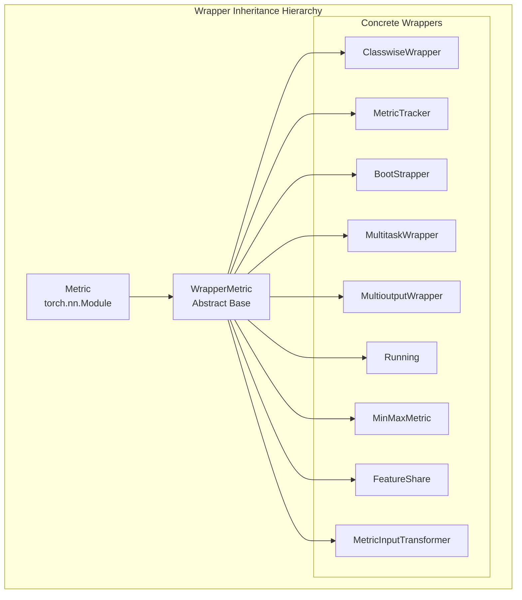
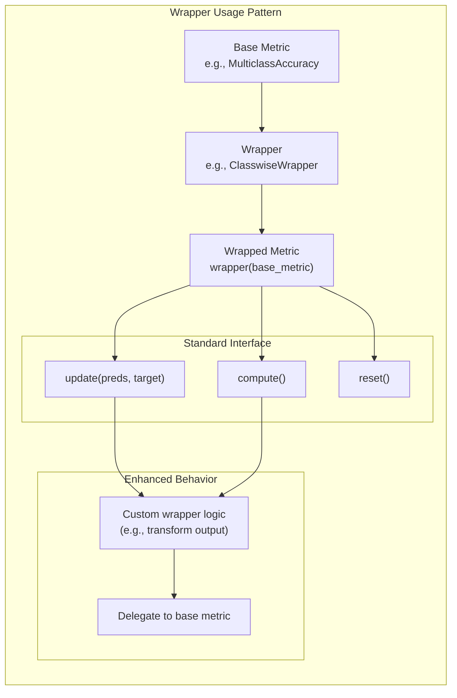
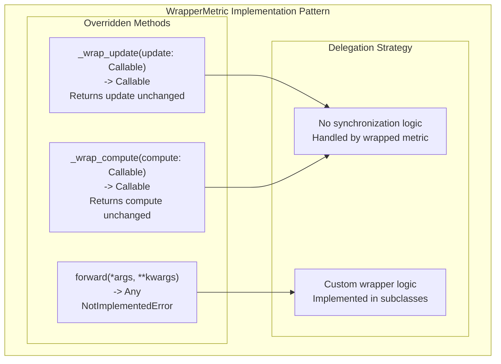

<!-- source: DeepWiki mcp.deepwiki.com · repo Lightning-AI/torchmetrics · page 12 Metric Wrappers · fetched 2026-10-21 -->

# Metric Wrappers

<details>
<summary>Relevant source files</summary>

The following files were used as context for generating this wiki page:

- [.pre-commit-config.yaml](.pre-commit-config.yaml)
- [CHANGELOG.md](CHANGELOG.md)
- [LICENSE](LICENSE)
- [README.md](README.md)
- [docs/source/_templates/theme_variables.jinja](docs/source/_templates/theme_variables.jinja)
- [docs/source/all-metrics.rst](docs/source/all-metrics.rst)
- [docs/source/conf.py](docs/source/conf.py)
- [docs/source/index.rst](docs/source/index.rst)
- [docs/source/pages/implement.rst](docs/source/pages/implement.rst)
- [docs/source/pages/lightning.rst](docs/source/pages/lightning.rst)
- [docs/source/pages/overview.rst](docs/source/pages/overview.rst)
- [docs/source/pages/quickstart.rst](docs/source/pages/quickstart.rst)
- [pyproject.toml](pyproject.toml)
- [requirements/integrate.txt](requirements/integrate.txt)
- [src/torchmetrics/__about__.py](src/torchmetrics/__about__.py)
- [src/torchmetrics/collections.py](src/torchmetrics/collections.py)
- [src/torchmetrics/metric.py](src/torchmetrics/metric.py)
- [tests/integrations/lightning/boring_model.py](tests/integrations/lightning/boring_model.py)
- [tests/integrations/test_lightning.py](tests/integrations/test_lightning.py)
- [tests/unittests/bases/test_collections.py](tests/unittests/bases/test_collections.py)
- [tests/unittests/bases/test_metric.py](tests/unittests/bases/test_metric.py)

</details>


Metric wrappers extend metric functionality through composition rather than inheritance. Instead of creating new metric subclasses, wrappers wrap existing metrics to add capabilities like temporal tracking, statistical analysis, output transformation, and multi-task support. This design pattern keeps the metric system modular and composable.

For metric collections and grouping, see page 2.4.

## The WrapperMetric Base Class

All wrappers inherit from `WrapperMetric`, an abstract base class that extends `Metric`. The base class delegates core metric operations (`update`, `compute`, `reset`) to the wrapped metric while providing a structure for adding custom behavior.

### WrapperMetric Architecture



**Sources:** [src/torchmetrics/wrappers/abstract.py:19-43]()

### Key Methods in WrapperMetric

The `WrapperMetric` class provides minimal wrapping logic, relying on subclasses to implement custom behavior:

| Method | Return Type | Purpose |
|--------|-------------|---------|
| `_wrap_update(update)` | `Callable` | Returns update unchanged - wrappers must call wrapped metric |
| `_wrap_compute(compute)` | `Callable` | Returns compute unchanged - wrappers must call wrapped metric |
| `forward(*args, **kwargs)` | `Any` | Abstract method - must be implemented by subclasses |

**Sources:** [src/torchmetrics/wrappers/abstract.py:19-43]()

## Available Wrappers

TorchMetrics provides wrappers for different use cases. Each wrapper is detailed in its respective subsection.

### Wrapper Categories and Classes

| Category | Wrapper | Subsection | Purpose |
|----------|---------|------------|---------|
| **Output Transformation** | `ClasswiseWrapper` | 12.1 | Convert tensor outputs to per-class dictionaries with custom labels |
| **Temporal Tracking** | `MetricTracker` | 12.2 | Track metric values over training steps/epochs |
| **Statistical Analysis** | `BootStrapper` | 12.3 | Compute confidence intervals via bootstrap resampling |
| **Multi-task Support** | `MultitaskWrapper` | 12.4 | Handle multiple tasks with different metrics |
| **Multi-output Support** | `MultioutputWrapper` | 12.4 | Enable multi-output for metrics lacking native support |
| **Running Statistics** | `Running` | 12.5 | Calculate metrics over sliding windows |
| **Range Tracking** | `MinMaxMetric` | 12.5 | Track minimum and maximum metric values |
| **Feature Sharing** | `FeatureShare` | N/A | Share feature extractors between metrics (advanced) |
| **Input Transformation** | `MetricInputTransformer` | N/A | Transform inputs before metric computation (advanced) |

**Sources:** [src/torchmetrics/wrappers/](), [CHANGELOG.md:405-406](), [CHANGELOG.md:272-273]()

## Basic Usage Pattern

All wrappers follow a consistent usage pattern. They wrap an existing metric instance and expose the same `update`/`compute`/`reset` interface:

### Wrapper Composition Flow



**Example: ClasswiseWrapper**
```python
from torchmetrics import ClasswiseWrapper
from torchmetrics.classification import MulticlassAccuracy

# Create base metric
base_metric = MulticlassAccuracy(num_classes=3, average=None)

# Wrap it for per-class output
wrapped = ClasswiseWrapper(base_metric, labels=["cat", "dog", "bird"])

# Use like any other metric
wrapped.update(preds, target)
result = wrapped.compute()  # Returns dict: {"cat": 0.8, "dog": 0.9, "bird": 0.7}
```

**Sources:** [src/torchmetrics/wrappers/classwise.py:32-245](), [tests/unittests/wrappers/test_classwise.py:10-179]()

## Implementation Patterns

### Abstract Base Class

All advanced wrappers inherit from `WrapperMetric`, which provides a foundation that delegates synchronization and state management to the wrapped metric:



**Sources:** [src/torchmetrics/wrappers/abstract.py:19-43]()

### Common Usage Patterns

| Pattern | Classes | Implementation | Use Case |
|---------|---------|---------------|----------|
| **State Duplication** | `MetricTracker`, `BootStrapper` | `ModuleList` of metric copies | Temporal tracking, statistical analysis |
| **Output Transformation** | `ClasswiseWrapper` | Transform `compute()` results | Format conversion, labeling |
| **Input Routing** | `MultitaskWrapper`, `MultioutputWrapper` | Route inputs to appropriate metrics | Multi-task scenarios |
| **Window-based Processing** | `Running` | Fixed-size state management | Sliding window metrics |

Advanced wrappers provide essential functionality for complex machine learning evaluation scenarios while maintaining the simple, consistent interface of the base metric system. Each wrapper addresses specific needs in modern ML workflows, from temporal analysis to multi-task learning support.

**Sources:** [src/torchmetrics/wrappers/tracker.py:33-354](), [src/torchmetrics/wrappers/bootstrapping.py:55-221](), [src/torchmetrics/wrappers/multitask.py:31-367](), [src/torchmetrics/wrappers/multioutput.py:44-204](), [src/torchmetrics/wrappers/classwise.py:32-245](), [src/torchmetrics/wrappers/running.py:28-184](), [src/torchmetrics/wrappers/minmax.py:30-161]()

---

